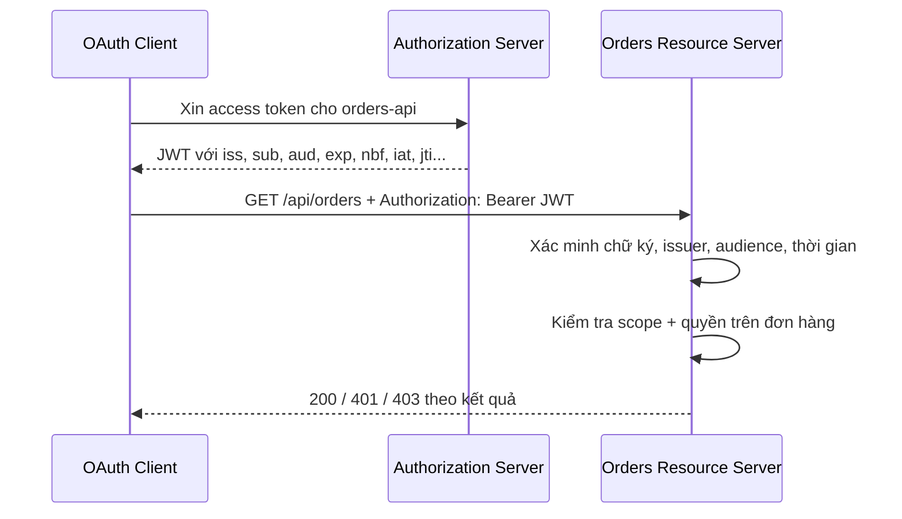
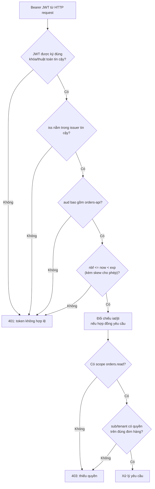

# `iss`, `sub`, `aud`, `exp`, `nbf`, `iat`, `jti` và ý nghĩa trong hợp đồng access token

Trong **Spring Security OAuth 2.0/OIDC Resource Server**, việc nhận một access token chưa đủ để kết luận rằng API được phép thực hiện yêu cầu. API cần biết token **do ai phát hành**, **đại diện cho chủ thể nào**, **dành cho API nào**, **hợp lệ trong khoảng thời gian nào**, và **có thể nhận diện lần phát hành cụ thể hay không**. Bảy claim đăng ký chuẩn của JWT — `iss`, `sub`, `aud`, `exp`, `nbf`, `iat`, `jti` — là những mảnh thông tin quan trọng để diễn đạt hợp đồng đó.

Tài liệu này tập trung vào ý nghĩa và cách sử dụng từng claim trong **hợp đồng giữa Authorization Server (AS) và Resource Server (RS)**, phân biệt điều mà Spring Security có thể xác minh với điều ứng dụng phải kiểm soát thêm. Ví dụ sử dụng access token dạng **JWT** trên Servlet stack của Spring Security; với opaque access token, nhiều thông tin tương tự có thể được trả về qua introspection, nhưng API không được mặc định rằng mọi token đều là JWT.

## 1. “Hợp đồng access token” là gì?

Hợp đồng access token là tập quy tắc mà **bên phát hành token** và **API nhận token** cùng thống nhất. Nó không chỉ là cấu trúc JSON; nó trả lời những câu hỏi cụ thể:

1. Nhà phát hành nào được API tin và khóa ký/token introspection của nhà phát hành đó được xác minh ra sao?
2. Token dành cho tài nguyên/API nào?
3. Chủ thể trong token là người dùng, client ứng dụng hay một loại principal khác?
4. Token có hiệu lực từ thời điểm nào, hết hạn lúc nào, được phát hành lúc nào?
5. API có cần định danh từng token để theo dõi, kiểm soát phát lại hoặc hỗ trợ thu hồi không?
6. Khi token hợp lệ, API dựa vào phạm vi quyền và dữ liệu nghiệp vụ nào để cho phép một thao tác cụ thể?

Hợp đồng tốt phải được mô tả bằng cấu hình và chính sách kiểm chứng cụ thể, vì **JWT được ký hợp lệ không đồng nghĩa JWT dành cho API hiện tại**.

### Các bên tham gia

| Bên | Trách nhiệm liên quan |
|---|---|
| **Authorization Server / Identity Provider** | Xác thực/cấp quyền theo luồng OAuth 2.0 tương ứng; quyết định các claim; ký JWT hoặc cung cấp introspection; công bố issuer và khóa phù hợp |
| **OAuth client** | Xin access token, lưu và trình bearer token theo cách được phép |
| **Resource Server** | Xác minh token nhận được, đối chiếu issuer/audience/thời gian, đánh giá scope/authority và chính sách tài nguyên |
| **Dịch vụ phía sau** | Khi nhận một access token ở hop tiếp theo, độc lập kiểm tra token có dành cho mình và đủ quyền hay không |



Các tên `iss`, `sub`, `aud`, `exp`, `nbf`, `iat`, `jti` xuất phát từ **RFC 7519 (JSON Web Token)**. Tuy nhiên, RFC 7519 định nghĩa **ý nghĩa chung** của các claim, còn việc claim nào phải xuất hiện phụ thuộc **profile JWT và hợp đồng ứng dụng**. Ví dụ, JWT access token tuân theo **RFC 9068** có các ràng buộc chặt hơn JWT tùy ý; OIDC ID token lại có mục đích và điều kiện xác minh riêng.

## 2. Nhìn một JWT access token theo hợp đồng

Một JWT thông dụng có dạng:

```text
BASE64URL(header).BASE64URL(payload).BASE64URL(signature)
```

Ví dụ payload minh họa:

```json
{
  "iss": "https://identity.example.com/realms/shop",
  "sub": "user-842",
  "aud": ["orders-api"],
  "exp": 1893459600,
  "nbf": 1893456000,
  "iat": 1893456000,
  "jti": "tok-28f9c36e-5d84-4f5f-b2be-6c532e7712a3",
  "scope": "orders.read orders.write",
  "client_id": "shop-web"
}
```

Các số thời gian ở ví dụ trên tương ứng:

- `iat = 1893456000`: 00:00:00 UTC, ngày 01/01/2030;
- `nbf = 1893456000`: token chưa được chấp nhận trước mốc này;
- `exp = 1893459600`: 01:00:00 UTC, ngày 01/01/2030; token hết hiệu lực tại mốc này.

Ví dụ chỉ là **payload để học**, không phải JWT được ký thực sự. Mọi claim do client cung cấp vẫn phải coi là **dữ liệu không đáng tin cho đến khi toàn bộ token được xác minh đúng cách**. Không giải mã payload bằng Base64 rồi sử dụng `sub`, `scope` hoặc `tenant_id` làm căn cứ phân quyền mà bỏ qua xác thực.

### Bảng định hướng bảy claim

| Claim | Tên đầy đủ | Câu hỏi chính | Kiểu dữ liệu thường gặp |
|---|---|---|---|
| `iss` | Issuer | **Ai phát hành token?** | Chuỗi định danh issuer |
| `sub` | Subject | **Token nói về chủ thể nào?** | Chuỗi định danh chủ thể |
| `aud` | Audience | **Token dành cho ai nhận?** | Chuỗi hoặc mảng chuỗi |
| `exp` | Expiration Time | **Khi nào token hết hiệu lực?** | NumericDate (số giây) |
| `nbf` | Not Before | **Sớm nhất khi nào token được chấp nhận?** | NumericDate |
| `iat` | Issued At | **Token được phát hành lúc nào?** | NumericDate |
| `jti` | JWT ID | **Đây là lần phát hành/token nào?** | Chuỗi định danh token |

Không nên “gom” ba trường `iss`, `sub`, `aud` thành một khái niệm danh tính duy nhất. Chúng nói về **ba vai trò khác nhau**: người phát hành, chủ thể được mô tả và người nhận dự kiến. Tương tự, `exp`, `nbf`, `iat` là ba mốc thời gian khác nhau, không thể thay thế cho nhau.

## 3. `iss` — issuer: token được phát hành bởi ai?

`iss` là định danh của thực thể **phát hành JWT**. Trong thực tế, issuer thường là URI HTTPS do IdP/Authorization Server công bố:

```json
{
  "iss": "https://identity.example.com/realms/shop"
}
```

Resource Server phải có **tập issuer tin cậy được cấu hình từ trước**. Nếu nhận token tự khai báo `iss=https://attacker.example`, API không thể tin token chỉ vì nó trỏ tới một JWKS do chính kẻ tấn công cung cấp. `iss` trước hết là một **giá trị cần kiểm chứng**, không phải giấy phép để API tự chọn nhà phát hành mới.

### 3.1. `iss` là điều kiện xác thực nguồn gốc

Với JWT có chữ ký, API cần phối hợp:

1. Lấy khóa xác minh từ nguồn đã được **cấu hình là đáng tin cậy**.
2. Xác minh chữ ký, thuật toán và các ràng buộc JOSE cần thiết.
3. Kiểm tra `iss` thực tế có khớp issuer được phép hay không.
4. Tiếp tục kiểm tra `aud`, thời gian hiệu lực và điều kiện chính sách.

Khóa ký đúng nhưng issuer không nằm trong hợp đồng vẫn là token bị từ chối. Ngược lại, một chuỗi `iss` khớp mong đợi nhưng chữ ký không hợp lệ cũng phải bị từ chối.

Ví dụ:

```text
Issuer API tin:
  https://identity.example.com/realms/shop

Token 1:
  iss = https://identity.example.com/realms/shop   -> tiếp tục kiểm chứng

Token 2:
  iss = https://identity.example.com/realms/partner -> từ chối nếu chưa cấu hình tin cậy

Token 3:
  iss = http://identity.example.com/realms/shop    -> không phải cùng issuer
```

Địa chỉ issuer nên được đối chiếu theo đúng giá trị đã thống nhất; không tự chuẩn hóa thành cùng một issuer bằng việc bỏ path, đổi scheme hoặc dựa vào tên domain giống nhau. Những khác biệt tưởng nhỏ có thể đại diện cho **realm/tenant/nhà phát hành khác**.

### 3.2. `iss` trong hệ thống nhiều tenant/issuer

Nếu API nhận token từ nhiều issuer, cần quản lý danh sách issuer đáng tin cậy và bộ kiểm chứng tương ứng. Không dùng cách “đọc `iss` trong JWT chưa xác thực → tải JWKS của bất cứ URL nào → chấp nhận”.

Ví dụ `sub=user-42` từ hai issuer khác nhau có thể là **hai chủ thể độc lập**:

```text
(iss = https://idp-a.example.com, sub = user-42)
(iss = https://idp-b.example.com, sub = user-42)
```

Với danh tính liên thông, hệ thống thường phải giữ ngữ cảnh `iss + sub`, hoặc ánh xạ chúng vào một định danh nội bộ do ứng dụng quản lý.

## 4. `sub` — subject: chủ thể được định danh là ai?

`sub` xác định **chủ thể mà các phát biểu trong token nói tới**:

```json
{
  "sub": "user-842"
}
```

Ở token đại diện người dùng, `sub` thường là định danh ổn định của người dùng trong phạm vi issuer. Nhưng **`sub` không bắt buộc luôn là người dùng** ở mọi luồng OAuth:

- Với Authorization Code flow, access token có thể mang `sub` của end-user theo hợp đồng IdP.
- Với Client Credentials flow không có người dùng trực tiếp, subject có thể là danh tính của client/service hoặc một subject khác theo profile/nhà phát hành.
- Với token exchange, delegated access và một số kiến trúc, chủ thể được biểu diễn phụ thuộc ngữ nghĩa token mới, actor và chính sách của nhà phát hành.

Do đó, API không được mặc định rằng “có `sub`” đồng nghĩa “có người dùng đã đăng nhập tương tác”.

### 4.1. `sub` không phải email và cũng không phải quyền truy cập

Các giả định sai:

```text
sub = user-842
=> Người dùng là owner mọi đơn hàng có tiền tố 842        (sai)
=> Người dùng có quyền admin vì từng đăng nhập thành công (sai)
=> Giá trị sub tương đương địa chỉ email hiện tại         (không được bảo đảm)
```

`sub` giúp API liên hệ token với một principal. Chính sách như “người dùng được xem đơn hàng này hay không” cần kiểm tra **ownership, tenant, role hoặc quan hệ nghiệp vụ** dựa trên dữ liệu tin cậy:

```text
JWT đã được xác minh:
  iss = https://identity.example.com/realms/shop
  sub = user-842
  scope = orders.read

Đơn hàng cần đọc:
  id = ORD-123
  owner = user-900

Kết quả:
  Token có thể hợp lệ nhưng user-842 không được phép đọc ORD-123.
```

Ngay cả khi `scope=orders.read`, quyền với **từng đối tượng** vẫn do Resource Server quyết định.

### 4.2. Tính ổn định của định danh

Về thiết kế, nên dùng `sub` theo hợp đồng issuer thay vì email/username có thể đổi. Không dùng `sub` từ issuer ngoài để ghi đè trực tiếp tài khoản cục bộ nếu chưa có quy trình liên kết danh tính. Với OIDC, subject identifier có thể là **public** hoặc **pairwise**, khiến cùng một người dùng có `sub` khác nhau giữa những client/sector theo thiết kế; việc tương quan danh tính phải tuân theo hợp đồng định danh thực tế.

## 5. `aud` — audience: token được cấp cho tài nguyên nào?

`aud` cho biết **đối tượng nhận JWT dự kiến**. Với access token phục vụ Resource Server, đây thường là định danh API hoặc resource indicator mà Authorization Server và API đã thống nhất:

```json
{
  "aud": ["orders-api"]
}
```

Nếu ứng dụng chỉ là **Orders API**, nó không được chấp nhận token có `aud` dành riêng cho **Payments API**, dù `iss` đúng và chữ ký hợp lệ.

```text
Orders API yêu cầu:
  aud chứa "orders-api"

Token A:
  iss = issuer hợp lệ
  aud = ["orders-api"]    -> audience phù hợp

Token B:
  iss = issuer hợp lệ
  aud = ["payments-api"]  -> audience sai, phải từ chối
```

Đây là lớp phòng vệ chống **token substitution**: một credential được cấp cho nơi này bị đem trình ở nơi khác.

### 5.1. `aud` có thể là chuỗi hoặc mảng

Theo JWT, `aud` có thể là:

```json
{"aud": "orders-api"}
```

hoặc:

```json
{"aud": ["orders-api", "reporting-api"]}
```

Đối với API yêu cầu audience `orders-api`, kiểm tra là **giá trị đó có thuộc tập audience được khai báo hay không**. Không nên chuyển sang so khớp một chuỗi JSON nguyên văn, hoặc dùng `contains("orders")` theo nghĩa khớp một phần. Việc cho phép token có nhiều audience phải do hợp đồng phát hành và chính sách bảo mật quyết định; giới hạn audience thường giảm nguy cơ một token bị sử dụng tại nhiều hệ thống.

### 5.2. Audience khác scope

Hai claim giải quyết hai câu hỏi độc lập:

| Câu hỏi | Dữ liệu liên quan |
|---|---|
| “Token có dành cho Orders API?” | `aud` |
| “Token được cấp phạm vi đọc đơn hàng?” | `scope` / `scp` tùy IdP |
| “Người gọi có được xem đơn hàng ORD-123?” | Chính sách owner/tenant/trạng thái dữ liệu |

Ví dụ token có `scope=orders.read` nhưng `aud=payments-api` vẫn **không được** dùng ở Orders API. Ngược lại, token có `aud=orders-api` nhưng thiếu `orders.read` vẫn không đủ quyền cho endpoint đọc đơn hàng.

### 5.3. Audience của access token khác audience của ID token

OIDC **ID token** thường có `aud` là `client_id` của OIDC client, vì ID token được phát hành để client hiểu kết quả xác thực người dùng. **Access token** được phát hành để truy cập Resource Server.

Ví dụ:

```text
ID token:
  aud = shop-web
  bên nhận dự kiến = OIDC client

Access token:
  aud = orders-api
  bên nhận dự kiến = Orders Resource Server
```

Không lấy ID token do browser gửi rồi xử lý như bearer access token của API chỉ vì cả hai đều là JWT có chữ ký từ cùng issuer. Một API phải yêu cầu **đúng loại credential và audience** theo hợp đồng của mình.

### 5.4. Gọi dịch vụ khác không tự kế thừa audience

```text
Client -- token aud=orders-api --> Orders API
Orders API -- token đó? -------> Payments API
```

Payments API phải từ chối token nếu audience của nó không có `payments-api`. Muốn gọi thay mặt người dùng có thể cần **token exchange/on-behalf-of** do IdP hỗ trợ, cấp token mới cho Payments API; muốn gọi theo danh tính dịch vụ có thể dùng **client credentials**. Không sửa trường `aud` trong payload rồi gửi tiếp: sửa payload sẽ làm hỏng chữ ký JWT.

## 6. `exp` — Expiration Time: thời điểm hết hạn

`exp` biểu diễn thời điểm **sau đó token không còn được chấp nhận**. Theo RFC 7519, quá trình xử lý yêu cầu **thời gian hiện tại phải trước `exp`**:

```json
{
  "exp": 1893459600
}
```

Quy tắc về mặt logic:

```text
now < exp     -> thỏa điều kiện hết hạn (nếu các kiểm tra khác đúng)
now >= exp    -> token đã hết hạn
```

Nếu `exp=01:00:00 UTC`, thì tại đúng `01:00:00 UTC` token **đã hết hạn**, không phải chỉ hết hạn ở giây sau. Thư viện có thể cho phép một **clock skew** nhỏ theo cấu hình, nên biên thực tế chịu ảnh hưởng của chính sách chênh lệch đồng hồ.

### 6.1. `exp` không phải thời lượng

`exp` là một **mốc thời gian tuyệt đối**, không phải TTL:

```text
iat = 1893456000
exp = 1893459600
TTL suy ra = exp - iat = 3600 giây
```

JWT `NumericDate` được biểu diễn bằng **số giây từ Unix epoch**, không phải số mili giây kiểu `System.currentTimeMillis()` của Java. Nhiều lỗi tích hợp xuất phát từ việc truyền giá trị mili giây vào claim mong đợi giây, làm thời gian hết hạn bị lệch rất xa.

Trong code Java:

```java
import java.time.Instant;

long issuedAtEpochSeconds = Instant.parse("2030-01-01T00:00:00Z")
    .getEpochSecond();
long expiresAtEpochSeconds = Instant.parse("2030-01-01T01:00:00Z")
    .getEpochSecond();
```

Nếu dùng API của Spring Security, thời gian trên `Jwt` thường được cung cấp dưới dạng `Instant` (ví dụ `jwt.getExpiresAt()`), giúp tránh tự parse lại kiểu timestamp.

### 6.2. Hết hạn không đồng nghĩa bị thu hồi

Token có `exp` chưa đến vẫn có thể **không còn phù hợp** vì quyền bị thu hồi, người dùng bị vô hiệu hoặc tình huống bảo mật. Với JWT được kiểm tra offline, xác minh chữ ký và `exp` **không tự biết** một sự kiện thu hồi vừa diễn ra.

Các lựa chọn phụ thuộc mức độ rủi ro:

- TTL ngắn để giới hạn thời gian bearer token bị lộ có thể bị lạm dụng.
- Kiểm tra quyền nghiệp vụ hiện tại cho tài nguyên nhạy cảm.
- Dùng introspection, cơ chế trạng thái hoặc danh sách thu hồi khi hợp đồng yêu cầu hiệu lực thu hồi sớm.
- Thiết kế quy trình đổi khóa và ứng phó khi khóa ký bị xâm phạm.

Không hứa “logout là JWT lập tức vô hiệu” nếu hệ thống chỉ kiểm tra chữ ký và `exp`.

## 7. `nbf` — Not Before: thời điểm bắt đầu được dùng

`nbf` nêu mốc **trước thời điểm đó JWT chưa được chấp nhận**:

```json
{
  "nbf": 1893456000
}
```

Quy tắc logic:

```text
now < nbf     -> chưa được phép sử dụng token
now >= nbf    -> thỏa điều kiện Not Before
```

Ví dụ IdP phát hành token lúc `00:00:00 UTC` nhưng đặt `nbf=00:05:00 UTC` để trì hoãn hiệu lực. Trong 5 phút đầu, token có thể có chữ ký đúng và `exp` vẫn còn xa nhưng Resource Server phải từ chối do **chưa đến thời điểm hiệu lực**.

### 7.1. Quan hệ giữa `nbf`, `iat` và `exp`

Một token thông thường có:

```text
iat <= nbf < exp
```

Trong nhiều trường hợp, `nbf = iat`. Tuy nhiên, `iat` và `nbf` **không đồng nghĩa**:

- `iat` cho biết token được tạo/phát hành khi nào.
- `nbf` cho biết sớm nhất khi nào token được dùng.
- `exp` cho biết mốc token hết hiệu lực.

Quan hệ trên là kỳ vọng phổ biến của nhiều hợp đồng, không phải lý do để bỏ qua việc kiểm tra từng mốc. Nếu hệ thống yêu cầu thêm tính nhất quán, chẳng hạn từ chối token có `nbf > exp` hoặc thời hạn vượt quá chính sách, ứng dụng có thể bổ sung validator theo hợp đồng.

### 7.2. Chênh lệch đồng hồ

Đồng hồ trên IdP, gateway và API không phải lúc nào cũng trùng tuyệt đối. Vì thế nhiều thư viện cho phép một khoản **clock skew tolerance** nhỏ khi đánh giá `exp` và `nbf`. Ví dụ, độ lệch cho phép 30 giây có thể tránh việc token vừa phát hành bị API có đồng hồ chậm vài giây từ chối.

Không dùng clock skew rất lớn để “chữa” đồng hồ hệ thống hoặc token phát hành sai; điều đó làm **mở rộng khoảng thời gian token được chấp nhận**. Đồng bộ giờ máy chủ (NTP) và chọn tolerance có chủ đích là cách phù hợp hơn.

## 8. `iat` — Issued At: thời điểm phát hành

`iat` thể hiện **thời điểm JWT được phát hành**, thường được dùng để tính tuổi token, đối chiếu sự kiện bảo mật hoặc áp dụng giới hạn thời hạn:

```json
{
  "iat": 1893456000
}
```

`iat` có ích trong những hợp đồng như:

- Access token không được có tuổi vượt quá thời lượng tối đa đã định.
- Chỉ nhận token phát hành sau một mốc chính sách, chẳng hạn sau khi client/user bị yêu cầu tái xác thực.
- Đối chiếu log cấp token với hoạt động API.
- Phân tích sự cố về sai lệch đồng hồ hoặc chu kỳ cấp token.

Nhưng **`iat` không mặc nhiên là mốc bắt đầu hiệu lực**; vai trò đó thuộc `nbf`. Một token có `iat` “ở tương lai” là dấu hiệu cấu hình giờ có thể sai hoặc dữ liệu đáng ngờ; ứng dụng có thể từ chối theo chính sách riêng, nhưng **không nên giả định mọi bộ kiểm chứng JWT đều tự kiểm tra `iat` tương lai**.

### 8.1. Chính sách tuổi tối đa

Giả sử ứng dụng đặt:

```text
maxTokenAge = 10 phút
now         = thời gian hệ thống đáng tin
iat         = thời điểm token khai báo đã phát hành
```

Chính sách bổ sung có thể là:

```text
now - iat <= 10 phút
AND iat <= now + allowedClockSkew
AND exp > now
```

Các điều kiện này **chỉ hợp lý sau khi token được xác thực nguồn phát hành và chữ ký**; nếu không, client có thể tự chỉnh `iat`. Trong đa số API, chỉ cần hợp đồng TTL và kiểm tra `exp`; max-age riêng thích hợp khi có yêu cầu bảo mật rõ ràng.

### 8.2. Không coi `iat` là lần đăng nhập cuối

Một token có thể được cấp sau refresh hoặc token exchange mà không có đăng nhập tương tác mới. Do đó `iat` của access token là **thời điểm token này được phát hành**, không phải thời điểm người dùng nhập mật khẩu, hoàn thành MFA hoặc được xác thực lần gần nhất.

Nếu nghiệp vụ cần bằng chứng về **thời điểm xác thực người dùng**, OIDC dùng claim `auth_time` trong những ngữ cảnh phù hợp. Không thay thế `auth_time` bằng `iat`.

## 9. `jti` — JWT ID: định danh riêng của token

`jti` là chuỗi định danh cho một **JWT cụ thể**:

```json
{
  "jti": "tok-28f9c36e-5d84-4f5f-b2be-6c532e7712a3"
}
```

Ý nghĩa chính: phân biệt **các lần phát hành token**, kể cả khi nhiều token có cùng `iss`, `sub`, `aud`, `scope` và khoảng thời gian gần nhau. Giá trị `jti` nên được cấp sao cho xác suất trùng lặp cực thấp, đủ tránh va chạm giữa các token do một issuer phát hành; môi trường nhiều issuer cần tránh nhầm `jti` trùng giữa các nguồn.

### 9.1. `jti` được dùng để làm gì?

| Mục đích | Cách sử dụng `jti` | Giới hạn |
|---|---|---|
| Điều tra sự cố / audit | Gắn định danh token vào sự kiện sau khi đã xác thực | Không nên ghi toàn bộ bearer token vào log |
| Nhận diện lần phát hành | Liên hệ một request với token cụ thể | Phải xét ngữ cảnh `iss`; `jti` không đại diện cho người dùng |
| Danh sách thu hồi | Lưu `iss + jti` của token bị vô hiệu theo thời hạn cần thiết | Chỉ hiệu quả khi mọi nơi cần áp dụng đều kiểm tra trạng thái |
| Phát hiện sử dụng lại trong giao thức một lần | Lưu trạng thái đã sử dụng của token/chứng từ loại *one-time* | Không tự có tác dụng chỉ vì claim tồn tại |
| Truy vết trong hệ phân tán | Tương quan sự kiện token qua các dịch vụ được phép | Cần kiểm soát quyền truy cập log và dữ liệu liên kết |

### 9.2. `jti` tự nó không chống replay

Bearer access token thường được dùng **nhiều lần** trước khi hết hạn:

```http
GET /api/orders/123
Authorization: Bearer SAME_VALID_TOKEN
```

```http
GET /api/orders/456
Authorization: Bearer SAME_VALID_TOKEN
```

Hai request này có thể hoàn toàn hợp lệ. Nếu Resource Server chỉ cần thấy một `jti` từng được sử dụng rồi chặn mọi request tiếp theo, ứng dụng sẽ tự làm hỏng cách dùng bearer token thông thường.

Muốn kiểm soát replay cần xác định rõ **điều đang được chống phát lại**:

- Với **một thao tác nghiệp vụ** (ví dụ thanh toán), dùng **idempotency key** và trạng thái xử lý giao dịch theo chính sách; `jti` của access token không phải idempotency key cho mọi request.
- Với **credential một lần**, hệ thống phải lưu trạng thái sử dụng và từ chối lần sử dụng tiếp theo theo giao thức tương ứng.
- Với **bằng chứng người gửi sở hữu khóa**, cân nhắc cơ chế sender-constrained token như DPoP hoặc mTLS-bound token, đồng thời phải kiểm chứng bằng chứng ràng buộc đầy đủ ở phía nhận.
- Với **thu hồi JWT**, cần một bộ kiểm tra trạng thái phân tán hoặc thời hạn token đủ ngắn theo mô hình rủi ro.

Đừng đánh đồng `jti` với một cơ chế chống phát lại tự động của Spring Security.

## 10. Quan hệ giữa bảy claim: một quyết định xác thực đầy đủ

Hãy xem một access token có dữ liệu:

```json
{
  "iss": "https://identity.example.com/realms/shop",
  "sub": "user-842",
  "aud": ["orders-api"],
  "iat": 1893456000,
  "nbf": 1893456000,
  "exp": 1893459600,
  "jti": "t-001",
  "scope": "orders.read"
}
```

Orders API có hợp đồng:

```text
issuer tin cậy = https://identity.example.com/realms/shop
audience phải có = orders-api
scope cần cho GET /api/orders/{id} = orders.read
quyền trên từng đơn hàng = owner/tenant/phân quyền nghiệp vụ
```

Một quyết định điển hình gồm:



Sơ đồ nhấn mạnh hai phần:

- **Authentication / token validation:** xác định token có đáng tin, hợp thời điểm và dành cho API này.
- **Authorization:** xác định chủ thể/quyền của token có cho phép thao tác với tài nguyên cụ thể hay không.

`iss`, `aud` và thời gian là điều kiện của **hợp đồng chấp nhận token**. `sub` được sử dụng như chủ thể đầu vào cho **chính sách nghiệp vụ**. `jti` thường hỗ trợ **vòng đời/truy vết token**. `iat` cung cấp dữ liệu thời điểm phát hành cho kiểm tra bổ sung. Không có claim nào tự thay thế quyết định phân quyền trên đối tượng.

## 11. Spring Security xác minh các claim này thế nào?

Với Servlet Resource Server xác thực JWT, Spring Security thường sử dụng `BearerTokenAuthenticationFilter` để lấy token, `JwtDecoder` để giải mã và xác minh, rồi tạo `JwtAuthenticationToken` chứa `Jwt`.

Ví dụ cấu hình Spring Boot/Spring Security:

```yaml
# application.yml
spring:
  security:
    oauth2:
      resourceserver:
        jwt:
          issuer-uri: https://identity.example.com/realms/shop
```

```java
import org.springframework.context.annotation.Bean;
import org.springframework.context.annotation.Configuration;
import org.springframework.security.config.Customizer;
import org.springframework.security.config.annotation.web.builders.HttpSecurity;
import org.springframework.security.web.SecurityFilterChain;

@Configuration
public class ApiSecurityConfig {
    @Bean
    SecurityFilterChain securityFilterChain(HttpSecurity http) throws Exception {
        return http
            .authorizeHttpRequests(auth -> auth
                .requestMatchers("/actuator/health").permitAll()
                .requestMatchers("/api/orders/**").hasAuthority("SCOPE_orders.read")
                .anyRequest().authenticated())
            .oauth2ResourceServer(oauth2 ->
                oauth2.jwt(Customizer.withDefaults()))
            .build();
    }
}
```

Với `issuer-uri` và decoder JWT mặc định được Spring Security cấu hình tương ứng, API thường được kiểm tra chữ ký, `iss`, `exp` và `nbf`. **Đừng mặc định audience của API đã được kiểm tra chỉ vì có `issuer-uri`.** Audience phải được ràng buộc theo hợp đồng API bằng cấu hình hoặc validator thích hợp. Tương tự, `iat` tương lai, TTL tối đa hay `jti` nằm trong denylist **không phải các chính sách mặc định có thể suy ra chỉ từ `issuer-uri`**.

### 11.1. Tự cấu hình validator cho `aud`

Ví dụ Spring Security 6 sử dụng `NimbusJwtDecoder` và cấu hình bổ sung audience cố định:

```yaml
app:
  security:
    issuer: https://identity.example.com/realms/shop
    audience: orders-api
```

```java
import org.springframework.beans.factory.annotation.Value;
import org.springframework.context.annotation.Bean;
import org.springframework.context.annotation.Configuration;
import org.springframework.security.oauth2.core.DelegatingOAuth2TokenValidator;
import org.springframework.security.oauth2.core.OAuth2Error;
import org.springframework.security.oauth2.core.OAuth2TokenValidator;
import org.springframework.security.oauth2.core.OAuth2TokenValidatorResult;
import org.springframework.security.oauth2.jwt.Jwt;
import org.springframework.security.oauth2.jwt.JwtDecoder;
import org.springframework.security.oauth2.jwt.JwtValidators;
import org.springframework.security.oauth2.jwt.NimbusJwtDecoder;

@Configuration
public class JwtContractConfig {

    @Bean
    JwtDecoder jwtDecoder(
            @Value("${app.security.issuer}") String trustedIssuer,
            @Value("${app.security.audience}") String requiredAudience) {

        // Khóa được chọn dựa trên issuer ứng dụng cấu hình, không dựa vào
        // một URL mà token chưa xác thực tự cung cấp.
        NimbusJwtDecoder decoder =
            NimbusJwtDecoder.withIssuerLocation(trustedIssuer).build();

        // Gồm các validator mặc định và kiểm tra issuer được tin cậy.
        OAuth2TokenValidator<Jwt> issuerAndTime =
            JwtValidators.createDefaultWithIssuer(trustedIssuer);

        // Bắt buộc token được phát hành cho chính Resource Server này.
        OAuth2TokenValidator<Jwt> audience = jwt ->
            jwt.getAudience().contains(requiredAudience)
                ? OAuth2TokenValidatorResult.success()
                : OAuth2TokenValidatorResult.failure(
                    new OAuth2Error(
                        "invalid_token",
                        "Access token is not intended for orders-api",
                        null));

        decoder.setJwtValidator(
            new DelegatingOAuth2TokenValidator<>(issuerAndTime, audience));
        return decoder;
    }
}
```

Các điểm cần nhận diện:

- `withIssuerLocation(trustedIssuer)` dựa vào issuer do ứng dụng cấu hình để xây dựng decoder và tìm khóa từ metadata/JWKS phù hợp.
- `JwtValidators.createDefaultWithIssuer(...)` kết hợp các điều kiện xác minh mặc định cho JWT cùng ràng buộc issuer; không bỏ các kiểm tra thời gian khi thêm audience.
- `jwt.getAudience().contains(requiredAudience)` xử lý audience như tập giá trị, phù hợp khi JWT mang một hoặc nhiều audience.
- Chuỗi mô tả lỗi được giữ chung chung; không tiết lộ token hay bí mật.
- Cấu hình decoder **không thay thế** kiểm tra scope/quyền tài nguyên của controller/service.

Một hệ thống có thể cấu hình audience bằng các API/convention khác tùy phiên bản Spring Boot/Spring Security. Điều cần giữ nguyên là **yêu cầu kiểm chứng audience cụ thể trước khi cho phép truy cập**.

### 11.2. Đọc claim đã xác thực trong ứng dụng

Sau khi token được Spring Security xác thực thành công, controller có thể nhận `Jwt` qua `@AuthenticationPrincipal`:

```java
import java.time.Instant;
import java.util.List;

import org.springframework.security.core.annotation.AuthenticationPrincipal;
import org.springframework.security.oauth2.jwt.Jwt;
import org.springframework.web.bind.annotation.GetMapping;
import org.springframework.web.bind.annotation.RestController;

@RestController
public class OrderController {
    private final OrderService orderService;

    public OrderController(OrderService orderService) {
        this.orderService = orderService;
    }

    @GetMapping("/api/orders")
    public List<OrderDto> myOrders(@AuthenticationPrincipal Jwt jwt) {
        String subject = jwt.getSubject();
        String tokenId = jwt.getId();
        Instant issuedAt = jwt.getIssuedAt();
        Instant notBefore = jwt.getNotBefore();
        Instant expiresAt = jwt.getExpiresAt();
        List<String> audiences = jwt.getAudience();

        // Giao quyền đọc dữ liệu cho lớp nghiệp vụ theo subject đã xác thực.
        // Các giá trị còn lại có thể được dùng cho policy/audit có kiểm soát.
        return orderService.findOrdersForSubject(subject);
    }
}
```

`findOrdersForSubject` ở đây là phương thức minh họa do ứng dụng định nghĩa, không phải API có sẵn của Spring Security. Với hệ thống nhiều issuer/tenant, chỉ truyền `subject` có thể chưa đủ: phải kèm **issuer/tenant đã xác minh** hoặc định danh principal nội bộ đã ánh xạ đúng. Không expose mọi claim trong response debug cho người dùng cuối chỉ vì đọc được chúng từ `Jwt`.

### 11.3. `iat` và `jti` nếu cần chính sách tùy biến

Spring Security cung cấp hạ tầng `OAuth2TokenValidator<Jwt>` để bổ sung các điều kiện như:

```text
iat không vượt quá now + allowedClockSkew
exp - iat không vượt quá maxAccessTokenLifetime
(iss, jti) không nằm trong danh sách token đã thu hồi
```

Chỉ thêm những kiểm tra mà hợp đồng thật sự yêu cầu. Ví dụ, nếu IdP cho phép `iat` vắng mặt trong một loại token theo hợp đồng, phải xác định rõ hành vi xử lý thiếu claim; nếu API chỉ chấp nhận JWT access token tuân theo profile bắt buộc có `iat`/`jti`, có thể yêu cầu chúng hiện diện. Không nên biến `jti` thành chặn sử dụng lại mọi bearer token như đã phân tích.

## 12. Điều gì bắt buộc? JWT, JWT access token và OIDC ID token

Cần phân biệt **đặc tả gốc** và **profile cụ thể**. Chỉ thấy chữ “JWT” không nói token là access token hay ID token.

| Ngữ cảnh | Điều cần hiểu |
|---|---|
| **RFC 7519 — JWT chung** | Định nghĩa cú pháp và ý nghĩa các registered claims; yêu cầu về sự hiện diện phụ thuộc ứng dụng/profile |
| **RFC 9068 — JWT Profile for OAuth 2.0 Access Tokens** | Quy định profile cho JWT access token, gồm tập claim và quy tắc chấp nhận chặt chẽ hơn; ví dụ `iss`, `sub`, `aud`, `exp`, `iat`, `jti` là các trường quan trọng trong profile |
| **OpenID Connect — ID Token** | Phục vụ OIDC client trong quá trình xác thực; có ràng buộc riêng về `iss`, `sub`, `aud`, `exp`, `iat` và các claim điều kiện |
| **Opaque OAuth access token** | Resource Server không tự diễn giải payload JWT; dùng introspection hoặc hợp đồng xác thực được hỗ trợ |

Ví dụ JWT header của token theo RFC 9068 có thể chứa type hint:

```json
{
  "alg": "RS256",
  "typ": "at+jwt",
  "kid": "key-2029-12"
}
```

`typ` giúp phân biệt loại JWT theo hợp đồng, nhưng **không được dùng một mình** làm bằng chứng token hợp lệ: Resource Server vẫn cần xác minh chữ ký, issuer, audience, thời gian và các quy tắc profile. Một hệ thống hỗ trợ nhiều định dạng token phải khai báo rõ profile nào được chấp nhận.

### 12.1. Bảng so sánh ý nghĩa claim theo mục đích

| Claim | JWT OAuth access token | OIDC ID token |
|---|---|---|
| `iss` | Nhà phát hành access token | Nhà cung cấp OIDC phát hành ID token |
| `sub` | Chủ thể theo hợp đồng access token; có thể là user hoặc service principal | Chủ thể người dùng được xác thực theo ngữ nghĩa OIDC |
| `aud` | Resource Server/API được nhắm tới | OIDC client được nhắm tới, thường định danh bằng `client_id` |
| `exp` | Hạn dùng access token tại API | Hạn dùng ID token trong kiểm chứng phía client |
| `nbf` | Bắt đầu hiệu lực nếu token/profile sử dụng | Không phải claim nền tảng bắt buộc ở mọi ID token |
| `iat` | Mốc phát hành access token | Mốc phát hành ID token; không phải thời điểm đăng nhập |
| `jti` | Định danh JWT để nhận diện từng token theo profile | Có thể hiện diện nhưng không phải bằng chứng bắt buộc của quy trình đăng nhập OIDC |

Tuy có tên claim trùng nhau, **đối tượng nhận và mục đích sử dụng là khác nhau**. Các API Resource Server không tự chấp nhận một ID token chỉ vì có đủ `iss`, `sub`, `exp` và chữ ký đúng.

## 13. Những lỗi thường gặp và cách nhìn đúng hợp đồng

| Sai lầm | Hệ quả | Thiết kế đúng |
|---|---|---|
| “Chữ ký JWT đúng là có thể gọi mọi API cùng IdP.” | Token có thể bị dùng sai dịch vụ | Kiểm tra `iss` **và** `aud` đúng Resource Server |
| Lấy `iss` từ token bất kỳ rồi tải JWKS theo URL đó | Bên gửi token có thể chi phối nguồn tin cậy | Chỉ chọn issuer/JWKS từ danh sách cấu hình đáng tin |
| Xem `sub` là email hoặc username | Nhầm người khi đổi tên, đổi email hoặc đa issuer | Dùng định danh chủ thể theo issuer và ánh xạ danh tính cẩn thận |
| Có `sub` thì mặc định là người dùng vừa đăng nhập | Sai với client credentials, token exchange | Xem loại principal và grant/delegation theo hợp đồng |
| `scope=orders.read` đồng nghĩa có quyền mọi đơn hàng | Lộ dữ liệu chéo người dùng/tenant | Kiểm tra quyền ở mức bản ghi và tenant |
| Nhận token `aud=payments-api` ở Orders API | Token substitution giữa API | Bắt buộc audience được chỉ định |
| Hiểu `exp` là số giây còn lại | Token có thể bị nhận sai thời gian | Dùng NumericDate tuyệt đối |
| Ghi `exp` bằng mili giây | Token trông như còn hiệu lực hàng nghìn năm | Chuẩn hóa seconds since Unix epoch |
| Dùng `iat` thay `nbf` | Sai điều kiện bắt đầu hiệu lực | Kiểm tra `nbf` riêng; `iat` chỉ nói thời điểm phát hành |
| Cho rằng `iat` luôn được kiểm tra tương lai tự động | Chấp nhận token có thời gian phát hành phi lý theo hợp đồng riêng | Thêm validator `iat` khi yêu cầu |
| Tin `jti` tự chống replay | Bearer token bị lộ vẫn có thể bị dùng lại | Cần trạng thái/giao thức chống replay thực tế |
| Chặn request thứ hai có cùng `jti` | Phá vỡ việc sử dụng bearer token bình thường | Dùng `jti` cho nhận diện/thu hồi; tách idempotency nghiệp vụ |
| Cho rằng `exp` chưa đến đồng nghĩa quyền không đổi | Không phản ánh thay đổi quyền/thu hồi kịp thời | Kiểm tra quyền hiện tại hoặc bổ sung cơ chế trạng thái |

## 14. Các tình huống áp dụng hợp đồng

### Tình huống A — Token đúng issuer nhưng sai audience

```json
{
  "iss": "https://identity.example.com/realms/shop",
  "sub": "user-842",
  "aud": ["payments-api"],
  "exp": 1893459600
}
```

Orders API tin issuer này, nhưng token chỉ được cấp cho Payments API. **Kết quả mong đợi: từ chối token** dù chữ ký và thời gian có thể hợp lệ. Với API Bearer, đây thường là lỗi xác thực token (HTTP 401).

### Tình huống B — Token hợp lệ nhưng `nbf` ở tương lai

```text
now = 2030-01-01T00:02:00Z
iat = 2030-01-01T00:00:00Z
nbf = 2030-01-01T00:05:00Z
exp = 2030-01-01T01:00:00Z
```

Token đã được phát hành nhưng **chưa đủ điều kiện thời gian để dùng**. API từ chối trừ khi phần lệch nằm trong tolerance được phép theo cấu hình, điều không nên thiết lập rộng tùy ý.

### Tình huống C — Cùng `sub`, khác `iss`

```text
Token 1: iss=https://idp-a.example.com, sub=staff-01
Token 2: iss=https://idp-b.example.com, sub=staff-01
```

Nếu API tin cả hai issuer, `staff-01` vẫn không chắc là cùng người. Khi lưu ownership, dùng cặp issuer/subject hoặc ánh xạ principal nội bộ có quản trị.

### Tình huống D — Hai token có cùng user và scope, khác `jti`

```text
Token A:
  iss=trusted-issuer, sub=user-842, aud=orders-api
  scope=orders.read, jti=t-001

Token B:
  iss=trusted-issuer, sub=user-842, aud=orders-api
  scope=orders.read, jti=t-002
```

Cả hai có thể đang hợp lệ. `jti` giúp phân biệt chúng trong audit hoặc danh sách thu hồi, nhưng **không khiến token B có quyền rộng hơn**. Quyền vẫn dựa vào scope và chính sách của tài nguyên.

### Tình huống E — API cần chủ động vô hiệu token trước khi hết hạn

Nếu hệ thống duy trì denylist theo `iss+jti`:

```text
JWT:
  iss = issuer-A
  jti = t-001
  exp = 01:00 UTC

Denylist:
  (issuer-A, t-001) -> bị thu hồi lúc 00:20 UTC
```

Sau 00:20 UTC, **mọi Resource Server cần áp dụng thu hồi phải kiểm tra denylist**. Nếu một API chỉ kiểm tra chữ ký và `exp`, nó vẫn có thể nhận JWT đến 01:00 UTC. Đây là tính chất vận hành của cơ chế trạng thái, không phải lỗi cú pháp `jti`.

### Tình huống F — Nhận ID token thay access token

Một client gửi ID token với `aud=shop-web` đến Orders API, nơi yêu cầu `aud=orders-api`. Dù `iss`, `sub` và chữ ký có thể đúng, đây vẫn **không phải credential hợp lệ cho API**. Resource Server phải dùng hợp đồng token riêng, không bỏ qua audience để “cho chạy được”.

## 15. Thiết kế hợp đồng giữa Authorization Server và Resource Server

Một tài liệu giao thức nội bộ tốt nên trả lời rõ từng trường:

| Thành phần hợp đồng | Ví dụ chính sách cho Orders API |
|---|---|
| Issuer chấp nhận | `https://identity.example.com/realms/shop` |
| Cơ chế kiểm chứng | JWT có chữ ký, khóa công khai lấy từ JWKS của issuer đã cấu hình |
| Token type/profile | Access token theo profile IdP đã thống nhất; không nhận ID token |
| Audience bắt buộc | `orders-api` |
| Subject | Định danh principal trong phạm vi issuer, ánh xạ với user/service tương ứng |
| Time semantics | `exp` và `nbf` được kiểm tra; skew nhỏ được quản trị |
| Issued at | `iat` phục vụ tuổi token/audit; validator thêm nếu có giới hạn riêng |
| Token ID | `jti` phục vụ correlation/thu hồi nếu hệ thống triển khai trạng thái |
| Authorization | `orders.read`, `orders.write` kết hợp ownership/tenant và quy tắc nghiệp vụ |
| Token propagation | Khi gọi API khác, dùng token có audience/quyền đúng của API đích |
| Logging và bảo vệ | Không ghi bearer token; quản trị TLS, khóa ký, thời gian và sự kiện thu hồi |

Hợp đồng nên quy định rõ **thiếu claim thì xử lý thế nào**. Ví dụ, JWT access token tuân theo profile yêu cầu `jti` thì API nên kiểm tra sự hiện diện của `jti` nếu cần bảo đảm profile đó. Nhưng một JWT hợp lệ theo cú pháp RFC 7519 không tự bắt buộc mọi claim trong bảng; không thể kết luận thiếu claim nào cũng sai nếu chưa xác định profile.

### Những câu hỏi nên được chốt trước triển khai

1. API đang chấp nhận **access token loại nào** (JWT profile nào, opaque token, hay cả hai theo kênh riêng)?
2. `iss` có thể có bao nhiêu giá trị? Ai được phép cập nhật tập issuer tin cậy?
3. `aud` là URI/resource indicator hay tên dịch vụ ổn định? Token đa audience có được cấp không?
4. `sub` đại diện cho người dùng, service principal, hay tùy grant type? Định danh nhiều issuer được ánh xạ ra sao?
5. `exp` tối đa bao lâu? `nbf` và clock skew được thiết lập thế nào?
6. `iat` cần để audit hay còn bắt buộc giới hạn max token age?
7. `jti` có bắt buộc không? Ai lưu/truy vấn trạng thái thu hồi, thời gian giữ đến lúc nào?
8. Phân quyền đối tượng và tenant được áp dụng tại tầng nào?

## 16. Kết luận: bảy claim là bảy mảnh thông tin, không phải bảy quyền

Có thể ghi nhớ theo ba nhóm:

```text
Nguồn phát hành và phạm vi:
  iss  -> AI phát hành?
  sub  -> Token mô tả CHỦ THỂ nào?
  aud  -> Token dành cho AI NHẬN?

Hiệu lực thời gian:
  iat  -> ĐƯỢC PHÁT HÀNH khi nào?
  nbf  -> ĐƯỢC DÙNG từ lúc nào?
  exp  -> HẾT HẠN từ lúc nào?

Định danh một token:
  jti  -> ĐÂY LÀ TOKEN nào trong các lần phát hành?
```

Trong Spring Security, `JwtDecoder` và validator giúp kiểm tra những điều kiện mà hệ thống đã cấu hình. API **vẫn phải yêu cầu audience phù hợp, thực thi phân quyền scope và kiểm tra quyền với dữ liệu cụ thể**. Một access token có đầy đủ bảy claim và chữ ký chính xác vẫn có thể bị từ chối vì không dành cho API, chưa đến thời điểm hiệu lực hoặc chủ thể không được phép thực hiện hành động đang yêu cầu.

### Tài liệu tham khảo

- [RFC 7519 — JSON Web Token (JWT)](https://www.rfc-editor.org/rfc/rfc7519) — ý nghĩa các registered claims và NumericDate.
- [RFC 9068 — JWT Profile for OAuth 2.0 Access Tokens](https://www.rfc-editor.org/rfc/rfc9068) — ràng buộc profile JWT access token.
- [RFC 8725 — JSON Web Token Best Current Practices](https://www.rfc-editor.org/rfc/rfc8725) — tách loại JWT, xác thực issuer/audience và an toàn xử lý token.
- [RFC 6750 — OAuth 2.0 Bearer Token Usage](https://www.rfc-editor.org/rfc/rfc6750) — truyền và bảo vệ bearer token.
- [RFC 7662 — OAuth 2.0 Token Introspection](https://www.rfc-editor.org/rfc/rfc7662) — kiểm tra opaque token và trạng thái/metadata token.
- [OpenID Connect Core 1.0](https://openid.net/specs/openid-connect-core-1_0.html) — ngữ nghĩa và kiểm chứng OIDC ID token.
- [Spring Security Reference — OAuth 2.0 Resource Server (Servlet)](https://docs.spring.io/spring-security/reference/servlet/oauth2/resource-server/index.html) — cấu hình xác thực bearer token.
- [Spring Security Reference — JWT Resource Server](https://docs.spring.io/spring-security/reference/servlet/oauth2/resource-server/jwt.html) — cấu hình JWT decoder và validator.
