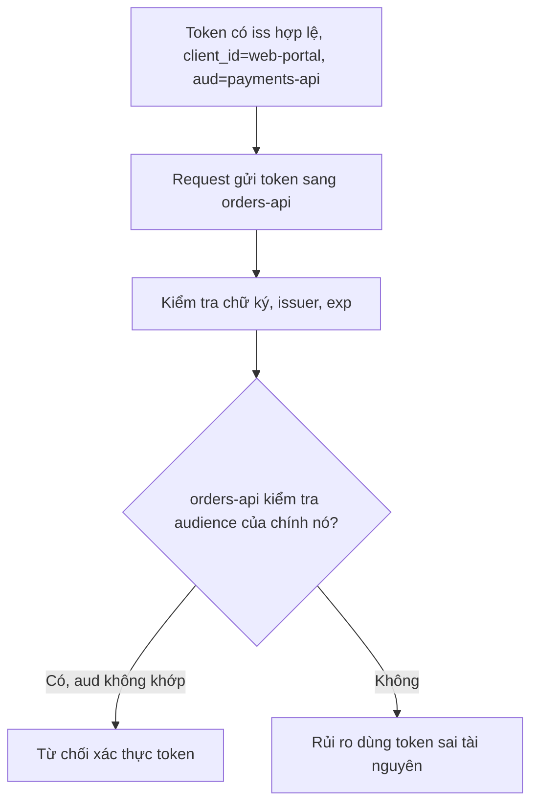
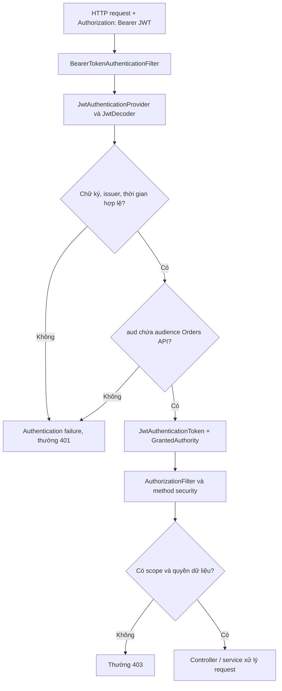

# Audience của API khác client_id của ứng dụng gọi

Trong OAuth 2.0/OIDC, một access token có thể chứa nhiều claim liên quan đến các bên tham gia: `iss`, `aud`, `client_id`, `sub`, `scope` và đôi khi `azp`. Dù xuất hiện gần nhau, **`aud` của access token và `client_id` của ứng dụng gọi API trả lời hai câu hỏi khác nhau**:

- **`aud` (audience):** Token được cấp để **Resource Server/API nào tiếp nhận**?
- **`client_id`:** **OAuth client (ứng dụng) nào đã yêu cầu hoặc nhận token**?

Ví dụ, ứng dụng `web-portal` xin access token để gọi `orders-api`. Khi đó `client_id=web-portal`, còn `aud` có thể là `https://api.example.test/orders` hoặc tên tài nguyên như `orders-api`, tùy hợp đồng với Authorization Server.

Đối với **Spring Security OAuth 2.0 Resource Server**, phân biệt này đặc biệt quan trọng: API phải kiểm tra rằng token **được cấp cho chính API**, trước khi quyết định scope, vai trò, danh tính client hoặc quyền dữ liệu của caller.

> **Ghi nhớ:** `client_id` cho biết ứng dụng đã xin token, còn `aud` cho biết đối tượng được phép nhận token. Token do đúng issuer cấp cho đúng ứng dụng vẫn có thể **không dành cho API** đang nhận request.

## 1. Ba vai trò trong một hành trình OAuth 2.0

Xét một hệ thống bán hàng:

| Vai trò | Ví dụ | Trách nhiệm |
|---|---|---|
| **OAuth Client** | `web-portal` | Ứng dụng đăng ký với Authorization Server và xin access token bằng flow phù hợp. |
| **Authorization Server (AS)** | `https://login.example.test/realms/shop` | Xác thực, áp chính sách cấp quyền, phát hành token và giới hạn tài nguyên được tiếp nhận token. |
| **Resource Server (RS)** | Orders API ở `https://api.example.test` | Nhận access token, xác thực token, kiểm tra audience và phân quyền cho API. |

Thỏa thuận định danh ví dụ:

```text
Issuer:           https://login.example.test/realms/shop
OAuth client ID:  web-portal
API:              Orders API
Audience của API: https://api.example.test/orders
Scope đọc:        orders.read
Scope ghi:        orders.write
```

**Audience là định danh tài nguyên đã được thỏa thuận, không nhất thiết là URL đầy đủ của HTTP request.** Một API phục vụ `GET /api/orders/42` và `GET /api/orders/43` có thể cùng dùng audience `https://api.example.test/orders`. Không suy ra expected audience từ path hay Host header do request gửi tới.

```mermaid
sequenceDiagram
    participant C as OAuth Client (web-portal)
    participant AS as Authorization Server
    participant RS as Resource Server (orders-api)
    C->>AS: Xin token cho resource=orders-api; client_id=web-portal
    AS->>AS: Kiểm tra client, resource, scope theo chính sách
    AS-->>C: Access token (aud=orders-api; client_id=web-portal)
    C->>RS: GET /api/orders/42 + Authorization: Bearer ...
    RS->>RS: Kiểm tra issuer, chữ ký/trạng thái, thời gian, aud
    RS->>RS: Kiểm tra scope và quyền với đơn hàng 42
    RS-->>C: Dữ liệu hoặc lỗi phù hợp
```

Một chương trình có thể đồng thời đóng hai vai trò. Ví dụ, Orders service là **Resource Server** khi nhận token từ `web-portal` và là **OAuth client** khi tự xin token để gọi Inventory API. Khi chuyển vai trò, audience của token cũng thay đổi theo API đích.

## 2. Một JWT access token minh họa

Giả sử AS phát hành JWT access token theo hợp đồng:

```json
{
  "iss": "https://login.example.test/realms/shop",
  "sub": "user-123",
  "aud": ["https://api.example.test/orders"],
  "client_id": "web-portal",
  "scope": "orders.read",
  "iat": 1794715200,
  "exp": 1794718800
}
```

Đây là **payload minh họa**, không phải JWT ký hợp lệ. JSON có thể đọc được không đồng nghĩa các claim đáng tin: Resource Server phải kiểm tra chữ ký và các điều kiện cần thiết trước khi dùng chúng.

| Claim | Câu hỏi nó trả lời | Trong ví dụ |
|---|---|---|
| `iss` | **Ai cấp token?** | Authorization Server của realm `shop`. |
| `aud` | **Token dành cho bên nhận nào?** | Orders API, có định danh `https://api.example.test/orders`. |
| `client_id` | **OAuth client nào xin/nhận token?** | `web-portal`. |
| `sub` | **Chủ thể được đại diện bởi token?** | `user-123`. |
| `scope` | **Những phạm vi quyền nào được cấp?** | `orders.read`. |
| `exp` | **Token hết hạn khi nào?** | Mốc Unix timestamp. |
| `iat` và `nbf` nếu có | **Token được phát hành/có hiệu lực khi nào?** | Dùng cùng các validator thời gian theo hợp đồng. |

Trong **JWT Profile for OAuth 2.0 Access Tokens (RFC 9068)**, audience và client ID có ngữ nghĩa rõ ràng. Tuy nhiên, OAuth 2.0 không bắt buộc mọi access token trên thế giới đều phải là JWT hoặc có tất cả các claim trên. Một hệ thống có thể cấp **opaque token** và cung cấp metadata qua introspection; một JWT tùy biến có thể dùng quy ước claim khác. Cần kiểm tra hợp đồng của issuer.

### 2.1. Audience của access token là đối tượng tiếp nhận

Theo RFC 7519, `aud` có thể là một chuỗi:

```json
"aud": "https://api.example.test/orders"
```

hoặc một mảng:

```json
"aud": [
  "https://api.example.test/orders",
  "https://api.example.test/inventory"
]
```

Nếu token có nhiều audiences, mỗi Resource Server cần xác nhận **định danh của chính nó** nằm trong danh sách, sau đó tiếp tục áp dụng kiểm tra khác.

**Audience không phải:**

- OAuth client ID của bên gọi, trừ trường hợp token được cấp cho chính client đó theo một hợp đồng riêng như ID token OIDC.
- Tên người dùng hoặc `sub`.
- Mọi hostname hoặc path có thể được caller chọn tùy ý.
- Một quyền như `orders.read`.
- Địa chỉ Authorization Server hoặc `jwks_uri`.

Thường một API có nhiều route vẫn dùng **một định danh audience**, còn endpoint và dữ liệu cụ thể được xử lý bằng authorization.

### 2.2. `client_id` là ứng dụng xin/nhận token

Ví dụ bốn OAuth clients:

```text
web-portal
mobile-shop
nightly-report-job
partner-integration
```

Tất cả có thể được AS cấp token để truy cập **cùng một API**:

```text
web-portal          --\
mobile-shop          --+--> aud = https://api.example.test/orders
nightly-report-job  --/
```

Ngược lại, cùng một ứng dụng `web-portal` có thể nhận hai token cho hai APIs:

```text
client_id = web-portal
      |
      +--> Token A: aud = https://api.example.test/orders
      |
      +--> Token B: aud = https://api.example.test/payments
```

Vì vậy, **cùng `client_id` không làm hai token có thể hoán đổi**, và **cùng `aud` không có nghĩa token phải đến từ một client duy nhất**.

### 2.3. `sub` không phải `client_id`

Trong flow có người dùng:

```text
sub       = user-123
client_id = web-portal
aud       = https://api.example.test/orders
```

`sub` có thể là người dùng được đại diện; `client_id` là ứng dụng OAuth xin token; `aud` là API đích.

Trong **client credentials grant**, không có người dùng đăng nhập. Tùy issuer, `sub` có thể nhận diện service principal hoặc chính client, đôi khi trùng `client_id`. Sự trùng giá trị **không thay đổi ý nghĩa** của các claim. API không nên mặc định một access token luôn đại diện cho người dùng cuối.

### 2.4. `scope` là điều kiện phân quyền riêng

Giả sử token có audience Orders API nhưng chỉ có `scope=orders.read`:

```text
GET  /api/orders/42  -> có thể được phép nếu có quyền dữ liệu
POST /api/orders     -> bị từ chối nếu cần orders.write
```

**Audience xác định API nào được nhận token; scope cho biết nhóm thao tác được cấp.** Quyền đọc đơn hàng 42 có thể còn phụ thuộc tenant, ownership, vai trò hoặc chính sách nghiệp vụ.

## 3. Hợp đồng access token giữa AS, client và API

Không nên để Resource Server tự “đoán” audience. Nhóm quản lý AS và nhóm phát triển API cần thỏa thuận trước.

Ví dụ hợp đồng Orders API:

| Hạng mục | Giá trị hoặc chính sách |
|---|---|
| Trusted issuer | `https://login.example.test/realms/shop` |
| Resource Server | Orders API |
| Expected audience | `https://api.example.test/orders` |
| OAuth clients được phép xin quyền | `web-portal`, `mobile-shop`, `nightly-report-job` theo cấu hình AS |
| Scope đọc | `orders.read` |
| Scope ghi | `orders.write` |
| Dạng token | JWT đã ký hoặc opaque token có cơ chế introspection |
| Client identity | Claim `client_id` hoặc metadata đáng tin cậy tương đương |
| Subject | Người dùng/service principal tùy grant và issuer |
| Các điều kiện thêm | Thời gian, loại token, tenant, chính sách quyền dữ liệu |

Ba bên có trách nhiệm khác nhau:

1. **Authorization Server:** Chỉ cấp audience và scope phù hợp với quyền client/request; không cấp bừa token cho mọi resource.
2. **OAuth client:** Xin token dành cho API định gọi và gửi token đó trong HTTP request.
3. **Resource Server:** Xác thực token rồi kiểm tra audience chính xác theo cấu hình tin cậy; không chấp nhận token cho resource khác.

Nếu AS cấp audience quá rộng cho mọi client, Resource Server vẫn cần audience validation, nhưng hệ thống cũng phải sửa **chính sách cấp token** để thực hiện quyền tối thiểu.

## 4. AS quyết định audience bằng cách nào?

Cách cấp audience phụ thuộc Authorization Server và hợp đồng tích hợp:

- **Cấu hình API/resource registration:** Client được cấp quyền xin token cho một API đã đăng ký.
- **Ánh xạ từ client hoặc scope:** AS chọn audience dựa trên client, scope, grant hoặc policy.
- **OAuth 2.0 Resource Indicators (RFC 8707):** Client gửi tham số `resource` để yêu cầu token dành cho protected resource cụ thể.
- **Token exchange hoặc cơ chế riêng của issuer:** Token có audience mới được cấp cho lời gọi downstream theo chính sách cho phép.

### 4.1. Resource Indicators không phải client ID

RFC 8707 định nghĩa tham số `resource` để chỉ ra API dự kiến tiếp nhận access token. Ví dụ một token request trong hệ thống hỗ trợ RFC 8707:

```http
POST /oauth2/token HTTP/1.1
Host: login.example.test
Content-Type: application/x-www-form-urlencoded
Authorization: Basic <client-credentials-example>

grant_type=client_credentials&scope=orders.read&resource=https%3A%2F%2Fapi.example.test%2Forders
```

Trong request:

- Danh tính OAuth client đến từ việc client được đăng ký/xác thực theo flow tương ứng.
- `scope=orders.read` xin quyền đọc.
- `resource=https://api.example.test/orders` xin token dùng tại Orders API.
- AS kiểm tra client được phép xin scope và resource hay không.

**Không phải AS nào cũng hỗ trợ tham số `resource`.** Một số nhà cung cấp dùng tham số `audience` tùy biến, cấu hình API trong console hoặc policy riêng. Hãy theo khả năng thực tế của issuer, không coi một tham số vendor-specific là chuẩn chung cho OAuth.

Ngoài ra, giá trị `resource` trong request không buộc `aud` cuối cùng luôn giống từng ký tự. AS có thể từ chối hoặc ánh xạ sang định danh resource phù hợp. Resource Server phải kiểm tra **audience mà AS phát hành theo hợp đồng**, không lấy trực tiếp `resource` từ HTTP request gọi API.

### 4.2. Token response không nhất thiết có field audience ngoài cùng

Ví dụ response OAuth:

```json
{
  "access_token": "<JWT-or-opaque-access-token>",
  "token_type": "Bearer",
  "expires_in": 300,
  "scope": "orders.read"
}
```

Ở đây không có `aud` trong JSON ngoài cùng. Với JWT, `aud` có thể nằm trong payload token. Với opaque token, Resource Server có thể nhận thông tin này qua introspection, nếu AS công bố. **Không suy ra audience chỉ từ `scope` hoặc `client_id`.**

## 5. Sai audience có thể gây token substitution

Giả sử cùng issuer phát hành token cho nhiều API:

```text
issuer chung: https://login.example.test/realms/shop

Orders API:
  expected aud = https://api.example.test/orders

Payments API:
  expected aud = https://api.example.test/payments
```

Token được cấp cho Payments API:

```json
{
  "iss": "https://login.example.test/realms/shop",
  "client_id": "web-portal",
  "aud": ["https://api.example.test/payments"],
  "scope": "payments.read",
  "exp": 1900000000
}
```

Giả sử client hoặc kẻ tấn công gửi token này tới Orders API:

```http
GET /api/orders/42 HTTP/1.1
Host: api.example.test
Authorization: Bearer <token-danh-cho-payments-api>
```

Nếu Orders API chỉ kiểm tra **chữ ký, issuer, expiry** rồi áp dụng quy tắc quá rộng như `authenticated()`, token dành cho Payments API có thể vô tình được chấp nhận. Đây là kiểu sai sót **token substitution/token redirect**.



**Token được issuer tin cậy ký không có nghĩa mọi Resource Server của issuer được phép sử dụng token đó.** Mỗi API phải kiểm tra chính mình là một audience được cấp.

Audience validation không thay thế kiểm tra quyền; mục đích của nó là xác nhận token **được phép sử dụng tại API này**. Scope và chính sách nghiệp vụ quyết định **được phép làm gì tại API này**.

## 6. Vì sao không thể dùng `client_id` để thay audience?

Một lỗi phổ biến là chỉ cho qua nếu:

```text
token.client_id == "web-portal"
```

Điều này có thể hữu ích như **chính sách hạn chế client bổ sung**, nhưng không chứng minh token dành cho Orders API. `web-portal` có thể dùng nhiều access token cho các resource khác nhau.

Lỗi cấu hình tương tự:

```yaml
# Sai về ý nghĩa nếu web-portal chỉ là OAuth client ID:
spring:
  security:
    oauth2:
      resourceserver:
        jwt:
          issuer-uri: https://login.example.test/realms/shop
          audiences:
            - web-portal
```

Cấu hình trên nói rằng Resource Server mong token có `aud=web-portal`. Nếu `web-portal` là **OIDC client ID**, giá trị này thường là audience của **ID token**, trong khi Orders API cần audience riêng.

Cấu hình đúng theo hợp đồng ví dụ:

```yaml
spring:
  security:
    oauth2:
      resourceserver:
        jwt:
          issuer-uri: https://login.example.test/realms/shop
          audiences:
            - https://api.example.test/orders
```

Như vậy API xác nhận token được cấp cho **Orders API**, bất kể client nào được AS cho phép gọi nó.

### Khi nào cần policy dựa trên `client_id`?

Đôi khi API chỉ cho một số tích hợp thực hiện thao tác đặc quyền:

```text
POST /api/orders/import chỉ được phép nếu:
  - Access token do issuer tin cậy cấp;
  - aud chứa https://api.example.test/orders;
  - scope chứa orders.import;
  - client_id thuộc allowlist các ứng dụng import;
  - Quyền dữ liệu/tenant đáp ứng chính sách.
```

Khi đó `client_id` là **điều kiện bổ sung sau khi xác thực token**, không phải thay thế audience.

Đừng lấy `client_id` từ request body, query hoặc JWT chưa xác thực rồi coi là danh tính client đáng tin. Và `client_id` là **định danh, không phải bí mật**: nó không tự chứng minh request hiện tại đến từ đúng cài đặt ứng dụng ban đầu. Với bearer token, kẻ sao chép được token có thể trình cùng một `client_id`; cần sender constraint như DPoP/mTLS nếu mô hình đe dọa yêu cầu.

## 7. OIDC ID token có `aud=client_id` — vì sao dễ nhầm?

Trong **OpenID Connect**, ID token được phát hành cho **OIDC client/relying party** nhằm thể hiện thông tin xác thực người dùng. Vì vậy audience của **ID token** thường đúng là client ID:

```json
{
  "iss": "https://login.example.test/realms/shop",
  "sub": "user-123",
  "aud": "web-portal",
  "exp": 1900000000,
  "iat": 1899996400
}
```

Tuy nhiên, **access token cho Resource Server** có thể là:

```json
{
  "iss": "https://login.example.test/realms/shop",
  "sub": "user-123",
  "aud": "https://api.example.test/orders",
  "client_id": "web-portal",
  "scope": "orders.read",
  "exp": 1900000000
}
```

So sánh:

| Thuộc tính | OIDC ID token | OAuth access token cho Orders API |
|---|---|---|
| Bên nhận dự kiến | OIDC client `web-portal` | Orders API |
| `aud` | Thường là `web-portal` (client ID) | Định danh Resource Server, ví dụ `https://api.example.test/orders` |
| Mục đích | Cung cấp thông tin xác thực danh tính cho relying party | Cho phép truy cập API theo quyền được cấp |
| Gửi vào header bearer của API? | **Không** | Có, nếu token hợp lệ theo chính sách API |
| Phân quyền API | Không tự cung cấp hợp đồng quyền API | Dựa trên scope/claims và chính sách Resource Server |

Một ID token cũng có thể là JWT được issuer ký bằng cùng bộ khóa JWKS như access token. **Chữ ký hợp lệ không làm nó thành access token**. Nếu một API nhận ID token do kiểm tra sai audience hoặc bỏ qua mục đích token, có thể xuất hiện lỗi *cross-JWT confusion*.

### `azp` có liên quan gì?

OIDC định nghĩa `azp` (*authorized party*) trong ngữ cảnh ID token. Một số nhà cung cấp cũng đặt `azp` trong **access token** để biểu thị ứng dụng gọi:

```json
{
  "aud": "https://api.example.test/orders",
  "azp": "web-portal"
}
```

Nhưng `azp` không được bảo đảm xuất hiện và có cùng quy ước trên mọi access token OAuth 2.0. Trong RFC 9068, `client_id` là claim tiêu chuẩn để nhận diện OAuth client. Nếu issuer dùng `azp` hay claim tùy biến cho client identity thì phải ghi rõ trong hợp đồng và ánh xạ đúng.

Trong mọi trường hợp, `azp` hoặc `client_id` **không thay thế** audience của Resource Server.

### Cần phân biệt loại access token

RFC 9068 yêu cầu JWT access token profile có kiểu JWT tương ứng như `typ=at+jwt`. Nếu AS sử dụng profile này, API nên cấu hình cách kiểm tra loại token phù hợp, ngoài issuer, chữ ký, audience, thời gian và quyền. Nếu AS dùng format khác, phải sử dụng hợp đồng token đó. Không có một quy tắc “JWT được ký = access token” hợp lệ cho mọi hệ thống.

## 8. Resource Server đánh giá audience ở tầng nào?

Với Spring Security Servlet, luồng JWT thường là:



Về logic:

1. Spring Security đọc bearer token từ header.
2. `JwtDecoder` xác minh chữ ký và các điều kiện JWT.
3. Audience validator đảm bảo token **dành cho API**.
4. Converter chuyển scope thành authorities, ví dụ `orders.read` → `SCOPE_orders.read`.
5. Authorization kiểm tra endpoint, method và quyền dữ liệu.

**Audience validation thuộc xác thực token**, bởi token dành cho API khác phải bị từ chối dù có được một issuer tin cậy ký. **Scope và quyền dữ liệu thuộc phân quyền**, bởi token dùng đúng API vẫn có thể thiếu quyền thực hiện hành động.

## 9. Cấu hình Spring Boot Resource Server bằng audience

Với các phiên bản Spring Boot hỗ trợ property audience:

```yaml
spring:
  security:
    oauth2:
      resourceserver:
        jwt:
          issuer-uri: https://login.example.test/realms/shop
          audiences:
            - https://api.example.test/orders
```

Điểm chính:

- `issuer-uri` cho phép cấu hình issuer đáng tin và lấy khóa ký thông qua discovery/JWKS khi phù hợp.
- `audiences` đặt audience mà **Resource Server phải tìm thấy** trong token JWT.
- Không đặt `web-portal` vào `audiences` chỉ vì đó là client ID.
- Sử dụng validator thời hạn, chữ ký, issuer và token type phù hợp với thiết kế.

Các phiên bản Spring Boot/Spring Security có thể khác nhau về hỗ trợ property và cách auto-configuration xử lý decoder. Khi khai báo `JwtDecoder` tùy biến, cần chắc chắn audience validator thực sự được đăng ký, chứ không chỉ tồn tại cấu hình YAML.

### 9.1. Quy tắc HTTP riêng với audience

```java
@Configuration
public class SecurityConfig {

    @Bean
    SecurityFilterChain apiSecurity(HttpSecurity http) throws Exception {
        return http
            .authorizeHttpRequests(auth -> auth
                .requestMatchers(HttpMethod.GET, "/public/health")
                    .permitAll()
                .requestMatchers(HttpMethod.GET, "/api/orders/**")
                    .hasAuthority("SCOPE_orders.read")
                .requestMatchers(HttpMethod.POST, "/api/orders/**")
                    .hasAuthority("SCOPE_orders.write")
                .anyRequest().authenticated()
            )
            .oauth2ResourceServer(oauth2 ->
                oauth2.jwt(Customizer.withDefaults()))
            .build();
    }
}
```

Các import:

```java
import org.springframework.context.annotation.Bean;
import org.springframework.context.annotation.Configuration;
import org.springframework.http.HttpMethod;
import org.springframework.security.config.Customizer;
import org.springframework.security.config.annotation.web.builders.HttpSecurity;
import org.springframework.security.web.SecurityFilterChain;
```

Với converter scope JWT mặc định, `scope=orders.read` được chuyển thành `SCOPE_orders.read`. **Audience không tự cấp scope** và `hasAuthority("SCOPE_orders.read")` không tự xác minh token dành cho Orders API.

Đoạn code chỉ minh họa chính sách HTTP. Những chính sách như CSRF, CORS, session, exception handler và method security phải được áp dụng theo kiến trúc thực tế của API.

## 10. Tự tạo audience validator nếu cần kiểm soát rõ ràng

Khi cần cấu hình `JwtDecoder` trực tiếp, có thể bổ sung `OAuth2TokenValidator<Jwt>` kiểm tra audience.

```java
@Configuration
public class JwtValidationConfig {

    private static final String ISSUER =
        "https://login.example.test/realms/shop";

    private static final String EXPECTED_AUDIENCE =
        "https://api.example.test/orders";

    @Bean
    JwtDecoder jwtDecoder() {
        NimbusJwtDecoder decoder =
            NimbusJwtDecoder.withIssuerLocation(ISSUER).build();

        OAuth2TokenValidator<Jwt> defaultValidators =
            JwtValidators.createDefaultWithIssuer(ISSUER);

        OAuth2TokenValidator<Jwt> audienceValidator = jwt -> {
            if (jwt.getAudience().contains(EXPECTED_AUDIENCE)) {
                return OAuth2TokenValidatorResult.success();
            }

            OAuth2Error error = new OAuth2Error(
                "invalid_token",
                "Access token is not intended for Orders API",
                null
            );
            return OAuth2TokenValidatorResult.failure(error);
        };

        decoder.setJwtValidator(
            new DelegatingOAuth2TokenValidator<>(
                defaultValidators, audienceValidator
            )
        );

        return decoder;
    }
}
```

Các import cho đoạn trên:

```java
import org.springframework.context.annotation.Bean;
import org.springframework.context.annotation.Configuration;
import org.springframework.security.oauth2.core.OAuth2Error;
import org.springframework.security.oauth2.core.OAuth2TokenValidator;
import org.springframework.security.oauth2.core.OAuth2TokenValidatorResult;
import org.springframework.security.oauth2.core.DelegatingOAuth2TokenValidator;
import org.springframework.security.oauth2.jwt.Jwt;
import org.springframework.security.oauth2.jwt.JwtDecoder;
import org.springframework.security.oauth2.jwt.JwtValidators;
import org.springframework.security.oauth2.jwt.NimbusJwtDecoder;
```

Giải thích:

1. `NimbusJwtDecoder.withIssuerLocation(ISSUER)` cấu hình decoder dựa trên issuer tin cậy và cơ chế khám phá khóa được hỗ trợ.
2. `JwtValidators.createDefaultWithIssuer(ISSUER)` cung cấp các validator mặc định, gồm issuer/thời gian theo phiên bản thư viện.
3. `jwt.getAudience()` là tập các audience của JWT đã được giải mã; kiểm tra nó chứa định danh của Resource Server.
4. `DelegatingOAuth2TokenValidator` kết hợp **validator mặc định** với **validator audience**.
5. Nếu thiếu audience, xác thực JWT thất bại trước khi yêu cầu được phân quyền như một caller hợp lệ.

**Không thay thế toàn bộ validator mặc định bằng chỉ một kiểm tra `aud`.** Nếu làm vậy, ứng dụng có thể vô tình bỏ điều kiện issuer hoặc thời gian trước đó đang có. Khi áp dụng vào dự án, phải theo đúng API Spring Security và các mặc định của phiên bản đang chạy.

Không lấy `EXPECTED_AUDIENCE` từ HTTP Host hoặc từ claim `aud` của token chưa xác thực. Đây là **cấu hình tin cậy phía API**, không phải giá trị do request quyết định.

### 10.1. Một API có thể chấp nhận nhiều audience?

Trong giai đoạn đổi định danh resource, API có thể cần chấp nhận hai giá trị được AS cho phép:

```java
private static final Set<String> ALLOWED_AUDIENCES = Set.of(
    "https://api.example.test/orders",
    "orders-api-v2"
);

OAuth2TokenValidator<Jwt> audienceValidator = jwt -> {
    boolean accepted = jwt.getAudience()
        .stream()
        .anyMatch(ALLOWED_AUDIENCES::contains);

    return accepted
        ? OAuth2TokenValidatorResult.success()
        : OAuth2TokenValidatorResult.failure(
            new OAuth2Error(
                "invalid_token",
                "Unexpected access-token audience",
                null
            )
        );
};
```

Import thêm: `java.util.Set`.

Chỉ thêm audience nếu **chúng thực sự cùng đại diện cho Resource Server hiện tại** và phù hợp hợp đồng AS. Không cho phép tất cả audience của doanh nghiệp để “sửa lỗi 401”, vì điều đó làm mất ranh giới tài nguyên.

### 10.2. Nhiều issuer hoặc nhiều tenant

Mỗi issuer có thể dùng quy ước audience khác nhau. Nếu chấp nhận token từ nhiều issuer, cần quản lý cặp **trusted issuer → audience được phép** và decoder/validator tương ứng:

```text
issuer tenant-A → expected audience orders-api-A
issuer tenant-B → expected audience orders-api-B
```

Không tin URL issuer tùy ý đọc từ JWT chưa xác thực để tự động tải khóa/metadata rồi chấp nhận token. Danh sách issuer đáng tin cậy phải được kiểm soát theo chính sách ứng dụng.

## 11. Opaque access token vẫn cần ranh giới resource

Opaque access token không nhất thiết mang claims mà Resource Server có thể đọc bằng cách tách JWT. API thường gọi **token introspection** (RFC 7662) để lấy trạng thái và metadata đáng tin cậy.

Ví dụ phản hồi:

```json
{
  "active": true,
  "iss": "https://login.example.test/realms/shop",
  "sub": "user-123",
  "client_id": "web-portal",
  "aud": ["https://api.example.test/orders"],
  "scope": "orders.read",
  "exp": 1900000000
}
```

Khi có metadata:

- `active: true` cho biết token đang hoạt động theo chính sách introspection.
- `client_id` chỉ OAuth client nhận token.
- `aud` vẫn cho biết Resource Server nào là bên nhận dự kiến.
- `scope` vẫn là quyền phạm vi và cần được đối chiếu với chính sách endpoint.

Không nên kết luận “token active nên chắc chắn dành cho API này” nếu hợp đồng introspection chưa bảo đảm ràng buộc resource. Spring Security sử dụng `OpaqueTokenIntrospector` để lấy thông tin principal; nếu cần audience validation mà cơ chế mặc định không áp dụng, có thể bổ sung kiểm tra tại lớp introspector/provider hoặc một thành phần xác thực đáng tin cậy trước khi tạo `Authentication`.

Nếu AS không trả `aud`, phải làm rõ **cách AS xác nhận token chỉ dành cho Resource Server hiện tại** (chẳng hạn introspection hạn chế theo resource hoặc API-specific token). Không tự coi `client_id` thay cho audience.

## 12. Một client gọi nhiều API và bài toán forward token

Giả sử Orders API nhận access token từ `web-portal` để đọc đơn hàng, sau đó Orders service cần gọi Inventory API.

```text
web-portal -> Orders API -> Inventory API

Token đến Orders API:
  aud = https://api.example.test/orders

Token Inventory API kỳ vọng:
  aud = https://api.example.test/inventory
```

Nếu Orders service **chuyển nguyên token đến Inventory**, Inventory phải từ chối token nếu không được cấp audience Inventory. Không nên cho phép chuyển tiếp token sai audience chỉ vì hai API cùng issuer.

Các hướng thiết kế phù hợp gồm:

- Orders service xin **token riêng** cho Inventory bằng client credentials khi tác vụ là service-to-service và chính sách cho phép.
- Orders service thực hiện **OAuth Token Exchange (RFC 8693)** để lấy token dành cho Inventory trong trường hợp cần thay mặt người dùng và Authorization Server hỗ trợ.
- Kiến trúc có thể cấp token đa audience có chủ đích, nhưng phải xem xét phạm vi rủi ro, scope và chính sách phân quyền của từng API.

Điểm cốt lõi: **token cho Orders API không tự động hợp lệ tại Inventory API**.

### Access token đa audience cần được thiết kế có chủ ý

Ví dụ:

```json
{
  "aud": [
    "https://api.example.test/orders",
    "https://api.example.test/inventory"
  ],
  "client_id": "web-portal",
  "scope": "orders.read inventory.read"
}
```

Nếu AS thực sự cấp token đa audience, mỗi API có thể xác minh audience của mình trong danh sách. Nhưng token này có thể dùng ở **nhiều tài nguyên**, làm tăng phạm vi hậu quả nếu token bị lộ. Đặt scope và audience theo nguyên tắc quyền tối thiểu.

## 13. Phân biệt lỗi 401 và 403 trong trường hợp audience

Giả sử Orders API yêu cầu `aud=https://api.example.test/orders` và endpoint đọc đơn hàng yêu cầu `SCOPE_orders.read`.

| Tình huống | Xác thực token | Phân quyền | HTTP thường gặp |
|---|---|---|---|
| Không có token ở endpoint được bảo vệ | Không có Authentication hợp lệ | Không cho qua | `401` |
| JWT bị sửa chữ ký | Thất bại | Không xét quyền như caller hợp lệ | `401` |
| JWT đúng chữ ký nhưng sai `iss` | Thất bại | Không xét quyền | `401` |
| JWT đúng issuer nhưng `aud=payments-api` | **Thất bại audience** | Không xét quyền | `401` |
| JWT đúng audience nhưng thiếu `orders.read` | Thành công | Thiếu authority | `403` |
| JWT đúng audience và scope, không có quyền với đơn hàng 42 | Thành công | Ownership/tenant từ chối | `403` hoặc `404` theo chính sách bảo vệ thông tin |
| JWT đúng audience và đủ quyền với tài nguyên | Thành công | Thành công | `200` nếu nghiệp vụ xử lý thành công |
| JWT đúng `client_id=web-portal` nhưng sai audience | **Thất bại audience** | Không cho qua | `401` |
| JWT đúng audience nhưng policy riêng chặn client ID | Thành công | Client-specific policy từ chối | Thường `403` |

**Lỗi audience là lỗi xác thực token tại Resource Server**, dù token có thể hợp lệ đối với một API khác. **Lỗi scope là lỗi phân quyền**, khi token đã qua xác thực nhưng thiếu quyền cho hành động.

HTTP response chính xác còn phụ thuộc exception handling và cấu hình riêng, nhưng sự phân biệt này giúp xác định đúng tầng cần sửa.

### Ví dụ request để quan sát

```bash
curl -i \
  "https://api.example.test/api/orders/42" \
  -H "Authorization: Bearer <ACCESS_TOKEN>"
```

Dùng token test trong môi trường thích hợp; đừng đưa token thật vào tài liệu, nơi công khai hoặc log.

Khi trả `401`, kiểm tra theo thứ tự:

1. Có đúng header bearer không?
2. Token có đúng loại **access token** không?
3. Chữ ký hoặc introspection có hợp lệ không?
4. Issuer, thời gian `exp`/`nbf` có đúng không?
5. Claim `aud` có chứa **định danh API được cấu hình** không?
6. Decoder/validator audience có thực sự được kích hoạt không?
7. AS có phát hành audience mà client đã xin theo đúng hợp đồng không?

Khi trả `403`, tiếp tục xem scope, authority, matcher HTTP, method security, client allowlist và quyền trên bản ghi.

### Log nên ghi gì?

Có thể ghi sự kiện chẩn đoán ở mức an toàn:

```text
event=ACCESS_DENIED
reason=INVALID_AUDIENCE
expected_audience=https://api.example.test/orders
issuer_configured=https://login.example.test/realms/shop
request_route=/api/orders/{id}
request_id=<internal-request-id>
```

Không ghi raw access token, refresh token, private key hoặc dữ liệu nhạy cảm. Thông tin để debug cần được giới hạn phù hợp với chính sách logging thực tế.

## 14. Những hiểu nhầm và hậu quả

### “Trong OIDC, audience phải bằng client ID”

Đó là quy tắc phổ biến cho **ID token dành cho OIDC client**, không phải cách mặc định để xác định audience của access token dành cho API. Resource Server phải dùng audience được AS cấp cho resource theo hợp đồng.

### “Client ID là chuỗi trong JWT, nên dùng nó làm expected audience”

**Sai về mục đích** nếu client ID là tên ứng dụng xin token. Cần cấu hình audience **Resource Server**, ví dụ `https://api.example.test/orders`.

### “Issuer đúng và chữ ký hợp lệ thì mọi API cùng issuer nhận được”

Một issuer có thể cấp token cho hàng chục API. Chữ ký xác thực nguồn phát hành; audience giới hạn bên nhận dự kiến. Thiếu audience validation có thể mở đường cho token substitution.

### “Scope `orders.read` chứng minh token thuộc Orders API”

Scope chỉ ra quyền thao tác, không nhất thiết định danh duy nhất API. Nhiều Resource Servers có thể dùng tên scope giống nhau. Audience và scope cần được xác minh riêng.

### “Client ID là bằng chứng bên gọi đúng ứng dụng”

`client_id` thường là định danh công khai. Một bearer token bị sao chép vẫn chứa cùng `client_id`. Nếu cần chống token replay do mất cắp, cân nhắc DPoP hoặc mTLS-bound access token và kiểm tra sender constraint đầy đủ.

### “Access token nào cũng có JWT payload chứa `aud`”

OAuth 2.0 không buộc access token là JWT. Opaque token phải được xác thực theo cơ chế phù hợp, thường qua introspection. Khi AS không trả `aud`, cần biết cách nó ràng buộc tài nguyên trước khi chấp nhận.

### “Expected audience có thể lấy từ Host header”

Host và URL request có thể thay đổi qua gateway hoặc reverse proxy và là dữ liệu request. Expected audience phải đến từ **cấu hình tin cậy của API** hoặc mapping tin cậy do kiến trúc quản lý, không phụ thuộc chuỗi do client tự gửi.

### “Token đa audience luôn tiện hơn”

Nó có thể tiện cho một số flow, nhưng mở rộng những tài nguyên sử dụng cùng một bearer token. Nên ưu tiên giới hạn audience theo nhu cầu và giảm quyền nếu có thể.

## 15. Bài tập tình huống có đáp án

**Tình huống A — Hai client gọi cùng Orders API.** Token của `web-portal` và `mobile-shop` đều có `aud=https://api.example.test/orders`, nhưng `client_id` khác nhau. **Kết luận:** Cả hai có thể qua kiểm tra audience; việc được phép thao tác vẫn phụ thuộc scope và policy.

**Tình huống B — Cùng client gọi hai APIs.** `web-portal` mang access token có `aud=https://api.example.test/payments` đến Orders API. **Kết luận:** Orders API phải từ chối do sai audience, dù `client_id` và chữ ký hợp lệ.

**Tình huống C — Dùng ID token như access token.** ID token có `aud=web-portal` và được ký bởi đúng issuer. Client gửi nó trong `Authorization: Bearer ...` tới Orders API. **Kết luận:** API phải từ chối token sai mục đích; đúng chữ ký/issuer không làm ID token thành access token.

**Tình huống D — Client credentials.** Token có `sub=nightly-report-job`, `client_id=nightly-report-job`, `aud=https://api.example.test/orders`. **Kết luận:** Dù `sub` và `client_id` có thể trùng nhau, audience vẫn chỉ Orders API; chính sách scope và quyền vẫn áp dụng.

**Tình huống E — Chỉ cấu hình issuer-uri.** API có:

```yaml
spring:
  security:
    oauth2:
      resourceserver:
        jwt:
          issuer-uri: https://login.example.test/realms/shop
```

**Kết luận:** Chưa thể hiện expected audience cho Orders API. Cần thêm `audiences` nếu framework hỗ trợ, hoặc một audience validator để kiểm tra chính xác resource.

**Tình huống F — API A gọi API B.** Token vào API A có `aud=api-a`, sau đó A chuyển nguyên token sang B, vốn yêu cầu `aud=api-b`. **Kết luận:** B phải từ chối. A cần token được cấp cho B bằng flow hoặc token exchange phù hợp.

**Tình huống G — Token đúng audience nhưng sai scope.** Token có `aud=https://api.example.test/orders`, `client_id=web-portal`, `scope=profile`. **Kết luận:** Authentication có thể thành công, nhưng endpoint yêu cầu `SCOPE_orders.read` phải từ chối phân quyền.

## 16. Mẫu hợp đồng và câu hỏi cần thống nhất khi triển khai

Trước khi tích hợp Resource Server với Authorization Server mới, nhóm API và nhóm identity nên làm rõ:

1. **Issuer:** URL issuer chính xác là gì? Có nhiều realm/tenant không?
2. **Access token:** JWT theo profile nào hay opaque token? Có cách phân biệt access token với ID token không?
3. **Audience:** Định danh nào đại diện cho API? Một hay nhiều giá trị được phép?
4. **Cách xin token cho API:** Resource Indicators, client/API registration, scope mapping hay cơ chế vendor-specific?
5. **Client identity:** Có claim `client_id` trong JWT/introspection không? Nếu dùng `azp`, ý nghĩa có được định nghĩa trong hợp đồng không?
6. **Subject:** `sub` đại diện người dùng hay service principal theo từng grant?
7. **Authorization:** API dùng scope nào và cần thêm quyền ownership/tenant gì?
8. **Token validation:** Các điều kiện issuer, signature/introspection, thời gian, audience và mục đích token được thực thi ở đâu?
9. **Downstream API:** Service dùng token riêng/token exchange như thế nào?
10. **Vận hành:** Sai audience được theo dõi và trả lỗi mà không lộ bearer token ra log ra sao?

Có thể ghi ngắn gọn hợp đồng theo mẫu:

```text
Authorization Server:
  issuer = https://login.example.test/realms/shop

OAuth Client:
  client_id = web-portal

Resource Server:
  name = orders-api
  expected_audience = https://api.example.test/orders

Access token:
  iss = https://login.example.test/realms/shop
  aud includes https://api.example.test/orders
  client_id = web-portal
  scope includes orders.read

Resource Server decision:
  validate issuer + signature/status + time + audience
  then authorize scope + ownership/tenant
```

Nhờ hợp đồng này, mỗi thành phần trả lời rõ: **ai phát hành**, **ứng dụng nào xin token**, **API nào được nhận token**, và **quyền nào đã được cấp**. Bốn câu hỏi đó không thể thay thế lẫn nhau.

## 17. Tài liệu chuẩn để tìm hiểu thêm

- [RFC 7519 — JSON Web Token (JWT)](https://www.rfc-editor.org/rfc/rfc7519): cú pháp và ngữ nghĩa `iss`, `sub`, `aud` và các claim chuẩn.
- [RFC 9068 — JWT Profile for OAuth 2.0 Access Tokens](https://www.rfc-editor.org/rfc/rfc9068): quy tắc JWT access token, audience, client ID và token type.
- [RFC 8707 — Resource Indicators for OAuth 2.0](https://www.rfc-editor.org/rfc/rfc8707): yêu cầu access token cho protected resource cụ thể bằng tham số `resource`.
- [RFC 8693 — OAuth 2.0 Token Exchange](https://www.rfc-editor.org/rfc/rfc8693): đổi token cho downstream API khi Authorization Server hỗ trợ.
- [RFC 7662 — OAuth 2.0 Token Introspection](https://www.rfc-editor.org/rfc/rfc7662): kiểm tra opaque token và metadata trả về.
- [OpenID Connect Core 1.0](https://openid.net/specs/openid-connect-core-1_0.html): audience và authorized party của ID token trong OIDC.
- [Spring Security Reference — OAuth 2.0 Resource Server JWT](https://docs.spring.io/spring-security/reference/servlet/oauth2/resource-server/jwt.html): xác thực JWT trong Resource Server, issuer và validator, ánh xạ scope thành authority.

**Điều cần nhớ:** Khi Orders API nhận bearer access token, điều kiện đầu tiên là **token do issuer đáng tin cấp và có audience của Orders API**. Sau đó mới đánh giá ứng dụng gọi (`client_id`), scope, danh tính chủ thể và quyền truy cập tài nguyên cụ thể.
