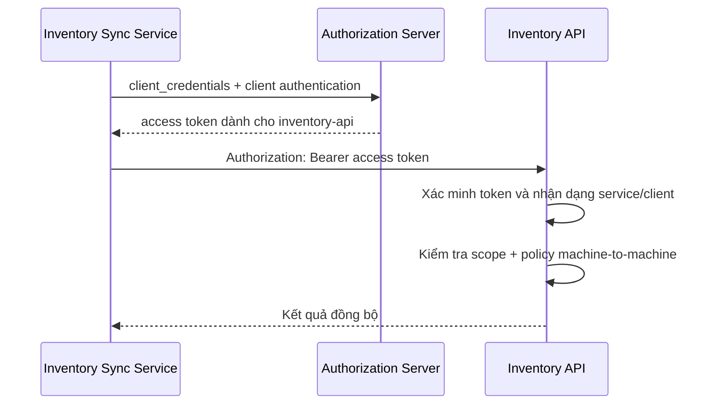
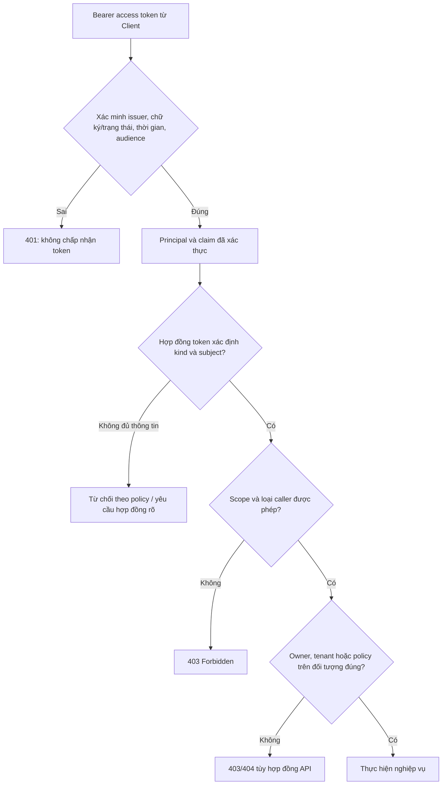

# Subject đại diện người dùng hay ứng dụng tùy loại token và nhà phát hành

Trong OAuth 2.0, Resource Server nhận **access token** để xác thực quyền truy cập API. Access token có thể chứa trường `sub` (*subject*), nhưng **`sub` không mặc định luôn là ID của người dùng đang ngồi trước màn hình**. Tùy vào kiểu cấp token (*grant*), định dạng token, profile và hợp đồng của Authorization Server, subject có thể đại diện cho một người dùng, một ứng dụng, một workload hoặc một chủ thể bảo mật khác.

Đây là chi tiết đặc biệt quan trọng khi lập trình **Spring Security OAuth 2.0 Resource Server**. Theo cấu hình JWT mặc định, `JwtAuthenticationToken.getName()` thường dùng claim `sub`. Nếu code nghiệp vụ thấy `authentication.getName()` rồi mặc định hiểu đó là `userId`, một machine-to-machine token có thể bị xử lý như token người dùng, dẫn đến sai quyền truy cập, sai dữ liệu sở hữu hoặc sai thông tin audit.

Ví dụ cùng một endpoint nhận hai access token đã được xác thực thành công:

Ví dụ A — access token được cấp trong ngữ cảnh người dùng:

```json
{
  "iss": "https://login.example.com/realms/shop",
  "sub": "user-123",
  "client_id": "web-app",
  "aud": ["orders-api"],
  "scope": "orders.read"
}
```

Ví dụ B — access token cho ứng dụng xử lý nền:

```json
{
  "iss": "https://login.example.com/realms/shop",
  "sub": "billing-worker",
  "client_id": "billing-worker",
  "aud": ["orders-api"],
  "scope": "orders.read"
}
```

Hai payload trên chỉ **minh họa claim**, không phải JWT hoàn chỉnh có thể đem sử dụng. Trong ví dụ A, `sub` là người dùng. Trong ví dụ B, `sub` là ứng dụng. Ở cả hai, `client_id` xác định OAuth Client; `aud` xác định API dự kiến nhận token; `scope` mô tả quyền được cấp. **Không thể lấy tên claim `sub` làm bằng chứng rằng chủ thể là người dùng.**

## 1. Phân biệt subject, client, actor và resource owner

OAuth 2.0 có nhiều vai trò. Một access token được cấp trong ngữ cảnh của một Client, nhưng **Client không nhất thiết đồng nhất với chủ thể mà token đại diện**.

| Khái niệm | Cách hiểu thực tế | Ví dụ |
| --- | --- | --- |
| **Subject (`sub`)** | Chủ thể được định danh trong token theo hợp đồng của issuer/token profile. | `user-123` hoặc `billing-worker`. |
| **OAuth Client (`client_id`)** | Ứng dụng đã đăng ký với Authorization Server, tham gia xin token. | `web-app`, `billing-worker`, `backend-service`. |
| **Resource Owner** | Chủ thể có khả năng cấp quyền truy cập tài nguyên; trong flow người dùng thường là End-User. | Khách hàng đồng ý cho ứng dụng đọc đơn hàng. |
| **Actor / bên hành động** | Bên trực tiếp thực hiện lời gọi hoặc hành động thay một chủ thể khác khi có cơ chế ủy quyền. | Backend gọi API thay người dùng qua token exchange. |
| **Audience (`aud`)** | Dịch vụ/API được dự kiến nhận token. | `orders-api`. |
| **Authority / scope** | Quyền thao tác được Resource Server chấp nhận từ token đã xác thực. | `SCOPE_orders.read`. |

Ba câu hỏi khác nhau cần được trả lời:

1. **Ai/điều gì là subject?** Trường `sub` có ý nghĩa gì trong token này?
2. **Ứng dụng nào đã xin hoặc đang sử dụng token?** Thông tin `client_id`, `azp` hoặc actor có nghĩa gì theo issuer?
3. **Token cho phép làm gì?** API nào được nhận token, scope nào được cấp, và đối tượng nghiệp vụ nào được truy cập?

Không nên gom ba câu hỏi thành một thuộc tính `userId` duy nhất.

### Subject không nhất thiết là bên đang gửi HTTP request

Một web frontend có thể gọi API qua backend với access token của người dùng. Khi đó `sub` có thể là người dùng, còn HTTP request trực tiếp đến API được gửi bởi backend. Trong một flow machine-to-machine, cả Client lẫn subject có thể biểu diễn cùng một ứng dụng. Trong cơ chế token exchange hoặc delegation, subject và actor có thể là hai chủ thể khác nhau.

Vì vậy, câu “Ai gọi API?” đôi khi có **nhiều câu trả lời hợp lệ ở những lớp khác nhau**: network caller, OAuth Client, subject và bên được ủy quyền. Hợp đồng token phải chỉ rõ lớp nào được dùng cho quyết định bảo mật cụ thể.

## 2. Grant và kiểu token ảnh hưởng tới ngữ nghĩa `sub`

### 2.1. Authorization Code trong ngữ cảnh người dùng

Trong luồng Authorization Code với người dùng, Authorization Server đã thực hiện quy trình cấp quyền có liên quan End-User. Access token được API chấp nhận thường có subject gắn với người dùng đó nếu token profile định nghĩa như vậy.

Một access token minh họa:

```json
{
  "iss": "https://login.example.com/realms/shop",
  "sub": "user-123",
  "client_id": "shop-web",
  "aud": ["orders-api"],
  "scope": "orders.read profile.read",
  "exp": 1900000000
}
```

Ở ví dụ này:

- `sub = user-123`: subject là người dùng theo hợp đồng issuer.
- `client_id = shop-web`: Client xin token là ứng dụng web; **không phải ID người dùng**.
- `aud = orders-api`: token được dự kiến sử dụng ở API này.
- `scope`: quyền đã cấp cho việc truy cập tài nguyên; vẫn cần kiểm tra owner và tenant ở API.

Không phải mọi Authorization Server đều phát hành access token với cùng tên claim hoặc cùng cấu trúc, dù flow OAuth giống nhau. Cần đọc đúng **hợp đồng access token được issuer công bố cho Resource Server**.

### 2.2. Client Credentials trong machine-to-machine

Trong OAuth 2.0 **Client Credentials**, Client xin token bằng định danh và credential của **chính ứng dụng**. Flow này không yêu cầu một End-User đang đăng nhập. Vì vậy, một token được cấp cho `inventory-sync` không tự mang danh tính người dùng nào.



Một số issuer đặt `sub` bằng `client_id` trong token Client Credentials; issuer khác có thể dùng một subject identifier nội bộ, claim riêng hoặc cách biểu diễn khác. **Không được mặc định `sub == client_id` là quy luật cho mọi provider**. Tương tự, không được dựa vào việc hai giá trị khác nhau để kết luận token chắc chắn có End-User.

Ví dụ token của một issuer:

```json
{
  "iss": "https://login.example.com/realms/shop",
  "sub": "service-account-8735",
  "client_id": "inventory-sync",
  "aud": ["inventory-api"],
  "scope": "inventory.write",
  "exp": 1900000000
}
```

Ở đây `sub` là một **service account** do issuer quản lý, còn `client_id` là OAuth Client. Nếu API có business rule dành cho ứng dụng `inventory-sync`, cần định nghĩa rõ sẽ so khớp `client_id`, `sub`, hay cả hai trong bối cảnh issuer nào.

Điều quan trọng hơn cú pháp: **không lấy `sub` của Client Credentials token làm owner của dữ liệu cá nhân** trừ khi hệ thống có một cơ chế ủy quyền và ánh xạ rõ ràng.

### 2.3. Token exchange, on-behalf-of và delegation

Trong một số kiến trúc, service A nhận request của người dùng rồi xin một token khác để gọi service B **thay người dùng**. Token được cấp có thể biểu diễn:

- `sub`: người dùng mà quyền đang được thực hiện thay.
- `client_id`: Client xin token.
- `act` hoặc claim tương đương: actor thực hiện hành động thay subject, **nếu token profile của provider hỗ trợ**.
- `aud`, `scope`: API B và quyền cụ thể cho phép.

Một payload minh họa theo phong cách actor claim:

```json
{
  "iss": "https://login.example.com/realms/shop",
  "sub": "user-123",
  "client_id": "order-bff",
  "act": {
    "sub": "order-bff"
  },
  "aud": ["payment-api"],
  "scope": "payments.create"
}
```

Claim `act` **không tự xuất hiện trong mọi access token**, cũng không có một cách ánh xạ actor duy nhất cho mọi provider. Nếu hệ thống sử dụng token exchange hoặc delegation, phải tuân theo profile thực sự được Authorization Server phát hành và Resource Server chấp nhận. Không tự cho phép client chèn claim `act` hoặc `sub` để tuyên bố “đang thay người dùng X”.

### 2.4. ID Token của OIDC là trường hợp khác

Trong **OIDC ID Token**, `sub` có ý nghĩa chuẩn là định danh End-User do OpenID Provider công bố cho OIDC Client. Nhưng Resource Server không được vì thế mà mặc định coi `sub` trong **mọi access token** cũng là End-User.

| Token | Mục đích | `sub` nên được hiểu theo đâu? |
| --- | --- | --- |
| **OIDC ID Token** | OIDC Client xác thực sự kiện đăng nhập và danh tính End-User. | Hợp đồng OIDC dành cho ID Token. |
| **User access token** | Truy cập protected resource trong ngữ cảnh người dùng. | Access-token profile và hợp đồng issuer; thường là End-User. |
| **Client Credentials access token** | Truy cập protected resource trong ngữ cảnh ứng dụng. | Hợp đồng issuer cho service/client subject. |
| **Exchanged/delegated access token** | Truy cập thay chủ thể hoặc có actor được chỉ định. | Token-exchange/delegation profile, subject và actor riêng. |

**Không gửi ID Token thay access token đến Resource Server.** Dù ID Token là JWT có chữ ký đúng, audience của nó thường là OIDC Client; API phải xác minh loại token và audience dành cho chính API.

## 3. `sub` có được đảm bảo luôn hiện diện và luôn ổn định?

Điều này phụ thuộc **định dạng access token và token profile**.

- Với JWT access token tuân theo một profile cụ thể như OAuth 2.0 JWT Access Token Profile, có các yêu cầu rõ ràng về claim và cách diễn giải subject. Resource Server phải theo đúng profile được thỏa thuận.
- Với JWT tùy biến của nhà phát hành, bộ claim có thể khác; một claim subject, client hoặc grant có thể được trình bày bằng tên riêng.
- Với **opaque access token**, Resource Server không đọc claim từ chuỗi token; thông tin subject có thể nằm trong kết quả introspection hoặc metadata do Authorization Server cung cấp, theo hợp đồng.

Không nên suy diễn về danh tính dựa trên việc JWT **đọc được payload**. JSON chưa được kiểm tra chữ ký/issuer/audience là dữ liệu không đáng tin.

### Tính ổn định và phạm vi của subject

Trong OIDC, `sub` thường được sử dụng cùng `iss` để định danh người dùng. Cùng một giá trị `sub` dưới **hai issuer khác nhau** không có nghĩa là cùng một tài khoản:

```text
(iss=https://login-a.example.com, sub=123) ≠
(iss=https://login-b.example.com, sub=123)
```

Với OIDC *pairwise subject identifiers*, cùng một End-User có thể nhận các giá trị `sub` khác nhau cho những Client/sector khác nhau theo cách issuer triển khai. Do đó cũng **không suy ra các `sub` khác nhau là hai người khác nhau trên thực tế** nếu chưa có cơ chế liên kết tài khoản được thiết kế rõ.

Đừng dùng email, display name hoặc preferred username để làm thay nhiệm vụ liên kết danh tính ổn định, vì các thuộc tính đó có thể thay đổi, không tồn tại, hoặc không duy nhất giữa các issuer.

## 4. Resource Server phải xác thực token trước khi diễn giải subject

Giả sử API nhận:

```http
POST /api/reports/generate HTTP/1.1
Host: api.example.com
Authorization: Bearer <access-token>
```

Một payload có `sub = admin` chưa chứng minh đây là người quản trị. Resource Server cần xác thực token theo cơ chế tương ứng:

**Với JWT:**

1. Xác minh chữ ký bằng khóa công khai và thuật toán đáng tin từ Authorization Server đã cấu hình.
2. Kiểm tra `iss`, thời gian (`exp`, `nbf`) và các validator mặc định.
3. Kiểm tra `aud` phù hợp với API; thêm validator audience nếu cấu hình hiện tại chưa thực thi chính sách này.
4. Kiểm tra các ràng buộc token type/profile và claim bắt buộc mà hệ thống đã thống nhất.
5. Chỉ khi thành công mới lấy subject/Client identity/authority từ token để xét quyền.

**Với opaque token:**

1. Gửi token theo cơ chế introspection được Authorization Server hỗ trợ hoặc dùng một validator đáng tin theo hợp đồng.
2. Kiểm tra trạng thái và metadata token trả về, bao gồm các ràng buộc API cần áp dụng.
3. Xây dựng principal và authority từ kết quả được tin cậy.

**Không sử dụng UserInfo endpoint thay xác thực access token.** UserInfo là một OIDC protected resource cung cấp claim hồ sơ cho Client có access token phù hợp; nó không phải phương thức chung để xác minh token dành cho mọi API.

## 5. Hành vi mặc định trong Spring Security Resource Server

Với cấu hình Resource Server JWT của Spring Security, quá trình thường diễn ra:

```text
Authorization: Bearer token
  -> BearerTokenAuthenticationFilter
  -> AuthenticationManager
  -> JwtAuthenticationProvider + JwtDecoder
  -> JWT được xác thực và chuyển thành JwtAuthenticationToken
  -> SecurityContext
  -> authorization rules / controller / service
```

`JwtAuthenticationToken` biểu diễn kết quả authentication. Trong cấu hình mặc định phổ biến:

- Principal là một đối tượng `Jwt` đã được decoder chấp nhận.
- `Jwt.getSubject()` trả claim `sub` nếu claim đó có trong JWT.
- `authentication.getName()` thường lấy từ claim `sub`.
- Các giá trị scope từ `scope` hoặc `scp` thường được ánh xạ sang authority với tiền tố `SCOPE_`.

**Spring Security không tự chứng minh `sub` là người dùng chỉ vì tên principal được gán từ `sub`.** Framework xác thực token và ánh xạ claim; ý nghĩa nghiệp vụ của claim phải do hợp đồng access token quy định.

Đoạn controller:

```java
@GetMapping("/api/whoami")
public String whoAmI(Authentication authentication) {
    return authentication.getName();
}
```

có thể trả `user-123` với user token và `inventory-sync` với một machine token. Hai kết quả đều có thể hợp lệ nhưng mang **hai loại danh tính khác nhau**. Endpoint tên `/whoami` vì vậy chỉ phù hợp khi hợp đồng API mô tả rõ “ai” ở đây là principal đã xác thực, chứ không mặc định là tài khoản người dùng.

## 6. Tách định danh người dùng và ứng dụng trong thiết kế nghiệp vụ

Một lỗi thường gặp là định nghĩa mọi API caller bằng cùng một biến:

```java
// Ví dụ phản diện: authentication.getName() luôn bị hiểu là userId.
String userId = authentication.getName();
return orderRepository.findByOwnerUserId(userId);
```

Nếu token từ `client_credentials` cũng có scope `orders.read`, đoạn mã có thể truy vấn sai dữ liệu, ghi audit không đúng hoặc làm một service account trông như tài khoản người dùng.

Thay vào đó, hãy định nghĩa **kiểu chủ thể** rõ ràng trong domain:

```java
public enum CallerKind {
    USER,
    SERVICE
}

public record CallerIdentity(
    CallerKind kind,
    String issuer,
    String subject,
    String clientId
) {}
```

Đây là kiểu dữ liệu ứng dụng, **không phải class Spring Security có sẵn**. Nó giúp service nhận một danh tính đã phân loại theo hợp đồng thay vì một chuỗi `userId` mơ hồ.

| Trường | Ý nghĩa | Lưu ý |
| --- | --- | --- |
| `kind` | User hoặc service theo hợp đồng token. | Không được tự suy ra từ `sub` có dạng email hay UUID. |
| `issuer` | Nơi phát hành đã được xác thực. | Cần cho phân biệt namespace subject. |
| `subject` | Giá trị `sub` đã được xác thực. | Tùy loại token, có thể đại diện user hoặc app. |
| `clientId` | Client được xác định từ claim đã xác thực. | Không mặc định luôn bằng subject. |

Đối với hệ thống nhiều tenant, có thể bổ sung `tenantId` đã kiểm tra hoặc ánh xạ từ dữ liệu tin cậy. Không chấp nhận một header client tự khai `X-Caller-Kind: USER` hay `X-Tenant-Id: ...` làm bằng chứng xác thực.

## 7. Cách xác định USER hay SERVICE mà không đoán mò

Không có một công thức phổ quát cho mọi issuer như:

```text
sub == client_id   => SERVICE
sub != client_id   => USER
```

Hai so sánh đó đều có thể sai. Một service account có `sub` nội bộ khác `client_id`; một provider khác có thể dùng mapping phức tạp cho user hoặc actor.

**Cách làm phù hợp** là yêu cầu Authorization Server phát hành token theo một hợp đồng rõ ràng. Ví dụ, riêng hệ thống của bạn thống nhất một custom claim **đã được issuer ký**:

```json
{
  "iss": "https://login.example.com/realms/shop",
  "sub": "service-account-8735",
  "client_id": "inventory-sync",
  "aud": ["inventory-api"],
  "scope": "inventory.write",
  "principal_type": "service"
}
```

Trong hệ thống khác, trường này có thể tên `token_kind`, `gty`, `grant_type` hoặc không tồn tại. **`principal_type` ở ví dụ là quy ước tùy biến, không phải claim mặc định mà mọi OAuth 2.0 issuer đều phải cấp.**

Một `CallerIdentityResolver` minh họa cách kiểm tra hợp đồng claim đã xác minh:

```java
import org.springframework.security.access.AccessDeniedException;
import org.springframework.security.oauth2.jwt.Jwt;
import org.springframework.stereotype.Component;

@Component
public class CallerIdentityResolver {

    public CallerIdentity resolve(Jwt jwt) {
        String issuer = jwt.getIssuer().toString();
        String subject = jwt.getSubject();
        String clientId = jwt.getClaimAsString("client_id");
        String principalType = jwt.getClaimAsString("principal_type");

        if (subject == null || subject.isBlank()) {
            throw new AccessDeniedException("Missing subject");
        }

        CallerKind kind;
        if ("user".equals(principalType)) {
            kind = CallerKind.USER;
        } else if ("service".equals(principalType)) {
            kind = CallerKind.SERVICE;
        } else {
            throw new AccessDeniedException("Unknown principal type");
        }

        if (kind == CallerKind.SERVICE &&
            (clientId == null || clientId.isBlank())) {
            throw new AccessDeniedException("Missing client identity");
        }

        return new CallerIdentity(kind, issuer, subject, clientId);
    }
}
```

Mã trên **giả định** issuer đáng tin phát hành claim `principal_type` theo hợp đồng mà cả hai phía đã thống nhất. Việc chấp nhận JWT, chữ ký, issuer, audience và các claim khác vẫn thuộc `JwtDecoder` và policy Resource Server. Với nhiều issuer, từng issuer có thể cần adapter/validator và cách ánh xạ riêng. **Nếu không có tín hiệu đáng tin để phân biệt loại caller, từ chối thao tác cần phân loại và thiết kế lại hợp đồng token**, thay vì đoán.

### Vì sao phải kiểm tra cả issuer?

Một claim như `"principal_type": "service"` chỉ có ý nghĩa khi đúng **issuer được tin cậy** thực sự cam kết phát hành và kiểm soát nó. Nếu API chấp nhận nhiều issuer, không nên cho issuer A tự khai role/identity mà chỉ issuer B được quyền cấp. Chính sách có thể yêu cầu mapping:

```text
Issuer A -> sub là user ID, client_id là OAuth Client, principal_type=user/service.
Issuer B -> subject nằm trong metadata introspection và có issuer-specific mapping.
Issuer C -> chỉ chấp nhận machine token cho API quản trị nền.
```

Đó là **ví dụ hợp đồng giả định**, không phải quy tắc áp dụng sẵn. Resource Server cần cấu hình các nguồn tin cậy tương ứng và xác minh token đến đúng từ issuer đã được cho phép.

## 8. Ví dụ cấu hình Spring Security để phân quyền theo loại caller

Đối với Spring Boot 3 / Spring Security 6, khai báo dependency:

```gradle
dependencies {
    implementation 'org.springframework.boot:spring-boot-starter-security'
    implementation 'org.springframework.boot:spring-boot-starter-oauth2-resource-server'
}
```

Cấu hình issuer JWT:

```yaml
spring:
  security:
    oauth2:
      resourceserver:
        jwt:
          issuer-uri: https://login.example.com/realms/shop
```

URL chỉ để minh họa; trong triển khai thật, phải khớp issuer của token được chấp nhận.

### SecurityFilterChain và scope theo chức năng

```java
import org.springframework.context.annotation.Bean;
import org.springframework.context.annotation.Configuration;
import org.springframework.http.HttpMethod;
import org.springframework.security.config.Customizer;
import org.springframework.security.config.annotation.web.builders.HttpSecurity;
import org.springframework.security.config.http.SessionCreationPolicy;
import org.springframework.security.web.SecurityFilterChain;

@Configuration
public class ApiSecurityConfig {

    @Bean
    SecurityFilterChain apiSecurity(HttpSecurity http) throws Exception {
        return http
            .securityMatcher("/api/**")
            .csrf(csrf -> csrf.disable())
            .sessionManagement(session -> session
                .sessionCreationPolicy(SessionCreationPolicy.STATELESS))
            .authorizeHttpRequests(auth -> auth
                .requestMatchers(HttpMethod.GET, "/api/orders/**")
                    .hasAuthority("SCOPE_orders.read")
                .requestMatchers(HttpMethod.POST, "/api/jobs/sync")
                    .hasAuthority("SCOPE_inventory.sync")
                .anyRequest().denyAll())
            .oauth2ResourceServer(oauth2 -> oauth2
                .jwt(Customizer.withDefaults()))
            .build();
    }
}
```

Ở đây, `oauth2ResourceServer(...jwt(...))` thiết lập **xác thực Bearer JWT**. `hasAuthority(...)` là một lớp **phân quyền scope**. Chưa có quy tắc nào trong ví dụ tự kiểm tra caller là USER hay SERVICE; đó là trách nhiệm của policy tiếp theo.

Ví dụ tắt CSRF giả định API chỉ dùng Bearer token truyền tường minh trong header, không dùng cookie tự động gửi từ browser để xác thực. Nếu ứng dụng còn dùng session/cookie login, cần cấu hình CSRF phù hợp.

### Controller cho phép chỉ người dùng đọc đơn hàng cá nhân

```java
import org.springframework.http.HttpStatus;
import org.springframework.security.core.annotation.AuthenticationPrincipal;
import org.springframework.security.oauth2.jwt.Jwt;
import org.springframework.web.bind.annotation.GetMapping;
import org.springframework.web.bind.annotation.PathVariable;
import org.springframework.web.bind.annotation.RestController;
import org.springframework.web.server.ResponseStatusException;

@RestController
public class OrderController {

    private final CallerIdentityResolver identities;
    private final OrderService orders;

    public OrderController(
            CallerIdentityResolver identities,
            OrderService orders) {
        this.identities = identities;
        this.orders = orders;
    }

    @GetMapping("/api/orders/{id}")
    public OrderDto find(
            @PathVariable long id,
            @AuthenticationPrincipal Jwt jwt) {

        CallerIdentity caller = identities.resolve(jwt);
        if (caller.kind() != CallerKind.USER) {
            throw new ResponseStatusException(HttpStatus.FORBIDDEN);
        }

        return orders.findOwnedOrder(
            id, caller.issuer(), caller.subject());
    }
}
```

`OrderService` và `OrderDto` là các thành phần ứng dụng minh họa; `findOwnedOrder` phải kiểm tra owner/tenant trong dữ liệu nghiệp vụ, thay vì chỉ dựa vào scope. Vì controller kiểm tra loại caller, service token có `orders.read` vẫn **không được giả làm user** để xem đơn hàng cá nhân. Trong ứng dụng lớn, cùng chính sách có thể đặt ở service hoặc method-security component để áp dụng nhất quán từ nhiều entry point.

### Controller chỉ cho phép service chạy job nền

```java
@PostMapping("/api/jobs/sync")
@ResponseStatus(HttpStatus.ACCEPTED)
public void runSync(@AuthenticationPrincipal Jwt jwt) {
    CallerIdentity caller = identities.resolve(jwt);

    if (caller.kind() != CallerKind.SERVICE ||
        !"inventory-sync".equals(caller.clientId())) {
        throw new ResponseStatusException(HttpStatus.FORBIDDEN);
    }

    inventoryService.scheduleSync(caller.issuer(), caller.subject());
}
```

Đây là một method minh họa đặt trong controller đã có `identities` và `inventoryService` được inject; cần các import web tương ứng. `SecurityFilterChain` bên trên kiểm tra `SCOPE_inventory.sync`; method này thêm ràng buộc **loại chủ thể và Client được phép**. Trong dự án thật nên cấu hình allowlist Client theo môi trường, không hardcode tùy tiện.

**Tại sao kiểm tra cả scope lẫn loại caller?** Scope cho biết token được phép yêu cầu thao tác nào; loại caller cho biết chủ thể nào đang sử dụng quyền đó và tài nguyên nào có thể được truy cập. Một service token có scope rộng không tự đại diện cho mọi người dùng.

## 9. Xác minh audience và claim hợp đồng ngay ở tầng token

Trước khi dùng `principal_type`, `sub` hoặc `client_id` để phân quyền, Resource Server phải xác minh token đúng issuer và đúng audience. Cấu hình `issuer-uri` thường thiết lập các validator issuer/thời gian, nhưng **không nên ngầm cho rằng audience của ứng dụng đã được kiểm tra đúng**.

Ví dụ bổ sung audience validator cho Spring Security 6:

```java
import java.util.List;

import org.springframework.context.annotation.Bean;
import org.springframework.context.annotation.Configuration;
import org.springframework.security.oauth2.core.DelegatingOAuth2TokenValidator;
import org.springframework.security.oauth2.core.OAuth2TokenValidator;
import org.springframework.security.oauth2.jwt.Jwt;
import org.springframework.security.oauth2.jwt.JwtClaimValidator;
import org.springframework.security.oauth2.jwt.JwtDecoder;
import org.springframework.security.oauth2.jwt.JwtValidators;
import org.springframework.security.oauth2.jwt.NimbusJwtDecoder;

@Configuration
public class JwtValidationConfig {

    private static final String ISSUER =
        "https://login.example.com/realms/shop";

    @Bean
    JwtDecoder jwtDecoder() {
        NimbusJwtDecoder decoder =
            NimbusJwtDecoder.withIssuerLocation(ISSUER).build();

        OAuth2TokenValidator<Jwt> defaults =
            JwtValidators.createDefaultWithIssuer(ISSUER);

        OAuth2TokenValidator<Jwt> audience =
            new JwtClaimValidator<List<String>>(
                "aud",
                values -> values != null &&
                    values.contains("orders-api"));

        decoder.setJwtValidator(
            new DelegatingOAuth2TokenValidator<>(defaults, audience));
        return decoder;
    }
}
```

Đây là cấu hình **minh họa cho một API**; với `inventory-api` trong các ví dụ trước, thay `orders-api` bằng audience phù hợp hoặc thiết kế các security chain/API độc lập. Không bỏ các validator mặc định khi thêm audience.

Nếu API phụ thuộc bắt buộc vào một claim đã thống nhất như `principal_type`, có thể bổ sung validator từ chối token thiếu/không hợp lệ ngay ở decoder. Chính sách cần phân biệt lỗi xác thực token với lỗi phân quyền:

- Token không hợp lệ với profile mà Resource Server bắt buộc chấp nhận: thường trả `401`.
- Token hợp lệ nhưng không có quyền thao tác hay không phải kiểu caller cho chức năng đó: thường trả `403`.

Không nên dùng một claim tự khai trong HTTP header làm thay dữ liệu từ JWT đã xác minh.

## 10. Với opaque access token, không ép mặc định principal thành JWT

Spring Security cũng hỗ trợ opaque token qua introspection. Cấu hình minh họa:

```yaml
spring:
  security:
    oauth2:
      resourceserver:
        opaquetoken:
          introspection-uri: https://login.example.com/oauth2/introspect
          client-id: ${INTROSPECTION_CLIENT_ID}
          client-secret: ${INTROSPECTION_CLIENT_SECRET}
```

Security filter chain khi đó chọn `.opaqueToken(Customizer.withDefaults())` thay cho `.jwt(...)`, tùy kiến trúc. Introspection response có thể chứa:

```json
{
  "active": true,
  "sub": "service-account-8735",
  "client_id": "inventory-sync",
  "scope": "inventory.write",
  "exp": 1900000000
}
```

Trong cơ chế này, `Authentication` thường là `BearerTokenAuthentication`, với `OAuth2AuthenticatedPrincipal` chứa các attribute tin cậy từ introspection. Việc `sub` đại diện user hay service vẫn do **hợp đồng Authorization Server** quy định. Không ép principal thành `Jwt` và không tự đoán loại caller từ cách chuỗi token trông như thế nào.

Ví dụ lấy thuộc tính từ introspected principal trong một endpoint đã được xác thực:

```java
@GetMapping("/api/caller")
public Map<String, Object> caller(Authentication authentication) {
    OAuth2AuthenticatedPrincipal principal =
        (OAuth2AuthenticatedPrincipal) authentication.getPrincipal();

    return Map.of(
        "principalName", principal.getName(),
        "clientId", String.valueOf(principal.getAttribute("client_id"))
    );
}
```

Đoạn trên chỉ minh họa **ứng dụng cấu hình opaque token** và endpoint đảm bảo principal có đúng kiểu, còn các giá trị `client_id`/`sub` tùy issuer có thể vắng mặt. Với API thực tế cần xử lý claim bắt buộc vắng mặt, phân loại caller theo profile và tránh trả dữ liệu nhạy cảm ra response. Nếu một endpoint có thể nhận nhiều kiểu principal, phải kiểm tra kiểu thay vì ép kiểu như ví dụ.

## 11. Các hệ quả khi dùng nhầm subject

### 11.1. Lộ dữ liệu do tưởng service token là user token

Giả sử API có luật:

```text
GET /api/orders/{id}
Yêu cầu SCOPE_orders.read
```

Nếu service token cũng có `orders.read`, một code path chỉ kiểm tra scope rồi đọc dữ liệu theo `sub` có thể cho service truy cập endpoint dành cho người dùng. Cần phân biệt policy **user-owned order** và policy **service-to-service inventory sync**, dù chúng dùng cùng JWT issuer.

### 11.2. Audit ghi sai chủ thể

Nếu bảng audit chỉ có `user_id` và mọi event ghi `authentication.getName()`, service `inventory-sync` sẽ xuất hiện như một “người dùng” giả. Một schema audit rõ ràng hơn có thể gồm:

```text
event_time
issuer
principal_type       // USER | SERVICE | ...
principal_subject    // giá trị sub đã xác minh
oauth_client_id       // client_id nếu được cấp
delegated_actor       // khi profile hỗ trợ và có
tenant_id             // nếu cần, từ nguồn đáng tin
action
resource_id
outcome
trace_id
```

Không ghi raw access token hay refresh token vào log/audit. Nếu cần khóa đối chiếu sự kiện, sử dụng request ID hoặc token identifier được phép ghi theo chính sách riêng, chứ không sao chép toàn bộ credential.

### 11.3. Trùng `sub` giữa các issuer

Hai issuer khác nhau có thể cùng phát hành `sub = 123`. Nếu database chỉ lưu `123`, API có nguy cơ liên kết nhầm tài khoản. Cần namespace định danh dựa trên issuer và loại chủ thể, cùng ánh xạ sang ID nội bộ khi phù hợp.

### 11.4. Client Credentials token dùng thay danh tính người dùng

Một job nền có thể được **ủy quyền để thực hiện hành động trên dữ liệu**, nhưng không có nghĩa job là chủ sở hữu cá nhân của các bản ghi. Nghiệp vụ có thể cấp quyền cho service xử lý tất cả các bản ghi trong tenant được cho phép; đó là một **policy riêng**, cần biểu diễn rõ ràng và giới hạn đúng mục đích.

### 11.5. Nhầm `client_id`, `azp` hoặc claim grant với subject

Một số issuer có `azp` (*authorized party*) hoặc claim riêng biểu diễn grant. Ý nghĩa của từng claim phụ thuộc token profile; không thay `sub` bằng `azp` hay `client_id` một cách máy móc. Grant type cũng không nên được suy ra từ request body khi API đang nhận Bearer access token: Resource Server phải tin dữ liệu từ token/introspection đã xác minh hoặc một hợp đồng kèm theo đã được bảo vệ.

## 12. Kịch bản xử lý bốn request khác nhau

Giả sử `orders-api` có endpoint đọc đơn hàng cá nhân, còn `inventory-api` có endpoint đồng bộ do service đảm nhiệm:

| Request và token | Subject có nghĩa gì? | Quyết định minh họa |
| --- | --- | --- |
| `GET /api/orders/42` với user token `sub=user-123`, `orders.read` | Người dùng `user-123`. | Chỉ cho phép nếu đơn 42 thuộc user/tenant phù hợp. |
| `GET /api/orders/42` với service token `sub=inventory-sync`, `orders.read` | Ứng dụng/service. | Từ chối policy dành riêng cho user, dù scope hợp lệ. |
| `POST /api/jobs/sync` với service token hợp lệ có `inventory.sync` | Service được xác thực. | Cho phép khi service nằm trong allowlist và phù hợp policy. |
| `POST /api/jobs/sync` với user token hợp lệ có `inventory.sync` | Người dùng. | Từ chối khi endpoint chỉ dành cho service. |

Việc dùng scope trùng tên giữa user token và machine token chỉ là giả định để làm rõ lỗi thường gặp: **scope không tự xác định loại chủ thể**. API thật nên thiết kế scope và policy sao cho quyền hạn của các nhóm caller rõ ràng.

Thành công authentication chưa đủ cho phép truy cập:



Khi không xác định được `kind` theo hợp đồng, không nên tự sửa `sub` hay tạo một user giả để đi tiếp. Chính sách fail-closed có thể trả lỗi không đủ quyền; nếu token vi phạm profile bắt buộc, có thể từ chối ngay ở bước validation.

## 13. Hướng dẫn xác định hợp đồng access token với Authorization Server

Trước khi viết code xử lý subject, đội phát hành token và đội Resource Server cần thống nhất những điểm sau:

| Câu hỏi | Ví dụ thỏa thuận |
| --- | --- |
| **Issuer nào được API tin cậy?** | `https://login.example.com/realms/shop`. |
| **API nhận audience nào?** | `orders-api` hoặc `inventory-api` theo endpoint/dịch vụ. |
| **Token nào được hỗ trợ?** | JWT access token theo profile đã thống nhất, hoặc opaque token qua introspection. |
| **`sub` của user token là gì?** | ID End-User do issuer quản lý. |
| **`sub` của machine token là gì?** | Client ID hoặc service-account ID theo issuer; không tự giả định. |
| **Phân biệt user và service thế nào?** | Claim đáng tin `principal_type`, endpoint/issuer policy, hoặc profile riêng được validator kiểm tra. |
| **`client_id` có mặt không?** | Tên claim, kiểu dữ liệu và mối quan hệ với `sub`. |
| **Delegation có tồn tại không?** | Cơ chế actor/subject nào được hỗ trợ và được API hiểu ra sao. |
| **Scope/role được ánh xạ thế nào?** | `orders.read` → `SCOPE_orders.read`; role tùy biến chỉ được chấp nhận nếu có mapping đáng tin. |
| **Dữ liệu nghiệp vụ quyết định quyền ở đâu?** | Ownership/tenant/membership trong service và database. |
| **Claim thay đổi hoặc token bị thu hồi ra sao?** | TTL, introspection, refresh/revocation và chính sách cập nhật quyền. |

Các giá trị trên là ví dụ. Một issuer có thể phát hành cùng một `sub` cho nhiều loại token; issuer khác có thể phát hành subject riêng cho service accounts. Resource Server phải thực hiện **hợp đồng thực tế**, không sao chép quy tắc của provider khác.

## 14. Kiểm thử phân biệt user token và machine token

Một bộ kiểm thử có ý nghĩa nên bao gồm:

| Trường hợp | Điều cần chứng minh |
| --- | --- |
| User token hợp lệ có đủ scope, đúng owner. | API trả dữ liệu được phép. |
| User token hợp lệ nhưng sai owner/tenant. | Bị từ chối ở policy dữ liệu (`403`/`404`). |
| Machine token hợp lệ có cùng scope user endpoint. | Không bị hiểu nhầm thành user. |
| Service token hợp lệ cho job nền. | Được phép khi cả scope và client/actor policy đúng. |
| User token đến job chỉ dành cho service. | Bị từ chối dù JWT hợp lệ. |
| Token thiếu claim phân loại bắt buộc. | Từ chối theo chính sách; không đoán kiểu caller. |
| JWT sai issuer, audience, chữ ký hoặc hết hạn. | Không được chấp nhận ở bước authentication (`401`). |
| Hai issuer phát cùng `sub`. | Danh tính không bị gộp nhầm trong mapping/audit. |
| Token có delegated actor. | Audit và phân quyền dựa trên contract subject/actor. |

Spring Security Test có thể tạo `JwtAuthenticationToken` giả lập bằng helper `jwt()` để kiểm tra policy theo claim/scope. Tuy nhiên, kiểm thử giả lập `jwt()` **không tự chứng minh** decoder trong production xác minh chữ ký, issuer hoặc audience đúng. Cần kiểm thử validation token thật hoặc tích hợp với một issuer/test JWK Set riêng khi cần xác thực end-to-end.

Trong khi debug, log thông tin đã được phép công bố như issuer, loại principal, Client ID và trace ID theo chính sách dữ liệu. Tránh log raw Bearer token hoặc toàn bộ các claim chứa thông tin cá nhân.

## 15. Kết nối các khái niệm trong thiết kế Resource Server

Hãy hình dung `sub` là **định danh trong một namespace có quy tắc**, thay vì một thuộc tính nghiệp vụ tự giải thích:

```text
Access Token
  |
  +-- Xác thực nguồn tin cậy
  |     issuer, chữ ký/trạng thái, thời gian, audience
  |
  +-- Diễn giải hợp đồng access token
  |     token profile, subject, client, actor, kind
  |
  +-- Tạo danh tính caller cho ứng dụng
  |     USER / SERVICE / DELEGATED ...
  |     issuer + subject + client identity
  |
  +-- Áp dụng chính sách quyền
        scope, role, owner, tenant, data policy
```

**Điểm cốt lõi:** `sub` có thể là người dùng hoặc ứng dụng tùy access token và nhà phát hành. Spring Security xác thực token và cung cấp principal, nhưng **Resource Server phải tự định nghĩa cách diễn giải principal theo hợp đồng đã tin cậy**. Phân biệt `sub` với `client_id`, biết rõ khi nào token đại diện người dùng hay service, và kiểm tra quyền trên tài nguyên sẽ giúp tránh nhầm danh tính, cấp quyền quá mức và ghi audit sai.
