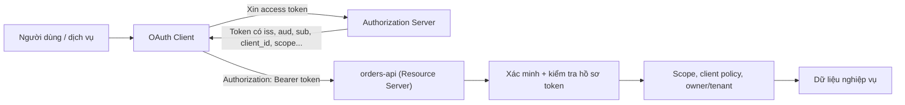
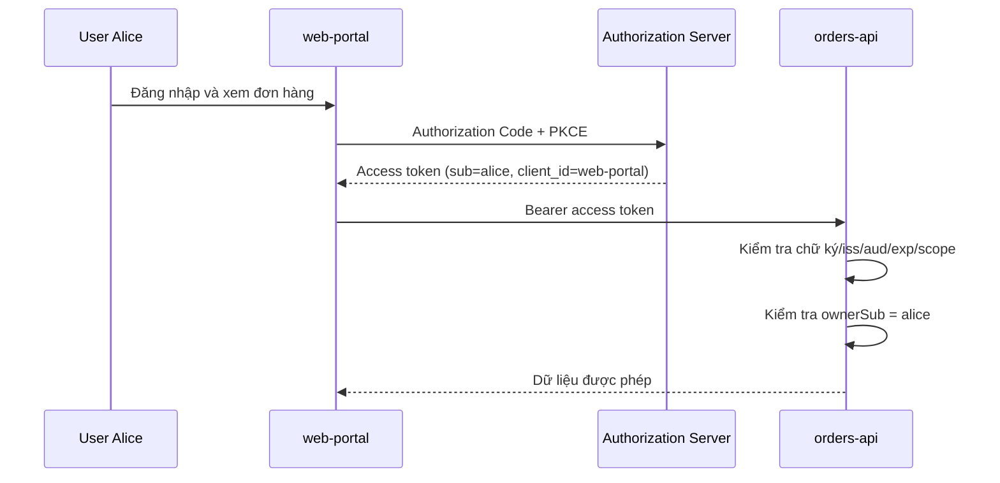

# `azp`, `client_id` và dữ liệu bổ sung: diễn giải theo hồ sơ access token

Trong hệ thống **Spring Security OAuth 2.0 / OIDC Resource Server**, API nhận một access token đã được Authorization Server phát hành. Nhiều token chứa các trường như `sub`, `aud`, `scope`, `azp`, `client_id`, `roles`, `tenant_id` hoặc `act`. Điều khó không nằm ở việc đọc được JSON; nó nằm ở việc hiểu **mỗi claim đang nói về ai, có nghĩa gì theo tiêu chuẩn/hồ sơ token nào, và có đủ cơ sở để dùng cho quyết định truy cập hay không**.

Hai câu hỏi thường bị trộn lẫn:

- **Ai là chủ thể được đại diện trong token?** Thường biểu diễn bằng `sub`, nhưng ý nghĩa thay đổi theo loại grant và hợp đồng với issuer.
- **OAuth client nào đã xin token?** Với hồ sơ JWT access token theo RFC 9068, claim `client_id` trả lời câu hỏi này. Với OIDC **ID Token**, `azp` có ý nghĩa được chuẩn hóa là *authorized party*, tức client nhận ID Token. Một số nhà cung cấp còn đưa `azp` vào **access token** như claim riêng của họ; khi đó phải đọc tài liệu hồ sơ cụ thể, không mặc định nó thay thế `client_id`.

Bài học trình bày từ mô hình niềm tin đến cách xây dựng hợp đồng claims, ví dụ ba loại token, cách đọc trong Spring Security, cơ chế ra quyết định và kế hoạch kiểm thử. Mọi host, client, người dùng và dữ liệu trong ví dụ đều là giả định.

## 1. Hợp đồng access token bắt đầu bằng việc xác định đúng vai trò

Hãy giả sử có bốn thành phần:

- **Identity Provider / Authorization Server (AS):** xác thực người dùng khi cần, kiểm tra yêu cầu ủy quyền và phát hành token.
- **Web client** `web-portal`: xin access token sau Authorization Code + PKCE để gọi API thay người dùng.
- **Batch client** `partner-batch`: xin access token bằng Client Credentials để đồng bộ công việc tự động.
- **Resource Server** `orders-api`: cung cấp endpoint, xác minh token và thực hiện chính sách truy cập.

Trên một request như:

```http
GET /api/orders/42 HTTP/1.1
Host: orders.example.test
Authorization: Bearer <ACCESS_TOKEN>
```

Resource Server cần trả lời những câu hỏi khác nhau:

| Câu hỏi | Dữ liệu thường dùng | Điều cần biết |
|---|---|---|
| **Ai đã phát hành token?** | `iss` | Chỉ chấp nhận issuer tin cậy, xác minh chữ ký hoặc introspection với issuer tương ứng. |
| **Token này dành cho API nào?** | `aud` | Token phải dành cho `orders-api`; `aud` không chỉ ra ai đã xin token. |
| **Token còn hiệu lực?** | `exp`, `nbf`, `iat` | Kiểm tra thời gian theo hồ sơ; `iat` không thay thế `exp`. |
| **Token đại diện cho chủ thể nào?** | `sub` | Có thể là user hoặc client/service tùy grant và hồ sơ. |
| **Client nào yêu cầu token?** | `client_id`, hoặc claim issuer-specific như `azp` | Không tự suy ra từ `sub`/`aud`. |
| **Client được cấp quyền thao tác gì?** | `scope`/`scp`, `roles`, `permissions` | Cần quy tắc ánh xạ và ràng buộc với audience. |
| **Yêu cầu có quyền trên bản ghi cụ thể?** | `sub`, `tenant_id`, dữ liệu trong DB | Đây là quyết định nghiệp vụ bổ sung, không tự xảy ra vì chữ ký hợp lệ. |
| **Có đang ủy quyền qua tác nhân trung gian?** | `act`, `may_act`, các claim khác | Chỉ có ý nghĩa nếu issuer phát hành theo hồ sơ ủy quyền tương ứng. |
| **Token có bị ràng buộc với bên trình token?** | `cnf`, chứng chỉ mTLS hoặc DPoP proof | Phải kiểm tra chứng minh khóa/chứng chỉ thực tế, không chỉ đọc claim. |

Sơ đồ quan hệ:



**`sub`, `client_id` và `aud` là ba trục khác nhau.** Việc một giá trị tình cờ trùng nhau trong token của Client Credentials không khiến ba trường trở nên đồng nghĩa.

## 2. Các chuẩn và hồ sơ token cần phân biệt

OAuth 2.0 bản thân nó không yêu cầu mọi access token phải là JWT. Token có thể là chuỗi opaque, JWT tuân RFC 9068, hoặc một định dạng riêng được hai bên thỏa thuận. Cách hiểu `azp` và `client_id` vì thế phụ thuộc **token profile**.

| Hồ sơ / đặc tả | Token được đề cập | Quy tắc đáng nhớ |
|---|---|---|
| **OAuth 2.0 Framework (RFC 6749)** | Access token nói chung | Định nghĩa việc cấp/tiêu thụ token; không bắt buộc token có JSON claims. |
| **OIDC Core** | **ID Token** | Định nghĩa `azp` (*authorized party*) là claim **tùy chọn**; nếu có, giá trị là OAuth 2.0 Client ID của bên được cấp ID Token. |
| **JWT Profile for OAuth 2.0 Access Tokens (RFC 9068)** | JWT access token theo hồ sơ chuẩn | `client_id` là **bắt buộc**. Header `typ` phải chỉ loại access token, thường `at+jwt`. |
| **OAuth 2.0 Token Exchange (RFC 8693)** | Access token, trong đó có token đổi từ token khác | Định nghĩa `client_id` là client đã yêu cầu token và thêm các claim như `act`/`may_act` cho một số trường hợp. |
| **OAuth 2.0 Token Introspection (RFC 7662)** | Phản hồi introspection cho access token | `active` là bắt buộc; `client_id` là trường **tùy chọn**, không giống quy tắc bắt buộc của RFC 9068. |
| **Hồ sơ riêng của IdP** | Access token do vendor/tenant cụ thể phát hành | Có thể dùng `azp`, `gty`, `realm_access`, `resource_access`, `tenant_id`...; phải kiểm tra tài liệu và hợp đồng phát hành thực tế. |

Chữ **“bắt buộc”** cần luôn đi kèm phạm vi: `client_id` bắt buộc **trong JWT access token tuân RFC 9068**, không phải trong mọi access token của OAuth 2.0. Tương tự, `azp` được chuẩn hóa **cho OIDC ID Token**, không phải claim bắt buộc của JWT access token chuẩn RFC 9068.

### 2.1. Ví dụ JWT access token theo RFC 9068

Phần JWS protected header có dạng:

```json
{
  "alg": "RS256",
  "typ": "at+jwt",
  "kid": "signing-key-01"
}
```

Payload minh họa:

```json
{
  "iss": "https://auth.example.test/realms/training",
  "sub": "user-123",
  "aud": ["orders-api"],
  "exp": 1890003600,
  "iat": 1890000000,
  "jti": "token-001",
  "client_id": "web-portal",
  "scope": "orders:read"
}
```

Đây là **JSON minh họa trước khi ký**, không phải Bearer token dùng được. Với hồ sơ RFC 9068:

- Những claims `iss`, `sub`, `aud`, `exp`, `iat`, `jti` và `client_id` là các claims bắt buộc của hồ sơ.
- `client_id = web-portal` nói client `web-portal` đã yêu cầu token; nó **không** nói `web-portal` là người sở hữu đơn hàng.
- `sub = user-123` biểu diễn chủ thể; trong luồng có người dùng, thường tương ứng người đã ủy quyền.
- `aud = orders-api` yêu cầu Resource Server phải là bên nhận hợp lệ; không biến `web-portal` thành đối tượng nhận.
- `scope = orders:read` mô tả quyền được cấp liên quan đến API `orders-api`; Resource Server còn phải kiểm tra quyền trên tài nguyên cụ thể.
- `typ = at+jwt` giúp chống nhầm **ID Token** với **access token**; khi chọn tuân nghiêm RFC 9068, Resource Server cần xác minh loại token này theo chuẩn.

Nếu IdP sử dụng một access-token profile khác, nó có thể không đặt `typ` hoặc `client_id` như trên. Khi ấy không tuyên bố token “tuân RFC 9068” chỉ vì payload có hình dạng JWT; thay vào đó phải thỏa thuận chính xác hồ sơ được phát hành và xác minh theo hồ sơ ấy.

### 2.2. Vì sao `client_id` trong token không tương đương xác thực client tại API?

`client_id` là **định danh** của OAuth client đã xin token. Nó không phải client secret và không phải bằng chứng rằng process đang gửi HTTP request hiện tại chính là process ban đầu đã xin token.

Một **Bearer token** về nguyên tắc có thể được sử dụng bởi bất kỳ bên nào nắm giữ token hợp lệ. Kể cả khi claim `client_id` được ký và kiểm tra đúng, nếu token bị đánh cắp, API vẫn có thể thấy `client_id = web-portal` từ token bị dùng lại. Khi yêu cầu phải ràng buộc token với bên trình token, hãy dùng phương án sender-constrained phù hợp như **mutual TLS** hoặc **DPoP**, cùng kiểm tra proof/certificate và claim `cnf` tương ứng.

Điều kiện `client_id` nằm trong allowlist có thể là **một tầng authorization**; nó không thay thế xác minh Bearer token, kiểm tra scope, tenant, quyền sở hữu, giới hạn API hay cơ chế proof-of-possession.

## 3. `azp` là gì, và khi nào có ý nghĩa?

Trong **OpenID Connect Core**, `azp` viết tắt của *authorized party*. Nó là claim tùy chọn của **ID Token**: nếu xuất hiện, nó phải chứa OAuth 2.0 Client ID của bên mà ID Token được cấp.

Ví dụ ID Token đã giải mã:

```json
{
  "iss": "https://auth.example.test/realms/training",
  "sub": "user-123",
  "aud": ["web-portal"],
  "azp": "web-portal",
  "exp": 1890003600,
  "iat": 1890000000
}
```

ID Token này **dành cho OIDC client `web-portal`**; nó không phải access token gửi đến `orders-api`. Chính `aud = web-portal` cho biết bên nhận dự kiến của ID Token. Khi ID Token chứa `azp`, OIDC client phải hiểu và kiểm tra claim theo các quy tắc xác thực ID Token áp dụng.

OIDC Core còn có hướng dẫn kiểm tra `azp` khi ID Token có nhiều audience: client cần xử lý sự hiện diện và giá trị của `azp` theo thuật toán xác minh ID Token trong OIDC Core. Không chuyển nguyên xi những quy tắc của **ID Token** sang **JWT access token** nếu hồ sơ access token không quy định như vậy.

### 3.1. Vì sao đôi khi access token cũng có `azp`?

Một số nhà cung cấp danh tính, chẳng hạn các triển khai có token schema riêng, vẫn thêm `azp` vào **access token** để diễn tả client liên quan đến việc phát hành/ủy quyền. Ví dụ minh họa một hồ sơ riêng:

```json
{
  "iss": "https://auth.example.test/realms/training",
  "sub": "user-123",
  "aud": ["orders-api"],
  "azp": "mobile-app",
  "scope": "orders:read",
  "exp": 1890003600
}
```

Nếu IdP của bạn bảo đảm trong tài liệu cấu hình rằng **ở hồ sơ access token này** `azp` mang client ID đã xin token, Resource Server có thể dùng `azp` theo hợp đồng đó. Nhưng không có bảo đảm chung rằng mọi access token OAuth đều có `azp`, hay rằng `azp` luôn có ý nghĩa giống `client_id`.

Hai quy tắc triển khai quan trọng:

1. **Không mặc định `azp == client_id`.** Khi cần định danh client, hãy chọn claim từ **hồ sơ token cụ thể của issuer**. Nếu token có cả hai claim, hợp đồng phải nói có bắt buộc chúng bằng nhau không và xử lý bất nhất thế nào.
2. **Không nhận ID Token làm Bearer access token.** Một token hợp lệ về chữ ký, chứa `azp` và `sub`, vẫn phải bị từ chối nếu nó là ID Token dành cho client chứ không dành cho Resource Server.

### 3.2. Trường hợp có cả `client_id` và `azp`

Giả sử issuer phát hành:

```json
{
  "iss": "https://auth.example.test/realms/training",
  "aud": ["orders-api"],
  "sub": "user-123",
  "client_id": "web-portal",
  "azp": "mobile-app",
  "scope": "orders:read"
}
```

**Không tự chọn một giá trị theo thứ tự ưu tiên** như “ưu tiên `client_id` nếu có, nếu không dùng `azp`” rồi cấp quyền. Đây là hai trường có thể thuộc các quy tắc khác nhau. Cần biết chính xác hồ sơ token: có phải token đã qua token exchange không; vendor định nghĩa `azp` là gì; có đang yêu cầu cả hai phải trùng nhau hay không; có thay đổi schema sau nâng cấp IdP không.

Trong hợp đồng yêu cầu chúng bằng nhau, token trên phải bị từ chối theo điều kiện hợp đồng. Trong hồ sơ mà `azp` có ý nghĩa khác, không nên áp đặt một quy tắc không được nhà phát hành cam kết. Nếu không giải thích được chính xác, **không dùng trường mơ hồ làm căn cứ phân quyền**.

## 4. Ý nghĩa của `client_id` và `sub` thay đổi theo luồng OAuth

### 4.1. Authorization Code + PKCE: token gắn với người dùng và client

Một ứng dụng tương tác có người dùng đăng nhập:



Token minh họa:

```json
{
  "iss": "https://auth.example.test/realms/training",
  "aud": ["orders-api"],
  "sub": "alice",
  "client_id": "web-portal",
  "scope": "orders:read"
}
```

Trong luồng này, `sub` thường là **người dùng Alice**, còn `client_id` là **ứng dụng `web-portal`**. Nếu Alice dùng thêm mobile app, token khác có thể có cùng `sub` nhưng `client_id = mobile-app`. Việc user giữ nguyên không có nghĩa token có cùng client.

Các điều kiện khác nhau có thể áp dụng đồng thời:

- Alice được phép đọc **đơn hàng do Alice sở hữu**.
- `web-portal` được phép dùng API theo chính sách quản lý client.
- Scope `orders:read` cho phép loại thao tác đọc, nhưng không tự cấp quyền đọc mọi đơn.
- API chấp nhận token chỉ khi `aud` chứa `orders-api`.

### 4.2. Client Credentials: không có user đăng nhập

Một batch job `partner-batch` có thể xin token bằng `client_credentials`:

```json
{
  "iss": "https://auth.example.test/realms/training",
  "aud": ["orders-api"],
  "sub": "partner-batch-service-subject",
  "client_id": "partner-batch",
  "scope": "orders:import"
}
```

Với RFC 9068, trong grant **không có resource owner**, `sub` nên đại diện cho client application theo định danh issuer chọn. Nó **không** phải “người dùng hiện đang đăng nhập”. `sub` cũng không bắt buộc phải có byte-for-byte cùng giá trị với `client_id`; một issuer có thể cấp subject identifier riêng cho ứng dụng.

Hệ quả:

- Một endpoint cần “chủ đơn hàng là user Alice” không thể tự động dùng `partner-batch-service-subject` như danh tính Alice.
- Quyền service-to-service nên được định nghĩa riêng bằng scope/role/chính sách client và các ràng buộc tenant thích hợp.
- Khi audit, phân biệt **chủ thể dịch vụ** với **người dùng tương tác**; không tự sinh user từ email, username hoặc tên client.
- Nếu sản phẩm hỗ trợ workload identity/service account, phải định nghĩa đường đi của nó trong nghiệp vụ và kiểm thử riêng.

### 4.3. Token Exchange và ủy quyền nhiều tầng

Trong các hệ thống nhiều dịch vụ, client A có thể đổi token ở Authorization Server để nhận token mới gọi backend B. RFC 8693 dùng `act` (*actor*) để biểu diễn tác nhân hiện tại, và `may_act` để mô tả tác nhân có thể được phép trở thành actor trong bối cảnh phù hợp.

Ví dụ access token mới được cấp sau token exchange, lược bớt claims:

```json
{
  "iss": "https://auth.example.test",
  "aud": ["orders-api"],
  "sub": "alice",
  "client_id": "api-gateway",
  "act": {
    "sub": "gateway-service"
  },
  "scope": "orders:read"
}
```

Trong một hợp đồng token exchange được thiết kế như vậy:

- `sub = alice` là **subject** được đại diện.
- `act.sub = gateway-service` là **actor** thực hiện hành động hiện tại; actor có thể có định danh khác với OAuth client.
- `client_id = api-gateway` là OAuth client đã yêu cầu token **mới** theo định nghĩa của `client_id`; nó không tự ghi lại lịch sử mọi client trước đó.
- Các actor lồng sâu hơn, nếu có, có thể mô tả lịch sử ủy quyền; RFC 8693 đặt quy tắc riêng về việc dùng actor hiện tại và lịch sử actor trong access control.

Không đồng nhất `act.sub`, `client_id` và `azp`. Chúng trả lời các câu hỏi khác nhau và chỉ xuất hiện khi issuer thực sự áp dụng hồ sơ có các claim đó. Không kết luận “user thật là Alice” nếu token service-to-service không có quy tắc delegation tương ứng.

### 4.4. Cùng một field, các kết luận khác nhau

| Trường hợp | `sub` nên hiểu là | `client_id` nên hiểu là | Câu hỏi còn phải giải quyết |
|---|---|---|---|
| Authorization Code + PKCE | Resource owner/user (thường vậy) | Web/mobile client đã xin access token | User này có quyền trên bản ghi nào? |
| Client Credentials | Định danh ứng dụng/dịch vụ do issuer cấp | OAuth client xin token | Workload có được làm thao tác và trong tenant nào? |
| Token Exchange | Subject được đại diện theo token đã cấp | Client xin token mới | Actor nào đang hành động, mức delegation được phép? |
| Opaque token qua introspection | Giá trị `sub` nếu server cung cấp | Giá trị `client_id` **nếu** server cung cấp | `active`, scope, issuer/context đã đáng tin và đầy đủ chưa? |
| OIDC ID Token | Người dùng xác thực | Thường **không** biểu diễn bằng claim `client_id`; client nhận ID Token qua `aud`/`azp` | Đây là token để client xác thực người dùng, không phải credential của API. |

## 5. Dữ liệu bổ sung: diễn giải theo ý nghĩa chứ không theo tên

Một token có thể chứa nhiều claims bổ sung. Một số là chuẩn có ý nghĩa riêng; số khác hoàn toàn do vendor hoặc ứng dụng định nghĩa. Nếu không có hợp đồng schema rõ ràng, **đừng biến chúng thành quyết định bảo mật chỉ vì tên trường nghe hợp lý**.

### 5.1. Nhóm xác minh nguồn gốc, hiệu lực và mục đích

| Claim / header | Ý nghĩa | Diễn giải an toàn |
|---|---|---|
| `iss` | Issuer | So sánh chính xác với issuer tin cậy; claim phải nằm trong token đã xác minh. |
| `aud` | Audience | API phải nằm trong danh sách audience, bất kể `client_id` hoặc `azp`. |
| `exp` / `nbf` | Hết hạn / bắt đầu hiệu lực | Validator kiểm tra theo đồng hồ và clock skew chính sách. |
| `iat` | Thời điểm phát hành | Hữu ích trong profile/audit; không thay kiểm tra hết hạn. |
| `jti` | ID token duy nhất trong ngữ cảnh issuer | Hỗ trợ audit/anti-replay/revocation **nếu hệ thống có hạ tầng tương ứng**; chỉ có `jti` không tự thu hồi token. |
| Header `typ` | Phân loại token (ví dụ `at+jwt`) | Nếu tuân RFC 9068, phải kiểm tra loại phù hợp, tránh nhận ID Token làm access token. |
| Header `alg`, `kid` | Thuật toán và khóa ký | Decoder chỉ chấp nhận thuật toán được cho phép, lấy khóa từ JWKS tin cậy; không lấy khóa từ URL do token tự chỉ định. |

### 5.2. Nhóm chủ thể, client và phiên xác thực

| Claim | Có thể chỉ ra | Giới hạn |
|---|---|---|
| `sub` | Subject của token | Đối với Client Credentials không mặc định là người dùng; phải kết hợp `iss` để bảo đảm namespace. |
| `client_id` | OAuth client yêu cầu token | Bắt buộc trong RFC 9068; không phải bằng chứng người trình token đang giữ client secret. |
| `azp` | Authorized party theo OIDC ID Token; hoặc ý nghĩa issuer-specific trong access token | Không dùng làm universal alias của `client_id`. |
| `sid` | Session ID trong một số hồ sơ OIDC | Không tự đồng nghĩa access token còn hiệu lực hay bị thu hồi; kiểm tra profile và cơ chế logout. |
| `auth_time` | Thời điểm user thực hiện xác thực | Chỉ có ý nghĩa khi issuer phát hành theo bối cảnh user; không nhất thiết có trong Client Credentials. |
| `amr` | Authentication Methods References | Phương pháp xác thực đã sử dụng; không tự mang nghĩa “MFA luôn đủ” nếu chưa thỏa thuận giá trị/chuẩn. |
| `acr` | Authentication Context Class Reference | Lớp/mức đảm bảo xác thực; cần hợp đồng về từng giá trị ACR và yêu cầu API. |
| `nonce` | Chống replay/khớp phiên trong luồng OIDC client | Thuộc quy trình xác thực ID Token của OIDC; không dùng như quyền của access token API. |

**Claim `auth_time`, `acr`, `amr` có thể dùng cho chính sách yêu cầu xác thực mạnh**, nhưng Resource Server chỉ nên tin vào giá trị do issuer bảo đảm và hiểu chính xác ranh giới. Ví dụ yêu cầu MFA cần định nghĩa cụ thể tập giá trị `acr`/`amr` nào đáp ứng, mức độ tươi của `auth_time` và xử lý khi claim không có.

### 5.3. Nhóm phân quyền

| Claim | Biểu diễn hay gặp | Lưu ý |
|---|---|---|
| `scope` | Chuỗi phân tách bằng dấu cách, ví dụ `"orders:read orders:write"` | Các scope phải có nghĩa đối với resource trong `aud`. |
| `scp` | Chuỗi hoặc mảng tùy issuer | Không giả định format nếu chưa định nghĩa converter. |
| `roles` / `groups` / `entitlements` | Chuỗi, mảng hoặc cấu trúc riêng | Cần thiết kế mapping vào `GrantedAuthority` và giới hạn quyền theo resource/tenant. |
| `permissions` | Danh sách quyền fine-grained của một vendor | Không phải claim JWT chuẩn chung; phải hiểu rõ namespace và authority cấp quyền. |
| `authorization_details` | Chi tiết ủy quyền theo Rich Authorization Requests (RFC 9396) khi được dùng | Không quy đổi tùy tiện thành scope; dữ liệu thường có cấu trúc và điều kiện riêng. |

Trong Spring Security Resource Server JWT, converter mặc định thường đọc `scope`/`scp` thành authorities tiền tố `SCOPE_`; **`client_id` hoặc `azp` không tự tạo ra authority đặc quyền**. Nếu token có `roles`, hãy định nghĩa converter tương thích với loại dữ liệu và issuer, sau đó kiểm tra cả privilege và điều kiện đối tượng.

### 5.4. Nhóm tổ chức, tenant và thông tin người dùng

Các claim hay gặp gồm `tenant_id`, `organization_id`, `org_id`, `email`, `email_verified`, `preferred_username`, `name`, `locale` hoặc `department`. Chúng thường là dữ liệu bổ sung hoặc thuộc **issuer-specific contract**.

Không suy ra:

- `email` hoặc `preferred_username` là khóa chính người dùng ổn định. Email có thể đổi, trùng theo hệ thống hoặc vắng mặt; có thể bị khai báo chưa xác minh.
- `tenant_id` mặc nhiên cho quyền vào mọi tài nguyên của tenant. API phải đối chiếu tenant tin cậy với tenant lưu trên bản ghi và kiểm tra vai trò/scope tương ứng.
- `groups = ["admins"]` luôn đồng nghĩa quyền quản trị của chính API. Có thể nhóm ở IdP dùng cho mục đích khác, namespace khác hoặc không ánh xạ trực tiếp.
- Có claim `department` đồng nghĩa được phê duyệt mua hàng. Điều kiện nghiệp vụ cần thêm dữ liệu tin cậy và workflow riêng.

Với hệ đa issuer, `sub = "123"` có thể tồn tại ở hai issuer khác nhau và chỉ đến hai chủ thể khác nhau. Khi lưu subject trong database, thường nên dùng khóa hợp thành **(issuer, subject)**, và tenant nếu yêu cầu. `client_id` cũng chỉ có ý nghĩa trong namespace của issuer/authorization server tương ứng.

### 5.5. Nhóm delegation và proof-of-possession

- `act` trong RFC 8693 chỉ ra actor hiện tại trong một trường hợp ủy quyền/đại diện. Không đọc actor lồng nhau như những người dùng cùng được cấp quyền.
- `may_act` chỉ ra chủ thể có thể được ủy quyền làm actor trong ngữ cảnh token exchange; không phải scope cấp API trực tiếp.
- `cnf` (*confirmation*) chỉ khóa hoặc thông tin ràng buộc xác nhận quyền sử dụng token. Với DPoP có thể dùng `cnf.jkt`; với mTLS có thể dùng `cnf["x5t#S256"]`. Resource Server phải kiểm tra proof/chứng chỉ của **request hiện tại** khớp ràng buộc token.
- Các claim như `gty`, `token_use`, `ver`, `realm_access` hoặc `resource_access` phụ thuộc IdP và token profile. Chúng có thể hữu ích, nhưng không mang ý nghĩa OAuth phổ quát nếu hai bên chưa thỏa thuận.

Đặc biệt, **một `client_id` được ký không phải sender-constrained token**; đừng bỏ qua kiểm tra DPoP/mTLS chỉ vì đã biết client nào xin token.

## 6. Opaque token và introspection: có `client_id` thì đọc ở đâu?

Khi access token là chuỗi opaque, Resource Server không thể tùy ý `Base64URL decode` để đọc payload. Thay vào đó nó gọi **introspection endpoint** của Authorization Server theo RFC 7662, bằng thông tin xác thực được quản lý an toàn.

Phản hồi giả định:

```json
{
  "active": true,
  "scope": "orders:read",
  "client_id": "web-portal",
  "sub": "alice",
  "aud": "orders-api",
  "iss": "https://auth.example.test",
  "exp": 1890003600
}
```

Theo RFC 7662, `active` là trường bắt buộc của phản hồi introspection, còn `client_id` là **tùy chọn**. Một phản hồi hợp lệ có thể không có `client_id`. Authorization Server phải bảo vệ introspection endpoint và Resource Server phải kiểm tra phản hồi đến từ AS tin cậy, sau đó thực thi các điều kiện về audience/scope theo hợp đồng.

Khi `active = false`, AS nên trả về rất ít thông tin ngoài trạng thái đó; không suy luận “client là ai” hoặc lý do token không hoạt động từ trường vắng mặt. Với introspection, việc cache phản hồi cần cân bằng độ trễ và độ kịp thời của thay đổi quyền/thu hồi token.

Trong Spring Security, nhánh JWT và nhánh opaque có principal type khác nhau. Mã gọi `((JwtAuthenticationToken) authentication).getToken()` chỉ dùng cho JWT; với opaque, Spring thường cung cấp `BearerTokenAuthentication` và `OAuth2AuthenticatedPrincipal`. Do đó, **logic trích xuất client identity nên được thiết kế theo profile** hoặc thông qua một lớp abstraction do ứng dụng kiểm soát.

## 7. Xây dựng hợp đồng access token trước khi viết phân quyền

Hợp đồng phải mô tả dữ liệu nào bắt buộc, được phát hành bởi ai, trong loại token nào, và cách xử lý mọi trường hợp không khớp. Một biểu mẫu phù hợp cho `orders-api`:

| Trường hợp / claim | Hồ sơ người dùng JWT RFC 9068 | Hồ sơ dịch vụ JWT RFC 9068 | Hồ sơ access token vendor dùng `azp` |
|---|---|---|---|
| Nguồn tin cậy | Issuer A, JWKS A | Issuer A, JWKS A | Issuer B, JWKS B |
| Đối tượng nhận | `aud` chứa `orders-api` | `aud` chứa `orders-api` | `aud` chứa `orders-api` |
| Loại token | Header `typ=at+jwt` | Header `typ=at+jwt` | Theo quy tắc riêng của issuer B |
| Chủ thể `sub` | User ID | Service subject | Theo định nghĩa issuer B |
| Client identity | **`client_id` bắt buộc** | **`client_id` bắt buộc** | `azp` nếu issuer B cam kết mang client ID |
| `azp` | Không cần mặc định | Không cần mặc định | Bắt buộc theo **hợp đồng riêng**, không theo RFC 9068 |
| Quyền thao tác | `scope`/role đã định nghĩa | Scope dành riêng workload | Claim path được xác định rõ |
| Chủ thể sở hữu dữ liệu | (iss, sub), thêm tenant khi cần | Chính sách service-to-service riêng | Mapping theo hồ sơ issuer B |
| Thiếu claim bắt buộc của profile | Từ chối token | Từ chối token | Từ chối token hoặc từ chối quyền theo ranh giới policy đã thỏa thuận |

Đây là **ví dụ về ba hồ sơ khác nhau**, không phải khuyến nghị một API phải bật đồng thời cả ba. Mỗi issuer/profile đưa đến một trust boundary và điều kiện bảo mật khác nhau. Nếu không có nhu cầu đa issuer, chỉ chấp nhận một profile rõ ràng thường dễ kiểm soát hơn.

### 7.1. Các mục phải ghi thành hợp đồng

1. **Issuer**: URI chính xác, JWKS/introspection endpoint, chính sách khóa ký và thuật toán.
2. **Loại token**: JWT access token RFC 9068, access token JWT vendor-specific, opaque token, hoặc sender-constrained token.
3. **Audience**: tên API/resource cụ thể; token dành cho ứng dụng frontend hoặc một API khác phải bị từ chối.
4. **Grant được hỗ trợ**: Authorization Code, Client Credentials, Token Exchange; với mỗi grant phải định nghĩa `sub` và actor nếu có.
5. **Client identity**: claim nào là nguồn chuẩn (`client_id` hay `azp`), kiểu dữ liệu, bắt buộc hay tùy chọn, quan hệ với issuer và hành vi khi thiếu.
6. **Authorization data**: scope/role/permissions, vị trí JSON path, kiểu dữ liệu, namespace, ánh xạ sang quyền endpoint.
7. **Business data**: tenant/organization, độ tin cậy và tần suất cập nhật, cách đối chiếu database.
8. **Extension**: `act`, `cnf`, `acr`, `amr`... được dùng theo chuẩn/hồ sơ nào; validator nào thực hiện kiểm tra.
9. **Trạng thái lỗi**: token sai cấu trúc/chữ ký/issuer/audience/claim bắt buộc thường là lỗi authentication; token hợp lệ thiếu quyền là authorization.
10. **Thay đổi tương thích**: ai quản lý version claim/profile, kế hoạch migration và kiểm thử với token thật.

### 7.2. Quy tắc đối với claim vắng mặt và sai kiểu

Một API cần client ID cho chính sách đối tác phải có hành vi rõ ràng khi token:

- Không có `client_id` trong **RFC 9068 token**: xem là vi phạm hồ sơ; không được coi là “client công khai”.
- Có `client_id` nhưng kiểu array/object thay vì string: từ chối theo schema; không gọi `toString()` rồi so khớp.
- Có `client_id = ""` hoặc toàn khoảng trắng: coi như không hợp lệ theo chính sách.
- Có `azp` nhưng không có `client_id` trong issuer chỉ hỗ trợ RFC 9068: không tự lấy `azp` làm fallback.
- Có cả `client_id` và `azp` khác nhau: xử lý theo policy đã định, không tự đoán.
- Có client ID lạ nhưng token vẫn có scope: nếu endpoint chỉ dành cho client được đăng ký, từ chối ở lớp authorization.
- Có scope và client ID hợp lệ nhưng `aud` sai: từ chối ở lớp authentication, trước khi xét scope.

**Fail closed** là nguyên tắc mặc định: không có đủ thông tin tin cậy để áp dụng policy thì không cấp quyền.

## 8. Triển khai trong Spring Security: xác minh trước, diễn giải sau

Ví dụ tiếp theo sử dụng **Java 17+, Spring Boot 3.x / Spring Security 6.x**, issuer giả định có thể phát hành JWT access token theo RFC 9068. Lưu ý các ví dụ là các mảnh triển khai cho một API, cần gắn với cấu hình Authorization Server đang sử dụng.

### 8.1. Cấu hình issuer và audience

Các dependency cần có:

```xml
<dependencies>
    <dependency>
        <groupId>org.springframework.boot</groupId>
        <artifactId>spring-boot-starter-web</artifactId>
    </dependency>
    <dependency>
        <groupId>org.springframework.boot</groupId>
        <artifactId>spring-boot-starter-security</artifactId>
    </dependency>
    <dependency>
        <groupId>org.springframework.boot</groupId>
        <artifactId>spring-boot-starter-oauth2-resource-server</artifactId>
    </dependency>
</dependencies>
```

```yaml
spring:
  security:
    oauth2:
      resourceserver:
        jwt:
          issuer-uri: https://auth.example.test/realms/training
          audiences:
            - orders-api
```

Cấu hình này yêu cầu Spring Resource Server xác minh JWT qua issuer/JWKS tin cậy và kiểm tra audience dành cho API. Nó **không mặc nhiên áp dụng đầy đủ mọi yêu cầu của RFC 9068** như kiểu token `at+jwt` và schema `client_id`. Nếu cần tuân RFC 9068 một cách nghiêm ngặt, hãy dùng validator dành cho access-token profile tương ứng và xác định token type được chấp nhận; xem mục sau.

### 8.2. Validator cho hồ sơ RFC 9068

Tài liệu Spring Security có hỗ trợ tạo validator riêng cho `at+jwt`. Ví dụ khai báo `JwtDecoder` khi API chỉ cho phép JWT access token theo RFC 9068:

```java
package com.example.orders.security;

import org.springframework.context.annotation.Bean;
import org.springframework.context.annotation.Configuration;
import org.springframework.security.oauth2.jwt.Jwt;
import org.springframework.security.oauth2.jwt.JwtDecoder;
import org.springframework.security.oauth2.jwt.JwtValidators;
import org.springframework.security.oauth2.jwt.NimbusJwtDecoder;

@Configuration
class JwtProfileConfig {
    private static final String ISSUER =
        "https://auth.example.test/realms/training";
    private static final String AUDIENCE = "orders-api";

    @Bean
    JwtDecoder jwtDecoder() {
        // Loại token sẽ do AtJwtValidator kiểm tra theo hồ sơ RFC 9068.
        NimbusJwtDecoder decoder = NimbusJwtDecoder.withIssuerLocation(ISSUER)
            .validateTypes(false)
            .build();

        decoder.setJwtValidator(
            JwtValidators.createAtJwtValidator()
                .issuer(ISSUER)
                .audience(AUDIENCE)
                .build()
        );
        return decoder;
    }
}
```

**Điều kiện áp dụng:** token thực tế của issuer phải tuân RFC 9068, trong đó có header `typ=at+jwt`/`application/at+jwt` và các claim bắt buộc. Nếu issuer không phát hành hồ sơ này, không thể chỉ “bật kiểm tra at+jwt” rồi yêu cầu mọi token vendor hoạt động như cũ. Khi cần kiểm tra `client_id` bằng một allowlist nhiều client cho **một endpoint**, có thể kiểm tra client ở tầng authorization riêng.

Khi tự khai báo `JwtDecoder`, cấu hình bean của bạn thay thế một phần cơ chế tự cấu hình của Boot; phải chủ động giữ các validator `iss`, `aud`, `exp`, `nbf` và token type phù hợp. Không tạo decoder chỉ parse token mà không xác minh chữ ký.

> **Ghi chú phiên bản:** API `JwtValidators.createAtJwtValidator()` và các builder có thể khác theo phiên bản Spring Security cụ thể; kiểm tra bản dependency thực dùng trước khi áp dụng. Mục tiêu bảo mật độc lập với API builder: xác minh chữ ký, issuer, audience, thời hạn, loại token và các claim bắt buộc theo profile.

### 8.3. Đọc `client_id` an toàn từ `JwtAuthenticationToken`

Sau khi JWT đã vượt qua decoder, Spring Security cung cấp một `JwtAuthenticationToken`. Nếu API muốn biết client xin token, hãy đọc **đúng claim được cam kết trong profile**:

```java
package com.example.orders.security;

import org.springframework.security.core.Authentication;
import org.springframework.security.oauth2.server.resource.authentication.JwtAuthenticationToken;
import org.springframework.stereotype.Component;

@Component("partnerClientGate")
public class PartnerClientGate {

    public boolean allow(Authentication authentication) {
        if (!(authentication instanceof JwtAuthenticationToken auth)
                || !authentication.isAuthenticated()) {
            return false;
        }

        Object rawClientId = auth.getToken().getClaims().get("client_id");

        // RFC 9068: client_id phải là string của client đã xin token.
        // Không fallback sang azp trong profile này.
        return rawClientId instanceof String clientId
            && "partner-batch".equals(clientId);
    }
}
```

Tại sao không dùng `authentication.getName()`? Theo mặc định, `JwtAuthenticationToken#getName()` thường ánh xạ tới `sub`, tức **subject** của token, chứ không phải `client_id`. Với grant của người dùng, `getName()` thường là user; với Client Credentials, subject có thể trùng hoặc khác client ID tùy issuer.

Nếu hợp đồng vendor yêu cầu `azp` thay vì `client_id`, xây dựng **một parser riêng cho profile ấy** với kiểm tra issuer, kiểu dữ liệu, giá trị cho phép và quy tắc bất nhất; không sửa parser RFC 9068 thành “lấy cả hai, cái nào có dùng cái đó”.

### 8.4. Chặn endpoint bằng cả scope và client policy

Bật method security để diễn đạt hai điều kiện độc lập: caller có quyền thao tác, và access token được cấp cho client nằm trong danh sách đối tác được phép.

```java
package com.example.orders.security;

import org.springframework.context.annotation.Bean;
import org.springframework.context.annotation.Configuration;
import org.springframework.http.HttpMethod;
import org.springframework.security.config.Customizer;
import org.springframework.security.config.annotation.method.configuration.EnableMethodSecurity;
import org.springframework.security.config.annotation.web.builders.HttpSecurity;
import org.springframework.security.config.annotation.web.configurers.AbstractHttpConfigurer;
import org.springframework.security.config.http.SessionCreationPolicy;
import org.springframework.security.web.SecurityFilterChain;

@Configuration
@EnableMethodSecurity
public class ApiSecurityConfig {

    @Bean
    SecurityFilterChain apiSecurity(HttpSecurity http) throws Exception {
        return http
            // Chỉ phù hợp API stateless dùng Bearer trong Authorization header.
            .csrf(AbstractHttpConfigurer::disable)
            .sessionManagement(session ->
                session.sessionCreationPolicy(SessionCreationPolicy.STATELESS))
            .authorizeHttpRequests(auth -> auth
                .requestMatchers(HttpMethod.POST, "/api/partner/payments")
                    .hasAuthority("SCOPE_payment:create")
                .anyRequest().denyAll())
            .oauth2ResourceServer(oauth -> oauth.jwt(Customizer.withDefaults()))
            .build();
    }
}
```

```java
package com.example.orders.api;

import org.springframework.http.ResponseEntity;
import org.springframework.security.access.prepost.PreAuthorize;
import org.springframework.web.bind.annotation.PostMapping;
import org.springframework.web.bind.annotation.RestController;

@RestController
public class PartnerPaymentController {

    @PostMapping("/api/partner/payments")
    @PreAuthorize("@partnerClientGate.allow(authentication)")
    public ResponseEntity<Void> createPayment() {
        // Ví dụ chỉ minh họa kiểm soát truy cập trước khi chạy nghiệp vụ.
        return ResponseEntity.accepted().build();
    }
}
```

Khi client `partner-batch` được cấp token hợp lệ cho `orders-api` với scope `payment:create`, request có thể đi đến controller. Client khác có cùng scope nhưng không trong allowlist sẽ bị `403`. Một Bearer token sai chữ ký, sai issuer/audience, hết hạn hoặc sai loại profile bị từ chối ở bước authentication trước đó, thường `401`.

Đây chỉ là **hai điều kiện đầu của endpoint**. Khi nghiệp vụ tạo khoản thanh toán thực, cần thêm kiểm tra đối tác đang được kích hoạt, tenant/hợp đồng kinh doanh, giới hạn số tiền, idempotency, audit và các quy tắc chống thao tác lặp hoặc gian lận phù hợp hệ thống.

### 8.5. Nếu có nhiều issuer hoặc nhiều hồ sơ

Không chọn hồ sơ bằng cách tin ngay vào `iss` hay `azp` **chưa được xác minh** trong token thô. Với nhiều issuer, bộ xác minh phải sử dụng danh sách issuer đã cho phép, mỗi issuer gắn với cấu hình khóa/metadata riêng, rồi mới áp dụng mapper và policy claims của issuer đó.

Có thể thiết kế một lớp giải nghĩa chính thức:

```java
public record TokenClientIdentity(
    String issuer,
    String clientId,
    String sourceClaim
) { }
```

| Hồ sơ tin cậy sau validation | Trường lấy client identity | Hành vi nếu thiếu |
|---|---|---|
| `RFC9068@issuer-A` | `client_id` | Từ chối vì token vi phạm hợp đồng. |
| `LegacyAccess@issuer-B` | `azp`, theo tài liệu issuer-B | Từ chối hoặc không đủ quyền theo policy; không lấy claim khác tùy ý. |
| `Introspection@issuer-C` | `client_id` nếu introspection cung cấp | Với endpoint yêu cầu client identity, từ chối nếu thiếu; có thể chọn policy chỉ dựa vào scope cho endpoint khác. |

Lớp mapping chỉ nên chạy **sau bước xác minh token** và trả về giá trị có nguồn gốc rõ ràng. Không đưa token raw, payload JSON chưa xác minh hay HTTP parameter `client_id` vào lớp này. Trong hệ đa issuer, chính sách kết hợp `issuer + client ID` cần được tách biệt, tránh trùng client ID giữa các tenant của IdP.

## 9. Kiểm thử hợp đồng: chứng minh từng điều kiện bị từ chối đúng chỗ

Để kiểm thử chính xác, phân biệt ba lớp:

1. **Unit test mapper/policy:** đọc các claims đã được tạo từ dữ liệu thử nghiệm và kiểm tra cách ứng dụng hiểu `client_id`, `azp`, kiểu dữ liệu, thiếu trường, bất nhất.
2. **HTTP / authorization test:** kiểm tra Spring filter/method security áp dụng scope, allowlist và nghiệp vụ. Mock authentication ở lớp này giúp tập trung vào policy.
3. **JWT validation / integration test:** dùng token ký thật và issuer/JWKS thử nghiệm, kiểm tra chữ ký, issuer, audience, thời hạn, `typ` và claim bắt buộc. Với opaque, kiểm tra introspection `active` và dữ liệu trả về.

### 9.1. Ma trận kiểm thử

| Tình huống | Hợp đồng kỳ vọng | Kết quả |
|---|---|---|
| `client_id = partner-batch`, scope `payment:create`, token hợp lệ | Đúng client và đủ quyền | Cho phép. |
| `client_id = mobile-app`, scope giống hệt | Client không trong allowlist | `403`. |
| Token RFC 9068 thiếu `client_id` | Vi phạm profile | Không chấp nhận token / fail closed. |
| Token RFC 9068 chỉ có `azp = partner-batch` | `azp` không được dùng thay `client_id` | Không chấp nhận theo RFC 9068. |
| `client_id` là array/object | Sai schema | Từ chối, không stringify ép kiểu. |
| `client_id` rỗng | Không có client ID dùng được | Từ chối. |
| Token đúng client, thiếu scope | Không đủ quyền thao tác | `403`. |
| Token có `scope` và `client_id` nhưng `aud` không chứa API | Sai audience | `401`. |
| ID Token có `azp` hợp lệ, `aud` dành cho web client | Không phải access token của API | `401`. |
| Token bị sửa `client_id` trong payload nhưng không ký lại | Sai chữ ký | `401`. |
| Token Client Credentials, `sub` khác `client_id` | Khác vai trò nhưng không bất thường | Đánh giá theo profile, không tự từ chối vì không trùng. |
| Token Exchange có `sub` và `act` | Phân biệt subject/actor/current client | Áp dụng delegation policy, kiểm tra đúng actor nếu cần. |
| Introspection trả `active=false` | Không có credential hợp lệ | `401`; bỏ qua các trường client/subject bổ sung. |
| Introspection `active=true` nhưng thiếu `client_id` | RFC 7662 cho phép vắng mặt | Endpoint cần allowlist client phải fail closed. |
| User A có scope nhưng truy cập đơn User B | Scope không cấp ownership | `403`/`404` tùy hợp đồng API. |

Lưu ý mã HTTP chính xác khi **claim bắt buộc bị thiếu** phụ thuộc vị trí kiểm tra: nếu decoder validator coi token sai hồ sơ, thường trả `401`; nếu token hợp lệ theo hồ sơ nhưng bị policy endpoint từ chối vì thiếu một trường tùy chọn, thường trả `403`. Điều cốt lõi là **không cấp quyền** trong cả hai trường hợp, và ghi rõ policy để client xử lý nhất quán.

### 9.2. Ví dụ test policy với `spring-security-test`

Các request dưới đây sử dụng `jwt()` từ `spring-security-test` để tạo authentication giả trong MockMvc. Đây là kiểm thử **authorization**, không phải bài test xác minh chữ ký hoặc kiểm tra `typ`/`aud`:

```java
import static org.springframework.security.test.web.servlet.request.SecurityMockMvcRequestPostProcessors.jwt;
import static org.springframework.test.web.servlet.request.MockMvcRequestBuilders.post;
import static org.springframework.test.web.servlet.result.MockMvcResultMatchers.status;

import org.junit.jupiter.api.Test;
import org.springframework.beans.factory.annotation.Autowired;
import org.springframework.boot.test.autoconfigure.web.servlet.AutoConfigureMockMvc;
import org.springframework.boot.test.context.SpringBootTest;
import org.springframework.security.core.authority.SimpleGrantedAuthority;
import org.springframework.test.web.servlet.MockMvc;

@SpringBootTest
@AutoConfigureMockMvc
class PartnerPaymentPolicyTest {

    @Autowired
    MockMvc mvc;

    @Test
    void approvedClientWithScopeCanCall() throws Exception {
        mvc.perform(post("/api/partner/payments")
                .with(jwt()
                    .jwt(token -> token
                        .claim("sub", "service-123")
                        .claim("client_id", "partner-batch"))
                    .authorities(
                        new SimpleGrantedAuthority("SCOPE_payment:create"))))
            .andExpect(status().isAccepted());
    }

    @Test
    void unapprovedClientCannotCallEvenWithSameScope() throws Exception {
        mvc.perform(post("/api/partner/payments")
                .with(jwt()
                    .jwt(token -> token
                        .claim("sub", "service-123")
                        .claim("client_id", "mobile-app"))
                    .authorities(
                        new SimpleGrantedAuthority("SCOPE_payment:create"))))
            .andExpect(status().isForbidden());
    }

    @Test
    void azpIsNotAnAutomaticFallbackForClientId() throws Exception {
        mvc.perform(post("/api/partner/payments")
                .with(jwt()
                    .jwt(token -> token
                        .claim("sub", "service-123")
                        .claim("azp", "partner-batch"))
                    .authorities(
                        new SimpleGrantedAuthority("SCOPE_payment:create"))))
            .andExpect(status().isForbidden());
    }

    @Test
    void approvedClientStillNeedsScope() throws Exception {
        mvc.perform(post("/api/partner/payments")
                .with(jwt()
                    .jwt(token -> token
                        .claim("client_id", "partner-batch"))
                    .authorities(
                        new SimpleGrantedAuthority("SCOPE_orders:read"))))
            .andExpect(status().isForbidden());
    }
}
```

Để chứng minh **khả năng phát hiện ID Token, sai issuer/audience, sai `typ`, sai chữ ký, hết hạn**, cần kiểm thử `JwtDecoder` với JWT thực được ký bằng cặp khóa RSA thử nghiệm và cấu hình JWKS cục bộ. Bài test MockMvc dùng `jwt()` có thể đặt arbitrary claims và bỏ qua decoder, do đó **không thể** thay thế test cryptographic validation.

### 9.3. Test tích hợp với Authorization Server

Khi có môi trường IdP thật, tạo ít nhất bốn khách hàng/chủ thể thử nghiệm:

- `web-portal` gọi API thay user Alice qua Authorization Code + PKCE.
- `mobile-app` gọi API thay cùng user Alice để thấy `sub` có thể giống nhưng `client_id` khác.
- `partner-batch` gọi API qua Client Credentials để thấy `sub` đại diện workload.
- Một client chỉ dành cho Token Exchange để xác nhận `act`/`sub` và `client_id` trong token kết quả.

Thu thập **token mẫu giả lập/đã ẩn dữ liệu nhạy cảm** hoặc metadata schema đã chuẩn hóa trong kho kiểm thử có quyền hạn, không lưu access token thật vào log hay repository. So sánh claims đúng sau khi được Resource Server xác minh và kiểm thử các endpoint tương ứng.

## 10. Một số lỗi thiết kế thường gặp

### Lỗi 1 — Dùng `azp` làm client ID cho mọi loại token

`azp` là khái niệm OIDC ID Token; access token vendor có thể thêm nhưng không có bảo đảm chung. Nếu API dùng `azp` vô điều kiện, việc nâng cấp IdP hoặc chuyển sang RFC 9068 có thể khiến policy sai. Cần ràng buộc parser vào **issuer/profile đã xác minh**.

### Lỗi 2 — Coi `sub` luôn là người dùng

Client Credentials không có resource owner. Nếu lấy `sub` làm user ID để gắn chủ đơn, service token có thể đi vào đường nghiệp vụ người dùng không phù hợp. Cần tách user flow và workload flow, hoặc có mô hình subject rõ cho cả hai.

### Lỗi 3 — Coi `client_id` đã chứng minh ai đang gọi qua mạng

Bearer token có thể bị phát lại nếu bị đánh cắp. Khi yêu cầu ràng buộc bên gửi, dùng mTLS/DPoP và kiểm tra chứng minh sở hữu khóa trên mỗi request theo chính sách.

### Lỗi 4 — Chấp nhận token dành cho frontend làm access token của API

Một ID Token có thể được ký bởi cùng IdP, chứa `sub`, `azp`, thậm chí `email`. Nếu không kiểm tra loại token và audience, API có nguy cơ token substitution/cross-JWT confusion. Cần thực thi hồ sơ access token và `aud` dành riêng cho Resource Server.

### Lỗi 5 — Biến role/tenant/profile claim thành quyền không có căn cứ

`roles`, `tenant_id`, `groups` hay `permissions` có thể là claims tùy biến. Chỉ được dùng theo issuer/hợp đồng cụ thể; giữ các quy tắc owner, tenant và chính sách nghiệp vụ ở tầng phù hợp.

### Lỗi 6 — Phân quyền theo giá trị JSON trước khi xác minh

Payload JWT chỉ Base64URL encoded, ai cũng sửa được trước khi ký. Không đọc raw payload để quyết định `client_id` hoặc scope, kể cả khi JSON nhìn hợp lệ. Decoder phải xác minh chữ ký và claims trước khi controller/service tiếp nhận `Jwt`.

### Lỗi 7 — Sử dụng fallback âm thầm khi token thiếu claim

Ví dụ `client_id ?? azp ?? sub` khiến quyền truy cập có thể mở rộng ngoài ý muốn giữa các hồ sơ. Fallback chỉ hợp lý nếu được **viết thành quy tắc tương thích có kiểm thử, có mốc kết thúc**, và vẫn không làm suy yếu kiểm tra issuer/token type/audience.

### Lỗi 8 — Nhận `jti` là cơ chế revocation

`jti` là định danh token. Muốn thu hồi token trước `exp` cần hạ tầng/thiết kế tương ứng (denylist, introspection, token lifetime phù hợp hoặc cơ chế khác). Chỉ có `jti` trong payload không tự làm token bị vô hiệu.

## 11. Quy trình đưa một claim mới vào hợp đồng API

Khi nhóm danh tính đề xuất thêm `azp`, `client_id`, `organization_id` hoặc một thuộc tính mới, hãy triển khai theo trình tự:

1. **Ghi mục đích**: claim phục vụ audit, nhận diện client, phân quyền thao tác, ràng buộc dữ liệu hay hiển thị giao diện?
2. **Xác định profile**: JWT access token RFC 9068, access token đặc thù issuer, ID Token, hay introspection? Loại token nào được gửi đến API?
3. **Ràng buộc nguồn**: issuer, signing keys/introspection, audience và token type; claim phải chỉ được đọc sau validation.
4. **Định nghĩa schema**: claim path, kiểu dữ liệu, các giá trị hợp lệ, bắt buộc/tùy chọn, namespace, trường hợp không có.
5. **Định nghĩa ý nghĩa**: claim nói về user, client, actor, tenant, session hay kỹ thuật xác thực? Tránh một claim mang hai nghĩa không được phân biệt.
6. **Viết quy tắc ra quyết định**: điều kiện độc lập về scope/role, client allowlist, ownership, tenant và proof-of-possession.
7. **Thêm bộ ví dụ và test âm tính**: thiếu, sai kiểu, thay đổi giá trị, client lạ, token dành cho API khác, user/service khác nhau.
8. **Triển khai đồng bộ với issuer**: xác nhận IdP thực sự phát hành claims như hợp đồng, có version/migration nếu thay đổi schema.
9. **Quan sát có giới hạn**: ghi loại lỗi, mã client được ẩn/mã hóa phù hợp và request correlation khi cần; không log access token, refresh token, user claims nhạy cảm.
10. **Đánh giá việc cần cập nhật động**: role/tenant thay đổi giữa tuổi thọ access token; xác định trade-off giữa token ngắn hạn, token exchange, introspection và tra cứu nghiệp vụ.

Một ví dụ diễn đạt thành policy:

```text
Permit POST /api/partner/payments only if:
  1. Access token matches the trusted issuer and access-token profile.
  2. The token is valid now, properly signed, and aud includes orders-api.
  3. Scope contains payment:create.
  4. The client_id from RFC9068 is exactly partner-batch.
  5. The business partner account is active and belongs to the target tenant.
  6. Sender-constrained proof is valid if this endpoint requires it.
Otherwise deny according to the failing authentication/authorization layer.
```

Quy tắc này cho thấy **`client_id` là một thuộc tính của hợp đồng access token, không phải toàn bộ quyết định truy cập**. Với issuer dùng `azp`, chỉ thay đường diễn giải client identity khi có hồ sơ chính thức, và vẫn giữ mọi kiểm tra trust, audience, scope và nghiệp vụ.

## Tài liệu tham chiếu chuẩn

- [RFC 9068 — JSON Web Token (JWT) Profile for OAuth 2.0 Access Tokens](https://www.rfc-editor.org/rfc/rfc9068.html): đặc tả `client_id` bắt buộc trong JWT access token profile, `typ` `at+jwt`, claims bắt buộc và các yêu cầu Resource Server.
- [OpenID Connect Core 1.0 — ID Token và claim `azp`](https://openid.net/specs/openid-connect-core-1_0.html): định nghĩa `azp` là *authorized party* tùy chọn của **ID Token**.
- [RFC 8693 — OAuth 2.0 Token Exchange](https://www.rfc-editor.org/rfc/rfc8693.html): `client_id`, `act`, `may_act` và các ngữ cảnh delegation.
- [RFC 7662 — OAuth 2.0 Token Introspection](https://www.rfc-editor.org/rfc/rfc7662.html): ý nghĩa `active` và `client_id` tùy chọn trong introspection response.
- [RFC 7519 — JSON Web Token (JWT)](https://www.rfc-editor.org/rfc/rfc7519.html): các claim `iss`, `sub`, `aud`, `exp`, `iat` và `jti`.
- [RFC 9396 — OAuth 2.0 Rich Authorization Requests](https://www.rfc-editor.org/rfc/rfc9396.html): cách mô tả `authorization_details`.
- [RFC 9449 — OAuth 2.0 Demonstrating Proof of Possession (DPoP)](https://www.rfc-editor.org/rfc/rfc9449.html) và [RFC 8705 — OAuth 2.0 Mutual-TLS Client Authentication and Certificate-Bound Access Tokens](https://www.rfc-editor.org/rfc/rfc8705.html): ràng buộc token với người trình.
- [Spring Security Reference — OAuth 2.0 Resource Server JWT](https://docs.spring.io/spring-security/reference/servlet/oauth2/resource-server/jwt.html): cơ chế giải mã/xác minh JWT, mapping authorities, validation và `JwtValidators.createAtJwtValidator()`.

Khi làm việc với một issuer mới, câu hỏi đầu tiên nên là **“Đây là token theo hồ sơ nào, và issuer cam kết những claims nào với ý nghĩa gì?”**. Sau khi xác định đúng điều đó, `azp`, `client_id` và các thuộc tính bổ sung mới có thể được dùng an toàn và nhất quán trong chính sách của Resource Server.
