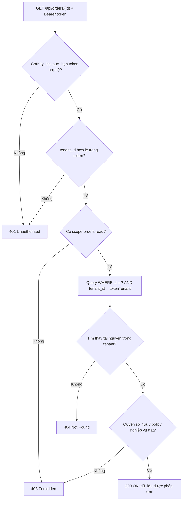
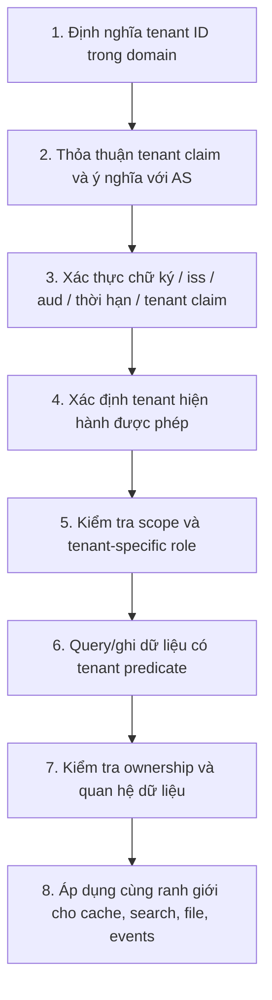

# Định danh tenant và ràng buộc với tài nguyên được truy cập

## 1. Bài toán multi-tenant khi API nhận access token

Giả sử hệ thống SaaS quản lý đơn hàng phục vụ hai công ty:

- **Tenant A — Công ty Alpha:** người dùng `alice` sở hữu đơn hàng `order-101`.
- **Tenant B — Công ty Beta:** người dùng `bob` sở hữu đơn hàng `order-202`.

Cả hai công ty có thể gọi cùng một REST API:

```http
GET /api/orders/order-101 HTTP/1.1
Host: orders.example.com
Authorization: Bearer <access-token>
```

Spring Security Resource Server có thể xác nhận token có chữ ký hợp lệ, còn hạn và có authority `SCOPE_orders.read`. Nhưng chỉ các bước đó **chưa đảm bảo** người gọi thuộc tenant Alpha hoặc được phép xem `order-101`.

Nếu API lấy dữ liệu chỉ theo ID:

```sql
SELECT * FROM orders WHERE id = :order_id;
```

thì một Client có token hợp lệ của Beta có thể thử thay `order_id` bằng ID của Alpha. Lỗi phân quyền kiểu này thuộc nhóm **Broken Object Level Authorization (BOLA)**: quyền được cấp ở mức chức năng, nhưng quyền trên từng đối tượng tài nguyên không được kiểm tra.

Với SaaS multi-tenant, Resource Server cần nối ba thông tin:

1. **Danh tính tenant được tin cậy:** token hoặc cơ chế định danh đã xác minh cho biết người gọi đang hành động trong phạm vi tenant nào.
2. **Danh tính tenant của tài nguyên:** đơn hàng, hóa đơn, tệp hoặc bản ghi có owner tenant nào trong dữ liệu hệ thống.
3. **Quy tắc truy cập:** scope, loại chủ thể, quyền nghiệp vụ, sở hữu và chính sách cho phép hoặc từ chối truy cập giữa các tenant.

**Mục tiêu:** Chỉ khi phạm vi tenant của yêu cầu được phép tương thích với tenant của tài nguyên, API mới tiếp tục thực hiện quyền nghiệp vụ. Bài học này bàn về hợp đồng access token và cách dùng nó để tạo ranh giới tenant trong Spring Security OAuth 2.0 Resource Server.

## 2. Phân biệt tenant, user, client, issuer và resource

Những khái niệm này có thể trùng giá trị chuỗi trong một hệ thống cụ thể, nhưng về bản chất là các định danh khác nhau.

| Khái niệm | Câu hỏi được trả lời | Ví dụ |
|---|---|---|
| **Tenant** | Dữ liệu/quyền thuộc không gian khách hàng hoặc tổ chức nào? | `tenant-alpha` |
| **User / subject** | Token đại diện cho chủ thể nào theo quy ước nhà phát hành? | `user-417` |
| **OAuth Client** | Ứng dụng nào được cấp token? | `shop-web` hoặc `billing-job` |
| **Issuer (`iss`)** | Authorization Server nào phát hành token? | `https://id.example.com/realms/shop` |
| **Audience (`aud`)** | Token dành cho Resource Server nào? | `orders-api` |
| **Scope** | Token được cấp quyền thực hiện nhóm thao tác nào? | `orders.read` |
| **Resource tenant** | Tài nguyên trong database thuộc tenant nào? | `orders.tenant_id = tenant-alpha` |

Một người dùng có thể là thành viên của nhiều tenant; một tenant có nhiều người dùng và nhiều ứng dụng; một OAuth Client có thể phục vụ một tenant hoặc nhiều tenant tùy mô hình. Đồng thời, một Authorization Server có thể phát hành token cho nhiều tenant và nhiều API.

Vì vậy, các suy luận sau **không an toàn nếu chưa có hợp đồng cụ thể**:

- `sub` chính là tenant ID.
- `iss` luôn chính là tenant ID.
- `aud` cho biết tenant đang được truy cập.
- Scope `orders.read` đồng nghĩa với “đọc đơn hàng của mọi tenant”.
- Email domain hoặc phần tên miền trong URL đủ để chứng minh người gọi thuộc tenant tương ứng.
- Người dùng đăng nhập thành công với OIDC thì đương nhiên có quyền đối với mọi tài nguyên thuộc tổ chức.

Một token hợp lệ thường phải được xem xét ở **nhiều chiều độc lập**: **ai**, **được phép làm gì**, **với API nào** và **trong tenant nào**.

### 2.1. Tenant ID nên có đặc tính gì?

Một tenant ID dùng cho kiểm soát truy cập nên:

- Ổn định và duy nhất trong phạm vi hệ thống.
- Có định dạng và cách so sánh được định nghĩa rõ ràng.
- Không phụ thuộc vào tên hiển thị hoặc email domain có thể thay đổi.
- Được tạo/quản lý bởi thành phần đáng tin cậy của hệ thống.
- Có thể đối chiếu với cột định danh tenant trong dữ liệu nghiệp vụ.

Ví dụ `tnt_01HX4A` hoặc UUID tenant là các lựa chọn minh họa. Không có một định dạng tenant ID bắt buộc của OAuth 2.0/OIDC: hệ thống phải thống nhất giữa Authorization Server, Resource Server và kho dữ liệu.

## 3. Hợp đồng access token mang thông tin tenant

### 3.1. Ví dụ token dùng cho đúng một tenant

Giả sử ứng dụng phát hành JWT access token có payload minh họa:

```json
{
  "iss": "https://id.example.com/realms/shop",
  "sub": "user-417",
  "aud": ["orders-api"],
  "exp": 1893456000,
  "nbf": 1893455100,
  "iat": 1893455100,
  "client_id": "shop-web",
  "scope": "orders.read orders.write",
  "tenant_id": "tenant-alpha"
}
```

Trong đó:

- `iss` xác định nhà phát hành phải được API tin tưởng.
- `aud` xác định token được cấp để gọi `orders-api`.
- `exp` và `nbf` giới hạn thời gian token được chấp nhận.
- `sub` xác định chủ thể; ở ví dụ này là người dùng.
- `scope` xác định nhóm thao tác được cấp.
- `tenant_id` xác định phạm vi tenant **theo hợp đồng riêng của hệ thống**.

**`tenant_id` không phải một registered JWT claim bắt buộc, cũng không phải claim chuẩn mà mọi OAuth 2.0/OIDC provider phát hành.** Nhà cung cấp có thể dùng `tid`, `org_id`, `organization`, một claim URI có namespace hoặc cách khác. Resource Server cần biết chính xác tên, kiểu dữ liệu, nguồn cấp và ngữ nghĩa; không tự coi các tên claim gần giống nhau là tương đương.

Đối với một hợp đồng token dành cho đúng một tenant, một quy tắc hợp lý là: **JWT access token của endpoint tenant-bound bắt buộc có đúng một `tenant_id` hợp lệ**. Nếu API cho phép token không có tenant claim để truy cập tài nguyên tenant, sẽ xuất hiện một đường đi bỏ qua ranh giới dữ liệu.

### 3.2. Hợp đồng cần nêu những gì?

Một ví dụ đặc tả hợp đồng giữa Authorization Server và Resource Server:

| Thành phần | Quy ước ví dụ | Cần bảo đảm |
|---|---|---|
| Loại token | Access token dùng để gọi `orders-api` | Không sử dụng ID token thay access token |
| Issuer | `https://id.example.com/realms/shop` | Xác minh đúng nhà phát hành và khóa ký |
| Audience | Chứa `orders-api` | Từ chối token phát hành cho API khác |
| Tenant claim | `tenant_id`, string không rỗng | Giá trị thuộc namespace tenant được quản lý |
| Quy tắc cấp tenant | AS chỉ phát hành tenant mà chủ thể/Client được phép đại diện | Không tin tenant do Client tự khai nếu chưa xác minh quyền |
| Scope | `orders.read`, `orders.write` | Định nghĩa rõ thao tác của từng scope |
| Chủ thể | `sub` theo quy ước của issuer | Phân biệt người dùng và dịch vụ khi nghiệp vụ yêu cầu |
| Thời hạn | `exp`, `nbf` và các validation liên quan | Chỉ chấp nhận token còn hiệu lực |
| Dữ liệu | `orders.tenant_id` đồng nhất với namespace tenant token | Ràng buộc truy vấn và ghi dữ liệu theo tenant |
| Chuyển tenant | Xin access token khác theo tenant được chọn hoặc cơ chế cho phép đã định nghĩa | Không lấy tên tenant từ request rồi tự nâng quyền |

Hợp đồng nên còn xác định cụ thể chính sách khi một người dùng được cấp quyền ở nhiều tenant, thay đổi tư cách thành viên, yêu cầu liên tenant hoặc sử dụng token máy-máy.

### 3.3. Access token là bằng chứng được cấp quyền, không phải dữ liệu do Client tự khai

Header hoặc query parameter sau đây **không phải chứng cứ ủy quyền**:

```http
GET /api/orders/order-101 HTTP/1.1
Authorization: Bearer <token-of-tenant-beta>
X-Tenant-ID: tenant-alpha
```

`X-Tenant-ID` có thể hữu ích để truyền tenant **được yêu cầu**, nhưng Client có quyền sửa giá trị header. API không được dùng nó để ghi đè `tenant_id` đã xác thực từ token.

Tương tự, Client không được đổi payload JWT từ `"tenant_id":"tenant-beta"` thành `"tenant_id":"tenant-alpha"` rồi giữ chữ ký cũ: chữ ký sẽ không xác minh. Nhưng JWT có chữ ký hợp lệ vẫn cần được so sánh với **tenant thật của bản ghi**.

Nếu Authorization Server cấp token có tenant dựa vào một lựa chọn của Client, **AS phải kiểm tra quyền đối với tenant được chọn trước khi phát hành token**. API cũng nên thực thi ranh giới tenant độc lập trên dữ liệu mà nó quản lý.

## 4. Hai mô hình phổ biến để biểu diễn tenant trong token

### 4.1. Một access token gắn với một tenant

Ví dụ người dùng `user-417` có quyền tại Alpha và Beta nhưng đang làm việc ở Alpha. Client nhận token có `tenant_id=tenant-alpha`. Khi chuyển sang Beta, Client yêu cầu quyền theo ngữ cảnh Beta và nhận token khác có `tenant_id=tenant-beta`, sau khi AS kiểm tra tư cách thành viên/quyền.

Ưu điểm của mô hình:

- Resource Server xác định tenant hiện hành từ **một claim** đã xác thực.
- Giảm nhầm lẫn “đang truy cập tenant nào?”.
- Scope và vai trò có thể mang ý nghĩa trong đúng phạm vi tenant đó.
- Dễ ràng buộc truy vấn `WHERE tenant_id = :tenant_id`.
- Giảm nguy cơ một token vô tình có quyền ở nhiều tenant.

Đổi lại, Client cần một quá trình chuyển tenant phù hợp với Authorization Server, thay vì chỉ đổi header hoặc tham số đường dẫn.

### 4.2. Access token cho phép nhiều tenant

Một số hệ thống phát hành token mang danh sách tenant được phép truy cập:

```json
{
  "sub": "user-417",
  "aud": ["orders-api"],
  "scope": "orders.read",
  "allowed_tenant_ids": ["tenant-alpha", "tenant-beta"]
}
```

Claim `allowed_tenant_ids` cũng là **claim tùy biến**. Resource Server trong mô hình này cần hai nguồn:

1. Danh sách tenant được phép từ token đã xác thực.
2. Tenant **đang được yêu cầu**, chẳng hạn `/api/tenants/tenant-alpha/orders/order-101`.

API kiểm tra `requestedTenantId` thuộc tập tenant được phép, rồi truy vấn dữ liệu **bằng đúng requestedTenantId**. Không có bước này, danh sách tenant trong token không tự đảm bảo request được gắn với tenant cụ thể.

Mô hình nhiều tenant cần cân nhắc token lớn, trạng thái thành viên thay đổi sau khi phát hành, và quyền khác nhau theo tenant. Ví dụ người dùng có `orders.read` tại Alpha nhưng chỉ có `orders.write` tại Beta thì không thể biểu diễn chính xác bằng một scope phẳng `"orders.read orders.write"` cộng danh sách tenant; cần mô hình quyền **theo từng tenant** hoặc token có phạm vi hẹp hơn.

**Khuyến nghị thiết kế:** Với API tenant-bound thông thường, token một tenant một ngữ cảnh giúp đơn giản hóa ranh giới an toàn. Nếu API cần nhiều tenant, hợp đồng phải mô tả chính xác quan hệ tenant–scope–role và cách kiểm tra ở từng endpoint.

### 4.3. Tenant riêng theo issuer hoặc realm

Một số IdP quản lý các tổ chức bằng issuer/realm riêng, ví dụ:

```text
https://id.example.com/realms/alpha
https://id.example.com/realms/beta
```

Trong kiến trúc đó, `iss` **có thể** gắn với danh tính tenant, nhưng điều này chỉ đúng nếu hệ thống có ánh xạ được định nghĩa và kiểm soát. Không phải mọi hệ thống dùng một issuer cho một tenant; cũng có trường hợp nhiều tenant nghiệp vụ cùng nằm trong một issuer.

Nếu chấp nhận nhiều issuer, Resource Server phải dùng **allowlist issuer tin cậy**, từng bộ khóa/validator phù hợp và ánh xạ issuer sang tenant đã cấu hình. Không nên lấy issuer bất kỳ do Client đưa vào request rồi tự động truy cập metadata/JWKS của issuer đó để cấp lòng tin.

## 5. Tenant trong token phải được ràng buộc với tenant của tài nguyên

Một API nên phân biệt ba giá trị:

```text
tokenTenant     = tenant_id từ access token đã xác minh
requestedTenant = tenant được chọn trong path/header (nếu API cho chọn)
resourceTenant  = tenant_id lưu với bản ghi trong database
```

Với access token một tenant, quy tắc thường là:

```text
tokenTenant == resourceTenant
```

Nếu API đưa tenant vào path, còn có:

```text
tokenTenant == requestedTenant
requestedTenant == resourceTenant
```

Nhưng cách triển khai tốt còn đi xa hơn việc tải bản ghi rồi so sánh: **đưa tenant vào điều kiện truy vấn dữ liệu ngay từ đầu**.



### 5.1. Truy vấn dữ liệu đúng cách

**Không ràng buộc tenant**:

```sql
SELECT id, tenant_id, owner_subject, total
FROM orders
WHERE id = :order_id;
```

**Có ràng buộc tenant**:

```sql
SELECT id, tenant_id, owner_subject, total
FROM orders
WHERE id = :order_id
  AND tenant_id = :verified_tenant_id;
```

Nếu endpoint chỉ dành cho người dùng xem dữ liệu của mình, có thể ràng buộc cả subject:

```sql
SELECT id, tenant_id, owner_subject, total
FROM orders
WHERE id = :order_id
  AND tenant_id = :verified_tenant_id
  AND owner_subject = :verified_subject;
```

Ở đây `verified_tenant_id` và `verified_subject` phải đến từ thông tin xác thực đáng tin và quy ước token của ứng dụng, không được lấy trực tiếp từ body/header do Client tự cung cấp. Khi bản ghi không thuộc tenant hiện hành, query không trả kết quả. API có thể trả `404 Not Found` để giảm lộ thông tin về sự tồn tại của bản ghi ở tenant khác.

### 5.2. Ràng buộc khi tạo tài nguyên

Khi nhận:

```http
POST /api/orders HTTP/1.1
Authorization: Bearer <token-tenant-alpha>
Content-Type: application/json

{
  "productId": "product-23",
  "tenantId": "tenant-beta",
  "quantity": 2
}
```

API **không được** lấy `tenantId` từ JSON để đặt tenant của đơn hàng. Phía server phải gán tenant dựa trên ngữ cảnh đã xác thực/phân quyền:

```java
String tenantId = jwt.getClaimAsString("tenant_id");
Order order = new Order();
order.setTenantId(tenantId);
order.setProductId(request.productId());
order.setQuantity(request.quantity());
repository.save(order);
```

Mã Java này là phác thảo tầng nghiệp vụ, giả sử claim đã được decoder/validator xác minh. Các ID liên kết như `productId` cũng phải được kiểm tra **thuộc cùng tenant** hoặc được chia sẻ rõ ràng theo chính sách. Nếu không, hệ thống vẫn có thể bị rò rỉ dữ liệu qua quan hệ giữa đơn hàng và sản phẩm.

### 5.3. Ràng buộc khi cập nhật hoặc xóa

Các thao tác thay đổi tài nguyên cũng cần tenant predicate:

```sql
UPDATE orders
SET status = :new_status
WHERE id = :order_id
  AND tenant_id = :verified_tenant_id;
```

```sql
DELETE FROM orders
WHERE id = :order_id
  AND tenant_id = :verified_tenant_id;
```

API cần kiểm tra số bản ghi thực sự được cập nhật/xóa và quyền nghiệp vụ trước khi thực thi. Không cho Client tự thay `tenant_id` của một bản ghi hiện có qua PATCH/PUT trừ khi có nghiệp vụ di chuyển tenant được kiểm soát riêng.

### 5.4. Đừng chỉ bảo vệ bảng chính

Với mô hình dữ liệu:

```text
Order (tenant_id)
  ├── OrderItem (order_id, product_id)
  ├── Invoice (tenant_id, order_id)
  ├── Attachment (tenant_id, storage_key)
  └── Payment (tenant_id, order_id)
```

Ranh giới tenant phải áp dụng xuyên suốt:

- Khi join dữ liệu, đảm bảo các quan hệ liên quan không trỏ sang tenant không được phép.
- Khi trả file, xác minh tenant của metadata/file trước khi tạo download URL.
- Khi cache dữ liệu, khóa cache nên mang tenant, ví dụ `orders:{tenantId}:{orderId}`, và kiểm tra quyền trước khi trả kết quả từ cache.
- Khi làm job hoặc đẩy sự kiện, truyền tenant context đã xác thực phù hợp, không dùng một tenant mặc định khó kiểm soát.
- Khi search/analytics, thêm tenant filter trên toàn bộ pipeline, bao gồm index, báo cáo và export.

Một lỗi rò rỉ dữ liệu giữa tenant có thể xuất hiện bên ngoài Controller, dù endpoint HTTP đã có `hasAuthority(...)`.

## 6. Ba lớp kiểm soát: xác thực token, quyền thao tác, quyền tài nguyên

Trong Spring Security, nên hình dung ba lớp theo thứ tự:

| Lớp | Kiểm tra | Ví dụ từ chối |
|---|---|---|
| **Authentication / token validation** | Chữ ký, issuer, audience, thời hạn, tenant claim bắt buộc | Token hết hạn hoặc không có `tenant_id` theo hợp đồng → `401` |
| **Endpoint authorization** | Scope/authority cho HTTP method, route | `GET /api/orders/42` không có `orders.read` → `403` |
| **Resource authorization / tenant isolation** | Tenant của token/yêu cầu và tenant bản ghi, ownership, tenant-specific roles | Token Beta cố đọc đơn Alpha → `404` hoặc `403` theo chính sách |

Một JWT có chữ ký đúng và claim `tenant_id=tenant-alpha` vẫn có thể truy cập nhầm tenant nếu Service truy vấn `findById(orderId)` mà không kiểm tra tenant. Ngược lại, một query đã ràng buộc tenant cũng không thay thế được xác minh issuer/audience: nếu API chấp nhận token giả, attacker có thể tự khai tenant Alpha.

### 6.1. Scope và role khác tenant

Ví dụ scope `orders.read` nói “được đọc đơn hàng”, nhưng không nói “đọc đơn hàng của tenant nào”. Role `TENANT_ADMIN` có thể nói “quản trị trong tenant hiện hành”, chứ không nên tự hiểu là quản trị toàn bộ hệ thống.

Một chính sách đầy đủ có thể diễn đạt:

```text
Allow GET /api/orders/{id} when
    token is valid for orders-api
    AND token has scope orders.read
    AND order.tenant_id == token.tenant_id
    AND (
        order.owner_subject == token.subject
        OR token has TENANT_ORDER_MANAGER role within token.tenant_id
    )
```

`TENANT_ORDER_MANAGER` là tên vai trò giả định; nếu ứng dụng có vai trò theo tenant, cần xác định rõ role này được AS/Authorization layer bảo đảm trong tenant nào. Không nên dựa vào một role toàn cục mang tên chung rồi tự mở quyền ở mọi tenant.

### 6.2. Phân quyền liên tenant là ngoại lệ phải được thiết kế riêng

Một số nghiệp vụ chính đáng cần quản trị hoặc tổng hợp nhiều tenant. Thay vì bỏ qua tenant filter khi thấy role `ADMIN`, nên có quyền rõ ràng như `orders.cross-tenant.read` được cấp chặt, ghi audit và xác định cụ thể những tenant/tài nguyên được phép.

Chẳng hạn, một internal reporting service có thể cần danh sách tenant đã được cấp để xuất số liệu tổng hợp, nhưng **không có quyền xem thông tin chi tiết của khách hàng**. Quyền liên tenant cần được kiểm tra theo cả mục đích truy cập, principal, phạm vi được cấp và chính sách dữ liệu; không phải mọi dịch vụ nội bộ đều có toàn quyền.

## 7. Cấu hình Spring Security Resource Server cho hợp đồng tenant

Ví dụ dưới đây dùng **JWT Bearer access token**, một issuer, một audience và mỗi token thuộc đúng một tenant. Ứng dụng chạy Spring Boot với Spring Security hiện đại. Với opaque token, cần dùng introspection và kiểm tra thuộc tính tenant của phản hồi tin cậy theo hợp đồng tương ứng.

### 7.1. Dependency và issuer

Với Gradle:

```groovy
dependencies {
    implementation 'org.springframework.boot:spring-boot-starter-web'
    implementation 'org.springframework.boot:spring-boot-starter-security'
    implementation 'org.springframework.boot:spring-boot-starter-oauth2-resource-server'
    implementation 'org.springframework.boot:spring-boot-starter-data-jpa'
}
```

Cấu hình `application.yml`:

```yaml
spring:
  security:
    oauth2:
      resourceserver:
        jwt:
          issuer-uri: https://id.example.com/realms/shop
```

`issuer-uri` phải khớp chính xác issuer thật của Authorization Server. Cấu hình chỉ issuer không tự bảo đảm token dành cho `orders-api`, có `tenant_id` hợp lệ hoặc có quyền với tài nguyên nghiệp vụ. Các ràng buộc đó phải được cấu hình bổ sung.

### 7.2. Yêu cầu audience và tenant claim ngay trong JWT validator

Ví dụ `JwtDecoder` sau sử dụng validation mặc định cho issuer/thời gian, đồng thời yêu cầu audience `orders-api` và `tenant_id` kiểu chuỗi không rỗng:

```java
import org.springframework.context.annotation.Bean;
import org.springframework.context.annotation.Configuration;
import org.springframework.security.oauth2.core.DelegatingOAuth2TokenValidator;
import org.springframework.security.oauth2.core.OAuth2Error;
import org.springframework.security.oauth2.core.OAuth2TokenValidator;
import org.springframework.security.oauth2.core.OAuth2TokenValidatorResult;
import org.springframework.security.oauth2.jwt.Jwt;
import org.springframework.security.oauth2.jwt.JwtDecoder;
import org.springframework.security.oauth2.jwt.JwtDecoders;
import org.springframework.security.oauth2.jwt.JwtValidators;
import org.springframework.security.oauth2.jwt.NimbusJwtDecoder;

@Configuration
public class TokenValidationConfig {

    @Bean
    JwtDecoder jwtDecoder() {
        String issuer = "https://id.example.com/realms/shop";
        String expectedAudience = "orders-api";

        NimbusJwtDecoder decoder =
            (NimbusJwtDecoder) JwtDecoders.fromIssuerLocation(issuer);

        OAuth2TokenValidator<Jwt> audienceValidator = jwt ->
            jwt.getAudience().contains(expectedAudience)
                ? OAuth2TokenValidatorResult.success()
                : OAuth2TokenValidatorResult.failure(
                    new OAuth2Error(
                        "invalid_token", "Invalid audience", null));

        OAuth2TokenValidator<Jwt> tenantValidator = jwt -> {
            Object claim = jwt.getClaims().get("tenant_id");
            boolean valid = claim instanceof String
                && !((String) claim).isBlank();

            return valid
                ? OAuth2TokenValidatorResult.success()
                : OAuth2TokenValidatorResult.failure(
                    new OAuth2Error(
                        "invalid_token", "Missing or invalid tenant_id", null));
        };

        decoder.setJwtValidator(
            new DelegatingOAuth2TokenValidator<>(
                JwtValidators.createDefaultWithIssuer(issuer),
                audienceValidator,
                tenantValidator
            ));

        return decoder;
    }
}
```

Ý nghĩa:

- `JwtDecoders.fromIssuerLocation` tạo decoder dựa trên metadata/khóa công khai từ issuer tin cậy và cơ chế tương ứng.
- `createDefaultWithIssuer` giữ các validator mặc định cần thiết, gồm những ràng buộc chuẩn về issuer/thời gian.
- `audienceValidator` từ chối token phát hành cho API khác.
- `tenantValidator` từ chối token không có `tenant_id` kiểu `String` không rỗng.
- Sau bước này, Controller/Service có thể đọc claim tenant đã được xác thực để áp dụng tenant isolation.

**Giới hạn quan trọng:** `tenantValidator` chỉ kiểm tra **hình dạng** của claim. Việc tenant đó có tồn tại, đang hoạt động và chủ thể còn quyền ở tenant đó hay không phải do Authorization Server bảo đảm khi cấp token hoặc API/authorization service kiểm tra bằng dữ liệu đáng tin. Nếu cần thu hồi tư cách thành viên ngay lập tức, token có `exp` chưa tới có thể chưa phản ánh thay đổi; ứng dụng cần cơ chế token ngắn hạn, kiểm tra quyền hiện tại hoặc thu hồi theo yêu cầu.

Đoạn cấu hình dùng issuer cố định chỉ nhằm minh họa. Ứng dụng thực tế nên đặt các định danh trong cấu hình môi trường và cấu hình cụ thể theo phiên bản Spring Security đang sử dụng.

### 7.3. Đặt điều kiện scope tại FilterChain

```java
import org.springframework.context.annotation.Bean;
import org.springframework.context.annotation.Configuration;
import org.springframework.http.HttpMethod;
import org.springframework.security.config.Customizer;
import org.springframework.security.config.annotation.web.builders.HttpSecurity;
import org.springframework.security.config.http.SessionCreationPolicy;
import org.springframework.security.web.SecurityFilterChain;

@Configuration
public class ApiSecurityConfig {

    @Bean
    SecurityFilterChain apiSecurity(HttpSecurity http) throws Exception {
        return http
            .csrf(csrf -> csrf.disable())
            .sessionManagement(session ->
                session.sessionCreationPolicy(
                    SessionCreationPolicy.STATELESS))
            .authorizeHttpRequests(authorize -> authorize
                .requestMatchers("/api/public/**").permitAll()
                .requestMatchers(
                    HttpMethod.GET, "/api/orders/**")
                    .hasAuthority("SCOPE_orders.read")
                .requestMatchers(
                    HttpMethod.POST, "/api/orders")
                    .hasAuthority("SCOPE_orders.write")
                .anyRequest().denyAll()
            )
            .oauth2ResourceServer(oauth2 ->
                oauth2.jwt(Customizer.withDefaults()))
            .build();
    }
}
```

Spring Security thường map claim `scope` hoặc `scp` thành các authority tiền tố `SCOPE_`, chẳng hạn `orders.read` thành `SCOPE_orders.read`. Nếu nhà phát hành dùng claim/định dạng khác, ứng dụng phải cấu hình converter phù hợp.

`STATELESS` và `csrf.disable()` trong ví dụ dành cho một REST API chỉ dùng Bearer token trong Authorization header, không sử dụng cookie để xác thực. Nếu ứng dụng có cơ chế xác thực tự động qua cookie hoặc luồng trình duyệt khác, phải đánh giá CSRF theo kiến trúc thật.

Đây là **lớp kiểm tra endpoint**; các rule trên không biết đơn hàng thuộc tenant nào. Ràng buộc tenant cần được thực thi trong phần xử lý dữ liệu tiếp theo.

### 7.4. Đọc tenant đã xác thực trong Controller

Ví dụ endpoint lấy đơn hàng của chính người dùng:

```java
import java.util.UUID;
import org.springframework.security.core.annotation.AuthenticationPrincipal;
import org.springframework.security.oauth2.jwt.Jwt;
import org.springframework.web.bind.annotation.GetMapping;
import org.springframework.web.bind.annotation.PathVariable;
import org.springframework.web.bind.annotation.RequestMapping;
import org.springframework.web.bind.annotation.RestController;

@RestController
@RequestMapping("/api/orders")
public class OrderController {

    private final OrderService orderService;

    public OrderController(OrderService orderService) {
        this.orderService = orderService;
    }

    @GetMapping("/{orderId}")
    public OrderDto getOwnOrder(
            @PathVariable UUID orderId,
            @AuthenticationPrincipal Jwt jwt) {

        String verifiedTenant = jwt.getClaimAsString("tenant_id");
        String verifiedSubject = jwt.getSubject();

        return orderService.findOwnOrder(
            orderId, verifiedTenant, verifiedSubject);
    }
}
```

Trong cấu hình trên, `Jwt` đại diện access token đã đi qua `JwtDecoder` và những validator được khai báo. `verifiedTenant` không đến từ path/header tự chọn. Tuy nhiên, ví dụ này **giả định `sub` là user ID theo hợp đồng AS**. Với token Client Credentials mà `sub` là Client ID, endpoint cần chính sách riêng; không lấy Client ID làm chủ sở hữu đơn hàng của người dùng.

### 7.5. Truy vấn dữ liệu tenant-aware trong Repository và Service

Repository Spring Data JPA có thể yêu cầu đồng thời ID, tenant và chủ sở hữu:

```java
import java.util.Optional;
import java.util.UUID;
import org.springframework.data.jpa.repository.JpaRepository;

public interface OrderRepository
        extends JpaRepository<OrderEntity, UUID> {

    Optional<OrderEntity> findByIdAndTenantIdAndOwnerSubject(
        UUID id, String tenantId, String ownerSubject);
}
```

Service:

```java
import java.util.UUID;
import org.springframework.http.HttpStatus;
import org.springframework.stereotype.Service;
import org.springframework.web.server.ResponseStatusException;

@Service
public class OrderService {

    private final OrderRepository repository;

    public OrderService(OrderRepository repository) {
        this.repository = repository;
    }

    public OrderDto findOwnOrder(
            UUID orderId, String tenantId, String subject) {

        OrderEntity order = repository
            .findByIdAndTenantIdAndOwnerSubject(
                orderId, tenantId, subject)
            .orElseThrow(() -> new ResponseStatusException(
                HttpStatus.NOT_FOUND, "Order not found"));

        return new OrderDto(order.getId(), order.getStatus());
    }
}
```

Ví dụ giả định dự án có `OrderEntity` (field `id`, `tenantId`, `ownerSubject`, `status`) và `OrderDto` tương ứng, không liệt kê hết các lớp domain/JPA mapping. Điều quan trọng là repository truy vấn **bằng cả tenant và subject**, thay vì chỉ `findById` rồi vô tình trả dữ liệu trước khi kiểm tra.

Nếu có vai trò quản lý được xem nhiều đơn hàng **trong cùng tenant**, Service có thể dùng query `findByIdAndTenantId` sau khi đã xác minh quyền quản lý của chủ thể trong tenant đó. Không loại bỏ điều kiện tenant vì có role quản trị tenant.

### 7.6. Khi tenant xuất hiện trong URL

Một API có thể công khai tenant theo URL:

```http
GET /api/tenants/tenant-alpha/orders/40f9... HTTP/1.1
Authorization: Bearer <access-token>
```

Khi token chỉ được cấp cho một tenant, phải so sánh tenant trong URL với tenant đã xác thực:

```java
@GetMapping("/api/tenants/{tenantId}/orders/{orderId}")
public OrderDto read(
        @PathVariable String tenantId,
        @PathVariable UUID orderId,
        @AuthenticationPrincipal Jwt jwt) {

    String verifiedTenant = jwt.getClaimAsString("tenant_id");

    if (!verifiedTenant.equals(tenantId)) {
        throw new ResponseStatusException(HttpStatus.FORBIDDEN);
    }

    return orderService.findOwnOrder(
        orderId, verifiedTenant, jwt.getSubject());
}
```

Đoạn này là **ví dụ endpoint độc lập**; để chạy cùng FilterChain ở mục 7.3, dự án cần khai báo rule cho `/api/tenants/**` tương ứng. Nếu ứng dụng muốn trả `404` cho tenant không khớp để tránh lộ sự tồn tại, có thể áp dụng chính sách đó nhất quán.

Điều quan trọng là cả phép so sánh URL lẫn truy vấn dữ liệu đều được thực thi. Việc URL có `tenant-alpha` không có nghĩa token của Beta được quyền truy cập Alpha.

## 8. Phân biệt user token và service token trong ngữ cảnh tenant

### 8.1. Access token của người dùng

Với Authorization Code, một token trong ngữ cảnh người dùng có thể mang:

```json
{
  "sub": "user-417",
  "client_id": "shop-web",
  "aud": ["orders-api"],
  "scope": "orders.read",
  "tenant_id": "tenant-alpha"
}
```

Resource Server cần kiểm tra token đúng issuer/audience/hạn, scope phù hợp, tenant đúng và user được phép truy cập đơn hàng. Một người dùng có thể thuộc cả Alpha và Beta, nhưng **token một tenant** không tự cho phép đọc dữ liệu từ tenant còn lại.

### 8.2. Access token của Client Credentials

Với Client Credentials, token thường đại diện cho chính Client/dịch vụ:

```json
{
  "sub": "billing-worker",
  "client_id": "billing-worker",
  "aud": ["orders-api"],
  "scope": "orders.payment.update",
  "tenant_id": "tenant-alpha",
  "principal_type": "service"
}
```

Các claim `tenant_id` và `principal_type` ở đây **là quy ước minh họa**; `sub`, `client_id` và loại principal phụ thuộc nhà phát hành. API phải có quy tắc rõ ràng về việc Client nào được phép đại diện tenant Alpha khi AS cấp token.

Nếu `billing-worker` phục vụ nhiều tenant, có hai hướng thiết kế: xin token theo từng tenant được phép hoặc có cơ chế quyền nhiều tenant được cấp/kiểm tra tường minh. Một token Client Credentials không đương nhiên có quyền thay đổi dữ liệu toàn hệ thống. Không lấy một claim `tenant_id` do chính Client tự gửi ở HTTP request để nâng phạm vi của service token.

### 8.3. Khi token được dùng để gọi tiếp API khác

Giả sử `orders-api` gọi `billing-api`. Access token dành cho `orders-api` thường không có audience của `billing-api`, vì vậy không nên tùy tiện chuyển tiếp token. Nếu cần giữ ngữ cảnh tenant/người dùng, hệ thống phải dùng một cơ chế cấp token/delegation phù hợp mà AS hỗ trợ và để downstream API kiểm tra lại issuer, audience, tenant và quyền của chính nó.

## 9. Kiến trúc dữ liệu: tenant trong từng lớp

### 9.1. Shared database, shared schema

Nhiều tenant lưu chung bảng, phân biệt bởi cột `tenant_id`:

```sql
CREATE TABLE orders (
    id UUID PRIMARY KEY,
    tenant_id VARCHAR(80) NOT NULL,
    owner_subject VARCHAR(150) NOT NULL,
    status VARCHAR(30) NOT NULL
);

CREATE INDEX idx_orders_tenant_id_id
    ON orders(tenant_id, id);
```

Đây là ví dụ đơn giản, cú pháp SQL có thể khác tùy cơ sở dữ liệu. Tất cả truy vấn trên dữ liệu tenant-bound cần tenant predicate phù hợp. Không nên coi việc ID là UUID khó đoán là cơ chế chống truy cập chéo tenant.

Có thể thêm **Row-Level Security (RLS)** ở cơ sở dữ liệu nếu nền tảng hỗ trợ. RLS là một lớp phòng vệ bổ sung, nhưng context tenant truyền xuống database phải được thiết lập từ danh tính tin cậy và quản lý đúng theo phạm vi transaction/connection.

### 9.2. Shared database, schema riêng hoặc database riêng

Một số hệ thống chọn schema hoặc database theo tenant. Khi đó việc chọn DataSource/schema cũng phải dựa trên **tenant đã xác thực**, không chỉ host/header hoặc giá trị path chưa phân quyền.

Ví dụ logic:

```text
verified tenant claim -> tenant authorization -> tenant routing
    -> đúng schema/database -> query bản ghi -> nghiệp vụ
```

Nếu sử dụng `ThreadLocal` để chứa tenant context cho routing, phải đặt và giải phóng context chính xác sau request, tránh rò thông tin giữa request do thread pool tái sử dụng. Với xử lý bất đồng bộ, reactive hoặc message-driven, phải có cơ chế truyền context được thiết kế riêng; không giả định context thread tự đi theo mọi luồng xử lý.

### 9.3. Caching, search, logs, events

Các đường dữ liệu khác cũng cần ràng buộc tenant:

| Thành phần | Rủi ro | Cách kiểm soát |
|---|---|---|
| Cache | Tenant Beta nhận cached object của Alpha vì key chỉ có order ID | Tenant-aware cache key, ví dụ `tenantId:orderId` |
| Search index | Truy vấn toàn index dù request chỉ dành cho Alpha | Áp dụng tenant filter tại search layer |
| Object storage | Tạo signed URL cho file không thuộc tenant | Xác minh metadata/tenant trước khi cấp URL |
| Event/queue | Consumer xử lý event trong tenant sai | Truyền tenant context đáng tin và kiểm tra tại consumer |
| Analytics/export | Báo cáo lẫn dữ liệu nhiều tenant | Xác định tập tenant được phép trước khi query/export |
| Batch jobs | Job mặc định dùng quyền “toàn bộ tenant” | Dùng service principal và scope tenant rõ ràng |
| Audit | Không truy vết được truy cập giữa tenant | Log tenant, subject/client, hành động và kết quả, tránh log token thật |

Không phải mọi tài nguyên đều thuộc đúng một tenant; ví dụ danh mục sản phẩm toàn cục có thể được chia sẻ. Trường hợp đó cần **chính sách chia sẻ được khai báo rõ**, không tự bỏ mọi tenant filter chỉ vì dữ liệu có vẻ dùng chung.

## 10. Những tình huống dễ phát sinh lỗ hổng

### 10.1. Tenant trong header ghi đè tenant trong token

**Tình huống:** Token `tenant-beta`, request có `X-Tenant-ID: tenant-alpha` và API đặt context theo header.

**Lỗi:** Header do Client kiểm soát đã trở thành nguồn ủy quyền.

**Cách xử lý:** Với token một tenant, chỉ chấp nhận tenant yêu cầu nếu khớp tenant token; với token nhiều tenant, kiểm tra membership/permission trong danh sách/nguồn tin cậy. Ràng buộc truy vấn với tenant đã được phê duyệt.

### 10.2. Scope đủ nhưng không có ownership

**Tình huống:** `orders.read` được cấp cho người dùng Alpha, nhưng API trả đơn hàng của người dùng khác trong cùng Alpha.

**Lỗi:** Chỉ kiểm tra tenant, không kiểm tra quyền cấp bản ghi.

**Cách xử lý:** Ngoài tenant predicate, áp dụng owner subject, tenant role hoặc chính sách nghiệp vụ phù hợp. **Tenant isolation không thay thế phân quyền giữa người dùng trong cùng tenant.**

### 10.3. Token được cấp cho API khác

**Tình huống:** JWT hợp lệ từ issuer đúng, `tenant_id=tenant-alpha`, nhưng `aud=billing-api` được gửi đến `orders-api`.

**Lỗi:** Thiếu ràng buộc audience.

**Cách xử lý:** Resource Server chỉ chấp nhận token có audience phù hợp với API của nó.

### 10.4. Gửi tenant ID trong body khi tạo bản ghi

**Tình huống:** Request POST có `tenantId=tenant-beta` trong khi token là `tenant-alpha`; API lưu theo body.

**Lỗi:** Mass assignment hoặc bỏ qua tenant context của chủ thể.

**Cách xử lý:** Server gán tenant từ context đã phân quyền; bỏ qua/từ chối tenantId tự khai nếu API không được phép chọn tenant, và kiểm tra tenant cho các quan hệ đi kèm.

### 10.5. Người dùng bị rút khỏi tenant nhưng token còn hạn

**Tình huống:** AS đã thay đổi membership sau khi phát hành JWT có `tenant_id=tenant-alpha`, nhưng JWT chưa hết hạn.

**Rủi ro:** Resource Server vẫn có thể chấp nhận token tới khi hết hạn nếu chỉ xác minh cục bộ và không kiểm tra trạng thái mới.

**Cách xử lý:** Thiết kế thời hạn token, refresh và cơ chế revocation/entitlement check tùy nhu cầu cập nhật quyền tức thời. Token hợp lệ về chữ ký không có nghĩa membership luôn mới nhất.

### 10.6. Nhiều issuer nhưng tự động tin issuer bất kỳ

**Tình huống:** Resource Server trích `iss` từ token chưa xác minh rồi truy cập JWKS của URL đó và tin khóa trả về.

**Lỗi:** Bên gửi token có thể tự dựng issuer và khóa để tạo token được chấp nhận.

**Cách xử lý:** Chỉ tin tập issuer đã được đăng ký/allowlist; cấu hình validator/khóa theo issuer đáng tin và ánh xạ tenant hợp lệ.

### 10.7. Role “admin” mở rộng toàn bộ tenant

**Tình huống:** `ROLE_ADMIN` được cấp cho quản trị viên Alpha, code bỏ tenant predicate nếu thấy role này.

**Lỗi:** Vai trò trong một tenant bị hiểu thành quyền toàn hệ thống.

**Cách xử lý:** Phân biệt tenant admin với platform admin; chỉ cấp quyền cross-tenant tường minh, giới hạn dữ liệu/hành động và ghi audit thích hợp.

## 11. Ma trận tình huống và kết quả mong đợi

Giả sử Resource Server yêu cầu access token hợp lệ cho `orders-api` và `tenant_id` cho endpoint đơn hàng. Các tình huống:

| Token / yêu cầu | Tài nguyên | Kết quả mong đợi |
|---|---|---|
| Token Alpha, scope `orders.read`, user là owner | Đơn của user trong Alpha | Cho phép |
| Token Alpha, scope `orders.read`, user không phải owner, không có quyền xem người khác | Đơn người khác trong Alpha | Từ chối |
| Token Beta, scope `orders.read` | Đơn Alpha | Từ chối, thường 404 hoặc 403 |
| Token Alpha nhưng thiếu `orders.read` | Đơn Alpha | 403 |
| Token không có `tenant_id` dù hợp đồng yêu cầu | Đơn Alpha | 401 do token không đạt validation |
| Token hợp lệ nhưng `aud=inventory-api` | Đơn Alpha | 401 do token sai audience |
| Token Alpha, path `/tenants/tenant-beta/...` | Đơn Beta | Từ chối vì path tenant không được phép |
| Token service có quyền riêng cho đối soát Alpha | Job/đối soát Alpha | Cho phép trong phạm vi quyền đã cấp |
| Token service Alpha | Job/đối soát Beta | Từ chối nếu không được ủy quyền cross-tenant |
| Token platform admin có grant liên tenant cụ thể | Dữ liệu trong phạm vi grant | Cho phép theo grant và audit, không bỏ ràng buộc toàn cục |

Các mã HTTP chính xác phụ thuộc chính sách báo lỗi của API. **`401`** thường dùng khi token không được chấp nhận; **`403`** dùng khi chủ thể đã xác thực nhưng thiếu quyền; **`404`** có thể dùng để không tiết lộ bản ghi ở tenant khác. Dù chọn mã nào, server không được trả dữ liệu vượt tenant.

## 12. Thiết kế API tenant-aware từ đầu

Đối với một API multi-tenant mới, có thể thiết kế theo chuỗi quyết định sau:



Khi xây dựng hợp đồng giữa hệ thống định danh và API, nên trả lời rõ:

1. **Tenant ID là gì?** Namespace, kiểu dữ liệu, lifecycle, có thể đổi hay không?
2. **Ai gán tenant vào token?** AS dựa trên membership/Client registration nào?
3. **Một token mang một tenant hay nhiều tenant?** Nếu nhiều, quyền khác nhau theo tenant được biểu diễn ra sao?
4. **Issuer/audience nào được tin?** Có nhiều issuer/realm không, và ánh xạ đến tenant thế nào?
5. **Subject là người dùng hay dịch vụ?** Có một hợp đồng nhận diện principal rõ ràng không?
6. **API chọn tenant hiện hành thế nào?** Từ verified claim hay request selection đã so khớp?
7. **Đọc/ghi dữ liệu tenant-bound theo điều kiện gì?** Có ownership/tenant role và quan hệ dữ liệu không?
8. **Khi membership thay đổi cần hiệu lực nhanh đến đâu?** Token lifetime, introspection/revocation và entitlement checks hoạt động thế nào?
9. **Có nghiệp vụ liên tenant không?** Quyền đặc biệt, phạm vi dữ liệu và audit được định nghĩa ở đâu?

Một thiết kế rõ các câu trả lời trên tránh để `tenant_id` trở thành một field trang trí trong JWT nhưng không thực sự kiểm soát truy cập.

## 13. Câu hỏi tự kiểm tra

**Câu 1.** JWT hợp lệ có `tenant_id=tenant-alpha`, `scope=orders.read`. Client gửi `X-Tenant-ID: tenant-beta`. API có thể dùng trực tiếp giá trị header để truy vấn tenant Beta không?

**Trả lời:** Không. Header do Client kiểm soát. Với token một tenant, yêu cầu Beta phải bị từ chối; với token nhiều tenant phải kiểm tra Beta thuộc phạm vi được phép và dùng quyền tương ứng.

**Câu 2.** Scope `orders.read` có đủ để đọc mọi đơn hàng trong tenant không?

**Trả lời:** Không. API còn phải kiểm tra quyền xem từng bản ghi: owner, role trong tenant hoặc chính sách phù hợp.

**Câu 3.** `iss` và `aud` có thay thế `tenant_id` được không?

**Trả lời:** Không mặc định. `iss` xác định bên phát hành; `aud` xác định API nhận token. Chỉ khi có thiết kế và ánh xạ đáng tin cụ thể mới có thể suy ra tenant từ issuer hoặc cấu trúc khác; `aud` tự thân không mang quyền tenant.

**Câu 4.** Repository nên dùng `findById(orderId)` hay `findByIdAndTenantId(orderId, verifiedTenantId)`?

**Trả lời:** Với dữ liệu tenant-bound, nên truy vấn theo cả ID và verified tenant. Endpoint chỉ dành cho chủ sở hữu còn có thể thêm điều kiện owner subject.

**Câu 5.** Một Client Credentials token có `tenant_id` thì có thể kết luận đó là người dùng của tenant không?

**Trả lời:** Không. Client Credentials thường đại diện cho dịch vụ; API phải xác định loại principal và quyền tenant theo hợp đồng AS, không suy diễn `sub` luôn là user ID.

**Câu 6.** Tại sao kiểm tra tenant phải xuất hiện ở caching, file và event consumer?

**Trả lời:** Vì dữ liệu có thể rò rỉ qua những đường không đi qua Controller/Repository chính. Cần truyền tenant context đáng tin và thực thi tenant isolation xuyên suốt luồng dữ liệu.

## 14. Kết luận

Trong Resource Server multi-tenant, access token hợp lệ mới chỉ là **điểm bắt đầu**. Hợp đồng token cần quy định rõ **tenant identity** được AS cấp và API xác minh; các điều kiện issuer, audience, thời hạn và scope phải được kiểm tra độc lập.

Để bảo vệ tài nguyên, Resource Server phải ràng buộc **tenant đã xác thực**, **tenant của yêu cầu đã được cho phép** và **tenant lưu trên bản ghi**. Spring Security hỗ trợ xác thực JWT và kiểm tra authority; Controller/Service/Repository cùng các tầng dữ liệu phải đảm bảo truy vấn, cập nhật, cache, file và sự kiện luôn tôn trọng ranh giới tenant. Đồng thời, kiểm tra tenant không thay thế quyền sở hữu và các quy tắc nghiệp vụ bên trong từng tenant.
