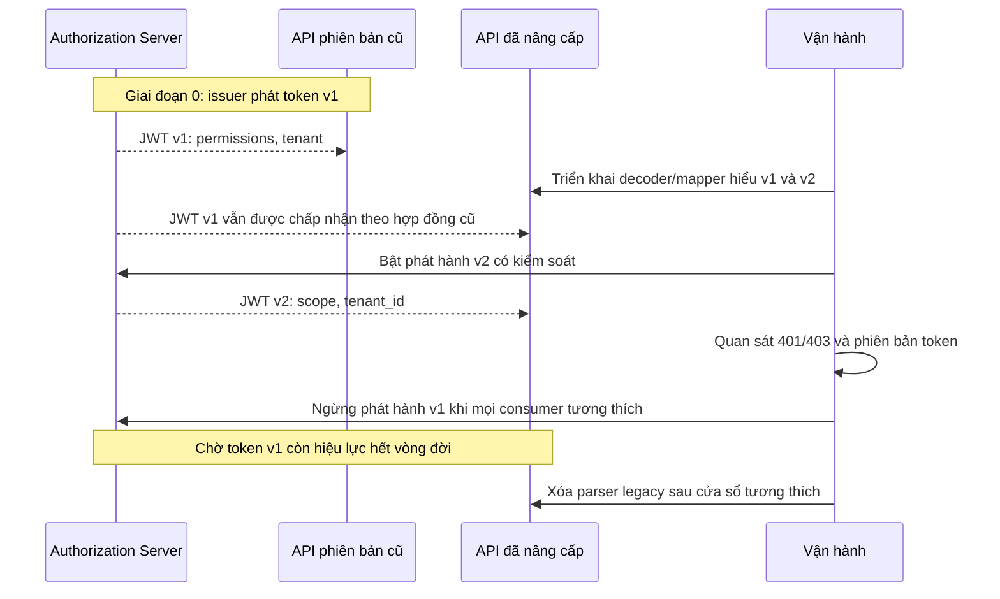

# Quản lý thay đổi claims và giữ tương thích giữa nhà phát hành với API

## 1. Vì sao access token cần một hợp đồng ổn định?

Trong kiến trúc **Spring Security OAuth 2.0/OIDC**, Authorization Server (nhà phát hành token) và Resource Server (API tiêu thụ token) thường được triển khai, nâng cấp và vận hành độc lập. Khi Authorization Server phát hành **JWT access token**, API phải hiểu một số claim để xác thực và quyết định quyền truy cập. Những claim đó tạo thành một **hợp đồng access token** giữa bên phát hành và bên tiêu thụ.

Ví dụ, API đơn hàng cần biết:

- Token được phát hành từ issuer đáng tin cậy nào (`iss`)?
- Token có hướng tới API đơn hàng không (`aud`)?
- Token còn hiệu lực không (`exp`, `nbf` và các quy tắc thời gian)?
- Người dùng hoặc client nào đang đại diện cho request (`sub`, `client_id` theo profile)?
- Token mang quyền gì (`scope`, `scp` hoặc claim quyền được hai bên thỏa thuận)?
- Request thuộc tenant nào, nếu hệ thống yêu cầu phân vùng dữ liệu (`tenant_id` theo hợp đồng nội bộ)?

Nếu nhà phát hành đổi tên `scope` thành `permissions`, thay `tenant_id` từ chuỗi thành đối tượng hoặc đổi cách hiểu của `sub`, API có thể **từ chối nhầm request hợp lệ**, **đọc sai quyền** hoặc nguy hiểm hơn là **cấp quyền ngoài dự kiến**.

Vì vậy, quản lý thay đổi claims là một hoạt động thiết kế giao thức giữa các thành phần, không chỉ là chỉnh một dòng parse JSON.

> **Nguyên tắc nền tảng:** JWT ký hợp lệ chỉ chứng minh các byte của token được phát hành bằng khóa tương ứng và không bị sửa. API vẫn phải thẩm định **issuer, audience, thời hạn, loại token và ngữ nghĩa của từng claim** trước khi dùng token để quyết định quyền truy cập.

### 1.1. Các vai trò liên quan

| Vai trò | Trách nhiệm với hợp đồng token |
| --- | --- |
| Authorization Server / OpenID Provider | Phát hành access token có cấu trúc, kiểu dữ liệu, ngữ nghĩa và phạm vi đã cam kết. |
| Resource Server | Kiểm tra token, giải thích các claim theo hợp đồng và thực thi chính sách API. |
| OAuth 2.0 Client | Yêu cầu access token theo grant, scope/resource phù hợp; không tự chế hoặc sửa claims. |
| Đội vận hành và bảo mật | Quản trị thay đổi, phân phối khóa, theo dõi migration và phản ứng khi xảy ra lỗi. |

**OIDC ID token không thay access token:** ID token phục vụ xác thực người dùng cho OIDC Client, thường có audience là client ID. API phải nhận access token dành cho resource của mình. Hai loại token có thể cùng chứa `sub` nhưng không có cùng hợp đồng quyền truy cập.

## 2. Hợp đồng access token gồm những gì?

Hợp đồng cần ghi rõ **tên claim, kiểu dữ liệu, ý nghĩa, điều kiện bắt buộc, nguồn giá trị và cách API sử dụng**, thay vì chỉ gửi một JSON mẫu rồi để từng API tự suy luận.

Một bảng hợp đồng minh họa:

| Claim | Kiểu thường gặp | Mức độ quan trọng | Quy tắc với API đơn hàng |
| --- | --- | --- | --- |
| `iss` | String URI | Bắt buộc theo cấu hình | Phải trùng issuer đã tin cậy; không nhận mọi issuer. |
| `aud` | String hoặc array string trong JWT | Bắt buộc theo chính sách API | Phải chứa `orders-api`; không chấp nhận audience chỉ dành cho client/UI. |
| `exp` | NumericDate (số giây từ Unix epoch) | Bắt buộc cho JWT access token theo hợp đồng này | Token phải còn hiệu lực, xét độ lệch đồng hồ hợp lý. |
| `nbf` | NumericDate | Tùy profile; nếu có phải hợp lệ | Không nhận token trước thời điểm được phép sử dụng. |
| `iat` | NumericDate | Theo profile | Có thể áp dụng kiểm soát tuổi token và hỗ trợ chẩn đoán. |
| `sub` | String | Tùy loại grant nhưng cần quy ước rõ | Định danh subject trong phạm vi issuer; không tự hiểu luôn là user ID. |
| `client_id` | String | Theo issuer/profile | Định danh client được cấp token, đặc biệt quan trọng với machine-to-machine. |
| `scope` | String gồm các scope cách nhau bằng khoảng trắng | Theo hợp đồng quyền | Được ánh xạ thành authority dùng cho kiểm tra `hasAuthority`. |
| `tenant_id` | String | Nếu endpoint xử lý dữ liệu đa tenant | Định danh tenant đã được issuer xác thực/cấp theo chính sách; dùng cùng kiểm tra dữ liệu. |
| `jti` | String | Tùy profile | ID duy nhất của token, hữu ích cho truy vết/chính sách replay nếu có cơ chế hỗ trợ. |
| `token_contract_version` | Integer hoặc String | Chỉ khi có thiết kế versioning tường minh | Chọn quy tắc diễn giải contract đã được phê duyệt; không thay các bước xác thực. |

Các claim `iss`, `aud`, `exp`, `iat`, `sub`, `jti` được chuẩn hóa trong JWT; các claim khác có thể đến từ OAuth 2.0 JWT Access Token Profile hoặc hợp đồng riêng với nhà phát hành. Không phải mọi access token đều là JWT: **opaque access token** có hợp đồng truy cập dưới dạng kết quả introspection thay vì tập claim có thể đọc trực tiếp.

### 2.1. Quy định rõ những điểm dễ bị hiểu ngầm

Một contract tốt nên trả lời:

1. **Claim bắt buộc hay tùy chọn?** Claim vắng mặt thì từ chối token, trả quyền rỗng hay dùng một default đã được phê duyệt?
2. **Kiểu dữ liệu chính xác là gì?** `scope` là một string có dấu cách, hay `scp` là mảng? `tenant_id` là string hay number? Có cho phép `null` không?
3. **Nguồn dữ liệu có đáng tin không?** Claim có được lấy từ tài khoản đã xác minh, policy engine, client metadata, hay một giá trị do người dùng tự nhập?
4. **Ngữ nghĩa là gì?** `orders:read` bao gồm đơn hàng của chính mình hay tất cả đơn hàng? `sub` có đại diện cho user, service principal hay một cặp `issuer + subject`?
5. **API dùng claim ở bước nào?** Để xác thực token, xác định principal, ánh xạ authority, lọc tenant hay hiển thị UI?
6. **Ai được thay đổi, ai phê duyệt và thông báo trước bao lâu?** Cần có đầu mối cho issuer và các API đang tiêu thụ.

Đặc biệt, **không dùng sự tồn tại của một claim làm bằng chứng quyền** nếu contract chưa quy định rõ claim đó được xác minh, có nguồn gốc phù hợp và được diễn giải như thế nào.

## 3. Ví dụ: hợp đồng cũ và hợp đồng mới

Giả sử một Authorization Server đã phát hành JWT access token cho `orders-api` nhiều năm. Phiên bản cũ có claim `permissions` và `tenant`; đội phát hành muốn chuyển sang claim `scope` tiêu chuẩn hơn và `tenant_id` nhất quán hơn.

**Token cũ (v1) — payload minh họa:**

```json
{
  "iss": "https://login.example.test/realms/shop",
  "sub": "user-123",
  "aud": ["orders-api"],
  "exp": 1893456000,
  "iat": 1893452400,
  "permissions": ["orders.read", "orders.write"],
  "tenant": "tenant-42"
}
```

**Token mới (v2) — payload minh họa:**

```json
{
  "iss": "https://login.example.test/realms/shop",
  "sub": "user-123",
  "aud": ["orders-api"],
  "exp": 1893456000,
  "iat": 1893452400,
  "scope": "orders:read orders:write",
  "tenant_id": "tenant-42",
  "token_contract_version": 2
}
```

Đây là payload đã giải mã để giảng giải, **không phải JWT có chữ ký dùng được**. Tất cả tên miền và giá trị đều là giả định.

Hai thay đổi cần được quản lý riêng:

- **Thay đổi hình thức:** `permissions` array chuyển thành `scope` string; `tenant` đổi thành `tenant_id`.
- **Thay đổi ngữ nghĩa tiềm tàng:** `orders.read` có thực sự đồng nghĩa với `orders:read`? Chúng có cùng phạm vi dữ liệu, điều kiện tenant, loại thao tác và chính sách gán quyền không?

Không được chỉ thay tên claim và cho rằng hợp đồng đã tương thích. Nếu quyền cũ `orders.read` chỉ cho phép đọc đơn của chính mình nhưng quyền mới `orders:read` được hiểu là đọc mọi đơn hàng, phép chuyển tên đó đã tạo **leo thang đặc quyền**.

Trong suốt quá trình nâng cấp, một request mang token cũ vẫn có thể đi vào API mới, và một request mang token mới vẫn có thể đi vào API chưa nâng cấp. Hai trường hợp này phải được dự kiến trong kế hoạch triển khai.

## 4. Phân loại thay đổi: tương thích và phá vỡ tương thích

| Loại thay đổi | Ví dụ | Ảnh hưởng |
| --- | --- | --- |
| Thêm claim tùy chọn, không ảnh hưởng chính sách | Thêm `request_context` được API cũ bỏ qua. | Thường tương thích nếu client/API không áp dụng schema đóng và không có rò rỉ dữ liệu. |
| Thêm claim bắt buộc ở phía API | API mới yêu cầu `tenant_id`, token cũ chưa có. | **Breaking** đối với token còn hiệu lực được phát hành trước đó. |
| Xóa hoặc đổi tên claim | Bỏ `permissions`, chỉ giữ `scope`. | **Breaking** cho API còn đọc claim cũ. |
| Đổi kiểu dữ liệu | `scope` string thành array; `tenant_id` string thành object. | **Breaking** với parser, validator và mapping hiện hữu. |
| Đổi ý nghĩa claim mà giữ nguyên tên | `sub` từ user ID thành service ID; `orders:read` được mở rộng quyền. | **Breaking về ngữ nghĩa và bảo mật**, dù schema vẫn hợp lệ. |
| Đổi kiểu biểu diễn danh sách quyền | `permissions` từ array string thành object lồng nhau. | Breaking cho converter hiện tại, cần schema/mapping mới. |
| Thay audience | Từ `orders-api` sang `api-v2` mà API chỉ chấp nhận `orders-api`. | Có thể gây **401 invalid_token** trên API cũ. |
| Thay issuer | URL `iss` thay đổi khi di chuyển realm/tenant. | Breaking với issuer validator, metadata và trust policy. |
| Thay thuật toán/JWKS key | Từ khóa ký A sang B, hoặc thay thuật toán JWS. | Thay đổi vận hành JOSE, phải phối hợp trust/algorithm và key rotation. |
| Bớt hoặc đổi quyền được cấp | Thu hồi `orders:write` hoặc tách thành quyền nhỏ hơn. | Có thể gây **403 insufficient_scope** và thay đổi hành vi nghiệp vụ. |
| Thêm phiên bản contract | Thêm `token_contract_version` tùy chọn. | Thường tương thích nếu API cũ bỏ qua claim; breaking nếu API mới bắt buộc claim này quá sớm. |

Không phải thay đổi “thêm dữ liệu” nào cũng an toàn. Ví dụ, thêm trường `roles` rồi cho API tự động coi mọi role là authority có thể nới rộng quyền ngoài dự kiến. API cần chủ động định nghĩa claim nào tham gia vào quyết định bảo mật.

### 4.1. Tương thích cú pháp khác tương thích ngữ nghĩa

Nếu token cũ có:

```json
{ "scope": "orders:read" }
```

và token mới cũng có:

```json
{ "scope": "orders:read" }
```

thì **schema giống nhau chưa chắc quyền giống nhau**. Nhà phát hành có thể vừa đổi chính sách: trước đây scope chỉ cho đọc đơn của user hiện tại, sau này scope cho đọc đơn thuộc toàn tenant. API phụ thuộc vào quy tắc cũ sẽ chịu ảnh hưởng dù parser vẫn hoạt động.

Mỗi thay đổi phải được đánh giá cả **tương thích dữ liệu** và **tương thích quyết định cấp quyền**.

## 5. Phần nào nên ổn định, phần nào được phép phát triển?

Không có một danh sách cố định áp dụng cho mọi hệ thống. Nhưng thông thường:

**Các claim và quy tắc tin cậy cốt lõi phải được kiểm soát nghiêm ngặt:**

- `iss`: danh tính issuer được tin cậy; thay đổi phải cập nhật và phê duyệt trust configuration.
- `aud`: resource nhận token; không được vô hiệu hóa audience validation cho “đỡ lỗi”.
- `exp`, `nbf`, `iat`: định dạng NumericDate và chính sách thời gian.
- `sub`, `client_id`: ý nghĩa danh tính người dùng/service, và cách kết hợp với issuer.
- Claim quyền: ý nghĩa của scope, role, permission; mối liên hệ với endpoint và tenant.

**Các claim mở rộng có thể phát triển có kiểm soát:**

- Tên hiển thị, locale, gợi ý giao diện, metadata không tham gia vào phân quyền.
- Claim mới được bổ sung tùy chọn với kiểu dữ liệu và nguồn giá trị được mô tả rõ.
- Trường phân quyền mới chỉ sau khi mọi API liên quan hiểu và đồng ý cách diễn giải.

Khi thêm claim tùy chỉnh, nên sử dụng tên rõ ràng, tránh xung đột với reserved/registered claims và quy định ownership. Hạn chế nhồi dữ liệu hồ sơ hoặc PII vào access token vì **JWS được ký chứ không tự mã hóa**; payload có thể bị đọc bởi bên đang giữ token.

## 6. Đưa hợp đồng vào tài liệu máy đọc được

Một trang wiki hữu ích để giải thích ý nghĩa; một **schema/hợp đồng dạng có cấu trúc** còn giúp tạo test và kiểm soát thay đổi tự động.

Ví dụ tập thông tin hợp đồng do đội issuer và API cùng duy trì:

```yaml
contract: orders-api-access-token
issuer: https://login.example.test/realms/shop
audience: orders-api
token_kind: oauth2-access-token
serialization: jwt
accepted_algorithms:
  - RS256
required_claims:
  iss: string
  aud: string-or-string-array
  exp: numeric-date
  sub: string
optional_claims:
  nbf: numeric-date
  iat: numeric-date
authorization:
  active_format: scope-string
  scopes:
    - orders:read
    - orders:write
  legacy_format:
    claim: permissions
    type: string-array
    mappings:
      orders.read: orders:read
      orders.write: orders:write
tenant:
  active_claim: tenant_id
  legacy_claim: tenant
  type: string
  required_for:
    - /api/orders/**
change_policy:
  migration: consumer-first
  reject_ambiguous_claim_sets: true
```

Đây là **ví dụ tài liệu quy ước**, không phải file cấu hình Spring Boot mà framework tự nhận. Trong triển khai thật, những thông tin này có thể được biểu diễn bằng JSON Schema, OpenAPI `securitySchemes` kết hợp tài liệu profile, schema riêng hoặc test fixtures. OpenAPI mô tả security scheme/scopes, nhưng không tự diễn đạt hết cấu trúc và ý nghĩa mọi JWT claim; cần có tài liệu chi tiết cho phần đó.

Tài liệu contract nên đi kèm các **mẫu token được phát hành có chữ ký thật trong môi trường kiểm thử**, fixture payload đại diện và mô tả chính xác hành vi khi claim thiếu, sai kiểu hoặc không hợp lệ.

## 7. Chiến lược migration an toàn: consumer trước, issuer sau

Khi cần đổi claim, cách dễ giảm gián đoạn nhất là **nâng khả năng đọc của Resource Server trước khi Authorization Server phát hành định dạng mới**.



### Giai đoạn 0 — Kiểm kê người tiêu thụ và chốt hợp đồng

Xác định mọi Resource Server, gateway, background worker, batch job và ứng dụng phân quyền đang đọc access token hoặc introspection response. Tránh chỉ kiểm tra một API chính rồi bỏ sót service nội bộ.

Chốt mapping v1 → v2, ví dụ:

| V1 | V2 | Điều kiện để coi là tương đương |
| --- | --- | --- |
| `permissions: ["orders.read"]` | `scope: "orders:read"` | Cùng giới hạn endpoint, ownership và tenant. |
| `permissions: ["orders.write"]` | `scope: "orders:write"` | Cùng quyền thao tác; không tự mở rộng sang bulk/admin. |
| `tenant: "tenant-42"` | `tenant_id: "tenant-42"` | Cùng tenant định danh trong kho dữ liệu. |
| `sub: "user-123"` | `sub: "user-123"` | Vẫn cùng subject trong issuer, không đổi sang mã email/username. |

Những trường không có mapping xác định thì phải coi là **không tương thích** cho đến khi có quyết định rõ ràng.

### Giai đoạn 1 — Triển khai API hiểu cả hai phiên bản

Resource Server có thể nhận token v1 hoặc v2 và **chuẩn hóa** chúng thành mô hình nội bộ nhất quán, ví dụ `SCOPE_orders:read`. Đây là bước **dual-read**.

Các điểm quan trọng:

- Cả v1 và v2 vẫn phải qua issuer, audience, chữ ký và thời hạn.
- Ưu tiên **các mapping được liệt kê rõ**; không lấy bất kỳ tên permission nào và tự đổi dấu chấm thành dấu hai chấm để tạo authority.
- Không hợp nhất quyền từ hai claim khác nhau một cách vô điều kiện. Token có cả `permissions` và `scope` nhưng giá trị mâu thuẫn cần được xử lý theo quy tắc rõ ràng, thường là từ chối token hoặc xác minh sự tương đương trước khi chọn claim.
- Không biến claim bị thiếu hoặc sai kiểu thành role quản trị mặc định.
- Mỗi instance API trong môi trường rolling deployment phải được nâng cấp trước khi issuer phát hành định dạng mới vào traffic của instance đó.

### Giai đoạn 2 — Phát hành token mới có kiểm soát

Authorization Server có thể bật phát hành token v2 cho một nhóm client/tenant thử nghiệm, hoặc trong một môi trường/stage nhỏ. Mọi quy tắc phát hành cần xác định rõ **token nào dùng format nào** để dễ chẩn đoán.

Nếu cần giai đoạn **dual-write** phát hành cả claim cũ và mới trong cùng token, phải bảo đảm:

- Giá trị cũ và mới biểu diễn **cùng một quyền**.
- API có quy tắc xử lý khi chúng thiếu/mâu thuẫn.
- Token không bị phình quá giới hạn header của reverse proxy hoặc cookie nếu client vô tình lưu token trong cookie.
- Các ứng dụng hiện hữu không diễn giải hai claim như **hai nguồn quyền độc lập** và vô tình cộng quyền.

Một lựa chọn khác là issuer phát hành **v1 cho client cũ, v2 cho client mới** theo policy và client registration. Điều này đòi hỏi kiểm soát rõ việc mỗi client nhận đúng token và mỗi API có chấp nhận được token đó hay không.

### Giai đoạn 3 — Theo dõi, ngừng v1 và gỡ code tương thích

Chỉ ngừng phát hành token cũ khi đã xác minh toàn bộ consumer có thể hiểu token mới. Sau đó vẫn phải chờ **những access token v1 đã phát hành còn hiệu lực** kết thúc vòng đời, xét thêm cache, độ lệch đồng hồ và chính sách refresh/reissue. Nếu client còn refresh/re-authorize để tiếp tục nhận v1, cửa sổ chuyển đổi phải bao trùm cả thời gian đó.

Khi không còn token v1 hợp lệ được sử dụng, API mới gỡ nhánh legacy. Việc gỡ cũng là một thay đổi contract cần theo dõi, không nên coi là việc dọn code vô hại.

## 8. Ví dụ Spring Security: đọc song song hai cấu trúc quyền

Giả sử v1 có `permissions` là một mảng string, v2 có `scope` là một string cách nhau bằng khoảng trắng. API chấp nhận:

```json
{ "permissions": ["orders.read"] }
```

hoặc:

```json
{ "scope": "orders:read" }
```

API **không chấp nhận cả hai cùng xuất hiện trong mẫu migration này**, nhằm tránh hai nguồn quyền mâu thuẫn. Quy tắc này là một **quyết định contract của ví dụ**, không phải quy tắc bắt buộc của OAuth 2.0.

### 8.1. Bước một: thẩm định issuer, audience và schema

Spring Security có thể sử dụng `NimbusJwtDecoder` cùng các `OAuth2TokenValidator`:

```java
@Configuration
class AccessTokenDecoderConfig {

    private static final String ISSUER =
            "https://login.example.test/realms/shop";
    private static final String AUDIENCE = "orders-api";
    private static final Set<String> LEGACY_PERMISSIONS =
            Set.of("orders.read", "orders.write");

    @Bean
    JwtDecoder jwtDecoder() {
        NimbusJwtDecoder decoder =
                NimbusJwtDecoder.withIssuerLocation(ISSUER).build();

        OAuth2TokenValidator<Jwt> standard =
                JwtValidators.createDefaultWithIssuer(ISSUER);

        OAuth2TokenValidator<Jwt> audience = jwt ->
                jwt.getAudience().contains(AUDIENCE)
                        ? OAuth2TokenValidatorResult.success()
                        : error("Unexpected audience");

        OAuth2TokenValidator<Jwt> contract = jwt -> {
            boolean current = jwt.getClaims().containsKey("scope");
            boolean legacy = jwt.getClaims().containsKey("permissions");

            // Mẫu này yêu cầu chính xác một trong hai format.
            if (current == legacy) {
                return error("Ambiguous or missing permission claim");
            }

            if (current) {
                Object raw = jwt.getClaim("scope");
                return raw instanceof String
                        ? OAuth2TokenValidatorResult.success()
                        : error("scope must be a string");
            }

            Object raw = jwt.getClaim("permissions");
            if (!(raw instanceof Collection<?> items)
                    || items.stream().anyMatch(
                            item -> !(item instanceof String name)
                                    || !LEGACY_PERMISSIONS.contains(name))) {
                return error("Invalid legacy permissions");
            }

            return OAuth2TokenValidatorResult.success();
        };

        decoder.setJwtValidator(
                new DelegatingOAuth2TokenValidator<>(
                        standard, audience, contract));
        return decoder;
    }

    private static OAuth2TokenValidatorResult error(String description) {
        return OAuth2TokenValidatorResult.failure(
                new OAuth2Error("invalid_token", description, null));
    }
}
```

Ví dụ minh họa Java 17+ với các class Spring Security `JwtDecoder`, `NimbusJwtDecoder`, `JwtValidators`, `Jwt`, `OAuth2TokenValidator`, `OAuth2TokenValidatorResult`, `DelegatingOAuth2TokenValidator` và `OAuth2Error`; các import được lược bớt để tập trung vào hợp đồng claims. Cấu hình thực tế phải tương thích với phiên bản Spring Security/JWT provider đang sử dụng.

Tác dụng của validator:

1. Chữ ký và các kiểm tra JWT mặc định được thực hiện bởi decoder/validator tương ứng.
2. `iss` phải đúng issuer được tin cậy, `aud` phải chứa `orders-api`.
3. Claim quyền phải có **đúng một format**, tránh parser tự suy đoán.
4. V1 chỉ cho phép những permission đã có mapping xác định.
5. Nếu một token không đáp ứng contract, API **từ chối** thay vì cố gán quyền theo kiểu “best effort”.

Điều kiện quyền ở trên là chính sách minh họa cho endpoint của `orders-api`. Hệ thống thực tế có thể có các token hợp lệ không mang scope cho một số endpoint; khi đó schema và validator phải được điều chỉnh theo contract đã được chấp thuận, không dùng máy móc điều kiện “phải có một claim” ở mọi loại token.

### 8.2. Bước hai: chuẩn hóa claim thành authority duy nhất

`JwtAuthenticationConverter` dùng một converter để biến hai dạng token hợp lệ thành những authority giống nhau:

```java
@Configuration
class AccessTokenAuthoritiesConfig {

    private static final Map<String, String> LEGACY_TO_SCOPE =
            Map.of(
                    "orders.read", "orders:read",
                    "orders.write", "orders:write");

    @Bean
    JwtAuthenticationConverter jwtAuthenticationConverter() {
        JwtAuthenticationConverter converter =
                new JwtAuthenticationConverter();
        converter.setJwtGrantedAuthoritiesConverter(
                this::convertAuthorities);
        return converter;
    }

    private Collection<GrantedAuthority> convertAuthorities(Jwt jwt) {
        Set<String> normalized = new LinkedHashSet<>();

        if (jwt.getClaims().containsKey("scope")) {
            String scope = jwt.getClaimAsString("scope");
            if (scope != null && !scope.isBlank()) {
                normalized.addAll(
                        Arrays.asList(scope.trim().split("\\s+")));
            }
        } else {
            Collection<?> permissions = jwt.getClaim("permissions");
            for (Object value : permissions) {
                // Contract validator đã kiểm tra các giá trị legacy.
                normalized.add(LEGACY_TO_SCOPE.get((String) value));
            }
        }

        return normalized.stream()
                .filter(name -> name != null && !name.isBlank())
                .map(name -> (GrantedAuthority)
                        new SimpleGrantedAuthority("SCOPE_" + name))
                .toList();
    }

    @Bean
    SecurityFilterChain apiSecurity(
            HttpSecurity http,
            JwtAuthenticationConverter converter) throws Exception {
        return http
                .authorizeHttpRequests(auth -> auth
                        .requestMatchers(HttpMethod.GET, "/api/orders/**")
                            .hasAuthority("SCOPE_orders:read")
                        .requestMatchers(HttpMethod.POST, "/api/orders/**")
                            .hasAuthority("SCOPE_orders:write")
                        .anyRequest().authenticated())
                .oauth2ResourceServer(oauth2 ->
                        oauth2.jwt(jwt ->
                                jwt.jwtAuthenticationConverter(converter)))
                .build();
    }
}
```

Những bean `JwtDecoder` và `JwtAuthenticationConverter` ở hai đoạn trên thuộc **cùng một cách triển khai JWT Resource Server**. Decoder chịu trách nhiệm xác minh tính hợp lệ và hợp đồng; converter chỉ biến những token đã hợp lệ thành Spring authorities.

Ví dụ sử dụng Java `Map`, `Set`, `Collection`, `LinkedHashSet`, `Arrays`, `GrantedAuthority` và `SimpleGrantedAuthority`. Cấu hình thực tế cần import đúng package. Nếu đang có `JwtAuthenticationConverter` tùy chỉnh, phải hợp nhất logic theo kiến trúc của ứng dụng để tránh xung đột bean.

**Vì sao không cộng tất cả claim quyền lại?** Nếu token cùng lúc có `scope: "orders:read"` và `permissions: ["orders.write"]`, việc union cả hai tạo ra quyền `orders:write` dù issuer có thể chỉ định `scope` làm nguồn chân lý mới. Validator ở trên từ chối token nhập nhằng ngay từ bước xác thực.

### 8.3. Thay đổi claim tenant cần cùng độ thận trọng

Đừng dùng kiểu:

```java
String tenant = jwt.getClaimAsString("tenant_id");
if (tenant == null) {
    tenant = "default-tenant";  // Không an toàn nếu đây là claim phân quyền.
}
```

Trong hệ thống đa tenant, một default không được kiểm chứng có thể gây truy cập chéo tenant. Nếu cần đọc `tenant` (v1) và `tenant_id` (v2), nên yêu cầu **một claim hợp lệ với định dạng đã được định nghĩa**, ánh xạ sang `TenantContext` nội bộ, và từ chối giá trị thiếu/mâu thuẫn khi endpoint bắt buộc tenant.

Tenant từ token đã thẩm định vẫn phải được kết hợp với **quyền trên bản ghi thực tế**, quan hệ user–tenant và policy của hệ thống. Một chuỗi `tenant_id` tự nó không cho phép đọc mọi bản ghi mang tenant đó.

## 9. Versioning: có cần claim phiên bản không?

Một thay đổi đơn giản có thể dùng **consumer-first** mà không cần version claim: Resource Server phân biệt v1/v2 bằng một định dạng đã được mô tả rõ. Nhưng khi hợp đồng có nhiều thay đổi đồng thời, có thể đặt một claim riêng:

```json
{
  "token_contract_version": 2,
  "scope": "orders:read",
  "tenant_id": "tenant-42"
}
```

Nếu dùng version claim:

- Quy định kiểu dữ liệu cố định, chẳng hạn số nguyên, và phạm vi mỗi phiên bản.
- API chỉ chấp nhận những version được phê duyệt; **không tự động nhận mọi version lớn hơn**.
- Nếu version và schema mâu thuẫn, phải từ chối token hoặc có quy tắc chặt chẽ đã kiểm thử.
- Tránh triển khai nhiều nhánh không có thời hạn gỡ; mỗi bản legacy có người phụ trách và thời điểm hết hỗ trợ.
- Version claim không thay thế `iss`, `aud`, `exp`, chữ ký và kiểm tra quyền.

Không nên dùng `jti` hoặc `kid` như “version hợp đồng”: `jti` định danh một token, `kid` giúp chọn khóa ký; hai giá trị này có mục đích khác.

### 9.1. Cách chọn chiến lược phát hành

| Chiến lược | Phù hợp khi | Cần chú ý |
| --- | --- | --- |
| Consumer-first + issuer đổi một lần | Ít thay đổi, tất cả API có thể nâng cấp trước. | API cần đọc v1/v2 đủ lâu cho token cũ hết hạn. |
| Dual-write claim cũ và mới | Consumer quá đa dạng, cần thời gian chuyển đổi. | Không cộng quyền từ hai claim; kiểm tra tương đương và kích thước token. |
| Phát v1/v2 theo client registration | Client có khả năng nâng cấp khác nhau. | Không để client tự chọn version vượt policy; theo dõi định dạng phát hành. |
| Version claim tường minh | Có nhiều cấu trúc hoặc thay đổi khó phân biệt. | Quản trị allowlist và vòng đời deprecation. |
| Issuer mới cho hợp đồng mới | Thay đổi security boundary lớn, tách hẳn realm/trust domain. | Resource Server phải cấu hình rõ nhiều issuer đáng tin cậy; migration phức tạp hơn. |

## 10. Thời gian tương thích phải tính theo vòng đời token

Giả sử token v1 có thời hạn tối đa **15 phút**. Nếu ngừng phát token v1 lúc 10:00, API cũ vẫn có thể nhận token v1 phát lúc 09:59 và còn hiệu lực tới 10:14. Không thể xóa code legacy ngay 10:00 chỉ vì issuer đã đổi.

Khoảng thời gian chờ tối thiểu cần xét:

```text
coexistence_window >= max_lifetime_of_last_issued_v1_access_token
                      + accepted_clock_skew
                      + relevant_cache_or_distribution_margin
```

Đây là công thức **ước lượng thiết kế**, không phải giá trị cố định của chuẩn. Thực tế còn phải xem token có được lưu lâu trong hàng đợi, gateway/cache, client hoặc batch job không. Nếu refresh token hoặc cơ chế phát hành lại tiếp tục sinh access token v1, phải tính từ **thời điểm cuối cùng còn có thể phát hành v1**.

Ngược lại, nếu muốn thu hồi gấp định dạng cũ do lỗi bảo mật, không thể chỉ dựa vào thời gian chờ. Cần cơ chế ứng phó phù hợp: thay chính sách xác thực, vô hiệu hóa token, rotation, đổi issuer/key hoặc introspection/revocation theo khả năng hệ thống, đồng thời cân bằng gián đoạn dịch vụ.

### 10.1. Token cũ hợp lệ nhưng đã bị API mới bỏ parser

Một failure mode phổ biến:

1. 09:50: Authorization Server phát token v1 còn hạn 30 phút.
2. 10:00: API deploy phiên bản chỉ đọc claim v2.
3. 10:05: Client gửi token v1 còn hạn, đúng chữ ký/issuer/audience nhưng API không đọc được quyền.
4. API trả **403** nếu token được xác thực nhưng converter không tạo đúng authority, hoặc **401** nếu API mới có claim validator bắt buộc v2 và từ chối token.

Đây là lỗi contract giữa issuer và consumer; **refresh hoặc đăng nhập lại có thể che triệu chứng**, nhưng cách khắc phục bền vững là lên lịch tương thích và thay đổi có kiểm soát.

## 11. Đồng bộ nhiều Resource Server và nhiều issuer

Một Authorization Server có thể phát token cho nhiều API có đối tượng nhận khác nhau:

```text
orders-api     expects aud = orders-api
payments-api   expects aud = payments-api
profile-api    expects aud = profile-api
```

Thay đổi một claim `scope` hoặc `tenant_id` có thể ảnh hưởng khác nhau tới từng API. Không nên thiết kế converter toàn hệ thống bằng cách tự động biến mọi claim `roles` thành authority như nhau cho tất cả API. Mỗi resource phải giữ chính sách riêng về audience, scope, ownership và quyền nghiệp vụ.

Nếu chuyển issuer từ `https://login-old.example.test` sang `https://login-new.example.test`, Resource Server không thể chỉ sửa chuỗi URL của claim `iss` rồi tiếp tục tin cả hai một cách ngầm định:

- Mỗi issuer phải có metadata/JWKS, thuật toán và chính sách xác minh phù hợp.
- Nếu cho phép nhiều issuer, cấu hình allowlist **cụ thể** và trust chain riêng cho từng issuer, ví dụ qua `JwtIssuerAuthenticationManagerResolver` với các issuer đã phê duyệt.
- Không nhận issuer tùy ý được người gọi truyền đến; không tự tải JWKS theo URL nằm trong JWT chưa tin cậy.
- Kiểm tra quyền và audience riêng cho từng trust domain.
- Khi gỡ issuer cũ, tính tới thời hạn token cũ và các client chưa chuyển đổi.

Đổi issuer thường là thay đổi **ranh giới tin cậy**, không chỉ đổi một field dữ liệu.

## 12. Phân biệt thay đổi claim và thay đổi khóa ký/JWKS

Một issuer có thể **xoay khóa ký (key rotation)** mà không đổi bất kỳ claim nào. Ví dụ JWT cũ có `kid=A`, JWT mới có `kid=B`; public key A và B cùng hiện diện trong JWKS trong giai đoạn chuyển tiếp.

Ngược lại, issuer có thể đổi tên claim mà tiếp tục ký bằng cùng một key pair. Hai trục thay đổi là độc lập:

| Trục thay đổi | Bên chịu ảnh hưởng trực tiếp | Cơ chế tương thích |
| --- | --- | --- |
| Claim schema/semantics | Parser, validator, authority converter, nghiệp vụ API | Schema versioning, dual-read, migration window, contract tests. |
| Key hoặc JWS algorithm | JWT decoder/JWKS cache và chính sách thuật toán | Công bố key mới trước khi ký, hỗ trợ old/new public key, kiểm soát thuật toán. |
| Issuer và audience | Trust validation và resource binding | Thêm trust policy rõ ràng, kiểm tra `iss`/`aud` cho từng token. |

**Không tắt kiểm tra chữ ký, issuer hoặc audience để giữ tương thích claims.** Đó là làm yếu ranh giới bảo mật thay vì giải quyết vấn đề contract.

## 13. Nếu access token là opaque thì sao?

Không phải Authorization Server nào cũng cấp JWT access token. Với **opaque access token**, API có thể gọi introspection endpoint để biết token còn active hay không và nhận metadata/claims, chẳng hạn:

```json
{
  "active": true,
  "client_id": "order-web",
  "sub": "user-123",
  "aud": ["orders-api"],
  "scope": "orders:read",
  "exp": 1893456000,
  "tenant_id": "tenant-42"
}
```

Khi đó “hợp đồng claims” vẫn tồn tại, nhưng nằm ở **kết quả introspection** hoặc ở cấu trúc principal do Resource Server chuẩn hóa:

- Nhà phát hành phải công bố các thuộc tính của introspection response và ngữ nghĩa của chúng.
- API phải kiểm tra `active`, audience/authorization context và quyền theo cấu hình/provider; không coi mọi `active: true` là có quyền vào mọi API.
- Thay đổi kiểu `scope`, `tenant_id` hay ý nghĩa `sub` vẫn có thể phá vỡ converter và chính sách.
- Cache introspection cần giới hạn TTL phù hợp; việc token bị thu hồi hoặc claim được cập nhật ở issuer không nhất thiết phản ánh ngay nếu kết quả đang được cache.

Không được lấy một opaque token rồi coi nó là JWT để decode Base64URL. Cũng không được giả định JWT và opaque token từ cùng issuer tự động có cùng dữ liệu claim; cần kiểm tra hợp đồng chính thức của mỗi luồng.

## 14. Kiểm thử hợp đồng giữa issuer và Resource Server

Những thay đổi liên quan quyền nên được kiểm thử bằng **token thật được ký từ môi trường kiểm thử** hoặc issuer giả lập có key pair, validator và claim contract tương ứng. Chỉ tạo payload JSON để so sánh không kiểm tra đầy đủ đường đi chữ ký/decoder/authorization.

### 14.1. Bộ tình huống tối thiểu

| Tình huống kiểm thử | Kỳ vọng |
| --- | --- |
| JWT v1 hợp lệ với `permissions: ["orders.read"]` | API chuyển thành `SCOPE_orders:read` và cấp quyền đọc phù hợp. |
| JWT v2 hợp lệ với `scope: "orders:read"` | API chuyển thành cùng authority và hành xử tương đương v1. |
| V1 với `orders.read` và v2 với `orders:read` trên cùng dữ liệu | Cùng kết quả nghiệp vụ/ownership nếu hai quyền được định nghĩa là tương đương. |
| V1 có permission không nằm trong mapping | Từ chối token theo contract nghiêm ngặt hoặc xử lý bằng chính sách đã định; không cấp quyền ngẫu nhiên. |
| Token có cả `permissions` và `scope` mâu thuẫn | Từ chối theo hợp đồng ví dụ; không union quyền. |
| Claim quyền sai kiểu, `scope` là array thay vì string | Từ chối bởi validator contract nếu không được hỗ trợ. |
| Token đúng scope nhưng sai `aud` | **401 invalid_token**, không được coi là access token dành cho API. |
| Token đúng audience nhưng sai issuer hoặc chữ ký | **401 invalid_token**. |
| Token hết hạn hoặc `nbf` trong tương lai | **401 invalid_token** theo quy tắc thời gian. |
| Token hợp lệ nhưng thiếu scope endpoint | **403 Forbidden** (thường `insufficient_scope`). |
| Token đúng scope nhưng sai tenant/ownership | Từ chối ở lớp nghiệp vụ/authorization dữ liệu. |
| OIDC ID token dành cho client UI được gửi vào API | Từ chối theo audience/token profile; không chấp nhận chỉ vì cùng issuer ký. |
| Token có quyền v1 bị loại ở phiên bản API mới trước cửa sổ hết hạn | Test phải phát hiện regression tương thích. |

Trong test nghiệp vụ, không chỉ so sánh HTTP status. Cần so sánh **kết quả quyết định quyền** cho những token có ý nghĩa tương đương, và bảo đảm các trường hợp đáng từ chối không trở thành được phép sau migration.

### 14.2. Contract tests hai phía

**Ở issuer:** kiểm tra JWT được ký bằng thuật toán đã chọn, có đúng `iss`, `aud`, claim bắt buộc, kiểu dữ liệu và mapping version; khi đổi format, các token mẫu/fixtures được cập nhật theo quy trình review.

**Ở Resource Server:** chạy test với token của từng version và test fail-closed khi claim bị thiếu/sai kiểu/mâu thuẫn; kiểm tra bộ authority và quyết định quyền. Dùng fixtures có thời hạn kiểm soát được để test không tự hết hạn do thời gian trôi.

**Ở tích hợp:** chạy một client nhận token từ issuer của môi trường test rồi gọi API thật; quan sát 401, 403, scope, tenant và quyền nghiệp vụ. Điều này giúp phát hiện khác biệt giữa mock trong unit test với mapping thực tế của nhà cung cấp.

Đối với nhiều consumer, nên chạy contract tests của từng API trước khi bật định dạng mới trên issuer. Nếu không thể kiểm thử tất cả, dùng canary có giới hạn và có quy tắc rollback rõ ràng.

## 15. Quan sát và chẩn đoán lỗi sau migration

Một đợt chuyển đổi có thể tạo lỗi 401/403 nhưng người dùng chỉ thấy “API không hoạt động”. Cần có tín hiệu vận hành để phân loại:

| Tín hiệu | Ý nghĩa cần điều tra |
| --- | --- |
| 401 tăng sau khi issuer đổi claim | API đang từ chối schema mới, sai audience, issuer, chữ ký hoặc token type. |
| 403 tăng dù 401 không tăng | Token qua xác thực nhưng authority mapping sai, scope đổi nghĩa hoặc policy nghiệp vụ mới chặn. |
| Chỉ một client/tenant lỗi | Issuer phát version khác theo client, client dùng token sai audience hoặc tenant mapping sai. |
| Chỉ một số instance API lỗi | Rolling deployment chưa đồng nhất decoder/converter. |
| Lỗi xuất hiện khi `kid` đổi | Khả năng JWKS rotation/cache hoặc chính sách thuật toán, không nhất thiết do claim. |
| Token cũ còn hạn bị từ chối | API đã gỡ logic legacy trước khi hết cửa sổ tương thích. |

Các metric hữu ích: số request theo token contract version **đã xác minh**, tỷ lệ 401/403 theo service, tỷ lệ token legacy còn lưu hành, tỷ lệ lỗi mapping và kết quả canary. Chỉ đưa version vào metric/log **sau khi token đã qua bước xác thực phù hợp**, tránh tin trực tiếp claim do người gọi tùy ý tạo.

Khi ghi log, tránh log nguyên access token, secret, refresh token, dữ liệu PII hoặc toàn bộ claim set. Có thể ghi mã lỗi, endpoint, request ID, version đã xác minh, audience và issuer được chuẩn hóa khi phù hợp với chính sách bảo mật. Với nguyên nhân nhạy cảm, giữ thông tin chi tiết trong log nội bộ đã kiểm soát; phản hồi công khai nên nhất quán và không tiết lộ quá nhiều.

### 15.1. Runbook gỡ lỗi 401 và 403

1. Xác nhận request **có Bearer access token** và gateway đã chuyển tiếp header.
2. Nếu **401**, xác định lỗi chữ ký, issuer, audience, thời hạn, token profile hay claim validator.
3. Nếu **403**, xem authority nào được tạo sau chuẩn hóa và endpoint cần quyền nào.
4. Kiểm tra token thuộc v1/v2 và API instance đang chạy converter nào.
5. So sánh với contract đã công bố: kiểu dữ liệu, quyền, tenant, tên claim và thời điểm thay đổi.
6. Nếu do migration, dùng rollback/canary switch đã chuẩn bị; không bỏ validator bảo mật để “chữa nóng”.

## 16. Quy trình thay đổi hợp đồng cho đội phát hành và đội API

Một thay đổi claim nên có **đề xuất**, **đánh giá tương thích**, **bằng chứng kiểm thử**, **kế hoạch phát hành** và **thời điểm gỡ legacy**.

Các câu hỏi cần giải quyết trước triển khai:

1. Claim nào đang thay đổi? Có sửa tên, kiểu, ngữ nghĩa hay nguồn cấp quyền không?
2. Có bao nhiêu consumer, endpoint, gateway và job đang phụ thuộc vào claim đó?
3. Có đảm bảo token cũ/mới tạo ra cùng quyết định authorization cho quyền tương đương không?
4. Token cũ tồn tại tối đa bao lâu? Client nào còn có thể nhận v1 qua refresh/reissue?
5. API version nào phải nâng cấp trước? Issuer chỉ bật v2 sau khi tiêu chí nào được đáp ứng?
6. Có dấu hiệu/metric gì để biết migration thành công, và ngưỡng nào kích hoạt rollback?
7. Ai sở hữu quyết định gỡ nhánh legacy, và ngày hỗ trợ cuối cùng là khi nào?

Đội issuer không nên đổi claim trong im lặng. Đội API cũng không nên tự thêm những alias không được issuer cam kết rồi biến chúng thành quyền. Hợp đồng cần có một phiên bản tài liệu được cả hai phía chấp thuận, cùng các test được duy trì qua từng thay đổi.

## 17. Các anti-pattern cần tránh

### 17.1. Cho phép tất cả tên claim “trông giống quyền”

Ví dụ API tự nhận `roles`, `groups`, `permissions`, `scope` và hợp nhất thành mọi authority. Hệ quả là claim phục vụ hiển thị hoặc nhóm tổ chức có thể vô tình biến thành đặc quyền nghiệp vụ. **Chỉ chấp nhận nguồn quyền và phép ánh xạ đã định nghĩa trong contract.**

### 17.2. Tắt audience validation để giữ token cũ hoạt động

Một JWT có chữ ký hợp lệ từ cùng issuer vẫn có thể dành cho OIDC Client hoặc resource khác. Bỏ `aud` validation tạo nguy cơ nhận token sai đích. Nếu cần đổi resource identifier, phải có kế hoạch chuyển tiếp audience tin cậy rõ ràng, có thời hạn và không nới quyền ngoài dự kiến.

### 17.3. Fallback sang tenant hoặc quyền mặc định khi claim thiếu

Nếu claim `tenant_id` chưa có, việc tự gán `default` hoặc tenant đầu tiên có thể gây truy cập nhầm dữ liệu. Với các claim ảnh hưởng tới bảo mật, lỗi schema cần được xử lý **fail-closed** theo hợp đồng.

### 17.4. Cho rằng refresh token giải quyết mọi lỗi tương thích

Refresh token có thể giúp lấy access token mới khi issuer đã đổi format, nhưng không giải quyết toàn bộ token cũ còn hiệu lực, client chưa cập nhật, audience sai hoặc converter của API chưa nhận format mới.

### 17.5. Đổi ý nghĩa scope mà không đổi chính sách API

Nếu `orders:read` đổi từ “đơn của chính mình” thành “mọi đơn của tenant”, giữ nguyên tên string có thể khiến cảnh báo schema không phát hiện được thay đổi bảo mật. Luôn kiểm thử cả **semantics và tác động authorization**, không chỉ cấu trúc JSON.

### 17.6. Đẩy toàn bộ trạng thái người dùng vào JWT

JWT có thể được cache và dùng cho đến khi hết hạn. Nếu quyền/tenant/role thay đổi sau khi token phát hành, một Resource Server chỉ kiểm tra JWT ngoại tuyến có thể tiếp tục thấy dữ liệu cũ. Những quyền cần phản ánh tức thời có thể cần access token ngắn hạn, introspection, token revocation hoặc policy check trực tuyến tùy mô hình.

## 18. Tình huống áp dụng

### Tình huống A — API mới đã deploy, issuer vẫn phát token cũ

API đã có dual-read `permissions` và `scope`, cùng validator issuer/audience. Token v1 đang lưu hành vẫn có thể truy cập theo quyền tương đương, giúp issuer chờ thời điểm triển khai an toàn hơn.

### Tình huống B — Issuer đổi `scope` từ string sang array

Đây là thay đổi kiểu dữ liệu, có khả năng phá vỡ mapping hiện hành và thậm chí không phù hợp một access-token profile đã cam kết. Nên đề xuất một claim mới có tên/kiểu rõ ràng hoặc cấu trúc versioned, thay vì ngầm thay đổi kiểu của `scope`. API chỉ hỗ trợ dạng mới sau khi contract và tests được cập nhật.

### Tình huống C — JWT đúng chữ ký, đúng audience nhưng claim tenant không tồn tại

Nếu `tenant_id` bắt buộc để phân quyền dữ liệu, API phải từ chối theo chính sách hợp đồng (có thể ở bước token validator hoặc authorization). Không tự đoán tenant theo email hay gán một tenant mặc định.

### Tình huống D — Hai phiên bản token cùng mang quyền đọc

Nếu `permissions: ["orders.read"]` và `scope: "orders:read"` là tương đương, hệ thống chuẩn hóa cả hai thành `SCOPE_orders:read`. Endpoint `GET /api/orders` dùng một quy tắc quyền duy nhất, không phụ thuộc cách issuer biểu diễn token trong giai đoạn chuyển tiếp.

### Tình huống E — Đổi issuer khi đang xoay khóa

Nếu đồng thời đổi `iss`, JWKS/`kid` và schema claim, khi 401 tăng rất khó xác định nguyên nhân. Nên quản lý từng trục thay đổi với giai đoạn quan sát và rollback rõ ràng, hoặc nếu buộc triển khai chung, phải có contract tests bao phủ mọi tổ hợp token/issuer/key được hỗ trợ.

## 19. Tài liệu chuẩn và thuật ngữ nên tra cứu

- **RFC 6749 — OAuth 2.0 Authorization Framework:** vai trò của client, Authorization Server, Resource Server và scope.
- **RFC 6750 — OAuth 2.0 Bearer Token Usage:** cách client gửi Bearer access token và ý nghĩa các lỗi `invalid_token`, `insufficient_scope`.
- **RFC 7519 — JSON Web Token (JWT):** các registered claim như `iss`, `sub`, `aud`, `exp`, `iat`, `jti`.
- **RFC 8725 — JSON Web Token Best Current Practices:** audience, algorithm constraints và phòng tránh nhầm token giữa các ngữ cảnh.
- **RFC 9068 — JWT Profile for OAuth 2.0 Access Tokens:** một profile tiêu chuẩn hóa cấu trúc access token dạng JWT. Chỉ áp dụng các yêu cầu profile này khi hệ thống tuyên bố/triển khai profile tương ứng.
- **RFC 7662 — OAuth 2.0 Token Introspection:** hợp đồng metadata và trạng thái khi xác minh opaque access token qua introspection.
- **Spring Security OAuth2 Resource Server:** `JwtDecoder`, `OAuth2TokenValidator`, `JwtAuthenticationConverter` và cấu hình JWT/opaque token.

**Quy tắc kết luận:** Quản lý claims là quản lý **hợp đồng bảo mật giữa nhà phát hành và Resource Server**. Muốn nâng cấp không gián đoạn, phải ghi rõ schema và ngữ nghĩa, triển khai API hiểu định dạng mới trước, kiểm thử cả token cũ và mới, quan sát 401/403, duy trì cửa sổ tương thích theo vòng đời token và chỉ gỡ legacy khi không còn consumer hợp lệ phụ thuộc. Tính tương thích không được đánh đổi bằng cách nới lỏng chữ ký, issuer, audience hoặc quyền truy cập.
