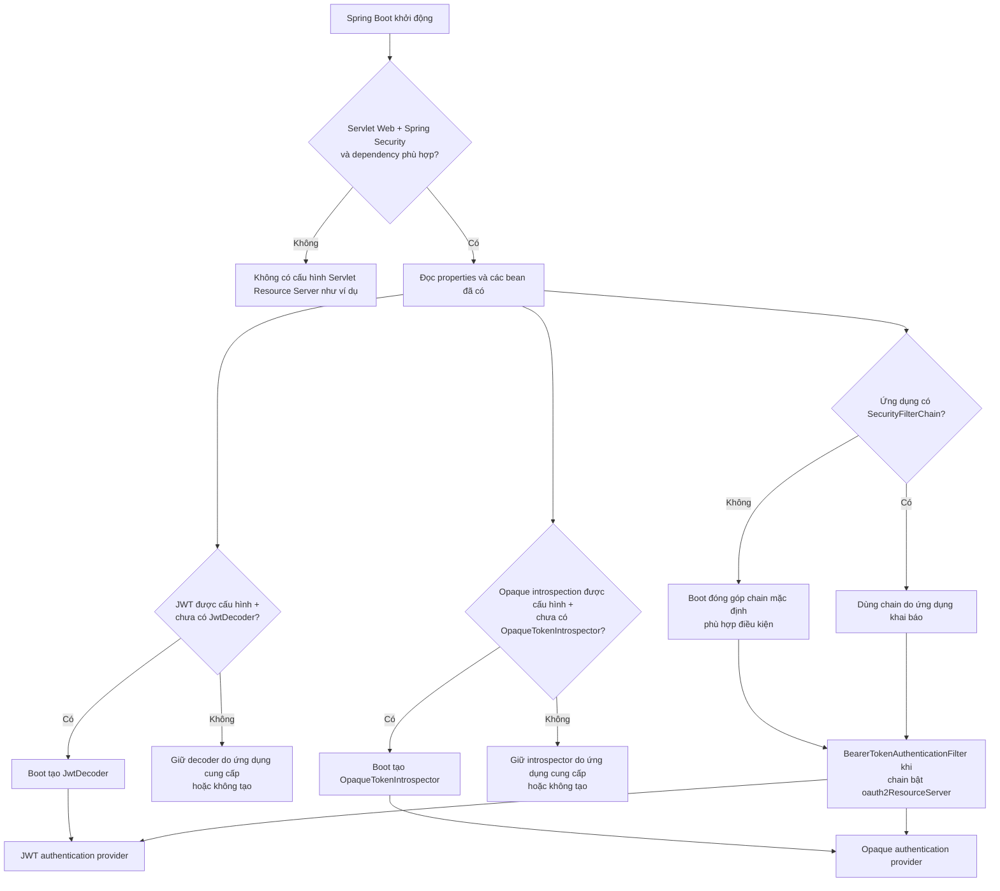
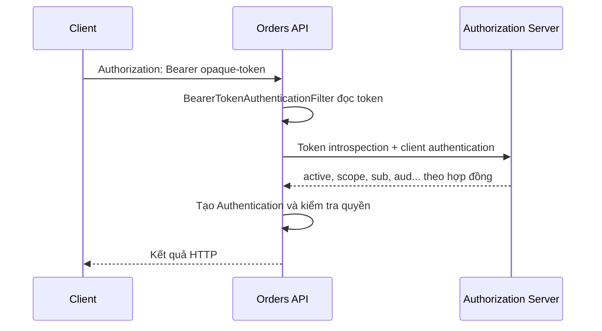
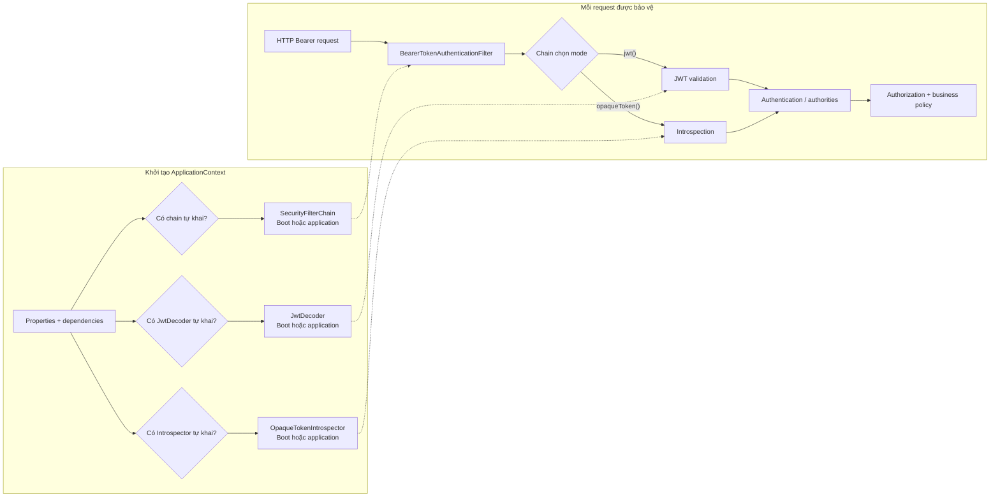

# Spring Boot tự tạo filter chain, decoder hoặc introspector khi nào?

Khi xây dựng **Spring Security OAuth 2.0/OIDC Resource Server**, nhiều ứng dụng Spring Boot chỉ thêm dependency và vài dòng trong `application.yml` là đã nhận được access token qua `Authorization: Bearer ...`. Điều này dễ dẫn đến hiểu nhầm rằng Spring Boot luôn tự tạo tất cả thành phần bảo mật, hoặc rằng chỉ cần tự viết một `SecurityFilterChain` là mọi cấu hình Resource Server trước đó vẫn hoạt động.

Thực tế, **auto-configuration là một tập quyết định có điều kiện**. Spring Boot quan sát các thư viện trên classpath, loại ứng dụng (Servlet/Reactive), các properties được khai báo và những bean do ứng dụng cung cấp. Nó chỉ đóng góp cấu hình mặc định khi các điều kiện tương ứng thỏa mãn. Ba thành phần quan trọng nhất cần phân biệt:

1. **`SecurityFilterChain`**: quyết định request nào chịu bộ lọc nào, yêu cầu xác thực/phân quyền nào và có bật xử lý OAuth 2.0 bearer token hay không.
2. **`JwtDecoder`**: xác minh và chuyển chuỗi JWT thành đối tượng `Jwt`, gồm chữ ký, issuer, thời gian và các validator được cấu hình.
3. **`OpaqueTokenIntrospector`**: kiểm tra token thông qua introspection, nhận thông tin principal và quyền từ Authorization Server hoặc cơ chế introspection tương đương.

Ba bean này **khác vai trò và có điều kiện tự cấu hình riêng**. Tạo bean này không nhất thiết vô hiệu hóa việc tự cấu hình bean kia. Bài học tập trung vào ứng dụng **Servlet Spring MVC** với `HttpSecurity` và `jakarta.servlet`; WebFlux dùng `SecurityWebFilterChain`, `ReactiveJwtDecoder` và `ReactiveOpaqueTokenIntrospector`, không thay thế trực tiếp được cho các kiểu Servlet.

## 1. Mô hình tự cấu hình từ dependency đến HTTP request



Sơ đồ là **mô hình khái niệm**: không có nghĩa cả decoder và introspector đều luôn được tạo, hoặc cùng được dùng để xác thực một request. Chế độ JWT hay opaque phải được lựa chọn/cấu hình rõ. Việc có bean trong `ApplicationContext` cũng không tự chứng minh nó được sử dụng bởi filter chain phục vụ một endpoint.

### 1.1. Hai thời điểm dễ bị nhầm

**Lúc khởi động:** Boot quyết định có tạo bean hay không; cấu hình `SecurityFilterChain` được xây dựng, các điều kiện classpath/properties/bean được đánh giá. Với một số decoder cấu hình qua issuer, việc truy vấn metadata/khóa của IdP có thể được hoãn tới lần cần xác thực token đầu tiên tùy phiên bản và cách tạo decoder.

**Lúc request chạy:** `FilterChainProxy` chọn chain phù hợp với request; `BearerTokenAuthenticationFilter` đọc bearer token; JWT provider dùng `JwtDecoder` hoặc opaque provider dùng `OpaqueTokenIntrospector`; sau khi xác thực mới đến bước authorization. **Không phải mỗi request đều kích hoạt Boot tạo lại bean.**

## 2. Điều kiện nền: classpath, loại ứng dụng và cấu hình

Spring Boot không đoán rằng một chuỗi trong `Authorization` là JWT hay opaque token nếu chưa có cấu hình. Điều kiện tối thiểu thường gồm:

| Yếu tố | JWT Resource Server | Opaque token Resource Server |
|---|---|---|
| Web runtime | Servlet web application cho `SecurityFilterChain` | Servlet web application cho `SecurityFilterChain` |
| Spring Security | Có các lớp security/web và Resource Server | Có các lớp security/web và Resource Server |
| Thư viện đặc thù | `spring-security-oauth2-resource-server` **và** `spring-security-oauth2-jose` để xác minh JWT | `spring-security-oauth2-resource-server` và hạ tầng introspection phù hợp |
| Cấu hình xác minh | `issuer-uri`, `jwk-set-uri`, `public-key-location` hoặc decoder riêng theo khả năng phiên bản | `introspection-uri` cùng credentials hoặc introspector riêng |
| Thành phần chuyên trách | `JwtDecoder` | `OpaqueTokenIntrospector` |
| Tích hợp trong HTTP | Chain cấu hình `.oauth2ResourceServer(...jwt(...))` | Chain cấu hình `.oauth2ResourceServer(...opaqueToken(...))` |

Với Spring Boot 3.x, starter thông dụng là:

```groovy
// build.gradle — ví dụ cho Spring Boot 3.x
dependencies {
    implementation 'org.springframework.boot:spring-boot-starter-web'
    implementation 'org.springframework.boot:spring-boot-starter-oauth2-resource-server'
}
```

Trên Spring Boot 4.x, có starter tên rõ hơn `spring-boot-starter-security-oauth2-resource-server`; tên cũ được đánh dấu deprecated trong danh mục starter Boot 4. Hãy chọn dependency theo **version của project thực tế**. Starter thường mang theo các thư viện Spring Security cần thiết; nếu khai báo module thủ công, đặc biệt với JWT, đừng quên `spring-security-oauth2-jose`.

**Chỉ thêm `spring-boot-starter-security` không đồng nghĩa ứng dụng đã là OAuth 2.0 Resource Server.** Một ứng dụng Spring Security web thông thường có thể được bảo vệ bằng HTTP Basic hoặc form login mặc định, phụ thuộc cấu hình và content negotiation. Để xác thực bearer token cho API, cần Resource Server support và cấu hình xác minh token.

### 2.1. Cấu hình Boot làm gì và Spring Security làm gì?

| Công việc | Chủ thể chính |
|---|---|
| Đọc `spring.security.oauth2.resourceserver.*` từ YAML/properties | Spring Boot |
| Quyết định khi nào đóng góp bean mặc định | Spring Boot auto-configuration |
| Cung cấp `HttpSecurity`, `SecurityFilterChain` và DSL `oauth2ResourceServer` | Spring Security |
| Đọc bearer token từ request | Spring Security `BearerTokenAuthenticationFilter` và resolver |
| Xác minh JWT hoặc introspect opaque token | `JwtDecoder` / `OpaqueTokenIntrospector` |
| Kiểm tra scope, quyền endpoint và quyền trên dữ liệu | Spring Security authorization và nghiệp vụ ứng dụng |

Nói “Boot tự bảo mật API” là cách nói rút gọn. Chính xác hơn: **Boot lắp ráp cấu hình mặc định; Spring Security xử lý request theo cấu hình đó.**

## 3. Khi nào Boot tự tạo `SecurityFilterChain`?

Trong ứng dụng Spring MVC không tự khai báo chain, Spring Boot có thể cung cấp **chain mặc định**. Nếu các điều kiện Resource Server JWT được thỏa mãn, cấu hình tương đương về ý tưởng:

```java
@Bean
SecurityFilterChain defaultResourceServerChain(HttpSecurity http)
        throws Exception {
    return http
        .authorizeHttpRequests(auth -> auth
            .anyRequest().authenticated())
        .oauth2ResourceServer(oauth2 ->
            oauth2.jwt(Customizer.withDefaults()))
        .build();
}
```

Trong chế độ opaque token, phần Resource Server tương đương là:

```java
.oauth2ResourceServer(oauth2 ->
    oauth2.opaqueToken(Customizer.withDefaults()))
```

Hai ví dụ trên diễn giải hành vi mặc định, **không yêu cầu người học khai báo cả hai chain**. Các request được bảo vệ mặc định; nếu ứng dụng cần endpoint công khai hoặc scope riêng, hãy tự cung cấp chain theo chủ đích.

### 3.1. Điều kiện “chưa có SecurityFilterChain” có ý nghĩa gì?

Spring Boot dùng cơ chế tương tự `@ConditionalOnMissingBean(SecurityFilterChain.class)` trong cấu hình bảo mật web. Khi ứng dụng đã cung cấp một bean `SecurityFilterChain`, Boot **nhường quyền thiết kế chain mặc định** cho ứng dụng.

Ví dụ người phát triển tự viết:

```java
@Bean
SecurityFilterChain securityFilterChain(HttpSecurity http) throws Exception {
    return http
        .authorizeHttpRequests(auth -> auth
            .anyRequest().authenticated())
        .httpBasic(Customizer.withDefaults())
        .build();
}
```

Đây là một custom chain hợp lệ, nhưng nó **không bật `oauth2ResourceServer().jwt()`**. Dù `application.yml` vẫn có `issuer-uri` và Boot đã tạo một `JwtDecoder`, request `Authorization: Bearer ...` **không tự được xác thực bằng JWT** trong chain này. Trên endpoint yêu cầu xác thực, request có thể nhận 401 theo cơ chế thực tế được bật.

Đây là điểm khác biệt quan trọng nhất:

> **Khai báo `SecurityFilterChain` thay thế cấu hình HTTP security mặc định. Không được hiểu rằng Boot sẽ tự ghép lại tất cả DSL Resource Server vào chain do bạn viết.**

### 3.2. Một bean có thể tác động tới toàn bộ cấu hình mặc định

Ngay cả khi custom chain chỉ dùng cho một nhóm đường dẫn:

```java
@Bean
@Order(1)
SecurityFilterChain internalChain(HttpSecurity http) throws Exception {
    return http
        .securityMatcher("/internal/**")
        .authorizeHttpRequests(auth -> auth
            .anyRequest().authenticated())
        .httpBasic(Customizer.withDefaults())
        .build();
}
```

Sự hiện diện của bean này có thể khiến Boot không thêm **chain Resource Server mặc định toàn cục**. Nếu không có chain thứ hai bắt các URL khác, các URL nằm ngoài `/internal/**` có thể **không được bất kỳ Spring Security chain nào bảo vệ**.

Vì vậy, với nhiều chain, ứng dụng cần tự xác định đầy đủ tập đường dẫn được bảo vệ và thứ tự:

```java
@Configuration
public class MultipleChainsConfig {

    @Bean
    @Order(1)
    SecurityFilterChain internalBasicChain(HttpSecurity http)
            throws Exception {
        return http
            .securityMatcher("/internal/**")
            .authorizeHttpRequests(auth -> auth
                .anyRequest().authenticated())
            .httpBasic(Customizer.withDefaults())
            .build();
    }

    @Bean
    @Order(2)
    SecurityFilterChain apiBearerChain(HttpSecurity http)
            throws Exception {
        return http
            .securityMatcher("/api/**")
            .authorizeHttpRequests(auth -> auth
                .anyRequest().authenticated())
            .oauth2ResourceServer(oauth2 ->
                oauth2.jwt(Customizer.withDefaults()))
            .build();
    }
}
```

Đây là ví dụ hai chain riêng, chưa bao phủ đường dẫn nằm ngoài `/internal/**` và `/api/**`. Nếu hệ thống còn URL khác, phải quyết định một chain bao phủ chúng, ví dụ một fallback chain có `anyRequest().denyAll()`, tùy kiến trúc. **`FilterChainProxy` chọn chain khớp đầu tiên; không gộp quyền của hai chain để xử lý cùng một request.**

### 3.3. Các endpoint public trong chain bearer

Thường API cần mở health endpoint nhưng giữ bảo vệ các đường dẫn khác:

```java
@Bean
SecurityFilterChain apiSecurity(HttpSecurity http) throws Exception {
    return http
        .authorizeHttpRequests(auth -> auth
            .requestMatchers("/actuator/health").permitAll()
            .requestMatchers("/api/orders/**")
                .hasAuthority("SCOPE_orders.read")
            .anyRequest().authenticated())
        .oauth2ResourceServer(oauth2 ->
            oauth2.jwt(Customizer.withDefaults()))
        .build();
}
```

`permitAll()` là quyết định ở tầng authorization, không loại bỏ mọi authentication filter khỏi endpoint. Ví dụ request tới endpoint public nhưng chứa một Bearer credential malformed vẫn có thể bị từ chối trước khi tới controller.

Với API không dùng session/cookie để xác thực thao tác, có thể cấu hình stateless và xem xét CSRF theo nguồn credential thực tế. Không tắt CSRF một cách máy móc trong ứng dụng vừa dùng bearer token vừa dùng form login/cookie.

## 4. Khi nào Boot tự tạo `JwtDecoder`?

Khi cấu hình JWT Resource Server hợp lệ, có dependency JWT và **không có bean `JwtDecoder` do ứng dụng cung cấp**, Boot có thể tạo decoder. Ví dụ cấu hình tối thiểu bằng issuer:

```yaml
# application.yml — Servlet JWT Resource Server
spring:
  security:
    oauth2:
      resourceserver:
        jwt:
          issuer-uri: https://idp.example.com/realms/shop
```

Nhìn theo logic:

```text
Classpath có hỗ trợ Resource Server JWT
AND thuộc cấu hình Servlet phù hợp
AND có nguồn xác minh token được cấu hình
AND chưa có JwtDecoder bean do ứng dụng cung cấp
    => Boot tạo JwtDecoder mặc định
```

Với `issuer-uri`, decoder có thể sử dụng metadata chuẩn của Authorization Server hoặc OpenID Provider để tìm địa chỉ JWKS và xác minh issuer. Lúc nhận token, Spring Security dựa vào decoder để xác minh chữ ký, các mốc thời gian như `exp`, `nbf` và `iss` theo cấu hình.

**Đây là decoder xác minh JWT, không phải bean phát hành JWT.** Resource Server không tự trở thành OAuth Authorization Server vì có `JwtDecoder`.

### 4.1. `issuer-uri`, `jwk-set-uri` và audience

Ba property rất dễ bị đặt sai mục đích:

| Property | Giá trị ví dụ | Vai trò |
|---|---|---|
| `spring.security.oauth2.resourceserver.jwt.issuer-uri` | `https://idp.example.com/realms/shop` | Khai báo issuer tin cậy; dùng discovery và/hoặc xác minh `iss` tùy cấu hình |
| `spring.security.oauth2.resourceserver.jwt.jwk-set-uri` | `https://idp.example.com/realms/shop/protocol/openid-connect/certs` | Chỉ rõ nơi lấy khóa công khai để xác minh chữ ký JWT |
| `spring.security.oauth2.resourceserver.jwt.audiences` | `orders-api` | Ràng buộc `aud` chứa audience API yêu cầu |

Cấu hình gợi ý cho API biết issuer và JWKS chính xác:

```yaml
spring:
  security:
    oauth2:
      resourceserver:
        jwt:
          issuer-uri: https://idp.example.com/realms/shop
          jwk-set-uri: https://idp.example.com/realms/shop/protocol/openid-connect/certs
          audiences:
            - orders-api
```

Khi khai báo cả `issuer-uri` và `jwk-set-uri`, ứng dụng có thể biết địa chỉ JWKS trực tiếp mà vẫn giữ validator issuer theo cấu hình. Nếu chỉ khai báo `jwk-set-uri`, **không nên tự giả định validator issuer được thiết lập** khi không có nguồn issuer rõ ràng. Đây là quyết định theo hợp đồng token và phiên bản; nếu API cần kiểm soát `iss`, hãy cấu hình `issuer-uri` hoặc validator tương ứng.

`audiences` được Spring Boot hỗ trợ để kiểm tra `aud` của token ở các phiên bản hiện đại. Nếu ứng dụng thay bằng `JwtDecoder` tự viết, cần bảo đảm các validator tương đương được gắn vào decoder riêng, vì tự thay bean có thể làm các thiết lập mặc định không còn áp dụng như mong muốn.

### 4.2. Khi nào IdP phải sẵn sàng?

Có hai hoạt động mạng khác nhau:

- **Issuer discovery:** lấy metadata để biết JWKS URI và thông tin liên quan.
- **JWKS retrieval:** lấy khóa công khai để xác minh chữ ký.

Trong phiên bản Spring Security hiện đại, đường auto-configuration có thể **trì hoãn discovery đến lần xác thực JWT đầu tiên** qua `SupplierJwtDecoder`. Cách này giúp ứng dụng khởi động mà chưa cần IdP đang sẵn sàng. Tuy nhiên, điều đó **không có nghĩa request đầu tiên sẽ thành công nếu IdP/JWKS đang không truy cập được**.

Nếu ứng dụng tự tạo `JwtDecoder` bằng `JwtDecoders.fromIssuerLocation(issuer)` tại thời điểm khởi tạo bean, việc discovery có thể diễn ra **ngay lúc tạo bean**. Vì vậy, sự khác biệt “khởi động được khi IdP chết hay không” phải được xem xét theo **version và cách tạo decoder cụ thể**, không thể suy ra chỉ từ việc có property `issuer-uri`.

Muốn tránh phụ thuộc vào discovery để biết JWKS URI, có thể cấu hình `jwk-set-uri` trực tiếp. Hệ thống vẫn cần bảo đảm khóa hợp lệ được cung cấp/refresh đúng khi xác thực token.

### 4.3. Ví dụ khi không cần tự khai báo decoder

Nếu chỉ yêu cầu nhận JWT do IdP phát hành, xác minh issuer/audience và dùng các scope chuẩn, cấu hình YAML là đủ cho phần decoder:

```yaml
spring:
  security:
    oauth2:
      resourceserver:
        jwt:
          issuer-uri: https://idp.example.com/realms/shop
          audiences: orders-api
```

Bạn chỉ cần viết custom chain khi muốn sửa chính sách endpoint, ví dụ `/public/**` public hoặc `/api/orders/**` yêu cầu `SCOPE_orders.read`. Khi đó **vẫn để Boot tạo decoder**, nhưng chain phải bật `oauth2ResourceServer().jwt()`.

## 5. Khi nào Boot tự tạo `OpaqueTokenIntrospector`?

Nếu ứng dụng sử dụng **introspection** thay vì tự xác minh JWT, Boot có thể tạo bean `OpaqueTokenIntrospector` khi có classpath phù hợp, thông tin introspection đầy đủ và chưa có introspector riêng.

```yaml
# application.yml — opaque token introspection
spring:
  security:
    oauth2:
      resourceserver:
        opaquetoken:
          introspection-uri: https://idp.example.com/oauth2/introspect
          client-id: orders-resource-server
          client-secret: ${INTROSPECTION_CLIENT_SECRET}
```

Ví dụ trong bài dùng biến môi trường để tránh đưa secret thực vào source. Nơi lưu bí mật có thể là secret manager, hệ thống triển khai hoặc cấu hình an toàn phù hợp.

Mô hình khái niệm:

```text
Classpath có hỗ trợ Resource Server opaque token
AND có introspection-uri + credentials thích hợp
AND chưa có OpaqueTokenIntrospector bean của ứng dụng
    => Boot tạo OpaqueTokenIntrospector mặc định
```

Với cấu hình hiện đại, implementation tự cấu hình có thể là `SpringOpaqueTokenIntrospector`. Khi có request:



Khác với JWT được xác minh offline, introspection thường tạo yêu cầu mạng đến Authorization Server khi token cần kiểm tra. Cần cân nhắc timeout, tính sẵn sàng của endpoint, quyền truy cập metadata và chính sách cache/thu hồi.

Một token có cấu trúc JWT **vẫn có thể được kiểm tra qua introspection** nếu hệ thống chủ động chọn cách đó. “Opaque” ở đây chỉ cách Resource Server xác minh token; nó không chứng minh token luôn là chuỗi vô nghĩa không chứa dấu chấm.

### 5.1. Nếu tự có introspector?

Ví dụ ứng dụng cần thêm timeout, metric hoặc chính sách kiểm tra trạng thái theo hợp đồng, nó có thể cung cấp:

```java
@Bean
OpaqueTokenIntrospector opaqueTokenIntrospector(
        @Value("${app.introspection.uri}") String introspectionUri,
        @Value("${app.introspection.client-id}") String clientId,
        @Value("${app.introspection.client-secret}") String clientSecret) {

    return SpringOpaqueTokenIntrospector
        .withIntrospectionUri(introspectionUri)
        .clientId(clientId)
        .clientSecret(clientSecret)
        .build();
}
```

Khi đã có bean `OpaqueTokenIntrospector`, Boot thường **không tạo introspector mặc định thứ hai** cho cùng điều kiện. Nếu muốn thêm logic, có thể trả về một wrapper implement `OpaqueTokenIntrospector` và delegate tới một introspector chuẩn. Không sửa kết quả introspection theo hướng biến `active=false` thành hợp lệ.

**Lưu ý phiên bản:** API builder/implementation có thể thay đổi giữa các nhánh Spring Security; ví dụ trên theo các nhánh hiện đại có `SpringOpaqueTokenIntrospector.withIntrospectionUri`. Khi project ở phiên bản khác, kiểm tra API tương ứng trong reference/Javadoc của đúng version.

### 5.2. Chỉ có bean introspector chưa nói chain sử dụng nó

Nếu ứng dụng tự tạo:

```java
@Bean
SecurityFilterChain apiChain(HttpSecurity http) throws Exception {
    return http
        .authorizeHttpRequests(auth -> auth
            .anyRequest().authenticated())
        .oauth2ResourceServer(oauth2 ->
            oauth2.opaqueToken(Customizer.withDefaults()))
        .build();
}
```

thì chain được chỉ định sử dụng opaque token introspection. Nếu custom chain chỉ bật `jwt()`, bean `OpaqueTokenIntrospector` có trong context cũng không tự làm chain đó xử lý theo opaque mode.

## 6. Quy tắc “back off” hoạt động độc lập cho từng bean

*Back off* nghĩa là cấu hình mặc định của Boot **nhường chỗ khi ứng dụng đã khai báo thành phần cùng vai trò**. Nó không phải nút “tắt toàn bộ Spring Security”.

| Ứng dụng khai báo | Cấu hình Boot thường nhường chỗ | Thành phần còn có thể do Boot tạo |
|---|---|---|
| `@Bean SecurityFilterChain` | Chain mặc định của Boot | `JwtDecoder` hoặc `OpaqueTokenIntrospector` nếu đủ điều kiện |
| `@Bean JwtDecoder` | Decoder JWT mặc định | Chain mặc định nếu chưa có custom chain và phù hợp cấu hình |
| `@Bean OpaqueTokenIntrospector` | Introspector mặc định | Chain mặc định nếu chưa có custom chain và phù hợp cấu hình |
| `@Bean JwtDecoder` và custom chain | Decoder JWT mặc định và chain mặc định | Các bean khác vẫn do điều kiện riêng quyết định |
| Custom `SecurityFilterChain` chỉ dùng `httpBasic()` | Chain Resource Server mặc định | Decoder có thể có trong context nhưng không được chain dùng |

Cần phân biệt **đăng ký bean trong Spring context** với **tham chiếu bean trong filter chain**. Ví dụ `JwtDecoder` là một bean singleton; `SecurityFilterChain` thiết lập chiến lược xác thực. Một decoder tự tồn tại nhưng không được tham chiếu bởi JWT authentication provider sẽ không xử lý bearer token.

### 6.1. Không có bean custom không đồng nghĩa Boot sẽ luôn tạo

Ví dụ application không cấu hình issuer, JWKS, public key hoặc decoder riêng mà chỉ thêm thư viện:

```groovy
implementation 'org.springframework.boot:spring-boot-starter-oauth2-resource-server'
```

Không nên cho rằng hệ thống đã biết **khóa nào** dùng để xác minh JWT hoặc **endpoint nào** để introspect opaque token. Cần có thông tin xác minh hợp lệ, hoặc bean do ứng dụng cung cấp. Tùy classpath và phiên bản, application có thể chạy với default web security khác, hoặc thất bại khi cố lắp một chain yêu cầu decoder nhưng không tìm thấy cấu hình cần thiết.

Ví dụ:

```java
@Bean
SecurityFilterChain apiChain(HttpSecurity http) throws Exception {
    return http
        .authorizeHttpRequests(auth -> auth
            .anyRequest().authenticated())
        .oauth2ResourceServer(oauth2 ->
            oauth2.jwt(Customizer.withDefaults()))
        .build();
}
```

Nếu không có `JwtDecoder` và không có cách cấu hình decoder, việc tạo chain kiểu JWT có thể làm startup báo lỗi thiếu bean/cấu hình. **Spring Security không tự tin bất kỳ chữ ký hay issuer nào chỉ vì developer gọi `.jwt()`.**

## 7. Tự khai báo `SecurityFilterChain`: giữ lại Resource Server

Khi cần bảo vệ endpoint theo scope, hãy khai báo chain có explicit `oauth2ResourceServer`. Ví dụ Servlet REST API chỉ đọc đơn hàng theo JWT:

```java
import org.springframework.context.annotation.Bean;
import org.springframework.context.annotation.Configuration;
import org.springframework.http.HttpMethod;
import org.springframework.security.config.Customizer;
import org.springframework.security.config.annotation.web.builders.HttpSecurity;
import org.springframework.security.config.annotation.web.configurers.AbstractHttpConfigurer;
import org.springframework.security.config.http.SessionCreationPolicy;
import org.springframework.security.web.SecurityFilterChain;

@Configuration
public class OrdersSecurityConfiguration {

    @Bean
    SecurityFilterChain apiSecurity(HttpSecurity http) throws Exception {
        return http
            // Phù hợp với API chỉ xác thực bằng Bearer header,
            // không dùng cookie/session cho các thao tác ghi.
            .csrf(AbstractHttpConfigurer::disable)
            .sessionManagement(session ->
                session.sessionCreationPolicy(SessionCreationPolicy.STATELESS))
            .authorizeHttpRequests(auth -> auth
                .requestMatchers("/actuator/health").permitAll()
                .requestMatchers(HttpMethod.GET, "/api/orders/**")
                    .hasAuthority("SCOPE_orders.read")
                .requestMatchers(HttpMethod.POST, "/api/orders/**")
                    .hasAuthority("SCOPE_orders.write")
                .anyRequest().authenticated())
            .oauth2ResourceServer(oauth2 ->
                oauth2.jwt(Customizer.withDefaults()))
            .build();
    }
}
```

```yaml
spring:
  security:
    oauth2:
      resourceserver:
        jwt:
          issuer-uri: https://idp.example.com/realms/shop
          audiences:
            - orders-api
```

Ở đây:

- **Ứng dụng tạo `SecurityFilterChain`**; Boot không cần đóng góp chain mặc định.
- **Boot vẫn có thể tạo `JwtDecoder`** từ `issuer-uri` và các properties nếu ứng dụng chưa khai báo decoder riêng.
- `oauth2ResourceServer().jwt()` nối decoder vào luồng xác thực bearer token.
- `hasAuthority("SCOPE_orders.read")` là kiểm tra authority; mặc định scope thường được ánh xạ thành `SCOPE_...`.
- Quyền trên **đúng đơn hàng** (owner, tenant, trạng thái) vẫn cần được kiểm tra ở tầng nghiệp vụ.

Nếu resource server còn phục vụ các trang web có session/cookie, không copy nguyên cấu hình `csrf().disable()` chỉ vì ví dụ API này có bearer token.

## 8. Tự khai báo `JwtDecoder`: giữ lại validator cần thiết

Ứng dụng có thể cần một decoder riêng khi:

- IdP dùng thuật toán/khóa hoặc định dạng cần cấu hình khác mặc định.
- Muốn kiểm tra audience, loại token, claim đặc thù hoặc giới hạn tuổi token theo hợp đồng riêng.
- Cần kiểm soát cách phát hiện khóa, cache hoặc timeout.
- Chấp nhận nhiều issuer có quản trị thông qua resolver/decoder được cấu hình rõ, không dựa vào bất cứ `iss` nào tự khai báo.

Khi đặt một `@Bean JwtDecoder`, **đừng mặc định Boot tiếp tục gắn các validator từ YAML vào decoder tự tạo**. Bản thân ứng dụng phải tạo decoder có đầy đủ điều kiện bảo mật theo hợp đồng.

Ví dụ decoder JWT với issuer và audience cố định:

```java
import org.springframework.beans.factory.annotation.Value;
import org.springframework.context.annotation.Bean;
import org.springframework.context.annotation.Configuration;
import org.springframework.security.oauth2.core.DelegatingOAuth2TokenValidator;
import org.springframework.security.oauth2.core.OAuth2Error;
import org.springframework.security.oauth2.core.OAuth2TokenValidator;
import org.springframework.security.oauth2.core.OAuth2TokenValidatorResult;
import org.springframework.security.oauth2.jwt.Jwt;
import org.springframework.security.oauth2.jwt.JwtDecoder;
import org.springframework.security.oauth2.jwt.JwtValidators;
import org.springframework.security.oauth2.jwt.NimbusJwtDecoder;

@Configuration
public class OrdersDecoderConfiguration {

    @Bean
    JwtDecoder jwtDecoder(
            @Value("${app.security.issuer}") String issuer,
            @Value("${app.security.audience}") String audience) {

        NimbusJwtDecoder decoder =
            NimbusJwtDecoder.withIssuerLocation(issuer).build();

        OAuth2TokenValidator<Jwt> standard =
            JwtValidators.createDefaultWithIssuer(issuer);

        OAuth2TokenValidator<Jwt> requireAudience = jwt ->
            jwt.getAudience().contains(audience)
                ? OAuth2TokenValidatorResult.success()
                : OAuth2TokenValidatorResult.failure(
                    new OAuth2Error(
                        "invalid_token",
                        "Unexpected audience",
                        null));

        decoder.setJwtValidator(
            new DelegatingOAuth2TokenValidator<>(standard, requireAudience));
        return decoder;
    }
}
```

```yaml
app:
  security:
    issuer: https://idp.example.com/realms/shop
    audience: orders-api
```

Đoạn code theo Spring Security 6+ diễn đạt rõ: chọn issuer tin cậy từ cấu hình ứng dụng, giữ validator mặc định và issuer, bổ sung audience. Nó chỉ giải quyết bước **xác thực token**; phân quyền vẫn nằm trong chain/controller/service.

**Lưu ý về startup:** `NimbusJwtDecoder.withIssuerLocation(...).build()` có thể cần discovery metadata khi tạo decoder. Nếu phụ thuộc tính năng deferred discovery của Boot, đừng vô tình thay bằng bean được khởi tạo eager rồi ngạc nhiên khi startup yêu cầu IdP có mặt.

### 8.1. Đặt decoder ngay trên DSL

Spring Security hỗ trợ cấu hình trực tiếp:

```java
.oauth2ResourceServer(oauth2 -> oauth2
    .jwt(jwt -> jwt.decoder(customJwtDecoder)))
```

Với chain này, decoder được truyền trực tiếp vào DSL thay vì dùng chiến lược tự động tìm `JwtDecoder` từ context cho chain đó. Cấu hình cục bộ trên DSL có thể **ghi đè lựa chọn mặc định** và có ưu tiên đối với chain cụ thể. Nếu ứng dụng có nhiều chain, cần biết decoder nào được dùng cho mỗi chain.

Tương tự, DSL JWT có tùy chọn như `jwkSetUri(...)` để chỉ định nguồn khóa. Khi thiết lập trực tiếp bằng DSL, đó là quyết định trong code và có thể thắng property tương ứng. Vì vậy, khi thay đổi `application.yml` mà hành vi không đổi, hãy kiểm tra xem decoder/JWKS đã bị cố định trong code hay chưa.

## 9. Tự khai báo `OpaqueTokenIntrospector`: giữ lại chain opaque

Một hệ thống có yêu cầu introspection riêng có thể cung cấp `OpaqueTokenIntrospector` bean để Boot nhường chỗ. Điều đó **không đồng nghĩa tự có filter xử lý Bearer** nếu ứng dụng đã tạo chain riêng.

Ví dụ chain rõ ràng:

```java
@Bean
SecurityFilterChain opaqueApiSecurity(HttpSecurity http)
        throws Exception {
    return http
        .authorizeHttpRequests(auth -> auth
            .requestMatchers("/health").permitAll()
            .requestMatchers("/api/payments/**")
                .hasAuthority("SCOPE_payments.read")
            .anyRequest().authenticated())
        .oauth2ResourceServer(oauth2 ->
            oauth2.opaqueToken(Customizer.withDefaults()))
        .build();
}
```

Sử dụng `@Bean OpaqueTokenIntrospector` phù hợp khi cần:

- Tùy biến kết nối đến introspection endpoint, timeout, client authentication.
- Gắn theo dõi, cache có kiểm soát và chính sách trạng thái token theo yêu cầu.
- Ánh xạ dữ liệu từ introspection sang principal/authorities theo hợp đồng cụ thể.

Nếu chỉ cần endpoint và credentials chuẩn, **cấu hình properties là đủ**; không cần tạo bean để sao chép hành vi mặc định. Khi tùy biến, phải bảo đảm `active` và những điều kiện resource server yêu cầu vẫn được thực thi, không biến mọi token mà introspection endpoint phản hồi thành principal hợp lệ.

## 10. JWT và opaque token có thể cấu hình đồng thời không?

Trên một ứng dụng có thể có cả `JwtDecoder` và `OpaqueTokenIntrospector` trong context, đặc biệt khi dùng nhiều SecurityFilterChain hoặc cấu hình phức hợp. Nhưng **có cả hai bean không chứng minh mỗi request được thử JWT trước rồi tự động fallback sang opaque**.

Ví dụ kiến trúc hai endpoint với hai cách xác thực:

```text
/api/external/**  -> chain A -> JWT decoder
/api/legacy/**    -> chain B -> opaque introspector
```

Ứng dụng cần cấu hình `securityMatcher` và `@Order` cho từng chain để bảo đảm request đi vào đúng chiến lược. Đây là quyết định thiết kế, không phải một hành vi tự chuyển đổi do cấu hình cả `jwt.*` và `opaquetoken.*` trong YAML.

Một bearer token có thể là JWT về mặt định dạng, nhưng vẫn được introspect nếu chain đang chọn opaque mode. Ngược lại, một chuỗi opaque token sẽ không trở thành JWT hợp lệ chỉ vì filter chain chọn JWT decoder.

**Khuyến nghị cấu hình:** Mỗi nhóm endpoint nên có một hợp đồng rõ: issuer/introspection endpoint nào, token được kiểm tra ra sao, audience/scope nào được yêu cầu và quyền trên từng tài nguyên được đánh giá ở đâu.

## 11. Bảng quyết định theo tình huống thực tế

| Tình huống | Boot tự tạo chain? | Boot tự tạo decoder/introspector? | Việc ứng dụng cần làm |
|---|---|---|---|
| Chỉ có Spring Security web, chưa bật Resource Server | Có thể tạo chain bảo mật web thông thường | Không có cơ sở để tạo token verifier Resource Server | Bổ sung Resource Server dependency và hợp đồng xác minh token |
| JWT dependency + `jwt.issuer-uri`, chưa có bean custom | **Có**, chain JWT mặc định theo điều kiện | **Có**, `JwtDecoder` | Xác định audience/authorization phù hợp |
| Opaque dependency + introspection properties, chưa có bean custom | **Có**, chain opaque mặc định theo điều kiện | **Có**, `OpaqueTokenIntrospector` | Bảo vệ credentials, kiểm tra scope và nghiệp vụ |
| Custom `SecurityFilterChain` + JWT properties | **Không tạo chain mặc định** | **Có thể vẫn tạo `JwtDecoder`** | Trong chain gọi `.oauth2ResourceServer(...jwt...)` |
| Custom `JwtDecoder` + không custom chain | Chain mặc định có thể vẫn được Boot tạo nếu điều kiện Resource Server thỏa | **Không** tạo decoder mặc định | Tự bảo đảm chữ ký/issuer/audience/thời gian |
| Custom `OpaqueTokenIntrospector` + không custom chain | Chain mặc định có thể vẫn được Boot tạo nếu điều kiện opaque thỏa | **Không** tạo introspector mặc định | Tự bảo đảm kết quả introspection hợp lệ |
| Custom chain chỉ bật HTTP Basic dù có JWT properties | Không tạo chain JWT mặc định | Decoder có thể vẫn có | Thêm `.oauth2ResourceServer(...jwt...)` nếu muốn Bearer |
| Custom chain cho một route, không có fallback chain | Không tạo chain mặc định toàn cục | Tùy properties/bean | Bảo vệ đầy đủ các route còn lại |
| Chỉ khai `jwt.issuer-uri` nhưng thiếu JOSE trên classpath | Không thể hoàn chỉnh cấu hình JWT theo dự kiến | Không có decoder JWT hoạt động đúng | Sửa dependency |
| Khai cả JWT và opaque properties không có định hướng rõ | Không nên giả định một kiểu được tự chọn đúng | Có thể hiện diện các bean tùy conditions | Chọn mode rõ trên từng chain |

Bảng mô tả **quy tắc điển hình** của auto-configuration; danh sách condition chi tiết có thể đổi theo phiên bản Boot/Security. Để kết luận một ứng dụng cụ thể, cần quan sát bean thực tế và condition report từ chính phiên bản đang chạy.

## 12. Bean lifecycle và ảnh hưởng của startup

Có ba trạng thái thường bị nhầm:

```text
1. Boot quyết định PHẢI tạo bean gì?
2. Spring khởi tạo bean đó THÀNH CÔNG không?
3. Khi request tới, filter chain có THỰC SỰ dùng bean đó không?
```

**Ví dụ 1: Decoder được dự kiến nhưng startup lỗi.** Application có cấu hình `issuer-uri`, nhưng code tự tạo `JwtDecoder` eager bằng discovery và Authorization Server đang không truy cập được. Lúc này không thể kết luận “Boot không hỗ trợ Resource Server”; nguyên nhân có thể là discovery khi khởi tạo custom decoder.

**Ví dụ 2: Bean hiện diện nhưng không dùng.** `JwtDecoder` xuất hiện trong `ApplicationContext`; custom chain chỉ bật `formLogin`. Filter xử lý JWT không tham gia chain.

**Ví dụ 3: Chain có JWT nhưng decoder sai cấu hình.** Request tới đúng chain và có `Authorization: Bearer`, nhưng chữ ký không xác minh được do JWKS URI sai. Đây là lỗi xác thực token, không phải lỗi thiếu filter chain.

**Ví dụ 4: JWT hợp lệ nhưng endpoint trả 403.** Decoder đã hoàn thành; scope/authority hoặc quyền nghiệp vụ chưa thỏa. Đổi issuer hoặc viết decoder mới không phải cách sửa lỗi phân quyền.

## 13. Phân biệt lỗi khởi động, 401 và 403

| Triệu chứng | Câu hỏi cần kiểm tra | Nhóm nguyên nhân thường gặp |
|---|---|---|
| Application không khởi động; thiếu `JwtDecoder` | Chain có gọi `jwt()` nhưng có decoder hợp lệ chưa? | Thiếu property, classpath, bean hoặc cách tạo decoder |
| Startup lỗi kết nối IdP | Có custom decoder eager/discovery không? | IdP/metadata endpoint không sẵn, URL/certificate sai |
| API trả 401 với Bearer JWT | Request có đi vào JWT Resource Server chain không? | Filter chain sai, token hết hạn, chữ ký/issuer/audience không hợp lệ |
| API trả 401 với opaque token | Chain dùng `opaqueToken()` chưa? | Introspection endpoint/client credentials sai, token inactive |
| API trả 403 | Token đã được xác thực và có authority cần thiết chưa? | Thiếu scope, policy endpoint hoặc quyền dữ liệu |
| Token Bearer không có hiệu lực, HTTP Basic lại chạy | Custom chain có chỉ bật `httpBasic()` không? | Tự khai `SecurityFilterChain` làm default Resource Server chain nhường chỗ |
| Một số URL không bị bảo vệ | Có chain nào match những URL đó? | Nhiều `securityMatcher` mà thiếu fallback |
| Thay `issuer-uri` trong YAML nhưng key vẫn cũ | Code có `decoder(...)` hoặc `jwkSetUri(...)` ghi đè không? | DSL/bean tự định nghĩa có ưu tiên hơn property |
| Token JWT đúng chữ ký nhưng API nhận sai audience | `audiences` hoặc validator audience đã bật chưa? | Chỉ cấu hình issuer, thiếu hợp đồng audience |

### 13.1. Phân biệt xác thực và phân quyền qua HTTP

```http
GET /api/orders/123 HTTP/1.1
Host: orders.example.com
Authorization: Bearer eyJ...
```

**401 Unauthorized** thường nghĩa là thiếu hoặc không có xác thực hợp lệ cho endpoint: token sai chữ ký, hết hạn, sai issuer, sai audience nếu có validator, hoặc request không có credential phù hợp.

**403 Forbidden** thường nghĩa là đã có danh tính xác thực nhưng thiếu quyền. Ví dụ token `scope=orders.read` hợp lệ nhưng người gọi không được xem đơn hàng thuộc tenant khác. Hai loại lỗi cần giải quyết ở tầng khác nhau.

Nếu API dùng `BearerTokenAuthenticationEntryPoint`, header `WWW-Authenticate: Bearer` có thể thể hiện lỗi theo RFC 6750, chẳng hạn `invalid_token` hoặc `insufficient_scope` tùy tình huống.

## 14. Tự kiểm tra điều kiện auto-configuration tại ứng dụng đang chạy

Không nên đoán từ YAML rằng mọi bean đã được tạo. Khi cần kiểm tra một môi trường cụ thể, có thể dùng những cơ chế sẵn có:

### 14.1. Condition Evaluation Report của Spring Boot

Chạy ứng dụng với `--debug`:

```bash
java -jar orders-api.jar --debug
```

Spring Boot có thể in **Conditions Evaluation Report** nêu auto-configuration nào khớp điều kiện, điều kiện nào không khớp. Các tên class nội bộ khác nhau theo phiên bản; tập trung vào lý do như “bean cùng loại đã tồn tại”, “classpath thiếu”, “property chưa khai báo”, thay vì học thuộc một tên auto-configuration.

Ví dụ cách hiểu report (minh họa, không phải stdout nguyên văn của Boot):

```text
Resource Server JWT:
  - found relevant classes
  - issuer-uri configured
  - no user JwtDecoder bean -> create default decoder

Web security:
  - user SecurityFilterChain bean found
  - default web chain backs off
```

Nếu quản trị Spring Boot Actuator, endpoint `/actuator/conditions` và `/actuator/beans` có thể giúp quan sát điều kiện và bean trong context. Những endpoint này có thể tiết lộ kiến trúc nội bộ, nên phải được bảo vệ và chỉ mở khi cần theo chính sách vận hành.

### 14.2. Log Spring Security

Trong môi trường phát triển có thể bật log phù hợp:

```yaml
logging:
  level:
    org.springframework.security: DEBUG
```

Log giúp thấy các filter chain được cấu hình và quyết định bảo mật theo request. Không bật log nhạy cảm tràn lan trên production; đặc biệt không ghi bearer token, client secret hoặc thông tin header nguyên vẹn vào log.

### 14.3. Kiểm tra request thật

Với JWT:

```bash
curl -i https://orders.example.com/api/orders/123 \
  -H "Authorization: Bearer ACCESS_TOKEN"
```

Với opaque:

```bash
curl -i https://orders.example.com/api/orders/123 \
  -H "Authorization: Bearer OPAQUE_ACCESS_TOKEN"
```

Hai chuỗi `ACCESS_TOKEN` và `OPAQUE_ACCESS_TOKEN` là placeholder. Việc một request thành công phụ thuộc token được phát hành đúng, còn hạn, đúng audience/phạm vi và được phân quyền đối với đúng tài nguyên. Test kết quả 401/403 cần tách khỏi việc kiểm tra **bean đã được tạo**: bean hiện diện là điều kiện cấu hình, còn phản hồi HTTP là hành vi của cả chain và nghiệp vụ.

## 15. Các trường hợp cấu hình thường gây bất ngờ

### 15.1. “Tôi đã đặt `issuer-uri`, nhưng Bearer token vẫn không chạy”

Kiểm tra trước tiên xem có custom `SecurityFilterChain` không. Nếu có, chain đó có:

```java
.oauth2ResourceServer(oauth2 -> oauth2.jwt(Customizer.withDefaults()))
```

hay không? Nếu không có, property `issuer-uri` chỉ đủ giúp tạo/configure decoder theo điều kiện, **không sửa chain do developer viết**.

### 15.2. “Tôi khai `JwtDecoder`, nhưng Boot vẫn thêm filter chain”

Điều này **có thể hoàn toàn đúng**. Tạo `JwtDecoder` chỉ thay đường tự cấu hình decoder; nếu không cung cấp `SecurityFilterChain`, Boot vẫn có thể đóng góp chain mặc định theo điều kiện Resource Server. Muốn tùy biến endpoint, phải tự khai báo chain.

### 15.3. “Tôi khai `SecurityFilterChain`, nhưng Boot vẫn tạo `JwtDecoder`”

Cũng là hành vi bình thường. Filter chain và decoder là hai loại bean độc lập. Nếu không muốn Boot tạo decoder, hãy cung cấp `JwtDecoder` riêng hoặc thay đổi cấu hình JWT; nhưng tránh tắt decoder khi chain vẫn cần một decoder để hoạt động.

### 15.4. “Tôi đã thêm `OpaqueTokenIntrospector`, sao token JWT không được chấp nhận?”

Có introspector không làm JWT chain tự chuyển sang opaque introspection. Kiểm tra mode:

```java
// JWT:
.oauth2ResourceServer(oauth2 -> oauth2.jwt(Customizer.withDefaults()))

// Opaque:
.oauth2ResourceServer(oauth2 -> oauth2.opaqueToken(Customizer.withDefaults()))
```

Chọn chế độ dựa trên **hợp đồng xác thực token của API**. JWT access token vẫn có thể được introspect nếu đó là cách hệ thống yêu cầu; không quyết định mode chỉ dựa vào token “có ba đoạn ngăn bằng dấu chấm”.

### 15.5. “Tại sao ứng dụng hỏi password mặc định?”

Nếu không có Resource Server configuration đầy đủ và ứng dụng đang dùng bảo mật web mặc định, Spring Boot có thể kích hoạt cơ chế form login/HTTP Basic và user phát sinh. Mật khẩu mặc định in vào log development không phải token của OAuth 2.0 Resource Server. Nó không giải quyết được yêu cầu xác minh JWT hay opaque token.

### 15.6. “Tại sao Boot tự bảo vệ cả `/actuator/health`?”

Mặc định web security có thể áp dụng cho nhiều endpoint, kể cả Actuator, tùy cấu hình/phiên bản. Khi ứng dụng tự cung cấp chain, cần chủ động nêu endpoint công khai, endpoint quản trị và phạm vi bảo vệ. Không mở toàn bộ Actuator chỉ để health check hoạt động; có thể sử dụng `requestMatchers("/actuator/health").permitAll()` hoặc các matcher Boot phù hợp.

## 16. Sơ đồ tổng hợp: ba quyết định độc lập, một luồng xác thực



Sơ đồ nhấn mạnh ba câu hỏi triển khai:

1. **Có chain nào match request và bật chế độ Bearer phù hợp?**
2. **Có decoder/introspector đúng hợp đồng để xác minh token không?**
3. **Sau khi xác thực, có quy tắc phân quyền endpoint và đối tượng dữ liệu không?**

Nếu thiếu (1), token verifier có thể nằm im trong context. Nếu thiếu (2), chain có thể thất bại khi khởi tạo hoặc từ chối token. Nếu thiếu (3), ứng dụng có thể xác thực thành công nhưng cấp quyền quá rộng hoặc không đúng nghiệp vụ.

## 17. Ghi nhớ khi làm việc với Spring Boot auto-configuration

**Spring Boot tự tạo `SecurityFilterChain` khi không có chain do ứng dụng cung cấp và điều kiện web/security tương ứng thỏa mãn.** Với JWT hoặc opaque Resource Server đã được cấu hình, chain mặc định thường yêu cầu mọi request được xác thực và bật phương thức bearer token phù hợp. Khi tự viết bất kỳ chain nào, cần chủ động lắp lại `oauth2ResourceServer()` cho những endpoint phải nhận bearer token.

**Spring Boot tự tạo `JwtDecoder` khi có hỗ trợ JWT, thông tin xác minh cần thiết và chưa có bean `JwtDecoder` riêng.** `issuer-uri`, `jwk-set-uri` và `audiences` mang ý nghĩa khác nhau; ghi đè decoder bằng bean/DSL có thể chuyển trách nhiệm validator sang ứng dụng.

**Spring Boot tự tạo `OpaqueTokenIntrospector` khi có hỗ trợ introspection, endpoint/credentials cần thiết và chưa có bean introspector riêng.** Khi tự khai introspector, phải giữ các bảo đảm xác thực và trạng thái token đúng hợp đồng.

Ba cơ chế đều là **tự cấu hình có điều kiện**, không phải phép thuật. Cách hiểu vững nhất là luôn xác định **bean nào được tạo**, **chain nào dùng bean đó** và **yêu cầu HTTP nào đi qua chain ấy**.

## Tài liệu tham khảo

- [Spring Boot Reference — Spring Security](https://docs.spring.io/spring-boot/reference/web/spring-security.html): bảo mật web mặc định và cách thay bằng `SecurityFilterChain`.
- [Spring Boot Reference — OAuth2 Resource Server](https://docs.spring.io/spring-boot/reference/security/oauth2.html): properties JWT/opaque, audience, bean custom.
- [Spring Security Reference — OAuth 2.0 Resource Server (Servlet)](https://docs.spring.io/spring-security/reference/servlet/oauth2/): mô hình JWT và opaque resource server.
- [Spring Security Reference — JWT Resource Server](https://docs.spring.io/spring-security/reference/servlet/oauth2/resource-server/jwt.html): decoder, issuer, audience, và cấu hình thay mặc định.
- [Spring Security Reference — Opaque Token](https://docs.spring.io/spring-security/reference/servlet/oauth2/resource-server/opaque-token.html): introspection và cấu hình thay mặc định.
- [Spring Boot Reference — Build Systems / Starters](https://docs.spring.io/spring-boot/reference/using/build-systems.html): tên starter theo phiên bản Spring Boot.
- [RFC 6750 — OAuth 2.0 Bearer Token Usage](https://www.rfc-editor.org/rfc/rfc6750): cú pháp Bearer và cách sử dụng access token.
