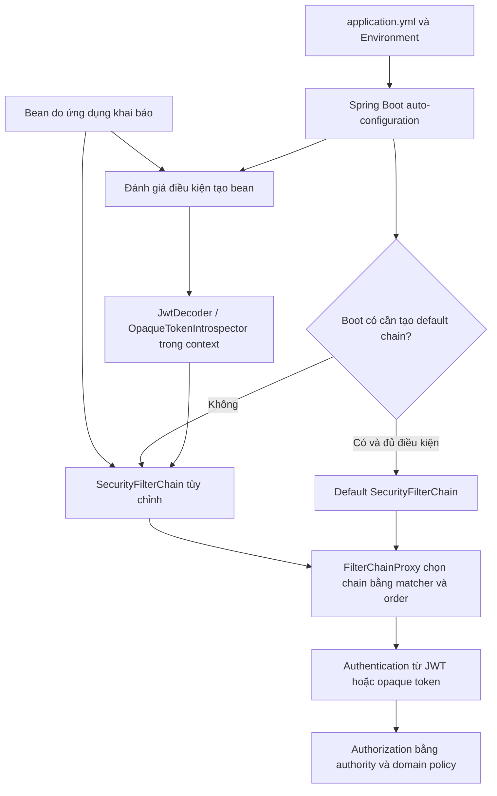

# Bean tùy chỉnh, cấu hình DSL và thứ tự ghi đè cấu hình tự động

Trong Spring Boot, cấu hình bảo mật của một OAuth 2.0 Resource Server không xuất phát từ một nơi duy nhất. Một phần đến từ **auto-configuration của Spring Boot**, một phần từ các thành phần **Spring Security**, và phần còn lại do ứng dụng khai báo bằng **bean** hoặc **DSL của `HttpSecurity`**.

Vì vậy, khi thêm một bean `SecurityFilterChain`, `JwtDecoder` hay `OpaqueTokenIntrospector`, hành vi có thể thay đổi dù file `application.yml` vẫn giữ nguyên. Hiểu phần nào được Boot tạo tự động, phần nào bị cơ chế *back off* nhường chỗ cho bean của ứng dụng và phần nào được chỉ định trực tiếp trong DSL giúp tránh các lỗi như: token không được xác thực, JWT thiếu kiểm tra audience, scope không ánh xạ đúng hoặc endpoint nằm ngoài mọi security chain.

Bài học sử dụng phong cách cấu hình **Spring Boot 3 và Spring Security 6**, với lambda DSL và `SecurityFilterChain`. Các điều kiện auto-configuration và API chi tiết có thể thay đổi giữa các phiên bản; khi áp dụng cần dựa trên phiên bản đang chạy của dự án.

## 1. Ba lớp cấu hình cần phân biệt

| Lớp | Nguồn | Ví dụ | Vai trò |
| --- | --- | --- | --- |
| **Auto-configuration** | Spring Boot | Tạo `JwtDecoder` từ `issuer-uri`, cấu hình chain mặc định khi đủ điều kiện. | Cung cấp **mặc định** nếu ứng dụng chưa cung cấp thành phần phù hợp. |
| **Bean ứng dụng** | Developer | `@Bean SecurityFilterChain`, `@Bean JwtDecoder`, `@Bean OpaqueTokenIntrospector`. | Cung cấp thành phần cụ thể, có thể khiến Boot **back off** một bean mặc định cùng vai trò. |
| **Spring Security DSL** | Developer trong `SecurityFilterChain` | `.securityMatcher(...)`, `.authorizeHttpRequests(...)`, `.oauth2ResourceServer(...)`. | Quyết định filter, cơ chế xác thực và luật phân quyền cho **chain đó**. |

Không có quy tắc chung “DSL luôn thắng bean, bean luôn thắng property” cho **mọi** khía cạnh bảo mật. Thứ tự có ý nghĩa phải được xác định riêng:

1. **Điều kiện tạo bean:** Boot chỉ tạo một số bean khi context chưa có bean thích hợp.
2. **Cách kết nối thành phần:** JWT DSL có thể dùng `JwtDecoder` trong context hoặc decoder được truyền rõ ràng.
3. **Chọn security chain:** Request chỉ đi qua chain đầu tiên phù hợp theo thứ tự ưu tiên.
4. **Chọn authorization rule:** Trong chain đã chọn, các request matcher được xét theo thứ tự khai báo.

Hãy phân tích từng lớp để biết **cấu hình nào thực sự có hiệu lực**.

## 2. Spring Boot tự cấu hình Resource Server như thế nào?

Với ứng dụng bảo vệ API bằng JWT, dependency thường gồm:

```gradle
dependencies {
    implementation 'org.springframework.boot:spring-boot-starter-security'
    implementation 'org.springframework.boot:spring-boot-starter-oauth2-resource-server'
}
```

Một cấu hình đơn giản:

```yaml
spring:
  security:
    oauth2:
      resourceserver:
        jwt:
          issuer-uri: https://login.example.com/realms/shop
```

Ở trường hợp **chưa có bean tùy chỉnh liên quan**, Spring Boot có thể:

- Tạo `JwtDecoder` từ issuer/JWK Set theo properties khi điều kiện auto-configuration được thỏa.
- Tạo security filter chain mặc định cho Resource Server khi không có chain của ứng dụng và các điều kiện cần thiết được đáp ứng.
- Để Spring Security tiếp nhận Bearer token, xác minh JWT và tạo `Authentication`.

Với issuer đáng tin cậy, decoder tiêu chuẩn xác minh chữ ký, issuer và các ràng buộc thời gian theo validator đã thiết lập. **Không mặc nhiên suy ra audience đã được kiểm tra theo yêu cầu riêng của API chỉ vì có `issuer-uri`.** API cần ràng buộc bên nhận bằng audience validator hoặc thuộc tính audience tương ứng nếu phiên bản Spring Boot hỗ trợ.

Issuer trong ví dụ chỉ để minh họa. Hệ thống thật phải sử dụng nguồn phát hành access token phù hợp, không lấy tùy ý ID Token dành cho OIDC Client để thay access token của API.

### Auto-configuration là cơ chế có điều kiện

Thay vì hiểu Spring Boot là “luôn tạo mặc định rồi bị ghi đè”, hãy hiểu Boot đánh giá điều kiện để **có tạo bean mặc định hay không**:

```text
Không có SecurityFilterChain tùy chỉnh
  -> Boot có thể tạo default web security / Resource Server chain

Có SecurityFilterChain do ứng dụng cung cấp
  -> default web security chain của Boot thường back off
  -> ứng dụng tự xác định chain nào bảo vệ endpoint nào

Không có JwtDecoder tùy chỉnh
  -> Boot có thể tạo decoder JWT từ properties

Có JwtDecoder do ứng dụng cung cấp
  -> Boot không tạo decoder mặc định tương ứng
  -> ứng dụng chịu trách nhiệm cấu hình validation của decoder đó
```

Tạo một `SecurityFilterChain` **không bắt buộc** tạo thêm `JwtDecoder`. Ngược lại, tạo một decoder riêng **không tự thêm** authorization rule cho các endpoint. Hai nhóm bean được quyết định độc lập.

## 3. Tạo `SecurityFilterChain` làm Boot thay đổi hành vi ra sao?

Ví dụ ứng dụng tự cấu hình API:

```java
import org.springframework.context.annotation.Bean;
import org.springframework.context.annotation.Configuration;
import org.springframework.http.HttpMethod;
import org.springframework.security.config.Customizer;
import org.springframework.security.config.annotation.web.builders.HttpSecurity;
import org.springframework.security.config.http.SessionCreationPolicy;
import org.springframework.security.web.SecurityFilterChain;

@Configuration
public class ApiSecurityConfig {

    @Bean
    SecurityFilterChain apiSecurity(HttpSecurity http) throws Exception {
        return http
            .securityMatcher("/api/**")
            .csrf(csrf -> csrf.disable())
            .sessionManagement(session -> session
                .sessionCreationPolicy(SessionCreationPolicy.STATELESS))
            .authorizeHttpRequests(auth -> auth
                .requestMatchers(HttpMethod.GET, "/api/orders/**")
                    .hasAuthority("SCOPE_orders.read")
                .requestMatchers(HttpMethod.POST, "/api/orders")
                    .hasAuthority("SCOPE_orders.write")
                .anyRequest().denyAll())
            .oauth2ResourceServer(oauth2 -> oauth2
                .jwt(Customizer.withDefaults()))
            .build();
    }
}
```

Hành vi được hình thành như sau:

1. Bean `SecurityFilterChain` của ứng dụng thường khiến Boot không cần tạo **default web security chain**.
2. `.securityMatcher("/api/**")` xác định **phạm vi** mà chain này được chọn.
3. `.authorizeHttpRequests(...)` xác định luật phân quyền bên trong chain đã chọn.
4. `.oauth2ResourceServer(...jwt(...))` kích hoạt cơ chế JWT Bearer authentication cho chain này. Property `issuer-uri` **không tự chèn cấu hình Resource Server** vào mọi custom chain.
5. Những URL không khớp `/api/**` cần chain khác hoặc một quyết định bảo vệ rõ ràng.

Thử xét một cấu hình chưa đầy đủ:

```java
@Bean
SecurityFilterChain incomplete(HttpSecurity http) throws Exception {
    return http
        .authorizeHttpRequests(auth -> auth
            .anyRequest().authenticated())
        .build();
}
```

Không thể dựa vào `issuer-uri` để kết luận chain này đang xử lý Bearer JWT; ở đây chưa bật `.oauth2ResourceServer(...)`. Nếu ứng dụng yêu cầu JWT, phải khai báo authentication mechanism tương ứng.

### Custom chain không nhất thiết thay decoder

Một cấu hình phổ biến là:

```text
application.yml: issuer-uri
  -> Boot tạo JwtDecoder

@Bean SecurityFilterChain:
  -> developer tự viết matcher và authorization rules
  -> developer bật oauth2ResourceServer().jwt()
  -> Spring Security sử dụng JwtDecoder đã có trong context
```

Như vậy, ứng dụng tùy chỉnh endpoint mà vẫn dùng decoder được Boot quản lý. **Phần bị back off là default chain**, không phải mọi bean bảo mật của Boot.

## 4. Có nhiều `SecurityFilterChain`: `@Order` và matcher quyết định

Khi nhiều chain tồn tại, `FilterChainProxy` duyệt theo thứ tự ưu tiên và chọn **chain đầu tiên có matcher khớp request**. Các chain sau **không được ghép thêm** để tăng quyền hoặc siết quyền của request đã khớp chain đầu tiên.

Ví dụ có API và một fallback cho những URL khác:

```java
import org.springframework.context.annotation.Bean;
import org.springframework.context.annotation.Configuration;
import org.springframework.core.annotation.Order;
import org.springframework.http.HttpMethod;
import org.springframework.security.config.Customizer;
import org.springframework.security.config.annotation.web.builders.HttpSecurity;
import org.springframework.security.config.http.SessionCreationPolicy;
import org.springframework.security.web.SecurityFilterChain;

@Configuration
public class MultiChainSecurityConfig {

    @Bean
    @Order(1)
    SecurityFilterChain apiChain(HttpSecurity http) throws Exception {
        return http
            .securityMatcher("/api/**")
            .csrf(csrf -> csrf.disable())
            .sessionManagement(session -> session
                .sessionCreationPolicy(SessionCreationPolicy.STATELESS))
            .authorizeHttpRequests(auth -> auth
                .requestMatchers("/api/health").permitAll()
                .requestMatchers(HttpMethod.GET, "/api/orders/**")
                    .hasAuthority("SCOPE_orders.read")
                .anyRequest().denyAll())
            .oauth2ResourceServer(oauth2 -> oauth2
                .jwt(Customizer.withDefaults()))
            .build();
    }

    @Bean
    @Order(2)
    SecurityFilterChain fallbackChain(HttpSecurity http) throws Exception {
        return http
            .authorizeHttpRequests(auth -> auth
                .anyRequest().denyAll())
            .build();
    }
}
```

Đây là ví dụ chính sách từ chối mặc định để minh họa an toàn. Trong ứng dụng thực, có thể cần cho phép trang đăng nhập, static resources, Actuator hoặc một web UI, với chain và luật phù hợp.

Hai loại matcher dễ bị nhầm:

| Cú pháp | Câu hỏi mà nó trả lời |
| --- | --- |
| `http.securityMatcher("/api/**")` | **Chain nào** được áp dụng cho request? |
| `authorizeHttpRequests().requestMatchers(...)` | Khi chain đã được chọn, **rule nào** cho phép/từ chối request? |

Nếu chain `@Order(1)` không khai báo `securityMatcher`, matcher mặc định có thể khớp **mọi request** và khiến chain thứ hai không bao giờ xử lý được request dự kiến. Nếu chỉ có chain `.securityMatcher("/api/**")` mà không có fallback, một URL như `/admin/report` có thể **không đi qua chain bảo mật nào**; Spring Boot không tự tạo lại fallback chỉ vì còn URL chưa khớp.

**`@Order` không có nghĩa bean này được tạo trước rồi ghi đè bean khác.** Nó chủ yếu quyết định thứ tự **chọn chain khi request đến**.

## 5. Ba trường hợp chọn `JwtDecoder`

`JwtDecoder` chịu trách nhiệm xác minh JWT, kiểm tra các token validator và trả về `Jwt` có thể được Spring Security sử dụng để tạo `Authentication`.

| Trường hợp | Decoder đến từ đâu? | Rủi ro cần chú ý |
| --- | --- | --- |
| **Chỉ có property** `issuer-uri` hoặc JWK Set | Boot tạo decoder khi đủ điều kiện. | Vẫn phải xét yêu cầu audience/token profile của API. |
| **Ứng dụng khai báo `@Bean JwtDecoder`** | Bean do ứng dụng tạo, Boot thường back off decoder mặc định. | Validator issuer, thời gian và audience phải được thiết lập đầy đủ. |
| **DSL chỉ định `jwt.decoder(...)`** | Decoder được truyền cụ thể cho chain. | Cấu hình của decoder đó có hiệu lực đối với chain, dù context có bean khác. |

Một mô hình quyết định cục bộ đối với decoder của **một JWT chain**:

```text
DSL đã chỉ định JwtDecoder trực tiếp?
  Có -> Dùng decoder đã chỉ định trong chain
  Không
    -> Spring Security tìm decoder bean phù hợp trong context
       -> Bean do ứng dụng tạo nếu có
       -> Nếu không, decoder Boot tạo từ properties khi đủ điều kiện
```

Nếu có nhiều bean `JwtDecoder` mà không chọn rõ bean nào, việc injection có thể mơ hồ. Dùng `@Qualifier`, `@Primary` ở nơi phù hợp hoặc truyền decoder rõ ràng cho từng chain.

### Tự tạo decoder và bổ sung audience validator

Giả sử API chỉ chấp nhận JWT có `aud = orders-api`, từ issuer đáng tin:

```yaml
spring:
  security:
    oauth2:
      resourceserver:
        jwt:
          issuer-uri: https://login.example.com/realms/shop

app:
  security:
    audience: orders-api
```

```java
import java.util.List;

import org.springframework.beans.factory.annotation.Value;
import org.springframework.context.annotation.Bean;
import org.springframework.context.annotation.Configuration;
import org.springframework.security.oauth2.core.DelegatingOAuth2TokenValidator;
import org.springframework.security.oauth2.core.OAuth2TokenValidator;
import org.springframework.security.oauth2.jwt.Jwt;
import org.springframework.security.oauth2.jwt.JwtClaimValidator;
import org.springframework.security.oauth2.jwt.JwtDecoder;
import org.springframework.security.oauth2.jwt.JwtValidators;
import org.springframework.security.oauth2.jwt.NimbusJwtDecoder;

@Configuration
public class TokenValidationConfig {

    @Bean
    JwtDecoder jwtDecoder(
            @Value("${spring.security.oauth2.resourceserver.jwt.issuer-uri}")
                String issuer,
            @Value("${app.security.audience}")
                String audience) {

        NimbusJwtDecoder decoder =
            NimbusJwtDecoder.withIssuerLocation(issuer).build();

        OAuth2TokenValidator<Jwt> defaultValidators =
            JwtValidators.createDefaultWithIssuer(issuer);

        OAuth2TokenValidator<Jwt> audienceValidator =
            new JwtClaimValidator<List<String>>(
                "aud", values -> values != null &&
                    values.contains(audience));

        decoder.setJwtValidator(
            new DelegatingOAuth2TokenValidator<>(
                defaultValidators, audienceValidator));
        return decoder;
    }
}
```

`withIssuerLocation(issuer)` giúp dựng decoder dựa trên metadata/JWK Set của issuer; validator `createDefaultWithIssuer` giữ các kiểm tra mặc định cùng kiểm tra issuer; validator audience yêu cầu token dành cho `orders-api`.

Vì đã khai báo bean này, phần auto-configuration tạo `JwtDecoder` tương ứng của Boot **không cần tạo thêm decoder mặc định**. Nếu thay bằng một decoder dựng thủ công chỉ với JWK Set URI mà **quên issuer validator**, ứng dụng có thể mất kiểm tra issuer so với cấu hình Boot ban đầu. Đừng coi property `issuer-uri` vẫn còn trong YAML là bằng chứng rằng decoder tự tạo chắc chắn sử dụng property đó.

Một số phiên bản Spring Boot hỗ trợ cấu hình audiences trực tiếp trên Resource Server JWT. Nếu thuộc tính này đủ đáp ứng yêu cầu và Boot là bên tạo decoder, có thể ưu tiên properties. Với **custom decoder**, phải kiểm tra validation của chính decoder thực tế; không mặc định property audience tự thêm validator vào bean tự tạo.

## 6. Chỉ định decoder trực tiếp trong JWT DSL

Nếu các nhóm URL chấp nhận token theo issuer/audience khác nhau, có thể chỉ định một decoder cụ thể cho từng chain:

```java
@Bean
@Order(1)
SecurityFilterChain partnerChain(
        HttpSecurity http,
        @Qualifier("partnerJwtDecoder") JwtDecoder partnerDecoder)
        throws Exception {

    return http
        .securityMatcher("/partner/**")
        .authorizeHttpRequests(auth -> auth
            .anyRequest().hasAuthority("SCOPE_partner.read"))
        .oauth2ResourceServer(oauth2 -> oauth2
            .jwt(jwt -> jwt.decoder(partnerDecoder)))
        .build();
}
```

Đây là **phương thức minh họa** cần đặt trong class cấu hình với các import `Bean`, `Order`, `Qualifier`, `HttpSecurity`, `SecurityFilterChain`, `JwtDecoder`. Bean `partnerJwtDecoder` cũng cần được khai báo và cấu hình validator đầy đủ. Ứng dụng cần thêm chain xử lý các URL ngoài `/partner/**`.

Với `.jwt(jwt -> jwt.decoder(partnerDecoder))`, decoder truyền rõ trong DSL được chain này dùng; việc context có một decoder mặc định khác không làm chain tự đổi sang decoder đó. Cách này hữu ích khi có nhiều issuer, audience hoặc chính sách riêng.

Nguyên tắc bảo trì:

- Dùng **một nơi chính** cho chiến lược decoder của một chain: decoder Boot từ properties, custom bean, hoặc decoder được chọn rõ trong DSL.
- Nếu có nhiều decoder, đặt tên bean, URL và audience biểu thị mục đích; không dựa vào bean “được tạo trước”.
- Không cấu hình cùng một nguồn khóa/validator ở quá nhiều nơi rồi giả định hệ thống sẽ tự tổng hợp các thiết lập.

## 7. `JwtAuthenticationConverter` khác `JwtDecoder`

`JwtDecoder` kiểm tra **token có hợp lệ và đáng tin không**. `JwtAuthenticationConverter` xử lý **JWT đã xác thực** để xây `Authentication` và các `GrantedAuthority`. Hai nhiệm vụ này cần tách biệt:

| Thành phần | Trách nhiệm |
| --- | --- |
| `JwtDecoder` | Xác minh chữ ký, issuer, thời gian, audience và token profile. |
| `JwtAuthenticationConverter` | Ánh xạ claim hợp lệ thành principal name và authorities. |
| `authorizeHttpRequests` / `@PreAuthorize` | Kiểm tra principal có quyền thao tác không. |
| Domain/service policy | Kiểm tra owner/tenant và quyền đối với bản ghi cụ thể. |

Spring Security thường ánh xạ `scope`/`scp` sang authority `SCOPE_*`. Nhưng claim `roles` tùy biến **không tự động** trở thành `ROLE_*`.

Ví dụ đọc role và vẫn giữ scope:

```java
import java.util.ArrayList;
import java.util.Collection;
import java.util.List;

import org.springframework.context.annotation.Bean;
import org.springframework.security.core.GrantedAuthority;
import org.springframework.security.core.authority.SimpleGrantedAuthority;
import org.springframework.security.oauth2.jwt.Jwt;
import org.springframework.security.oauth2.server.resource.authentication.JwtAuthenticationConverter;
import org.springframework.security.oauth2.server.resource.authentication.JwtGrantedAuthoritiesConverter;

@Bean
JwtAuthenticationConverter roleAndScopeConverter() {
    JwtGrantedAuthoritiesConverter scopeConverter =
        new JwtGrantedAuthoritiesConverter();

    JwtAuthenticationConverter converter =
        new JwtAuthenticationConverter();

    converter.setJwtGrantedAuthoritiesConverter((Jwt jwt) -> {
        Collection<GrantedAuthority> authorities =
            new ArrayList<>(scopeConverter.convert(jwt));

        List<String> roles = jwt.getClaimAsStringList("roles");
        if (roles != null) {
            for (String role : roles) {
                authorities.add(
                    new SimpleGrantedAuthority("ROLE_" + role));
            }
        }
        return authorities;
    });

    return converter;
}
```

Để chain sử dụng converter, gắn rõ vào DSL:

```java
@Bean
SecurityFilterChain apiSecurity(
        HttpSecurity http,
        JwtAuthenticationConverter roleAndScopeConverter)
        throws Exception {

    return http
        .securityMatcher("/api/**")
        .authorizeHttpRequests(auth -> auth
            .requestMatchers("/api/admin/**").hasRole("ADMIN")
            .anyRequest().authenticated())
        .oauth2ResourceServer(oauth2 -> oauth2
            .jwt(jwt -> jwt
                .jwtAuthenticationConverter(roleAndScopeConverter)))
        .build();
}
```

Đây là các phương thức minh họa; cần đặt trong class cấu hình và có import tương ứng. Khi ghép vào dự án, hãy **chọn một cấu hình chain phù hợp** thay vì đăng ký nhiều bean chain trùng đường dẫn mà không có chủ đích.

Một bean `JwtAuthenticationConverter` được khai báo **không nên mặc định được coi là đã tự áp dụng lên mọi JWT chain**. Nếu cần converter tùy chỉnh, wiring qua `.jwtAuthenticationConverter(...)` là cách rõ ràng.

```java
hasAuthority("SCOPE_orders.read") // Scope orders.read được ánh xạ
hasAuthority("ROLE_ADMIN")       // Authority ROLE_ADMIN
hasRole("ADMIN")                 // Mặc định thường xét ROLE_ADMIN
```

`hasRole("ADMIN")` không đồng nghĩa `SCOPE_admin`. Mọi role tùy chỉnh phải đến từ claim có nguồn phát hành đáng tin, không từ header client tự khai. Và role/scope **không thay thế** kiểm tra ownership/tenant trong API.

## 8. Opaque token và `OpaqueTokenIntrospector`

Với opaque token, Resource Server không tự giải mã JWT mà thường dùng introspection endpoint của Authorization Server:

```yaml
spring:
  security:
    oauth2:
      resourceserver:
        opaquetoken:
          introspection-uri: https://login.example.com/oauth2/introspect
          client-id: ${INTROSPECTION_CLIENT_ID}
          client-secret: ${INTROSPECTION_CLIENT_SECRET}
```

Nếu ứng dụng không khai báo `OpaqueTokenIntrospector` riêng và các điều kiện auto-configuration được thỏa, Boot có thể tạo introspector từ properties.

Một chain tùy chỉnh cần bật opaque token rõ ràng:

```java
@Bean
SecurityFilterChain opaqueApi(HttpSecurity http) throws Exception {
    return http
        .securityMatcher("/opaque-api/**")
        .authorizeHttpRequests(auth -> auth
            .anyRequest().authenticated())
        .oauth2ResourceServer(oauth2 -> oauth2
            .opaqueToken(Customizer.withDefaults()))
        .build();
}
```

Khi ứng dụng khai báo bean `OpaqueTokenIntrospector` riêng, Boot thường back off introspector mặc định tương ứng. Có thể chỉ định một introspector cụ thể qua opaque-token DSL khi cần. **Introspection khác OIDC UserInfo:** introspection phục vụ xác minh trạng thái/metadata của access token; UserInfo cung cấp claim hồ sơ người dùng cho OIDC Client.

Trong hệ thống có cả JWT và opaque token, nên quy định rõ URL nào chấp nhận kiểu token nào và cơ chế authentication nào áp dụng. Không suy ra loại token một cách tùy tiện từ chuỗi do client gửi nếu chưa có hợp đồng và quy trình xác minh phù hợp.

## 9. Các quyết định diễn ra tại các thời điểm khác nhau



Đây là sơ đồ tư duy về các điểm lựa chọn, không phải sơ đồ bean lifecycle chi tiết. Điều quan trọng là **mỗi lớp có cơ chế quyết định riêng**:

- **Properties** cung cấp dữ liệu cho auto-config khi bean đó được tạo.
- **Custom bean** có thể khiến điều kiện đăng ký bean mặc định không còn phù hợp.
- **DSL** liên kết decoder, converter, authentication và authorization cho chain.
- **`@Order` + `securityMatcher`** quyết định chain nào xử lý request.

Khi cả `issuer-uri`, một bean `JwtDecoder` và `.jwt(jwt -> jwt.decoder(...))` cùng tồn tại, hãy truy ra **decoder thực sự gắn với chain** rồi kiểm tra validator của nó. Không thể xác định tính bảo mật chỉ bằng việc nhìn thấy property trong YAML.

## 10. Các tình huống ghi đè thường gặp

| Thay đổi trong ứng dụng | Hệ quả | Điều cần làm |
| --- | --- | --- |
| Chỉ thêm `issuer-uri` | Boot có thể tạo JWT decoder và default chain khi đủ điều kiện. | Kiểm tra audience và chính sách tài nguyên. |
| Thêm `@Bean SecurityFilterChain` | Default web chain của Boot thường back off. | Khai báo JWT/opaque DSL, các matcher và fallback thích hợp. |
| Thay `authorizeHttpRequests` | Thay đổi quyền endpoint của chain. | Không suy ra JWT validation tự thay đổi. |
| Thêm `@Bean JwtDecoder` | Boot không cần tạo default decoder tương ứng. | Cấu hình issuer, thời gian, audience và các validator khác. |
| Chỉ định `jwt.decoder(custom)` trong DSL | Chain dùng decoder được truyền cụ thể. | Kiểm tra đúng decoder, tránh cấu hình nhiều nơi mâu thuẫn. |
| Thêm `JwtAuthenticationConverter` | Bean tồn tại trong context. | Gắn converter vào chain cần dùng. |
| Thêm `OpaqueTokenIntrospector` | Boot có thể back off phần introspector mặc định. | Cấu hình endpoint, credentials và token policy. |
| Hai chain cùng khớp một URL | Chain có độ ưu tiên cao hơn được chọn. | Sắp xếp `@Order` và matcher rõ ràng. |
| Chỉ có chain `/api/**` | URL khác có thể không thuộc chain nào. | Tạo fallback hoặc chính sách xử lý mọi route. |
| Thêm `@Primary` cho decoder | Ảnh hưởng lựa chọn bean khi injection. | Không thay đổi thứ tự chain hoặc decoder đã chọn trong DSL. |

### Tình huống A: property vẫn còn nhưng validation bị mất

Ban đầu:

```text
issuer-uri trong YAML -> Boot tạo decoder có issuer validator
```

Sau đó thêm custom decoder:

```text
@Bean JwtDecoder từ JWK Set URI -> Boot back off
custom decoder không cài issuer validator -> mất kiểm tra issuer mong muốn
```

Giải pháp: cấu hình rõ validator trên custom decoder, chẳng hạn `JwtValidators.createDefaultWithIssuer(issuer)` và audience validator. **Cấu hình JWK Set chỉ giải quyết nguồn khóa; không tự thay thế mọi claim validation cần thiết.**

### Tình huống B: URL không còn được bảo vệ

Trước khi thay đổi, default chain bảo vệ mọi request. Sau khi thêm `securityMatcher("/api/**")` mà không có fallback, `/admin/**` có thể không đi qua security chain. Cần khai báo đầy đủ những vùng URL mà ứng dụng phục vụ và kiểm soát các chain matcher.

### Tình huống C: đã khai báo role converter nhưng vẫn 403

Nguyên nhân có thể là converter chưa được wiring vào JWT DSL, claim role có cấu trúc khác dự kiến hoặc rule đang kiểm tra `ROLE_ADMIN` trong khi token chỉ có `SCOPE_admin`. Kiểm tra chain thực tế và authority được tạo từ **token đã xác thực**; không dùng header client làm quyền.

### Tình huống D: sửa `issuer-uri` nhưng API tiếp tục dùng issuer cũ

Nếu decoder được ứng dụng dựng thủ công với URL hardcode hoặc DSL truyền decoder khác, property có thể **không còn tác động lên decoder được sử dụng**. Nên lấy URL từ configuration vào bean custom hoặc dùng decoder của Boot, tránh khai báo trùng nguồn cấu hình.

## 11. Bean trùng loại, `@Primary` và nhiều issuer

Ví dụ context có hai decoder:

```java
@Bean
JwtDecoder ordersJwtDecoder() {
    return buildOrdersDecoder();
}

@Bean
JwtDecoder analyticsJwtDecoder() {
    return buildAnalyticsDecoder();
}
```

Hai method trên chỉ là ví dụ kiến trúc; các hàm `buildOrdersDecoder`, `buildAnalyticsDecoder` phải được hiện thực để trả các decoder có validator đầy đủ. Khi Spring Security tìm một `JwtDecoder` không có qualifier, có thể xảy ra injection không rõ nên chọn bean nào.

`@Primary` có thể chọn bean ưu tiên cho cơ chế injection, nhưng **không tự động**:

- Thay decoder đã được đặt trực tiếp bằng `.jwt(jwt -> jwt.decoder(...))`.
- Thay thứ tự các `SecurityFilterChain`.
- Bổ sung issuer/audience validator cho một decoder.
- Gắn `JwtAuthenticationConverter` vào tất cả chain.

Đối với nhiều issuer, nên cấu hình mapping rõ giữa URL/issuer/audience và decoder được phép dùng. Nếu một endpoint phải chấp nhận token từ nhiều issuer, cần một resolver chọn cơ chế xác thực theo danh sách issuer tin cậy, chẳng hạn `AuthenticationManagerResolver` trong kiến trúc phù hợp. Không để giá trị `iss` trong token **chưa xác thực** tự quyết định một URL/JWK Set tùy ý không thuộc allowlist.

## 12. Thứ tự authorization rule ở bên trong một chain

Thứ tự matcher trong `authorizeHttpRequests` có ý nghĩa độc lập với thứ tự chain:

```java
.authorizeHttpRequests(auth -> auth
    .requestMatchers("/api/admin/**").hasRole("ADMIN")
    .requestMatchers("/api/**").authenticated()
    .anyRequest().denyAll())
```

Với `/api/admin/report`, rule chuyên biệt được xét trước, vì vậy cần `ROLE_ADMIN`.

Nếu viết:

```java
.authorizeHttpRequests(auth -> auth
    .requestMatchers("/api/**").authenticated()
    .requestMatchers("/api/admin/**").hasRole("ADMIN")
    .anyRequest().denyAll())
```

thì rule rộng `/api/**` có thể khớp trước, khiến luật admin chặt hơn không được áp dụng. Hãy đặt rule cụ thể trước, rule bao quát sau và có chính sách fallback rõ ràng.

Method security với `@EnableMethodSecurity` và `@PreAuthorize` có thể thêm lớp kiểm tra ở service:

```java
@PreAuthorize("hasAuthority('SCOPE_orders.read')")
public OrderDto readOrder(long id) {
    return orderService.findVisibleOrder(id);
}
```

Method security không xóa filter-chain authorization. Request có thể qua rule web nhưng vẫn bị chặn vì thiếu quyền ở method hoặc vì sai owner/tenant trong domain. Ngược lại, method security chỉ bảo vệ những entry point thực sự gọi đến method đã được bảo vệ qua cơ chế proxy phù hợp.

## 13. Quan sát cấu hình thực sự có hiệu lực

Khi một request được cho phép hoặc từ chối khác mong đợi, nên kiểm tra theo đúng các lớp:

1. Xác định phiên bản Spring Boot/Spring Security và starter Resource Server.
2. Xem các bean `SecurityFilterChain`, `@Order` và `securityMatcher` của ứng dụng.
3. Với chain khớp request, xem đã bật `.oauth2ResourceServer().jwt()` hay `.opaqueToken()` chưa.
4. Tìm bean `JwtDecoder`/`OpaqueTokenIntrospector` của ứng dụng và decoder được chỉ định trực tiếp trong DSL.
5. Xác nhận validator thực tế: chữ ký/trạng thái, issuer, thời gian, audience, token type/profile khi cần.
6. Với token hợp lệ nhưng 403, kiểm tra converter, scope/role, thứ tự matcher và owner/tenant policy.
7. Với endpoint được cho phép ngoài dự kiến, xem có chain nào không khớp, matcher quá rộng hoặc route ngoài fallback không.

Trong môi trường phát triển, Spring Boot có thể hiển thị báo cáo điều kiện auto-configuration khi bật:

```properties
debug=true
```

Condition evaluation report giúp nhận biết bean mặc định nào được tạo hoặc nhánh nào không thỏa điều kiện do đã có bean của ứng dụng. Actuator có thể cung cấp endpoint `conditions` trong cấu hình phù hợp; endpoint này cần được bảo vệ khi sử dụng.

Để quan sát việc chọn filter chain trong môi trường phát triển:

```yaml
logging:
  level:
    org.springframework.security: DEBUG
```

Chỉ bật mức log cần thiết và bảo vệ log. Không ghi raw access token, refresh token, `Authorization` header hoặc credential introspection vào log và telemetry.

## 14. Phân biệt kiểm thử cấu hình và kiểm thử phân quyền

| Kịch bản | Điều cần chứng minh |
| --- | --- |
| JWT đúng issuer, audience, thời gian, đủ scope | Request vào đúng chain và được phép theo policy. |
| JWT hợp lệ về chữ ký nhưng sai audience | Decoder/validator từ chối token. |
| JWT sai issuer hoặc hết hạn | Authentication thất bại, thường HTTP 401. |
| JWT hợp lệ nhưng thiếu `SCOPE_orders.read` | Authentication thành công, authorization từ chối, thường 403. |
| JWT hợp lệ, có scope nhưng sai owner/tenant | Service/domain policy từ chối quyền đối tượng. |
| Request `/api/**` và `/admin/**` | Mỗi URL vào đúng chain, không có URL bỏ lọt. |
| Converter role được gắn trong DSL | Authority `ROLE_*` được ánh xạ và kiểm tra đúng. |
| Custom decoder + property issuer | Validation thực tế không bị mất vì Boot đã back off. |
| Nhiều decoder | Mỗi chain dùng đúng bean decoder, không injection mơ hồ. |
| Opaque token | Dùng đúng introspection mechanism, không nhầm với JWT hoặc UserInfo. |

Trong Spring Security Test, MockMvc helper `jwt()` có thể tạo principal JWT giả lập để kiểm tra authorization. Nhưng helper này thường **không xác minh chữ ký token thực qua decoder**. Kiểm thử decoder với JWT thật hoặc tích hợp Authorization Server/JWK Set kiểm chứng một vấn đề khác với kiểm thử rule `hasAuthority`. Cần tách những mục đích này khi đánh giá mức độ bảo vệ của hệ thống.

## 15. Ví dụ thay đổi yêu cầu và cách chọn nơi cấu hình

Giả sử ứng dụng đã chạy JWT Resource Server từ `issuer-uri`, sau đó có ba yêu cầu mới:

**Yêu cầu 1: API đọc đơn hàng phải có `orders.read`.** Thêm custom `SecurityFilterChain` với `authorizeHttpRequests` và `.oauth2ResourceServer().jwt()`. Nếu decoder Boot đang phù hợp, không cần tạo decoder mới.

**Yêu cầu 2: Token bắt buộc có `aud = orders-api`.** Nếu phiên bản Boot hỗ trợ audience property và decoder vẫn được Boot quản lý, có thể cấu hình property. Nếu cần custom validator, cung cấp `JwtDecoder` giữ validation mặc định rồi thêm audience; nhận trách nhiệm về bean mới vì nhánh auto-config decoder tương ứng sẽ back off.

**Yêu cầu 3: Token chứa `roles: ["ADMIN"]`.** Cấu hình `JwtAuthenticationConverter` ánh xạ role và gắn vào JWT DSL. Đây là bước biến claim đã xác thực thành authority, **không thay thế validation của decoder**.

Nếu muốn chia `/api/**` và `/admin/**` thành các security chain khác nhau, phải quy định `securityMatcher`, `@Order` và fallback. Nếu chỉ khác path và authority nhưng dùng cùng cơ chế xác thực, một chain với rule chuyên biệt có thể dễ bảo trì hơn.

## 16. Mô hình suy nghĩ giúp tránh ghi đè nhầm

Một request đi qua những quyết định sau:

```text
1. Bean nào thực sự có trong ApplicationContext?
   └─ Boot tạo mặc định hay đã back off vì custom bean?

2. FilterChainProxy chọn SecurityFilterChain nào?
   └─ @Order và securityMatcher

3. Chain dùng cơ chế authentication nào?
   └─ jwt(), opaqueToken(), decoder/introspector được gắn cụ thể

4. Authentication tạo principal/authority ra sao?
   └─ JwtDecoder, JwtAuthenticationConverter, opaque principal

5. Request được phân quyền thế nào?
   └─ requestMatchers, method security, owner/tenant/domain policy
```

**Điểm cốt lõi:** Bean tùy chỉnh có thể làm Spring Boot *back off* một phần auto-configuration; DSL xác định chain sử dụng thành phần nào; `@Order` chọn chain, còn thứ tự `requestMatchers` chọn authorization rule. Khi hiểu **bean nào bị thay thế, thành phần nào được wiring và phạm vi request nào bị ảnh hưởng**, bạn có thể cấu hình Resource Server nhất quán mà không vô tình bỏ qua xác thực token hoặc quyền truy cập tài nguyên.
