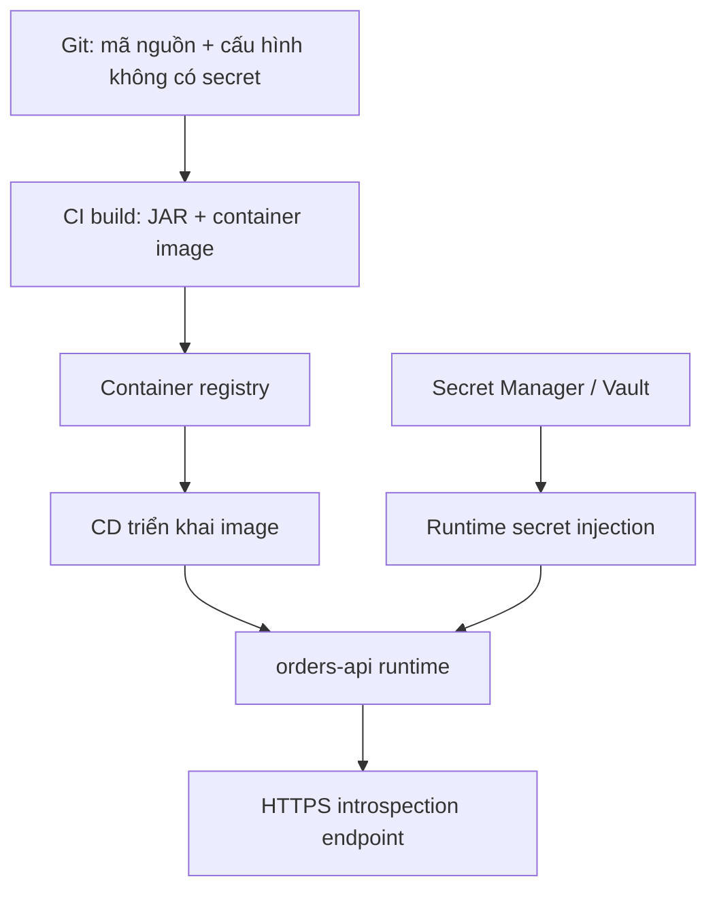
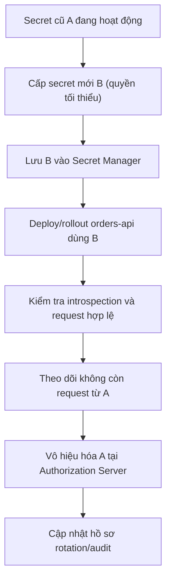

# Quản lý bí mật cho introspection và tránh đưa vào mã nguồn

**Spring Security OAuth 2.0 Resource Server** có thể xác thực access token bằng hai cơ chế chính: kiểm tra JWT đã ký với khóa công khai, hoặc gửi token đến **OAuth 2.0 Token Introspection Endpoint** của Authorization Server. Ở trường hợp introspection, Resource Server thường cần một **client ID** và một **client secret** (hoặc cơ chế xác thực client khác) để được phép hỏi Authorization Server xem token có còn hoạt động hay không. Cặp thông tin xác thực đó là tài sản của **dịch vụ Resource Server**, khác với access token do người dùng/client gửi vào.

Bài này tập trung vào cách **cấu hình và bảo vệ thông tin xác thực dùng cho introspection** trong Spring Boot/Spring Security: lưu bí mật ngoài mã nguồn, cấp vào ứng dụng bằng cơ chế phù hợp với môi trường, hạn chế quyền và khả năng lộ dữ liệu, xoay vòng bí mật, kiểm thử các trạng thái lỗi và vận hành. Ví dụ dùng Java 17+, Spring Boot 3.x và Spring Security 6.x; địa chỉ, tên ứng dụng và giá trị cấu hình chỉ mang tính minh họa.

## 1. Introspection hoạt động ra sao và bí mật nằm ở đâu?

Giả sử ứng dụng có:

- **Client** `web-portal` được cấp opaque access token sau khi người dùng đăng nhập.
- **Resource Server** `orders-api` cung cấp API đặt hàng.
- **Authorization Server / OIDC Provider** `https://auth.example.test` có endpoint `/oauth2/introspect`.
- **Introspection client** `orders-api-introspector` được Authorization Server cấp credential riêng cho nhiệm vụ tra cứu trạng thái token.

Luồng tổng quát:

```mermaid
sequenceDiagram
    participant C as Client web-portal
    participant R as Resource Server orders-api
    participant AS as Authorization Server
    C->>R: GET /api/orders + Authorization: Bearer opaque-token
    R->>AS: POST /oauth2/introspect (token + client authentication)
    Note over R,AS: HTTPS; client ID/secret thuộc orders-api
    AS->>AS: Kiểm tra client được phép introspect; kiểm tra token
    AS-->>R: {"active": true, "scope": "orders:read", ...}
    R->>R: Xác thực token và kiểm tra quyền API
    R-->>C: 200 hoặc 403 theo quyền
```

Nếu `active=false` hoặc token không được chấp nhận, Resource Server phải từ chối yêu cầu. Nếu chính endpoint introspection bị lỗi mạng hoặc xác thực client thất bại, Resource Server không có bằng chứng đủ tin cậy để cấp quyền; **không được tự cho qua** chỉ vì không liên lạc được Authorization Server.

Thông điệp introspection dùng `POST` theo RFC 7662. Trong triển khai thường gặp, HTTP request có nội dung dạng `application/x-www-form-urlencoded`:

```http
POST /oauth2/introspect HTTP/1.1
Host: auth.example.test
Authorization: Basic <base64-encoded-client-credentials>
Content-Type: application/x-www-form-urlencoded

token=<opaque-access-token>&token_type_hint=access_token
```

Đây là **mô tả giao thức, không phải lệnh gửi thông tin thật**. `Authorization: Basic ...` chỉ **Base64 encode** tên/mật khẩu client; Base64 **không phải mã hóa bảo mật**. Bí mật và access token chỉ được truyền qua HTTPS đến đúng endpoint. Thông tin Basic vẫn nhạy cảm nếu xuất hiện trong log, trace hoặc bản ghi HTTP.

Phản hồi ví dụ:

```json
{
  "active": true,
  "iss": "https://auth.example.test",
  "sub": "user-42",
  "client_id": "web-portal",
  "aud": "orders-api",
  "scope": "orders:read",
  "exp": 1890003600
}
```

Hai client ID trong câu chuyện **không giống nhau về vai trò**:

| Định danh | Đại diện cho | Thường xuất hiện ở đâu? |
|---|---|---|
| `orders-api-introspector` | Client dùng để **xác thực Resource Server với introspection endpoint**. | Cấu hình Spring `opaquetoken.client-id` và thông tin xác thực HTTP gửi đến Authorization Server. |
| `web-portal` | OAuth client **đã yêu cầu access token** cho người dùng. | Claim `client_id` trong phản hồi introspection nếu Authorization Server cung cấp. |
| `user-42` | Chủ thể của access token. | Claim `sub` trong phản hồi nếu có. |
| `orders-api` | Tài nguyên/API dự định nhận token. | `aud` nếu profile hỗ trợ, hoặc ràng buộc quyền truy cập Resource Server do Authorization Server thực thi. |

**Không dùng `client_id` nhận từ kết quả introspection làm credential để gọi lại introspection endpoint.** Cũng không lấy secret dành cho web client, tài khoản quản trị Authorization Server hay refresh token của người dùng thay cho credential introspection riêng của Resource Server.

## 2. Những gì được coi là bí mật

Trong bối cảnh này, một số giá trị có mức độ nhạy cảm khác nhau:

| Giá trị | Độ nhạy cảm | Chính sách thực tế |
|---|---|---|
| `introspection-uri` | Thường không phải secret, nhưng là cấu hình bảo mật quan trọng. | Cố định theo môi trường và issuer tin cậy; dùng HTTPS, không nhận URL từ request. |
| `introspection client-id` | Thường là định danh, không phải secret. | Lưu trong cấu hình thông thường vẫn được, song nên hạn chế thay đổi/giả mạo. |
| `introspection client-secret` | **Secret**: chứng minh Resource Server có quyền gọi introspection. | Không hardcode; bảo vệ khi lưu, truyền, cấp quyền, logging và rotation. |
| Access token do client gửi | **Bearer credential** của một request. | Không log, không cho vào URL, không lưu dài hạn tùy tiện. |
| Refresh token | **Credential nhạy cảm cao**, thường thuộc client tương ứng. | Resource Server không cần giữ để introspect access token. |
| JWT private signing key của Authorization Server | **Private key cực kỳ nhạy cảm**. | Resource Server không được nhận khóa ký này để làm JWT verifier. |
| JWT public key / JWKS | Công khai để xác minh chữ ký, không phải secret. | Phải lấy từ nguồn tin cậy và có quy tắc thuật toán/issuer phù hợp. |

**Sự khác biệt quan trọng:** Khi Resource Server xác minh JWT qua JWKS, thường nó chỉ cần **public key** và không phải cung cấp introspection secret. Khi dùng opaque token, nó có thể cần client secret hoặc một cơ chế client authentication mạnh hơn để gửi yêu cầu introspection. Không áp dụng cách quản lý secret của opaque token cho một JWT decoder vốn chỉ cần public key.

Nếu Authorization Server hỗ trợ `private_key_jwt` hoặc mutual TLS cho introspection client, bí mật cần bảo vệ có thể là **private key** hoặc thông tin khóa/chứng chỉ ở nơi khác, thay vì chuỗi `client-secret`. Quy tắc cốt lõi vẫn giống nhau: private credential thuộc về hệ thống quản lý bí mật/khóa, không được chép vào mã nguồn.

## 3. Các đường rò rỉ secret thường gặp

Mật khẩu introspection có thể bị lộ mà không hề được viết trong một dòng `password=...` rõ ràng của Java:

| Đường đi | Ví dụ sai | Vì sao nguy hiểm |
|---|---|---|
| Mã nguồn | `private static final String SECRET = "real-secret";` | Mọi người có quyền xem repository/history có thể lấy secret. |
| File cấu hình được commit | `application.yml` chứa `client-secret: real-secret` | Secret tồn tại trong Git history và bản sao CI/artifact. |
| File môi trường được theo dõi | `.env`, `application-prod.properties` có giá trị thật | `.gitignore` không cứu dữ liệu đã commit. |
| Docker image | `ENV INTROSPECTION_CLIENT_SECRET=...` hoặc `ARG ...` trong Dockerfile | Giá trị có thể lộ qua image history, layer, metadata, build log. |
| Build/CI/CD | In secret bằng `echo`, truyền qua CLI arguments hoặc bật shell tracing `set -x` | Secret có thể vào logs và danh sách process. |
| Kubernetes manifest | Dán password/base64 vào `Secret` YAML được commit | Base64 chỉ là biểu diễn, giải mã được, Git history vẫn chứa credential. |
| Logs/traces | Bật wire logging HTTP khiến `Authorization: Basic` hoặc Bearer token xuất hiện | Token và client authentication có thể bị khai thác. |
| Error response | Trả lỗi upstream có nguyên header/password cho người dùng | Tiết lộ thông tin nội bộ và credential. |
| CI artifact/diagnostics | Upload toàn bộ `env`, heap dump, config dump | Bí mật có thể nằm trong runtime memory và cấu hình. |
| Chat/ticket/snippet | Dán token thật hoặc đoạn `curl --user id:secret` vào thảo luận | Mở rộng phạm vi người có thể xem credential. |

**Không giải quyết vấn đề bằng cách Base64 encode hoặc “mã hóa” bằng một khóa hardcode ngay cạnh secret.** Khi máy chủ có đủ dữ liệu để tự giải mã và khóa giải mã nằm trong repository, giá trị bị lộ cùng cách khôi phục.

## 4. Cấu hình Spring Resource Server với secret bên ngoài

Để làm rõ cách triển khai, ta dùng opaque token introspection bằng `client_secret_basic`. Đây là phương án Spring Boot tích hợp sẵn, nhưng Authorization Server phải hỗ trợ và cấp đúng credential.

### 4.1. Dependency và security chain

Dùng Spring Boot Maven BOM/parent quản lý version:

```xml
<dependencies>
    <dependency>
        <groupId>org.springframework.boot</groupId>
        <artifactId>spring-boot-starter-web</artifactId>
    </dependency>
    <dependency>
        <groupId>org.springframework.boot</groupId>
        <artifactId>spring-boot-starter-security</artifactId>
    </dependency>
    <dependency>
        <groupId>org.springframework.boot</groupId>
        <artifactId>spring-boot-starter-oauth2-resource-server</artifactId>
    </dependency>
    <dependency>
        <groupId>org.springframework.boot</groupId>
        <artifactId>spring-boot-starter-test</artifactId>
        <scope>test</scope>
    </dependency>
    <dependency>
        <groupId>org.springframework.security</groupId>
        <artifactId>spring-security-test</artifactId>
        <scope>test</scope>
    </dependency>
</dependencies>
```

Tạo `SecurityConfig.java`:

```java
package com.example.orders.security;

import org.springframework.context.annotation.Bean;
import org.springframework.context.annotation.Configuration;
import org.springframework.http.HttpMethod;
import org.springframework.security.config.Customizer;
import org.springframework.security.config.annotation.web.builders.HttpSecurity;
import org.springframework.security.config.annotation.web.configurers.AbstractHttpConfigurer;
import org.springframework.security.config.http.SessionCreationPolicy;
import org.springframework.security.web.SecurityFilterChain;

@Configuration
class SecurityConfig {

    @Bean
    SecurityFilterChain securityFilterChain(HttpSecurity http) throws Exception {
        return http
            // Chỉ phù hợp API stateless dùng Bearer token trong Authorization header.
            .csrf(AbstractHttpConfigurer::disable)
            .sessionManagement(s ->
                s.sessionCreationPolicy(SessionCreationPolicy.STATELESS))
            .authorizeHttpRequests(auth -> auth
                .requestMatchers(HttpMethod.GET, "/api/public/ping").permitAll()
                .requestMatchers(HttpMethod.GET, "/api/orders/**")
                    .hasAuthority("SCOPE_orders:read")
                .anyRequest().authenticated())
            .oauth2ResourceServer(oauth ->
                oauth.opaqueToken(Customizer.withDefaults()))
            .build();
    }
}
```

Khi client gửi access token đến endpoint được bảo vệ, Spring Security sử dụng một `OpaqueTokenIntrospector` để kiểm tra token. Nếu token active, Spring xây dựng authentication và ánh xạ các scope thành authorities có tiền tố `SCOPE_` theo cơ chế mặc định. `SecurityFilterChain` tiếp tục xét quyền endpoint.

Đây là **phương án opaque token**. Để dùng JWT, cấu hình `oauth2ResourceServer(oauth -> oauth.jwt(...))` và `resourceserver.jwt` theo hợp đồng JWT, không tự ý cấu hình cả hai kiểu để chấp nhận mọi token mà không có policy phân loại rõ ràng.

### 4.2. `application.yml` chỉ chứa tham chiếu cấu hình

Cấu hình dành cho Spring Boot:

```yaml
spring:
  security:
    oauth2:
      resourceserver:
        opaquetoken:
          introspection-uri: ${INTROSPECTION_URI}
          client-id: ${INTROSPECTION_CLIENT_ID}
          client-secret: ${INTROSPECTION_CLIENT_SECRET}
```

Các chuỗi `${...}` là **Spring property placeholders**, lấy giá trị ở runtime từ môi trường/property source. Giá trị thật của `INTROSPECTION_CLIENT_SECRET` không nằm trong file `application.yml` được commit.

Gợi ý tên biến môi trường:

```text
INTROSPECTION_URI=https://auth.example.test/oauth2/introspect
INTROSPECTION_CLIENT_ID=orders-api-introspector
INTROSPECTION_CLIENT_SECRET=<provided-by-secret-manager-at-runtime>
```

Dòng thứ ba là ký hiệu mô tả, **không phải giá trị secret** để sao chép vào môi trường thật. `introspection-uri` và `client-id` có thể nằm trong cấu hình triển khai nếu thích hợp; client secret phải được inject từ nguồn được bảo vệ.

Không thêm giá trị mặc định kiểu `${INTROSPECTION_CLIENT_SECRET:changeme}` hoặc `${INTROSPECTION_CLIENT_SECRET:dev-secret}` vào cấu hình production. Những fallback này dễ bị vô tình dùng khi secret chưa được provision. Nếu thiếu secret bắt buộc, deployment nên **fail startup** với thông báo chỉ nêu tên cấu hình thiếu; không in giá trị của secret.

### 4.3. Hiểu chính xác biến môi trường, property source và file local

Spring Boot hỗ trợ nhiều nguồn cấu hình: `application.yml`, biến môi trường, JVM system properties, config tree, nguồn từ Secret Manager qua integration phù hợp… Trong ví dụ `${INTROSPECTION_CLIENT_SECRET}`, **biến này phải thực sự xuất hiện trong môi trường chạy của tiến trình Java** hoặc trong một property source được Spring Boot đọc.

Các tình huống dễ nhầm:

- Có file `.env` trong thư mục dự án **không có nghĩa Spring Boot tự động nạp file đó**. Có thể IDE/Docker Compose/tool chạy ứng dụng đọc `.env` thay, nhưng đó là hành vi của công cụ, không phải mặc định của Spring Boot.
- Chỉnh biến môi trường trên máy developer **sau khi Java đã chạy** không làm JVM tự nhận giá trị mới.
- Đặt biến ở CI job build image không đồng nghĩa biến có mặt trong container chạy production.
- JVM system property và command-line argument có thể lộ qua diagnostic hoặc process metadata; tránh truyền secret qua `--...client-secret=...` trên command line.
- Bật actuator `/env`, `/configprops` hoặc debug logs có thể vô tình làm lộ metadata/cấu hình nếu bảo vệ và sanitize không đúng. Hạn chế truy cập, kiểm tra masking và tốt nhất không expose các endpoint nhạy cảm công khai.

Đối với môi trường local, người phát triển nên lấy secret thử nghiệm từ secret store nội bộ hoặc môi trường chạy cá nhân được quản lý; không dùng credential production cho máy developer. Một file local chưa commit vẫn cần quyền truy cập filesystem phù hợp và cơ chế dọn dẹp.

### 4.4. Hai cách khai báo tương đương

Spring Boot cũng có thể bind trực tiếp tên biến môi trường dạng *relaxed binding*:

```text
SPRING_SECURITY_OAUTH2_RESOURCESERVER_OPAQUETOKEN_INTROSPECTION_URI
SPRING_SECURITY_OAUTH2_RESOURCESERVER_OPAQUETOKEN_CLIENT_ID
SPRING_SECURITY_OAUTH2_RESOURCESERVER_OPAQUETOKEN_CLIENT_SECRET
```

Nếu platform inject trực tiếp ba tên này, có thể không cần đặt lại placeholder trong `application.yml`. **Chọn một cách thống nhất** để tránh khó xác định nguồn giá trị khi nhiều property sources cùng khai báo một thuộc tính. Biến môi trường cũng là nơi secret có thể bị đọc bởi process cùng quyền phù hợp, công cụ dump môi trường hoặc hệ thống diagnostics; cần bảo vệ runtime chứ không chỉ bảo vệ Git.

## 5. Chọn nơi lưu secret theo môi trường

Một cách triển khai hợp lý là tách **nơi lưu lâu dài**, **cơ chế phân phối** và **cách ứng dụng tiêu thụ**.

| Môi trường | Nguồn secret thường dùng | Cách cấp đến Spring Boot | Lưu ý |
|---|---|---|---|
| Developer local | Secret vault của nhóm hoặc secret store dành cho dev | IDE run configuration, env var ngắn hạn, hoặc file mount bị giới hạn quyền | Dùng tài khoản/credential dev riêng; không commit file có secret. |
| CI test | CI secret store hoặc credential test ngắn hạn | Inject vào test/deployment job khi cần | Không in ra log, không upload env dump; hạn chế quyền job. |
| Container production | Secret manager của cloud/vault | Env var runtime hoặc mount file | Không đặt secret trong Dockerfile, image layer, deployment template công khai. |
| Kubernetes | External Secrets/CSI/Secret đã được quản lý, có RBAC | `secretKeyRef` hoặc mounted file | Kubernetes Secret chỉ Base64 encode ở manifest; phải bảo vệ etcd/RBAC/encryption at rest. |
| Bare metal/VM | Vault/secret-agent/systemd credentials/tệp cấu hình bảo vệ | File chỉ đọc hoặc env từ service manager | Quản lý quyền thư mục/file, backup, vòng đời credential. |

**Biến môi trường là phương tiện vận chuyển cấu hình, không phải kho bí mật.** Secret Manager giúp bảo vệ và audit thao tác đọc giá trị; khi đưa vào env var, giá trị vẫn xuất hiện trong bộ nhớ/process environment. Với yêu cầu cao hơn, dùng file mount có quyền tối thiểu hoặc agent cung cấp credential ngay khi runtime cần.

## 6. Mẫu triển khai bằng Kubernetes

Giả sử `orders-api` chạy trong namespace `orders-prod`. Hệ thống quản lý secrets đã đồng bộ một Kubernetes Secret tên `orders-introspection-auth` chứa hai key `client-id` và `client-secret`. Tài liệu này chỉ dùng **tham chiếu**, không tạo manifest chứa giá trị bí mật.

```yaml
apiVersion: apps/v1
kind: Deployment
metadata:
  name: orders-api
  namespace: orders-prod
spec:
  replicas: 2
  selector:
    matchLabels:
      app: orders-api
  template:
    metadata:
      labels:
        app: orders-api
    spec:
      serviceAccountName: orders-api
      containers:
        - name: orders-api
          image: registry.example.test/orders-api:<version-digest-or-tag>
          ports:
            - containerPort: 8080
          env:
            - name: INTROSPECTION_URI
              value: "https://auth.example.test/oauth2/introspect"
            - name: INTROSPECTION_CLIENT_ID
              valueFrom:
                secretKeyRef:
                  name: orders-introspection-auth
                  key: client-id
            - name: INTROSPECTION_CLIENT_SECRET
              valueFrom:
                secretKeyRef:
                  name: orders-introspection-auth
                  key: client-secret
```

Yêu cầu bên ngoài đoạn YAML:

1. Secret `orders-introspection-auth` phải được tạo/đồng bộ bởi quy trình quản lý secret có quyền được kiểm soát; không đưa chuỗi thật vào Git.
2. Chỉ workload trong namespace và role thích hợp mới được quyền đọc Secret. Quy tắc RBAC, node access, backup, admission policy và encryption at rest phải được tổ chức thiết lập.
3. **Base64 trong đối tượng Kubernetes Secret không mã hóa bảo mật.** Ai đọc được trường `data` có thể giải mã.
4. Một cập nhật Kubernetes Secret **không tự cập nhật biến môi trường của process đang chạy**. Với cách `secretKeyRef` để inject env var, sau rotation cần thực hiện rolling restart/rollout theo quy trình.
5. Chú ý secret không xuất hiện trong `kubectl describe pod` ở dạng giá trị, nhưng người có quyền đọc container environment hoặc exec/debug container vẫn có thể lấy được secret. Hạn chế quyền vận hành.
6. Không giả định service account cần quyền `get secrets` nếu Kubernetes đã inject `secretKeyRef`. Cấp quyền đọc trực tiếp Secrets cho ứng dụng chỉ khi thực sự cần truy xuất qua Kubernetes API.

### 6.1. Nếu muốn mount file thay vì env var

Một số môi trường không muốn đưa secret vào environment. Secret manager hoặc CSI driver có thể mount file chỉ đọc tại một đường dẫn nội bộ. Với Spring Boot, có thể import **config tree**:

```yaml
spring:
  config:
    import: "configtree:/run/secrets/"
  security:
    oauth2:
      resourceserver:
        opaquetoken:
          introspection-uri: ${INTROSPECTION_URI}
          client-id: ${INTROSPECTION_CLIENT_ID}
          client-secret: ${introspection-client-secret}
```

Khi đó file:

```text
/run/secrets/introspection-client-secret
```

chứa **chỉ giá trị secret thật ở runtime** do nền tảng cung cấp. Spring Boot `configtree:` đưa tên file thành tên property và nội dung file thành giá trị property. Tên tham chiếu `introspection-client-secret` phải đúng với tên file và config tree được import.

Các lưu ý khi triển khai bằng file mount:

- Đường dẫn phải có sẵn **trước** khi ứng dụng Spring Boot khởi động, trừ khi integration hỗ trợ dynamic resolution.
- File và thư mục nên được giới hạn quyền cho user/service chạy ứng dụng. Không world-readable, không đưa vào shared volumes ngoài nhu cầu.
- Không copy file này vào Docker image; không chạy `COPY secrets/ ...` trong Dockerfile.
- Không bật directory listing hay static file serving cho thư mục chứa secrets.
- Khi file mount đổi nội dung, Spring Boot **không mặc nhiên tái tạo bean introspector hoặc làm mới credential**. Cần một cơ chế reload được thiết kế rõ hoặc restart pod/process theo quy trình.
- Nếu nền tảng đã dùng bí mật thông qua SDK/API, cần tránh ghi tạm ra đĩa khi không cần thiết và quản lý vòng đời cache.

Việc chọn env var hay file phụ thuộc chính sách platform. Cả hai đều chỉ an toàn khi nguồn lưu, vận chuyển, quyền đọc và cách quan sát runtime được kiểm soát.

## 7. Mẫu Docker và CI/CD để tránh đưa secret vào artifact

### 7.1. Docker image phải độc lập với secret của môi trường

Một Dockerfile ví dụ:

```dockerfile
FROM eclipse-temurin:21-jre
WORKDIR /app
COPY target/orders-api.jar /app/orders-api.jar
USER 10001
ENTRYPOINT ["java", "-jar", "/app/orders-api.jar"]
```

Image chứa mã ứng dụng và cấu hình mặc định không nhạy cảm. Credential introspection được platform inject **khi chạy container**. Vì vậy cùng một image có thể triển khai sang staging và production với secret khác nhau, tránh xây lại image chỉ để đổi mật khẩu.

Không dùng các mẫu sau trong image thật:

```dockerfile
# KHÔNG DÙNG:
ARG INTROSPECTION_CLIENT_SECRET=super-secret-value
ENV INTROSPECTION_CLIENT_SECRET=super-secret-value
COPY .env /app/.env
RUN echo "client-secret=super-secret-value" >> /app/application.properties
```

Ngay cả khi xóa secret trong layer sau, giá trị có thể còn trong layer/history/build logs. Sử dụng build secret của công cụ build khi **bản thân build** cần credential để lấy dependency; credential introspection của runtime thông thường **không cần đi vào build stage**.

### 7.2. Phân tách build và deploy

Pipeline nên hoạt động theo chuỗi:



Một số nguyên tắc:

- CI build ứng dụng phải chạy được mà không cần secret production; test bảo mật dùng credential giả hoặc service stub.
- Service account của **deployment** có quyền lấy/inject secret phù hợp. Developer hoặc mọi pull request không mặc định được xem secret production.
- Không chuyển secret vào artifact, cache, Docker layer, test report, build scan hoặc build output.
- Không dump toàn bộ environment, HTTP headers hoặc lệnh shell đã mở rộng. Đặc biệt tránh `set -x` trong bước chạm tới secret.
- Hạn chế workflow có thể nhận secret: pull request từ nhánh không tin cậy không nên có quyền truy cập secret dành cho deployment.
- Nếu automation dùng GitOps, lưu tham chiếu tới secret bên ngoài hoặc dùng công cụ mã hóa phù hợp (ví dụ SOPS/Sealed Secrets) với quản lý khóa ngoài repository; **không đưa Secret Base64 thô lên Git**.

### 7.3. Local và `.gitignore`

Có thể commit một file mẫu `.env.example` chứa **tên cấu hình** để người khác biết cách chuẩn bị môi trường:

```dotenv
INTROSPECTION_URI=https://auth-dev.example.test/oauth2/introspect
INTROSPECTION_CLIENT_ID=orders-api-introspector-dev
INTROSPECTION_CLIENT_SECRET=
```

File chứa secret thật, nếu dùng, nên bị loại khỏi version control:

```gitignore
.env
.env.*
!.env.example
secrets/
*.secret
```

Tuy nhiên `.gitignore` **không xóa secret đã được Git theo dõi**. Nếu secret từng bị commit, cần thu hồi/rotate nó tại Authorization Server và đánh giá phạm vi lộ, rồi mới xử lý lịch sử Git theo quy trình tổ chức. Chỉ sửa commit cuối cùng hay thêm ignore rule không làm credential cũ mất hiệu lực.

## 8. Cấp quyền tối thiểu cho introspection client

Một introspection client nên được tạo **riêng cho từng Resource Server và môi trường** khi Authorization Server hỗ trợ. Ví dụ:

| Môi trường/API | Credential | Quyền introspection |
|---|---|---|
| `orders-api` trong staging | `orders-api-staging-introspector` | Chỉ token thuộc tài nguyên/phạm vi staging thích hợp. |
| `orders-api` trong production | `orders-api-prod-introspector` | Chỉ token phù hợp với production `orders-api` theo chính sách AS. |
| `payments-api` trong production | `payments-api-prod-introspector` | Chỉ token thuộc payments theo chính sách AS. |

Không dùng chung một secret giữa nhiều ứng dụng nếu hệ thống cho phép tách. Khi một credential bị lộ, khả năng thu hồi và truy vết tốt hơn nếu nó có phạm vi riêng.

Authorization Server phải kiểm tra identity của client trước khi trả introspection data. Hãy cấu hình:

1. **Client authentication method** đúng loại được hỗ trợ, ví dụ `client_secret_basic`. Không bật nhiều phương án yếu/không cần thiết.
2. **Quyền gọi introspection** cho client chính xác, không dùng tài khoản quản trị toàn hệ thống.
3. **Giới hạn token/resource** mà client được phép introspect nếu IdP hỗ trợ, theo `aud`/resource/policy.
4. **Môi trường riêng**: staging không dùng credentials production và không introspect token production.
5. **HTTPS/TLS trust**: xác minh chứng chỉ hostname và chuỗi tin cậy; không tắt certificate verification trong client HTTP.
6. **Audit của AS**: ghi client ID, thời gian, kết quả ở mức phù hợp; không ghi token thật hoặc secret.

Nhiều Authorization Server có cơ chế cấp quyền introspection khác nhau. Không giả định chỉ cần tạo client secret là client tự động được introspect mọi token. Phải biết rõ API và quyền của nhà cung cấp.

### 8.1. Client secret không phải mật khẩu của người dùng

Client authentication và token introspection giải quyết hai lớp khác nhau:

- Credential introspection xác nhận **Resource Server được phép hỏi** trạng thái token.
- Kết quả introspection xác nhận **access token của request** có đang active hay không và mang thông tin gì.
- Security policy của Resource Server quyết định **token active đó có đủ quyền** đối với endpoint và đối tượng hay không.

Nếu introspection client đúng secret nhưng request mang token của người dùng đã hết hạn/thu hồi, API vẫn phải từ chối. Ngược lại, một token active không biến Resource Server thành admin chỉ vì introspection credential có nhiều quyền quản trị tại AS.

## 9. Quy tắc TLS, mạng và xử lý HTTP

Credential và access token đều đi qua kết nối đến Authorization Server. Bởi vậy đường truyền là một phần không thể tách khỏi bảo vệ secret.

### 9.1. Introspection URL phải cố định và tin cậy

Ví dụ an toàn:

```yaml
spring:
  security:
    oauth2:
      resourceserver:
        opaquetoken:
          introspection-uri: https://auth.example.test/oauth2/introspect
          client-id: ${INTROSPECTION_CLIENT_ID}
          client-secret: ${INTROSPECTION_CLIENT_SECRET}
```

Ứng dụng không được lấy `introspection-uri` từ query string, token chưa xác minh hoặc HTTP header do client gửi. Nếu URL bị thay bởi người gọi, Resource Server có nguy cơ **gửi client secret và access token** đến máy chủ do người khác kiểm soát. Đây là đường tấn công dẫn đến đánh cắp credential hoặc SSRF.

Khi sử dụng proxy nội bộ, service mesh hoặc CA riêng, phải quản lý trust store/route đúng cách và vẫn xác minh danh tính endpoint. Không khắc phục lỗi TLS bằng `trustAllCertificates` hay `disableHostnameVerification`.

### 9.2. Không log dữ liệu nhạy cảm ở các điểm giao tiếp

Những vị trí phải kiểm tra cấu hình masking:

- HTTP access log của API/ingress: header `Authorization: Bearer ...`.
- HTTP client logging: header `Authorization: Basic ...` gửi tới introspection.
- Payload outbound: trường `token=...` trong form request.
- Tracing/APM: request/response headers, query/body capture, stack trace và exception message.
- Application logger: đối tượng `Authentication`/principal/claims có thể chứa dữ liệu cá nhân và identifiers.
- Reverse proxy/HTTP gateway đứng trước Authorization Server.

Thay vì ghi cả token, log các dữ liệu vận hành vừa đủ, ví dụ request correlation ID, endpoint, status, một mã lỗi nội bộ an toàn, thời gian gọi AS và tên **introspection client ID** (nếu không bị cấm bởi quy định nội bộ).

Không log `client-secret`, token introspection đầu vào, header Basic, refresh token, hay toàn bộ response introspection chứa PII. Nếu cần token fingerprint để gỡ lỗi, chỉ cân nhắc giải pháp hash/HMAC được thiết kế để chống suy diễn và thu hồi, với giới hạn lưu trữ và quyền xem rõ ràng; không dùng fingerprint như credential.

### 9.3. Timeout và lỗi AS

Một Resource Server dùng introspection thường phụ thuộc vào độ sẵn sàng mạng của Authorization Server. Cần chính sách **connection timeout**, **read timeout**, giới hạn số kết nối, circuit breaker nếu phù hợp và quan sát tỷ lệ lỗi. Giá trị timeout tùy SLO của ứng dụng, không thể chọn chung cho mọi API.

| Sự cố | Ý nghĩa | Cách xử lý |
|---|---|---|
| `active: false` | Token không active. | Từ chối authentication, thường trả `401` cho request được bảo vệ. |
| `active: true` nhưng thiếu scope | Token active nhưng không có quyền tương ứng. | Từ chối authorization, thường `403`. |
| AS trả `401` hoặc `403` cho yêu cầu introspection | Credential introspection sai, hết hạn hoặc không đủ quyền. | Xem là sự cố cấu hình/vận hành upstream; không cấp quyền request, báo lỗi vận hành an toàn. |
| AS trả `5xx` hoặc timeout | Chưa xác minh được token. | **Fail closed**; tùy exception handling có thể trả lỗi máy chủ/upstream. Không tự coi token active. |
| AS trả JSON không hợp lệ/thiếu `active` | Phản hồi không đúng hợp đồng introspection. | Không chấp nhận token; theo dõi lỗi cấu hình/tích hợp. |
| SSL handshake/certificate lỗi | Không xác lập được kênh tin cậy. | Không gửi lại secret qua HTTP, không tắt TLS verification; xử lý trust/CA. |

**Mã HTTP cụ thể khi AS không sẵn sàng phụ thuộc Spring Security version, introspector và exception handler.** Không mặc định mọi lỗi network đều là `401`. Điều bắt buộc là request không được đi vào nghiệp vụ khi token chưa được kiểm tra, và người dùng không nhận được thông tin credential/chi tiết nội bộ. Một số hệ thống chủ động map lỗi upstream thành `503 Service Unavailable` để biểu thị sự cố, nhưng đó là lựa chọn thiết kế phải triển khai/test rõ.

### 9.4. Introspection caching và thay đổi quyền

Cache introspection response có thể giảm latency nhưng **làm tăng khoảng thời gian token bị thu hồi vẫn được tin**. Nếu sử dụng cache, phải thiết kế:

- TTL ngắn hơn hoặc bằng thời gian còn lại đến `exp`, cùng chính sách an toàn hơn nếu cần.
- Phạm vi key đủ chặt và không ghi raw access token vào logs/metrics/cache key công khai.
- Cách hủy cache khi chính sách yêu cầu thu hồi nhanh.
- Cách phân biệt `active=false` và lỗi tạm thời của AS; không cache sai kết quả.
- Kiểm thử khi AS không sẵn sàng và cache hết hạn: **không cho qua vì convenience**.

Dùng cùng một cache cho nhiều issuer/audience mà không khóa namespace rõ ràng có thể dẫn đến nhầm trust boundary.

## 10. Xoay vòng, hết hạn và thu hồi introspection secret

Không có secret tồn tại an toàn mãi. Cần một runbook rotation định kỳ và runbook xử lý lộ credential.

### 10.1. Rotation dự kiến, giảm gián đoạn

Một quy trình phù hợp khi AS hỗ trợ **hai credential song song** cho cùng client hoặc cho phép client cũ/mới hoạt động đồng thời:



Điểm quan trọng là **không thu hồi A quá sớm** khi pod cũ còn chạy. Sau rollout, theo dõi metric/introspection errors để bảo đảm không còn ứng dụng cần A. Nếu không thể sử dụng hai secret đồng thời, có thể dùng hai introspection client hoặc kế hoạch chuyển đổi có cửa sổ bảo trì theo khả năng AS; phải hiểu rõ downtime và rollback trước khi làm.

Với Kubernetes env var, secret update thường đòi hỏi rolling restart. Với mounted files, ứng dụng có thể nhìn thấy nội dung file mới, nhưng **bean introspector của Spring không nhất thiết được reload**; nên dự kiến restart/rebind cho đến khi có cơ chế reload được xác thực. Không ghi cả A và B vào logs “để so sánh”.

### 10.2. Khi nghi ngờ secret bị lộ

Quy trình ứng phó cơ bản:

1. **Đánh giá phạm vi**: secret thuộc client nào, môi trường nào, có quyền introspect các loại token nào, thời điểm lộ dự kiến, nguồn lộ là Git/CI/log/image hay người dùng.
2. **Thu hồi hoặc vô hiệu hóa credential bị lộ** tại Authorization Server và cấp credential mới theo phương án hạn chế gián đoạn cho hệ thống.
3. **Cập nhật Secret Manager và triển khai lại** những workload được phép dùng credential mới.
4. **Thu hồi/giới hạn logs/artifacts** đã chứa secret, áp dụng quy trình xử lý sự cố dữ liệu của tổ chức; chỉ xóa text trong Git không khiến giá trị từng lộ trở nên an toàn.
5. **Kiểm tra audit phía AS** để phát hiện introspection từ địa chỉ/client bất thường, các request lấy thông tin token không phù hợp.
6. **Chặn tái diễn**: sửa pipeline, RBAC, logging, repository scanning, quản lý image và quyền truy cập.
7. **Xác minh phục hồi**: token active đúng quyền vẫn hoạt động; secret cũ không còn xác thực được; không còn retry từ deployment cũ.

Nếu secret đã đi vào Git history, rotate nó **ngay cả khi sau đó có dùng `git filter-repo` hoặc một công cụ rewrite history**. Các clone, mirror, CI cache, pull request hay bản backup vẫn có thể giữ secret cũ.

### 10.3. Không tự động xem lỗi credential là token không hợp lệ

Nếu client secret đã hết hạn, Resource Server có thể không xác minh được **bất kỳ token nào**, kể cả token hoàn toàn hợp lệ. Phải tách lỗi vận hành “AS từ chối credential introspection” khỏi lỗi nghiệp vụ “token inactive”, để operator biết cách khắc phục. Tuy nhiên, cả hai đều **không được phép đi đến controller** khi chưa thỏa điều kiện xác thực.

## 11. Kiểm thử cấu hình mà không dùng credential production

Kiểm thử bảo mật trong môi trường dev/test không cần, và không nên, nhập client secret production.

### 11.1. Tầng 1: test quyền API bằng `spring-security-test`

Spring Security Test có request post-processor `opaqueToken()` để tạo một authenticated principal giả và kiểm tra phân quyền. Ví dụ này **bỏ qua gọi introspection HTTP** nhằm kiểm tra route/scope:

```java
package com.example.orders;

import static org.springframework.security.test.web.servlet.request.SecurityMockMvcRequestPostProcessors.opaqueToken;
import static org.springframework.test.web.servlet.request.MockMvcRequestBuilders.get;
import static org.springframework.test.web.servlet.result.MockMvcResultMatchers.status;

import org.junit.jupiter.api.Test;
import org.springframework.beans.factory.annotation.Autowired;
import org.springframework.boot.test.autoconfigure.web.servlet.AutoConfigureMockMvc;
import org.springframework.boot.test.context.SpringBootTest;
import org.springframework.security.core.authority.SimpleGrantedAuthority;
import org.springframework.test.web.servlet.MockMvc;

@SpringBootTest
@AutoConfigureMockMvc
class OrdersAuthorizationTest {

    @Autowired
    MockMvc mvc;

    @Test
    void missingTokenRejected() throws Exception {
        mvc.perform(get("/api/orders/1"))
            .andExpect(status().isUnauthorized());
    }

    @Test
    void tokenWithReadScopePassesRoutePolicy() throws Exception {
        mvc.perform(get("/api/orders/1")
                .with(opaqueToken()
                    .authorities(
                        new SimpleGrantedAuthority("SCOPE_orders:read"))))
            // Giả sử controller GET /api/orders/1 tồn tại và trả 200.
            .andExpect(status().isOk());
    }

    @Test
    void tokenWithoutReadScopeForbidden() throws Exception {
        mvc.perform(get("/api/orders/1")
                .with(opaqueToken()
                    .authorities(
                        new SimpleGrantedAuthority("SCOPE_orders:write"))))
            .andExpect(status().isForbidden());
    }
}
```

Ví dụ phụ thuộc controller `/api/orders/1` do ứng dụng test cung cấp (và không áp thêm điều kiện owner); nếu chưa có controller thì cần bổ sung endpoint fixture trước khi kỳ vọng `200`. `opaqueToken()` tạo authentication phục vụ kiểm thử policy, **không kiểm tra** credential introspection, HTTPS, request Basic hay phản hồi AS. Những yếu tố đó cần tầng test khác.

### 11.2. Tầng 2: local introspection stub

Dùng HTTP test server cục bộ (ví dụ WireMock/MockWebServer) giả lập Authorization Server và cấu hình `INTROSPECTION_URI` trỏ đến endpoint giả trong profile `test`. Secret fake được giữ trong bộ nhớ hoặc test fixture, không phải credential thật.

Kiểm thử cần quan sát:

| Trường hợp | Phản hồi stub | Kỳ vọng ở Resource Server |
|---|---|---|
| Request introspection đúng | Stub nhận `POST` form token, Basic credential test hợp lệ | Spring tiếp nhận `active=true`, tiếp tục authorization. |
| Secret sai | Stub trả `401`/`403` khi Basic authentication không đúng | Không cấp quyền; ghi lỗi cấu hình an toàn. |
| Thiếu secret ở runtime | Không tạo được client introspection hợp lệ, hoặc khởi động bị chặn bởi cấu hình | Fail startup theo thiết kế hoặc fail closed, không dùng giá trị rỗng/fallback. |
| Token inactive | `{"active":false}` | Request API bị từ chối authentication. |
| Token active, scope thiếu | `{"active":true,"scope":"other:read"}` | Request bị `403` trên route đòi `orders:read`. |
| AS timeout hoặc `5xx` | Stub trì hoãn/ngắt kết nối hoặc trả lỗi | Request không được thực thi nghiệp vụ, lỗi vận hành được quan sát. |
| Redirect đến host khác | Stub trả `302` với location không tin cậy | Không được gửi lại client credential/Bearer token sang host ngoài danh sách tin cậy. |
| Introspection active nhưng audience sai | Response theo một profile có `aud` không khớp | API phải kiểm tra audience theo hợp đồng; không chỉ tin vào `active=true`. |

Cần kiểm tra rõ rằng secret fake chỉ xuất hiện trong **request gửi đến stub**, không xuất hiện ở response API, log capture, test report hoặc exception in ra. Đừng viết assertion in ra `Authorization` header mỗi khi test thất bại.

Với Spring Security, những claim nào được kiểm tra/ánh xạ ngoài `active` phụ thuộc introspector và cấu hình; ví dụ kiểm tra audience của introspection response **cần hiện thực policy nếu hệ thống của bạn yêu cầu**. Không được giả định `active=true` tự bảo đảm quyền đối với `orders-api` trong mọi Authorization Server. Theo RFC 7662, thông tin response có thể được giới hạn theo resource requester; hợp đồng với AS vẫn phải xác định rõ.

### 11.3. Tầng 3: staging với Authorization Server thật

Kiểm thử bằng **introspection client dành riêng staging** do AS cấp, cùng access token staging:

1. Token hợp lệ, đúng scope/audience và đủ quyền truy cập API.
2. Token bị thu hồi/hết hạn trả `active=false` và API từ chối.
3. Sai client secret hoặc client bị vô hiệu hóa: API không cấp quyền; có alert vận hành.
4. Thử rollout bằng secret B, xác nhận hết traffic dùng A trước khi vô hiệu hóa A.
5. Thử timeout/TLS certificate sai trong môi trường có kiểm soát; request bị từ chối, không lộ credential.
6. Xác nhận log/trace/metrics, ingress và Authorization Server không ghi raw access token hoặc introspection credential.

Không đưa credential production vào staging để “thử nhanh”. Tập token, client ID và policy staging cần tách khỏi production.

## 12. Một số cách triển khai sai và thay thế phù hợp

### Sai: hardcode secret trong Java

```java
// KHÔNG DÙNG:
String introspectionSecret = "orders-api-prod-secret";
```

**Thay bằng:** Spring property bên ngoài, truyền từ Secret Manager ở runtime. Dù source code nằm trong repository riêng tư, mọi clone, CI log, code review và artifact đều có thể làm rộng bề mặt lộ.

### Sai: commit secret trong YAML rồi đặt file “private”

```yaml
# KHÔNG DÙNG:
spring:
  security:
    oauth2:
      resourceserver:
        opaquetoken:
          client-secret: "prod-secret-value"
```

**Thay bằng:** `client-secret: ${INTROSPECTION_CLIENT_SECRET}`, còn giá trị thật lưu trong kho bí mật được quản lý. Việc repository là private không thay thế quản lý secret.

### Sai: đưa client secret trực tiếp trong Dockerfile hoặc Kubernetes manifest

```dockerfile
# KHÔNG DÙNG:
ENV INTROSPECTION_CLIENT_SECRET=prod-secret-value
```

```yaml
# KHÔNG DÙNG:
apiVersion: v1
kind: Secret
data:
  client-secret: <base64-cua-prod-secret>
```

**Thay bằng:** tham chiếu runtime secret store, `secretKeyRef` hoặc volume mount do nền tảng cấp. Đừng xem Base64 là một lớp bảo vệ.

### Sai: dùng cùng credential cho mọi môi trường

Nếu staging và production cùng dùng một secret, việc lộ trên môi trường thử nghiệm sẽ ảnh hưởng production. **Thay bằng:** credentials riêng và giới hạn quyền theo môi trường/resource.

### Sai: tự cho qua khi AS timeout

```java
// KHÔNG DÙNG: chỉ mô tả anti-pattern
if (introspectionTimedOut) {
    // Không được tự biến token chưa xác minh thành user đã đăng nhập.
    allowRequest();
}
```

**Thay bằng:** fail closed; cấu hình timeout, retry có giới hạn, monitoring và thông báo lỗi upstream không chứa dữ liệu nhạy cảm. Nếu thêm cache, phải có chính sách TTL/revocation và xử lý các tình huống lỗi một cách chính thức.

### Sai: ghi mọi HTTP header để debug

Log nguyên `Authorization: Basic` hoặc `Bearer` có thể làm lộ cả introspection secret lẫn access token. **Thay bằng:** masking/redaction trước khi logging và kiểm thử redaction ở HTTP client, API gateway, APM, exception handler.

### Sai: nghĩ chỉ cần `client-id` đã đủ quyền introspection

Định danh client không chứng minh quyền gọi endpoint; cần authentication phù hợp và quyền được AS cấp. **Thay bằng:** đăng ký client dành riêng cho introspection và xác thực bằng credential được cấp với nguyên tắc quyền tối thiểu.

## 13. Mốc bàn giao cho một Resource Server dùng introspection

Có thể triển khai theo các mốc sau, mỗi mốc gắn với kết quả quan sát được:

| Mốc | Công việc | Kết quả mong đợi |
|---|---|---|
| **A. Chọn cơ chế** | Xác định access token opaque, endpoint introspection, client authentication method. | Có hợp đồng rõ giữa AS và Resource Server. |
| **B. Tách cấu hình** | `application.yml` dùng placeholders/property sources, không chứa secret thật. | Build artifact dùng chung cho các môi trường. |
| **C. Provision secret** | Tạo client có quyền tối thiểu; lưu secret trong manager; inject env/file runtime. | App kết nối AS qua HTTPS mà secret không vào Git/image. |
| **D. Bảo vệ route** | Bật `opaqueToken()` và yêu cầu scope/authorization tại endpoint. | Active token đủ quyền được phục vụ; token thiếu quyền bị từ chối. |
| **E. Vận hành an toàn** | Timeout, logging redaction, RBAC, TLS, monitoring. | Lỗi AS/credential không cho qua, operator chẩn đoán được mà không thấy secret. |
| **F. Kiểm thử tích hợp** | Stub AS và test staging; active/inactive/sai secret/network/rotation. | Hành vi fail closed và vòng đời credential có bằng chứng. |
| **G. Rotation/incident** | Cơ chế cấp secret mới, rollout và thu hồi secret cũ. | Đổi credential có kiểm soát và có quy trình khi lộ. |

Trước khi đưa vào production, người phụ trách cần có câu trả lời rõ cho các câu hỏi:

- **Secret lấy từ đâu?** Ai có quyền đọc, ai rotate, ai audit?
- **Ai là principal thực sự của introspection request?** Có đúng `orders-api` và đúng môi trường không?
- **Endpoint nào nhận secret?** Có cố định, HTTPS và có chính sách chống chuyển tiếp credential không?
- **Nếu secret sai/AS ngắt kết nối, API làm gì?** Có fail closed và thông báo lỗi vận hành hữu ích không?
- **Khi rotate, tiến trình Java nào còn giữ secret cũ?** Có phải restart/rollout không?
- **Có thể tìm thấy secret qua Git history, image, CI artifact, logs, traces hoặc debugging tool không?** Hệ thống có cơ chế kiểm soát và ứng phó không?

## 14. Thuật ngữ và tiêu chuẩn liên quan

| Thuật ngữ | Ý nghĩa ngắn gọn |
|---|---|
| **Opaque token** | Access token mà Resource Server không tự đọc/xác minh nội dung như JWT, thường hỏi AS qua introspection. |
| **Introspection client credential** | Credential Resource Server dùng xác thực với AS khi gọi introspection; không phải token của người dùng. |
| **`active`** | Trường trong introspection response báo token có hoạt động theo AS hay không. |
| **Client secret rotation** | Cấp credential mới, chuyển hệ thống sang credential mới, vô hiệu hóa credential cũ. |
| **Least privilege** | Chỉ cấp quyền introspection cần thiết cho resource/môi trường tương ứng. |
| **Fail closed** | Khi chưa đủ bằng chứng để xác thực token, từ chối truy cập thay vì mặc định cho phép. |
| **Secret Manager** | Nền tảng bảo vệ, phân phối, audit và đôi khi tự động rotate secret. |
| **Config tree** | Cơ chế Spring Boot đọc tên file/nội dung file thành thuộc tính cấu hình, hữu ích với file-mounted secrets. |

Tài liệu chuẩn để đối chiếu khi triển khai:

- [RFC 7662 — OAuth 2.0 Token Introspection](https://www.rfc-editor.org/rfc/rfc7662.html): định nghĩa endpoint, yêu cầu client authorization và trường `active`.
- [RFC 6749 — The OAuth 2.0 Authorization Framework](https://www.rfc-editor.org/rfc/rfc6749.html): các phương án client authentication và nền tảng sử dụng access token.
- [Spring Security Reference — OAuth 2.0 Resource Server Opaque Tokens](https://docs.spring.io/spring-security/reference/servlet/oauth2/resource-server/opaque-token.html): cấu hình `introspection-uri`, `client-id`, `client-secret` và `OpaqueTokenIntrospector`.
- [Spring Boot Reference — Externalized Configuration](https://docs.spring.io/spring-boot/reference/features/external-config.html): placeholders, environment variables và config tree.
- [Kubernetes Documentation — Secrets](https://kubernetes.io/docs/concepts/configuration/secret/): cơ chế `Secret`, mounts, environment variables và giới hạn bảo mật.
- [OWASP Secrets Management Cheat Sheet](https://cheatsheetseries.owasp.org/cheatsheets/Secrets_Management_Cheat_Sheet.html): vòng đời secret, quyền tối thiểu, auditing và rotation.

**Nguyên tắc xuyên suốt:** introspection secret là credential của Resource Server đối với Authorization Server. Cần giữ secret trong hệ thống quản lý bí mật, đưa vào tiến trình khi chạy, giới hạn người có thể đọc và phạm vi quyền, dùng HTTPS, ngăn lộ qua log/artifact, và có quy trình thay thế khi credential thay đổi hoặc bị lộ. Một token chỉ có thể được Resource Server chấp nhận sau khi introspection và các quy tắc authorization có liên quan hoàn tất.
