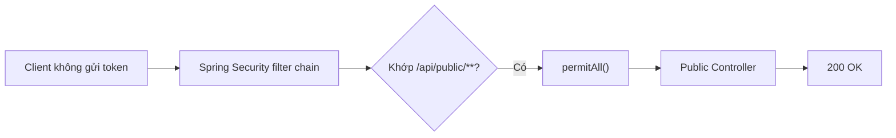
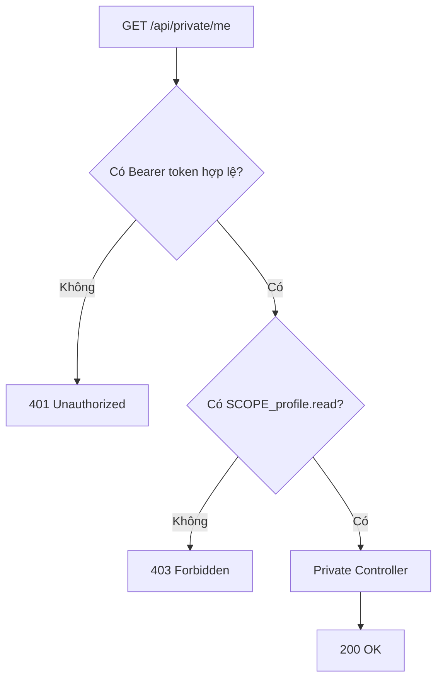
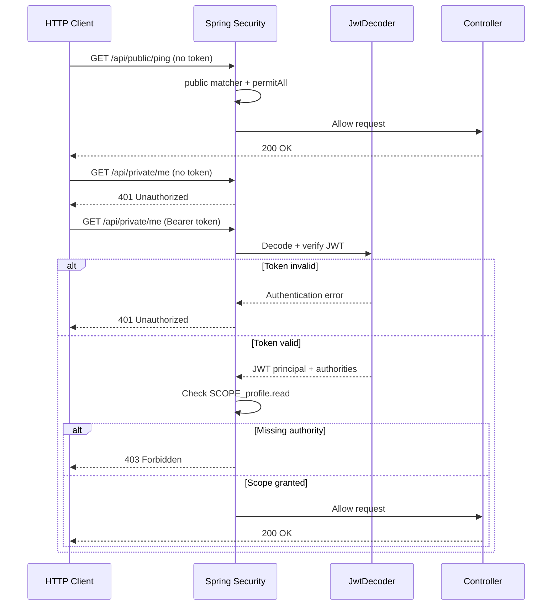

# Xác nhận một yêu cầu công khai và một yêu cầu được bảo vệ

## 1. Mục tiêu thực hành

Khi bắt đầu cấu hình **Spring Security OAuth 2.0 Resource Server**, điều đầu tiên cần xác nhận là API phân biệt đúng hai tình huống:

1. Một **yêu cầu công khai (public request)** được phép truy cập mà không gửi access token.
2. Một **yêu cầu được bảo vệ (protected request)** chỉ được xử lý khi Bearer access token hợp lệ và đáp ứng chính sách phân quyền.

Trong bài này, ta xây dựng ứng dụng Spring Boot rất nhỏ với hai endpoint:

| Endpoint | Mục đích | Chính sách |
|---|---|---|
| `GET /api/public/ping` | Kiểm tra API đang hoạt động | `permitAll()`, không cần token |
| `GET /api/private/me` | Trả thông tin chủ thể đã xác thực | Cần JWT access token có authority `SCOPE_profile.read` |

Mục tiêu quan sát được là:

- Gửi `GET /api/public/ping` **không có token** → `200 OK`.
- Gửi `GET /api/private/me` **không có token** → `401 Unauthorized`.
- Gửi `GET /api/private/me` **có Bearer token không hợp lệ** → `401 Unauthorized`.
- Gửi `GET /api/private/me` **có access token hợp lệ và scope `profile.read`** → `200 OK`.
- Gửi `GET /api/private/me` **có access token hợp lệ nhưng thiếu `profile.read`** → `403 Forbidden`.

Những trường hợp bổ sung giúp phân biệt rõ **xác thực token** và **phân quyền**. Bài học tập trung vào việc khởi tạo, cấu hình và xác nhận kết quả ở Resource Server; việc đăng nhập và phát hành token thuộc trách nhiệm của Authorization Server.

> **Điều kiện:** Để xác nhận chữ ký JWT thật bằng `curl`, cần một Authorization Server hoặc OIDC Provider hoạt động và một access token thực được phát hành cho API. Token giả trong ví dụ chỉ để thử nhánh lỗi. Phần kiểm thử MockMvc bên dưới cho phép xác nhận các quy tắc định tuyến mà không phải lấy token thật, nhưng không thay cho việc kiểm tra chữ ký JWT thực tế.

## 2. Public request và protected request đi qua Spring Security thế nào?

Một REST API thường vừa có tài nguyên công khai vừa có tài nguyên cần bảo vệ. Spring Security sử dụng `SecurityFilterChain` để xử lý HTTP request và quyết định có cho phép đi tới Controller hay không.

### 2.1. Yêu cầu công khai

Ví dụ:

```http
GET /api/public/ping HTTP/1.1
Host: localhost:8080
Accept: application/json
```

Nếu cấu hình có `requestMatchers("/api/public/**").permitAll()`, yêu cầu không cần thông tin xác thực vẫn có thể đi đến Controller.



`permitAll()` có nghĩa là **không đòi hỏi quyền truy cập cho đường dẫn phù hợp**. Nó không có nghĩa là toàn bộ Spring Security filter chain bị vô hiệu hóa hoặc mọi thông tin xác thực sai đều bị bỏ qua.

### 2.2. Yêu cầu được bảo vệ

Ví dụ:

```http
GET /api/private/me HTTP/1.1
Host: localhost:8080
Authorization: Bearer <access-token>
Accept: application/json
```

Đối với endpoint được bảo vệ, Resource Server phải:

1. Tìm Bearer token trong yêu cầu.
2. Xác thực JWT bằng bộ giải mã và khóa tin cậy.
3. Kiểm tra các claim liên quan, ví dụ `iss`, thời hạn, và `aud` nếu API có cấu hình ràng buộc audience.
4. Biến thông tin đã xác thực thành `Authentication` và authorities.
5. Kiểm tra endpoint có đòi scope/authority nào.
6. Chỉ cho phép Controller xử lý khi các điều kiện đạt.



**`401` và `403` là hai kết quả khác nhau:** `401` thường cho biết request chưa có thông tin xác thực được chấp nhận; `403` cho biết đã xác thực nhưng không đủ quyền để thực hiện thao tác.

## 3. Chuẩn bị project Spring Boot

### 3.1. Yêu cầu môi trường

Sử dụng:

- JDK tương thích với phiên bản Spring Boot của project, ví dụ Java 17 hoặc cao hơn với dòng Spring Boot 3.x.
- Gradle hoặc Maven theo cách project đang dùng.
- Ứng dụng Spring Web và Spring Security.
- Một OAuth 2.0/OIDC Authorization Server có thể cấp **JWT access token** cho Resource Server, hoặc một môi trường thử nghiệm có cấu hình tương đương.
- Công cụ gửi HTTP request như `curl`, Postman hoặc PowerShell `curl.exe`.

Ví dụ trong bài sử dụng **Spring Security hiện đại với `SecurityFilterChain`** và lambda DSL. Các package, API hoặc lựa chọn cấu hình cụ thể phải phù hợp với phiên bản Spring Boot/Spring Security của project.

### 3.2. Thêm dependency

Với Gradle, đưa các starter cần thiết vào `build.gradle`:

```groovy
dependencies {
    implementation 'org.springframework.boot:spring-boot-starter-web'
    implementation 'org.springframework.boot:spring-boot-starter-security'
    implementation 'org.springframework.boot:spring-boot-starter-oauth2-resource-server'
}
```

Nếu sử dụng Maven, khai báo các starter tương ứng:

```xml
<dependencies>
    <dependency>
        <groupId>org.springframework.boot</groupId>
        <artifactId>spring-boot-starter-web</artifactId>
    </dependency>
    <dependency>
        <groupId>org.springframework.boot</groupId>
        <artifactId>spring-boot-starter-security</artifactId>
    </dependency>
    <dependency>
        <groupId>org.springframework.boot</groupId>
        <artifactId>spring-boot-starter-oauth2-resource-server</artifactId>
    </dependency>
</dependencies>
```

Các snippet trên giả định project đã có phần khai báo Spring Boot plugin, phiên bản và dependency management phù hợp. Không nên tự trộn các phiên bản Spring Security không tương thích với BOM do Spring Boot quản lý.

### 3.3. Cấu trúc lớp ví dụ

Một ứng dụng nhỏ có thể đặt các file như sau:

```text
src/main/java/com/example/resourceapi/
├── ResourceApiApplication.java
├── SecurityConfig.java
└── ApiController.java

src/main/resources/
└── application.yml
```

Các lớp cùng package gốc `com.example.resourceapi` để Spring Boot tự phát hiện Controller và cấu hình.

## 4. Tạo hai endpoint để kiểm tra

### 4.1. Lớp khởi động

```java
package com.example.resourceapi;

import org.springframework.boot.SpringApplication;
import org.springframework.boot.autoconfigure.SpringBootApplication;

@SpringBootApplication
public class ResourceApiApplication {
    public static void main(String[] args) {
        SpringApplication.run(ResourceApiApplication.class, args);
    }
}
```

### 4.2. Controller có một API public và một API protected

```java
package com.example.resourceapi;

import java.util.Map;
import org.springframework.security.core.annotation.AuthenticationPrincipal;
import org.springframework.security.oauth2.jwt.Jwt;
import org.springframework.web.bind.annotation.GetMapping;
import org.springframework.web.bind.annotation.RestController;

@RestController
public class ApiController {

    // Public endpoint: hoạt động ngay cả khi không có access token.
    @GetMapping("/api/public/ping")
    public Map<String, String> ping() {
        return Map.of(
            "status", "ok",
            "endpoint", "public"
        );
    }

    // Protected endpoint: chỉ truy cập sau khi JWT được chấp nhận.
    @GetMapping("/api/private/me")
    public Map<String, String> me(@AuthenticationPrincipal Jwt jwt) {
        return Map.of(
            "status", "ok",
            "endpoint", "protected",
            "subject", jwt.getSubject()
        );
    }
}
```

Cách dùng `@AuthenticationPrincipal Jwt` ở endpoint bảo vệ phù hợp với cấu hình Resource Server dùng JWT. Ví dụ giả định access token được cấp có claim `sub` hợp lệ, để `jwt.getSubject()` trả một định danh chủ thể không null.

Ở đây không có code xử lý đăng nhập hoặc cấp token. Phía Client phải nhận access token từ Authorization Server rồi gửi token đến API.

Nếu API dùng opaque access token thông qua introspection thay cho JWT, kiểu principal và cách lấy claim cần được điều chỉnh theo loại Authentication tương ứng.

## 5. Cấu hình Spring Security phân biệt hai đường dẫn

Tạo `SecurityConfig.java`:

```java
package com.example.resourceapi;

import org.springframework.context.annotation.Bean;
import org.springframework.context.annotation.Configuration;
import org.springframework.http.HttpMethod;
import org.springframework.security.config.Customizer;
import org.springframework.security.config.annotation.web.builders.HttpSecurity;
import org.springframework.security.config.http.SessionCreationPolicy;
import org.springframework.security.web.SecurityFilterChain;

@Configuration
public class SecurityConfig {

    @Bean
    SecurityFilterChain apiSecurity(HttpSecurity http) throws Exception {
        return http
            .csrf(csrf -> csrf.disable())
            .sessionManagement(session -> session
                .sessionCreationPolicy(SessionCreationPolicy.STATELESS))
            .authorizeHttpRequests(authorize -> authorize
                .requestMatchers(
                    HttpMethod.GET, "/api/public/ping"
                ).permitAll()

                .requestMatchers(
                    HttpMethod.GET, "/api/private/me"
                ).hasAuthority("SCOPE_profile.read")

                .anyRequest().denyAll()
            )
            .oauth2ResourceServer(oauth2 ->
                oauth2.jwt(Customizer.withDefaults()))
            .build();
    }
}
```

Điểm cần hiểu:

| Cấu hình | Tác dụng |
|---|---|
| `requestMatchers(GET, "/api/public/ping").permitAll()` | Cho phép GET public không cần xác thực |
| `requestMatchers(GET, "/api/private/me").hasAuthority("SCOPE_profile.read")` | Đòi xác thực và scope tương ứng |
| `anyRequest().denyAll()` | Từ chối các request không khớp quy tắc trên |
| `oauth2ResourceServer(...jwt(...))` | Bật xác thực JWT Bearer token |
| `SessionCreationPolicy.STATELESS` | Không dựa vào HTTP session để duy trì đăng nhập |
| `csrf.disable()` | Tắt CSRF trong ví dụ API thuần Bearer header, không dùng cookie xác thực |

**Thứ tự matcher có ý nghĩa.** Nên khai báo các rule cụ thể trước rule tổng quát. Nếu cấu hình `anyRequest().authenticated()` hoặc một rule bao trùm toàn bộ API trước `permitAll`, hành vi truy cập công khai có thể không đúng dự định hoặc cấu hình có thể báo lỗi tùy cách viết.

Ví dụ tắt CSRF chỉ áp dụng cho kiến trúc REST API **không sử dụng cookie trình duyệt để xác thực**. Nếu sử dụng session/cookie hoặc có luồng gửi credential tự động từ trình duyệt, phải thiết kế bảo vệ CSRF phù hợp, không sao chép cấu hình này một cách máy móc.

### Tại sao dùng `SCOPE_profile.read`?

Với JWT được Spring Security xử lý theo mapping scope mặc định thông dụng:

```json
{
  "scope": "profile.read"
}
```

sẽ được chuyển thành authority:

```text
SCOPE_profile.read
```

Một số Authorization Server dùng `scp` thay cho `scope`. Nếu tên claim, định dạng scope hoặc tiền tố authority khác mặc định, cần cấu hình `JwtAuthenticationConverter` phù hợp với hợp đồng token. Resource Server phải dựa vào quyền được cấp bởi nơi phát hành, không tin scope gửi riêng dưới dạng HTTP header do Client tự chọn.

Nếu bài thực hành chỉ muốn xác nhận token hợp lệ mà chưa kiểm tra scope, có thể thay `hasAuthority("SCOPE_profile.read")` bằng `authenticated()`. Khi đó token hợp lệ không có scope vẫn qua bước endpoint authorization, và không còn kịch bản thiếu scope trả `403` như bảng kết quả của bài này.

## 6. Cấu hình nơi phát hành JWT tin cậy

Đặt trong `src/main/resources/application.yml`:

```yaml
server:
  port: 8080

spring:
  security:
    oauth2:
      resourceserver:
        jwt:
          issuer-uri: https://id.example.com/realms/shop
```

Địa chỉ `https://id.example.com/realms/shop` là **ví dụ**, phải thay bằng issuer chính xác mà Authorization Server hoặc OIDC Provider của bạn công bố.

Khi dùng `issuer-uri`, Spring Security có thể tra metadata của nơi phát hành, tìm JWKS endpoint và xác minh JWT bằng những khóa được công bố từ nguồn tin cậy. JWT thường được kiểm tra chữ ký, issuer và các ràng buộc thời gian theo cấu hình của framework.

Điều kiện để thực hành với token thật:

1. Issuer trong `application.yml` trùng với `iss` trong JWT được cấp.
2. Resource Server có thể lấy khóa xác minh đáng tin từ issuer/JWKS phù hợp.
3. Access token chưa hết hạn và thỏa các điều kiện thời gian.
4. Token có scope `profile.read` để đi qua rule của endpoint `/api/private/me`.
5. Theo thiết kế an toàn cho API, token phải được phát hành cho **audience của API**; phần bổ sung validator audience nằm ở mục 11.

Nếu issuer không tồn tại, metadata không đúng định dạng hoặc Resource Server không thể lấy khóa cần thiết, ứng dụng có thể gặp lỗi cấu hình/khởi động hay thất bại khi xác minh token, tùy đường cấu hình và phiên bản. Điều đó khác với một `401` do request thực sự không có token.

## 7. Khởi động Resource Server

Với Gradle wrapper của project:

```bash
./gradlew bootRun
```

Với Maven wrapper:

```bash
./mvnw spring-boot:run
```

Trên Windows, có thể dùng `gradlew.bat bootRun` hoặc `mvnw.cmd spring-boot:run` tương ứng.

Khi ứng dụng đã khởi động thành công và lắng nghe cổng `8080`, mở một terminal khác để gửi các request ở phần tiếp theo.

Lưu ý: Tài liệu đưa ra các lệnh để người học chạy trong môi trường của mình. Việc xác nhận API bằng request thật cần issuer, token và ứng dụng đang chạy; không thể kết luận hệ thống đã hoạt động chỉ từ việc đọc file cấu hình.

## 8. Xác nhận yêu cầu công khai: không gửi token

### 8.1. Gửi HTTP request

Dùng `curl`:

```bash
curl -i http://localhost:8080/api/public/ping
```

Tùy phiên bản/transport, output có thể tương tự:

```http
HTTP/1.1 200 OK
Content-Type: application/json

{"status":"ok","endpoint":"public"}
```

`-i` yêu cầu `curl` hiển thị cả status line và response headers. Thứ tự field JSON hoặc các header phụ có thể khác. Điều cần quan sát là:

- HTTP status = **`200 OK`**.
- Response body chứa dữ liệu mà `ping()` trả về.
- Request **không có header Authorization**.
- Controller được thực thi mặc dù chưa có token.

Đây là bằng chứng ở mức request/response rằng matcher `permitAll()` đã cho phép endpoint công khai.

### 8.2. Vì sao `200` có ý nghĩa?

Theo cấu hình, SecurityFilterChain nhìn thấy `GET /api/public/ping` khớp rule `permitAll()`. Vì endpoint không yêu cầu xác thực, Spring Security không buộc Client cung cấp JWT trước khi trả lời.

Nhưng `200` chỉ xác nhận hành vi của endpoint public này. Nó **không chứng minh** endpoint khác đã được bảo vệ; cần thử thêm một request không có token vào endpoint protected.

### 8.3. Cẩn thận với đường dẫn và method

Ví dụ này chỉ công khai **GET** đúng đường dẫn `/api/public/ping`. Gửi `POST /api/public/ping` không tự động được phép bởi rule GET; cũng không có handler POST tương ứng trong Controller.

Khi thử thực tế, hãy phân biệt:

- `404 Not Found`: không có route tương ứng hoặc route sai.
- `405 Method Not Allowed`: route tồn tại nhưng không hỗ trợ HTTP method.
- `401 Unauthorized`: request chưa được xác thực.
- `403 Forbidden`: quyền truy cập bị từ chối.

Một HTTP status không mong đợi có thể xuất phát từ mapping của Controller hoặc chính sách SecurityFilterChain; không nên coi mọi lỗi HTTP đều là lỗi JWT.

## 9. Xác nhận yêu cầu được bảo vệ: không gửi token

Gửi:

```bash
curl -i http://localhost:8080/api/private/me
```

Kết quả dự kiến:

```http
HTTP/1.1 401 Unauthorized
WWW-Authenticate: Bearer
```

Response body có thể rỗng hoặc khác nhau theo cấu hình xử lý exception. Điều quan trọng là HTTP status **`401`**; Resource Server không cho request không có thông tin xác thực hợp lệ đi vào `me()`.

Vì sao?

1. Đường dẫn và method khớp rule `hasAuthority("SCOPE_profile.read")`.
2. Request không có Bearer token.
3. Spring Security không có Authentication thích hợp để đáp ứng rule.
4. Request bị từ chối; cơ chế Bearer authentication entry point phản hồi `401`.

Nếu kết quả lại là `200 OK`, có thể có một rule `permitAll` bao trùm endpoint hoặc một filter chain khác đang được chọn. Nếu là `404`, hãy kiểm tra đường dẫn Controller. Nếu ứng dụng không mở cổng, cần giải quyết lỗi khởi động trước khi đánh giá HTTP status.

## 10. Xác nhận token sai bị từ chối

Gửi một chuỗi rõ ràng không phải JWT hợp lệ:

```bash
curl -i \
  -H 'Authorization: Bearer not-a-valid-jwt' \
  http://localhost:8080/api/private/me
```

Kết quả dự kiến:

```http
HTTP/1.1 401 Unauthorized
WWW-Authenticate: Bearer error="invalid_token"
```

Đây là mẫu minh họa. Giá trị đầy đủ của `WWW-Authenticate` có thể gồm mô tả lỗi khác hoặc được framework cấu hình riêng. Tuy nhiên, một protected endpoint với Bearer token không hợp lệ cần bị từ chối thay vì trả dữ liệu.

Khác với request ở mục 9, request này **có** header Authorization, nhưng token không thể được chấp nhận vì không đúng định dạng/chữ ký hoặc không đạt kiểm tra JWT.

Không nên cố “khắc phục” lỗi này bằng cách chuyển `/api/private/me` sang `permitAll()`. Nếu có access token thật nhưng vẫn `401`, hãy kiểm tra issuer, khóa ký/JWKS, thời hạn và các validator liên quan.

## 11. Xác nhận access token hợp lệ và scope phù hợp

### 11.1. Access token phải đến từ đâu?

Client cần nhận access token từ Authorization Server đã cấu hình và được quyền gọi API. Ví dụ:

- Ứng dụng người dùng dùng **Authorization Code + PKCE** để được cấp token sau một quá trình ủy quyền phù hợp.
- Backend có thể dùng **Client Credentials** nếu nhà phát hành cho phép Client đó truy cập API và cấp scope `profile.read` theo thiết kế.

Hai grant types này là cách Client **lấy token**; Resource Server ở bài này chỉ **nhận và xác minh access token**.

Không sử dụng **ID token OIDC** thay cho access token để gọi API. ID token dành cho ứng dụng OIDC Client và thường có audience là Client ID, không nhất thiết được phép dùng với Resource Server.

Ví dụ payload access token hợp lệ theo hợp đồng minh họa:

```json
{
  "iss": "https://id.example.com/realms/shop",
  "sub": "user-417",
  "aud": ["resource-api"],
  "exp": 1893456000,
  "scope": "profile.read"
}
```

Giá trị `exp` chỉ minh họa và không tự khiến token hợp lệ. Một payload JSON do người học tự tạo không có chữ ký thật từ issuer là **không đủ** để truy cập endpoint. Các claim này phải có trong access token thực sự do Authorization Server tin cậy phát hành.

### 11.2. Gửi request có Bearer token

Trên shell dạng Bash, gán access token đã được cấp hợp lệ vào biến môi trường:

```bash
export ACCESS_TOKEN='<access-token-issued-by-your-authorization-server>'
```

Sau đó gọi:

```bash
curl -i \
  -H "Authorization: Bearer $ACCESS_TOKEN" \
  http://localhost:8080/api/private/me
```

Kết quả **nếu token hợp lệ và có scope yêu cầu**:

```http
HTTP/1.1 200 OK
Content-Type: application/json

{"status":"ok","endpoint":"protected","subject":"user-417"}
```

Body là ví dụ tương ứng với token có `sub=user-417`. Token từ issuer thực có thể cho subject khác. Nếu đã nhận `200` và body của `me()` thì yêu cầu đã vượt qua chuỗi xác thực và phân quyền đã cấu hình.

**Đừng commit token thật**, dán token vào issue công khai, đưa token vào URL hoặc ghi token nguyên văn vào log. Bearer access token là thông tin có thể được người nắm giữ sử dụng lại trong thời hạn hiệu lực; dùng HTTPS khi gọi qua mạng.

### 11.3. Khi token hợp lệ nhưng không có `profile.read`

Giả sử một token cùng issuer, còn hạn, đúng audience nhưng chỉ có:

```json
{
  "scope": "orders.read"
}
```

Token đó có thể được **xác thực thành công**, nhưng không có authority `SCOPE_profile.read`. Vì vậy `GET /api/private/me` phải bị từ chối với **`403 Forbidden`**:

```http
HTTP/1.1 403 Forbidden
WWW-Authenticate: Bearer error="insufficient_scope"
```

Header chi tiết tùy cấu hình/framework, nhưng ý nghĩa cốt lõi là **token đã được chấp nhận để xác thực, quyền truy cập endpoint chưa đủ**.

Không thể mô phỏng đúng nhánh `403` chỉ bằng cách tự sửa payload token hợp lệ: làm vậy sẽ phá chữ ký và nhiều khả năng nhận `401`. Cần một token thật được AS cấp với scope thiếu, hoặc sử dụng kiểm thử Spring Security giả lập Authentication như phần kiểm thử sau.

### 11.4. Bổ sung ràng buộc audience để xác nhận token dành cho API

Issuer và chữ ký hợp lệ là chưa đủ trong hệ thống nhiều API. Token cấp cho `billing-api` không nên được chấp nhận ở `resource-api`. Để kiểm tra `aud` như hợp đồng ví dụ ở trên, có thể bổ sung một bean `JwtDecoder`:

```java
package com.example.resourceapi;

import org.springframework.context.annotation.Bean;
import org.springframework.context.annotation.Configuration;
import org.springframework.security.oauth2.core.DelegatingOAuth2TokenValidator;
import org.springframework.security.oauth2.core.OAuth2Error;
import org.springframework.security.oauth2.core.OAuth2TokenValidator;
import org.springframework.security.oauth2.core.OAuth2TokenValidatorResult;
import org.springframework.security.oauth2.jwt.Jwt;
import org.springframework.security.oauth2.jwt.JwtDecoder;
import org.springframework.security.oauth2.jwt.JwtDecoders;
import org.springframework.security.oauth2.jwt.JwtValidators;
import org.springframework.security.oauth2.jwt.NimbusJwtDecoder;

@Configuration
public class JwtValidationConfig {

    @Bean
    JwtDecoder jwtDecoder() {
        String issuer = "https://id.example.com/realms/shop";
        String audience = "resource-api";

        NimbusJwtDecoder decoder =
            (NimbusJwtDecoder) JwtDecoders.fromIssuerLocation(issuer);

        OAuth2TokenValidator<Jwt> audienceValidator = jwt ->
            jwt.getAudience().contains(audience)
                ? OAuth2TokenValidatorResult.success()
                : OAuth2TokenValidatorResult.failure(
                    new OAuth2Error(
                        "invalid_token", "Invalid audience", null));

        decoder.setJwtValidator(
            new DelegatingOAuth2TokenValidator<>(
                JwtValidators.createDefaultWithIssuer(issuer),
                audienceValidator
            ));

        return decoder;
    }
}
```

Đây là **cấu hình bổ sung tùy kiến trúc**, không phải điều kiện bắt buộc để thử nhanh một public request không mang token. Ví dụ giữ bộ validator mặc định cần thiết về issuer/thời hạn và thêm audience. Khi tự thay validator, không được vô tình bỏ các kiểm tra JWT cần thiết.

Phải thống nhất audience `resource-api` với cấu hình phát hành token tại Authorization Server. Nếu token được cấp audience khác, hãy sửa cấu hình cấp token phù hợp, thay vì bỏ kiểm tra audience để ép API trả `200`.

## 12. Bộ kiểm tra tự động với MockMvc

Kiểm tra HTTP bằng `curl` cho thấy cách hệ thống thực nhận request. Khi làm việc trong project Spring Boot, cũng có thể viết test tự động để xác nhận các matcher `permitAll`/`hasAuthority`.

**Lưu ý phạm vi kiểm thử:** Spring Security Test có thể **giả lập JWT Authentication** để xác nhận phân quyền. Kỹ thuật đó không kiểm tra chữ ký/JWKS/issuer thực; muốn xác nhận toàn bộ hành vi Resource Server cần một kiểm thử tích hợp với Authorization Server/token thật hoặc môi trường kiểm thử phù hợp.

### 12.1. Dependency kiểm thử

Với Gradle:

```groovy
dependencies {
    testImplementation 'org.springframework.boot:spring-boot-starter-test'
    testImplementation 'org.springframework.security:spring-security-test'
}
```

Nếu project dùng một bộ starter test khác do phiên bản Spring Boot quản lý, dùng dependency tương thích với cấu hình hiện tại.

### 12.2. Kiểm tra 200, 401 và 403 trên cùng SecurityFilterChain

Ví dụ test sử dụng JUnit 5 và Spring MockMvc:

```java
package com.example.resourceapi;

import org.junit.jupiter.api.Test;
import org.springframework.beans.factory.annotation.Autowired;
import org.springframework.boot.test.autoconfigure.web.servlet.AutoConfigureMockMvc;
import org.springframework.boot.test.context.SpringBootTest;
import org.springframework.http.MediaType;
import org.springframework.security.core.authority.SimpleGrantedAuthority;
import org.springframework.test.web.servlet.MockMvc;

import static org.springframework.security.test.web.servlet.request
    .SecurityMockMvcRequestPostProcessors.jwt;
import static org.springframework.test.web.servlet.request
    .MockMvcRequestBuilders.get;
import static org.springframework.test.web.servlet.result
    .MockMvcResultMatchers.*;

@SpringBootTest
@AutoConfigureMockMvc
class ApiAccessTest {

    @Autowired
    MockMvc mvc;

    @Test
    void publicEndpointWorksWithoutToken() throws Exception {
        mvc.perform(get("/api/public/ping"))
            .andExpect(status().isOk())
            .andExpect(content().contentTypeCompatibleWith(
                MediaType.APPLICATION_JSON))
            .andExpect(jsonPath("$.endpoint").value("public"));
    }

    @Test
    void privateEndpointWithoutTokenReturns401() throws Exception {
        mvc.perform(get("/api/private/me"))
            .andExpect(status().isUnauthorized());
    }

    @Test
    void privateEndpointWithScopeReturns200() throws Exception {
        mvc.perform(get("/api/private/me")
                .with(jwt()
                    .jwt(builder -> builder.subject("user-417"))
                    .authorities(new SimpleGrantedAuthority(
                        "SCOPE_profile.read"))))
            .andExpect(status().isOk())
            .andExpect(jsonPath("$.subject").value("user-417"));
    }

    @Test
    void privateEndpointWithoutScopeReturns403() throws Exception {
        mvc.perform(get("/api/private/me")
                .with(jwt()
                    .jwt(builder -> builder.subject("user-417"))
                    .authorities(new SimpleGrantedAuthority(
                        "SCOPE_orders.read"))))
            .andExpect(status().isForbidden());
    }
}
```

Các test minh họa trực tiếp quy tắc authorization trong `SecurityFilterChain`. `with(jwt())` tạo một JWT principal giả lập tại lớp kiểm thử, không tạo JWT được ký thật.

Nếu Spring test context cố khởi tạo decoder từ issuer không có thật, hãy cấp cấu hình test cho một `JwtDecoder` mock hoặc issuer/JWKS test phù hợp với project. Đừng cho rằng một test dùng `with(jwt())` chứng minh cấu hình JWKS production đã hoạt động.

### 12.3. Kiểm tra thực tế vẫn cần token đúng và sai

Bốn test ở trên xác nhận:

- `permitAll()` cho phép public endpoint khi không có JWT.
- Endpoint protected trả `401` nếu không có thông tin xác thực.
- JWT Authentication giả lập có `SCOPE_profile.read` qua được endpoint.
- Authentication giả lập thiếu authority bị `403`.

Ngoài ra nên xác nhận **một access token ký thật** và **một token lỗi** qua HTTP thật. Bộ kiểm thử giả lập không thay thế quá trình xác minh chữ ký, kiểm tra issuer/audience, đồng bộ JWKS và thời hạn token của Resource Server.

## 13. Ma trận request để đánh giá hành vi

| STT | Đường dẫn | Authorization header | Điều kiện token | Kết quả mong đợi |
|---|---|---|---|---|
| 1 | `GET /api/public/ping` | Không gửi | Không có token | **200 OK** |
| 2 | `GET /api/private/me` | Không gửi | Không có token | **401 Unauthorized** |
| 3 | `GET /api/private/me` | `Bearer not-a-valid-jwt` | Token không hợp lệ | **401 Unauthorized** |
| 4 | `GET /api/private/me` | Bearer token thật | Còn hạn, issuer và audience phù hợp, có `profile.read` | **200 OK** |
| 5 | `GET /api/private/me` | Bearer token thật | Hợp lệ nhưng thiếu `profile.read` | **403 Forbidden** |
| 6 | `GET /api/private/me` | Bearer JWT đã hết hạn | `exp` không còn hiệu lực | **401 Unauthorized** |
| 7 | `GET /api/private/me` | Bearer JWT sai issuer | Issuer không được tin | **401 Unauthorized** |
| 8 | `GET /api/private/me` | Bearer JWT sai audience | Audience validator đã bật | **401 Unauthorized** |
| 9 | `GET /api/public/ping` | Bearer token không hợp lệ | Filter cố xác thực token được gửi | **Thường 401**, dù endpoint có `permitAll()` |
| 10 | `GET /api/public/ping` | Bearer token hợp lệ | Không cần scope cho public | **200 OK** |

Dòng 9 dễ gây nhầm lẫn. Một endpoint `permitAll()` không có nghĩa hệ thống sẽ bỏ qua Bearer token **đã được gửi**. Khi Request có header `Authorization: Bearer ...` và Resource Server filter xử lý token đó, token sai có thể làm request thất bại **trước** bước kiểm tra quyền endpoint. Để xác nhận public route hoạt động, nên thử request thực sự **không mang token**, đúng như yêu cầu của bài.

Trong ứng dụng nhiều `SecurityFilterChain`, có thể thiết kế chain công khai riêng. Khi đó hành vi với token sai phụ thuộc chain được chọn; cần xem cấu hình thực tế trước khi kết luận.

## 14. Diễn giải kết quả theo từng lớp bảo vệ

Có thể nhớ chuỗi xử lý như sau:



Từ kết quả HTTP, người học có thể suy luận:

**Trường hợp `200` ở public:** Matcher public đã cho phép request, Controller tồn tại và xử lý thành công. Chưa kết luận gì về endpoint protected.

**Trường hợp `401` ở protected không token:** API đã yêu cầu xác thực cho endpoint này và từ chối request chưa xác thực.

**Trường hợp `401` với token sai:** Resource Server đã không chấp nhận token. Cần xét định dạng, chữ ký, issuer, audience và thời hạn, tùy validator được cấu hình.

**Trường hợp `403` với token hợp lệ nhưng thiếu scope:** Authentication đã được thiết lập nhưng authorization rule từ chối; nên kiểm tra claim `scope`/`scp` và authority mapping thay vì tắt security.

**Trường hợp `200` ở protected có token hợp lệ:** Request đã qua xác thực/phân quyền endpoint mà ứng dụng khai báo. Nếu Controller truy vấn dữ liệu nghiệp vụ, còn phải kiểm tra quyền trên đối tượng cụ thể, chẳng hạn ownership hoặc tenant isolation.

## 15. Những lỗi cấu hình thường gặp khi xác nhận hai request

### 15.1. Public endpoint bất ngờ trả 401

Có thể do:

- Route không đúng với `requestMatchers`.
- Cấu hình có một filter chain khác đang được chọn.
- Client vô tình gửi `Authorization` chứa Bearer token sai, dẫn đến thất bại khi xác thực token.
- Một thành phần bảo vệ khác áp thêm yêu cầu xác thực hoặc reverse proxy từ chối trước Spring Boot.

Hãy thử request thật sự không có `Authorization`, đúng HTTP method và URL. Kiểm tra thứ tự matcher và filter chain đang hoạt động.

### 15.2. Protected endpoint không có token vẫn trả 200

Đây là dấu hiệu cần xem lại chính sách:

- Một matcher `permitAll()` quá rộng đã bao trùm `/api/private/me`.
- API đi qua chain không cấu hình điều kiện xác thực như dự định.
- Controller hoặc đường dẫn thử khác với endpoint protected trong cấu hình.
- Một lớp ứng dụng đứng trước trả response thay vì endpoint đang kiểm tra.

Nên sử dụng các matcher rõ ràng và một rule mặc định chặt như `anyRequest().denyAll()` để tránh vô tình mở endpoint chưa được xem xét.

### 15.3. Token thật luôn nhận 401

Một số nguyên nhân:

- `issuer-uri` khác hoàn toàn hoặc khác chi tiết đường dẫn so với claim `iss`.
- Không thể truy cập metadata/JWKS hoặc không tìm được khóa đúng.
- Token đã hết hạn, chưa đến `nbf` hoặc đồng hồ hệ thống chênh lệch lớn.
- Token là ID token OIDC được gửi nhầm thay access token.
- Token dành cho audience khác trong khi API đã bật audience validator.
- Thuật toán ký hoặc khóa không được decoder chấp nhận.

Cần xác minh nguồn phát hành và cấu hình tin cậy; không dùng decoder chấp nhận mọi chữ ký hoặc bỏ toàn bộ validation để ép request thành công.

### 15.4. Token thật trả 403 dù JWT nhìn có vẻ đúng

Một token có `scope` khác `profile.read` sẽ không đáp ứng `hasAuthority("SCOPE_profile.read")`. Nếu claim scope có định dạng mảng hoặc tên claim riêng, cần mapping tương ứng bằng `JwtAuthenticationConverter`.

Đừng nhầm **Client permissions ở Authorization Server** với **authorities được Spring Security trích ra từ token**. Một scope chỉ có tác dụng tại API khi được phát hành thật, ánh xạ đúng và được dùng trong chính sách của endpoint.

### 15.5. Postman thành công nhưng trình duyệt bị lỗi CORS

CORS là cơ chế khác với xác thực và phân quyền. Với request cross-origin từ trình duyệt, API cần cấu hình CORS phù hợp với origin, method và header được phép; preflight `OPTIONS` có thể bị chặn nếu cấu hình security không hỗ trợ.

Không thể khắc phục lỗi CORS đúng cách chỉ bằng cách chuyển mọi endpoint thành `permitAll()`. Hãy kiểm tra cả chính sách CORS và authentication/authorization riêng biệt.

### 15.6. Trả 404/405 thay vì 200/401

Nếu Controller chưa được scan, đường dẫn sai hoặc HTTP method không phù hợp, response có thể là `404` hoặc `405`. Với rule `anyRequest().denyAll()`, một request không khớp policy có thể bị security từ chối trước khi routing trả lỗi tương ứng.

Để tránh nhiễu trong bài thực hành, hãy giữ đúng hai endpoint được khai báo, đúng method `GET`, đúng cổng `8080` và các đường dẫn chính xác.

## 16. Thực hiện với Windows PowerShell

Trong Windows PowerShell 5.1, lệnh `curl` có thể là alias của `Invoke-WebRequest` và không dùng cùng tập tham số với `curl` phổ biến trên Linux/macOS. Muốn sử dụng cú pháp `curl -i` nhất quán, gọi rõ `curl.exe`:

```powershell
# Public endpoint
curl.exe -i http://localhost:8080/api/public/ping

# Protected endpoint, no token
curl.exe -i http://localhost:8080/api/private/me

# Protected endpoint, invalid token
curl.exe -i -H "Authorization: Bearer not-a-valid-jwt" http://localhost:8080/api/private/me
```

Nếu đã có access token thực và muốn thử endpoint protected trong PowerShell:

```powershell
$accessToken = "<access-token-from-authorization-server>"
curl.exe -i -H "Authorization: Bearer $accessToken" http://localhost:8080/api/private/me
```

Không lưu access token thật trong script được commit hoặc chia sẻ. Khi làm việc với môi trường production, không gửi Bearer token qua HTTP; những URL localhost trong bài chỉ phục vụ thử nghiệm cục bộ.

## 17. Mở rộng sau khi xác nhận hai request

Sau khi thấy public `200` và protected `401`/`200` đúng mong đợi, có thể mở rộng cấu hình Resource Server:

- **Scope theo hành động:** `orders.read` cho GET, `orders.write` cho POST/PUT.
- **Audience cụ thể:** một token được cấp cho `orders-api` không được dùng cho `billing-api`.
- **Bảo vệ dữ liệu nghiệp vụ:** kiểm tra user có sở hữu bản ghi hay thuộc tenant được phép hay không.
- **Opaque token:** thay cấu hình `jwt()` bằng introspection nếu Authorization Server phát hành access token dạng opaque.
- **Giao diện frontend:** cấu hình CORS và cách Client giữ/gửi Bearer token phù hợp.
- **Chẩn đoán:** theo dõi HTTP status, mã lỗi, request ID và policy được áp dụng mà không ghi raw token ra log.

Đó là các bước tiếp theo khi áp dụng Resource Server cho API thực tế; không cần triển khai tất cả chỉ để xác nhận hai request đầu tiên.

## 18. Câu hỏi tự kiểm tra

**Câu 1.** Vì sao phải gửi request public **không có token** để xác nhận `permitAll()`?

**Trả lời:** Đây là phép thử trực tiếp rằng endpoint không đòi xác thực. Một Bearer token sai được gửi đến public endpoint vẫn có thể bị filter xác thực token từ chối.

**Câu 2.** Protected endpoint không có token trả `401` nói lên điều gì?

**Trả lời:** Spring Security đang yêu cầu Authentication được chấp nhận trước khi cho phép truy cập endpoint đó.

**Câu 3.** Tại sao token đã xác thực vẫn có thể trả `403`?

**Trả lời:** Token không có authority `SCOPE_profile.read` hoặc không đáp ứng rule phân quyền khác. Xác thực token và cho phép thao tác là hai bước riêng.

**Câu 4.** Test `with(jwt())` của MockMvc có chứng minh JWT thật được ký bằng khóa đúng không?

**Trả lời:** Không. Nó giả lập JWT Authentication để kiểm tra authorization; cần token thật và decoder/JWKS thực để xác nhận signature validation.

**Câu 5.** Chỉ dùng `issuer-uri` đã đủ để bảo đảm token được cấp cho API cụ thể chưa?

**Trả lời:** Chưa. Cần ràng buộc audience theo hợp đồng của Resource Server nếu API phải từ chối token phát hành cho dịch vụ khác.

**Câu 6.** Nếu `GET /api/public/ping` trả `200`, có thể kết luận toàn bộ API được bảo vệ đúng không?

**Trả lời:** Không. Cần xác nhận riêng endpoint protected từ chối thiếu token và token sai, đồng thời chấp nhận token hợp lệ đủ quyền.

## 19. Kết luận

Với Spring Security OAuth 2.0 Resource Server, phép kiểm tra khởi đầu rõ ràng nhất là tạo một endpoint **public** và một endpoint **protected**, rồi gửi request quan sát HTTP status.

Cấu hình `permitAll()` cho phép public endpoint trả **`200 OK`** mà không cần token. Cấu hình `oauth2ResourceServer(...jwt(...))` kết hợp `hasAuthority("SCOPE_profile.read")` giúp endpoint protected từ chối request không có hoặc có token sai bằng **`401 Unauthorized`**, từ chối token hợp lệ nhưng thiếu quyền bằng **`403 Forbidden`**, và cho phép token hợp lệ, đủ quyền tới Controller để trả **`200 OK`**.

Bài thực hành này xác nhận ranh giới truy cập ở mức HTTP và Spring Security; trong ứng dụng thực, hãy tiếp tục ràng buộc issuer, audience, thời hạn token và quyền với dữ liệu nghiệp vụ cụ thể trước khi coi API đã được bảo vệ đầy đủ.
