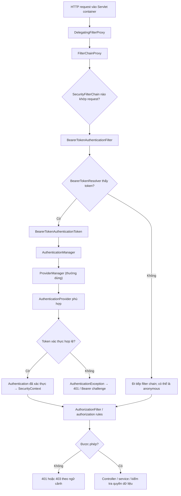
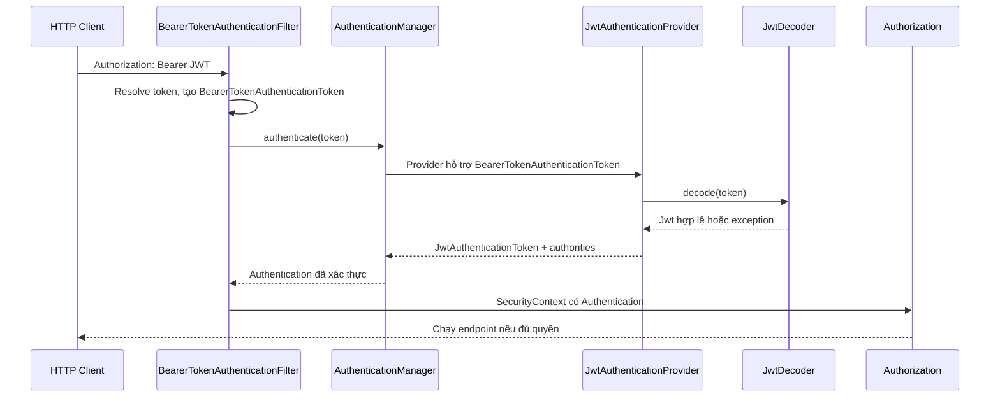
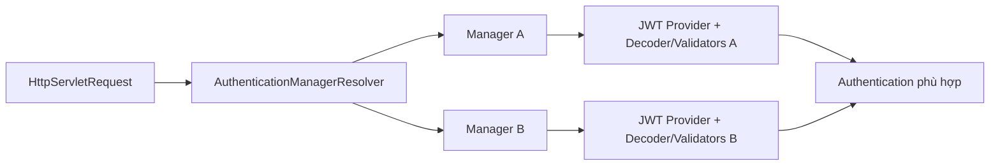

# AuthenticationManager, ProviderManager và lựa chọn provider

## 1. Vị trí của AuthenticationManager trong chuỗi xử lý Servlet

Trong ứng dụng Spring Security dùng **Servlet stack**, một HTTP request đi qua chuỗi servlet filters trước khi vào controller. Khi request mang thông tin đăng nhập hoặc Bearer access token, một authentication filter sẽ tạo đối tượng `Authentication` ban đầu và chuyển cho **AuthenticationManager** kiểm tra.

Ba khái niệm thường bị nhầm:

- **`AuthenticationManager`:** giao diện nhận một `Authentication` và yêu cầu xác thực nó. Đây là điểm phối hợp xác thực mà filter sử dụng.
- **`ProviderManager`:** triển khai phổ biến của `AuthenticationManager`, điều phối danh sách các `AuthenticationProvider`.
- **`AuthenticationProvider`:** thành phần biết cách xác thực **một hay nhiều kiểu đối tượng `Authentication`**; ví dụ provider kiểm tra JWT, introspect opaque token hoặc kiểm tra username/password.

Trong OAuth 2.0 Resource Server, `BearerTokenAuthenticationFilter` thường tạo `BearerTokenAuthenticationToken` từ header `Authorization: Bearer ...`. Một provider phù hợp sẽ kiểm tra access token, rồi trả về một `Authentication` đã được xác thực để Spring Security đưa vào `SecurityContext`.

**Quy tắc cốt lõi:** filter **thu thập credential và khởi động xác thực**; `AuthenticationManager` **điều phối xác thực**; provider **thực hiện xác thực**; bước **authorization** sau đó mới quyết định request có quyền vào API hay không.

### 1.1. Tình huống minh họa

Giả sử API đơn hàng yêu cầu Bearer access token:

```http
GET /api/orders/123 HTTP/1.1
Host: api.example.test
Authorization: Bearer <access-token>
```

Resource Server cần:

1. Nhận ra Bearer credential trên request.
2. Kiểm tra token có chữ ký/hiệu lực và phù hợp issuer, audience, token profile của API.
3. Biến các claim quyền thành Spring Security authorities.
4. Đặt kết quả xác thực vào security context cho request hiện tại.
5. Áp dụng quy tắc, ví dụ `SCOPE_orders:read`, rồi mới chạy controller nếu được phép.

Không bước nào yêu cầu controller tự giải mã token hoặc tự chọn JWT provider bằng câu lệnh `if`.

## 2. Sơ đồ tổng thể từ HTTP request tới provider



`DelegatingFilterProxy` là cầu nối từ Servlet container đến bean filter của Spring. `FilterChainProxy` lựa chọn một `SecurityFilterChain` theo `RequestMatcher` của chain. Trong một ứng dụng có nhiều chain, **chain đầu tiên khớp** sẽ được sử dụng; các chain khác không tự nối tiếp để xác thực cùng request.

Sơ đồ này mô tả đường đi phổ biến của Bearer token. Thứ tự và sự hiện diện của từng filter phụ thuộc cấu hình Spring Security, nên hãy dùng cấu hình filter chain thực tế để hiểu hệ thống đang triển khai.

### 2.1. Authentication và authorization là hai giai đoạn

| Giai đoạn | Câu hỏi | Thành phần điển hình | Lỗi thường thấy |
| --- | --- | --- | --- |
| Tách credential | Request có Bearer token ở vị trí được phép không? | `BearerTokenResolver`, `BearerTokenAuthenticationFilter` | Lỗi request hoặc không có credential. |
| Authentication | Credential có thật và hợp lệ cho hệ thống này không? | `AuthenticationManager`, `ProviderManager`, `JwtAuthenticationProvider` hoặc `OpaqueTokenAuthenticationProvider` | `401 invalid_token` hoặc lỗi xác thực khác. |
| Authorization | Principal đã xác thực có quyền gọi endpoint không? | `AuthorizationFilter`, `AuthorizationManager`, method security | Thường `403 Forbidden` khi token hợp lệ nhưng thiếu quyền. |
| Phân quyền dữ liệu | Principal có được xem/sửa đúng đơn hàng, tenant hoặc tài nguyên này không? | Service/domain policy, query constraints, method security | Tùy thiết kế: 403, 404 hoặc lỗi nghiệp vụ phù hợp. |

Một token **xác thực thành công** không đương nhiên có quyền truy cập mọi endpoint. Ngược lại, việc request **không có Bearer token** chưa phải một lỗi giải mã JWT: filter có thể cho request đi tiếp rồi authorization mới yêu cầu xác thực.

## 3. Giao diện AuthenticationManager thực sự làm gì?

Trong Spring Security, `AuthenticationManager` có một thao tác trọng tâm:

```java
public interface AuthenticationManager {
    Authentication authenticate(Authentication authentication)
            throws AuthenticationException;
}
```

`Authentication` đầu vào mô tả credential chưa được tin cậy hoặc yêu cầu xác thực. Ví dụ:

- `UsernamePasswordAuthenticationToken`: username/password trong form login hoặc Basic authentication.
- `BearerTokenAuthenticationToken`: chuỗi Bearer token được trích từ HTTP request.
- Những kiểu `Authentication` khác do cơ chế login hoặc ứng dụng tạo ra.

Nếu xác thực thành công, manager trả về một `Authentication` có principal, authorities và trạng thái đã xác thực. Nếu thất bại, manager ném một `AuthenticationException` phù hợp. Trong mô hình `ProviderManager`, các provider cũng có thể trả `null` nội bộ để nhường cơ hội cho provider tiếp theo.

**AuthenticationManager không nhất thiết là một provider.** Nó là lớp điều phối. Một triển khai có thể gọi một provider, nhiều provider hoặc ủy quyền cho một manager cha.

### 3.1. Authentication trước và sau xác thực

Với JWT access token, sự chuyển đổi có thể hình dung như sau:

```text
Input:
  BearerTokenAuthenticationToken
  principal/credentials: chuỗi access token chưa được kiểm chứng
  authenticated: false

  AuthenticationManager.authenticate(...)
      → JwtAuthenticationProvider
      → JwtDecoder + validators
      → JwtAuthenticationConverter

Output:
  JwtAuthenticationToken
  principal: Jwt đã được decoder xác minh
  authorities: ví dụ SCOPE_orders:read
  authenticated: true
```

Với opaque access token, provider có thể trả `BearerTokenAuthentication` chứa principal thuộc mô hình token đã introspect. Kiểu principal và authorities cụ thể có thể khác JWT, nhưng controller và cơ chế authorization vẫn có thể nhìn thấy một `Authentication` hợp lệ trong `SecurityContext`.

Không nên coi một `Authentication` tự tạo với `authenticated=true` là bằng chứng token đã được Spring xác thực. Đối tượng tin cậy phải đến từ luồng provider/manager đã cấu hình phù hợp.

## 4. ProviderManager: bộ điều phối AuthenticationProvider

`ProviderManager` thường nhận một danh sách provider và thử các provider theo thứ tự được cấu hình. Mỗi provider implement:

```java
public interface AuthenticationProvider {
    Authentication authenticate(Authentication authentication)
            throws AuthenticationException;

    boolean supports(Class<?> authentication);
}
```

**`supports(...)` là phép kiểm tra loại `Authentication`**, chứ không phải việc kiểm tra chữ ký JWT, audience hay scope. Nó trả lời câu hỏi: “Provider này có thể xử lý một đối tượng Authentication thuộc class này không?”

Ví dụ `JwtAuthenticationProvider` thường hỗ trợ `BearerTokenAuthenticationToken`, còn `DaoAuthenticationProvider` hỗ trợ `UsernamePasswordAuthenticationToken`. Khi nhận Bearer token, provider username/password thường được bỏ qua vì `supports(...)` không khớp.

### 4.1. Thuật toán lựa chọn provider theo khái niệm

```text
authenticate(authentication):
    for provider in configuredProviders:
        if not provider.supports(authentication.getClass()):
            continue

        try:
            result = provider.authenticate(authentication)
            if result != null:
                return authenticatedResult
        catch AuthenticationException ex:
            remember ex
            continue if the exception class permits trying other providers

    if no local provider authenticated and parent manager is configured:
        try parent.authenticate(authentication)

    if still no result:
        throw a recorded AuthenticationException,
        or ProviderNotFoundException when no suitable provider handled it
```

Đây là **giả mã giải thích nguyên tắc**, không phải mã nguồn Spring Security để copy vào ứng dụng. Một số exception, đặc biệt các lỗi trạng thái tài khoản hoặc lỗi nội bộ thuộc loại phải dừng ngay, sẽ khiến `ProviderManager` **không thử provider tiếp theo**. Quy tắc exception cụ thể phụ thuộc triển khai Spring Security đang dùng.

Các điểm quan trọng:

1. Provider có `supports(...) == false` bị bỏ qua.
2. Provider hỗ trợ kiểu nhưng trả về `null` có nghĩa nó **không xử lý được đối tượng cụ thể**, nên manager có thể thử provider khác.
3. Provider xác thực thành công trả một `Authentication` hợp lệ; manager dừng và dùng kết quả.
4. Provider có thể ném `AuthenticationException`. Với một số loại thất bại, manager có thể tiếp tục tới provider khác; với exception dừng ngay thì không.
5. Nếu không provider nào xử lý được, có thể nhận `ProviderNotFoundException`.
6. Nếu có **parent AuthenticationManager**, `ProviderManager` có thể thử parent sau khi các provider cục bộ không xác thực thành công, trừ những tình huống dừng sớm.

### 4.2. Thứ tự provider khi nào quan trọng?

| Danh sách provider | `Authentication` đầu vào | Tình huống |
| --- | --- | --- |
| `DaoAuthenticationProvider` rồi `JwtAuthenticationProvider` | `BearerTokenAuthenticationToken` | DAO không hỗ trợ kiểu token này; JWT provider được xét. |
| `JwtAuthenticationProvider` rồi `DaoAuthenticationProvider` | `UsernamePasswordAuthenticationToken` | JWT provider không hỗ trợ; DAO provider được xét. |
| Hai custom provider đều hỗ trợ `OneTimeCodeAuthenticationToken` | `OneTimeCodeAuthenticationToken` | Thứ tự và cách provider trả `null`/throw có thể ảnh hưởng kết quả. |
| JWT provider và opaque provider cùng hỗ trợ `BearerTokenAuthenticationToken` | Bearer token | **Cả hai có thể tham gia**; không có cơ chế mặc định “tự đoán” token là JWT hay opaque một cách bảo đảm an toàn. |

Khi nhiều provider hỗ trợ **cùng một class**, `ProviderManager` không quyết định bằng `iss`, `aud` hay tiền tố token trước khi thử provider. Những đặc điểm đó thuộc về kiểm tra credential bên trong provider/decoder và chính sách manager được chọn.

**Không dựa vào “thứ tự may mắn” để hỗ trợ nhiều kiểu access token có trust boundary khác nhau.** Nếu API cần nhiều issuer, tenant hoặc phương thức, cần thiết kế nguồn tin cậy và cơ chế lựa chọn rõ ràng, ví dụ các filter chains riêng hoặc `AuthenticationManagerResolver`.

## 5. Spring Security chọn provider trong Resource Server như thế nào?

### 5.1. JWT access token

Một cấu hình JWT Resource Server thông dụng:

```yaml
spring:
  security:
    oauth2:
      resourceserver:
        jwt:
          issuer-uri: https://login.example.test/realms/shop
```

Và DSL:

```java
@Configuration
class ApiSecurityConfiguration {

    @Bean
    SecurityFilterChain apiSecurity(HttpSecurity http) throws Exception {
        return http
                .authorizeHttpRequests(auth -> auth
                        .requestMatchers(HttpMethod.GET, "/api/orders/**")
                        .hasAuthority("SCOPE_orders:read")
                        .anyRequest().authenticated())
                .oauth2ResourceServer(oauth2 ->
                        oauth2.jwt(Customizer.withDefaults()))
                .build();
    }
}
```

Trong cấu hình này, Spring Security thiết lập đường xác thực Bearer JWT, sử dụng `JwtDecoder` và provider tương ứng. Sơ đồ khái niệm:



`JwtDecoder` kiểm tra chữ ký và các ràng buộc token đã cấu hình. Sau đó `JwtAuthenticationConverter` có thể ánh xạ các claim quyền thành `GrantedAuthority`, chẳng hạn `scope: "orders:read"` thành `SCOPE_orders:read` theo converter mặc định thông dụng.

**Cần phân biệt hai mức thẩm định:** cấu hình `issuer-uri` thường giúp kiểm tra issuer và các ràng buộc JWT chuẩn, nhưng API vẫn phải bảo đảm **audience** và token type/profile phù hợp. Nếu JWT không được phát hành cho `orders-api`, chữ ký hợp lệ vẫn không đủ để cho phép gọi API.

### 5.2. Opaque access token

Nếu Authorization Server cấp opaque access token, Resource Server thường gọi **token introspection endpoint**:

```yaml
spring:
  security:
    oauth2:
      resourceserver:
        opaquetoken:
          introspection-uri: https://login.example.test/oauth2/introspect
          client-id: orders-api-introspection
          client-secret: "replace-with-secret-from-secret-manager"
```

```java
@Configuration
class OpaqueApiSecurityConfiguration {

    @Bean
    SecurityFilterChain apiSecurity(HttpSecurity http) throws Exception {
        return http
                .authorizeHttpRequests(auth -> auth
                        .anyRequest().authenticated())
                .oauth2ResourceServer(oauth2 ->
                        oauth2.opaqueToken(Customizer.withDefaults()))
                .build();
    }
}
```

Trong mô hình này, Spring Security có thể dùng `OpaqueTokenAuthenticationProvider` và `OpaqueTokenIntrospector` tương ứng. Provider xác minh token theo kết quả introspection, tạo principal và authorities thích hợp. Các thuộc tính cần có và chính sách audience/tenant phụ thuộc kết quả introspection và hợp đồng với issuer.

Hai cấu hình JWT và opaque ở trên là **hai phương án cho cùng một mục đích**, không nên khai báo đồng thời hai bean `SecurityFilterChain` không có matcher rồi mong mỗi request tự chọn đúng. Nếu API phải hỗ trợ nhiều chế độ, cần thiết kế tường minh cơ chế lựa chọn.

### 5.3. Bảng so sánh lựa chọn provider

| Đầu vào hoặc cơ chế | Provider tiêu biểu | Hành vi xác thực |
| --- | --- | --- |
| `BearerTokenAuthenticationToken`, JWT Resource Server | `JwtAuthenticationProvider` | Gọi `JwtDecoder`, tạo `JwtAuthenticationToken`. |
| `BearerTokenAuthenticationToken`, opaque Resource Server | `OpaqueTokenAuthenticationProvider` | Gọi `OpaqueTokenIntrospector`, tạo authentication từ kết quả introspection. |
| `UsernamePasswordAuthenticationToken` | `DaoAuthenticationProvider` | Kiểm tra thông tin người dùng từ `UserDetailsService` và `PasswordEncoder`. |
| `OAuth2LoginAuthenticationToken` và các bước liên quan đến OAuth2 Login | Provider của OAuth2/OIDC Login | Xác thực kết quả luồng đăng nhập cho OAuth2 Client; khác với xác minh Bearer API. |
| Custom `Authentication` | Custom `AuthenticationProvider` | Áp dụng quy tắc xác thực riêng, nên quy định rõ kiểu hỗ trợ và trust boundary. |

Một ứng dụng có thể vừa là **OIDC Client** để đăng nhập người dùng, vừa là **Resource Server** để bảo vệ API. Điều đó **không** có nghĩa cùng một provider xử lý mọi loại request: authentication token class, filter chain và manager mà filter sử dụng phải phù hợp từng vai trò.

## 6. Tự tạo ProviderManager để hiểu cơ chế điều phối

Ví dụ thuần Java sau tập trung vào `AuthenticationManager` và `JwtAuthenticationProvider`, không phải cách bắt buộc phải gọi trong controller:

```java
JwtAuthenticationProvider jwtProvider =
        new JwtAuthenticationProvider(jwtDecoder);

AuthenticationManager manager =
        new ProviderManager(List.of(jwtProvider));

Authentication requestToken =
        new BearerTokenAuthenticationToken(compactJwtAccessToken);

Authentication result = manager.authenticate(requestToken);

System.out.println(result.isAuthenticated()); // true nếu authenticate thành công
```

Khi JWT hợp lệ, provider tạo kết quả phù hợp, ví dụ `JwtAuthenticationToken`. Khi token sai chữ ký, hết hạn, issuer hoặc validator khác từ chối, manager ném `AuthenticationException`. Đây là ví dụ để nhìn rõ quan hệ giữa giao diện và các class.

**Trong ứng dụng web thực tế, không tự gọi manager từ controller để thay `BearerTokenAuthenticationFilter`.** Hãy dùng `oauth2ResourceServer().jwt()` hoặc `opaqueToken()` để Spring Security lắp đúng filter, entry point và security context.

### 6.1. Không phải mọi bean AuthenticationManager đều tự động được filter sử dụng

Đây là bẫy cấu hình phổ biến: khai báo một bean `AuthenticationManager` tùy chỉnh rồi cho rằng tất cả authentication filters sẽ dùng bean đó. Mỗi filter/`SecurityFilterChain` được cấu hình bằng một manager hoặc resolver tương ứng; DSL của Resource Server có thể xây dựng manager thích hợp cho JWT/opaque thay vì gọi bean mà lập trình viên vừa tạo.

Nếu cần thay đổi cách JWT được xác thực, thông thường nên **đưa custom `JwtDecoder`, `OAuth2TokenValidator` hoặc `JwtAuthenticationConverter` vào cấu hình OAuth2 Resource Server**, thay vì thay toàn bộ manager không cần thiết. Việc sử dụng manager tùy chỉnh phải được nối vào chính filter chain hoặc resolver tiêu thụ request đó.

## 7. Lựa chọn provider khác lựa chọn AuthenticationManager

Hai cơ chế dễ nhầm nhưng nằm ở hai tầng:

1. `ProviderManager` nhận một `Authentication` và chọn **provider trong danh sách của mình** dựa vào `supports(...)` và kết quả xác thực.
2. `AuthenticationManagerResolver<C>` nhận một **ngữ cảnh** (ví dụ `HttpServletRequest`) và chọn **AuthenticationManager** nào sẽ nhận credential.

Trong OAuth2 Resource Server dùng Servlet, `AuthenticationManagerResolver<HttpServletRequest>` có thể được cấu hình để chọn manager cho request. Nó đặc biệt hữu ích khi có **nhiều issuer tin cậy** hoặc mô hình tenant khác nhau.



### 7.1. Vì sao cần tách manager theo issuer?

Giả sử API chấp nhận token từ:

```text
https://login-a.example.test
https://login-b.example.test
```

Hai issuer có JWKS riêng, ranh giới tin cậy riêng, cách đặt claim khác nhau. Nếu chỉ đưa hai JWT providers vào một `ProviderManager` và cả hai đều hỗ trợ `BearerTokenAuthenticationToken`, việc chọn provider sẽ chịu ảnh hưởng thứ tự và exception handling; không có bảo đảm rằng provider phù hợp issuer tự động được chọn trước.

Thay vào đó có thể dùng cơ chế resolver đa issuer. Trên các phiên bản Spring Security hỗ trợ API tương ứng, ví dụ:

```java
@Configuration
class MultiIssuerApiSecurity {

    @Bean
    SecurityFilterChain apiSecurity(HttpSecurity http) throws Exception {
        AuthenticationManagerResolver<HttpServletRequest> resolver =
                JwtIssuerAuthenticationManagerResolver.fromTrustedIssuers(
                        "https://login-a.example.test",
                        "https://login-b.example.test");

        return http
                .securityMatcher("/api/**")
                .authorizeHttpRequests(auth -> auth
                        .anyRequest().authenticated())
                .oauth2ResourceServer(oauth2 ->
                        oauth2.authenticationManagerResolver(resolver))
                .build();
    }
}
```

Ví dụ thể hiện **allowlist issuer**. API `fromTrustedIssuers` và builder liên quan cần đối chiếu phiên bản Spring Security cụ thể của dự án. Nếu issuer thay đổi hoặc thư viện không có API này, triển khai resolver theo giao diện tương ứng và whitelist issuer tường minh; không “tin” một issuer chỉ vì JWT tự khai `iss`.

**Lưu ý về token chưa xác thực:** resolver có thể cần đọc một phần claim `iss` trước khi xác minh chữ ký nhằm xác định manager sẽ dùng. Giá trị đọc lúc này **chưa đáng tin**; chỉ được dùng như **gợi ý tra cứu trong allowlist cố định**, sau đó decoder đã chọn bắt buộc xác minh chữ ký và issuer thật sự, audience, thời hạn và chính sách. Tuyệt đối không nhận URL issuer tùy ý rồi tải JWKS theo URL do attacker đưa vào.

### 7.2. Một số cách phân vùng khác

- **Theo path:** mỗi nhóm endpoint có `SecurityFilterChain` riêng, ví dụ `/api/partner/**` và `/api/internal/**` có issuer và scope khác nhau.
- **Theo host/subdomain đã được cơ sở hạ tầng xác thực:** resolver lựa chọn dựa trên tenant routing đáng tin cậy; phải quản lý các header như `Host`/`X-Forwarded-Host` để tránh spoofing.
- **Theo issuer trong allowlist:** một resource API nhận token của nhiều trusted issuer, mỗi issuer có validator riêng.

Điểm chung: việc chọn trust domain phải được **cấu hình và kiểm soát ở phía server**, còn mọi token đều phải qua kiểm tra riêng của trust domain đã chọn.

## 8. Nhiều SecurityFilterChain: API Resource Server và Web OIDC Client

Một ứng dụng Spring Boot có thể phục vụ:

- `/api/**`: endpoint chỉ nhận Bearer access token, hoạt động kiểu stateless.
- Những đường dẫn web còn lại: dùng `oauth2Login()` để đăng nhập OIDC và duy trì phiên web.

Ví dụ:

```java
@Configuration
class SecurityChains {

    @Bean
    @Order(1)
    SecurityFilterChain apiChain(HttpSecurity http) throws Exception {
        return http
                .securityMatcher("/api/**")
                .csrf(AbstractHttpConfigurer::disable)
                .sessionManagement(session -> session
                        .sessionCreationPolicy(SessionCreationPolicy.STATELESS))
                .authorizeHttpRequests(auth -> auth
                        .requestMatchers("/api/public/**").permitAll()
                        .requestMatchers(HttpMethod.GET, "/api/orders/**")
                            .hasAuthority("SCOPE_orders:read")
                        .anyRequest().authenticated())
                .oauth2ResourceServer(oauth2 ->
                        oauth2.jwt(Customizer.withDefaults()))
                .build();
    }

    @Bean
    @Order(2)
    SecurityFilterChain webChain(HttpSecurity http) throws Exception {
        return http
                .authorizeHttpRequests(auth -> auth
                        .requestMatchers("/", "/assets/**").permitAll()
                        .anyRequest().authenticated())
                .oauth2Login(Customizer.withDefaults())
                .build();
    }
}
```

Code giả định đã có cấu hình OAuth2 Client và JWT Resource Server thích hợp; `csrf` chỉ được tắt trên **API chain** được thiết kế dùng Bearer token độc lập với cookie/session. Nếu API có endpoint sử dụng cookie hoặc session, quyết định CSRF cần xem xét theo mô hình ứng dụng thực tế.

Tác động tới AuthenticationManager:

| Request | Chain khớp đầu tiên | Cơ chế xác thực điển hình |
| --- | --- | --- |
| `GET /api/orders/123` | `apiChain`, `@Order(1)` | Bearer token → JWT provider. |
| `GET /api/public/health` không token | `apiChain` | Không yêu cầu xác thực vì `permitAll()`. |
| `GET /dashboard` | `webChain`, `@Order(2)` | OIDC login/session và các provider liên quan. |
| `GET /api/orders` chỉ mang cookie phiên web | `apiChain` | Không mặc nhiên coi OIDC web session là Bearer token cho API stateless. |

Trong `FilterChainProxy`, **thứ tự chain quan trọng**: một chain có matcher quá rộng đặt trước `/api/**` có thể bắt request API và khiến cấu hình Bearer không được áp dụng. Cần định nghĩa các matcher và thứ tự rõ ràng.

Một chi tiết khác: `permitAll()` chỉ cho phép endpoint ở bước **authorization**. Khi request vào API chain và **có gửi Bearer token không hợp lệ**, `BearerTokenAuthenticationFilter` vẫn có thể từ chối token trước khi đến `permitAll()`. Vì vậy `/api/public/**` không nhất thiết bỏ qua xử lý Bearer nếu client tự gắn token hỏng.

## 9. Điều gì xảy ra nếu không có provider phù hợp?

Một `ProviderManager` chỉ biết cách xử lý các class được những provider trong nó hỗ trợ. Giả sử manager chỉ có provider username/password:

```java
AuthenticationManager manager =
        new ProviderManager(List.of(usernamePasswordProvider));

Authentication bearer =
        new BearerTokenAuthenticationToken(compactAccessToken);

manager.authenticate(bearer);
```

Nếu không provider nào hỗ trợ `BearerTokenAuthenticationToken` và không có parent có thể xử lý, việc xác thực sẽ thất bại, thường với `ProviderNotFoundException`. Đây là **lỗi cấu hình cơ chế xác thực**, khác với một JWT được đưa vào `JwtDecoder` và bị từ chối vì sai chữ ký hoặc hết hạn.

Ngược lại, nếu provider phù hợp đã nhận `BearerTokenAuthenticationToken` và decoder ném lỗi, thì vấn đề có thể nằm ở JWT, issuer, audience, JWKS, thời gian hoặc token profile.

**Không sửa ProviderNotFoundException bằng cách tắt xác thực endpoint.** Hãy kiểm tra filter thực sự dùng manager nào và manager đó có provider hỗ trợ class Authentication được tạo hay không.

### 9.1. Provider.supports là cần nhưng chưa đủ

Một provider custom có thể trả `true` với một class, nhưng khi chạy `authenticate(...)` vẫn cần kiểm tra credential:

```java
@Override
public boolean supports(Class<?> authentication) {
    return OneTimeCodeAuthenticationToken.class
            .isAssignableFrom(authentication);
}
```

Đây là ví dụ với class `OneTimeCodeAuthenticationToken` giả định do ứng dụng định nghĩa; nó chỉ minh họa cách kiểm tra type. `supports(...) == true` **không bảo đảm** mã dùng một lần đúng, chưa hết hạn hoặc đã được xác minh. Toàn bộ kiểm tra đó phải được thực hiện trong `authenticate(...)`.

Nếu provider custom nhận một loại credential nhưng trả về một đối tượng đã authenticated mà không kiểm tra credential thực tế, nó đang phá vỡ ranh giới tin cậy của hệ thống.

## 10. Provider trả null, ném exception hoặc trả Authentication

Đây là ba hành vi có ý nghĩa khác nhau:

| Kết quả của `authenticate(...)` | Ý nghĩa | ProviderManager xử lý |
| --- | --- | --- |
| Trả một `Authentication` hợp lệ | Provider đã xác thực thành công. | Dùng kết quả; thường dừng duyệt provider. |
| Trả `null` | Provider không thể quyết định/xử lý credential cụ thể. | Có thể thử provider tiếp theo. |
| Ném `AuthenticationException` | Provider đã gặp lỗi xác thực. | Ghi nhận lỗi; có thể thử provider sau hoặc dừng sớm tùy subclass exception. |

Trong các provider chuẩn, lỗi mật khẩu hoặc JWT thường được biểu diễn bằng exception phù hợp, không nhất thiết bằng `null`. Cần phân biệt:

- **`BadCredentialsException`:** thông tin xác thực không được chấp nhận, thường trong credential-based authentication.
- **`AuthenticationServiceException` và subclass như `InternalAuthenticationServiceException`:** lỗi dịch vụ xác thực/nguồn dữ liệu; một số dạng khiến manager dừng ngay.
- **`AccountStatusException`:** trạng thái tài khoản như khóa/vô hiệu hóa; manager có thể dừng mà không thử provider khác.
- **`ProviderNotFoundException`:** không có provider/parent manager nào có thể xử lý loại Authentication.
- Các lỗi OAuth 2.0 token có thể được quy đổi thành `OAuth2AuthenticationException` chứa Bearer error thích hợp.

Không nên thiết kế nhiều provider theo kiểu “cứ lỗi thì thử provider kế tiếp” nếu như lỗi ở provider đầu có nghĩa token **đáng bị từ chối**. Cơ chế fallback tùy tiện có thể vô tình cho phép credential từ trust domain khác được chấp nhận.

### 10.1. Parent AuthenticationManager để làm gì?

`ProviderManager` có thể được cấu hình một parent. Các provider cục bộ được xét trước; khi không có kết quả hợp lệ và không gặp lỗi bắt buộc dừng, manager có thể ủy quyền cho parent:

```text
ProviderManager(child)
    ├── provider 1
    ├── provider 2
    └── parent AuthenticationManager
            ├── provider A
            └── provider B
```

Cấu trúc parent hữu ích khi chia sẻ cơ chế xác thực nền tảng giữa các khu vực, nhưng cũng tạo nguy cơ cho phép một loại credential vượt qua ranh giới bảo vệ dự kiến. Vì vậy, với API Bearer độc lập, nên quản lý chính xác những cơ chế được phép và tránh parent fallback không được kiểm soát.

## 11. Chọn JWT provider không đồng nghĩa chấp nhận mọi JWT

Một JWT do cùng Authorization Server ký có thể là:

- **OAuth 2.0 access token** dành cho `orders-api`.
- **OIDC ID token** dành cho `web-client`.
- Access token dành cho `payments-api`.
- Một JWT do issuer dùng cho giao thức/nhiệm vụ khác.

Một decoder có thể kiểm tra được chữ ký của tất cả các token này vì cùng JWKS. Tuy nhiên, Resource Server **chỉ nên nhận access token được cấp cho chính API**, với audience, token type và claim policy phù hợp.

Khi `JwtAuthenticationProvider` gọi decoder, cần có validation thích hợp:

```java
@Configuration
class JwtDecoderConfiguration {

    private static final String ISSUER =
            "https://login.example.test/realms/shop";
    private static final String API_AUDIENCE = "orders-api";

    @Bean
    JwtDecoder jwtDecoder() {
        NimbusJwtDecoder decoder =
                NimbusJwtDecoder.withIssuerLocation(ISSUER).build();

        OAuth2TokenValidator<Jwt> issuerAndTime =
                JwtValidators.createDefaultWithIssuer(ISSUER);

        OAuth2TokenValidator<Jwt> audience = jwt ->
                jwt.getAudience().contains(API_AUDIENCE)
                        ? OAuth2TokenValidatorResult.success()
                        : OAuth2TokenValidatorResult.failure(
                                new OAuth2Error(
                                        "invalid_token",
                                        "Access token is not for this API",
                                        null));

        decoder.setJwtValidator(
                new DelegatingOAuth2TokenValidator<>(
                        issuerAndTime, audience));

        return decoder;
    }
}
```

Ví dụ cần những class như `JwtDecoder`, `NimbusJwtDecoder`, `JwtValidators`, `OAuth2TokenValidator`, `OAuth2TokenValidatorResult`, `DelegatingOAuth2TokenValidator` và `OAuth2Error`; các import được lược bớt để tập trung vào nguyên tắc.

Mẫu này bổ sung issuer/thời gian và audience. Trong sản phẩm thật, còn cần ràng buộc thuật toán ký, token type/profile, các claim bắt buộc và chính sách scope theo hợp đồng issuer. Khi resource server chỉ sử dụng `JwtDecoder` để kiểm tra chữ ký mà bỏ audience, **provider có thể xác thực thành công token không dành cho API**.

**Provider được chọn theo loại đầu vào; token có hợp lệ cho API hay không là kết quả của decoder, validators và quy tắc quyền.** Hai câu hỏi không được gộp làm một.

## 12. Authentication thành công được đặt ở đâu?

Sau khi manager trả kết quả hợp lệ, `BearerTokenAuthenticationFilter` đặt Authentication vào một `SecurityContext` để phần xử lý tiếp theo biết principal và authorities. Trong Servlet stack, `SecurityContextHolder` cung cấp cách truy cập context theo chiến lược được cấu hình, thường gắn với luồng xử lý request.

Ví dụ controller chỉ đọc danh tính đã được Spring xác thực:

```java
@GetMapping("/api/me")
Map<String, Object> me(Authentication authentication) {
    return Map.of(
            "name", authentication.getName(),
            "authorities", authentication.getAuthorities().stream()
                    .map(GrantedAuthority::getAuthority)
                    .toList());
}
```

Controller trên **không chạy decoder** và không tự quyết định credential hợp lệ: nó nhận `Authentication` do filter chain thiết lập. Nếu API cần subject/claims JWT, có thể sử dụng `@AuthenticationPrincipal Jwt jwt` hoặc `@AuthenticationPrincipal(expression = "...")` khi phù hợp với principal thực tế.

Resource Server chỉ dùng access token thường nên sử dụng `SessionCreationPolicy.STATELESS` để tránh phụ thuộc session web. Cấu hình session, security context repository và chính sách lưu context quyết định thông tin xác thực được lưu xuyên request hay chỉ tồn tại trong request hiện tại.

### 12.1. Chú ý đến credentials và dữ liệu nhạy cảm

`ProviderManager` có cơ chế xóa credential sau xác thực thành công (`eraseCredentialsAfterAuthentication` thường được bật mặc định) khi đối tượng kết quả hỗ trợ `CredentialsContainer`. Điều này giúp giảm thời gian credential nhạy cảm tồn tại trong bộ nhớ, nhưng không thay cho việc quản lý access token, secret và log an toàn.

Đừng log nguyên `BearerTokenAuthenticationToken`, access token, refresh token, private key hoặc response introspection nhạy cảm. Tránh trả chuỗi token qua API debug. Nếu sử dụng cache object principal/`UserDetails`, phải hiểu ảnh hưởng của xóa credentials để không vô tình làm thay đổi đối tượng dùng chung trong cache.

## 13. Phản hồi 401 và 403 xuất hiện ở đâu?

Ba tình huống quan trọng:

### 13.1. Không gửi token

```http
GET /api/orders/123 HTTP/1.1
Host: api.example.test
```

`BearerTokenAuthenticationFilter` không tìm thấy Bearer credential và để request tiếp tục. Nếu endpoint yêu cầu xác thực mà không có cơ chế khác, `ExceptionTranslationFilter` có thể gọi `BearerTokenAuthenticationEntryPoint` để trả:

```http
HTTP/1.1 401 Unauthorized
WWW-Authenticate: Bearer
```

Không có JWT nào được đưa vào provider trong trường hợp này.

### 13.2. Có Bearer token nhưng không hợp lệ

```http
GET /api/orders/123 HTTP/1.1
Host: api.example.test
Authorization: Bearer <expired-or-invalid-token>
```

Provider/decoder từ chối token; Bearer failure handler/entry point thường trả:

```http
HTTP/1.1 401 Unauthorized
WWW-Authenticate: Bearer error="invalid_token"
```

Lỗi cú pháp phương thức gửi Bearer token có thể nhận mã khác, ví dụ `400 invalid_request` theo RFC 6750. Phản hồi thực tế cũng phụ thuộc tùy chỉnh security exception handlers và gateway.

### 13.3. Token hợp lệ nhưng thiếu scope

`JwtAuthenticationProvider` có thể xác thực thành công token, trả `JwtAuthenticationToken` chỉ mang `SCOPE_orders:read`. Nếu endpoint yêu cầu `SCOPE_orders:write`, bước authorization có thể trả:

```http
HTTP/1.1 403 Forbidden
WWW-Authenticate: Bearer error="insufficient_scope"
```

Đây là **lỗi quyền truy cập**, không phải việc manager chọn sai provider.

### 13.4. Sai provider hoặc không provider phù hợp

Nếu request có Bearer token nhưng filter dùng manager chỉ biết username/password, quá trình xác thực không tìm thấy provider thích hợp. Lỗi phát sinh từ **configuration của authentication layer**, không chứng minh JWT sai. Cần kiểm tra:

- `SecurityFilterChain` nào khớp request?
- Filter nào tạo Authentication object, class chính xác là gì?
- Filter đang gọi manager/resolver nào?
- `ProviderManager` có danh sách provider gì và provider nào `supports` class đó?
- Decoder/introspector và validators có được kết nối với đúng provider không?

Đối với người dùng API, vẫn nên trả phản hồi bảo mật phù hợp thay vì tiết lộ tên provider, cấu trúc chain hoặc stack trace.

## 14. Sai lầm thường gặp khi lựa chọn provider

### Sai lầm 1 — Cho rằng supports kiểm tra tính hợp lệ của token

`supports(BearerTokenAuthenticationToken.class)` chỉ nói provider xử lý được loại credential. JWT còn phải qua chữ ký, issuer, audience, thời gian và các validators cần thiết.

### Sai lầm 2 — Kết hợp JWT và opaque provider rồi kỳ vọng Spring tự đoán

Cả hai provider có thể hỗ trợ Bearer token. Một ProviderManager chứa cả hai không tự tạo ra chiến lược phân biệt tin cậy dựa trên token format. Chọn một mô hình xác thực được định nghĩa rõ cho từng API, hoặc thiết kế resolver/chain tường minh khi phải chấp nhận nhiều nguồn.

### Sai lầm 3 — Tự tạo AuthenticationManager bean rồi nghĩ mọi filter sẽ dùng

Filter chain có thể đã được DSL cấu hình với một manager khác. Luôn xem nơi filter được cấu hình hoặc sử dụng các extension point như `JwtDecoder`, `JwtAuthenticationConverter`, `AuthenticationManagerResolver` phù hợp.

### Sai lầm 4 — Đặt SecurityFilterChain web trước API

Một chain có matcher rộng và độ ưu tiên cao có thể nhận request `/api/**`, khiến Bearer token không được xử lý bởi API chain. Phải kiểm soát `securityMatcher` và `@Order`.

### Sai lầm 5 — Để custom provider trả authenticated khi chưa kiểm tra credential

Điều đó phá ranh giới trust của `AuthenticationManager` và khiến `AuthorizationFilter` đánh giá quyền trên một principal giả. Provider custom phải fail-closed khi không xác thực được credential.

### Sai lầm 6 — Dùng ID token thay access token

OIDC ID token dùng cho OIDC Client; Resource Server cần access token đúng audience/token profile. Cùng issuer và chữ ký không chứng minh ID token thích hợp để gọi API.

### Sai lầm 7 — Tưởng authentication thành công đồng nghĩa authorization thành công

Provider trả Authentication hợp lệ chỉ hoàn thành bước xác thực. Scope, role, tenant và ownership có thể tiếp tục chặn request.

### Sai lầm 8 — Thêm provider fallback để “chữa” mọi lỗi 401

Một provider mới có thể vô tình chấp nhận token đáng lẽ bị từ chối. Khi nhiều provider cùng hỗ trợ một loại Authentication, cần đánh giá chính sách failover, exception và thứ tự thay vì mở rộng danh sách tùy tiện.

## 15. Cách chẩn đoán từ triệu chứng

| Triệu chứng | Khả năng thường gặp | Hướng kiểm tra |
| --- | --- | --- |
| Request có Bearer token nhưng không vào JWT decoder | API chain không khớp, Bearer filter không được lắp, resolver không nhận token hoặc manager không có JWT provider. | Kiểm tra `FilterChainProxy`, `securityMatcher`, `oauth2ResourceServer().jwt()`, header. |
| `ProviderNotFoundException` | Không provider/parent manager nào hỗ trợ Authentication class. | Xem manager thực dùng và danh sách providers cùng `supports(...)`. |
| Token còn hạn nhưng 401 `invalid_token` | Sai chữ ký, issuer, audience, JWKS, token type/profile hoặc validator khác. | Xem kết quả decoder/introspection, đối chiếu issuer/JWKS và contract. |
| Token hợp lệ nhưng 403 | Authority mapping hoặc chính sách endpoint/tenant thiếu quyền. | Xem `JwtAuthenticationConverter`, `scope`/`scp`, `hasAuthority` và method security. |
| API không nhận token từ issuer B | Resolver không cho phép B, chưa có decoder cho B, trust/JWKS sai. | Kiểm tra allowlist issuers và manager của từng issuer. |
| Token JWT bị chuyển sang opaque introspection ngoài dự kiến | Mơ hồ khi cấu hình nhiều cơ chế Bearer. | Xem provider/manager selection, không dựa vào thứ tự ngầm định. |
| Login web hoạt động nhưng Bearer API 401 | OIDC Client và Resource Server dùng chain/credentials khác nhau. | Kiểm tra `apiChain`, access token dành cho API, audience và scope. |
| `permitAll()` vẫn trả 401 khi client gắn token hỏng | Bearer filter xử lý credential trước authorization. | Kiểm tra token tự động được client gửi, matcher/chain và endpoint. |
| Chỉ một số URL vào sai manager | Thứ tự hoặc phạm vi `SecurityFilterChain` không đúng. | Kiểm tra request matcher/`@Order` và các đường dẫn có prefix. |

Có thể bật log có kiểm soát khi phát triển:

```yaml
logging:
  level:
    org.springframework.security: DEBUG
```

Log bảo mật cho biết filter chain được áp dụng và loại exception ở mức thích hợp, nhưng phải tránh tiết lộ token trong log hoặc response. Trong production, áp dụng mức log, kiểm soát truy cập và thời gian lưu theo chính sách.

## 16. Những tình huống thực hành

### Tình huống A — Một API chỉ nhận JWT

API `orders-api` chỉ dùng JWT từ một issuer. Cấu hình `oauth2ResourceServer().jwt()` cùng decoder xác minh issuer, audience và thời hạn. `BearerTokenAuthenticationFilter` tạo `BearerTokenAuthenticationToken`; `JwtAuthenticationProvider` xử lý; `JwtAuthenticationToken` mang quyền vào `SecurityContext`. Không cần manager resolver riêng chỉ để chọn giữa JWT/opaque khi API đã có một cơ chế rõ ràng.

### Tình huống B — Ứng dụng có form login và Bearer API

Form login gửi `UsernamePasswordAuthenticationToken`, còn API gửi `BearerTokenAuthenticationToken`. Cùng một `ProviderManager` về mặt kỹ thuật có thể chứa providers hỗ trợ hai loại này, nhưng kiến trúc nhiều `SecurityFilterChain` cho web và API thường giúp mô tả rõ security boundary và session policy hơn.

### Tình huống C — Hai provider đều hỗ trợ BearerTokenAuthenticationToken

Provider A dùng JWT, provider B dùng opaque introspection. Cả hai nhận cùng class input. `supports(...)` không phân biệt được vì đều trả `true`. Nếu token không qua A và A ném exception, kết quả có thử B hay không phụ thuộc exception và logic manager. Điều này **không phải chiến lược lựa chọn dựa trên issuer đáng tin cậy**. Cần thiết kế cách chọn manager/token mechanism theo policy rõ ràng.

### Tình huống D — Multi-tenant với issuer riêng

Tenant A và B dùng hai OIDC Provider khác nhau. Resolver chỉ chấp nhận `iss` nằm trong allowlist, mỗi manager xác minh JWT theo JWKS, audience và chính sách của issuer tương ứng. Token tự khai issuer C không nằm trong allowlist phải bị từ chối; không được tự tạo manager cho issuer C theo URL trong token.

### Tình huống E — Provider xác thực thành công nhưng scope chưa đủ

JWT hợp lệ có `scope="orders:read"`, endpoint `POST /api/orders` yêu cầu `SCOPE_orders:write`. AuthenticationManager và JWT provider đã hoàn thành nhiệm vụ; bước authorization trả 403. Sửa lỗi bằng quyền được cấp hợp lệ hoặc chính sách authorization đúng, không phải thay provider xác thực.

## 17. Câu hỏi tự kiểm tra

1. **`AuthenticationManager` khác `AuthenticationProvider` ở đâu?** Manager là điểm điều phối; provider là thành phần kiểm tra credential của những loại Authentication mà nó hỗ trợ.
2. **`ProviderManager` chọn provider bằng gì?** Trước hết bằng `supports(authentication.getClass())`, sau đó thử `authenticate(...)` theo thứ tự và quy tắc kết quả/exception.
3. **`supports(...) == true` đã chứng minh JWT hợp lệ chưa?** Chưa. Nó chỉ chứng minh provider có thể tiếp nhận class Authentication.
4. **Không có Bearer token thì JWT provider có được gọi không?** Thường không; Bearer filter không tạo authentication request khi resolver trả `null`.
5. **JWT và opaque provider có tự được lựa chọn bằng dạng token không?** Không có bảo đảm chỉ từ `ProviderManager`; cả hai có thể hỗ trợ cùng `BearerTokenAuthenticationToken`.
6. **Để dùng nhiều issuer, cơ chế nào thích hợp?** Một `AuthenticationManagerResolver<HttpServletRequest>` gắn với allowlist issuer và các manager/decoder tin cậy hoặc các filter chain có matcher riêng.
7. **Tại sao JWT đã xác minh chữ ký vẫn có thể bị 401?** Có thể sai issuer, audience, thời hạn, loại token hoặc validator khác.
8. **Tại sao Authentication thành công vẫn có thể nhận 403?** Principal thiếu scope/authority hoặc không đáp ứng chính sách phân quyền.
9. **Khi nào xuất hiện `ProviderNotFoundException`?** Khi manager không tìm thấy provider (hoặc parent) có thể xử lý class Authentication.
10. **Có nên tự gọi `AuthenticationManager.authenticate(...)` trong mọi controller không?** Không. Trong Resource Server dùng Servlet, authentication nên được thực hiện bởi security filter chain.

## 18. Tài liệu tham chiếu

- **Spring Security — Servlet Architecture:** `DelegatingFilterProxy`, `FilterChainProxy`, `SecurityFilterChain`, `SecurityContextHolder`.
- **Spring Security — Authentication Architecture:** `Authentication`, `AuthenticationManager`, `ProviderManager`, `AuthenticationProvider` và parent manager.
- **Spring Security — OAuth 2.0 Resource Server JWT:** `BearerTokenAuthenticationFilter`, `JwtAuthenticationProvider`, `JwtDecoder` và `JwtAuthenticationToken`.
- **Spring Security — OAuth 2.0 Resource Server Opaque Token:** `OpaqueTokenAuthenticationProvider` và `OpaqueTokenIntrospector`.
- **Spring Security — Multi-tenancy:** `AuthenticationManagerResolver<HttpServletRequest>` và cơ chế issuer allowlist cho JWT.
- **RFC 6750 — OAuth 2.0 Bearer Token Usage:** Bearer challenge và lỗi `invalid_token`/`insufficient_scope`.
- **RFC 7519 — JWT** và **RFC 8725 — JWT Best Current Practices:** cấu trúc token, kiểm tra audience, issuer và chống nhầm loại token.

**Điểm ghi nhớ:** `AuthenticationManager` là đầu mối nhận yêu cầu xác thực, `ProviderManager` điều phối các provider theo loại `Authentication` và kết quả xác thực, còn `AuthenticationProvider` thực sự kiểm tra credential. Trong Servlet Resource Server, `BearerTokenAuthenticationFilter` khởi động quy trình này; sau khi token được xác minh, Spring Security mới đánh giá quyền truy cập API. Muốn hỗ trợ nhiều issuer hoặc nhiều cơ chế token, hãy thiết kế rõ **filter chain, manager/resolver, provider và trust policy**, không để việc chấp nhận credential phụ thuộc vào suy đoán hay fallback ngầm định.
