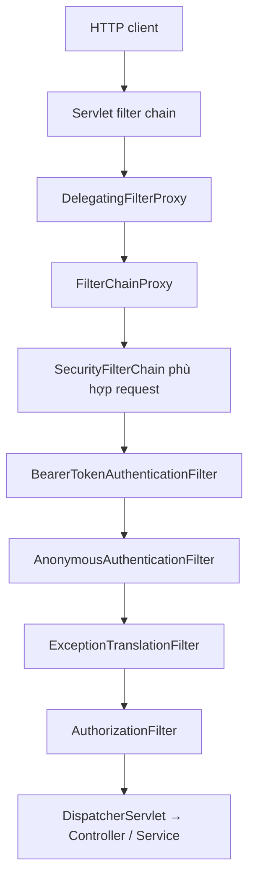
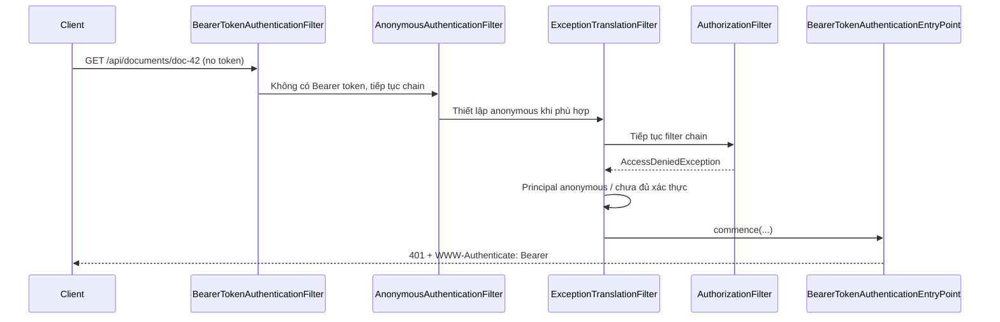
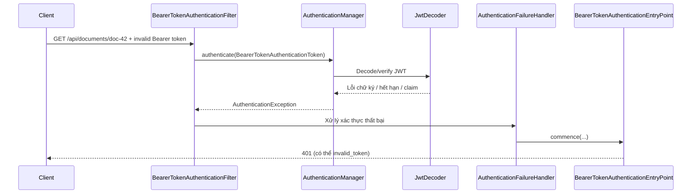
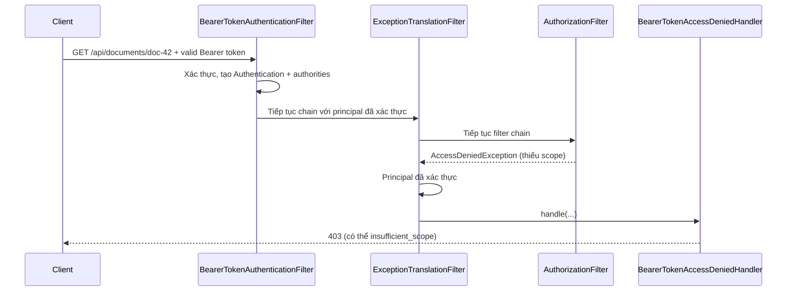
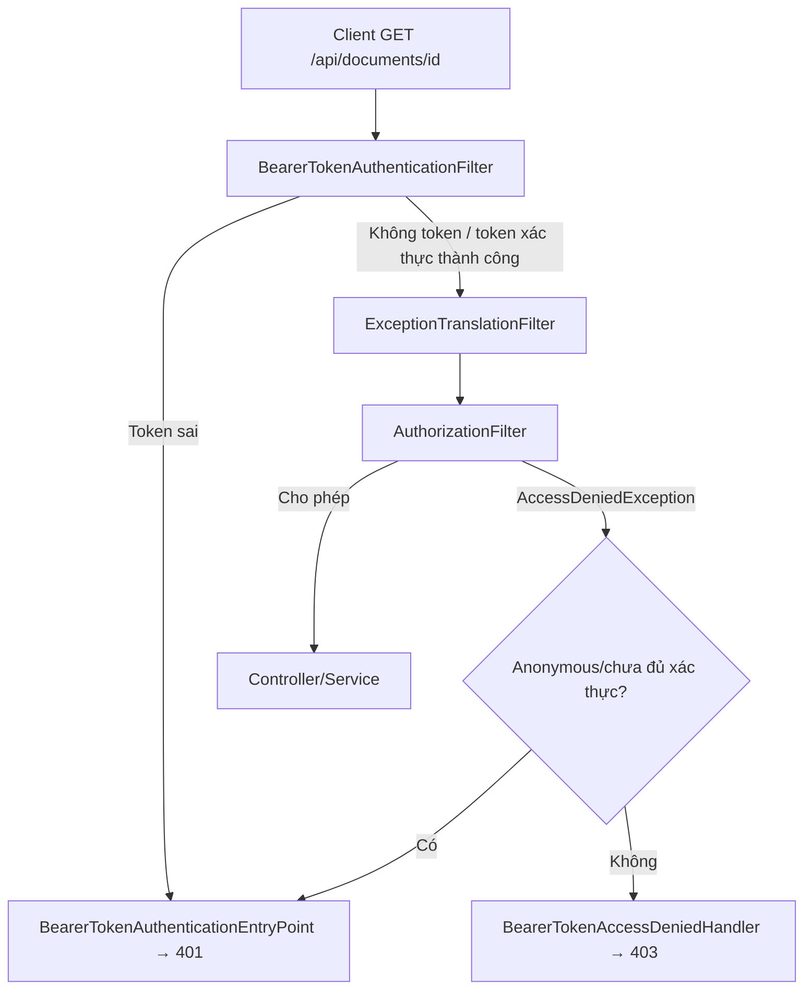

# ExceptionTranslationFilter, entry point và access denied handler

## 1. Bài toán: tại sao cùng một API có lúc trả 401, có lúc trả 403?

Giả sử một Spring Boot REST API được cấu hình làm **OAuth 2.0 Resource Server** với hai endpoint:

- `GET /api/public/ping`: công khai.
- `GET /api/documents/{id}`: yêu cầu access token hợp lệ và scope `documents.read`.

Ba Client có thể gọi cùng đường dẫn được bảo vệ:

```http
GET /api/documents/doc-42 HTTP/1.1
Host: api.example.com
Authorization: Bearer <access-token>
```

Nhưng kết quả khác nhau:

| Request | Trạng thái điển hình | Ý nghĩa |
|---|---|---|
| Không gửi Bearer token | `401 Unauthorized` | Chưa có thông tin xác thực được chấp nhận |
| Bearer token sai chữ ký/hết hạn | `401 Unauthorized` | Xác thực token thất bại |
| Token hợp lệ nhưng thiếu `documents.read` | `403 Forbidden` | Đã xác thực nhưng không đủ quyền |
| Token hợp lệ, có scope yêu cầu và đạt quyền nghiệp vụ | `200 OK` | Được xử lý |

Spring Security cung cấp các thành phần chịu trách nhiệm chuyển những tình huống này thành phản hồi HTTP:

- **`ExceptionTranslationFilter`:** nhận và xử lý các ngoại lệ bảo mật phát sinh ở các thành phần nằm phía sau nó trong filter chain.
- **`AuthenticationEntryPoint`:** bắt đầu quy trình xác thực khi request chưa có thông tin xác thực thích hợp hoặc xác thực không thành công; đối với Bearer API thường tạo `401` cùng header `WWW-Authenticate`.
- **`AccessDeniedHandler`:** xử lý trường hợp truy cập bị từ chối đối với chủ thể đã xác thực; thường tạo `403`.
- **`BearerTokenAuthenticationFilter`:** tiếp nhận Bearer token, thử xác thực và có cơ chế xử lý thất bại của riêng nó.

Điểm quan trọng: **`ExceptionTranslationFilter` không phải thành phần tự giải mã JWT, xác thực chữ ký hay cấp quyền đọc dữ liệu**. Nó biến những kết quả lỗi bảo mật phù hợp thành hành vi giao thức HTTP. Việc hiểu vị trí của nó giúp chẩn đoán vì sao API trả 401, 403 hoặc hành vi khác.

### Mục tiêu học tập

Sau bài này, bạn sẽ hiểu được:

1. Vị trí `ExceptionTranslationFilter` trong Spring Security Servlet filter chain.
2. Điểm khác nhau giữa `AuthenticationException` và `AccessDeniedException`.
3. Điều kiện Spring Security gọi entry point hoặc access denied handler.
4. Đặc điểm `BearerTokenAuthenticationEntryPoint` và `BearerTokenAccessDeniedHandler` trong OAuth 2.0 Resource Server.
5. Cách cấu hình, thử request bằng `curl` và đọc phản hồi 401/403.
6. Cách xử lý sai lầm phổ biến như redirect tới trang login trong REST API hoặc nuốt ngoại lệ bảo mật.

## 2. Bối cảnh Servlet: request đi qua những filter nào?

Trong ứng dụng Spring MVC dùng Servlet, một request từ Client sẽ đi qua **Servlet Filter Chain** trước khi tới `DispatcherServlet` và Controller.

Spring Security tích hợp với container Servlet thông qua một chuỗi thành phần khái quát:



Sơ đồ tập trung vào các filter quan trọng với bài này. Cấu hình thực tế còn có filter về security context, header, CORS, CSRF, logout và các thành phần khác; thứ tự chính xác phụ thuộc phiên bản/configuration. Đặc điểm cần chú ý là trong cấu hình Resource Server điển hình, **Bearer token filter nằm phía trước `ExceptionTranslationFilter`, còn `AuthorizationFilter` nằm phía sau nó**.

### 2.1. Các vai trò không nên nhầm lẫn

| Thành phần | Vai trò chính |
|---|---|
| `DelegatingFilterProxy` | Cầu nối từ Servlet container vào bean/filter của Spring |
| `FilterChainProxy` | Chọn và thực thi `SecurityFilterChain` áp dụng cho request |
| `BearerTokenAuthenticationFilter` | Tìm Bearer token; nhờ `AuthenticationManager` xác thực token |
| `JwtDecoder` | Giải mã và xác minh JWT theo khóa/validator được cấu hình |
| `SecurityContextHolder` | Cho phép các thành phần trong request truy cập `Authentication` hiện hành |
| `AnonymousAuthenticationFilter` | Tạo anonymous authentication khi chưa có principal phù hợp, nếu bật anonymous |
| `ExceptionTranslationFilter` | Chuyển `AuthenticationException`/`AccessDeniedException` từ phần downstream thành quy trình xử lý xác thực hoặc từ chối |
| `AuthorizationFilter` | Áp dụng các quy tắc `authorizeHttpRequests` bằng `AuthorizationManager` |
| `AuthenticationEntryPoint` | Tạo phản hồi/challenge khi cần xác thực |
| `AccessDeniedHandler` | Tạo phản hồi khi chủ thể đã xác thực không đủ quyền |

Spring Security có thể sử dụng `AuthorizationFilter` trong cấu hình hiện đại hoặc các thành phần authorization khác ở ứng dụng/phiên bản cũ. Dù chi tiết filter khác nhau, tư duy cơ bản vẫn là **xác thực danh tính trước, quyết định quyền sau, xử lý ngoại lệ theo ngữ cảnh**.

### 2.2. Vì sao vị trí filter ảnh hưởng việc bắt ngoại lệ?

Một Servlet filter thường hoạt động theo dạng:

```java
doFilter(request, response, chain) {
    // Xử lý trước các filter phía sau.
    chain.doFilter(request, response);
    // Xử lý sau khi filter phía sau hoàn tất.
}
```

Một filter có thể bắt ngoại lệ phát sinh khi nó gọi `chain.doFilter(...)`. Vì vậy, `ExceptionTranslationFilter` chỉ xử lý các ngoại lệ bảo mật **đi qua phạm vi gọi các filter phía sau nó**.

Nếu lỗi phát sinh **trước khi** `ExceptionTranslationFilter` được gọi, nó không thể tự quay ngược lại để bắt lỗi. Đây là điểm quan trọng khi phân tích token sai ngay ở `BearerTokenAuthenticationFilter`.

## 3. ExceptionTranslationFilter làm gì?

Về nguyên lý, `ExceptionTranslationFilter` là cầu nối giữa **ngoại lệ Java bên trong Spring Security** và **kết quả HTTP** mà Client nhìn thấy.

Nó quan tâm chủ yếu đến:

- `AuthenticationException`: lỗi xác thực, hoặc một thành phần thông báo cần xác thực.
- `AccessDeniedException`: chủ thể không được phép thực hiện hành động.

Ví dụ về logic quyết định, viết dưới dạng pseudocode dễ hiểu:

```text
try:
    continue downstream filter chain
catch security exception:
    if AuthenticationException:
        invoke AuthenticationEntryPoint
    else if AccessDeniedException:
        if current principal is anonymous
           or considered insufficiently authenticated:
            invoke AuthenticationEntryPoint
        else:
            invoke AccessDeniedHandler
    else:
        propagate error
```

Đây là mô hình ý tưởng, không phải mã nguồn nguyên văn của framework. Triển khai thật còn tương tác với `AuthenticationTrustResolver`, `RequestCache`, `SecurityContext` và những loại exception cụ thể.

### 3.1. Nếu bắt `AuthenticationException`

Khi phần downstream phát sinh `AuthenticationException` phù hợp, `ExceptionTranslationFilter` xử lý như một tình huống phải bắt đầu xác thực. Theo cơ chế mặc định của nó, nó có thể lưu request qua `RequestCache`, xóa ngữ cảnh xác thực liên quan và gọi:

```java
authenticationEntryPoint.commence(request, response, authenticationException);
```

Với ứng dụng đăng nhập bằng form, entry point có thể điều hướng tới trang login; còn với REST API dùng Bearer token, entry point thường phản hồi **401 kèm Bearer challenge**.

Lưu ý: Không phải mọi `AuthenticationException` trong toàn hệ thống đều đi qua `ExceptionTranslationFilter`. Một authentication filter nằm trước nó có thể tự bắt lỗi và gọi failure handler/entry point.

### 3.2. Nếu bắt `AccessDeniedException`

`AccessDeniedException` thường được tạo khi kiểm tra quyền không đạt. Lúc này, `ExceptionTranslationFilter` phải xem **tình trạng xác thực** của request:

- **Anonymous hoặc chưa đủ xác thực:** chuyển sang `AuthenticationEntryPoint` để Client biết cần xác thực, thường là 401 đối với Bearer API.
- **Đã xác thực theo chính sách:** gọi `AccessDeniedHandler`, thường là 403.

Chính vì vậy, **không phải cứ thấy `AccessDeniedException` là phải trả 403**. Ví dụ, một request không có token đi vào endpoint cần `SCOPE_documents.read` có thể bị `AuthorizationFilter` từ chối; vì principal là anonymous, `ExceptionTranslationFilter` sẽ chọn entry point và trả 401.

### 3.3. ExceptionTranslationFilter không kiểm tra JWT hoặc quyền nghiệp vụ

Nó không chịu trách nhiệm:

- Kiểm tra chữ ký RSA/ECDSA của JWT.
- Lấy JWKS từ Authorization Server.
- Xác minh `iss`, `aud`, `exp` hoặc `nbf`.
- Ánh xạ claim `scope` thành `SCOPE_...`.
- Quyết định một người dùng có sở hữu đơn hàng hoặc tài liệu cụ thể hay không.
- Tự phát hành token, xác thực bằng mật khẩu hoặc cung cấp trang đăng nhập.

Những nhiệm vụ đó thuộc `JwtDecoder`, authentication provider, authorization component hoặc tầng nghiệp vụ. `ExceptionTranslationFilter` chỉ quyết định **cách báo lỗi bảo mật cho Client** khi ngoại lệ đi đến nó.

## 4. Hai loại ngoại lệ chính: AuthenticationException và AccessDeniedException

### 4.1. AuthenticationException

`AuthenticationException` là lớp gốc cho các lỗi liên quan đến xác thực trong Spring Security.

Ví dụ theo ngữ cảnh:

- Một token bị từ chối vì sai chữ ký hoặc hết hạn.
- Một yêu cầu xác thực không có credential phù hợp.
- Một cơ chế xác thực không thể tạo principal hợp lệ.

Trong Resource Server, lỗi xử lý JWT có thể xuất hiện thông qua `JwtException`, `OAuth2AuthenticationException` hoặc được chuyển thành một `AuthenticationException` ở lớp xác thực. Tuy nhiên, đường đi cụ thể phụ thuộc filter/provider.

Mã HTTP thường gặp là **401 Unauthorized**. Tên `Unauthorized` của HTTP dễ gây nhầm lẫn; trong trường hợp này nó có nghĩa **request chưa được xác thực hợp lệ**.

### 4.2. AccessDeniedException

`AccessDeniedException` thể hiện việc một request **không được phép** theo chính sách đang áp dụng.

Ví dụ:

- Token hợp lệ nhưng thiếu authority `SCOPE_documents.read`.
- Method security như `@PreAuthorize` từ chối lời gọi.
- Người dùng đã xác thực cố truy cập bản ghi không được phép và Service phát sinh `AccessDeniedException`.
- Kiểm tra quyền khác trong Spring Security từ chối request.

Nếu principal đã xác thực, Spring Security thường dùng **403 Forbidden**. Nhưng khi request là anonymous hoặc chưa đủ xác thực, framework có thể chọn **401** bằng cách gọi entry point.

### 4.3. So sánh ngắn gọn

| Tiêu chí | AuthenticationException | AccessDeniedException |
|---|---|---|
| Bản chất | Thông tin xác thực không đáp ứng | Quyền truy cập không đáp ứng |
| Câu hỏi chính | “Request này có được xác thực không?” | “Chủ thể này có được phép làm việc đó không?” |
| Thành phần xử lý qua `ExceptionTranslationFilter` | `AuthenticationEntryPoint` | Entry point nếu anonymous/chưa đủ xác thực, ngược lại `AccessDeniedHandler` |
| Status phổ biến với Bearer API | `401` | `401` hoặc `403` tùy ngữ cảnh |
| Ví dụ | Không có token hợp lệ | Token hợp lệ thiếu scope |

**Quy tắc dễ nhớ:** Kiểm tra trạng thái xác thực trước rồi mới kết luận một `AccessDeniedException` nên tạo HTTP 401 hay 403.

## 5. AuthenticationEntryPoint: nơi bắt đầu xác thực/challenge

### 5.1. Giao diện AuthenticationEntryPoint

Spring Security định nghĩa interface:

```java
public interface AuthenticationEntryPoint {
    void commence(
        HttpServletRequest request,
        HttpServletResponse response,
        AuthenticationException authException
    ) throws IOException, ServletException;
}
```

Phương thức `commence(...)` có thể tạo HTTP response, thêm header hoặc chuyển hướng người dùng tùy loại ứng dụng.

Ví dụ:

- `LoginUrlAuthenticationEntryPoint`: chuyển trình duyệt sang trang đăng nhập trong ứng dụng form login.
- `HttpStatusEntryPoint`: trả một status HTTP được cấu hình.
- **`BearerTokenAuthenticationEntryPoint`**: phù hợp Resource Server dùng Bearer token; phản hồi theo quy tắc HTTP Bearer challenge.

### 5.2. BearerTokenAuthenticationEntryPoint mặc định xử lý gì?

Với OAuth 2.0 Resource Server, entry point tiêu biểu là `BearerTokenAuthenticationEntryPoint`. Khi request cần xác thực, nó thường trả:

```http
HTTP/1.1 401 Unauthorized
WWW-Authenticate: Bearer
```

`WWW-Authenticate` là một phần quan trọng của hợp đồng HTTP: nó cho Client biết cơ chế xác thực Bearer mà API yêu cầu.

Khi có token nhưng token không hợp lệ, phản hồi có thể có các thông tin lỗi theo RFC 6750:

```http
HTTP/1.1 401 Unauthorized
WWW-Authenticate: Bearer error="invalid_token"
```

Header trong thực tế có thể thêm `error_description`, `realm` hoặc trường khác tùy exception và cấu hình. Không nên dựa vào việc mọi lỗi 401 đều có chuỗi `invalid_token`; request **thiếu token** thường chỉ nhận challenge `Bearer` mà không kèm mã lỗi.

### 5.3. Entry point không phải màn hình đăng nhập

Trong API nhận JWT, entry point **không tự phát hành access token hoặc hiển thị trang login**. Client phải sử dụng luồng OAuth 2.0 phù hợp với Authorization Server, ví dụ Authorization Code + PKCE hoặc Client Credentials, để nhận access token rồi gọi lại API.

Một Resource Server API dành cho mobile, frontend hoặc giao tiếp dịch vụ thường không nên bất ngờ trả:

```http
HTTP/1.1 302 Found
Location: /login
```

trong khi Client mong đợi lỗi Bearer API. Nếu thấy redirect như vậy, có thể một cấu hình `formLogin` hoặc filter chain khác đang chọn entry point phù hợp với form login thay vì Bearer.

### 5.4. Entry point có được gọi cho mọi lỗi JWT không?

**Không nhất thiết thông qua `ExceptionTranslationFilter`.** Khi `BearerTokenAuthenticationFilter` tự thử xác thực token và thất bại, nó có cơ chế gọi `AuthenticationFailureHandler`; mặc định với Resource Server, failure handler có thể dùng `AuthenticationEntryPointFailureHandler` để gọi Bearer entry point.

Do đó, một response 401 do JWT sai **không chứng minh `ExceptionTranslationFilter` đã bắt ngoại lệ**. Đường xử lý lỗi thường kết thúc ngay ở token authentication filter, trước khi request đi tới phần authorization phía sau.

## 6. AccessDeniedHandler: xử lý chủ thể đã xác thực nhưng thiếu quyền

### 6.1. Giao diện AccessDeniedHandler

`AccessDeniedHandler` chịu trách nhiệm phản hồi khi quyền truy cập bị từ chối đối với principal đã xác thực:

```java
public interface AccessDeniedHandler {
    void handle(
        HttpServletRequest request,
        HttpServletResponse response,
        AccessDeniedException accessDeniedException
    ) throws IOException, ServletException;
}
```

Triển khai tổng quát như `AccessDeniedHandlerImpl` có thể gửi status 403 hoặc chuyển tiếp tới một error page theo cấu hình.

Với Resource Server, Spring Security cung cấp **`BearerTokenAccessDeniedHandler`**, thích hợp để tạo phản hồi Bearer.

### 6.2. BearerTokenAccessDeniedHandler và insufficient_scope

Ví dụ Client có access token hợp lệ:

```json
{
  "sub": "user-417",
  "scope": "documents.list"
}
```

nhưng endpoint yêu cầu `SCOPE_documents.read`. Bộ kiểm tra quyền từ chối yêu cầu và một handler phù hợp Bearer API có thể trả:

```http
HTTP/1.1 403 Forbidden
WWW-Authenticate: Bearer error="insufficient_scope"
```

Mã `insufficient_scope` báo rằng token chưa đáp ứng quyền truy cập cần thiết. Tùy trạng thái Authentication và cách handler được cấu hình, header có thể khác; **không nên coi `insufficient_scope` là nội dung bắt buộc của mọi 403**.

`BearerTokenAccessDeniedHandler` không xác minh lại chữ ký hoặc tự động bổ sung scope. Nó chỉ chuyển kết quả từ chối quyền thành phản hồi HTTP phù hợp.

### 6.3. Thiếu quyền nghiệp vụ cũng có thể trả 403

Giả sử JWT hợp lệ, có scope `documents.read`, nhưng `doc-42` thuộc tenant khác. Service kiểm tra dữ liệu và có thể từ chối:

```java
if (!document.getTenantId().equals(currentTenantId)) {
    throw new AccessDeniedException("Access denied");
}
```

Nếu ngoại lệ được truyền qua phần Spring Security filter chain mà `ExceptionTranslationFilter` có thể xử lý, handler thường tạo 403 đối với principal đã xác thực. Tuy nhiên, trong một số thiết kế cần tránh tiết lộ tài nguyên tồn tại, API có thể trả 404 theo chính sách phân quyền ở tầng nghiệp vụ.

Đừng dùng response `403` làm bằng chứng rằng logic tenant/ownership đã chạy; cần xem chính sách thực tế đã kiểm tra điều gì.

## 7. Ba đường xử lý quan trọng trong Resource Server

### 7.1. Đường A: không có Bearer token



Diễn giải:

1. Authentication filter không tìm thấy token nên để request đi tiếp.
2. Anonymous authentication có thể được đặt trong context.
3. `AuthorizationFilter` áp dụng rule yêu cầu scope và từ chối.
4. `ExceptionTranslationFilter` xác định request chưa có chủ thể được xác thực thích hợp.
5. Entry point trả 401.

Đây là ví dụ **`AccessDeniedException` dẫn tới 401** vì người gọi chưa được xác thực.

### 7.2. Đường B: Bearer token không hợp lệ



Đây là điểm thường bị hiểu nhầm: lỗi JWT phát sinh trong `BearerTokenAuthenticationFilter` nằm **trước** `ExceptionTranslationFilter` ở chuỗi điển hình. Filter xác thực Bearer xử lý thất bại ngay tại đó, thường qua failure handler/entry point.

Vì vậy, nếu đặt breakpoint trong `ExceptionTranslationFilter` nhưng không thấy nó bắt một JWT invalid, chưa hẳn có lỗi cấu hình.

### 7.3. Đường C: token hợp lệ nhưng thiếu scope



`Authentication` đã hợp lệ nhưng không chứa authority mà endpoint yêu cầu. Đây là tình huống chủ yếu của `AccessDeniedHandler`.

### 7.4. Bảng quyết định tổng hợp

| Điều kiện | Thành phần thường phát hiện | Hành động xử lý | Status |
|---|---|---|---|
| Không token, endpoint `permitAll` | `AuthorizationFilter` cho phép | Controller xử lý | `2xx` thích hợp |
| Không token, endpoint bắt buộc xác thực | `AuthorizationFilter` từ chối | `ExceptionTranslationFilter` → entry point | `401` |
| Bearer token sai định dạng/chữ ký/hết hạn | Bearer authentication filter/provider/decoder | Failure handler → entry point | `401` |
| Token hợp lệ, thiếu scope | `AuthorizationFilter` hoặc method security | `ExceptionTranslationFilter` → access denied handler | `403` |
| Token hợp lệ, đủ scope | `AuthorizationFilter` cho phép | Controller/Service xử lý | `2xx` hoặc kết quả nghiệp vụ |
| Token đủ scope nhưng thất bại kiểm tra quyền trên bản ghi | Tầng authorization/nghiệp vụ | Handler hoặc xử lý lỗi nghiệp vụ theo chính sách | `403` hoặc `404` |

Một request đến endpoint public **vẫn có thể nhận 401 nếu Client chủ động gửi Bearer token hỏng** và token authentication filter thử xử lý nó trước khi đến rule `permitAll`.

## 8. Cấu hình Spring Security Resource Server để thấy hành vi mặc định

### 8.1. Thêm dependency

Ví dụ ứng dụng Spring Boot dùng Gradle:

```groovy
dependencies {
    implementation 'org.springframework.boot:spring-boot-starter-web'
    implementation 'org.springframework.boot:spring-boot-starter-security'
    implementation 'org.springframework.boot:spring-boot-starter-oauth2-resource-server'
}
```

### 8.2. Cấu hình issuer

Trong `application.yml`:

```yaml
server:
  port: 8080

spring:
  security:
    oauth2:
      resourceserver:
        jwt:
          issuer-uri: https://id.example.com/realms/shop
```

Địa chỉ issuer trên là ví dụ và phải được thay bằng issuer của Authorization Server thật. Một JWT access token được chấp nhận cần có chữ ký hợp lệ, issuer đúng, chưa hết hạn và thỏa các validator khác mà Resource Server cấu hình.

Nếu API có audience riêng, ví dụ `documents-api`, cần **bổ sung audience validator** hoặc cấu hình audience theo khả năng phiên bản Spring Security/Spring Boot; issuer hợp lệ không tự chứng minh token dành cho API này.

### 8.3. SecurityFilterChain tối thiểu

Ví dụ cho một REST API chỉ nhận Bearer JWT:

```java
package com.example.documents;

import org.springframework.context.annotation.Bean;
import org.springframework.context.annotation.Configuration;
import org.springframework.http.HttpMethod;
import org.springframework.security.config.Customizer;
import org.springframework.security.config.annotation.web.builders.HttpSecurity;
import org.springframework.security.config.http.SessionCreationPolicy;
import org.springframework.security.web.SecurityFilterChain;

@Configuration
public class SecurityConfig {

    @Bean
    SecurityFilterChain apiSecurity(HttpSecurity http) throws Exception {
        return http
            .csrf(csrf -> csrf.disable())
            .sessionManagement(session -> session
                .sessionCreationPolicy(SessionCreationPolicy.STATELESS))
            .authorizeHttpRequests(auth -> auth
                .requestMatchers("/api/public/**").permitAll()
                .requestMatchers(HttpMethod.GET, "/api/documents/**")
                    .hasAuthority("SCOPE_documents.read")
                .requestMatchers(HttpMethod.POST, "/api/documents/**")
                    .hasAuthority("SCOPE_documents.write")
                .anyRequest().denyAll()
            )
            .oauth2ResourceServer(oauth2 ->
                oauth2.jwt(Customizer.withDefaults()))
            .build();
    }
}
```

Trong cấu hình này:

- `permitAll()` cho phép request public không có token.
- `hasAuthority("SCOPE_documents.read")` đòi authority khi đọc tài liệu.
- `anyRequest().denyAll()` từ chối các endpoint/method chưa được khai báo.
- `oauth2ResourceServer(...jwt(...))` bật quá trình xác thực JWT Bearer và các thành phần xử lý lỗi Bearer phù hợp.
- `STATELESS` không dựa vào HTTP session để duy trì đăng nhập.

Cấu hình `csrf.disable()` chỉ phù hợp với giả định API thuần Bearer token được gửi chủ động qua header, không dựa trên cookie để xác thực. Nếu API dùng cookie/session, cần bảo vệ CSRF theo kiến trúc thực tế.

Các cấu hình mặc định của Resource Server thường thiết lập `BearerTokenAuthenticationEntryPoint` và `BearerTokenAccessDeniedHandler` cho trường hợp phù hợp. Với nhiều cơ chế xác thực hay nhiều `SecurityFilterChain`, hành vi còn phụ thuộc chain nào thực sự được chọn và entry point/handler được cấu hình ở đó.

### 8.4. Controller minh họa

```java
package com.example.documents;

import java.util.Map;
import org.springframework.security.core.annotation.AuthenticationPrincipal;
import org.springframework.security.oauth2.jwt.Jwt;
import org.springframework.web.bind.annotation.GetMapping;
import org.springframework.web.bind.annotation.PathVariable;
import org.springframework.web.bind.annotation.RestController;

@RestController
public class DocumentController {

    @GetMapping("/api/public/ping")
    public Map<String, String> ping() {
        return Map.of("status", "ok");
    }

    @GetMapping("/api/documents/{id}")
    public Map<String, String> read(
            @PathVariable String id,
            @AuthenticationPrincipal Jwt jwt) {

        return Map.of(
            "documentId", id,
            "subject", jwt.getSubject()
        );
    }
}
```

Đây là ví dụ quan sát luồng xác thực/phân quyền endpoint; nó **không triển khai kiểm tra sở hữu tài liệu**. Với API thật, phải truy vấn tài liệu theo tenant/owner hoặc gọi service thực thi object-level authorization. Nếu thiếu bước đó, có `SCOPE_documents.read` vẫn có thể đọc dữ liệu không thuộc quyền.

### 8.5. Sơ đồ phối hợp của các handler



Sơ đồ biểu diễn các trường hợp phổ biến với cấu hình mặc định. Kết quả của từng request còn chịu ảnh hưởng bởi method security, quyền nghiệp vụ và các exception handler khác được ứng dụng khai báo.

## 9. Tùy chỉnh entry point và access denied handler

### 9.1. Khi nào cần tùy chỉnh?

Thông thường, Resource Server có thể dùng handler mặc định. Chỉ tùy chỉnh khi cần một hợp đồng phản hồi cụ thể, ví dụ:

- Cấu hình tên `realm` cho Bearer challenge.
- Chuẩn hóa JSON error body hoặc correlation ID.
- Ghi log/audit có kiểm soát.
- Chuyển những trường hợp khác nhau thành mã lỗi nghiệp vụ ổn định mà Client hiểu.

Dù tùy chỉnh, API vẫn phải giữ nguyên nguyên tắc:

- Chưa xác thực/token không hợp lệ → **401**.
- Đã xác thực nhưng thiếu quyền → **403**.
- Bearer API nên cung cấp header `WWW-Authenticate` phù hợp.

Không nên thay mọi lỗi bằng `200 OK` kèm `"success":false` hoặc biến lỗi access token thành redirect tới trang login, vì sẽ làm Client hiểu sai giao thức.

### 9.2. Cấu hình rõ ràng hai handler Bearer

Ví dụ dưới đây cấu hình `realm` và đăng ký các handler cùng lúc ở `exceptionHandling` và `oauth2ResourceServer`. Mục đích là cùng một chính sách phản hồi cho ngoại lệ downstream và lỗi xảy ra ngay khi Bearer filter xác thực token:

```java
package com.example.documents;

import org.springframework.context.annotation.Bean;
import org.springframework.context.annotation.Configuration;
import org.springframework.http.HttpMethod;
import org.springframework.security.config.Customizer;
import org.springframework.security.config.annotation.web.builders.HttpSecurity;
import org.springframework.security.config.http.SessionCreationPolicy;
import org.springframework.security.oauth2.server.resource.web.BearerTokenAuthenticationEntryPoint;
import org.springframework.security.oauth2.server.resource.web.access.BearerTokenAccessDeniedHandler;
import org.springframework.security.web.SecurityFilterChain;

@Configuration
public class SecurityConfig {

    @Bean
    SecurityFilterChain apiSecurity(HttpSecurity http) throws Exception {
        BearerTokenAuthenticationEntryPoint entryPoint =
            new BearerTokenAuthenticationEntryPoint();
        entryPoint.setRealmName("documents-api");

        BearerTokenAccessDeniedHandler deniedHandler =
            new BearerTokenAccessDeniedHandler();
        deniedHandler.setRealmName("documents-api");

        return http
            .csrf(csrf -> csrf.disable())
            .sessionManagement(s -> s
                .sessionCreationPolicy(SessionCreationPolicy.STATELESS))
            .authorizeHttpRequests(auth -> auth
                .requestMatchers("/api/public/**").permitAll()
                .requestMatchers(HttpMethod.GET, "/api/documents/**")
                    .hasAuthority("SCOPE_documents.read")
                .anyRequest().denyAll()
            )
            .exceptionHandling(ex -> ex
                .authenticationEntryPoint(entryPoint)
                .accessDeniedHandler(deniedHandler)
            )
            .oauth2ResourceServer(oauth2 -> oauth2
                .authenticationEntryPoint(entryPoint)
                .accessDeniedHandler(deniedHandler)
                .jwt(Customizer.withDefaults())
            )
            .build();
    }
}
```

Ví dụ này là **phương án thay thế** cho `SecurityConfig` ở mục 8.3, không khai báo đồng thời hai bean `SecurityFilterChain` giống hệt nhau trong cùng project.

Giải thích các điểm cấu hình:

- `exceptionHandling().authenticationEntryPoint(...)` cho biết cách xử lý những tình huống cần xác thực được chuyển đến bởi `ExceptionTranslationFilter`.
- `exceptionHandling().accessDeniedHandler(...)` cho biết cách xử lý `AccessDeniedException` của chủ thể đã xác thực ở downstream.
- `oauth2ResourceServer().authenticationEntryPoint(...)` cho cơ chế Bearer authentication sử dụng entry point tương ứng khi xác thực token thất bại.
- `oauth2ResourceServer().accessDeniedHandler(...)` thiết lập handler từ chối phù hợp với Resource Server.
- `setRealmName("documents-api")` bổ sung realm cho Bearer challenge do handler tạo, khi áp dụng.

Việc cấu hình cả hai vị trí không phải lúc nào cũng cần thiết khi đã dùng mặc định, nhưng hữu ích để hiểu **hai đường phát sinh lỗi khác nhau**.

### 9.3. Ví dụ response có realm

Không có token:

```http
HTTP/1.1 401 Unauthorized
WWW-Authenticate: Bearer realm="documents-api"
```

Token hợp lệ nhưng thiếu scope:

```http
HTTP/1.1 403 Forbidden
WWW-Authenticate: Bearer realm="documents-api", error="insufficient_scope"
```

Đây là các response minh họa. Phần header thực tế còn phụ thuộc exception, Authentication hiện tại và framework. Đừng xây dựng Client dựa trên việc `error_description` luôn có mặt hoặc luôn giống một chuỗi cố định.

### 9.4. Nếu muốn trả JSON lỗi

Một số REST API muốn body như:

```json
{
  "code": "INSUFFICIENT_SCOPE",
  "message": "Access denied"
}
```

Có thể viết `AuthenticationEntryPoint` và `AccessDeniedHandler` tùy biến để bổ sung body, nhưng cần:

1. Chọn status đúng theo bản chất lỗi.
2. Giữ header `WWW-Authenticate` hợp lệ cho Bearer API khi thích hợp.
3. Sử dụng thông báo không tiết lộ thông tin nội bộ, khóa, token hoặc chi tiết xác thực nhạy cảm.
4. Không ghi response hai lần nếu một handler khác đã commit response.
5. Kiểm tra tương thích với `SecurityFilterChain` và cách các exception được đưa đến handler.

Một cách tiếp cận là bọc (`delegate`) `BearerTokenAuthenticationEntryPoint` và `BearerTokenAccessDeniedHandler` chuẩn để giữ challenge/status, sau đó chỉ bổ sung body khi response còn ghi được. Tránh tự thay toàn bộ logic Bearer chỉ để định dạng JSON.

## 10. Thử các đường xử lý bằng curl

Giả sử ứng dụng chạy tại `http://localhost:8080` và issuer được cấu hình thật. Các token bên dưới là placeholder.

### 10.1. Yêu cầu public không có token

```bash
curl -i http://localhost:8080/api/public/ping
```

Kết quả điển hình:

```http
HTTP/1.1 200 OK
Content-Type: application/json

{"status":"ok"}
```

Điều này cho thấy endpoint public có thể hoạt động khi không có thông tin xác thực. Không suy ra từ đây rằng endpoint private đã được bảo vệ.

### 10.2. Yêu cầu private không có token

```bash
curl -i http://localhost:8080/api/documents/doc-42
```

Kết quả điển hình:

```http
HTTP/1.1 401 Unauthorized
WWW-Authenticate: Bearer
```

Diễn giải: `AuthorizationFilter` thấy chưa có quyền; `ExceptionTranslationFilter` xác định anonymous và gọi entry point.

### 10.3. Yêu cầu private với token sai

```bash
curl -i \
  -H 'Authorization: Bearer invalid.jwt.token' \
  http://localhost:8080/api/documents/doc-42
```

Kết quả điển hình:

```http
HTTP/1.1 401 Unauthorized
WWW-Authenticate: Bearer error="invalid_token"
```

Diễn giải: `BearerTokenAuthenticationFilter` thử xác thực nhưng không chấp nhận token. Lỗi được xử lý theo cơ chế authentication failure của filter rồi gọi Bearer entry point; không nhất thiết đi qua `ExceptionTranslationFilter`.

### 10.4. Yêu cầu private với token hợp lệ nhưng thiếu scope

Giả sử Authorization Server cấp một token thật có `scope=documents.list`, chưa hết hạn, issuer và audience đúng. Client gọi:

```bash
curl -i \
  -H "Authorization: Bearer $ACCESS_TOKEN_WITHOUT_READ_SCOPE" \
  http://localhost:8080/api/documents/doc-42
```

Kết quả thường là:

```http
HTTP/1.1 403 Forbidden
WWW-Authenticate: Bearer error="insufficient_scope"
```

Diễn giải: token được xác thực, nhưng `SCOPE_documents.read` không có trong `Authentication` nên `AuthorizationFilter` từ chối; `ExceptionTranslationFilter` gọi access denied handler.

**Không tự sửa claim `scope` trong JWT để tạo token thiếu quyền**: sửa payload sẽ phá chữ ký, dẫn đến `401` thay vì kiểm chứng đúng nhánh `403`. Hãy yêu cầu issuer cấp token với scope phù hợp hoặc dùng cơ chế giả lập Authentication trong kiểm thử.

### 10.5. Yêu cầu private với token hợp lệ và đủ scope

```bash
curl -i \
  -H "Authorization: Bearer $ACCESS_TOKEN_WITH_READ_SCOPE" \
  http://localhost:8080/api/documents/doc-42
```

Nếu JWT hợp lệ và có `documents.read`, Controller minh họa có thể trả:

```http
HTTP/1.1 200 OK
Content-Type: application/json

{"documentId":"doc-42","subject":"user-417"}
```

`subject` ở response chỉ là giá trị ví dụ; token thật có thể có chủ thể khác. Đối với hệ thống thật, quyền đọc bản ghi `doc-42` phải được Service kiểm tra thêm.

### 10.6. Tự tổng hợp kết quả

| Thử nghiệm | Token | Endpoint | Dự kiến |
|---|---|---|---|
| Public | Không có | `/api/public/ping` | 200 |
| Protected thiếu token | Không có | `/api/documents/doc-42` | 401 |
| Protected token sai | Sai/expired | `/api/documents/doc-42` | 401 |
| Protected thiếu scope | Hợp lệ, không có `documents.read` | `/api/documents/doc-42` | 403 |
| Protected đủ scope | Hợp lệ, có `documents.read` | `/api/documents/doc-42` | 200 nếu các điều kiện khác đạt |

Các phản hồi trên chỉ xuất hiện đúng như mong đợi nếu API đã chạy, issuer/keys cấu hình chính xác và Request đi qua filter chain dự định. Không dùng token thật qua HTTP ngoài môi trường localhost; khi gọi qua mạng phải dùng HTTPS.

## 11. Kiểm thử SecurityFilterChain bằng Spring Security Test

### 11.1. Vì sao cần hai loại kiểm thử?

Để phân biệt lỗi, thường cần:

- **Kiểm thử phân quyền:** dùng `MockMvc` và `spring-security-test` để giả lập principal/authorities, xác nhận rule 200/401/403.
- **Kiểm thử xác thực token thực:** dùng JWT do issuer phù hợp ký, hoặc test setup với bộ khóa xác minh, để kiểm tra signature/issuer/audience/thời hạn.

Một request có `with(jwt())` trong Spring Security Test tạo Authentication phục vụ kiểm thử, **không đồng nghĩa đã xác minh chữ ký JWT thật bằng `JwtDecoder`**.

### 11.2. Dependency test

```groovy
dependencies {
    testImplementation 'org.springframework.boot:spring-boot-starter-test'
    testImplementation 'org.springframework.security:spring-security-test'
}
```

### 11.3. MockMvc minh họa các nhánh

```java
package com.example.documents;

import org.junit.jupiter.api.Test;
import org.springframework.beans.factory.annotation.Autowired;
import org.springframework.boot.test.autoconfigure.web.servlet.AutoConfigureMockMvc;
import org.springframework.boot.test.context.SpringBootTest;
import org.springframework.security.core.authority.SimpleGrantedAuthority;
import org.springframework.test.web.servlet.MockMvc;

import static org.springframework.security.test.web.servlet.request
    .SecurityMockMvcRequestPostProcessors.jwt;
import static org.springframework.test.web.servlet.request
    .MockMvcRequestBuilders.get;
import static org.springframework.test.web.servlet.result
    .MockMvcResultMatchers.*;

@SpringBootTest
@AutoConfigureMockMvc
class ResourceAccessTest {

    @Autowired
    MockMvc mvc;

    @Test
    void publicEndpointAllowsAnonymous() throws Exception {
        mvc.perform(get("/api/public/ping"))
            .andExpect(status().isOk());
    }

    @Test
    void protectedEndpointWithoutTokenReturns401() throws Exception {
        mvc.perform(get("/api/documents/doc-42"))
            .andExpect(status().isUnauthorized());
    }

    @Test
    void protectedEndpointWithoutScopeReturns403() throws Exception {
        mvc.perform(get("/api/documents/doc-42")
                .with(jwt()
                    .jwt(token -> token.subject("user-417"))
                    .authorities(new SimpleGrantedAuthority(
                        "SCOPE_documents.list"))))
            .andExpect(status().isForbidden());
    }

    @Test
    void protectedEndpointWithScopeReturns200() throws Exception {
        mvc.perform(get("/api/documents/doc-42")
                .with(jwt()
                    .jwt(token -> token.subject("user-417"))
                    .authorities(new SimpleGrantedAuthority(
                        "SCOPE_documents.read"))))
            .andExpect(status().isOk())
            .andExpect(jsonPath("$.documentId").value("doc-42"));
    }
}
```

Đây là ví dụ minh họa với Spring Boot/Spring Security hỗ trợ các annotation/import tương ứng. Test context còn phải có cấu hình `JwtDecoder`/issuer phù hợp. Nếu issuer minh họa không tồn tại hoặc context yêu cầu giải mã JWT khi khởi tạo, có thể sử dụng một `JwtDecoder` test bean/mock theo cơ chế của phiên bản framework đang dùng.

Bốn test chỉ xác nhận điều kiện endpoint, **không thực sự ký hoặc kiểm tra JWT**. Để xác nhận token invalid đi qua `BearerTokenAuthenticationFilter`, cần một test thiết lập `JwtDecoder` từ chối token hoặc kiểm thử HTTP tích hợp với issuer/khóa thật.

### 11.4. Điều cần quan sát ở từng test

Nếu `publicEndpointAllowsAnonymous` trả 401, kiểm tra matcher public và có header Bearer sai được gửi ngầm không.

Nếu `protectedEndpointWithoutTokenReturns401` trả 403, kiểm tra cấu hình anonymous authentication, entry point và handler; `ExceptionTranslationFilter` có thể đang xử lý tình huống không như mong đợi.

Nếu `protectedEndpointWithoutScopeReturns403` trả 200, kiểm tra authority mà rule yêu cầu, phương thức HTTP, path matcher và `SecurityFilterChain` được chọn.

Nếu `protectedEndpointWithScopeReturns200` trả 403, kiểm tra `SCOPE_` prefix, mapping scope và những rule/annotation method security khác.

## 12. ExceptionTranslationFilter và xử lý ngoại lệ tại Controller

Spring MVC có cơ chế `@ExceptionHandler`, `@ControllerAdvice` hoặc `HandlerExceptionResolver` để chuyển exception thành HTTP response. Cơ chế này **khác** với `ExceptionTranslationFilter` của Spring Security.

Ví dụ Service có thể kiểm tra nghiệp vụ:

```java
Document document = documentRepository.findById(id)
    .orElseThrow(DocumentNotFoundException::new);

if (!permissionService.canRead(authentication, document)) {
    throw new AccessDeniedException("Not allowed");
}
```

Nếu exception đi qua đường Spring Security xử lý bảo mật, `AccessDeniedException` có thể được `ExceptionTranslationFilter` xử lý khi truyền ngược qua filter chain. Nhưng nếu một `@ControllerAdvice` hoặc resolver của Spring MVC **bắt exception và chuyển thành response trước**, ngoại lệ sẽ không còn truyền ra ngoài để filter đó nhận.

Vì vậy, tránh tạo `@ExceptionHandler(Exception.class)` tổng quát rồi vô tình biến mọi lỗi bảo mật thành `500`, `200` hoặc JSON lỗi thiếu status/`WWW-Authenticate`. Cần thiết kế ranh giới giữa Security exception và domain exception một cách rõ ràng.

### 12.1. Vì sao không nên dùng try/catch trong mọi Controller?

Cách làm không phù hợp:

```java
try {
    return documentService.getDocument(id);
} catch (Exception ignored) {
    return Map.of("status", "ok");
}
```

Cách này nuốt cả lỗi phân quyền và các lỗi nghiêm trọng khác, làm mất thông tin bảo mật và có thể phản hồi thành công giả.

Hãy để Spring Security xử lý authentication/authorization exception đúng cơ chế; với domain error như không tìm thấy bản ghi, dùng error handling của ứng dụng với HTTP status thích hợp.

### 12.2. Method security và ngoại lệ quyền

Nếu bật method security và viết:

```java
@PreAuthorize("hasAuthority('SCOPE_documents.write')")
public void updateDocument(...) {
    // ...
}
```

Spring có thể từ chối bằng `AccessDeniedException` khi quyền không đủ. Kết quả HTTP phụ thuộc vị trí exception phát sinh và việc nó có bị MVC exception resolver xử lý hay không. Trong luồng Servlet Security điển hình, ngoại lệ bảo mật không bị xử lý trước sẽ truyền ra filter chain và được `ExceptionTranslationFilter` chuyển sang entry point hoặc handler phù hợp.

`@PreAuthorize` không tự kiểm tra tenant/ownership của bản ghi nếu expression và Service không khai báo điều đó.

## 13. RequestCache, SecurityContext và khác biệt với form login

### 13.1. RequestCache

`ExceptionTranslationFilter` có khả năng lưu request qua `RequestCache` trước khi gọi entry point để một cơ chế đăng nhập tương tác có thể xử lý request sau khi người dùng đăng nhập.

Ví dụ với form login truyền thống:

```text
GET /admin/reports (chưa login)
    → lưu request
    → redirect /login
    → user login
    → có thể quay lại request đã lưu
```

Với OAuth 2.0 Resource Server API dùng Bearer token, thông thường Client chỉ cần nhận `401` rồi lấy token hợp lệ và **gửi lại request có Authorization header**. Không nên dựa vào saved request trong HTTP session của một API stateless.

Nếu cần thiết, có thể cấu hình `NullRequestCache` cho kiến trúc API stateless theo yêu cầu cụ thể; không có nghĩa `ExceptionTranslationFilter` bị loại khỏi filter chain.

### 13.2. SecurityContext

Khi token hợp lệ, authentication filter thiết lập `Authentication` thích hợp cho request. `AuthorizationFilter` và thành phần nghiệp vụ có thể đọc từ security context để kiểm tra quyền.

Khi bắt đầu lại việc xác thực, Spring Security cần tránh sử dụng một authentication cũ không đáng tin. `ExceptionTranslationFilter` có bước xử lý ngữ cảnh liên quan khi khởi động authentication.

Không nên lấy `SecurityContextHolder.getContext().getAuthentication() != null` làm điều kiện duy nhất để kết luận đã đăng nhập, vì một `AnonymousAuthenticationToken` vẫn có thể nằm trong context. Hãy dùng cơ chế `AuthenticationTrustResolver`/authorization manager hoặc annotation phù hợp để phân biệt anonymous với principal đã xác thực.

### 13.3. Form login và Resource Server khác nhau về entry point

| Kiểu ứng dụng | Request chưa xác thực | Entry point điển hình |
|---|---|---|
| Web MVC dùng form login | Điều hướng người dùng đến trang đăng nhập | `LoginUrlAuthenticationEntryPoint` |
| HTTP Basic API | Yêu cầu Client dùng Basic credentials | `BasicAuthenticationEntryPoint` |
| OAuth 2.0 Bearer Resource Server | Yêu cầu Bearer access token | `BearerTokenAuthenticationEntryPoint` |

Khi một ứng dụng đồng thời bật form login, HTTP Basic và Bearer, kết quả có thể phụ thuộc request matcher, content negotiation, thứ tự filter chain và cách entry point được chọn. Không kết luận “Spring Security mặc định luôn trả 401 cho mọi request” nếu dự án đang dùng nhiều authentication mechanisms.

## 14. Những lỗi thường gặp khi cấu hình

### 14.1. Bất ngờ trả 302 về /login

**Nguyên nhân khả dĩ:** `formLogin` hoặc chain dành cho trình duyệt đang xử lý API.

**Cách xử lý:** Xem `SecurityFilterChain` nào khớp request, entry point nào được đăng ký và liệu API Bearer có được chọn đúng không. Với endpoint REST, dùng Bearer entry point để phản hồi 401 thay vì redirect không mong đợi.

### 14.2. Token giả không đi qua ExceptionTranslationFilter

**Nguyên nhân thường gặp:** `BearerTokenAuthenticationFilter` xác thực Bearer trước `ExceptionTranslationFilter` và trực tiếp sử dụng failure handler.

**Cách xử lý:** Theo dõi authentication filter/provider/`JwtDecoder` và failure handler; không ép mọi lỗi JWT qua `ExceptionTranslationFilter` chỉ vì tên của nó.

### 14.3. Thiếu token lại trả 403

**Nguyên nhân khả dĩ:** Cấu hình exception handling khác mặc định, anonymous authentication bị tùy biến, nhiều filter chain hoặc request đi vào nhánh authorization không có Bearer entry point phù hợp.

**Cách xử lý:** Kiểm tra anonymous/`AuthenticationTrustResolver`, entry point, rule bảo vệ endpoint và chain được chọn. Trong API Bearer mặc định, protected endpoint thiếu token thường trả 401.

### 14.4. Token đủ scope vẫn trả 403

**Nguyên nhân khả dĩ:** Scope không được map thành authority đúng (ví dụ thiếu tiền tố `SCOPE_`), HTTP method/path không khớp rule, method security khác đang từ chối hoặc quyền nghiệp vụ/tenant chưa đáp ứng.

**Cách xử lý:** Xem danh sách authorities đã tạo từ token, rule tương ứng và các kiểm tra tầng Service. Không mở `permitAll()` chỉ để che lỗi.

### 14.5. Token sai trả 500

**Nguyên nhân khả dĩ:** Lỗi không được chuyển thành authentication failure phù hợp, cấu hình `JwtDecoder` sai, exception handler tổng quát nuốt ngoại lệ hoặc lỗi nội bộ khác.

**Cách xử lý:** Phân biệt lỗi **token không hợp lệ** với **sự cố hệ thống** như cấu hình JWKS, mạng hoặc code. Kiểm tra log không chứa token thật và nguyên nhân exception; không đổi mọi lỗi thành 401 một cách máy móc.

### 14.6. 403 trả JSON nhưng thiếu Bearer challenge

**Nguyên nhân khả dĩ:** Một `AccessDeniedHandler` tùy chỉnh chỉ ghi JSON và quên xử lý `WWW-Authenticate`.

**Cách xử lý:** Cân nhắc delegate cho `BearerTokenAccessDeniedHandler` chuẩn hoặc bảo đảm handler tuân thủ giao thức Bearer. Client có thể cần `insufficient_scope` để hiểu vì sao token bị từ chối.

### 14.7. Tất cả request đều được phép

**Nguyên nhân khả dĩ:** `permitAll` áp dụng quá rộng, filter chain không được gắn với request, hoặc cấu hình authorization không có rule yêu cầu quyền.

**Cách xử lý:** Dùng matcher rõ ràng, kiểm tra thứ tự, và rule mặc định `denyAll()` hoặc chính sách xác thực chặt cho những endpoint chưa được khai báo.

### 14.8. API public có Bearer token sai vẫn trả 401

Đây có thể là **hành vi đúng**. `permitAll` cho phép request không cần token, nhưng không bắt buộc framework bỏ qua token hỏng mà Client gửi. Bearer authentication filter có thể thử xử lý token và từ chối trước khi tới rule authorization.

Để xác nhận public endpoint, thử request thật sự không có header `Authorization`.

## 15. Chẩn đoán theo HTTP status và vị trí lỗi

| Triệu chứng | Kiểm tra đầu tiên | Thành phần liên quan |
|---|---|---|
| 401, không gửi token | Endpoint yêu cầu Authentication đúng chưa? | `AuthorizationFilter` → `ExceptionTranslationFilter` → entry point |
| 401, token không hợp lệ | JWT có đúng issuer/chữ ký/thời hạn/audience? | `BearerTokenAuthenticationFilter`, `JwtDecoder`, failure handler |
| 403, token hợp lệ | Scope có được map đúng không? | `AuthorizationFilter`, `ExceptionTranslationFilter`, access denied handler |
| 403, đủ scope nhưng sai chủ sở hữu | Service có kiểm tra ownership/tenant không? | Method security và domain authorization |
| 302 redirect | API đang dùng entry point nào? | `SecurityFilterChain`, form login entry point |
| Response không có `WWW-Authenticate` | Có handler custom thay handler Bearer không? | `AuthenticationEntryPoint`, `AccessDeniedHandler` |
| Handler không được gọi | Có MVC resolver bắt exception trước không? | `@ControllerAdvice` / `HandlerExceptionResolver` |
| Public request có token hỏng trả 401 | Bearer token có bị filter xác thực không? | `BearerTokenAuthenticationFilter` |

Khi điều tra, nên bật log Spring Security ở mức thích hợp **trong môi trường phát triển**, ví dụ:

```yaml
logging:
  level:
    org.springframework.security: DEBUG
```

Không bật mức log chi tiết lâu dài trong production nếu gây lộ thông tin hoặc tạo lưu lượng lớn; đặc biệt không ghi nguyên Bearer token, private key hoặc client secret. Có thể theo dõi request ID, HTTP method, đường dẫn, mã lỗi và tên filter/handler đang thực thi.

## 16. Tình huống mở rộng: một API có nhiều filter chain

Một ứng dụng đôi khi cần vừa có giao diện web đăng nhập bằng form vừa có API Bearer. Khi đó có thể dùng nhiều `SecurityFilterChain` với `securityMatcher(...)` và `@Order` để tách các nhóm request.

Ví dụ ý tưởng:

```text
/api/**       → Bearer JWT Resource Server → 401 / 403
/web/**       → Form login               → redirect /login
```

Việc chọn đúng chain quyết định entry point/handler nào có hiệu lực. Một request `/api/documents` không nên vô tình vào chain dùng form login do matcher quá rộng hoặc thứ tự chain không đúng.

Không nên nhân bản logic `AuthenticationEntryPoint` ở Controller hoặc interceptor riêng khi Spring Security đã cung cấp cơ chế tương đương trong đúng filter chain. Hãy cấu hình và xác nhận chain đang xử lý request trước khi sửa HTTP response.

## 17. Câu hỏi tự kiểm tra

**Câu 1.** Resource Server nhận `GET /api/documents/doc-42` không có token, `AuthorizationFilter` phát sinh `AccessDeniedException`. Vì sao kết quả có thể là 401 thay vì 403?

**Trả lời:** `ExceptionTranslationFilter` xem principal là anonymous/chưa đủ xác thực và chọn `AuthenticationEntryPoint`. Do chưa có thông tin xác thực được chấp nhận, Bearer API thường trả 401.

**Câu 2.** JWT sai chữ ký trả 401 nhưng không thấy `ExceptionTranslationFilter` bắt ngoại lệ. Có nhất thiết là lỗi?

**Trả lời:** Không. `BearerTokenAuthenticationFilter` ở phía trước có cơ chế xử lý xác thực thất bại và gọi Bearer entry point qua failure handler, nên request có thể kết thúc trước khi tới `ExceptionTranslationFilter`.

**Câu 3.** Token hợp lệ nhưng thiếu `documents.read` thì component nào quyết định từ chối?

**Trả lời:** Authorization component (ví dụ `AuthorizationFilter` dùng `AuthorizationManager`) quyết định rule không đạt. `ExceptionTranslationFilter` nhận ngoại lệ downstream rồi dùng `AccessDeniedHandler` cho principal đã xác thực.

**Câu 4.** `AuthenticationEntryPoint` có phát hành access token cho Client không?

**Trả lời:** Không. Resource Server entry point thông báo request cần Bearer credentials, thường qua 401 và `WWW-Authenticate`. Client phải lấy token từ Authorization Server phù hợp.

**Câu 5.** Đặt `@ExceptionHandler(Exception.class)` trả 200 cho mọi exception có an toàn không?

**Trả lời:** Không. Nó có thể nuốt lỗi bảo mật và khiến Client hiểu sai. Cần xử lý Authentication/AccessDenied đúng status và để cơ chế bảo mật hoạt động phù hợp.

**Câu 6.** Vì sao một request public có Bearer token hỏng vẫn có thể nhận 401?

**Trả lời:** Bearer authentication filter có thể xác thực token đã được gửi trước khi `permitAll` được áp dụng. `permitAll` cho phép request không cần token; không bắt buộc bỏ qua token hỏng.

**Câu 7.** Access denied handler có nên trả 401 cho token hợp lệ nhưng thiếu scope?

**Trả lời:** Thông thường không. Trường hợp token hợp lệ nhưng thiếu quyền là 403. Bearer handler có thể kèm mã `insufficient_scope`.

## 18. Ghi nhớ mối quan hệ giữa ba thành phần

Một API Servlet Resource Server có thể tóm lược bằng hai câu hỏi và một lớp điều phối:

1. **Request có được xác thực không?** `BearerTokenAuthenticationFilter` và thành phần xác thực/token decoder xử lý việc này. Nếu thất bại tại filter, entry point có thể được gọi thông qua failure handler.
2. **Chủ thể đã xác thực có được truy cập không?** `AuthorizationFilter`/method security và các quy tắc nghiệp vụ xử lý việc này. Nếu không đạt, thường có `AccessDeniedException`.
3. **Báo lỗi cho Client bằng cách nào?** `ExceptionTranslationFilter` xử lý các ngoại lệ bảo mật đi qua phần downstream: gọi entry point khi cần xác thực, gọi access denied handler khi principal đã xác thực nhưng thiếu quyền.

Với Bearer API, **`BearerTokenAuthenticationEntryPoint` thường tạo 401**, còn **`BearerTokenAccessDeniedHandler` thường tạo 403** theo tình huống được truyền đến chúng. Biết vị trí của từng filter và đường xử lý ngoại lệ giúp cấu hình đúng, đọc log chính xác và bảo vệ API mà không vô tình đánh đồng token không hợp lệ với token thiếu quyền.
