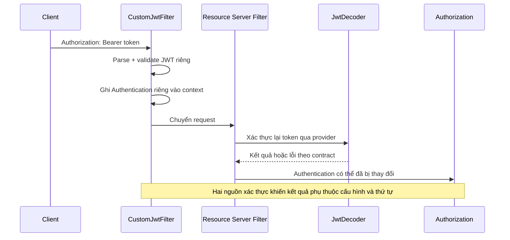
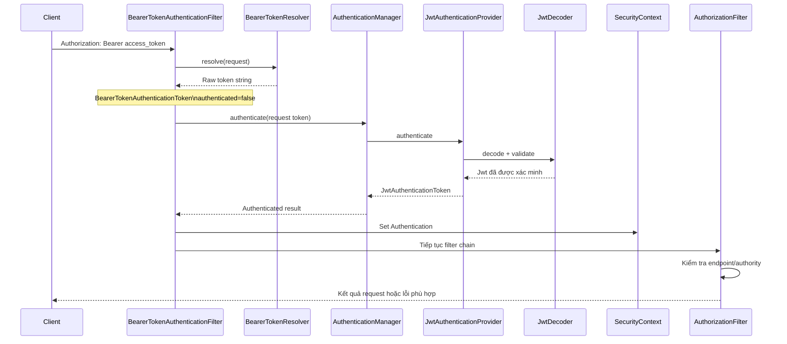

# Giữ logic xác thực trong cơ chế Resource Server thay vì viết filter JWT song song

## 1. Bài toán trong ứng dụng Spring Security Servlet

Khi xây dựng REST API bằng Spring Boot và Spring Security, một cách làm thường gặp là tự tạo `OncePerRequestFilter`: đọc header `Authorization`, tách chuỗi JWT, kiểm tra chữ ký, lấy username/role rồi đặt một đối tượng `Authentication` vào `SecurityContextHolder`. Cách này có vẻ trực tiếp, nhưng khi ứng dụng đồng thời cấu hình **OAuth 2.0 Resource Server**, sẽ xuất hiện **hai cơ chế xác thực Bearer token** chạy trên cùng HTTP request.

Spring Security đã cung cấp luồng chuyên biệt cho access token trong Servlet stack:

```text
HTTP request
    |
    v
FilterChainProxy / SecurityFilterChain
    |
    v
BearerTokenAuthenticationFilter
    |
    v
BearerTokenResolver
    |  lấy một Bearer credential từ request
    v
BearerTokenAuthenticationToken (chưa xác thực)
    |
    v
AuthenticationManager / AuthenticationProvider
    |
    +---- JWT ----> JwtAuthenticationProvider ---> JwtDecoder
    |                                        kiểm tra chữ ký + claims
    |
    +---- opaque -> OpaqueTokenAuthenticationProvider
                                        ---> OpaqueTokenIntrospector
    |
    v
Authentication đã xác thực
    |
    v
SecurityContextHolder
    |
    v
AuthorizationFilter / method security / nghiệp vụ
```

**Ý chính của bài:** nếu API nhận OAuth 2.0 access token, hãy cấu hình và mở rộng `oauth2ResourceServer()` tại những extension point được thiết kế cho công việc đó. Một filter JWT viết riêng không nên đồng thời đọc, xác thực và gắn `Authentication` cho cùng Bearer credential.

Điều này không cấm ứng dụng viết mọi loại Servlet filter. Filter phục vụ correlation ID, tracing, rate limit, header normalization hoặc nghiệp vụ khác có thể hợp lệ. Vấn đề là **tạo một đường xác thực token thứ hai** cạnh tranh với Resource Server.

## 2. Phân biệt các trách nhiệm trong chuỗi xử lý

Để tránh viết nhầm một filter “làm tất cả”, hãy tách các việc mà Resource Server đã thực hiện:

| Trách nhiệm | Thành phần được thiết kế để xử lý | Câu hỏi chính |
|---|---|---|
| Chọn security chain cho URL | `FilterChainProxy`, các `SecurityFilterChain` | Request này chịu chính sách bảo vệ nào? |
| Tách Bearer credential từ HTTP | `BearerTokenResolver` | Có token? Token được truyền theo hình thức hợp lệ? |
| Tạo yêu cầu xác thực | `BearerTokenAuthenticationFilter` | Credential nào cần xác minh? |
| Chọn cơ chế xác thực | `AuthenticationManager` hoặc `AuthenticationManagerResolver<HttpServletRequest>` | Provider nào phù hợp? |
| Kiểm tra JWT | `JwtAuthenticationProvider` + `JwtDecoder` | Chữ ký, issuer, thời hạn, audience và token profile đúng không? |
| Kiểm tra opaque access token | `OpaqueTokenAuthenticationProvider` + `OpaqueTokenIntrospector` | Token có active và dành cho API không? |
| Chuyển token đã xác thực thành principal/authority | `JwtAuthenticationConverter`, converter/provider tương ứng | Principal nào và quyền nào được tin cậy? |
| Đưa kết quả xác thực vào request context | Resource Server filter và `SecurityContextHolder` | Những filter phía sau nhìn thấy danh tính nào? |
| Quyết định endpoint có được truy cập | `AuthorizationFilter`, `authorizeHttpRequests`, method security | Token đã xác thực có đủ quyền thao tác? |
| Quyết định trên từng bản ghi | Tầng service/domain | Chủ thể có được đọc/sửa tài nguyên cụ thể? |
| Trả challenge/lỗi xác thực | `BearerTokenAuthenticationEntryPoint`, các handler liên quan | Thiếu/sai token thì trả 401; thiếu quyền thì trả gì? |

Một custom JWT filter thường vô tình gộp các trách nhiệm “đọc token”, “giải mã JWT”, “đặt principal”, “gắn role”, “chặn request” vào cùng một lớp. Khi mỗi nhóm thay đổi, filter đó phải tự tái tạo logic framework hoặc trở nên không nhất quán với cấu hình Resource Server.

### Ví dụ hai cơ chế đang tồn tại cùng lúc

```java
// MẪU THIẾT KẾ CẦN TRÁNH: hai thành phần đều xác thực cùng Bearer JWT.
http
    .addFilterBefore(customJwtFilter, UsernamePasswordAuthenticationFilter.class)
    .oauth2ResourceServer(oauth2 -> oauth2.jwt(Customizer.withDefaults()));
```

Nếu `customJwtFilter` cũng đọc `Authorization: Bearer ...`, tự validate JWT và đặt `Authentication`, cả hai nhánh có thể chạy trong một request. Việc chọn filter order chỉ thay đổi **cơ chế nào chạy trước**, không giải quyết sự trùng lặp trách nhiệm.

## 3. Tại sao filter JWT song song dễ gây lỗi?

### 3.1. Hai nguồn quyết định token hợp lệ

Giả sử filter tự viết chỉ kiểm tra chữ ký JWT và `exp`, còn `JwtDecoder` của Resource Server còn kiểm tra `iss`, `aud=orders-api` và token type.

```text
Client gửi JWT:
  signature = hợp lệ
  exp       = chưa hết hạn
  iss       = đúng nhà cung cấp
  aud       = billing-api      <- sai đối tượng nhận
  scope     = orders.read

CustomJwtFilter:
  signature + exp = OK
  => đặt Authentication vào SecurityContext

Resource Server:
  signature + exp + issuer + audience
  => phải từ chối token sai audience
```

Khi hai nhánh cùng hoạt động, kết quả có thể phụ thuộc thứ tự filter, cách filter bắt exception và cách chúng ứng xử khi context đã có `Authentication`. Một nhánh “cho qua” trong khi nhánh kia “từ chối” là dấu hiệu hợp đồng access token không còn được áp dụng nhất quán.

**Chữ ký JWT đúng không tự có nghĩa API được phép nhận token.** Resource Server còn phải kiểm tra issuer, audience, hiệu lực, token profile khi có và authorization đối với tài nguyên.

### 3.2. Filter thứ hai có thể ghi đè SecurityContext

Một filter tự viết có thể tạo:

```java
UsernamePasswordAuthenticationToken authentication =
        new UsernamePasswordAuthenticationToken(
                username, null, authorities);

SecurityContextHolder.getContext().setAuthentication(authentication);
```

Nếu `username` và `authorities` được lấy từ claims chưa xác thực đầy đủ, object được đánh dấu authenticated mà không qua provider tin cậy. Ngay cả khi filter có tự kiểm tra JWT, một lần gọi `setAuthentication` như trên có thể ghi đè kết quả từ Resource Server hoặc ghi vào context không đúng điểm trong vòng đời request.

Một `Authentication` xuất hiện trong `SecurityContext` **không phải bằng chứng rằng đúng hợp đồng Resource Server đã chạy**. Cần biết thành phần nào tạo nó, loại authentication và các điều kiện đã được xác minh.

### 3.3. Lỗi 401/403 và `WWW-Authenticate` không nhất quán

Resource Server xử lý bearer authentication failure qua các cơ chế chuẩn, thường trả:

```http
HTTP/1.1 401 Unauthorized
WWW-Authenticate: Bearer error="invalid_token"
```

Trong khi một filter tự viết có thể:

```java
response.setStatus(403);
response.getWriter().write("Invalid JWT");
return;
```

Khi cùng API lúc trả 401, lúc trả 403 cho JWT hết hạn hoặc sai chữ ký, client không biết nên xin token mới hay báo thiếu quyền. Filter riêng cũng có thể quên `WWW-Authenticate`, ghi token thô vào message lỗi hoặc nuốt exception để request đi tiếp như anonymous.

Trong OAuth 2.0 Bearer model, **401** thường chỉ lỗi thiếu/không hợp lệ credential, còn **403** thường chỉ thiếu quyền đối với request sau khi credential đã được chấp nhận. Lỗi `invalid_request` do truyền nhiều token hoặc định dạng sai có thể dẫn đến 400 theo RFC 6750; mapping thực tế phụ thuộc Spring Security và cấu hình.

### 3.4. Thứ tự filter và exception boundary

Servlet filter chain có thứ tự. `ExceptionTranslationFilter` không phải một bộ `try/catch` bao phủ mọi filter đứng trước nó; nó xử lý những exception phát sinh từ các thành phần downstream phù hợp trong chuỗi.

Một custom filter nếu ném exception ở điểm không được Spring Security entry point xử lý có thể tạo response 500 hoặc response không theo hợp đồng. Nếu filter tự viết `sendError` thì lại tạo đường lỗi riêng.

`BearerTokenAuthenticationFilter` đã được tích hợp với failure handler/entry point của Resource Server. Dùng đúng extension point giúp tránh tái tạo thủ công việc chọn status, challenge, dọn context và gọi filter chain.

### 3.5. Public endpoint, preflight và request thiếu token

Nhiều JWT filter tự viết thực hiện kiểu:

```java
if (authorizationHeader == null) {
    response.sendError(401);
    return;
}
```

Điều này có thể làm hỏng `permitAll()` endpoint, health endpoint, callback hoặc CORS preflight, vì filter chặn mọi request trước khi tới phần authorization rules.

`BearerTokenAuthenticationFilter` theo mô hình chuẩn thường **cho request đi tiếp nếu không tìm thấy Bearer credential**. Các quy tắc trong `authorizeHttpRequests` quyết định endpoint nào yêu cầu authentication. Với CORS, cần cấu hình xử lý preflight đúng tại security chain hoặc tầng proxy phù hợp.

Lưu ý chiều ngược lại: một public endpoint có `permitAll()` nhưng **được gửi Bearer token sai** vẫn có thể chịu lỗi xác thực ở Resource Server filter. `permitAll` không có nghĩa framework bỏ qua mọi credential đã được gửi.

### 3.6. Nhiều cơ chế xoay khóa và cache JWKS

Khi Authorization Server đổi signing key, `JwtDecoder` có thể dùng JWKS endpoint và cache/refresh keys theo thư viện đã cấu hình. Nếu custom filter tự tải PEM hoặc JWKS rồi cache theo cách khác, một bên có thể biết khóa mới, bên kia vẫn dùng khóa cũ.

Tương tự, nếu filter chỉ kiểm tra `kid` mà không giới hạn issuer/JWKS hoặc tin URL `jku` bên trong token, nó có thể tạo nguy cơ key confusion hoặc tải khóa từ nguồn không tin cậy.

### 3.7. Quyền được ánh xạ khác nhau

Custom filter có thể đọc `roles` thành `ROLE_ADMIN`, trong khi Resource Server mặc định đọc `scope`/`scp` thành `SCOPE_orders.read`. Nếu cả hai cùng tồn tại, cùng một JWT có thể tạo hai tập authority khác nhau. Quyết định HTTP và `@PreAuthorize` có thể phụ thuộc object cuối cùng trong context.

Thay vì đọc JWT lần thứ hai để thêm role, hãy tùy biến **`JwtAuthenticationConverter`** trên dữ liệu JWT đã xác minh.

## 4. Dùng Resource Server làm đường xác thực chính

Một API Spring Boot Servlet chấp nhận JWT access token có thể bắt đầu với các dependency Spring Boot phù hợp, thường là `spring-boot-starter-security` và `spring-boot-starter-oauth2-resource-server`.

Ví dụ cấu hình issuer:

```yaml
spring:
  security:
    oauth2:
      resourceserver:
        jwt:
          issuer-uri: https://id.example.com/realms/demo
```

Với issuer hỗ trợ metadata/JWKS, Spring Security dùng thông tin tin cậy đó để xác minh JWT theo cấu hình.

Security chain minh họa cho **API stateless nhận Bearer token**:

```java
import org.springframework.context.annotation.Bean;
import org.springframework.context.annotation.Configuration;
import org.springframework.http.HttpMethod;
import org.springframework.security.config.Customizer;
import org.springframework.security.config.annotation.web.builders.HttpSecurity;
import org.springframework.security.config.annotation.web.configurers.AbstractHttpConfigurer;
import org.springframework.security.config.http.SessionCreationPolicy;
import org.springframework.security.web.SecurityFilterChain;

@Configuration
public class ApiSecurityConfig {

    @Bean
    SecurityFilterChain apiSecurity(HttpSecurity http) throws Exception {
        return http
                .securityMatcher("/api/**")
                .sessionManagement(session -> session
                        .sessionCreationPolicy(SessionCreationPolicy.STATELESS))
                .csrf(AbstractHttpConfigurer::disable)
                .authorizeHttpRequests(authorize -> authorize
                        .requestMatchers(HttpMethod.GET, "/api/public/**")
                            .permitAll()
                        .requestMatchers(HttpMethod.GET, "/api/orders/**")
                            .hasAuthority("SCOPE_orders.read")
                        .requestMatchers(HttpMethod.POST, "/api/orders/**")
                            .hasAuthority("SCOPE_orders.write")
                        .anyRequest().authenticated())
                .oauth2ResourceServer(oauth2 ->
                        oauth2.jwt(Customizer.withDefaults()))
                .build();
    }
}
```

Ý nghĩa:

1. `securityMatcher("/api/**")` giới hạn **security chain này** cho các đường dẫn API, giúp tách khỏi cơ chế đăng nhập giao diện nếu ứng dụng có nhiều chain.
2. `SessionCreationPolicy.STATELESS` thể hiện API Bearer xác thực theo từng request, không dựa vào session để lấy identity.
3. `csrf(...disable)` chỉ phù hợp trong ví dụ API dùng access token được client gửi bằng header và **không dùng session/cookie tự động mang quyền truy cập**. Không sao chép vào các luồng browser có cookie authentication mà không phân tích CSRF.
4. `authorizeHttpRequests` định nghĩa policy từng endpoint, có thể tiếp tục kiểm tra quyền nghiệp vụ trong service.
5. `oauth2ResourceServer().jwt()` đăng ký cơ chế JWT Resource Server và tích hợp authentication filter/provider tương ứng; không phải tự `addFilterBefore(new JwtFilter(), ...)`.

**Giới hạn ví dụ:** nếu ứng dụng còn URL ngoài `/api/**`, cần security chain khác hoặc policy fallback phù hợp; không mặc định rằng URL ngoài matcher sẽ được bảo vệ bởi chain này. Nếu API dùng opaque access token, thay JWT configuration bằng opaque-token introspection theo hợp đồng issuer.

### 4.1. Điều gì vẫn cần cấu hình thêm?

Cấu hình `issuer-uri` hỗ trợ xác thực issuer, khóa và những validator mặc định, nhưng **không mặc định bảo đảm audience của API** hay mọi claim provider-specific được kiểm tra. Với API `orders-api`, hãy bổ sung audience validator và, khi cần, kiểm tra token profile như `typ=at+jwt` theo RFC 9068 hoặc `token_use=access` theo hợp đồng issuer.

Đây là **tùy biến JwtDecoder/validators**; không phải lý do để thêm filter xác thực JWT thứ hai.

## 5. Tùy biến đúng chỗ: lập bản đồ từ nhu cầu sang extension point

| Nhu cầu | Cách mở rộng phù hợp | Không nên làm |
|---|---|---|
| Chỉ dùng RS256, issuer được tin cậy | `JwtDecoder` / `NimbusJwtDecoder`, cấu hình JWS algorithm | Tự gọi `JWT.parse` trong filter |
| Bắt buộc `aud=orders-api` | `OAuth2TokenValidator<Jwt>` trong decoder | Đọc `aud` từ payload chưa xác minh rồi cho qua |
| Kiểm tra token type/profile | Validator/profile trong cơ chế JWT Resource Server | “JWT có `sub` là đủ” trong custom filter |
| Ánh xạ `scope`, `roles`, principal name | `JwtAuthenticationConverter` hoặc converter chuyên biệt | Tạo `UsernamePasswordAuthenticationToken` từ claims thô |
| JWT từ nhiều issuer hợp lệ | `AuthenticationManagerResolver` hoặc cấu hình nhiều chain phù hợp | Tin `iss` bất kỳ do token khai báo để tải JWKS |
| Access token opaque | `oauth2ResourceServer().opaqueToken()`, `OpaqueTokenIntrospector` | Cố decode opaque token như JWT trong filter |
| Header token khác mặc định | `BearerTokenResolver` với chính sách transport rõ ràng | Viết filter thứ hai chỉ để đọc một header |
| Format JSON cho lỗi 401/403 | `authenticationEntryPoint` / `accessDeniedHandler` | Tự chặn request ở JWT filter |
| Cần phân quyền theo tenant/owner | `AuthorizationManager`, method security hoặc domain service | Nhét query database/authorization đối tượng vào JWT parser |
| Cần request ID, tracing, audit metadata | Filter riêng không xác thực token hoặc instrumentation | Tái tạo `AuthenticationManager` trong filter logging |
| Chặn duplicate Authorization | `BearerTokenResolver` hoặc gateway validation | Chọn credential đầu/cuối tùy tiện |

Một extension point đúng sẽ tiếp nhận **đầu vào ở ranh giới phù hợp**. Ví dụ validation của JWT xảy ra trong decoder, nơi đã có logic mật mã và claims; authorization nghiệp vụ xảy ra sau khi có principal đáng tin.

## 6. Thêm audience validator mà không viết JWT filter

Giả sử token của nhà cung cấp được ký hợp lệ nhưng có thể dành cho nhiều API. API `orders-api` nên kiểm tra audience. Ví dụ đăng ký `JwtDecoder`:

```java
import org.springframework.context.annotation.Bean;
import org.springframework.context.annotation.Configuration;
import org.springframework.security.oauth2.core.DelegatingOAuth2TokenValidator;
import org.springframework.security.oauth2.core.OAuth2Error;
import org.springframework.security.oauth2.core.OAuth2TokenValidator;
import org.springframework.security.oauth2.core.OAuth2TokenValidatorResult;
import org.springframework.security.oauth2.jwt.Jwt;
import org.springframework.security.oauth2.jwt.JwtDecoder;
import org.springframework.security.oauth2.jwt.JwtValidators;
import org.springframework.security.oauth2.jwt.NimbusJwtDecoder;

@Configuration
class JwtValidationConfig {

    private static final String ISSUER =
            "https://id.example.com/realms/demo";

    @Bean
    JwtDecoder jwtDecoder() {
        NimbusJwtDecoder decoder =
                NimbusJwtDecoder.withIssuerLocation(ISSUER).build();

        OAuth2TokenValidator<Jwt> issuerAndTime =
                JwtValidators.createDefaultWithIssuer(ISSUER);

        OAuth2TokenValidator<Jwt> audience = jwt ->
                jwt.getAudience().contains("orders-api")
                    ? OAuth2TokenValidatorResult.success()
                    : OAuth2TokenValidatorResult.failure(
                            new OAuth2Error(
                                    "invalid_token",
                                    "Token audience is not orders-api",
                                    null));

        decoder.setJwtValidator(
                new DelegatingOAuth2TokenValidator<>(
                        issuerAndTime, audience));
        return decoder;
    }
}
```

Trong ví dụ:

- `withIssuerLocation(ISSUER)` liên kết decoder với issuer và nguồn key discovery/JWKS của issuer.
- `createDefaultWithIssuer` giữ kiểm tra issuer và các validator JWT mặc định liên quan tới hiệu lực token.
- Audience validator không cho token dành cho `billing-api` hoặc `web-client` được dùng gọi `orders-api`.
- `setJwtValidator` **thay bộ validator của decoder**. Vì vậy khi đặt validator tùy biến, cần giữ đầy đủ các điều kiện issuer, lifetime và contract phù hợp, tránh chỉ còn một điều kiện `aud`.
- `JwtAuthenticationProvider` vẫn sử dụng decoder được cấu hình; không cần bất kỳ filter JWT bổ sung nào.

Code minh họa audience validation cho token JWT đã ký. Nếu issuer yêu cầu profile **RFC 9068**, cần thực thi thêm `typ=at+jwt` và các yêu cầu của profile, bằng khả năng validator/profile phù hợp với phiên bản Spring Security. Nếu issuer dùng claim riêng như `token_use=access`, chỉ kiểm tra nó khi có hợp đồng rõ ràng với provider; không giả định claim đó tồn tại ở mọi OAuth 2.0 access token.

### Tại sao không kiểm tra audience ở `OncePerRequestFilter`?

Một filter thủ công phải tự mở, xác minh và tái kiểm tra JWT hoặc đọc claims từ một token chưa xác minh. Khi decoder đã có chỗ áp dụng `OAuth2TokenValidator`, đặt audience ở đó giúp cùng một kết quả xác thực chịu **một bộ điều kiện nhất quán** trước khi sinh `Authentication`.

## 7. Ánh xạ authorities tại `JwtAuthenticationConverter`

Một nhu cầu khác thường dẫn tới custom filter là: “JWT của provider có role trong claim khác với scope, nên phải tự lấy role và gắn vào SecurityContext.” Nhu cầu này thuộc trách nhiệm **chuyển JWT đã xác thực thành Authentication**, không phải đọc token từ HTTP thêm lần nữa.

Ví dụ provider đưa scope trong `permissions` với các giá trị cách nhau bằng dấu cách, còn ứng dụng muốn prefix `SCOPE_`:

```json
{
  "iss": "https://id.example.com/realms/demo",
  "sub": "user-123",
  "aud": "orders-api",
  "permissions": "orders.read orders.write",
  "exp": 1910000000
}
```

Có thể dùng converter:

```java
import org.springframework.context.annotation.Bean;
import org.springframework.security.oauth2.server.resource.authentication
        .JwtAuthenticationConverter;
import org.springframework.security.oauth2.server.resource.authentication
        .JwtGrantedAuthoritiesConverter;

@Bean
JwtAuthenticationConverter jwtAuthenticationConverter() {
    JwtGrantedAuthoritiesConverter authorities =
            new JwtGrantedAuthoritiesConverter();
    authorities.setAuthoritiesClaimName("permissions");
    authorities.setAuthorityPrefix("SCOPE_");

    JwtAuthenticationConverter converter =
            new JwtAuthenticationConverter();
    converter.setJwtGrantedAuthoritiesConverter(authorities);
    converter.setPrincipalClaimName("sub");

    return converter;
}
```

Gắn converter vào JWT DSL:

```java
.oauth2ResourceServer(oauth2 -> oauth2
        .jwt(jwt -> jwt.jwtAuthenticationConverter(
                jwtAuthenticationConverter())))
```

Các đoạn code trong mục này mô tả phần mở rộng riêng; khi tích hợp, đặt bean và DSL vào cấu hình `SecurityFilterChain` nhất quán của ứng dụng.

Lưu ý:

- Converter được áp dụng **sau khi JWT được decoder xác minh**; nó không chịu trách nhiệm kiểm tra chữ ký.
- `JwtGrantedAuthoritiesConverter` hỗ trợ quy ước claim authority thường gặp; nếu claim có cấu trúc nested hoặc mảng object đặc thù, có thể cần custom `Converter<Jwt, AbstractAuthenticationToken>` có kiểm soát.
- `sub` không phải luôn là username dùng để hiển thị. Nếu dùng `preferred_username` làm principal name, phải hiểu tính ổn định/duy nhất của claim theo issuer và không suy ra quyền từ tên hiển thị.
- Dù JWT có `orders.read`, tầng nghiệp vụ vẫn cần kiểm tra order có thuộc tài khoản/tenant đang yêu cầu không.

**Quan trọng:** bộ chuyển authorities không được tin dữ liệu từ token chưa xác thực. Spring Security chỉ gọi converter trên đối tượng `Jwt` đã vượt qua decoder/validators của hệ thống.

## 8. Custom BearerTokenResolver khi khác biệt nằm ở HTTP transport

Nếu yêu cầu thực sự là thay cách lấy token từ request, hãy tùy biến `BearerTokenResolver` thay vì xây một JWT filter mới.

Ví dụ API muốn từ chối request mà Servlet container còn nhìn thấy **hai Authorization header**:

```java
import java.util.Enumeration;

import org.springframework.context.annotation.Bean;
import org.springframework.http.HttpHeaders;
import org.springframework.security.oauth2.core.OAuth2AuthenticationException;
import org.springframework.security.oauth2.server.resource.BearerTokenErrors;
import org.springframework.security.oauth2.server.resource.web.BearerTokenResolver;
import org.springframework.security.oauth2.server.resource.web.DefaultBearerTokenResolver;

@Bean
BearerTokenResolver strictBearerTokenResolver() {
    DefaultBearerTokenResolver delegate =
            new DefaultBearerTokenResolver();

    return request -> {
        Enumeration<String> values =
                request.getHeaders(HttpHeaders.AUTHORIZATION);

        int count = 0;
        while (values != null && values.hasMoreElements()) {
            values.nextElement();
            if (++count > 1) {
                throw new OAuth2AuthenticationException(
                        BearerTokenErrors.invalidRequest(
                                "Multiple Authorization headers"));
            }
        }
        return delegate.resolve(request);
    };
}
```

Gắn resolver:

```java
.oauth2ResourceServer(oauth2 -> oauth2
        .bearerTokenResolver(strictBearerTokenResolver())
        .jwt(Customizer.withDefaults()))
```

Trách nhiệm của resolver ở ví dụ chỉ là **đọc và phân loại credential HTTP**, không xác thực JWT hoặc đặt `SecurityContext`. Sau khi resolver trả chuỗi token, đường xác thực chuẩn tiếp tục hoạt động.

Một tầng reverse proxy có thể đã gộp hoặc loại bỏ duplicate header trước khi request vào Servlet container, vì vậy gateway cần áp dụng cùng chính sách nếu yêu cầu phát hiện header gốc. Theo RFC 6750, client không nên dùng đồng thời nhiều phương thức truyền bearer access token; Spring Security mặc định không đọc token từ query/body trừ khi bật rõ ràng.

Nếu ứng dụng dùng header thay thế do một gateway nội bộ định nghĩa, hãy giới hạn trust boundary để client bên ngoài không tự giả mạo header đó. Cấu hình `DefaultBearerTokenResolver` hoặc custom resolver theo hợp đồng gateway; không viết lại toàn bộ quá trình xác thực JWT chỉ vì tên header khác.

## 9. Tách authentication, authorization và domain access

Một custom filter JWT thường đi xa hơn xác thực: nó truy vấn database để tìm user, kiểm tra role rồi từ chối request trước cả controller. Thực tế có ba lớp quyết định khác nhau.

### 9.1. Authentication: token có được tin?

Authentication kiểm tra bearer token là credential hợp lệ:

- JWT: thuật toán ký được phép, chữ ký đúng bằng key của issuer tin cậy, `exp`/`nbf`, `iss`, `aud`, token type/profile cần thiết.
- Opaque: introspection trả trạng thái và metadata đáp ứng hợp đồng access token.
- Sender-constrained token: nếu có DPoP/mTLS, xác minh thêm điều kiện ràng buộc người gửi theo cơ chế tương ứng.

Kết quả là **principal và authorities được kiểm chứng**. Xác thực không tự quyết định mọi action của domain.

### 9.2. Authorization: quyền với endpoint nào?

Ví dụ:

```java
.authorizeHttpRequests(auth -> auth
        .requestMatchers(HttpMethod.GET, "/api/orders/**")
            .hasAuthority("SCOPE_orders.read")
        .requestMatchers(HttpMethod.POST, "/api/orders/**")
            .hasAuthority("SCOPE_orders.write")
        .anyRequest().authenticated())
```

Một access token có quyền đọc không tự được dùng để tạo đơn hàng. Policy có thể nằm tại URL, method security hoặc một `AuthorizationManager` tùy biến.

### 9.3. Business ownership: dữ liệu của ai?

Ví dụ `GET /api/orders/42` cần token có scope `orders.read`, nhưng còn phải xác định order `42` thuộc tenant/account mà principal được phép truy cập.

Không nhét logic “order owner” vào JWT filter để biến nó thành layer nghiệp vụ thứ hai. Đặt quyền đối tượng tại service/domain, nơi có dữ liệu và ngữ cảnh nghiệp vụ. Cách này còn giúp xử lý nhất quán giữa REST API, scheduled jobs và message consumers.

## 10. Quy trình xử lý request: trước và sau khi dùng Resource Server

### 10.1. Luồng với custom filter song song



Sơ đồ cho thấy một rủi ro **thiết kế có thể xảy ra**, không khẳng định mọi custom filter đều ghi đè context. Cách filter chạy thực tế phụ thuộc mã nguồn từng ứng dụng và version của Spring Security.

### 10.2. Luồng dùng cơ chế Resource Server



Một số khác biệt trong hành vi Servlet cần lưu ý:

- Request không có Bearer token có thể đi tiếp dưới trạng thái chưa đăng nhập; endpoint `authenticated()` sau đó từ chối.
- Request gửi Bearer token sai định dạng có thể bị resolver từ chối **trước** khi tạo `BearerTokenAuthenticationToken`.
- JWT trích xuất được nhưng sai chữ ký sẽ bị provider/decoder từ chối; không tạo `JwtAuthenticationToken` thành công.
- JWT đã xác thực nhưng thiếu scope thường bị authorization từ chối (403), thay vì decoder từ chối là token giả.
- API stateless cần xác thực trên mỗi request, không dựa vào việc người dùng đã từng có Authentication ở request trước.

## 11. Đặt xử lý lỗi trong Resource Server

Một động cơ để viết filter JWT riêng là muốn trả JSON thống nhất cho lỗi 401/403. Có thể tùy biến entry point và access denied handler của Spring Security Resource Server mà **không tự viết xác thực token**.

Ví dụ cấu hình handler theo hợp đồng mặc định:

```java
import org.springframework.context.annotation.Bean;
import org.springframework.security.oauth2.server.resource.web
        .BearerTokenAuthenticationEntryPoint;
import org.springframework.security.oauth2.server.resource.web.access
        .BearerTokenAccessDeniedHandler;

@Bean
BearerTokenAuthenticationEntryPoint bearerEntryPoint() {
    return new BearerTokenAuthenticationEntryPoint();
}

@Bean
BearerTokenAccessDeniedHandler bearerAccessDeniedHandler() {
    return new BearerTokenAccessDeniedHandler();
}
```

Khi cần tự tạo JSON lỗi, có thể triển khai `AuthenticationEntryPoint` và `AccessDeniedHandler` phù hợp rồi gắn vào DSL:

```java
.oauth2ResourceServer(oauth2 -> oauth2
        .authenticationEntryPoint(customBearerEntryPoint)
        .accessDeniedHandler(customBearerDeniedHandler)
        .jwt(Customizer.withDefaults()))
```

Đây là ví dụ gắn **những handler đã được định nghĩa** vào security chain, không phải đoạn class hoàn chỉnh có thể copy riêng lẻ. Handler tùy biến phải giữ status HTTP phù hợp, `WWW-Authenticate` Bearer challenge khi cần và không đưa token hoặc thông tin nhạy cảm vào response.

Theo Bearer token usage, các tình huống thường gặp:

| Tình huống | Tầng xử lý | Kết quả điển hình |
|---|---|---|
| Không có credential, endpoint cần xác thực | Authorization / entry point | 401 với Bearer challenge |
| Bearer token không hợp lệ hoặc hết hạn | Resolver hoặc authentication provider | 401, thường `invalid_token` |
| Request dùng nhiều phương thức truyền token | Resolver/transport policy | Có thể 400 với `invalid_request` |
| Token hợp lệ nhưng không đủ scope | Authorization / denied handler | 403, thường `insufficient_scope` |
| Controller/service từ chối nghiệp vụ | Domain authorization | 403 hoặc response phù hợp theo chính sách domain |

Response thực tế phụ thuộc cấu hình chain, loại exception và các handler. Không hứa mọi lỗi cú pháp Bearer luôn trả đúng cùng một mã trên mọi phiên bản.

## 12. Khi có nhiều issuer hoặc nhiều loại access token

Một ứng dụng nhiều tenant có thể tin access token từ nhiều issuer. Vấn đề là **chọn đúng cấu hình xác minh** cho từng request. Đây không phải lý do tự viết JWT filter song song.

### 12.1. `AuthenticationManagerResolver<HttpServletRequest>`

Spring Security hỗ trợ cơ chế giải quyết `AuthenticationManager` từ request. Với JWT đa issuer, có thể dùng giải pháp multi-tenant của framework, ví dụ `JwtIssuerAuthenticationManagerResolver` trong các phiên bản cung cấp API tương ứng.

Ý tưởng:

```text
Bearer request
    |
    v
AuthenticationManagerResolver
    |
    +--> issuer A đã đăng ký -> JwtDecoder/validators A
    |
    +--> issuer B đã đăng ký -> JwtDecoder/validators B
    |
    +--> issuer khác         -> Từ chối
    |
    v
Authenticated JWT đúng trust domain
```

Nếu resolver cần đọc claim `iss` từ JWT **chưa được xác minh** để định tuyến, giá trị đó chỉ được phép chọn một trong các issuer **đã được cấu hình tin cậy**. Sau khi decoder tương ứng xác minh chữ ký, vẫn phải đối chiếu issuer, audience và profile.

Không cho request cung cấp URL issuer/JWKS tùy ý rồi tải khóa và chấp nhận token. Với mỗi issuer, cần định nghĩa audience hoặc resource, thuật toán, claims và scope mapping phù hợp.

### 12.2. JWT và opaque token cùng hệ thống

Nếu API thật sự phải chấp nhận hai định dạng, cần mô tả rõ **hợp đồng và nhánh xác minh** (có thể dùng nhiều security chain, resolver hoặc provider theo kiến trúc phù hợp). Không nên làm:

```java
// PSEUDOCODE CẦN TRÁNH
try {
    authenticateAsJwt(rawToken);
} catch (Exception ex) {
    authenticateAsOpaque(rawToken); // fallback mù quáng
}
```

Cách “thử đến khi qua” có thể làm yếu chính sách, tăng call introspection không cần thiết hoặc cho token không đúng mục đích đi qua cơ chế thứ hai. Cần có quy tắc lựa chọn nguồn xác thực đáng tin và policy độc lập của từng profile.

### 12.3. OIDC Login và Resource Server cùng một backend

Backend có thể vừa đăng nhập người dùng bằng `oauth2Login()` (vai trò OIDC Client/Relying Party), vừa bảo vệ REST API bằng `oauth2ResourceServer()`.

- **ID token** được OIDC Client dùng để kiểm tra đăng nhập, thường có `aud=client_id`.
- **Access token** được Resource Server dùng để kiểm tra request API, phải dành cho audience/resource của API.
- **Refresh token** dùng ở token endpoint của Authorization Server; Resource Server không lấy refresh token từ client để tự đăng nhập.

Nếu ứng dụng có UI cookie/session và API Bearer, nên cân nhắc tách các `SecurityFilterChain` theo đường dẫn để mỗi vùng có policy rõ ràng. Không gom tất cả vào một filter JWT tự viết rồi thử nhận mọi loại token.

## 13. Chuyển từ một filter JWT cũ sang Resource Server

Khi dự án đã có `JwtAuthenticationFilter` tự viết, mục tiêu là **loại bỏ đường xác thực token trùng lặp** sau khi các chức năng cần thiết được chuyển về đúng cơ chế. Có thể phân tách hành vi của filter cũ:

| Logic hiện nằm trong filter cũ | Nơi chuyển đến |
|---|---|
| Đọc `Authorization` và tách Bearer prefix | `BearerTokenResolver` mặc định |
| Đọc token từ header nội bộ đặc thù | Custom `BearerTokenResolver` khi cần |
| Lấy public key/JWKS | `JwtDecoder` với issuer/JWK URI tin cậy |
| Kiểm tra signature/alg | `JwtDecoder` |
| Kiểm tra issuer, audience, thời hạn, token purpose | `OAuth2TokenValidator<Jwt>` hoặc validator/profile tương ứng |
| Tạo principal từ `sub` | `JwtAuthenticationConverter` / principal claim |
| Đổi claim scope/roles thành GrantedAuthority | Converter dành cho JWT đã xác thực |
| Chặn endpoint theo quyền | `authorizeHttpRequests`, method security |
| Chặn dữ liệu khác tenant hoặc owner | Service/domain authorization |
| Trả lỗi JWT không hợp lệ | Bearer entry point / authentication failure handling |
| Trả lỗi thiếu quyền | Bearer access denied handler |
| Ghi request ID, tracing | Filter instrumentation độc lập, không xác thực token |

Ví dụ cấu hình cũ có thể có:

```java
// TRƯỚC: ví dụ ý tưởng, không phải đoạn cần giữ.
http.addFilterBefore(jwtAuthenticationFilter,
        UsernamePasswordAuthenticationFilter.class);
```

Sau khi chuyển đầy đủ các yêu cầu cần thiết sang Resource Server, cấu hình sẽ dùng:

```java
// SAU: Resource Server chịu trách nhiệm Bearer authentication.
http.oauth2ResourceServer(oauth2 ->
        oauth2.jwt(Customizer.withDefaults()));
```

**Quan trọng:** xóa đường đăng ký filter cũ khỏi chain khi chuyển đổi; chỉ xóa tên class mà vẫn để bean/registration tự động đăng ký `Filter` với Servlet container có thể khiến filter chạy ngoài `FilterChainProxy`. Một custom `Filter` là bean có thể được Spring Boot auto-register dưới dạng Servlet filter tùy cấu hình. Cần biết filter đã được đăng ký qua `addFilterBefore`, qua `FilterRegistrationBean` hay đường khác để loại bỏ đúng cơ chế thực thi.

### Ví dụ tách logic không thuộc authentication

Nếu filter cũ làm cả JWT authentication và gắn correlation ID, chỉ phần authentication cần chuyển sang Resource Server. Có thể giữ một filter riêng cho correlation ID, nhưng filter này **không đọc JWT, không xác thực token và không đặt Authentication**.

```java
// PSEUDOCODE: filter instrumentation riêng trách nhiệm.
try {
    putRequestIdIntoMdc(requestId);
    chain.doFilter(request, response);
} finally {
    removeRequestIdFromMdc();
}
```

Mục đích là mỗi thành phần có **một trách nhiệm rõ ràng**. Không phải mọi custom filter đều sai; chỉ nên tránh filter xác thực Bearer token chạy song song với Resource Server.

## 14. Một số tình huống cụ thể giúp chọn extension point

### 14.1. “JWT của nhà cung cấp có claim `roles` nên cần filter riêng”

Không cần. Dùng `JwtAuthenticationConverter` hoặc converter tùy biến để lấy `roles` **sau khi JwtDecoder xác minh**. Bên ngoài security chain, có thể dùng `hasAuthority`/`hasRole` và method security theo chính sách.

### 14.2. “API cần kiểm tra token dành cho đúng service”

Đây là **audience validator** của `JwtDecoder`, không phải filter. Nếu token dành cho `billing-api`, `orders-api` từ chối ngay trong authentication.

### 14.3. “Cần nhận token của hai Authorization Server”

Dùng các decoder/manager được cấu hình tin cậy và `AuthenticationManagerResolver`/chain phù hợp. Không chấp nhận issuer bất kỳ theo `iss` tự khai báo.

### 14.4. “Provider sử dụng opaque token”

Chọn `opaqueToken()` và introspector; không dùng filter tự decode vì token không bắt buộc mang cấu trúc JWT. Tùy contract, introspection metadata còn cần kiểm tra audience, resource và authorization.

### 14.5. “Muốn trả JSON khác khi token hết hạn”

Tùy biến entry point/handler để format response, đồng thời giữ status/challenge phù hợp. Không dùng custom JWT filter chỉ vì muốn một body lỗi khác.

### 14.6. “Muốn endpoint public hoạt động cả khi không có token”

Định nghĩa `permitAll()` cho URL thích hợp; `BearerTokenAuthenticationFilter` không tự bắt buộc mọi request phải có token. Nếu client gửi credential malformed đến public endpoint, authentication filter vẫn có thể từ chối; client nên tránh gửi token sai.

### 14.7. “Cần kiểm tra user vẫn tồn tại trong database”

Phải làm rõ điều kiện nghiệp vụ: JWT là bằng chứng được issuer ký và có thời hạn; việc kiểm tra trạng thái account có thể thuộc custom claims validation, dịch vụ phân quyền hoặc cơ chế revocation. Nếu cần quyết định dựa trên trạng thái user tức thời, thiết kế mô hình dữ liệu và trust boundary rõ ràng. Không âm thầm biến raw token parser thành một `UserDetailsService` được gọi cho mọi request mà thiếu cân nhắc hiệu năng, availability và consistency.

### 14.8. “Gateway đã xác thực JWT; backend có cần Resource Server không?”

Phụ thuộc ranh giới tin cậy giữa gateway và backend. Nếu backend vẫn nhận bearer access token, thông thường backend nên áp dụng contract xác thực/phân quyền phù hợp và không tin các header danh tính do client trực tiếp kiểm soát. Nếu kiến trúc dùng identity propagation bởi gateway, phải bảo đảm transport và provenance của identity được bảo vệ, ví dụ mTLS và header stripping ở ingress.

Đừng dùng một JWT filter tự viết như một phép “bỏ kiểm tra cho nhanh” khi backend đang phụ thuộc gateway; cần hợp đồng đáng tin giữa các thành phần.

## 15. Lỗi phổ biến khi chuyển đổi

| Triệu chứng | Khả năng nguyên nhân | Hướng xử lý tại Resource Server |
|---|---|---|
| Request hợp lệ bị xử lý hai lần | Còn đăng ký filter JWT tự viết | Gỡ đường đăng ký filter trùng; để cơ chế Resource Server xử lý |
| Token đúng chữ ký nhưng API trả 401 | Sai issuer, audience, token type, key rotation hoặc thời hạn | Xác định validator thất bại; sửa cấu hình issuer/client/token contract |
| Token đăng nhập được UI nhưng API trả 401 | Dùng **ID token** thay access token | Client gọi API bằng access token có audience đúng |
| `hasRole("ADMIN")` không hoạt động | Converter chỉ ánh xạ `scope` thành `SCOPE_`, không có `ROLE_ADMIN` | Thiết kế converter/policy authority nhất quán |
| `permitAll` vẫn trả 401 nếu gửi token hỏng | Bearer filter vẫn kiểm tra credential được gửi | Sửa client gửi token; nếu cần tách security chain theo endpoint |
| `OPTIONS` preflight bị 401 | CORS hoặc filter custom chặn thiếu token | Định nghĩa CORS/preflight hợp lệ; bỏ yêu cầu token ở custom filter |
| Lỗi JWT trả 500 thay vì 401 | Exception/handler riêng ở filter ngoài boundary | Dùng cơ chế Resource Server entry point/failure handling |
| Token cũ không dùng được sau rotation | Key/JWKS cache hoặc issuer cấu hình sai | Dùng JWKS tin cậy và cơ chế refresh khóa của decoder |
| Principal trong log là nguyên chuỗi JWT | Đọc `BearerTokenAuthenticationToken` chưa xác thực | Chỉ dùng authenticated principal và không log token |
| Dùng session cũ thay cho bearer trên API | Các security chain hoặc context/session policy chồng lấn | Tách và định nghĩa rõ authentication mechanism cho API |
| JWT sai audience vẫn được chấp nhận | Thiếu audience validator | Áp dụng kiểm tra `aud` trong token acceptance contract |
| JWT có `scope` nhưng thao tác vẫn 403 | Scope mapping hoặc quyền domain khác policy | Kiểm tra `JwtAuthenticationConverter` và authorization trên tài nguyên |

Dù dùng Spring Security chuẩn, một API vẫn có thể cấu hình sai. **Bỏ custom filter** làm luồng nhất quán và dễ quản lý hơn, nhưng không thay trách nhiệm xác định issuer, audience, token profile và quyền nghiệp vụ.

## 16. Bảo vệ SecurityContext và vòng đời của Bearer authentication

Đối tượng `BearerTokenAuthenticationToken` do filter tạo ra từ raw token có `isAuthenticated=false`. Sau khi `AuthenticationManager` và provider xác thực thành công, kết quả điển hình là:

- `JwtAuthenticationToken` với JWT access token đã kiểm tra.
- `BearerTokenAuthentication` với opaque access token đã được introspection.

Resource Server filter gắn authenticated result vào `SecurityContext` cho request tiếp tục. `SecurityContextHolder` chỉ là nơi truy cập context theo chiến lược hiện hành; nó không tự làm token hợp lệ.

Với API stateless:

- Không nên “cache `Authentication` của request trước” rồi coi như token hiện tại đã hợp lệ.
- Không tự gắn `UsernamePasswordAuthenticationToken` từ JWT chưa xác thực vào context.
- Không biến `isAuthenticated=true` thành đường tắt thay xác minh chữ ký.
- Không log `Authorization` hay `getCredentials()` của authentication request, vì raw bearer token là credential nhạy cảm.
- Nếu dùng async processing hoặc nhiều thread, việc truyền context cần theo cơ chế Spring Security hỗ trợ; không dựa vào một `ThreadLocal` tự viết độc lập.

Các yêu cầu về session persistence, exception handling và context cleanup do framework cung cấp theo cấu hình. Viết JWT filter song song đồng nghĩa phải hiểu lại và tự duy trì những hành vi này trong khi chúng không phải mục tiêu nghiệp vụ của API.

## 17. Phân biệt Resource Server với OAuth2 Client/OIDC Login

Cùng một ứng dụng có thể dùng nhiều phần của Spring Security:

| Vai trò | Cơ chế | Token xử lý |
|---|---|---|
| Bảo vệ HTTP API | `oauth2ResourceServer().jwt()` / `opaqueToken()` | Bearer **access token** |
| Đăng nhập người dùng bằng OP | `oauth2Login()` | **ID token** của OIDC Client, thông tin UserInfo/phiên đăng nhập |
| Ứng dụng gọi API khác | OAuth2 Client support | Lấy và trình bày access token, có thể refresh token |
| Backend nghiệp vụ kiểm tra object-level permission | Application/domain authorization | Dựa trên principal/authorities đã xác thực và dữ liệu nghiệp vụ |

Không phải cứ thấy “JWT” trong OIDC ID token là nên gửi nó vào Resource Server. API phải kiểm tra token có đúng **mục đích và audience** của API. Nếu dùng `oauth2Login()` cùng Resource Server trong một backend, cần thiết kế đường dẫn/security chain và quyền session/bearer rõ ràng, thay vì để filter JWT tùy biến cố giải thích mọi cookie và token.

## 18. Ma trận tình huống cho đường xác thực thống nhất

Đây là các **kịch bản thiết kế**, không phải kết quả thực thi một bộ kiểm thử:

| HTTP request đến `orders-api` | Resource Server nên xử lý |
|---|---|
| Không có `Authorization`, endpoint public | Request có thể tiếp tục tới endpoint public |
| Không có `Authorization`, endpoint yêu cầu `authenticated()` | Không có Bearer authentication; thường trả 401 |
| `Authorization: Bearer` | Resolver từ chối Bearer malformed |
| `Authorization: Bearer abc.def.ghi` nhưng JWT giả | Provider/decoder từ chối |
| JWT đúng chữ ký/issuer, hết hạn | Decoder/validator từ chối |
| JWT đúng chữ ký/issuer, `aud=web-client` (ID token) | Validator audience/purpose từ chối |
| JWT đúng chữ ký/issuer, `aud=billing-api` | Validator audience từ chối |
| JWT access token đúng `aud=orders-api`, `scope=orders.read` | Xác thực thành công, xét GET và ownership |
| JWT access token đúng audience nhưng thiếu `orders.write` | Xác thực được, POST có thể bị từ chối 403 |
| Bearer token opaque ở API cấu hình `jwt()` | Không giải mã được theo JWT contract |
| Opaque token ở API cấu hình `opaqueToken()` và introspection active | Xác thực theo metadata/hợp đồng; tiếp tục phân quyền |
| Refresh token gửi vào API thay access token | Từ chối theo contract Resource Server |
| Token đúng nhưng đơn hàng thuộc tenant khác | Domain authorization từ chối |
| Có hai Authorization header | Cần policy chống duplicate tại gateway hoặc resolver, không chọn bừa một giá trị |

Nếu cần kiểm tra triển khai, nên chứng minh mỗi nhóm tình huống được xử lý bởi **đúng thành phần**: resolver cho transport, decoder/introspector cho authentication, authorization layer cho quyền. Không cần tạo một custom JWT filter để “chặn trước” những case mà Resource Server đã hỗ trợ.

## 19. Quy tắc áp dụng trong dự án

1. **Một Bearer credential chỉ có một đường xác thực chính.** Dùng `BearerTokenAuthenticationFilter` do Resource Server đăng ký, không có custom filter thứ hai cùng đọc và xác minh JWT.
2. **Định nghĩa access-token contract tường minh:** issuer, algorithm/key source, audience, lifetime, token type/profile và các claim cần thiết. Không tin token chỉ vì decode được.
3. **Giữ JWT validation tại `JwtDecoder` và validators.** Khi cần opaque token, sử dụng introspection.
4. **Giữ ánh xạ principal và authorities tại converter.** Không lấy role từ payload chưa xác minh rồi tự gắn `Authentication` vào context.
5. **Giữ quyền HTTP và domain ở authorization layer.** Chữ ký đúng hoặc scope có mặt chưa chứng minh user được đọc bản ghi cụ thể.
6. **Giữ xử lý lỗi ở Resource Server entry point/denied handler.** Không viết một đường `sendError` song song cho cùng credential.
7. **Dùng `BearerTokenResolver` để tùy biến transport** và `AuthenticationManagerResolver` khi cần lựa chọn manager cho nhiều issuer đã tin cậy.
8. **Tách security chain theo mục đích khi cần**, chẳng hạn browser session và bearer API; đừng để filter JWT tự viết vô tình bắt mọi endpoint.
9. **Bảo vệ raw access token:** không log Authorization header, không lưu token làm principal, không dùng JWT decode ở gateway/client như bằng chứng xác thực.
10. **Khi chuyển từ filter cũ, loại bỏ mọi điểm đăng ký cũ**, đồng thời chuyển đầy đủ các validation và authority mapping mà ứng dụng thật sự cần sang extension point thích hợp.

**Kết quả mong muốn** là một chuỗi xử lý Servlet có ranh giới rõ ràng: filter đọc credential; provider và decoder xác thực; converter xây danh tính; security context giữ kết quả; authorization quyết định quyền. Những tùy biến nghiệp vụ được đặt đúng nơi mà framework có hợp đồng hỗ trợ.

## 20. Tài liệu tham khảo

- **Spring Security Reference — OAuth 2.0 Resource Server (Servlet):** đường xử lý JWT/opaque access token và các thành phần của Resource Server. https://docs.spring.io/spring-security/reference/servlet/oauth2/resource-server/index.html
- **Spring Security Reference — JWT Resource Server:** cấu hình issuer, JWKS, JWS algorithm, claim validation và authorities mapping. https://docs.spring.io/spring-security/reference/servlet/oauth2/resource-server/jwt.html
- **Spring Security Reference — Servlet Authentication Architecture:** `Authentication`, `AuthenticationManager`, `AuthenticationProvider` và `SecurityContextHolder`. https://docs.spring.io/spring-security/reference/servlet/authentication/architecture.html
- **Spring Security Reference — Servlet Architecture:** `FilterChainProxy`, `SecurityFilterChain` và filter ordering. https://docs.spring.io/spring-security/reference/servlet/architecture.html
- **Spring Security API — `BearerTokenAuthenticationFilter`:** Resource Server authentication filter. https://docs.spring.io/spring-security/site/docs/current/api/org/springframework/security/oauth2/server/resource/web/authentication/BearerTokenAuthenticationFilter.html
- **Spring Security API — `DefaultBearerTokenResolver`:** cách đọc bearer credential từ HTTP. https://docs.spring.io/spring-security/site/docs/current/api/org/springframework/security/oauth2/server/resource/web/DefaultBearerTokenResolver.html
- **Spring Security API — `JwtAuthenticationConverter`:** chuyển JWT đã xác thực thành `Authentication`. https://docs.spring.io/spring-security/site/docs/current/api/org/springframework/security/oauth2/server/resource/authentication/JwtAuthenticationConverter.html
- **RFC 6750 — OAuth 2.0 Bearer Token Usage:** cách truyền token và `WWW-Authenticate`. https://www.rfc-editor.org/rfc/rfc6750
- **RFC 7662 — OAuth 2.0 Token Introspection:** trạng thái token và introspection metadata. https://www.rfc-editor.org/rfc/rfc7662
- **RFC 8725 — JWT Best Current Practices:** issuer/audience validation, algorithm confusion và token substitution. https://www.rfc-editor.org/rfc/rfc8725
- **RFC 9068 — JWT Profile for OAuth 2.0 Access Tokens:** JWT access token profile và `at+jwt`. https://www.rfc-editor.org/rfc/rfc9068
