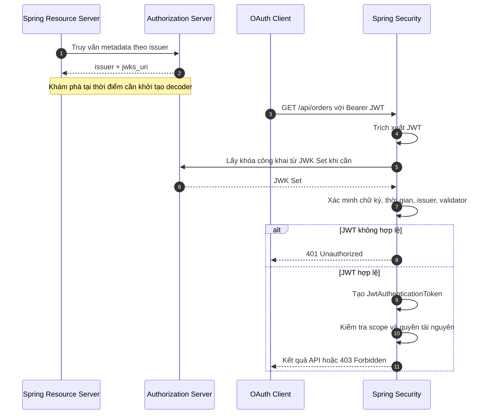
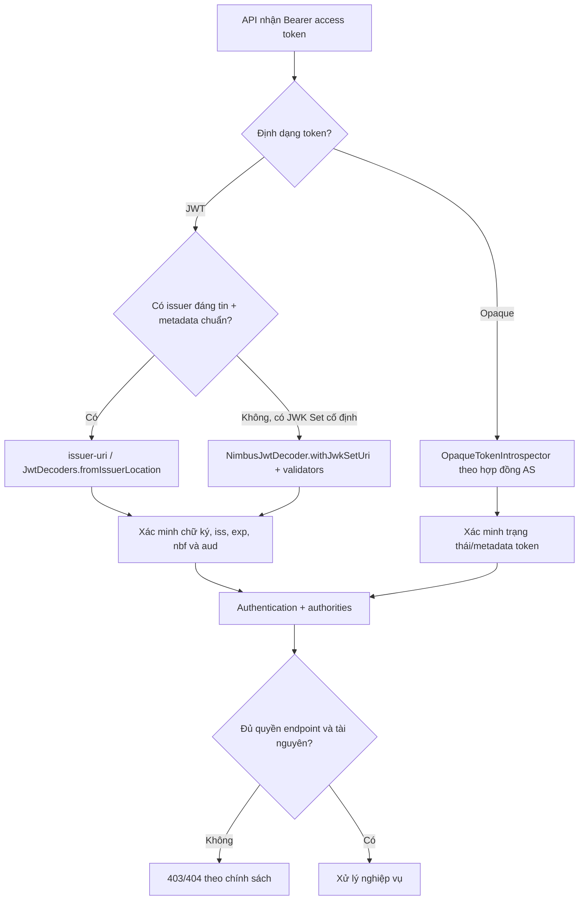

# `JwtDecoders.fromIssuerLocation` và cấu hình dựa trên issuer

Khi xây dựng một **Spring Security OAuth 2.0 Resource Server**, ứng dụng thường nhận access token dạng JWT qua header `Authorization: Bearer ...`. Để chấp nhận một token, API cần **xác minh chữ ký và các điều kiện hợp lệ** theo một Authorization Server/OpenID Provider (OP) đáng tin cậy. API không thể chỉ giải mã Base64URL của JWT rồi tin ngay các claim như `sub`, `scope` hay `roles`.

Trong Spring Security, `JwtDecoders.fromIssuerLocation(issuer)` giúp tạo `JwtDecoder` dựa trên **issuer URI**. Phương thức này dùng thông tin metadata do issuer công bố để tìm khóa công khai (JWK Set), rồi chuẩn bị decoder dùng cho việc xác minh JWT. Đây là cách tránh hardcode khóa ký hoặc đường dẫn JWKS khi hệ thống có metadata chuẩn.

Điểm quan trọng nhất là **issuer không chỉ là URL để tải khóa**. Nó còn biểu diễn *bên phát hành token* mà Resource Server tin cậy. Một JWT được xác minh chữ ký bởi khóa hợp lệ nhưng có issuer sai, audience sai hoặc hết hạn vẫn không được phép sử dụng cho API.

Trong bài này, ví dụ dùng phong cách **Spring Boot 3 và Spring Security 6**. Cấu hình lớp, điều kiện khởi tạo và một số API có thể khác giữa các phiên bản; khi áp dụng hãy đối chiếu phiên bản thực tế trong dự án.

## 1. Issuer là gì?

**Issuer** là định danh của bên phát hành token, thường được biểu diễn bằng một HTTPS URI trong claim `iss`. Ví dụ:

```json
{
  "iss": "https://login.example.com/realms/shop",
  "sub": "user-123",
  "aud": ["orders-api"],
  "exp": 1900000000,
  "scope": "orders.read"
}
```

JSON trên chỉ là **payload minh họa**, không phải JWT có chữ ký. Nếu token được phát hành theo một issuer khác, Resource Server không nên chấp nhận nó chỉ vì `sub` hoặc `scope` trông đúng.

Thông thường API cấu hình issuer:

```yaml
spring:
  security:
    oauth2:
      resourceserver:
        jwt:
          issuer-uri: https://login.example.com/realms/shop
```

URI này có **hai vai trò liên quan nhưng khác nhau**:

1. Là điểm xuất phát để Resource Server **khám phá metadata** của bên phát hành.
2. Là giá trị mong đợi của claim **`iss`** khi xác minh token.

Issuer không nhất thiết trùng với URL trang đăng nhập, endpoint cấp token hoặc URL JWKS. Chẳng hạn issuer là `https://login.example.com/realms/shop` nhưng JWK Set có thể nằm tại `https://login.example.com/realms/shop/protocol/openid-connect/certs`, tùy OP.

> Một API có thể tin cậy issuer ở một realm/tenant cụ thể. Không tự thay URL issuer bằng trang chủ của máy chủ định danh hoặc một realm khác chỉ vì các URL đó cùng domain.

## 2. `JwtDecoders.fromIssuerLocation` giải quyết bài toán gì?

Để xác minh JWT ký bất đối xứng, Resource Server cần biết **khóa công khai đúng của issuer**, quy tắc chấp nhận thuật toán, thời hạn token và các validator khác. Nếu mỗi ứng dụng tự nhập khóa hoặc URL JWKS, việc đổi khóa, đổi endpoint và vận hành nhiều môi trường trở nên phức tạp.

Ví dụ dùng trực tiếp Spring Security:

```java
import org.springframework.security.oauth2.jwt.JwtDecoder;
import org.springframework.security.oauth2.jwt.JwtDecoders;

String issuer = "https://login.example.com/realms/shop";
JwtDecoder decoder = JwtDecoders.fromIssuerLocation(issuer);
```

Khi phương thức tạo decoder chạy, Spring Security thực hiện quy trình khám phá dựa trên issuer theo các định dạng metadata được hỗ trợ:

1. Truy vấn endpoint metadata tương ứng issuer, chẳng hạn **OpenID Connect Discovery** hoặc **OAuth 2.0 Authorization Server Metadata**.
2. Đọc và xác minh rằng metadata mô tả đúng issuer mong đợi.
3. Lấy thông tin cần thiết như **`jwks_uri`**, nơi công bố các khóa công khai để xác minh chữ ký.
4. Tạo decoder (thường dựa trên Nimbus JWT support) và cấu hình các validator mặc định, gồm kiểm tra issuer theo thiết lập của phương thức.
5. Khi có request Bearer JWT, decoder xác minh token và trả về `Jwt` đã được chấp nhận; lỗi xác minh khiến authentication thất bại.

Đây là việc **khởi tạo cấu hình xác minh token dựa trên issuer**, không phải gọi Authorization Server để xin access token thay client, không phải đăng nhập người dùng và cũng không phải gọi OIDC UserInfo.

### Tại sao method trả về `JwtDecoder`?

`JwtDecoder` là abstraction của Spring Security:

```java
Jwt jwt = decoder.decode(rawJwt);
```

Trong lệnh trên, `rawJwt` là chuỗi token chưa xác thực. Lời gọi `decode` không chỉ tách payload; nó **xác minh token** theo decoder và các validator đã cấu hình. Nếu sai chữ ký, sai issuer, quá hạn hoặc vi phạm validator, phương thức sẽ ném lỗi thuộc nhóm `JwtException` thay vì trả JWT đã tin cậy.

Trong Resource Server thông thường, không cần gọi `decode` bằng tay từ controller: `BearerTokenAuthenticationFilter`, `AuthenticationManager` và `JwtAuthenticationProvider` sẽ xử lý token, tạo `JwtAuthenticationToken` và đưa kết quả vào `SecurityContext`.

## 3. Issuer discovery: metadata và JWK Set là hai thứ khác nhau

OIDC và OAuth 2.0 có cơ chế công bố **metadata** để client và Resource Server tìm ra thông tin cấu hình của Authorization Server. Với issuer:

```text
https://login.example.com/realms/shop
```

Một đường dẫn discovery OIDC minh họa là:

```text
https://login.example.com/realms/shop/.well-known/openid-configuration
```

Với OAuth 2.0 Authorization Server Metadata, chuẩn cũng định nghĩa dạng đường dẫn `.well-known` tương ứng với issuer; ví dụ:

```text
https://login.example.com/.well-known/oauth-authorization-server/realms/shop
```

**Không nên tự hardcode một đường dẫn duy nhất rồi cho rằng mọi provider phải dùng nó.** Cách xây dựng URI, tập endpoint được Spring Security thử và hành vi khi endpoint trả lỗi phụ thuộc cơ chế discovery/version hỗ trợ. `JwtDecoders.fromIssuerLocation` giúp Resource Server thực hiện việc khám phá theo logic của framework.

Một metadata response rút gọn có thể là:

```json
{
  "issuer": "https://login.example.com/realms/shop",
  "jwks_uri": "https://login.example.com/realms/shop/keys",
  "authorization_endpoint": "https://login.example.com/realms/shop/authorize",
  "token_endpoint": "https://login.example.com/realms/shop/token"
}
```

Hai thuộc tính cần chú ý nhất đối với JWT Resource Server:

| Trường | Ý nghĩa |
| --- | --- |
| `issuer` | Bên phát hành mà metadata đang mô tả; phải khớp issuer đáng tin cậy đã cấu hình. |
| `jwks_uri` | Endpoint chứa JWK Set, cung cấp khóa công khai có thể dùng để xác minh token. |

`authorization_endpoint` và `token_endpoint` quan trọng với OAuth Client/Authorization Code flow, nhưng **Resource Server chỉ xác thực Bearer JWT không cần thực hiện authorization flow** trong mỗi request.

### JWK Set chứa gì?

Một JWK Set có thể có dạng:

```json
{
  "keys": [
    {
      "kty": "RSA",
      "kid": "key-2026-01",
      "use": "sig",
      "alg": "RS256",
      "n": "<public-modulus>",
      "e": "AQAB"
    }
  ]
}
```

Các giá trị ví dụ không phải khóa có thể dùng thực tế. Đây là tập **khóa công khai**, không phải private key. Với JWT ký RSA, bên phát hành dùng private key để ký; Resource Server dùng public key tương ứng để xác minh.

Claim header JWT có thể chứa `kid` để chọn khóa trong JWK Set. Tuy nhiên **không được coi `kid` hoặc URL gắn trong header token là một nguồn khóa đáng tin tự thân**. Decoder phải chọn khóa từ JWK Set của issuer/nguồn đã được cấu hình tin cậy và chỉ chấp nhận thuật toán cho phép.

## 4. Luồng xử lý từ issuer đến một HTTP request



Sơ đồ nhằm phân biệt **khám phá metadata**, **lấy khóa JWK Set** và **xác minh từng JWT**. Thực tế decoder thường dùng cache khóa, vì vậy **không nhất thiết gọi JWK Set trên mỗi request**; ngược lại, khi khóa bị thay đổi hoặc cache thiếu key, decoder có thể cần truy cập JWK Set lại.

Metadata discovery không đồng nghĩa phải gọi metadata mỗi request. Và việc tự xác minh JWT bằng public key cũng khác với opaque-token introspection, nơi Resource Server thường phải hỏi endpoint của Authorization Server để biết trạng thái token.

## 5. Cách dùng đơn giản nhất: chỉ cấu hình `issuer-uri` trong Spring Boot

Trong dự án Spring Boot, cách phổ biến là để auto-configuration tạo `JwtDecoder` từ property:

```gradle
dependencies {
    implementation 'org.springframework.boot:spring-boot-starter-security'
    implementation 'org.springframework.boot:spring-boot-starter-oauth2-resource-server'
}
```

```yaml
spring:
  security:
    oauth2:
      resourceserver:
        jwt:
          issuer-uri: https://login.example.com/realms/shop
```

Nếu không có bean decoder phù hợp do ứng dụng cung cấp, Spring Boot có thể tạo `JwtDecoder` từ cấu hình trên khi điều kiện auto-configuration được thỏa. Ở một ứng dụng không có `SecurityFilterChain` tùy chỉnh, Boot cũng có thể cung cấp chain Resource Server mặc định khi đủ điều kiện.

**Không nên đánh đồng hai nhánh auto-configuration này.** Nếu đã tạo một bean `SecurityFilterChain` riêng, Boot thường không tạo chain mặc định nữa, nhưng vẫn có thể tạo decoder từ `issuer-uri`. Vì thế chain riêng phải bật JWT Bearer support rõ ràng:

```java
import org.springframework.context.annotation.Bean;
import org.springframework.context.annotation.Configuration;
import org.springframework.http.HttpMethod;
import org.springframework.security.config.Customizer;
import org.springframework.security.config.annotation.web.builders.HttpSecurity;
import org.springframework.security.config.http.SessionCreationPolicy;
import org.springframework.security.web.SecurityFilterChain;

@Configuration
public class ApiSecurityConfig {

    @Bean
    SecurityFilterChain apiSecurity(HttpSecurity http) throws Exception {
        return http
            .securityMatcher("/api/**")
            .csrf(csrf -> csrf.disable())
            .sessionManagement(session -> session
                .sessionCreationPolicy(SessionCreationPolicy.STATELESS))
            .authorizeHttpRequests(auth -> auth
                .requestMatchers(HttpMethod.GET, "/api/orders/**")
                    .hasAuthority("SCOPE_orders.read")
                .anyRequest().denyAll())
            .oauth2ResourceServer(oauth2 -> oauth2
                .jwt(Customizer.withDefaults()))
            .build();
    }
}
```

Ở đây:

- `.oauth2ResourceServer(...jwt(...))` bật cơ chế **xác thực Bearer JWT** cho chain.
- `hasAuthority("SCOPE_orders.read")` là kiểm tra **phân quyền** sau xác thực. Spring Security thường ánh xạ claim `scope`/`scp` sang authority có tiền tố `SCOPE_`.
- `.securityMatcher("/api/**")` giới hạn phạm vi của chain này. Nếu ứng dụng phục vụ các đường dẫn khác, cần chain/fallback tương ứng để không bỏ lọt endpoint.
- `STATELESS` phù hợp với API kiểm chứng Bearer token trên mỗi request. Đoạn `csrf.disable()` giả định API chỉ xác thực bằng Bearer token truyền rõ qua header, không dựa vào cookie/session tự gửi từ browser; ứng dụng dùng cookie cần chính sách CSRF thích hợp.

Ví dụ **không tự tạo bean `JwtDecoder`**: để Boot cấu hình từ property, rồi Security DSL dùng decoder đã có. Đó là cách đơn giản khi không cần tùy chỉnh riêng về validator/thuật toán/nguồn khóa.

## 6. Tự tạo bean `JwtDecoder` bằng `JwtDecoders.fromIssuerLocation`

Nếu ứng dụng không dùng auto-configuration decoder hoặc muốn đưa issuer vào một cấu hình riêng, có thể khai báo:

```java
import org.springframework.beans.factory.annotation.Value;
import org.springframework.context.annotation.Bean;
import org.springframework.context.annotation.Configuration;
import org.springframework.security.oauth2.jwt.JwtDecoder;
import org.springframework.security.oauth2.jwt.JwtDecoders;

@Configuration
public class DecoderConfig {

    @Bean
    JwtDecoder jwtDecoder(
        @Value("${spring.security.oauth2.resourceserver.jwt.issuer-uri}")
        String issuer
    ) {
        return JwtDecoders.fromIssuerLocation(issuer);
    }
}
```

Khi bean này tồn tại, Spring Boot thường **back off** nhánh tạo decoder mặc định tương ứng. Bean custom ở đây cung cấp chính đối tượng `JwtDecoder` cho Security chain. Lúc này, nếu ứng dụng thay đổi cách khởi tạo decoder, ứng dụng cũng phải đảm bảo các validator mong muốn vẫn còn hiệu lực.

Trong một ứng dụng có một JWT chain và một bean decoder rõ ràng, Spring Security thường sử dụng decoder đó khi DSL bật `.jwt(Customizer.withDefaults())`. Nếu có nhiều bean `JwtDecoder`, cần quyết định bean nào được chọn thay vì dựa vào thứ tự chúng được tạo.

### Khi nào không cần tự tạo bean?

Nếu chỉ muốn xác thực JWT theo issuer và Boot đang có sẵn auto-configuration phù hợp, đoạn `@Bean` trên thường **không mang lại lợi ích mới** so với `issuer-uri`. Tự tạo bean có thể khiến developer chịu thêm trách nhiệm về vòng đời khởi tạo và các tùy chỉnh sau này.

Nên tự tạo bean khi có **nhu cầu cụ thể**, chẳng hạn cần validator bổ sung, customize thuật toán/HTTP client hoặc dùng một cơ chế chọn decoder theo issuer/tenant rõ ràng.

## 7. `JwtDecoders.fromIssuerLocation` và `NimbusJwtDecoder.withIssuerLocation`

Hai API có quan hệ gần nhau nhưng phục vụ cách cấu hình hơi khác:

```java
JwtDecoder decoder =
    JwtDecoders.fromIssuerLocation(issuer);
```

hoặc:

```java
NimbusJwtDecoder decoder =
    NimbusJwtDecoder.withIssuerLocation(issuer).build();
```

| API | Kiểu trả về | Tình huống phù hợp |
| --- | --- | --- |
| `JwtDecoders.fromIssuerLocation(issuer)` | `JwtDecoder` | Muốn lấy decoder theo issuer với cấu hình tiêu chuẩn của Spring Security. |
| `NimbusJwtDecoder.withIssuerLocation(issuer).build()` | `NimbusJwtDecoder` | Muốn dùng builder của Nimbus decoder để bổ sung cấu hình trước/sau khi xây dựng, ví dụ validators. |
| `NimbusJwtDecoder.withJwkSetUri(uri).build()` | `NimbusJwtDecoder` | Đã biết trực tiếp JWK Set URI, không cần discovery issuer để tìm endpoint khóa. |

Với custom builder, phải chủ động hiểu **các validator thực sự được gắn vào decoder**. Đặc biệt, decoder tạo từ `jwkSetUri` không nên bị cho là đã kiểm tra issuer chỉ vì URI JWKS thuộc domain của Authorization Server.

Không cần cast `JwtDecoders.fromIssuerLocation(...)` thành một implementation cụ thể để tùy biến. Nếu muốn gọi `setJwtValidator` của Nimbus, có thể chọn Nimbus builder rõ ràng như các ví dụ bên dưới.

## 8. Cần kiểm tra thêm audience: cách giữ validation mặc định

`issuer-uri` là cơ sở kiểm tra nơi phát hành và khám phá khóa. Nhưng một issuer có thể cấp token cho **nhiều API**. Ví dụ:

```json
{
  "iss": "https://login.example.com/realms/shop",
  "sub": "user-123",
  "aud": ["payments-api"],
  "scope": "payments.read"
}
```

Token này có thể hợp lệ về chữ ký và issuer, nhưng **không được dùng để gọi `orders-api`** nếu API yêu cầu `aud` chứa `orders-api`.

Một custom decoder bổ sung audience validator:

```yaml
spring:
  security:
    oauth2:
      resourceserver:
        jwt:
          issuer-uri: https://login.example.com/realms/shop

app:
  security:
    jwt:
      audience: orders-api
```

```java
import java.util.List;

import org.springframework.beans.factory.annotation.Value;
import org.springframework.context.annotation.Bean;
import org.springframework.context.annotation.Configuration;
import org.springframework.security.oauth2.core.DelegatingOAuth2TokenValidator;
import org.springframework.security.oauth2.core.OAuth2TokenValidator;
import org.springframework.security.oauth2.jwt.Jwt;
import org.springframework.security.oauth2.jwt.JwtClaimValidator;
import org.springframework.security.oauth2.jwt.JwtDecoder;
import org.springframework.security.oauth2.jwt.JwtValidators;
import org.springframework.security.oauth2.jwt.NimbusJwtDecoder;

@Configuration
public class JwtValidationConfig {

    @Bean
    JwtDecoder jwtDecoder(
        @Value("${spring.security.oauth2.resourceserver.jwt.issuer-uri}")
        String issuer,
        @Value("${app.security.jwt.audience}")
        String audience
    ) {
        NimbusJwtDecoder decoder =
            NimbusJwtDecoder.withIssuerLocation(issuer).build();

        OAuth2TokenValidator<Jwt> defaults =
            JwtValidators.createDefaultWithIssuer(issuer);

        OAuth2TokenValidator<Jwt> audienceValidator =
            new JwtClaimValidator<List<String>>(
                "aud",
                values -> values != null && values.contains(audience)
            );

        decoder.setJwtValidator(
            new DelegatingOAuth2TokenValidator<>(
                defaults,
                audienceValidator
            )
        );
        return decoder;
    }
}
```

Lưu ý các lớp trách nhiệm:

1. `NimbusJwtDecoder.withIssuerLocation` khám phá cấu hình theo issuer.
2. `JwtValidators.createDefaultWithIssuer(issuer)` giữ các validation mặc định và ràng buộc issuer.
3. `JwtClaimValidator` yêu cầu claim `aud` chứa audience của API.
4. `DelegatingOAuth2TokenValidator` kết hợp các validator để token phải thỏa mọi điều kiện.
5. `JwtDecoder` tự tạo khiến nhánh auto-configuration mặc định cùng vai trò của Boot không cần tạo thêm decoder.

Ví dụ giả định JWT có `aud` là danh sách chuỗi đúng theo profile mà issuer phát hành. Nếu issuer sử dụng token profile/claim mapping khác, validator cần được thiết kế theo hợp đồng thực tế. Một số phiên bản Spring Boot hỗ trợ cấu hình audience bằng property; khi dùng khả năng đó cần xác nhận decoder được Boot quản lý và phiên bản hỗ trợ đúng yêu cầu.

**Tuyệt đối không bỏ validator issuer/thời gian khi thêm audience riêng.** Việc giải mã và kiểm tra chữ ký chỉ là một phần của xác thực token.

## 9. Biết JWK Set URI thì có cần discovery issuer không?

Trong một số môi trường, Resource Server đã biết trực tiếp JWK Set URI đáng tin cậy:

```yaml
spring:
  security:
    oauth2:
      resourceserver:
        jwt:
          issuer-uri: https://login.example.com/realms/shop
          jwk-set-uri: https://login.example.com/realms/shop/keys
```

Cấu hình đồng thời **issuer URI** và **JWK Set URI** có thể giúp ứng dụng tránh phải thực hiện metadata discovery chỉ để tìm endpoint khóa. Trong cách cấu hình Boot/Spring Security hỗ trợ này, issuer vẫn được dùng để ràng buộc claim `iss`; đường dẫn JWKS là nguồn khóa đã được chỉ định rõ.

Đây là lựa chọn hữu ích khi:

- Metadata discovery không sẵn sàng trong một số môi trường deploy nhưng URL JWKS được quản lý ổn định.
- Muốn giảm phụ thuộc vào việc truy vấn metadata **trong giai đoạn khởi tạo decoder**.
- Cần cấu hình nguồn khóa trực tiếp theo hợp đồng với bên cấp token.

Tuy nhiên, một URL JWKS trực tiếp **không loại bỏ nhu cầu lấy khóa từ mạng** khi cache chưa có khóa; chỉ loại bỏ việc phải khám phá nơi đặt khóa qua metadata. Ngoài ra, cấu hình JWKS trực tiếp không tự chứng minh mọi claim token đều hợp lệ.

### Nếu chỉ dựng decoder từ JWKS URI

Ví dụ:

```java
NimbusJwtDecoder decoder =
    NimbusJwtDecoder.withJwkSetUri(
        "https://login.example.com/realms/shop/keys"
    ).build();
```

Đây là decoder biết **nguồn public key**, nhưng khi API cần xác minh issuer, nên bổ sung validator issuer rõ ràng:

```java
decoder.setJwtValidator(
    JwtValidators.createDefaultWithIssuer(
        "https://login.example.com/realms/shop"
    )
);
```

Sau đó thêm audience validator như phần trước nếu API yêu cầu. Không đồng nhất “xác minh được chữ ký bằng khóa từ một URL” với “token được phát hành cho đúng issuer và dành cho đúng API”.

| Cấu hình | Discovery metadata | Khóa công khai | Kiểm tra issuer |
| --- | --- | --- | --- |
| `issuer-uri` qua cấu hình tiêu chuẩn | Dùng metadata issuer khi cần xác lập decoder. | Lấy từ `jwks_uri` đã khám phá. | Có trong cơ chế tiêu chuẩn dựa trên issuer. |
| `issuer-uri` + `jwk-set-uri` với Boot hỗ trợ | Có thể bỏ bước tìm JWKS qua metadata. | Dùng URL đã chỉ định. | Vẫn cần và được gắn qua issuer trong cấu hình hỗ trợ. |
| Chỉ `NimbusJwtDecoder.withJwkSetUri` | Không cần discovery. | Dùng URL đã chỉ định. | Cần cấu hình validator issuer nếu policy yêu cầu. |

## 10. Khởi tạo decoder và sự phụ thuộc vào Authorization Server

Một câu hỏi vận hành quan trọng: **ứng dụng có khởi động được khi issuer tạm thời không truy cập được?**

Nếu tự tạo bean như sau:

```java
@Bean
JwtDecoder jwtDecoder() {
    return JwtDecoders.fromIssuerLocation(
        "https://login.example.com/realms/shop"
    );
}
```

phương thức tạo decoder có thể **truy vấn metadata ngay khi bean được khởi tạo**. Nếu issuer chưa sẵn sàng hoặc metadata có lỗi, bean creation có thể thất bại và kéo theo lỗi khởi động ApplicationContext.

Tuy nhiên, **không nên suy ra mọi phiên bản Spring Boot với `issuer-uri` đều gọi metadata ngay khi startup**. Auto-configuration, lazy resolution và vòng đời bean có thể thay đổi theo phiên bản. Khi cần một cam kết về khả năng startup độc lập với Authorization Server, phải kiểm chứng phiên bản/cấu hình thực tế hoặc sử dụng chiến lược nguồn khóa đã thiết kế riêng.

Khi đã có một `JwtDecoder` và JWK Set được cache, việc xác minh nhiều JWT có thể diễn ra cục bộ. Dù vậy, khi cache hết hạn, xuất hiện key mới hoặc cần đồng bộ JWKS, API vẫn có thể phải truy cập endpoint khóa. Vì thế **startup độc lập với metadata không đồng nghĩa API không bao giờ phụ thuộc vào mạng**.

### Hai kiểu lỗi khác nhau

```text
Lỗi A: không lấy được discovery metadata
    -> không biết jwks_uri / metadata không hợp lệ
    -> chưa xây dựng được decoder theo issuer

Lỗi B: decoder đã có nhưng không lấy được JWK Set khi cần
    -> không có khóa xác minh phù hợp / lỗi mạng
    -> token không thể được xác thực trong request đó
```

Việc xử lý lỗi cần xét đúng tầng. Không nên “cho qua token” khi Authorization Server hoặc JWK Set không truy cập được. Với authentication, nguyên tắc phù hợp là **không chấp nhận credential chưa được xác minh**.

## 11. Khóa ký xoay vòng (key rotation) và thuật toán

Issuer có thể thay đổi khóa ký định kỳ. JWK Set công bố nhiều public key cùng thời điểm hoặc thay khóa theo lịch:

```text
T0: JWKS có key-A
T1: Issuer chuẩn bị key-B, JWKS có key-A và key-B
T2: Issuer bắt đầu ký JWT mới bằng key-B
T3: JWT cũ hết hạn, issuer loại dần key-A
```

Với `jwks_uri` từ discovery, decoder có khả năng sử dụng tập khóa công khai do issuer cung cấp và cơ chế cache/refresh tương ứng. Việc đồng bộ khóa thường được xử lý bởi thư viện JWT, thay vì code ứng dụng tải từng public key bằng tay cho mỗi request.

Resource Server vẫn cần chú ý:

- **Thuật toán được chấp nhận:** Không tin một thuật toán do JWT header tự khai báo nếu decoder chưa được giới hạn đúng. Hãy xác định thuật toán ký mà issuer thực sự dùng và các thuật toán decoder cho phép.
- **Nguồn khóa:** Chỉ sử dụng JWKS của issuer đáng tin. Không tải khóa từ URL tùy ý trong JWT.
- **Thời gian cache và rotation:** Có thể cần làm mới JWK Set khi xuất hiện `kid` mới hoặc cache hết hạn; thiết kế monitoring cho lỗi lấy khóa.
- **Thời gian sống token:** Issuer nên giữ khóa xác minh cũ đủ lâu cho token đã cấp còn hiệu lực nếu chính sách yêu cầu.
- **Bảo mật TLS:** Metadata và JWKS phải được lấy qua kênh tin cậy, tránh cấu hình endpoint không an toàn.

Theo cấu hình phổ biến của Spring Security/Nimbus, thuật toán JWT được tin cậy theo thiết lập decoder chứ không tự cho phép mọi giá trị `alg` mà token đề xuất. Nếu issuer dùng thuật toán khác mặc định, cần cấu hình rõ cơ chế decoder hỗ trợ và chính sách chấp nhận, không “mở mọi thuật toán” để token chạy được.

## 12. `iss`, `aud`, `sub`, `scope`: mỗi claim có mục đích khác nhau

JWT minh họa:

```json
{
  "iss": "https://login.example.com/realms/shop",
  "sub": "user-123",
  "aud": ["orders-api"],
  "exp": 1900000000,
  "nbf": 1899990000,
  "scope": "orders.read",
  "tenant_id": "tenant-a"
}
```

| Claim | Ý nghĩa | Nhóm kiểm tra |
| --- | --- | --- |
| `iss` | Ai phát hành token. | Xác thực nguồn tin cậy. |
| `aud` | Token dành cho API/bên nhận nào. | Xác thực token theo protected resource. |
| `exp`, `nbf` | Token có nằm trong khoảng được phép sử dụng không. | Xác thực thời gian. |
| `sub` | Định danh subject theo issuer/token profile. | Ánh xạ principal sau xác thực. |
| `scope`/`scp` | Quyền được cấp cho token. | Ánh xạ authority và authorization. |
| `tenant_id` | Bối cảnh tenant nếu issuer phát hành theo hợp đồng đáng tin. | Authorization theo dữ liệu, thường cần kiểm tra bổ sung. |

`JwtDecoders.fromIssuerLocation` giải quyết nền tảng xác thực token theo issuer, **không quyết định đơn hàng nào thuộc subject nào**. Quyền truy cập API vẫn cần các rule scope/role và chính sách owner/tenant.

Với Client Credentials token, `sub` có thể là service account hoặc ứng dụng theo issuer, không phải End-User. Spring Security tạo `Authentication` từ token đã xác minh nhưng **không tự gán ngữ nghĩa user/service cho mọi issuer**.

## 13. Ví dụ đọc JWT đã được xác minh trong controller

Sau khi chain bảo vệ `/api/**` và bật JWT Resource Server, một controller có thể nhận `Jwt` đã xác thực:

```java
import java.util.Map;

import org.springframework.security.core.annotation.AuthenticationPrincipal;
import org.springframework.security.oauth2.jwt.Jwt;
import org.springframework.web.bind.annotation.GetMapping;
import org.springframework.web.bind.annotation.RestController;

@RestController
public class CallerController {

    @GetMapping("/api/caller")
    public Map<String, String> caller(@AuthenticationPrincipal Jwt jwt) {
        return Map.of(
            "issuer", jwt.getIssuer().toString(),
            "subject", jwt.getSubject()
        );
    }
}
```

Ví dụ này cần bổ sung authorization rule cho `/api/caller` trong chain ở phần 5, chẳng hạn một rule `.authenticated()` đặt ở vị trí phù hợp trước `anyRequest().denyAll()`.

**Controller không tự lấy chuỗi JWT từ HTTP header rồi Base64-decode.** Spring Security đã chạy `JwtDecoder` trước khi cung cấp principal cho endpoint được bảo vệ. Tuy nhiên, chỉ nên trả claim thực sự có ích và được phép công bố; không đưa toàn bộ token, secret hoặc claim nhạy cảm vào response.

Một request được xác thực thành công nhưng thiếu `SCOPE_orders.read` vẫn có thể bị HTTP `403` ở endpoint cần quyền đó. Tương tự, token đủ scope vẫn có thể bị từ chối nếu chủ thể không sở hữu tài nguyên:

```text
JWT hợp lệ + đúng audience + đủ scope
    -> kiểm tra owner/tenant của bản ghi
    -> có thể trả 403 hoặc 404 theo chính sách API
```

Đây là **authorization**, diễn ra sau khi decoder đã xác minh JWT.

## 14. Những lỗi thường gặp khi cấu hình issuer discovery

### 14.1. Dùng sai issuer URI

Giả sử JWT có:

```json
{ "iss": "https://login.example.com/realms/shop" }
```

nhưng ứng dụng cấu hình:

```yaml
issuer-uri: https://login.example.com
```

Hai giá trị **khác nhau**. Nếu metadata issuer là realm cụ thể, cấu hình root domain có thể khiến discovery sai hoặc issuer validation từ chối token. Đảm bảo giá trị `issuer-uri` khớp chính xác với issuer mà Authorization Server công bố cho token.

Các sai khác như path, realm, scheme, dấu `/` ở cuối và hostname public/internal có thể làm issuer không khớp. Không tự “sửa cho gần đúng” claim `iss` của token.

### 14.2. Metadata không có `jwks_uri` phù hợp

Nếu metadata trả về thiếu URL JWK Set, schema không đúng hoặc issuer không khớp, decoder có thể không khởi tạo được. Kiểm tra metadata **của đúng issuer** và contract với provider; không tự chọn một URL khóa từ nguồn không tin cậy.

### 14.3. Lẫn issuer URI và JWK Set URI

Sai cách hiểu:

```text
issuer-uri = URL JSON chứa các khóa RSA
```

Issuer là định danh bên phát hành. JWK Set URI là endpoint công bố khóa; cả hai có thể liên quan nhưng không thể thay thế cho nhau. Spring Boot có properties `issuer-uri` và `jwk-set-uri` phục vụ các vai trò khác nhau.

### 14.4. Chỉ kiểm tra chữ ký, bỏ issuer hoặc audience

JWT có chữ ký hợp lệ từ một JWKS chưa chắc được phát hành cho **Resource Server hiện tại**. Nếu decoder tự dựng với `withJwkSetUri`, phải bổ sung issuer và audience validator theo hợp đồng. Một hệ thống dùng chung issuer cho nhiều API đặc biệt cần audience rõ ràng.

### 14.5. Dùng access token của API khác

Token có `aud = payments-api` không tự trở thành token dành cho `orders-api`. Cần xác thực audience; scope dù tên giống nhau cũng chưa đảm bảo đúng bên nhận.

### 14.6. Gọi discovery cho mọi request

Không nên tự triển khai một REST call đến discovery metadata cho từng HTTP request. Decoder và caching JWK Set là cơ chế xác thực được framework quản lý; nếu cần kiểm tra token bị thu hồi gần thời gian thực, đó là yêu cầu thiết kế riêng. **JWT validation cục bộ không tự kiểm tra revocation tức thời**, còn opaque introspection có thể cung cấp trạng thái token theo hợp đồng của Authorization Server.

### 14.7. Tùy chỉnh `JwtDecoder` nhưng quên validator

Khi tạo bean `JwtDecoder` riêng, Boot có thể không tạo decoder mặc định nữa. Nếu bean mới không giữ các ràng buộc issuer/time/audience mong muốn, mức bảo vệ API có thể giảm dù cấu hình YAML vẫn có `issuer-uri`. Luôn xem **decoder thực sự được chain sử dụng**.

### 14.8. Thấy `JwtDecoders.fromIssuerLocation` chạy được nhưng API vẫn 401

Khám phá metadata thành công chỉ có nghĩa Resource Server xác định được cách xây decoder. Một token riêng lẻ vẫn có thể lỗi chữ ký, sai `iss`, hết hạn, chưa đến `nbf`, sai thuật toán hoặc vi phạm validator khác. Phân biệt **lỗi tạo decoder** và **lỗi xác thực request**.

## 15. HTTP status và cách xác định tầng lỗi

| Tình huống | Tầng lỗi | Kết quả thường thấy |
| --- | --- | --- |
| Metadata issuer không truy cập được khi cần xây decoder | Khởi tạo cấu hình/decoder | Lỗi khởi tạo bean hoặc lỗi lấy cấu hình tùy vòng đời. |
| JWK Set tạm thời không truy cập được khi cần khóa xác minh | JWT decoding/authentication | Không thể xác thực request, lỗi tùy cách xử lý của hệ thống. |
| JWT sai chữ ký, sai issuer hoặc hết hạn | Authentication | Thường `401 Unauthorized`. |
| JWT sai audience theo validator đã cấu hình | Authentication | Thường `401 Unauthorized`. |
| JWT hợp lệ nhưng thiếu `SCOPE_orders.read` | Authorization endpoint | `403 Forbidden`. |
| JWT hợp lệ, đúng scope nhưng sai owner/tenant | Authorization nghiệp vụ | `403` hoặc `404` theo hợp đồng API. |
| JWT hợp lệ, đủ quyền và đúng dữ liệu | Cho phép xử lý | `2xx` nếu nghiệp vụ thành công. |

Thông báo lỗi Bearer có thể kèm header `WWW-Authenticate: Bearer`, ví dụ `invalid_token` cho credential không hợp lệ. Không nên đưa token nguyên văn, credential hoặc nội dung JWK nhạy cảm vào exception và log. Khi chẩn đoán, lưu request ID, tầng lỗi, issuer được kỳ vọng, thời điểm kiểm tra và mã lỗi phù hợp với chính sách logging.

## 16. Cách quan sát và kiểm thử cấu hình dựa trên issuer

Khi API từ chối token hoặc không khởi động được, hãy phân biệt ba loại câu hỏi kỹ thuật:

**Cấu hình issuer:** Ứng dụng có đúng `issuer-uri` không? Metadata trả về `issuer` và `jwks_uri` hợp lệ không? Endpoint sử dụng TLS và có truy cập từ môi trường deploy không?

**Xác thực token:** Token có chữ ký hợp lệ theo JWK Set không? `exp`, `nbf`, `iss`, `aud` có phù hợp không? Decoder thật đang dùng là bean của Boot, bean custom hay decoder truyền trực tiếp vào DSL?

**Phân quyền:** Token hợp lệ có authorities nào? Endpoint yêu cầu scope gì? Quyền owner/tenant trong service có thỏa không?

Ví dụ hai cách kiểm thử có phạm vi khác nhau:

```text
MockMvc + spring-security-test jwt():
  -> tạo principal JWT giả lập để kiểm thử authorization
  -> thường không thực sự xác minh chữ ký bằng decoder production

Integration test với JWT ký bởi test key:
  -> dùng issuer/JWKS kiểm thử hoặc decoder test có validator
  -> xác minh token thật được chấp nhận/từ chối theo issuer, aud, thời gian
```

Vì vậy, kết quả MockMvc `jwt()` cho phép đọc endpoint **không chứng minh** `JwtDecoders.fromIssuerLocation` đã khám phá metadata và kiểm tra token đúng trong môi trường triển khai.

Một vài trường hợp cần được phân biệt rõ khi chuẩn bị kiểm thử:

| Ca | Kỳ vọng |
| --- | --- |
| Issuer metadata hợp lệ, JWKS chứa khóa đang ký token | Decoder có thể xác minh token hợp lệ. |
| Metadata công bố `issuer` khác URI đã cấu hình | Từ chối cấu hình metadata không phù hợp. |
| JWT đúng chữ ký nhưng `iss` khác | Authentication thất bại. |
| JWT đúng issuer nhưng `aud` là API khác | Thất bại nếu API có audience validator đúng. |
| JWT hết hạn hoặc `nbf` ở tương lai ngoài clock skew cho phép | Authentication thất bại. |
| Key rotation: token mới dùng `kid` khác | Decoder lấy/refresh khóa phù hợp hoặc từ chối an toàn nếu không xác minh được. |
| JWT hợp lệ nhưng thiếu scope | Authentication thành công; authorization từ chối. |
| Access token hợp lệ nhưng sai owner | Authorization dữ liệu từ chối. |

## 17. Phân biệt `fromIssuerLocation` với những cơ chế khác

| Cơ chế | Nơi nhận metadata | Dùng khi nào |
| --- | --- | --- |
| `JwtDecoders.fromIssuerLocation` | Discovery theo issuer, lấy `jwks_uri` | JWT Resource Server tin issuer có metadata chuẩn. |
| `NimbusJwtDecoder.withIssuerLocation` | Discovery theo issuer, tùy biến qua Nimbus builder | Cần xây decoder có validation/tùy biến cụ thể. |
| `NimbusJwtDecoder.withJwkSetUri` | URL JWK Set được cung cấp trực tiếp | Biết nguồn khóa, tự bảo đảm các claim validator cần thiết. |
| Opaque-token introspection | Introspection endpoint của Authorization Server | Access token opaque hoặc profile yêu cầu introspection. |
| OIDC UserInfo | UserInfo endpoint của OpenID Provider | OIDC Client cần claim hồ sơ người dùng; **không phải JWT decoder**. |
| OIDC login (`oauth2Login`) | Authorization Code flow và OIDC token processing | Ứng dụng đóng vai trò Client đăng nhập, khác với API Bearer JWT. |

Ví dụ hệ thống gồm Web UI và API: Web UI có thể dùng `oauth2Login()` để đăng nhập, còn API dùng `.oauth2ResourceServer().jwt()` để kiểm tra Bearer access token. Cùng một issuer có thể phục vụ cả hai vai trò, nhưng ID Token dành cho Client không được tự động coi là access token dành cho API.

## 18. Quy trình chọn cấu hình khi xây một Resource Server

Khi bắt đầu một API mới, nên xác định lần lượt:

1. **Access token có phải JWT không?** Nếu opaque, ưu tiên thiết kế introspection thay vì ép JWT decoder.
2. **Issuer nào được tin cậy?** Lấy issuer theo token profile/metadata của nhà phát hành; không đoán từ URL login.
3. **Issuer có metadata chuẩn và JWK Set không?** Nếu có, có thể để Boot cấu hình `issuer-uri` hoặc dùng `JwtDecoders.fromIssuerLocation`.
4. **API yêu cầu audience nào?** Thêm validator audience nếu chưa được thiết lập bởi cơ chế config hiện hành.
5. **Có cần custom decoder không?** Nếu chỉ cần cấu hình tiêu chuẩn, properties thường đủ; nếu custom, giữ đủ các validation mặc định và bổ sung validator mới.
6. **Chain nào nhận request?** Khi viết `SecurityFilterChain` riêng, bật `.oauth2ResourceServer().jwt()` và định nghĩa matcher/fallback an toàn.
7. **Quyền truy cập được xác định ở đâu?** Dùng scope/role tại endpoint và ownership/tenant ở domain layer.
8. **Quá trình lấy metadata và JWKS có phù hợp vận hành không?** Xem startup, network, cache, key rotation và các tình huống issuer không sẵn sàng.

Sơ đồ tư duy:



**Điểm cốt lõi:** `JwtDecoders.fromIssuerLocation` giúp **khám phá metadata và thiết lập JWT decoder từ issuer đáng tin cậy**. Nó tạo nền tảng xác minh chữ ký và issuer, nhưng không tự quyết định audience, scope/role tùy biến hoặc quyền trên tài nguyên nghiệp vụ theo mọi yêu cầu của ứng dụng. Kết hợp đúng **issuer discovery, JWKS, token validators, SecurityFilterChain và authorization policy** sẽ tạo nên một Resource Server có cấu hình rõ ràng và an toàn.
