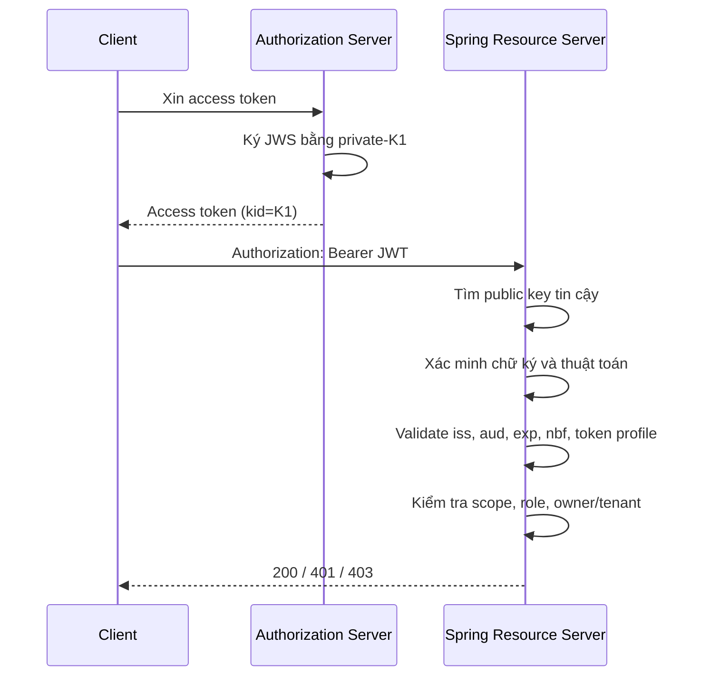
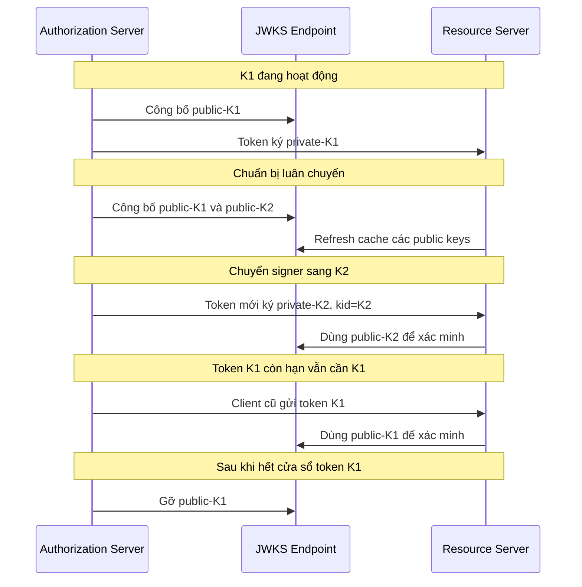

# Khóa công khai cố định và yêu cầu luân chuyển

Trong **Spring Security OAuth 2.0 / OIDC Resource Server**, một access token dạng JWT thường được Authorization Server ký bằng **private signing key**. Resource Server giữ **public key** tương ứng để xác minh chữ ký JWS trước khi tin các claims. Cách cấu hình đơn giản nhất là cung cấp **một public key cố định**, từ file PEM đã kiểm chứng hoặc cấu hình triển khai được quản lý.

Khóa cố định phù hợp với những hệ thống nhỏ hoặc môi trường có quản lý thay đổi chặt, nhưng sẽ nảy sinh vấn đề khi Authorization Server phải **luân chuyển khóa** (*signing key rotation*): token mới được ký bằng K2 trong khi các token cũ ký bằng K1 vẫn còn hạn. Nếu Resource Server chỉ biết một public key tại một thời điểm, không thể đồng thời xác minh hai loại token đó.

Bài học giải thích cách xác minh JWT bằng public key cố định, tách chữ ký với kiểm tra issuer/audience, lên kế hoạch đổi khóa theo thời gian sống của token, chuyển sang JWKS khi cần hỗ trợ nhiều khóa và kiểm thử việc phân phối/thu hồi khóa trong Spring Security.

> Ký hiệu của bài: **K1** và **K2** là hai cặp khóa độc lập. Bên phát hành giữ `private-K1` và `private-K2`; Resource Server chỉ được cung cấp `public-K1` và `public-K2`. Tên miền và thông số đều là ví dụ giả định.

## 1. Khóa công khai tham gia xác minh JWT như thế nào?

Một access token JWT được bảo vệ bằng JWS Compact thường có ba đoạn:

```text
BASE64URL(protected-header).BASE64URL(payload).BASE64URL(signature)
```

Protected header có thể chứa:

```json
{
  "alg": "RS256",
  "typ": "at+jwt",
  "kid": "orders-signing-K1"
}
```

Payload có thể chứa:

```json
{
  "iss": "https://login.example.test/realms/orders",
  "sub": "user-123",
  "aud": ["orders-api"],
  "scope": "orders:read",
  "iat": 1890000000,
  "exp": 1890003600
}
```

Đây chỉ là JSON minh họa, chưa phải token được ký hợp lệ. Trong JWS Compact thông thường, bên phát hành ký **byte ASCII của hai đoạn đã mã hóa nối bằng dấu chấm**:

```text
signingInput = ASCII(encodedHeader + "." + encodedPayload)
signature    = SIGN(privateKey, signingInput, approvedAlgorithm)
compactJws   = encodedHeader + "." + encodedPayload
               + "." + BASE64URL(signature)
```

Bên nhận dùng public key tương ứng để kiểm tra chữ ký. Nếu payload bị sửa, header bị sửa hoặc token được ký bằng private key khác, kết quả phải không hợp lệ.



**Chữ ký hợp lệ không đồng nghĩa token được phép gọi mọi API.** Sau khi xác minh mật mã, Resource Server vẫn phải xác nhận issuer, audience, thời hạn và loại access token được chấp nhận, rồi áp dụng phân quyền.

| Lớp | Câu hỏi | Lỗi thường gặp |
|---|---|---|
| **Chữ ký JWS** | Token được ký bằng khóa riêng tương ứng với public key tin cậy, đúng thuật toán? | Sai chữ ký, khóa/algorithm không khớp → thường `401`. |
| **JWT validation** | `iss` đúng, `aud` dành cho API, `exp`/`nbf` hợp lệ, đúng token profile? | Token đúng chữ ký nhưng không được phát hành cho API → thường `401`. |
| **Authorization** | User/service đủ scope/role và có quyền trên tài nguyên? | Token hợp lệ nhưng thiếu quyền → thường `403`, hoặc `404` tùy policy bảo vệ tài nguyên. |

Base64URL **không mã hóa bí mật**; chỉ decode header và payload không đủ để xác minh JWT. Public key cũng không “giải mã” hay “giải nén” dữ liệu; nó dùng để kiểm tra chữ ký số.

## 2. Thế nào là public key cố định?

Có một số mô hình phân phối khóa cho Resource Server:

| Mô hình | Nguồn public key | Cập nhật khóa | Điểm đánh đổi |
|---|---|---|---|
| **Một khóa tĩnh** | File PEM được đóng gói trong application hoặc mount bằng cấu hình được bảo vệ. | Thay file/build rồi khởi tạo lại decoder/deploy. | Dễ vận hành ban đầu, không thể chấp nhận đồng thời K1 và K2 nếu chỉ có một key. |
| **JWKS qua HTTPS tin cậy** | Endpoint JWK Set do issuer công bố, decoder chọn khóa theo `kid`. | Công bố K2, giữ K1 để overlap; verifier refresh/cache JWKS. | Luân chuyển linh hoạt, phụ thuộc chính sách JWKS/cache/mạng. |
| **Nhiều khóa được phân phối tĩnh** | Keyset local đã kiểm chứng được phân phối bởi pipeline. | Cập nhật keyset từng instance trước khi signer đổi khóa. | Không cần gọi JWKS runtime, nhưng phải tự quản lý selection, trust và rollout. |

**Public key không phải bí mật**, có thể phân phối công khai. Tuy nhiên **tính toàn vẹn và xuất xứ của public key là dữ liệu bảo mật cốt lõi**. Nếu ai đó thay public key đã tin cậy thành khóa của họ, họ có thể tạo token giả được ký bằng private key tương ứng và làm API xác minh sai. Cần bảo vệ file, repository, pipeline và quyền sửa cấu hình.

Ngược lại, **private key chỉ thuộc Authorization Server/HSM/KMS**. Không đưa nó vào Resource Server để “kiểm tra chữ ký thuận tiện”, không commit private key, và không dùng private key của issuer làm test fixture.

### 2.1. Phân biệt hai dạng PEM RSA phổ biến

File public key theo định dạng **X.509 SubjectPublicKeyInfo (SPKI)** có cấu trúc:

```pem
-----BEGIN PUBLIC KEY-----
<base64-SPKI-DER>
-----END PUBLIC KEY-----
```

Nội dung `<base64-SPKI-DER>` là placeholder. Một biến thể khác:

```text
-----BEGIN RSA PUBLIC KEY-----
...
-----END RSA PUBLIC KEY-----
```

Dạng thứ hai thường là **PKCS#1 RSAPublicKey**, khác với SPKI. Parser Java dùng `X509EncodedKeySpec` mong đợi **SPKI**, nên không lấy PKCS#1 PEM đưa thẳng vào mà không chuyển đổi đúng cách.

Khi thực hành ở môi trường cô lập, có thể sinh keypair mô phỏng issuer rồi xuất **public key**:

```bash
# Lab only: private key nằm ở máy phát hành mô phỏng.
openssl genpkey -algorithm RSA -pkeyopt rsa_keygen_bits:3072 \
  -out issuer-private.pem

openssl pkey -in issuer-private.pem -pubout \
  -out issuer-public.pem

openssl pkey -pubin -in issuer-public.pem -text -noout
```

Trong hệ thống thật, chỉ lấy public key từ nhà phát hành qua kênh đáng tin cậy, không tự tạo keypair ở API rồi coi đó là khóa của issuer đang phát hành token.

## 3. Tạo Resource Server dùng một public key cố định

Ví dụ chạy với Java 17+, Spring Boot 3.x/Spring Security 6.x. Có các quy ước:

- Issuer: `https://login.example.test/realms/orders`.
- Audience: `orders-api`.
- Chữ ký: `RS256`.
- Public key PEM: `classpath:keys/orders-issuer-public.pem`.
- Scope đọc đơn hàng: `orders:read`.

### 3.1. Dependency Maven

Sử dụng BOM/parent Spring Boot để quản lý version dependency:

```xml
<dependencies>
    <dependency>
        <groupId>org.springframework.boot</groupId>
        <artifactId>spring-boot-starter-web</artifactId>
    </dependency>
    <dependency>
        <groupId>org.springframework.boot</groupId>
        <artifactId>spring-boot-starter-security</artifactId>
    </dependency>
    <dependency>
        <groupId>org.springframework.boot</groupId>
        <artifactId>spring-boot-starter-oauth2-resource-server</artifactId>
    </dependency>
    <dependency>
        <groupId>org.springframework.boot</groupId>
        <artifactId>spring-boot-starter-test</artifactId>
        <scope>test</scope>
    </dependency>
    <dependency>
        <groupId>org.springframework.security</groupId>
        <artifactId>spring-security-test</artifactId>
        <scope>test</scope>
    </dependency>
</dependencies>
```

### 3.2. Cấu hình khóa và hợp đồng JWT

```yaml
security:
  jwt:
    issuer: https://login.example.test/realms/orders
    audience: orders-api
    public-key: classpath:keys/orders-issuer-public.pem
```

Đây là **property tự định nghĩa** để sử dụng cùng bean `JwtDecoder` ở phần tiếp theo. Public key cũng có thể được mount vào runtime:

```yaml
security:
  jwt:
    issuer: https://login.example.test/realms/orders
    audience: orders-api
    public-key: file:/etc/orders/keys/issuer-public.pem
```

Cách mount file tránh phải build lại image chỉ để đổi một public key; tuy nhiên **đổi nội dung file sau khi ứng dụng đã khởi tạo không tự làm decoder nạp khóa mới**. Cần quy trình restart/rebind hoặc refresh có chủ đích.

### 3.3. Đọc RSA public key và khai báo `JwtDecoder`

Tạo `StaticKeyJwtConfig.java`:

```java
package com.example.orders.security;

import java.io.InputStream;
import java.nio.charset.StandardCharsets;
import java.security.KeyFactory;
import java.security.interfaces.RSAPublicKey;
import java.security.spec.X509EncodedKeySpec;
import java.util.Base64;

import org.springframework.beans.factory.annotation.Value;
import org.springframework.context.annotation.Bean;
import org.springframework.context.annotation.Configuration;
import org.springframework.core.io.Resource;
import org.springframework.security.oauth2.core.DelegatingOAuth2TokenValidator;
import org.springframework.security.oauth2.core.OAuth2Error;
import org.springframework.security.oauth2.core.OAuth2TokenValidator;
import org.springframework.security.oauth2.core.OAuth2TokenValidatorResult;
import org.springframework.security.oauth2.jwt.Jwt;
import org.springframework.security.oauth2.jwt.JwtDecoder;
import org.springframework.security.oauth2.jwt.JwtValidators;
import org.springframework.security.oauth2.jwt.NimbusJwtDecoder;

@Configuration
public class StaticKeyJwtConfig {

    @Bean
    JwtDecoder jwtDecoder(
        @Value("${security.jwt.public-key}") Resource publicKeyResource,
        @Value("${security.jwt.issuer}") String trustedIssuer,
        @Value("${security.jwt.audience}") String expectedAudience
    ) throws Exception {
        RSAPublicKey publicKey = readPublicKey(publicKeyResource);

        // Mặc định builder RSA này tin RS256 trong Spring Security 6.x.
        NimbusJwtDecoder decoder =
            NimbusJwtDecoder.withPublicKey(publicKey).build();

        OAuth2TokenValidator<Jwt> audienceValidator = jwt ->
            jwt.getAudience().contains(expectedAudience)
                ? OAuth2TokenValidatorResult.success()
                : OAuth2TokenValidatorResult.failure(
                    new OAuth2Error("invalid_token", "Wrong audience", null));

        // Bao gồm các kiểm tra thời hạn cùng kiểm tra issuer;
        // bổ sung audience của chính orders-api.
        decoder.setJwtValidator(
            new DelegatingOAuth2TokenValidator<>(
                JwtValidators.createDefaultWithIssuer(trustedIssuer),
                audienceValidator
            )
        );
        return decoder;
    }

    private static RSAPublicKey readPublicKey(Resource resource)
        throws Exception {
        String pem;
        try (InputStream in = resource.getInputStream()) {
            pem = new String(in.readAllBytes(), StandardCharsets.US_ASCII);
        }

        // Mẫu này dành cho PEM X.509 SPKI: BEGIN PUBLIC KEY.
        String encoded = pem
            .replace("-----BEGIN PUBLIC KEY-----", "")
            .replace("-----END PUBLIC KEY-----", "")
            .replaceAll("\\s", "");

        byte[] der = Base64.getDecoder().decode(encoded);
        KeyFactory factory = KeyFactory.getInstance("RSA");
        return (RSAPublicKey) factory.generatePublic(
            new X509EncodedKeySpec(der));
    }
}
```

**Ý nghĩa bảo mật của cấu hình:**

1. `withPublicKey(publicKey)` sử dụng một public RSA key mà **server quản lý**, không lấy khóa từ nội dung token do client gửi.
2. Decoder xác minh JWS signature; các JWT validators bổ sung kiểm tra `iss`, `aud`, `exp`, `nbf` và các điều kiện mặc định tương ứng.
3. Trong Spring Security 6.x, `withPublicKey(...)` thông thường mặc định tin `RS256`; khi issuer dùng thuật toán khác phải cấu hình theo chính sách rõ ràng và đúng loại khóa.
4. Parser ví dụ chấp nhận một định dạng PEM cụ thể (SPKI). Nếu tổ chức xuất PKCS#1 hoặc certificate, cần parser/converter phù hợp, không dùng phép `replace` tùy tiện để biến một dạng khóa thành dạng khác.
5. Nếu file thiếu, bị sửa, không đọc được, sai Base64 hoặc không phải RSA public key, ứng dụng phải **fail startup**. Không tự tạo một khóa “dự phòng” và không bỏ signature validation để ứng dụng khởi động.
6. Bean `JwtDecoder` tùy chỉnh thay thế một phần auto-configuration của Spring Boot; cần kiểm tra **toàn bộ** validator của hợp đồng token. Nếu dùng JWT access token theo RFC 9068, còn phải cân nhắc kiểm tra token type `at+jwt` và các claim bắt buộc của hồ sơ.

Public key có thể được commit (nó không chứa secret), nhưng chỉ sau khi đã xác minh chính xác nguồn gốc và có quy trình review/update. Không lưu `issuer-private.pem` trong thư mục `resources` hoặc Docker image.

### 3.4. Bật JWT Resource Server và scope protection

```java
package com.example.orders.security;

import org.springframework.context.annotation.Bean;
import org.springframework.context.annotation.Configuration;
import org.springframework.http.HttpMethod;
import org.springframework.security.config.Customizer;
import org.springframework.security.config.annotation.web.builders.HttpSecurity;
import org.springframework.security.config.annotation.web.configurers.AbstractHttpConfigurer;
import org.springframework.security.config.http.SessionCreationPolicy;
import org.springframework.security.web.SecurityFilterChain;

@Configuration
class ApiSecurityConfig {

    @Bean
    SecurityFilterChain apiSecurity(HttpSecurity http) throws Exception {
        return http
            .csrf(AbstractHttpConfigurer::disable)
            .sessionManagement(session ->
                session.sessionCreationPolicy(SessionCreationPolicy.STATELESS))
            .authorizeHttpRequests(auth -> auth
                .requestMatchers(HttpMethod.GET, "/api/public/ping").permitAll()
                .requestMatchers(HttpMethod.GET, "/api/orders/**")
                    .hasAuthority("SCOPE_orders:read")
                .anyRequest().denyAll())
            .oauth2ResourceServer(oauth ->
                oauth.jwt(Customizer.withDefaults()))
            .build();
    }
}
```

Đối với API stateless sử dụng Bearer token trong header `Authorization`, cấu hình trên là điểm khởi đầu. Không sao chép việc tắt CSRF sang ứng dụng xác thực bằng cookie/session mà không đánh giá riêng. Quyền `SCOPE_orders:read` còn cần kết hợp với kiểm tra chủ sở hữu/tenant của dữ liệu trong service/repository.

### 3.5. Cấu hình ngắn bằng Spring Boot property

Spring Boot có thể nhận public key tĩnh thông qua property:

```yaml
spring:
  security:
    oauth2:
      resourceserver:
        jwt:
          public-key-location: classpath:keys/orders-issuer-public.pem
```

Đây là đường ngắn hơn khi không cần custom decoder. Tuy vậy, **không mặc định việc khai báo public key đã bảo đảm toàn bộ hợp đồng access token**. Phải xác minh issuer, audience, thời hạn, thuật toán, token type theo profile và các Spring Boot/Security defaults cụ thể của phiên bản đang chạy. Nếu ứng dụng **đã có `@Bean JwtDecoder` tùy chỉnh**, property này có thể không còn được auto-config dùng theo cách bạn kỳ vọng.

Trong bài này, ví dụ bean decoder giúp thể hiện rõ nguồn public key và validators. Hãy chọn **một phương án cấu hình decoder**, không để hai bean `JwtDecoder` cạnh tranh lẫn nhau.

## 4. “Đúng khóa” không thay thế các validator khác

Với RSA, một public key đúng cho K1 giúp kiểm tra chữ ký được tạo bởi private-K1. Nó không trả lời các câu hỏi còn lại:

| Kiểm tra | Public key tự đáp ứng? | Yêu cầu thực tế |
|---|---|---|
| JWT được ký đúng RSA key và algorithm | **Có**, nếu decoder giới hạn thuật toán đúng. | Kiểm tra JWS signature. |
| `iss` thuộc issuer tin cậy | **Không**. | Validate issuer chính xác. |
| `aud` chứa `orders-api` | **Không**. | Validate audience; không chấp nhận token dành cho một API/frontend khác. |
| `exp`, `nbf` hợp lệ | **Không**. | Kiểm tra hiệu lực theo đồng hồ, chính sách skew. |
| Token là **access token** đúng profile | **Không**. | Ràng buộc token type/claims theo hợp đồng (ví dụ `at+jwt` cho RFC 9068). |
| Scope/role được cấp cho hành động | **Không**. | Ánh xạ quyền và kiểm tra route/method. |
| User/service sở hữu bản ghi | **Không**. | Kiểm tra owner, tenant và ràng buộc nghiệp vụ. |
| Token bị thu hồi trước `exp` | **Không**. | Thiết kế revocation/introspection, token TTL hoặc cơ chế bổ sung. |
| Private-K1 đã bị lộ | **Không**. | Loại K1 khỏi trust và xử lý token ký K1. |

Điều này giải thích hai loại lỗi dễ nhầm:

- JWT có chữ ký K1 hợp lệ nhưng `aud=payments-api` bị từ chối **vì dành cho API khác**, không phải vì public key sai.
- JWT có `scope=orders:read` trong JSON nhưng chữ ký K1 không hợp lệ thì không được xây dựng principal/authority. Không cho qua chỉ vì phần payload đọc được.

### 4.1. `kid` chỉ là gợi ý chọn khóa

JWS header thường chứa `kid` (*key identifier*) để lựa chọn khóa trong một JWKS. Nhưng `kid` không phải bằng chứng tin cậy: kẻ tấn công có thể tự đặt `kid` vào token chưa được xác minh.

Với một public key tĩnh, decoder đã biết key để kiểm tra; `kid` không tự chuyển K1 thành K2. Với JWKS, decoder tìm `kid` **trong tập khóa gắn với issuer tin cậy đã được cấu hình**. Không truy cập URL tùy ý từ token header `jku`/`x5u` chưa được kiểm chứng để tải public key; điều đó có thể làm API tin khóa do kẻ tấn công điều khiển.

### 4.2. Thuật toán phải được allowlist

Nếu verifier đọc `alg` rồi tự chuyển sang bất kỳ thuật toán nào token đề nghị, có nguy cơ **algorithm confusion**. Ví dụ cấu hình RSA nhưng bất cẩn chấp nhận HMAC bằng RSA public key làm secret có thể tạo lỗ hổng nghiêm trọng ở implementation sai.

Phải từ chối `alg=none` cho access token yêu cầu ký, giới hạn `RS256`/`PS256`/`ES256` đúng theo hợp đồng issuer và phù hợp key type. Không dùng “accept all algorithms” như một giải pháp tạm thời để hỗ trợ rotation.

## 5. Một khóa tĩnh gặp vấn đề gì khi K1 đổi thành K2?

Giả sử:

- Toàn bộ `orders-api` đang tin `public-K1`.
- Authorization Server đang ký access token bằng `private-K1`.
- Access token có hạn sử dụng tối đa **30 phút**.
- Tổ chức muốn chuyển sang keypair K2.

Khi issuer bắt đầu ký private-K2:

```text
Token K1 + Resource Server tin public-K1  -> chữ ký có thể hợp lệ
Token K2 + Resource Server tin public-K1  -> chữ ký bị từ chối
Token K1 + Resource Server tin public-K2  -> chữ ký bị từ chối
Token K2 + Resource Server tin public-K2  -> chữ ký có thể hợp lệ
```

**Không có thời điểm một decoder chỉ tin đúng một public key mà vẫn nhận được cả token K1 và K2.**

Giả sử 10 pod API rolling update: 5 pod K1, 5 pod K2. Một client vẫn mang token K1 có thể gọi thành công khi request đến pod cũ, nhưng `401` khi request đến pod mới. Token K2 gặp lỗi theo chiều ngược lại. Tăng retry hoặc bật sticky session không giải quyết nền tảng của việc chia tách niềm tin: failover, autoscaling và load balancing có thể đổi pod bất kỳ lúc nào.

### 5.1. Bảng thời điểm cắt khóa

| Giai đoạn | Issuer ký bằng | API chỉ tin | Token K1 còn hạn | Token K2 mới |
|---|---|---|---|---|
| Ban đầu | K1 | public-K1 | Chấp nhận | Chưa được phát hành. |
| Chuyển issuer trước | K2 | public-K1 | Chấp nhận | **401**. |
| Chuyển API trước | K1 | public-K2 | **401**. | Không có. |
| Chuyển toàn bộ sang K2 | K2 | public-K2 | **401**, dù `exp` vẫn còn. | Chấp nhận. |

Cố gắng đổi hai phía “đồng thời” vẫn có khoảng thời gian phân phối, cache và clock skew. Nếu API cần tiếp tục nhận **cả token cũ còn hạn và token mới**, phải dùng giải pháp tin **nhiều public keys** trong giai đoạn chuyển tiếp.

### 5.2. Hard cutover với single-key có thể chấp nhận được không?

Có, nhưng cần thông báo rõ trade-off:

1. Dừng phát hành token K1 theo quy trình.
2. Chờ token K1 cuối cùng hết hạn và hoàn tất thời gian skew/usage window đã cam kết.
3. Cắt signer và verifier sang K2 trong một cửa sổ được kiểm soát.
4. Phát hành token K2 và cho client lấy lại token.

Ở hệ thống hoạt động liên tục, việc chờ token K1 hết hạn trong khi ngừng phát token mới có thể gây gián đoạn. Nếu dịch vụ không chấp nhận downtime, hard cutover bằng **một key duy nhất** là lựa chọn không phù hợp. Nên công khai hạn chế này ngay khi thiết kế, không đợi tới ngày rotation.

## 6. Dùng JWKS để chấp nhận K1 và K2 trong giai đoạn overlap

**JWKS — JSON Web Key Set** công bố một tập public keys. Với RSA, public JWK chứa `n` (modulus) và `e` (exponent), kèm một `kid` nhận diện khóa:

```json
{
  "keys": [
    {
      "kty": "RSA",
      "kid": "orders-signing-K1",
      "use": "sig",
      "alg": "RS256",
      "n": "<public-modulus-K1-base64url>",
      "e": "AQAB"
    },
    {
      "kty": "RSA",
      "kid": "orders-signing-K2",
      "use": "sig",
      "alg": "RS256",
      "n": "<public-modulus-K2-base64url>",
      "e": "AQAB"
    }
  ]
}
```

Các chuỗi `<public-modulus-...>` là placeholder, không phải khóa thật. JWKS công khai **không được chứa private JWK fields** như `d`, `p`, `q`, `dp`, `dq` hay `qi`.

Decoder chọn khóa từ JWKS **đã tin cậy**, thường theo `kid`/`alg`/`kty`. Nếu token mang `kid=orders-signing-K2`, decoder thử public-K2 để xác minh chữ ký; nếu token cũ mang K1, public-K1 vẫn còn.

### 6.1. Luân chuyển định kỳ theo các bước

| Giai đoạn | Issuer dùng private key nào để ký? | JWKS công bố | Điều kiện vận hành |
|---|---|---|---|
| **A. Ổn định** | K1 | public-K1 | Các API đang chấp nhận token K1. |
| **B. Công bố trước** | **Vẫn K1** | public-K1 **và** public-K2 | Cho API/JWKS cache có thời gian biết K2. |
| **C. Chuyển ký** | **K2** | public-K1 và public-K2 | Token mới K2 được nhận, token K1 còn hạn tiếp tục hợp lệ. |
| **D. Chờ token cũ** | K2 | public-K1 và public-K2 | Chờ token K1 cuối cùng hết hạn và xử lý skew/cache. |
| **E. Thu hồi K1** | K2 | Chỉ public-K2 | Các verifier cập nhật/loại K1 theo chính sách. |



Quy tắc quan trọng là **công bố K2 trước khi ký token K2; giữ K1 sau khi ngừng ký K1 cho tới khi token K1 hết giá trị sử dụng, trừ trường hợp thu hồi khẩn cấp**.

### 6.2. Tính cửa sổ overlap

Đừng lấy cố định 5 phút hoặc 24 giờ cho mọi dịch vụ. Thời gian cần xét:

- **TTL tối đa** của mọi access token K1 có thể được phát hành. Grant khác nhau có thể dùng TTL khác nhau.
- **Thời điểm cuối cùng issuer ký bằng K1**, kể cả các node phát hành chưa đồng bộ.
- **Clock skew** của JWT validators, hệ thống phát hành và xác minh.
- **JWKS cache TTL**, refresh interval, CDN/proxy cache và các node có cache riêng.
- **Độ trễ triển khai** đến mọi Resource Server.
- Trường hợp `nbf` trong tương lai, token batch/job offline và chính sách token vẫn được sử dụng đến `exp`.

Ví dụ, token K1 cuối cùng được cấp lúc 10:00 với TTL tối đa 30 phút thì 10:01 vẫn còn rất nhiều token K1 hợp lệ. Ngay cả sau 10:30, cần cân nhắc skew và khả năng cache/đồng bộ. Chính xác khi nào gỡ K1 phải dựa trên hợp đồng token và trạng thái thực tế của hệ thống.

### 6.3. Lưu ý riêng về JWKS cache

Spring Security/Nimbus hoặc HTTP proxy có thể cache keyset. Các biểu hiện khác nhau:

- Key K2 đã xuất hiện ở JWKS nhưng một số decoder vẫn giữ bản K1 cũ.
- Token mới mang `kid=K2` có thể kích hoạt refresh cache ở một số triển khai; **không giả định mọi version refresh ngay lập tức**.
- Nếu tái sử dụng cùng `kid` cho cặp khóa khác, decoder có thể chọn public key cũ, làm xác minh chữ ký thất bại. Cấp `kid` mới cho keypair mới.
- Sau khi xóa K1 khỏi JWKS, một số instance có thể **vẫn giữ K1 trong cache**. Việc xóa trên issuer không bảo đảm tất cả Resource Server đã dừng tin K1 ngay.
- Nếu JWKS endpoint lỗi mạng, token dùng khóa đã cache có thể vẫn được kiểm tra ở một số cấu hình, nhưng token mang `kid` mới không thể xác minh sẽ bị từ chối. Không có cơ sở cho phép qua.

Vì vậy, **test rotation phải bao gồm cache behavior của phiên bản Spring Security/Nimbus/proxy thực tế**, không chỉ kiểm tra file JWKS trên issuer.

## 7. Cấu hình JWKS trong Spring Security

Một cấu hình điển hình khi issuer hỗ trợ discovery:

```yaml
spring:
  security:
    oauth2:
      resourceserver:
        jwt:
          issuer-uri: https://login.example.test/realms/orders
          audiences:
            - orders-api
```

Spring Security có thể dùng metadata của issuer tin cậy để định vị JWKS endpoint; chi tiết discovery và khởi động phụ thuộc cấu hình/phiên bản. Nếu muốn cố định JWKS endpoint đã được tổ chức kiểm duyệt:

```yaml
spring:
  security:
    oauth2:
      resourceserver:
        jwt:
          issuer-uri: https://login.example.test/realms/orders
          jwk-set-uri: https://login.example.test/realms/orders/protocol/openid-connect/certs
          audiences:
            - orders-api
```

URL chỉ mang tính minh họa; phải lấy chính xác `jwks_uri` từ metadata/đặc tả issuer. Kết hợp `issuer-uri` và `jwk-set-uri` giúp chỉ rõ nguồn khóa và duy trì kiểm tra issuer trong cấu hình Spring Boot thích hợp, đồng thời có thể tránh phụ thuộc discovery ở thời điểm khởi động.

Không cho request header, query string hay `jku` trong JWT thay đổi địa chỉ JWKS đang tin cậy. Endpoint JWKS phải được truy cập qua HTTPS với chứng chỉ hợp lệ, quyền thay đổi metadata được kiểm soát và có quy trình rotation.

### 7.1. Decoder JWKS được khai báo bằng Java

Nếu cần tự tạo bean `JwtDecoder`:

```java
package com.example.orders.security;

import org.springframework.context.annotation.Bean;
import org.springframework.context.annotation.Configuration;
import org.springframework.security.oauth2.core.DelegatingOAuth2TokenValidator;
import org.springframework.security.oauth2.core.OAuth2Error;
import org.springframework.security.oauth2.core.OAuth2TokenValidator;
import org.springframework.security.oauth2.core.OAuth2TokenValidatorResult;
import org.springframework.security.oauth2.jwt.Jwt;
import org.springframework.security.oauth2.jwt.JwtDecoder;
import org.springframework.security.oauth2.jwt.JwtValidators;
import org.springframework.security.oauth2.jwt.NimbusJwtDecoder;

@Configuration
class JwksJwtConfig {
    private static final String ISSUER =
        "https://login.example.test/realms/orders";
    private static final String JWKS_URI =
        "https://login.example.test/realms/orders/protocol/openid-connect/certs";

    @Bean
    JwtDecoder jwtDecoder() {
        NimbusJwtDecoder decoder =
            NimbusJwtDecoder.withJwkSetUri(JWKS_URI).build();

        OAuth2TokenValidator<Jwt> audience = jwt ->
            jwt.getAudience().contains("orders-api")
                ? OAuth2TokenValidatorResult.success()
                : OAuth2TokenValidatorResult.failure(
                    new OAuth2Error("invalid_token", "Wrong audience", null));

        decoder.setJwtValidator(
            new DelegatingOAuth2TokenValidator<>(
                JwtValidators.createDefaultWithIssuer(ISSUER),
                audience
            )
        );
        return decoder;
    }
}
```

Ví dụ này thay thế bean static-key ở phần 3. **Không tạo cả `StaticKeyJwtConfig` và `JwksJwtConfig` trong cùng application context** nếu cả hai cùng định nghĩa bean `JwtDecoder` không có điều kiện. Hãy chọn một chiến lược theo môi trường.

Mặc định về thuật toán được phép phải được đối chiếu với phiên bản Spring Security sử dụng; muốn dùng `PS256`/`ES256` hoặc đổi loại khóa phải cấu hình và kiểm thử **chính xác thuật toán được phê duyệt**. Không mở chấp nhận mọi `alg` chỉ để token hoạt động.

### 7.2. `kid`, `kty`, `alg` và lựa chọn khóa

Trong JWKS:

- `kid`: ID khóa để nhận diện khi có nhiều public key. Cần duy nhất trong giai đoạn overlap.
- `kty`: loại khóa, ví dụ `RSA` hoặc `EC`.
- `alg`: thuật toán dự kiến, ví dụ `RS256`; chỉ là một phần metadata, verifier vẫn phải có policy.
- `use=sig`: mục đích ký/xác minh; không dùng khóa chỉ dành cho encryption nếu policy không cho phép.
- `n`, `e`: thông số public RSA.
- `key_ops` (nếu dùng): có thể khai báo `verify`.

**Key selection không thay thế signature verification**. Dù `kid` khớp một public key trong JWKS, chữ ký vẫn phải được xác minh bằng mật mã. Không chấp nhận token chỉ vì `kid` hoặc `iss` nhìn có vẻ hợp lệ.

## 8. Nếu phải giữ khóa tĩnh: thiết kế quy trình thay khóa

Một số tổ chức không cho Resource Server truy cập JWKS qua mạng. Khi đó nên chủ động thiết kế quản lý vòng đời khóa:

1. **Tạo khóa mới**: issuer/HSM tạo K2, giữ private-K2 ngoài Resource Server.
2. **Công bố public-K2 qua kênh có kiểm chứng**: ví dụ artifact được ký, kênh nội bộ đã xác thực, fingerprint SHA-256 của DER SPKI được đội issuer xác nhận theo quy trình.
3. **Phân phối keyset hoặc bản thay khóa**: chỉ cho phép pipeline/role thích hợp cập nhật file trusted keys.
4. **Đổi decoder/rollout**: reload bean có chủ đích hoặc restart pod; với static single-key phải chấp nhận khoảng chuyển đổi hay hard cutover.
5. **Kiểm tra trên mọi instance**: xác nhận ứng dụng đã dùng đúng bản key, không lẫn phiên bản và không dùng fallback không có policy.
6. **Thu hồi K1**: theo trạng thái token cũ hoặc quy trình ứng phó khẩn cấp.
7. **Lưu lịch sử thay đổi có thể audit**: ai duyệt public key mới, ngày áp dụng, thuật toán, `kid`, fingerprint và lịch hết hiệu lực.

### 8.1. Nhiều khóa tĩnh có thể thay thế JWKS runtime

Nếu cần vừa không gọi mạng vừa hỗ trợ overlap, có thể dùng **tập public keys tĩnh** có `kid` và trust policy rõ ràng. Một lựa chọn là phân phối **JWKS JSON local đã kiểm chứng**, dùng thư viện JOSE để chọn khóa theo `kid`/algorithm và kiểm tra chữ ký, rồi chạy các JWT validators giống cấu hình bình thường.

Tuy nhiên, implementation multi-key tùy chỉnh là một phần security-critical. Không nên thay bằng:

```java
// PSEUDOCODE MINH HỌA SAI LẦM — KHÔNG DÙNG PRODUCTION
try {
    return decoderK1.decode(token);
} catch (Exception error) {
    return anyDecoderThatAcceptsIt.decode(token);
}
```

Một fallback không rõ ranh giới có thể biến lỗi issuer/audience/algorithm thành “thử khóa khác” rồi được chấp nhận. Nếu thực hiện multi-key, phải:

- Gắn keyset với **đúng issuer và token profile**.
- Giới hạn thuật toán và key type.
- Chọn khóa duy nhất, xử lý `kid` lạ hoặc ambiguous theo policy.
- Áp dụng **mọi validator** cho token, không bỏ qua ở nhánh decoder khác.
- Có cơ chế phân phối keyset mới và loại K1 khỏi **toàn bộ** pod.
- Kiểm thử đầy đủ hành vi khi trust keyset không đồng bộ.

Một JWKS endpoint **nội bộ** đã được kiểm chứng đôi khi dễ vận hành hơn tự phát triển selector. Việc JWKS có công bố qua Internet hay không là quyết định network; điều cốt lõi là nguồn khóa đáng tin và hỗ trợ overlap.

### 8.2. Pinning và luân chuyển

Có hai tầng “pin” dễ bị nhầm:

- **Pin issuer/JWKS URL**: Resource Server chỉ tải public keys từ nguồn được phép, issuer/certificate tin cậy. Các signing keys trong JWKS có thể thay đổi theo policy.
- **Pin một public signing key duy nhất**: Resource Server chỉ tin keypair tương ứng. Khi signer đổi keypair, phải cập nhật public key theo cách phối hợp.

Pin đúng một key có thể chặt nhưng tạo chi phí rất cao cho rotation. Nếu yêu cầu zero downtime và AS rotate thường xuyên, hãy đánh giá có nên chuyển sang trust **issuer + JWKS endpoint** hoặc keyset được phân phối tĩnh với overlap. **TLS certificate pinning** của JWKS endpoint lại là vấn đề khác với pin JWT public signing key.

## 9. Rotation định kỳ và rotation khẩn cấp khác nhau

Trong **rotation định kỳ**, K1 chưa bị mất tin cậy; vẫn an toàn về mặt mật mã để chấp nhận token K1 còn hạn theo hợp đồng. Có thể duy trì giai đoạn overlap để client không phải lấy token mới đột ngột.

Trong **rotation khẩn cấp do private-K1 bị lộ**, ai có private-K1 có thể ký token giả với claims do họ chọn. Việc giữ K1 trong JWKS chỉ để tránh lỗi `401` sẽ duy trì khả năng giả mạo. Runbook nên ưu tiên thu hồi trust K1 và chấp nhận việc các token K1 còn hạn phải được cấp lại.

### 9.1. Quy trình xử lý nghi ngờ lộ private signing key

1. Xác nhận phạm vi: issuer, keypair, môi trường, nơi lưu private key, log/bản backup/CI liên quan.
2. Cách ly nguồn lộ, đóng quyền truy cập trái phép vào HSM/KMS/key store.
3. Sinh K2 trong kho khóa tin cậy, sử dụng `kid` mới và thuật toán đã được phê duyệt.
4. Chuyển AS sang ký K2 và cấu hình mọi Resource Server chấp nhận K2 nhanh nhất có thể.
5. **Loại public-K1 khỏi trust** ở các verifier theo chính sách sự cố; xử lý JWKS cache và ứng dụng còn giữ K1.
6. Đánh giá token bị giả mạo hoặc hành vi bất thường, đồng thời thông báo client cần refresh/đăng nhập lại khi token K1 bị vô hiệu.
7. Kiểm thử token K1 bị từ chối và token K2 được chấp nhận trên mọi pod/region.
8. Điều tra nguyên nhân, cập nhật bảo vệ private key, audit trail và runbook phòng ngừa.

Một private key bị lộ làm chữ ký K1 mất giá trị phân biệt token hợp lệ cũ với token giả mới. JWT không có cách tự nhận biết điều đó nếu chỉ dựa trên public-K1. Cơ chế revocation bổ sung có thể hữu ích nhưng không thay thế việc loại trust đối với khóa đã mất an toàn.

### 9.2. JWKS cache trong sự cố khẩn cấp

Khi issuer gỡ K1 khỏi JWKS, **một số decoder vẫn có thể giữ public-K1 trong cache**. Tùy phiên bản thư viện, cache có TTL hoặc refresh logic riêng, nên không thể coi gỡ K1 trên endpoint là thu hồi ngay lập tức.

Runbook cần có phương án khả thi để:

- Invalidating cache hoặc restart/recreate decoder trên các pod.
- Xác nhận các API instance ở tất cả region/cluster đã loại K1.
- Ngăn các pod cũ quay lại với cấu hình cache/keyset K1.
- Kiểm tra token K1 bị từ chối sau khi quy trình thu hồi hoàn thành.

Không tắt xác minh JWT hay tạm mở `permitAll` để che đi lỗi rotation.

## 10. Kiểm thử chữ ký và sự chuyển đổi khóa

Kiểm thử theo lớp giúp biết một token bị từ chối vì **sai chữ ký**, **sai claims**, hay **thiếu quyền**.

### 10.1. Ma trận kiểm thử tối thiểu

| Kịch bản | Decoder chỉ tin K1 | JWKS tin K1+K2 | Sau thu hồi K1 |
|---|---|---|---|
| Token K1 đúng chữ ký/claims, còn hạn | Chấp nhận | Chấp nhận | Từ chối |
| Token K2 đúng chữ ký/claims, còn hạn | Từ chối | Chấp nhận | Chấp nhận |
| Token K1 sửa payload nhưng giữ chữ ký | Từ chối | Từ chối | Từ chối |
| Token `alg=none` hoặc algorithm ngoài allowlist | Từ chối | Từ chối | Từ chối |
| Token đúng chữ ký nhưng `iss` khác | Từ chối | Từ chối | Từ chối |
| Token đúng chữ ký nhưng `aud` là API khác | Từ chối | Từ chối | Từ chối |
| Token đúng chữ ký nhưng `exp` đã qua | Từ chối | Từ chối | Từ chối |
| Token hợp lệ, thiếu scope | Authentication thành công, authorization từ chối | Tương tự | Tương tự |
| Token hợp lệ, đủ scope nhưng sai owner | Authorization nghiệp vụ từ chối | Tương tự | Tương tự |

Các hàng “chấp nhận” giả định mọi điều kiện không nêu đều hợp lệ và chính sách API cho phép.

### 10.2. JUnit test chứng minh một public key không xác minh token K2

Sinh **keypair test** trong bộ nhớ, ký bằng private key của từng cặp và thử decoder chỉ tin public-K1:

```java
package com.example.orders.security;

import static org.junit.jupiter.api.Assertions.assertEquals;
import static org.junit.jupiter.api.Assertions.assertThrows;

import java.security.KeyPair;
import java.security.KeyPairGenerator;
import java.security.interfaces.RSAPrivateKey;
import java.security.interfaces.RSAPublicKey;
import java.time.Instant;
import java.util.List;

import com.nimbusds.jose.jwk.JWKSet;
import com.nimbusds.jose.jwk.RSAKey;
import com.nimbusds.jose.jwk.source.ImmutableJWKSet;
import org.junit.jupiter.api.Test;
import org.springframework.security.oauth2.jose.jws.SignatureAlgorithm;
import org.springframework.security.oauth2.jwt.Jwt;
import org.springframework.security.oauth2.jwt.JwtClaimsSet;
import org.springframework.security.oauth2.jwt.JwtDecoder;
import org.springframework.security.oauth2.jwt.JwtEncoderParameters;
import org.springframework.security.oauth2.jwt.JwtException;
import org.springframework.security.oauth2.jwt.JwsHeader;
import org.springframework.security.oauth2.jwt.NimbusJwtDecoder;
import org.springframework.security.oauth2.jwt.NimbusJwtEncoder;

class FixedPublicKeyDecoderTest {
    @Test
    void k1KeyDoesNotVerifySignatureCreatedByK2() throws Exception {
        KeyPair k1 = generateRsa();
        KeyPair k2 = generateRsa();

        String tokenK1 = sign(k1, "K1", "alice");
        String tokenK2 = sign(k2, "K2", "alice");

        JwtDecoder decoder = NimbusJwtDecoder
            .withPublicKey((RSAPublicKey) k1.getPublic())
            .build();

        Jwt valid = decoder.decode(tokenK1);
        assertEquals("alice", valid.getSubject());

        assertThrows(JwtException.class, () -> decoder.decode(tokenK2));
    }

    private static KeyPair generateRsa() throws Exception {
        KeyPairGenerator generator = KeyPairGenerator.getInstance("RSA");
        generator.initialize(2048); // Lab only, không khuyến nghị mặc định cho production.
        return generator.generateKeyPair();
    }

    private static String sign(KeyPair keyPair, String kid, String subject) {
        RSAKey signingJwk = new RSAKey.Builder(
            (RSAPublicKey) keyPair.getPublic())
            .privateKey((RSAPrivateKey) keyPair.getPrivate())
            .keyID(kid)
            .build();

        NimbusJwtEncoder encoder = new NimbusJwtEncoder(
            new ImmutableJWKSet<>(new JWKSet(signingJwk)));

        Instant now = Instant.now();
        JwtClaimsSet claims = JwtClaimsSet.builder()
            .issuer("https://login.example.test/realms/orders")
            .subject(subject)
            .audience(List.of("orders-api"))
            .issuedAt(now)
            .expiresAt(now.plusSeconds(300))
            .claim("scope", "orders:read")
            .build();

        JwsHeader header = JwsHeader.with(SignatureAlgorithm.RS256)
            .keyId(kid)
            .build();

        return encoder.encode(
            JwtEncoderParameters.from(header, claims)).getTokenValue();
    }
}
```

Mục tiêu của test này là **khóa ký và khóa xác minh**. Nó chưa gắn các validators issuer/audience như cấu hình production; cần test thêm decoder được cấu hình với `JwtValidators.createDefaultWithIssuer(...)` và audience validator để bảo đảm mọi claim quan trọng cũng bị kiểm tra.

Không dùng private key production trong test. Khi chạy test bảo mật HTTP với `spring-security-test`, lưu ý `jwt()` của MockMvc tạo mock authentication, bỏ qua bước chữ ký/JWKS, nên **không đủ làm bằng chứng rotation**.

### 10.3. Integration test cho JWKS và cache

Dùng local HTTP server giả lập JWKS và hai cặp khóa K1/K2, sau đó mô phỏng:

1. JWKS chỉ chứa K1, token K1 hợp lệ.
2. JWKS công bố K1+K2 trong khi signer vẫn ký K1.
3. Token K2 xuất hiện với `kid` mới; decoder phải nhận K2 sau khi refresh, token K1 vẫn phải được xác minh.
4. JWKS cache trả bản cũ hoặc endpoint lỗi: quan sát token K2, key lookup và fail closed.
5. JWKS bỏ K1; kiểm tra token K1 chỉ bị từ chối **sau khi decoder thực sự bỏ cached K1**.
6. Token `kid` lạ, trùng key ID, algorithm ngoài policy, sai `iss`/`aud`, hết hạn và signature sai đều bị từ chối theo hợp đồng.
7. Trong môi trường staging nhiều pod, xác nhận token K1/K2 có hành vi nhất quán trước, trong và sau rotation.

Nếu test không kiểm soát cache và rollout, có thể kết luận sai rằng hệ thống đã thu hồi K1 hoặc đã sẵn sàng cho K2.

## 11. Khi thay thuật toán đồng thời với thay khóa

Đổi RSA keypair K1 → K2 trong khi giữ `RS256` là key rotation. Đổi `RS256` sang `PS256` hoặc `ES256` đồng thời là **algorithm migration**:

- Với RSA → EC, loại khóa và parser/verifier cũng khác.
- Một JWK có `kty=RSA` không dùng để xác minh ECDSA token.
- `alg` phải thuộc danh sách được cho phép bởi Resource Server trước khi xử lý token.
- Các API phiên bản cũ có thể không hỗ trợ thuật toán mới.
- Nếu có giai đoạn overlap giữa thuật toán cũ/mới, phải khai báo có giới hạn và kiểm thử các token hợp lệ/bị từ chối của từng loại.

Quy trình nên là: **đưa verifier hỗ trợ chính sách mới lên trước → công bố key mới → bắt đầu ký theo thuật toán mới → chờ token cũ hết hạn → loại thuật toán/key cũ**. Không bật mọi thuật toán chỉ để bảo đảm “không gián đoạn”.

## 12. Giám sát và xử lý lỗi rotation trong vận hành

Các chỉ báo cần quan sát mà không lưu credential:

| Hiện tượng | Nguyên nhân có thể | Điều kiểm tra |
|---|---|---|
| `401` tăng ngay khi issuer chuyển signer K2 | API thiếu public-K2 hoặc JWKS cache cũ. | `kid` mới, keyset hiện tại, cache refresh và version từng pod. |
| Token cùng loại thành công ở pod A nhưng thất bại pod B | Các pod tin khóa khác nhau. | Deployment, mounted public key, cache và readiness. |
| K2 không được nhận nhưng K1 vẫn hoạt động | K2 chưa pre-publish, lỗi TLS/JWKS hoặc thuật toán/key type không khớp. | JWKS endpoint đã tin cậy, `kid`, `alg`. |
| Token K1 còn được nhận sau khi đã rút K1 | Cache/public key local còn tồn tại. | Cache invalidate, restart/rollout và bản keyset ở mọi instance. |
| `403` tăng nhưng JWT decode thành công | Scope, role, ownership hoặc tenant có vấn đề. | Phân quyền, không mặc định là lỗi khóa. |
| JWKS endpoint timeout hoặc TLS failure | Mạng, CA, proxy, outage của AS. | Đường mạng và chứng chỉ; không tắt TLS verification. |
| Token đúng chữ ký nhưng sai `aud`/`iss` | Thay profile token hoặc cấu hình AS. | Hợp đồng issuer/audience; không tắt validators. |

**Không log raw JWT**, `Authorization: Bearer`, private keys hoặc kết quả introspection nhạy cảm. Có thể log request ID, mã trạng thái và loại lỗi đã chuẩn hóa, cùng số liệu theo pod/region. Header `kid` lấy từ token chưa xác minh cũng là dữ liệu do client điều khiển; khi log phải giới hạn độ dài/ký tự và không xem nó là bằng chứng nguồn token.

Khi không lấy được khóa tin cậy phù hợp để xác minh, **fail closed**: request không được đi vào nghiệp vụ bảo vệ. Mã HTTP cụ thể cho lỗi hạ tầng JWKS có thể phụ thuộc decoder và exception handler, nhưng không được mặc định cho qua vì network lỗi.

## 13. Runbook luân chuyển khóa định kỳ

**Trước khi bắt đầu**

- Xác nhận chủ sở hữu Authorization Server và ai có quyền tạo/đổi private signing key.
- Xác định thuật toán, `kid` mới, TTL access token tối đa và clock skew.
- Xác nhận số lượng pod/API, JWKS cache/CDN/proxy và cách refresh/restart.
- Chuẩn bị token test K1/K2, test issuer/audience, dashboard 401 và kênh rollback.
- Bảo đảm private-K2 được lưu trong HSM/KMS/secret store của **issuer**, không đưa vào Resource Server.

**Thực hiện**

1. Tạo K2, kiểm tra public-K2/metadata.
2. Công bố public-K2 **cùng** public-K1 qua JWKS hoặc phân phối keyset tĩnh hỗ trợ overlap.
3. Chờ hệ thống xác minh có thể lấy và chấp nhận K2; kiểm tra mọi pod/region trước khi chuyển signer.
4. Chuyển Authorization Server sang ký bằng private-K2.
5. Xác minh token K2 mới được chấp nhận, token K1 còn hạn vẫn được chấp nhận theo chính sách.
6. Duy trì overlap cho đến khi token K1 cuối cùng hết hạn, cộng các yếu tố clock skew/cache/rollout.
7. Gỡ public-K1 khỏi tập khóa tin cậy theo kế hoạch; kiểm tra các verifier đã thật sự loại K1.
8. Ghi lại kết quả, version/key ID và ngày hết hạn; xử lý/hủy private-K1 theo chính sách quản lý khóa.

**Nếu private-K1 có nguy cơ bị lộ:** rút ngắn hoặc bỏ giai đoạn overlap nhằm tránh tiếp tục tin token giả có chữ ký K1. Có thể phải buộc client cấp lại token và chấp nhận sự gián đoạn ngắn có kiểm soát.

## 14. Các hiểu nhầm phổ biến

| Hiểu nhầm | Cách hiểu đúng |
|---|---|
| “Public key là secret, không được đưa lên JWKS.” | Public key có thể công khai; phải bảo vệ **tính toàn vẹn và xuất xứ** của nó. |
| “Resource Server có public key thì tự động kiểm tra `aud`/`iss`.” | Chữ ký và validation claims là các bước độc lập, cần cấu hình rõ. |
| “Header `kid=K2` tự động làm API nhận K2.” | `kid` chỉ định danh khóa trong **tập tin cậy**; API phải thực sự có public-K2. |
| “Tôi có một khóa tĩnh nên có thể luân chuyển không gián đoạn.” | Nếu token K1/K2 đồng thời tồn tại, decoder một-key không thể nhận cả hai. |
| “Chỉ cần rolling deploy nửa số pod K2.” | Token sẽ thành công/thất bại tùy pod; cần overlap ở mỗi verifier. |
| “Gỡ K1 khỏi JWKS là vô hiệu hóa K1 tức thì.” | Caches có thể vẫn chứa K1; cần quy trình invalidate/restart/đồng bộ. |
| “Key rotation định kỳ là cách logout user ngay.” | Trong rotation định kỳ, token K1 thường vẫn được nhận đến khi hết hạn; revocation là bài toán khác. |
| “Chữ ký hợp lệ thì scope trong payload chắc chắn được phép.” | Scope, role, audience, owner/tenant phải được kiểm tra độc lập. |
| “Khi JWKS lỗi, cứ bỏ qua xác minh cho API hoạt động.” | Không được cấp quyền cho token chưa xác minh; phải fail closed. |
| “Có thể đổi `RS256` thành `HS256` chỉ bằng sửa header.” | Thuật toán phải được allowlist và phù hợp loại khóa; tránh algorithm confusion. |

## 15. Lựa chọn kiến trúc theo yêu cầu thực tế

| Yêu cầu | Cách tiếp cận nên cân nhắc |
|---|---|
| Một issuer, ít thay khóa, có cửa sổ bảo trì | Public key tĩnh với cutover/runbook rõ ràng; chấp nhận giới hạn. |
| API nhiều pod, token TTL còn dài, cần không gián đoạn | JWKS hoặc tập public keys hỗ trợ K1/K2 overlap. |
| Môi trường offline, không truy cập JWKS runtime | Keyset được phân phối tĩnh có nguồn gốc đã kiểm chứng và nhiều khóa trong giai đoạn chuyển. |
| Nhiều issuer | Ràng buộc **issuer → khóa/JWKS → thuật toán → token profile**, không trộn lẫn trust domain. |
| Cần thu hồi key bị lộ nhanh | Quy trình emergency, kiểm soát cache và thay trust keys trên mọi verifier. |
| Muốn đổi từ RSA sang EC/PSS | Kế hoạch migration thuật toán riêng, kiểm thử cả loại khóa và signed tokens. |

Mô hình cần ghi nhớ:

```text
Authorization Server
  ├─ private-K1 (ngừng ký, token cũ có thể còn hạn)
  └─ private-K2 (đang ký)
          │
          ▼
JWKS hoặc keyset tin cậy
  ├─ public-K1 (đến hết giai đoạn overlap)
  └─ public-K2 (dành cho token mới)
          │
          ▼
Spring Security JwtDecoder
  ├─ Thuật toán, key source, kid và signature verification
  ├─ JWT validation: iss, aud, exp, nbf, token profile
  └─ Authentication → scopes/roles → owner/tenant authorization
```

**Quy tắc vận hành căn bản:** **công bố public-K2 trước → chuyển issuer ký private-K2 → giữ public-K1 cho token cũ còn hiệu lực → loại K1 sau khi hết cửa sổ và xác minh trạng thái cache/pod**. Nếu private-K1 đã mất an toàn, ưu tiên thu hồi K1 ngay theo kế hoạch ứng phó, dù token cũ phải được cấp lại.

### Tài liệu kỹ thuật tham chiếu

- [RFC 7515 — JSON Web Signature (JWS)](https://www.rfc-editor.org/rfc/rfc7515.html): protected header, chữ ký và `kid`.
- [RFC 7517 — JSON Web Key (JWK)](https://www.rfc-editor.org/rfc/rfc7517.html): cấu trúc public JWK và JWK Set.
- [RFC 7518 — JSON Web Algorithms (JWA)](https://www.rfc-editor.org/rfc/rfc7518.html): `RS256`, `PS256`, `ES256` và key formats.
- [RFC 7519 — JSON Web Token (JWT)](https://www.rfc-editor.org/rfc/rfc7519.html): issuer, audience, thời gian và các claims.
- [RFC 8725 — JWT Best Current Practices](https://www.rfc-editor.org/rfc/rfc8725.html): thuật toán, ranh giới tin cậy, nhầm lẫn loại token.
- [RFC 9068 — JWT Profile for OAuth 2.0 Access Tokens](https://www.rfc-editor.org/rfc/rfc9068.html): điều kiện của JWT access token.
- [Spring Security Reference — OAuth 2.0 Resource Server JWT](https://docs.spring.io/spring-security/reference/servlet/oauth2/resource-server/jwt.html): `NimbusJwtDecoder`, JWKS, validation và authorities.
- [Spring Boot Reference — Spring Security](https://docs.spring.io/spring-boot/reference/web/spring-security.html): JWT Resource Server auto-configuration.

Một Resource Server chỉ dùng **một public key cố định** có thể hoàn toàn an toàn khi khóa được cấp từ nguồn đúng, chữ ký và claims được xác minh đầy đủ, và ứng dụng chấp nhận được quy trình thay khóa. Nhưng khi yêu cầu vận hành liên tục với token cũ/mới đồng thời tồn tại, **hỗ trợ nhiều public keys và một giai đoạn overlap có kiểm soát là một phần thiết yếu của thiết kế xác minh JWT**.
