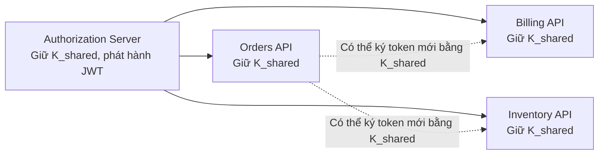
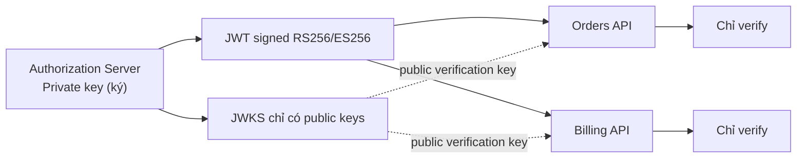

# Khóa đối xứng và ranh giới tin cậy khi bên xác minh cũng giữ bí mật ký

Trong hệ thống **Spring Security OAuth 2.0 / OIDC Resource Server**, JWT thường được bảo vệ bằng chữ ký để API kiểm tra token có bị sửa và có đến từ nguồn tin cậy hay không. Một lựa chọn kỹ thuật là dùng **khóa đối xứng** với thuật toán HMAC như `HS256`. Cách này đơn giản về mặt mật mã: bên phát hành và bên xác minh dùng **cùng một secret**.

Chính tính chất “cùng khóa” tạo ra một **ranh giới tin cậy quan trọng**: **mọi thành phần có thể xác minh JWT bằng HMAC secret cũng có khả năng tạo MAC hợp lệ cho một JWT mới**. Nếu Authorization Server đưa secret ký cho nhiều Resource Server, mỗi Resource Server trở thành một bên có thể **tự phát hành token hợp lệ về mặt mật mã**. Việc nó được giao nhiệm vụ “chỉ xác minh” là quy ước vận hành, không phải giới hạn được thuật toán HMAC cưỡng chế.

Bài này giải thích vì sao hiện tượng đó xảy ra, cách đánh giá ảnh hưởng khi nhiều API cùng giữ secret, cấu hình HS256 trong Spring Security, và các lựa chọn thiết kế khi muốn tách quyền **ký** khỏi quyền **xác minh**.

> **Phạm vi ví dụ:** Authorization Server tại `https://login.example.com` cấp access token cho Orders API tại `https://api.example.com`, với issuer `https://login.example.com`, audience `orders-api` và scope `orders.read`. Các địa chỉ, secret và claims chỉ để minh họa. Ví dụ Java dùng Spring Security 6.x trên Servlet Resource Server.

## 1. Khóa đối xứng là gì trong chữ ký JWT?

JWT dùng JOSE/JWS có thể được bảo vệ bằng nhiều thuật toán. Với HMAC, hai bên cùng giữ một **shared secret key**:

```text
Authorization Server                             Orders API / Resource Server
       │                                                      │
       │ Giữ secret K                                         │ Giữ cùng secret K
       │                                                      │
       ├── MAC = HMAC-SHA256(K, signingInput)                  │
       │                                                      │
       └── JWT: header.payload.signature ────────────────────>│
                                                              │
                                                 Tự tính lại MAC bằng K
                                                 So sánh với signature
                                                 Kiểm tra iss/aud/exp/scope
```

Khi tạo JWS Compact theo `HS256`:

```text
encodedHeader  = BASE64URL(UTF8(headerJSON))
encodedPayload = BASE64URL(UTF8(payloadJSON))
signingInput   = ASCII(encodedHeader + "." + encodedPayload)
mac            = HMAC-SHA256(secretKey, signingInput)

jwt = encodedHeader + "." + encodedPayload + "." + BASE64URL(mac)
```

Bên xác minh phải tính MAC tương ứng bằng **đúng secret** và so sánh an toàn, đồng thời kiểm tra những điều kiện token khác. Việc so sánh raw JWT signature theo cách tự viết không được khuyến nghị; nên dùng thư viện JOSE/JWT được duy trì như Spring Security + Nimbus.

### 1.1. `HS256`, `HS384` và `HS512`

| JOSE `alg` | Cơ chế | Độ dài secret tối thiểu theo JWA | Điều quan trọng |
|---|---|---:|---|
| `HS256` | HMAC với SHA-256 | **256 bit** (32 byte) | Khóa phải đủ entropy, cả bên ký và bên xác minh đều biết. |
| `HS384` | HMAC với SHA-384 | **384 bit** (48 byte) | Hai bên phải thống nhất thuật toán. |
| `HS512` | HMAC với SHA-512 | **512 bit** (64 byte) | Tăng độ dài MAC không tạo sự phân tách quyền ký/xác minh. |

Điều kiện về độ dài khóa nêu trong RFC 7518 cho họ HMAC SHA-2. **Khóa dài chưa chắc là khóa mạnh** nếu lấy từ password dễ đoán. Nên tạo chuỗi byte bằng bộ sinh số ngẫu nhiên mật mã (CSPRNG), lưu dưới cơ chế quản lý secret; không dùng password, tên công ty hay cụm từ dễ nhớ làm HMAC secret.

Ví dụ JOSE header:

```json
{
  "alg": "HS256",
  "typ": "at+jwt",
  "kid": "orders-hmac-2026-01"
}
```

Trong đó:

- `alg=HS256` nói rằng JWT được bảo vệ bằng HMAC-SHA256.
- `typ=at+jwt` là ví dụ token type khi access token theo hồ sơ RFC 9068. Không phải mọi signed JWT trong mọi hệ thống đều tự động tuân thủ RFC 9068.
- `kid` chỉ là **gợi ý chọn khóa**, không phải bằng chứng nguồn khóa đáng tin.

Payload có thể là:

```json
{
  "iss": "https://login.example.com",
  "sub": "user-42",
  "aud": ["orders-api"],
  "iat": 1999996400,
  "exp": 2000000000,
  "scope": "orders.read"
}
```

Chữ ký/MAC không **mã hóa** claims. Bất kỳ bên nào có chuỗi JWS đều có thể Base64URL-decode payload để đọc; điều khác biệt là không thể sửa claim rồi tạo MAC hợp lệ **nếu không có secret K**.

## 2. Vì sao người xác minh cũng có khả năng ký?

### 2.1. Bản chất của HMAC

HMAC là **Message Authentication Code** sử dụng khóa bí mật chung. Để xác minh MAC, Resource Server phải biết đủ thông tin để tự tạo lại MAC dự kiến:

```text
MAC_expected = HMAC(K, header.payload)
MAC_received = signature gửi trong JWT

accept_signature = constant_time_equal(MAC_expected, MAC_received)
```

Nhưng nếu Resource Server biết `K` và có thể tính `HMAC(K, message)` để xác minh, về mặt mật mã nó cũng có thể chọn **message khác** và tính `HMAC(K, message_moi)`.

Cụ thể, một bên giữ khóa có thể:

1. Tạo JWT header với `alg=HS256`.
2. Tạo payload với `sub`, `aud`, `scope`, `exp` mà nó muốn.
3. Tính MAC bằng secret `K`.
4. Gửi JWT mới cho bất kỳ verifier nào cũng tin `K` và chấp nhận các claim tương ứng.

**Không có một cờ trong HS256 chỉ cho phép verify mà cấm sign.** Có thể hạn chế quyền của service bằng IAM, chính sách vận hành hoặc môi trường thực thi, nhưng nếu tiến trình sở hữu bytes khóa HMAC có thể dùng thuật toán HMAC tùy ý, tiến trình đã có năng lực tạo MAC.

Điều này **không đồng nghĩa** mọi token do server giữ khóa tạo ra chắc chắn được mọi API chấp nhận: API còn có chính sách `iss`, `aud`, `exp`, `scope`, loại token, quyền tenant và các quy tắc bổ sung. Tuy nhiên **bên giữ khóa có thể chủ động tạo claims thỏa những kiểm tra đó** nếu không có ràng buộc bên ngoài độc lập.

### 2.2. “Xác minh được” không chứng minh “chỉ Authorization Server đã ký”

Giả sử Authorization Server và Orders API đều giữ cùng secret `K`. Orders API nhận một JWT có MAC hợp lệ. Kết quả xác minh cho phép kết luận:

> Token được tạo hoặc thay đổi bởi **một bên biết `K`**, và nội dung được kiểm tra toàn vẹn tương ứng với `K`.

Từ riêng kết quả này **không thể chứng minh duy nhất Authorization Server là tác giả của token**. Orders API cũng biết `K`. Nếu còn một Billing API giữ `K`, Billing API cũng có cùng năng lực tính MAC.

Vì vậy đừng trình bày HS256 như một “chữ ký số bất đối xứng bảo đảm chỉ issuer phát hành” khi Resource Server cũng nắm secret. Bằng chứng mật mã chỉ gắn với **tập các bên biết khóa**, không gắn độc quyền với một người ký.

### 2.3. HMAC không có tính chối bỏ như chữ ký riêng của issuer

Trong mô hình đối xứng, cả bên phát hành và bên xác minh có thể tạo MAC, nên một JWT có MAC hợp lệ không đủ để quy trách nhiệm bên nào trong nhóm giữ secret đã tạo token. Dù ứng dụng có log “token do issuer phát hành”, thông tin ấy chỉ đáng tin đến mức độ hệ thống quản lý khóa, quy trình phát hành và dữ liệu kiểm toán độc lập.

Với **chữ ký bất đối xứng**, issuer giữ **private key**, còn Resource Server chỉ giữ **public key**. Đối tượng chỉ có public key có thể kiểm tra chữ ký nhưng không tạo chữ ký mới theo thuật toán được triển khai đúng. Đây là ranh giới mật mã rõ ràng hơn.

## 3. So sánh HS256 với RS256/ES256

| Tiêu chí | HS256 (HMAC, đối xứng) | RS256 / ES256 (bất đối xứng) |
|---|---|---|
| Bên ký dùng | Secret `K` | Private key |
| Bên xác minh dùng | **Cũng secret `K`** | Public key |
| Verifier có thể tự ký token? | **Có**, nếu biết và có quyền dùng HMAC secret | **Không**, nếu chỉ biết public key và thuật toán an toàn |
| Công khai vật liệu xác minh | **Không được** công khai secret | Public key có thể được công bố qua JWKS tin cậy |
| Nhiều Resource Server | Cần phân phối secret cho nhiều nơi hoặc cấp secret riêng từng audience | Có thể phân phối cùng public key cho nhiều RS mà không trao quyền ký |
| Rủi ro khi một RS bị chiếm quyền | Có thể rò secret và gây giả mạo token ở nơi cùng tin khóa | Có thể lộ access token hoặc thông tin API, nhưng chỉ có public key **không** đủ để ký JWT mới |
| Rotation | Cần đồng bộ secret mới tới mọi bên giữ khóa | Issuer thay private key; RS cập nhật/truy xuất public key phù hợp |
| Bằng chứng nguồn phát hành | Một trong các bên biết secret | Bên sở hữu private key tương ứng |
| Phù hợp điển hình | Miền tin cậy nhỏ, một số ít dịch vụ được phép giữ secret | Issuer tách biệt và nhiều Resource Server / nhiều tổ chức / multi-tenant |

Không phải RS256 hoặc ES256 tự làm hệ thống an toàn trong mọi trường hợp. Cần xác minh issuer, audience, thời hạn, thuật toán, scope; public key phải được lấy từ nguồn tin cậy và private key phải được bảo vệ. Điểm khác biệt ở đây là **có thể cấp cho RS quyền xác minh mà không cần cấp quyền ký**.

## 4. Ranh giới tin cậy: từ một Resource Server đến nhiều Resource Server

### 4.1. Một issuer, một resource server, cùng secret

Một hệ thống nội bộ nhỏ có thể cho Authorization Server và Orders API cùng giữ `K_orders`. Nếu cả hai thực sự nằm trong cùng trust boundary, được bảo vệ, quản lý và vận hành bởi một nhóm, HS256 **có thể** là lựa chọn hợp lý.

Nhưng cần chấp nhận rằng:

- Orders API có thể tạo token vượt qua kiểm tra MAC dựa trên `K_orders`.
- Độ tin cậy của JWT không cao hơn độ tin cậy của **cả hai** môi trường giữ khóa.
- Nếu máy chủ Orders API bị chiếm quyền và secret bị lấy, việc bảo vệ issuer riêng vẫn chưa chặn kẻ tấn công tạo JWT cho mọi verifier cùng tin khóa.
- Kiểm soát truy cập vào cấu hình secret, memory/process, backup, log và secret manager đều là phần của ranh giới tin cậy.

Đây là sự lựa chọn **kiến trúc và mức chấp nhận rủi ro**, không phải vấn đề HMAC tính sai hay thuật toán yếu.

### 4.2. Một issuer, nhiều Resource Server dùng chung secret

Giả sử ba API cùng giữ `K_shared`:



Trong trường hợp bình thường, cả ba API tự tính MAC để xác minh JWT. Nhưng nếu Orders API bị xâm nhập và secret bị lộ:

1. Kẻ tấn công biết `K_shared`.
2. Có thể tự tạo JWT với `iss=https://login.example.com`, `aud=billing-api`, `scope=billing.write` và các claim thích hợp.
3. Tính HMAC hợp lệ cho JWT tự tạo.
4. Billing API cũng tin `K_shared` sẽ không thể dùng MAC để phân biệt token giả với token do Authorization Server ký.
5. Nếu không còn lớp kiểm soát độc lập đủ mạnh, kẻ tấn công có thể đi từ sự cố Orders API sang giả mạo credential dùng ở Billing API.

**Một yếu tố cần hiểu chính xác:** kiểm tra `aud` vẫn là yêu cầu bắt buộc của Resource Server và có tác dụng khi token được issuer cấp sai đích. Tuy nhiên **audience check không giải quyết được việc kẻ tấn công đã biết khóa ký chung**: kẻ đó có thể tự ký token mới chứa chính audience mà Billing API mong đợi.

### 4.3. Dùng secret riêng cho từng audience

Một phương án giảm phạm vi ảnh hưởng là cấp secret riêng:

```text
Authorization Server
  ├── K_orders     ↔ Orders API
  ├── K_billing    ↔ Billing API
  └── K_inventory  ↔ Inventory API
```

Khi đó, việc Orders API bị lộ `K_orders` **không tự động** cho phép tạo MAC hợp lệ bằng `K_billing` cho Billing API, nếu khóa độc lập và các verifier không tin nhầm khóa của nhau.

Phương án này giúp **cô lập giữa các Resource Server**, nhưng **không xóa được ranh giới tin cậy trong chính mỗi API**:

- Orders API vẫn có khả năng ký token cho `orders-api` bằng `K_orders`.
- Authorization Server phải lựa chọn khóa theo audience/resource một cách chính xác.
- Cần quản lý nhiều secret, rotation, phân phối và các luồng nhiều audience.
- Với token có nhiều audience, phải định nghĩa rõ khóa nào ký và Resource Server nào được phép xác minh; không trộn nhiều khóa hoặc cho phép fallback tùy ý.
- Không lấy `kid` hay `aud` chưa xác minh làm nguồn tin tuyệt đối để chọn secret từ vị trí không kiểm soát.

Khi hệ thống có nhiều dịch vụ độc lập, chữ ký bất đối xứng thường **dễ bảo đảm ranh giới tin cậy hơn** so với việc quản lý vô số shared secret.

## 5. Các mô hình tin cậy thường gặp

| Mô hình | Bên giữ khóa ký | Bên giữ vật liệu xác minh | Nhận định |
|---|---|---|---|
| **HS256 cùng trust boundary** | Authorization Server + Resource Server | Cùng secret | Đơn giản, nhưng verifier có năng lực ký. |
| **HS256 chia sẻ cho nhiều API** | AS và mọi API dùng chung secret | Cùng secret | Phạm vi ảnh hưởng lớn khi một API bị lộ. |
| **HS256 một secret mỗi API** | AS và API tương ứng | Secret riêng | Giảm giả mạo liên API, vẫn không tách verify khỏi sign trong một API. |
| **RS256/ES256 public key** | Chỉ issuer/đối tượng được cấp private key | Mỗi API nhận public key tin cậy | Phân tách quyền ký và xác minh bằng mật mã. |
| **Opaque access token + introspection** | AS phát hành token; không yêu cầu RS giữ JWT signing key | RS dùng introspection credential được cấp quyền | Không đưa khóa ký JWT cho RS; cần bảo vệ introspection và kiểm tra metadata. |

Đừng đồng nhất “opaque token” với “không có bí mật trên Resource Server”: introspection client secret cũng là credential và cần bảo vệ. Nhưng introspection credential **không phải** HMAC signing key có thể trực tiếp ký access token mới, trừ khi hệ thống tự thiết kế sai làm chúng trùng nhau.

### 5.1. Khi nào có thể cân nhắc HS256?

Một số điều kiện làm mô hình này dễ chấp nhận hơn:

- AS và RS thuộc cùng miền tin cậy, cùng đội vận hành và cùng chính sách ứng cứu sự cố.
- Số bên giữ secret rất ít và được kiểm kê cụ thể.
- Secret được tạo bằng CSPRNG đủ độ dài, phân phối và rotate qua secret manager.
- Token có tuổi thọ ngắn, `iss`/`aud`/scope được kiểm tra chặt.
- Rủi ro rằng **bất kỳ bên giữ secret đều có thể ký token** đã được kiến trúc hệ thống chấp nhận.

Ngược lại, với API của đối tác, nhiều đội triển khai độc lập, đa tenant, hoặc ranh giới “Authorization Server được ký; Resource Server chỉ được xác minh”, nên ưu tiên **chữ ký bất đối xứng** hoặc mô hình token/introspection phù hợp.

## 6. Điều gì xảy ra khi Resource Server bị xâm nhập?

Một câu hỏi quan trọng khi threat modeling là: **“Nếu quyền chạy mã tại Resource Server bị chiếm, kẻ tấn công có thể làm gì ngoài đọc dữ liệu mà API đang nắm?”**

Với HS256 secret được nạp vào memory hoặc cấu hình của RS:

- Kẻ tấn công có quyền phù hợp ở máy chủ có thể đọc secret từ môi trường, vùng nhớ, cấu hình hoặc secret manager nếu quyền truy cập cho phép.
- Nếu có key bytes, kẻ tấn công tính được HMAC cho payload bất kỳ.
- Có thể giả mạo `sub`, `scope`, `roles`, `aud`, thời hạn và cả `iss` mà những verifier dùng cùng secret đang mong đợi.
- Có thể tạo JWT còn thời hạn sau thời điểm truy cập trái phép, cho tới khi khóa bị thay/thu hồi khỏi tập được chấp nhận.
- Ghi log request có thể không đủ để phân biệt JWT do issuer ký và JWT tự tạo nếu cả hai dùng cùng secret.

Với RS chỉ giữ **public key**, xâm nhập vẫn rất nghiêm trọng: kẻ tấn công có thể xem dữ liệu dịch vụ, token đang đi qua hoặc làm thay đổi hành vi của API. Nhưng riêng public key không cho phép tạo chữ ký issuer mới để dùng ở RS khác.

Từ đó, phạm vi thu hồi sau sự cố khác nhau:

| Sự cố | HS256 shared secret | RS256/ES256 verifier chỉ có public key |
|---|---|---|
| RS bị lộ dữ liệu request | Token đang truyền vẫn có thể bị lạm dụng | Tương tự |
| RS bị đọc cấu hình/key material | Có thể lộ **khóa có quyền ký** | Lộ public key không tạo năng lực ký mới |
| Cần cô lập các API khác | Phải xem xét thay secret ở mọi nơi cùng tin khóa | Khóa public ở các API khác thường không phải signing secret bị lộ |
| Token giả mạo xuất hiện sau sự cố | Khó phân biệt nếu đã được HMAC ký bằng shared secret | Chỉ có public key thì không ký được JWT hợp lệ mới |

Chỉ dùng `exp` ngắn không khắc phục hết sự cố lộ HMAC secret: kẻ đã có khóa có thể tạo JWT mới với `exp` mới, cho đến khi các verifier ngừng tin khóa đó hoặc có kiểm soát bổ sung thực sự độc lập.

## 7. Quản lý HMAC secret đúng cách

### 7.1. Sinh secret ngẫu nhiên đủ entropy

Với HS256, tối thiểu **32 byte ngẫu nhiên**. Có thể dùng Java `SecureRandom` trong một tác vụ cấp phát secret được kiểm soát:

```java
import java.security.SecureRandom;
import java.util.Base64;

public class GenerateHmacSecret {
    public static void main(String[] args) {
        byte[] key = new byte[32];
        new SecureRandom().nextBytes(key);

        // Ví dụ chỉ chạy trong môi trường cấp phát secret kiểm soát;
        // đầu ra là credential thật, tuyệt đối không lưu vào log/commit.
        String encoded = Base64.getEncoder().encodeToString(key);
        System.out.println(encoded);
    }
}
```

**Không chạy mẫu sinh khóa theo cách để output bị hệ thống CI, terminal chia sẻ hoặc log công khai lưu lại.** Trong triển khai thật, hệ thống cấp phát khóa/secret manager nên sinh và lưu secret trực tiếp, chỉ cấp cho workload có quyền.

Nên hiểu rõ hai lớp biểu diễn:

- `key` là **bytes ngẫu nhiên** dùng làm khóa HMAC.
- `Base64(key)` chỉ là cách **biểu diễn để lưu/truyền cấu hình**, không phải lớp mã hóa bảo mật.
- Không nên dùng chính chuỗi Base64 như mật khẩu dễ nhớ rồi coi đó là ngẫu nhiên.
- Khi đọc cấu hình, cần **Base64-decode** trở lại bytes trước khi tạo `SecretKey`.

### 7.2. Lưu ở đâu?

Tránh các cách lưu sau:

- Hardcode secret trong Java/YAML đã commit vào Git.
- Dán HMAC key vào tài liệu hỗ trợ, issue tracker, chat công khai.
- Ghi secret ra log khi ứng dụng khởi động hoặc trong thông báo lỗi.
- Đưa signing secret vào môi trường browser, JavaScript bundle hoặc mobile app.
- Sử dụng một secret cho cả JWT signing, database password, OAuth client secret và các mục đích mật mã khác.

Các lựa chọn hợp lý hơn gồm secret manager hoặc vault, cơ chế inject secret theo workload identity, hạn chế quyền đọc của tiến trình cần dùng, kiểm toán truy cập, rotation và quy trình xử lý khi bị lộ.

**Không có secret nào trở nên “verify-only” chỉ nhờ đặt tên biến `JWT_VERIFY_SECRET`**. Tên vai trò ở cấu hình không thay đổi khả năng mật mã của key bytes.

### 7.3. `kid` và xoay khóa

Ví dụ header có `kid=hmac-2026-01`. Trong quá trình rotation có thể dùng khóa mới `hmac-2026-02` và tạm chấp nhận khóa cũ trong thời hạn đã định để các token đã phát hành còn hiệu lực.

Những điểm cần làm rõ:

1. Chỉ lấy khóa từ **danh sách khóa đáng tin đã cấu hình**, không từ URL/path do JWT tùy ý cung cấp.
2. Không dùng cùng một `kid` cho hai secret có nghĩa khác nhau trong một miền issuer.
3. Khóa mới phải được phân phối tới verifier **trước** hoặc đồng bộ với thời điểm AS ký bằng khóa mới.
4. Hết thời gian chấp nhận, bỏ khóa cũ khỏi mọi verifier; nếu secret bị lộ, ứng cứu sự cố có thể yêu cầu **thu hồi ngay**, không chờ token hết hạn.
5. Với `NimbusJwtDecoder.withSecretKey(...)` chỉ cấu hình **một secret**, đừng giả định có cơ chế rotation theo `kid` tự động. Nếu cần nhiều khóa, phải thiết kế resolver/decoder hoặc JWK source thích hợp và kiểm tra kỹ hợp đồng xác minh.

Khi nhiều Resource Server cùng dùng HMAC secret, rotation cũng là hoạt động phối hợp trên **mọi môi trường giữ khóa**. Đây là một chi phí vận hành ít thấy nếu chỉ so sánh độ dài chữ ký.

## 8. Cấu hình Spring Security Resource Server xác minh HS256

### 8.1. Khác biệt với cấu hình issuer-uri thông thường

Đối với JWT ký bất đối xứng, cấu hình phổ biến:

```yaml
spring:
  security:
    oauth2:
      resourceserver:
        jwt:
          issuer-uri: https://login.example.com
```

cho phép Spring Security khám phá metadata/JWKS và dùng public key của issuer để xác minh JWT, tùy khả năng của nhà cung cấp.

**Với HS256**, Resource Server cần chính **HMAC secret**. Public JWKS của issuer không nên chứa HMAC signing secret. Vì vậy không thể chỉ trông chờ `issuer-uri` tìm được một “public HMAC key”. Thay vào đó, cần đưa secret vào Resource Server qua kênh bí mật và cấu hình decoder đối xứng.

Giả sử ứng dụng dùng **Spring Boot 3.x, Spring Security 6.x, Servlet stack** và access token có `alg=HS256`.

### 8.2. Gradle dependencies

```groovy
dependencies {
    implementation 'org.springframework.boot:spring-boot-starter-web'
    implementation 'org.springframework.boot:spring-boot-starter-security'
    implementation 'org.springframework.boot:spring-boot-starter-oauth2-resource-server'
}
```

Dự án cần các thư viện Spring Security OAuth2 Resource Server và JOSE/Nimbus thông qua starter phù hợp.

### 8.3. Khởi tạo SecretKey từ secret manager/biến môi trường

Ví dụ sử dụng biến môi trường `ORDERS_JWT_HMAC_KEY_B64` do môi trường triển khai cấp phát. Giá trị là Base64 của ít nhất 32 random bytes, **không phải secret ghi sẵn trong source**.

```java
package com.example.orders.security;

import java.util.Base64;
import java.util.List;

import javax.crypto.SecretKey;
import javax.crypto.spec.SecretKeySpec;

import org.springframework.context.annotation.Bean;
import org.springframework.context.annotation.Configuration;
import org.springframework.security.oauth2.core.DelegatingOAuth2TokenValidator;
import org.springframework.security.oauth2.core.OAuth2TokenValidator;
import org.springframework.security.oauth2.jwt.Jwt;
import org.springframework.security.oauth2.jwt.JwtClaimNames;
import org.springframework.security.oauth2.jwt.JwtClaimValidator;
import org.springframework.security.oauth2.jwt.JwtDecoder;
import org.springframework.security.oauth2.jwt.JwtValidators;
import org.springframework.security.oauth2.jwt.NimbusJwtDecoder;
import org.springframework.security.oauth2.jose.jws.MacAlgorithm;

@Configuration
public class HmacJwtDecoderConfiguration {

    private static final String ISSUER = "https://login.example.com";
    private static final String AUDIENCE = "orders-api";

    @Bean
    JwtDecoder jwtDecoder() {
        String encoded = System.getenv("ORDERS_JWT_HMAC_KEY_B64");
        if (encoded == null || encoded.isBlank()) {
            throw new IllegalStateException("JWT HMAC secret is missing");
        }

        // Secret thực được cấp từ secret manager; biến môi trường
        // chỉ được dùng làm ví dụ cách chuyển bytes vào ứng dụng.
        byte[] rawKey = Base64.getDecoder().decode(encoded);
        if (rawKey.length < 32) {
            throw new IllegalStateException(
                "HS256 requires at least 256 bits of secret key"
            );
        }

        SecretKey secretKey = new SecretKeySpec(rawKey, "HmacSHA256");

        NimbusJwtDecoder decoder = NimbusJwtDecoder
            .withSecretKey(secretKey)
            .macAlgorithm(MacAlgorithm.HS256)
            .build();

        OAuth2TokenValidator<Jwt> issuerAndTime =
            JwtValidators.createDefaultWithIssuer(ISSUER);

        OAuth2TokenValidator<Jwt> audience =
            new JwtClaimValidator<List<String>>(
                JwtClaimNames.AUD,
                audiences -> audiences != null
                    && audiences.contains(AUDIENCE)
            );

        decoder.setJwtValidator(
            new DelegatingOAuth2TokenValidator<>(
                issuerAndTime,
                audience
            )
        );

        return decoder;
    }
}
```

**Ý nghĩa của từng lớp:**

- `withSecretKey(secretKey)` trao cho decoder **cùng key material có thể dùng để ký HS256**. Resource Server nay thuộc nhóm các bên có năng lực tạo MAC.
- `macAlgorithm(MacAlgorithm.HS256)` chỉ định thuật toán HMAC mong đợi, tránh để token tự chọn thuật toán.
- `JwtValidators.createDefaultWithIssuer(ISSUER)` kiểm tra issuer và các kiểm tra mặc định như thời hạn trên những phiên bản Spring Security tương ứng.
- `JwtClaimValidator<List<String>>` kiểm tra `aud` chứa `orders-api`; khác issuer hoặc API đích đều phải bị từ chối.
- `setJwtValidator(...)` sử dụng tập validator do ứng dụng đặt; các quy tắc bổ sung của hợp đồng token như `typ`, `client_id` hoặc tenant phải được bổ sung khi cần.

Đoạn code sử dụng **một khóa HS256 tĩnh** tại một thời điểm. Nó chưa thực hiện rotation đa khóa, token revocation, token profile RFC 9068 đầy đủ hoặc xác minh tenant cụ thể. Những khả năng đó cần được thiết kế bổ sung theo hợp đồng của hệ thống.

**Cảnh báo về cách kết hợp cấu hình:** khi đã tự cung cấp `JwtDecoder` bean như trên, không giả định Spring Boot sẽ tự động ghép mọi thuộc tính `spring.security.oauth2.resourceserver.jwt.*` vào custom decoder. Ví dụ đã cài issuer và audience **bên trong validator** để ranh giới xác minh rõ ràng.

### 8.4. SecurityFilterChain cho endpoint Orders API

```java
package com.example.orders.security;

import org.springframework.context.annotation.Bean;
import org.springframework.context.annotation.Configuration;
import org.springframework.http.HttpMethod;
import org.springframework.security.config.Customizer;
import org.springframework.security.config.annotation.web.builders.HttpSecurity;
import org.springframework.security.config.http.SessionCreationPolicy;
import org.springframework.security.web.SecurityFilterChain;

@Configuration
public class OrdersApiSecurity {

    @Bean
    SecurityFilterChain apiChain(HttpSecurity http) throws Exception {
        return http
            .securityMatcher("/api/**")
            .authorizeHttpRequests(auth -> auth
                .requestMatchers(HttpMethod.GET, "/api/orders/**")
                    .hasAuthority("SCOPE_orders.read")
                .requestMatchers(HttpMethod.POST, "/api/orders/**")
                    .hasAuthority("SCOPE_orders.write")
                .anyRequest().authenticated()
            )
            .sessionManagement(session ->
                session.sessionCreationPolicy(SessionCreationPolicy.STATELESS)
            )
            .oauth2ResourceServer(oauth2 ->
                oauth2.jwt(Customizer.withDefaults())
            )
            .build();
    }
}
```

Trong luồng JWT Resource Server, Spring Security đọc Bearer token từ `Authorization` header, tạo `Authentication` chưa được xác thực, sử dụng `JwtDecoder` xác minh HMAC/claims và chuyển scope sang authority như `SCOPE_orders.read`. Chỉ sau đó mới xét luật truy cập endpoint.

Mã trên là **chain riêng cho `/api/**`; các URL ngoài `/api/**` phải có chính sách bảo vệ riêng. Với API chỉ dùng bearer header và không dựa vào cookie để xác thực, cấu hình stateless thích hợp; chính sách CSRF cần xét dựa trên thực tế các cơ chế auth đang dùng.

### 8.5. Kết quả xác minh HS256 không chứng minh khóa chỉ có ở AS

Sau khi decoder xác thực, controller có thể nhận `Jwt`:

```java
import java.util.Map;
import org.springframework.security.core.annotation.AuthenticationPrincipal;
import org.springframework.security.oauth2.jwt.Jwt;
import org.springframework.web.bind.annotation.GetMapping;
import org.springframework.web.bind.annotation.RestController;

@RestController
class CurrentSubjectController {

    @GetMapping("/api/me")
    Map<String, String> me(@AuthenticationPrincipal Jwt jwt) {
        return Map.of("subject", jwt.getSubject());
    }
}
```

Tại thời điểm này, Spring Security đã kiểm tra rằng JWT hợp lệ **theo shared secret và các validators được cấu hình**. Nó không có bằng chứng mật mã độc lập để phân biệt:

- JWT được Authorization Server tạo bằng `K`.
- JWT do một Resource Server khác đang giữ `K` tự tạo.
- JWT do kẻ tấn công đã lấy được `K` tạo.

Đây chính là ranh giới tin cậy của khóa đối xứng; không thể loại bỏ nó bằng cách thay tên class hoặc thêm `hasAuthority(...)`.

## 9. Một ví dụ giả mạo trong nội bộ hệ thống

Giả sử Authorization Server cấp một token hợp lệ:

```json
{
  "iss": "https://login.example.com",
  "sub": "user-42",
  "aud": ["orders-api"],
  "scope": "orders.read",
  "exp": 2000000000
}
```

Orders API xác minh MAC bằng `K_shared`.

Nếu một dịch vụ khác cũng biết `K_shared`, dịch vụ đó có khả năng tạo payload mới, ví dụ:

```json
{
  "iss": "https://login.example.com",
  "sub": "admin-1",
  "aud": ["orders-api"],
  "scope": "orders.read orders.write",
  "exp": 2000003600
}
```

Rồi tính MAC HS256 bằng `K_shared`. Về mặt xác minh HMAC, token thứ hai không khác token thứ nhất: cả hai đều có MAC hợp lệ do bên biết `K_shared` tạo. Nếu Orders API chỉ kiểm tra issuer, audience, thời gian và scope theo token, nó có thể chấp nhận token tự tạo đó.

Những biện pháp như kiểm tra quyền trên từng đơn hàng, allowlist client, tenant policy, trạng thái user, hoặc tra cứu token đã cấp có thể giảm một số đường tấn công, **nhưng phải có nguồn tin độc lập**. Nếu kẻ giữ khóa có thể tạo mọi claim mà những bước kiểm tra ấy tin tưởng, các kiểm tra claim đơn thuần không khôi phục được tính độc quyền của issuer.

Ví dụ này **không hướng dẫn tấn công dịch vụ thực**; nó là tình huống threat modeling để thấy rõ hệ quả khi cấp cùng HMAC signing secret cho nhiều verifier.

## 10. Khi nào kiểm tra issuer/audience/scope vẫn có ích?

Dù HS256 có ranh giới chia sẻ khóa, Resource Server **vẫn phải xác minh toàn bộ hợp đồng access token**.

| Kiểm tra | Mục đích | Giới hạn nếu secret đã lộ |
|---|---|---|
| Signature/MAC | Phát hiện JWT bị sửa bởi bên không biết secret | Kẻ biết secret có thể tạo MAC hợp lệ cho payload mới. |
| `iss` | Chỉ nhận token từ issuer đã cấu hình | Kẻ biết secret có thể tự ghi issuer hợp lệ. |
| `aud` | Không nhận token thực sự phát hành cho API khác | Kẻ biết secret có thể ghi audience mong đợi. |
| `exp` / `nbf` | Chỉ nhận token còn thời gian sử dụng | Kẻ biết secret có thể tạo token với hạn mới, nếu không có kiểm soát độc lập. |
| `scope` / roles | Giới hạn chức năng được phép | Kẻ biết secret có thể tự khai phạm vi quyền. |
| Kiểm tra tài nguyên/tenant ở DB độc lập | Xác định hành động trên đối tượng thực tế có được phép không | Có thể giảm tác động; hiệu quả phụ thuộc thiết kế dữ liệu và các thuộc tính không thể tùy tiện giả mạo. |
| Kiểm tra token ID với sổ đăng ký do AS quản lý độc lập | Giới hạn token được chấp nhận tới token AS đã phát hành | Có thể giúp phát hiện token giả nếu RS không thể thay đổi dữ liệu đăng ký; đổi lại mất ưu điểm xác minh JWT hoàn toàn offline. |

Không nên bỏ kiểm tra issuer/audience vì chúng không giải quyết được secret bị lộ. Chúng vẫn cần để bảo vệ trước token hợp lệ nhưng **sai đích**, nhầm issuer hoặc quyền không đủ trong điều kiện bình thường.

## 11. Algorithm confusion: một lỗi khác với bản chất khóa đối xứng

Rủi ro nổi tiếng trong hệ sinh thái JWT là ứng dụng xác minh tin thuật toán do token tự khai mà không giới hạn trước. Ví dụ một verifier kỳ vọng token `RS256` nhưng bị triển khai sai để chấp nhận `HS256` và dùng **public RSA key bytes** như một HMAC secret.

Nếu thiết kế sai như vậy, dữ liệu vốn có thể công khai (public key) có nguy cơ trở thành “secret” cho HS256, mở đường tạo token giả. Đây là lỗi triển khai/nhầm thuật toán, **không phải tính chất tất yếu của RS256**.

Những nguyên tắc bắt buộc trong thiết kế:

1. **Cố định thuật toán được phép theo issuer và hợp đồng API**, không tùy tiện tin `alg`.
2. Nếu API dùng HS256, cấu hình decoder với đúng `MacAlgorithm.HS256` và secret đủ độ dài.
3. Nếu API dùng RS256, dùng public key đúng kiểu để xác minh chữ ký, **không để fallback sang HMAC** chỉ vì token tự khai.
4. Từ chối `alg=none` khi hợp đồng yêu cầu access token có chữ ký.
5. Hạn chế `kid` vào tập khóa đã tin, không lấy key từ URL do header chưa xác minh chỉ định.
6. Không dùng chung key bytes giữa các thuật toán hoặc mục đích mật mã khác nhau.

Spring Security/Nimbus cung cấp các API riêng cho decoder dùng public key và decoder dùng secret. Tận dụng điểm này để làm rõ chính sách thuật toán, tránh tự viết bộ “tự phát hiện JWT algorithm” không kiểm soát.

## 12. Di chuyển từ HS256 sang RS256/ES256

Nếu hệ thống phát triển từ một service sang nhiều Resource Server hoặc nhiều đội vận hành, nên xem xét thay mô hình chia sẻ secret bằng mô hình **issuer giữ private key, RS dùng public key**.

### 12.1. Mô hình mục tiêu



Khi Resource Server nhận JWT, nó tìm public key đáng tin theo issuer/JWKS và xác minh chữ ký, nhưng **không nắm private key của issuer**. Xâm nhập một Resource Server không tự cung cấp khả năng ký JWT giả cho Resource Server khác chỉ từ key xác minh.

### 12.2. Những bước chuyển đổi nên thiết kế

1. **Tạo key pair mới** trong cơ chế quản lý khóa của Authorization Server. Private key chỉ cấp cho tiến trình/thiết bị được quyền ký; public key được xuất bản qua JWKS đáng tin.
2. **Cấu hình issuer ký JWT bằng RS256/ES256**, khai báo đúng `alg` và `kid` cho khóa mới.
3. **Cấu hình Resource Server tin issuer/JWKS** và thuật toán đã thỏa thuận; kiểm tra `iss`, `aud`, hạn dùng, token type và scope.
4. **Lập chiến lược chuyển đổi token đang lưu hành:** nếu phải chấp nhận song song HS256 và thuật toán mới trong một thời gian, đảm bảo từng thuật toán được gắn với nguồn khóa đúng, giới hạn thời gian rõ, không trộn key material.
5. **Ngừng phát hành HS256** và loại bỏ shared secret khỏi Resource Server sau thời hạn chuyển đổi/thu hồi.
6. **Kiểm tra hoạt động rotation mới:** AS thay private key, Resource Server cập nhật public keys mà không cần biết bí mật ký.

Khi chuyển đổi, tránh cơ chế “chấp nhận bất kỳ thuật toán nào token đề xuất để đỡ lỗi”. Thiết kế nhiều thuật toán phải có điều kiện tin cậy cụ thể và lộ trình loại bỏ khóa cũ.

### 12.3. Cấu hình public-key Resource Server phổ biến

Nếu Authorization Server công bố metadata và JWKS đúng chuẩn:

```yaml
spring:
  security:
    oauth2:
      resourceserver:
        jwt:
          issuer-uri: https://login.example.com
          audiences:
            - orders-api
```

Với issuer ký bất đối xứng và Spring Boot/Spring Security phiên bản hỗ trợ các thuộc tính trên, cấu hình có thể dùng metadata/JWKS để xác minh mà không đưa secret ký cho Orders API. Tùy phiên bản, cần cấu hình validator audience riêng nếu `audiences` không được hỗ trợ hoặc hợp đồng yêu cầu validator bổ sung. Không nhầm `issuer-uri` với mật khẩu hay secret cho resource server.

Nếu chính sách yêu cầu cố định một thuật toán, có thể cấu hình `NimbusJwtDecoder` theo public key/JWK source và bộ thuật toán cho phép; không dùng `withSecretKey(...)` trong mô hình chỉ chia sẻ public key.

## 13. Các tình huống và quyết định thiết kế

### Tình huống A — Một ứng dụng nội bộ phát hành và xác minh token

Ứng dụng có một thành phần phát hành JWT và một API dùng chung hạ tầng, cùng trust boundary và cùng team. HS256 có thể giảm phức tạp xử lý key pair.

Điều kiện: secret đủ mạnh, bảo mật trong cấu hình, giới hạn phạm vi sử dụng, xác minh issuer/audience/time/scope; tổ chức chấp nhận năng lực ký nằm ở cả verifier.

### Tình huống B — Ba microservices dùng cùng secret

Orders, Billing và Inventory cùng dùng secret trong cấu hình deployment. Mỗi service là môi trường có thể bị lỗi hoặc xâm nhập độc lập.

Rủi ro: một service lộ secret dẫn đến **khả năng giả mạo JWT** cho service khác nếu tất cả cùng tin khóa. Hướng phù hợp thường là chuyển sang private/public key hoặc ít nhất phân tách secret theo audience cùng kế hoạch dài hạn.

### Tình huống C — Đối tác được cấp secret để “chỉ verify”

Đối tác được cấp HS256 secret để tự kiểm tra JWT do tổ chức phát hành.

Rủi ro: đối tác về mặt kỹ thuật có thể **ký token mới** bằng secret đó. Hợp đồng pháp lý “chỉ được verify” không giới hạn khả năng cryptographic. Với đối tác, nên cung cấp **public key/JWKS** hoặc cơ chế introspection với quyền giới hạn.

### Tình huống D — Secret HS256 bị lộ trong log build

Kẻ khác có thể lấy secret từ log, clone triển khai hoặc biến môi trường bị ghi ra file. Thay token `exp` ngắn không đủ vì kẻ giữ secret có thể ký JWT mới.

Cần thu hồi/rotate secret và loại bỏ key cũ khỏi **mọi verifier**, rà soát các token và tài nguyên có thể bị truy cập, khắc phục nguồn lộ và kiểm toán phù hợp. Nếu nhiều API dùng chung secret, phạm vi ứng cứu phải tính cả các API đó.

### Tình huống E — Có claim role admin nhưng chữ ký HS256 hợp lệ

Resource Server có thể đọc `roles=["admin"]` từ JWT ký HS256 và cấp quyền nếu chính sách cho phép. Nhưng **mức đáng tin của role claim không cao hơn mức đáng tin của mọi bên biết signing secret**.

Nếu vai trò admin đặc biệt nhạy cảm, nên cân nhắc bổ sung kiểm tra quyền độc lập tại service, tách nguồn ký và verifier bằng khóa bất đối xứng, đồng thời giảm tối đa phạm vi người/tiến trình giữ khóa.

## 14. Một số câu hỏi thường gặp

### “Chỉ cho Resource Server quyền đọc secret từ vault, không cho quyền sửa; vậy có verify-only không?”

**Không theo nghĩa mật mã.** Nếu Resource Server có thể **đọc bytes secret** hoặc gọi dịch vụ HMAC một cách tùy ý, nó có khả năng tạo MAC cho dữ liệu do nó chọn. Quyền read-only của vault giúp tránh sửa giá trị secret đang lưu, nhưng không ngăn việc sử dụng secret để tính MAC khác.

Nếu dùng một HSM/dịch vụ xác minh chỉ cung cấp API verify có chính sách hạn chế input và không xuất khóa, có thể đặt ranh giới vận hành chặt hơn. Tuy nhiên đó là **giới hạn của dịch vụ/HSM và mô hình quyền**, không phải tính chất phân tách sign/verify của HS256, và cần đánh giá khả năng lạm dụng API verify, vai trò quản trị, logging và các đầu vào được phép.

### “HMAC HS256 có yếu hơn RS256 không?”

Không thể kết luận “yếu” chỉ vì dùng đối xứng. HMAC-SHA256 với secret ngẫu nhiên đủ mạnh là cơ chế mật mã tốt cho **tính toàn vẹn và xác thực dựa trên secret chung**. Điểm bất lợi lớn trong hệ thống nhiều Resource Server là **phân phối cùng một secret cho người chỉ cần xác minh**, làm tăng số nơi có năng lực ký.

### “Một JWT có chữ ký HMAC hợp lệ thì đã xác thực người dùng chưa?”

Không đủ. JWT còn cần issuer, audience, thời hạn, loại token, claims và phạm vi quyền đúng. Trong OAuth 2.0, một access token có thể được cấp qua `client_credentials` để đại diện ứng dụng, **không nhất thiết** có người dùng cuối. HMAC hợp lệ chỉ là một điều kiện để tin token theo hợp đồng.

### “Có nên đưa secret HS256 vào JWKS endpoint?”

**Không công khai symmetric signing secret**. JWK có key type `oct` để biểu diễn symmetric key trong những ngữ cảnh an toàn, nhưng đưa secret đó vào JWKS **công khai** sẽ làm mọi người nhận được nó có khả năng ký JWT hợp lệ. JWKS công khai dùng để phát hành **public keys** của thuật toán bất đối xứng, không phải secret HMAC.

### “Nếu token dùng `kid` thì Resource Server chỉ còn quyền xác minh?”

Không. `kid` là identifier chọn key. Nếu key được chọn là HMAC secret và Resource Server biết secret, nó vẫn có năng lực ký. `kid` không tạo phân quyền cryptographic.

### “Đổi HMAC secret bao lâu một lần?”

Không có một chu kỳ cố định đúng cho mọi hệ thống. Cần thiết kế theo nguy cơ, yêu cầu nội bộ, vòng đời token, khả năng phối hợp deploy và phát hiện lộ secret. Khi có bằng chứng secret bị lộ, ưu tiên thay/thu hồi nhanh, không chờ kỳ rotation định kỳ.

## 15. Ma trận quyết định bảo mật

Trước khi chọn thuật toán ký access token, có thể đặt các câu hỏi sau:

| Câu hỏi | Nếu câu trả lời là “Có” | Hướng ưu tiên |
|---|---|---|
| Resource Server do nhóm khác hoặc đối tác vận hành? | Không muốn trao quyền ký cho bên xác minh | Dùng RS256/ES256 hoặc introspection. |
| Nhiều API cần verify token từ cùng issuer? | Shared secret làm tăng phạm vi ảnh hưởng | Dùng một hệ thống public keys/JWKS với private key ở issuer. |
| Chỉ có một trust boundary nhỏ, ít bên giữ khóa? | HS256 có thể đủ theo threat model | Bảo vệ key và cấu hình verifier rõ ràng. |
| Cần tách quyền “sign” khỏi quyền “verify” bằng mật mã? | HMAC không đáp ứng mục tiêu này | Dùng chữ ký bất đối xứng. |
| Access token được gửi cho browser/mobile? | Secret HMAC tuyệt đối không thể ở client | Client chỉ giữ access token; signing key ở hạ tầng tin cậy. |
| Cần thu hồi tức thì hoặc kiểm tra trạng thái token ở AS? | JWT tự verify có thể chưa đủ | Xem xét opaque/introspection hoặc cơ chế revocation được thiết kế riêng. |
| Dữ liệu claims cần giữ bí mật khỏi bên cầm token? | Signed JWT không mã hóa payload | Giảm claims; JWE/opaque hoặc API bổ sung tùy nhu cầu. |

## 16. Ghi nhớ khi thiết kế Resource Server

- **HS256/HS384/HS512 dùng HMAC và secret đối xứng.** Bên xác minh cần cùng key material mà bên ký sử dụng.
- **Ai giữ HMAC signing secret đều có khả năng ký JWT có MAC hợp lệ.** Tên vai trò “Resource Server” không tự hạn chế điều này.
- **HMAC xác minh một bên biết secret, không xác minh duy nhất Authorization Server đã phát hành token** khi secret được chia sẻ với nhiều verifier.
- **Một Resource Server bị lộ shared secret có thể làm ảnh hưởng các verifier khác cùng tin secret đó.** Audience và scope check vẫn cần, nhưng chúng không ngăn kẻ đã có secret tự ký claims phù hợp.
- **Secret riêng từng API giảm phạm vi ảnh hưởng**; chữ ký bất đối xứng còn cho phép tách quyền ký và xác minh bằng private/public key.
- **Spring Security có thể xác minh HS256** với `NimbusJwtDecoder.withSecretKey(...).macAlgorithm(MacAlgorithm.HS256)`, kèm validator issuer, audience, thời hạn và quyền.
- **Không công khai HMAC secret qua JWKS, mã nguồn hoặc log**; dùng secret manager, CSPRNG, phân quyền, rotation và kế hoạch ứng cứu lộ khóa.
- **HS256 không mã hóa claims** và bearer JWT bị đánh cắp vẫn có thể bị lạm dụng trong thời hạn hợp lệ.

Khi review kiến trúc OAuth 2.0 Resource Server, câu hỏi có giá trị nhất là: **“Những ai đang giữ secret dùng để xác minh JWT, và nếu một bên bị xâm nhập thì họ có thể ký token được những hệ thống nào khác chấp nhận?”** Nếu yêu cầu là chỉ Authorization Server được phát hành token, còn Resource Server chỉ được kiểm tra, mô hình **chữ ký bất đối xứng** tạo ranh giới mật mã phù hợp hơn.
