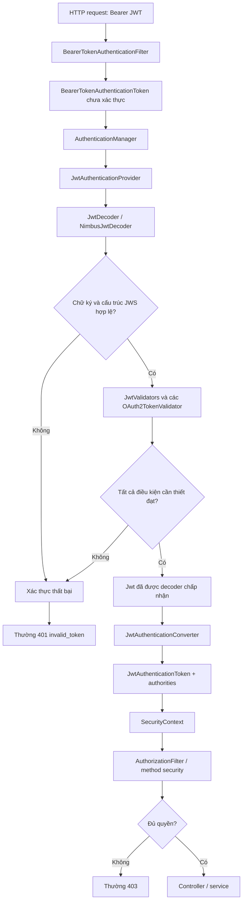

# JwtValidators và cấu hình chuỗi kiểm tra sau xác minh chữ ký

Trong **Spring Security OAuth 2.0 Resource Server**, một JWT có chữ ký hợp lệ vẫn có thể **không được phép dùng tại API đang nhận request**. Chữ ký xác nhận token không bị sửa và được ký bằng một khóa tin cậy; Resource Server còn cần kiểm tra **nhà phát hành (§iss§), thời hạn (§exp§, §nbf§), đối tượng tiếp nhận (§aud§) và những ràng buộc riêng của API**.

Spring Security cung cấp `JwtValidators` cùng cơ chế `OAuth2TokenValidator<Jwt>` để cấu hình các điều kiện đó. Các validator thường được ghép bằng `DelegatingOAuth2TokenValidator` và chạy trong `JwtDecoder` sau khi bước xác minh chữ ký JWT thành công.

Bài này theo dõi **ranh giới giữa xác minh chữ ký, xác thực claims và phân quyền**, giải thích các validator mặc định, cách bổ sung audience và claim tùy biến, cách điều chỉnh clock skew, những lỗi khi thay thế validator mặc định và cách quan sát kết quả tại Resource Server.

## 1. Vì sao chữ ký hợp lệ chưa đủ?

Giả sử Authorization Server của doanh nghiệp phát hành JWT cho nhiều API: `orders-api` và `payments-api`. Token dưới đây được ký đúng bằng khóa của issuer, nhưng audience lại là Payments API:

```json
{
  "iss": "https://login.example.test/realms/shop",
  "sub": "user-123",
  "aud": ["payments-api"],
  "scope": "payments.read",
  "iat": 1794715200,
  "exp": 1794718800
}
```

Nếu Orders API chỉ kiểm tra chữ ký, nó có thể tin nhầm một token vốn **không được phát hành cho Orders API**. Tương tự, token có thể có chữ ký hợp lệ nhưng đã hết hạn hoặc có `nbf` ở tương lai.

Có ba lớp kiểm tra tách biệt:

| Lớp | Câu hỏi | Công cụ/chính sách |
|---|---|---|
| **Xác minh chữ ký JWS** | JWT có được ký bằng khóa đáng tin, với thuật toán được cho phép, và không bị sửa không? | `JwtDecoder` / bộ xử lý JWS bên dưới, JWKS hoặc khóa tin cậy |
| **JWT claim validation** | Token có đúng issuer, còn hiệu lực, đúng audience và đáp ứng quy tắc của API không? | `OAuth2TokenValidator<Jwt>`, `JwtValidators`, `DelegatingOAuth2TokenValidator` |
| **Authorization** | Chủ thể trong token đã xác thực có được gọi endpoint và truy cập bản ghi này không? | `authorizeHttpRequests`, `hasAuthority`, method security, chính sách nghiệp vụ |

**Không được thay xác minh chữ ký bằng một tập kiểm tra claim.** Một token có `iss`, `aud` và `exp` trông hợp lý nhưng chữ ký sai vẫn phải bị từ chối. Ngược lại, chữ ký đúng không thay thế những điều kiện issuer/audience/thời hạn.

## 2. Vị trí validator trong Servlet Resource Server

Một request có header:

```http
GET /api/orders/42 HTTP/1.1
Host: api.example.test
Authorization: Bearer <ACCESS_TOKEN>
```

thường đi qua luồng logic:



Luồng này diễn ra trước controller. Khi `JwtDecoder.decode(...)` trả `Jwt` thành công, Spring Security mới có cơ sở chuyển claims thành principal và authorities. Nếu decoder ném lỗi do chữ ký hoặc validator, request **không được tạo một `JwtAuthenticationToken` đáng tin cậy**.

Cần phân biệt hai tên gần giống:

- `JwtDecoder` là thành phần **thực hiện quá trình decode và xác minh tổng thể**.
- `JwtValidators` là lớp tiện ích **tạo các validator tiêu chuẩn để áp dụng lên đối tượng `Jwt` sau khi được giải mã/xác minh chữ ký**.

Trong ứng dụng thông thường, chúng ta cấu hình validator **cho decoder**, rồi Spring Security tự gọi decoder trong `JwtAuthenticationProvider`. Controller không cần tự trích xuất JWT và chạy validator lần nữa.

## 3. API cốt lõi: `OAuth2TokenValidator<Jwt>`

Spring Security biểu diễn một điều kiện xác thực token bằng interface tổng quát:

```java
public interface OAuth2TokenValidator<T extends OAuth2Token> {
    OAuth2TokenValidatorResult validate(T token);
}
```

Đoạn trên minh họa chữ ký khái niệm của interface. Với JWT, kiểu sử dụng là `OAuth2TokenValidator<Jwt>`.

Một validator:

1. Nhận đối tượng `Jwt` sau khi decoder đã parse và xác minh chữ ký.
2. Xem các claims/header cần thiết.
3. Trả `OAuth2TokenValidatorResult.success()` nếu điều kiện đạt.
4. Trả `OAuth2TokenValidatorResult.failure(...)` chứa một hoặc nhiều `OAuth2Error` nếu điều kiện không đạt.

Ví dụ validator chỉ chấp nhận audience của Orders API:

```java
OAuth2TokenValidator<Jwt> audienceValidator = jwt -> {
    if (jwt.getAudience().contains("orders-api")) {
        return OAuth2TokenValidatorResult.success();
    }

    return OAuth2TokenValidatorResult.failure(
        new OAuth2Error(
            "invalid_token",
            "Token is not intended for orders-api",
            null
        )
    );
};
```

Các import:

```java
import org.springframework.security.oauth2.core.OAuth2Error;
import org.springframework.security.oauth2.core.OAuth2TokenValidator;
import org.springframework.security.oauth2.core.OAuth2TokenValidatorResult;
import org.springframework.security.oauth2.jwt.Jwt;
```

**Validator không phải permission checker cho mọi request.** Audience là điều kiện để một token hợp lệ **tại Resource Server này**; quyền của `GET /api/orders/42` còn cần kiểm tra authority và ownership sau đó.

### 3.1. `OAuth2TokenValidatorResult` mang ý nghĩa gì?

Kết quả không phải một boolean đơn thuần. Nó có thể chứa thông tin lỗi giúp decoder báo rằng token bị từ chối vì lý do nào.

```text
validate(jwt)
    ├── success() → tiếp tục xử lý token
    └── failure(OAuth2Error) → decoder từ chối token
```

Không nên dùng exception nghiệp vụ tùy ý để báo sai audience từ một validator khi API đã hỗ trợ `OAuth2TokenValidatorResult.failure(...)`. Đối với validator có thể dự đoán điều kiện thất bại, trả kết quả thất bại giúp decoder xử lý đồng nhất.

Các validator nên **xác định, không có side effect và an toàn khi dùng chung nhiều request**. Tránh ghi token ra log, thay đổi trạng thái toàn cục hoặc gọi HTTP bên ngoài không kiểm soát chỉ để kiểm tra một claim đơn giản.

## 4. `JwtValidators.createDefault()` và `createDefaultWithIssuer()`

`JwtValidators` cung cấp các factory tạo nhóm validator tiêu chuẩn của Spring Security. Hai phương thức thường gặp:

```java
OAuth2TokenValidator<Jwt> defaults =
    JwtValidators.createDefault();

OAuth2TokenValidator<Jwt> defaultsWithIssuer =
    JwtValidators.createDefaultWithIssuer(
        "https://login.example.test/realms/shop"
    );
```

| Phương thức | Ý định | Điểm cần chú ý |
|---|---|---|
| `JwtValidators.createDefault()` | Tạo các điều kiện mặc định phù hợp với JWT trong phiên bản Spring Security đang dùng, nổi bật là kiểm tra thời gian | **Không tự biết issuer cụ thể mà API tin cậy** nếu không cấu hình issuer riêng. |
| `JwtValidators.createDefaultWithIssuer(issuer)` | Nhóm điều kiện mặc định **cộng với yêu cầu issuer mong đợi** | Phù hợp khi Resource Server chỉ tin một issuer được định danh rõ. |
| `DelegatingOAuth2TokenValidator<>(...)` | Ghép nhiều validator vào một `OAuth2TokenValidator<Jwt>` | Dùng để bổ sung audience, tenant hoặc claim khác mà vẫn bảo lưu validator tiêu chuẩn. |

Không nên coi danh sách chi tiết bên trong `createDefault()` là bất biến giữa mọi phiên bản Spring Security. Lấy hàm factory làm nguồn cho các điều kiện mặc định, rồi bổ sung chính sách riêng vào nhóm đó. Trong tài liệu này, **issuer, thời gian và audience** được xem là những điều kiện chủ chốt; audience cần được cấu hình riêng khi API yêu cầu.

### 4.1. Tại sao nên bảo lưu default validators?

Giả sử lập trình viên tạo custom decoder nhưng chỉ gắn audience validator:

```java
decoder.setJwtValidator(audienceValidator);
```

Lệnh này **thay thế validator hiện có** trên decoder. Nếu decoder trước đó có validator kiểm tra `iss`, `exp`, `nbf`, chúng có thể bị mất vì ứng dụng đã đặt một tập validator mới không bao gồm chúng.

Cách an toàn hơn là ghép với nhóm điều kiện mặc định và issuer:

```java
OAuth2TokenValidator<Jwt> requiredValidators =
    new DelegatingOAuth2TokenValidator<>(
        JwtValidators.createDefaultWithIssuer(ISSUER),
        audienceValidator
    );

decoder.setJwtValidator(requiredValidators);
```

Như vậy, audience là **điều kiện bổ sung**, không phải lý do bỏ những điều kiện bảo mật có trước.

## 5. DelegatingOAuth2TokenValidator: ghép chuỗi điều kiện

Một Resource Server có thể đòi hỏi token đáp ứng:

- Được phát hành bởi issuer đáng tin cậy.
- Còn thời gian hiệu lực.
- Có audience của API.
- Có claim bắt buộc hoặc tenant hợp lệ.

`DelegatingOAuth2TokenValidator<Jwt>` ghép các điều kiện riêng lẻ thành một validator tổng hợp:

```java
OAuth2TokenValidator<Jwt> combined =
    new DelegatingOAuth2TokenValidator<>(
        JwtValidators.createDefaultWithIssuer(ISSUER),
        audienceValidator,
        requiredExpirationValidator,
        tenantValidator
    );
```

**Hãy hiểu đây là tổ hợp điều kiện AND về mặt chấp nhận token**: token chỉ thành công khi không validator bắt buộc nào trả lỗi. Không nên dựa vào việc các validator được gọi theo một thứ tự như một pipeline biến đổi dữ liệu; chúng không được thiết kế để phụ thuộc vào side effect của nhau.

Ví dụ:

| Chữ ký JWT | Default/issuer | Audience | Tenant | Kết quả |
|---|---|---|---|---|
| Đúng | Đạt | Đạt | Đạt | Decoder chấp nhận JWT |
| Sai | Chưa xét được một cách đáng tin | — | — | Decoder từ chối ở bước xác minh chữ ký |
| Đúng | Token hết hạn | Đạt | Đạt | Decoder từ chối |
| Đúng | Đạt | Sai | Đạt | Decoder từ chối |
| Đúng | Đạt | Đạt | Sai | Decoder từ chối |
| Đúng | Sai issuer | Sai audience | Đạt | Decoder từ chối; có thể có nhiều lỗi validation |

Không nhất thiết chỉ có một lỗi. Tùy implementation, `DelegatingOAuth2TokenValidator` có thể gom các lỗi từ các delegate. Hệ thống không nên cần phân biệt “lỗi đầu tiên” để ra quyết định cấp quyền.

### 5.1. Chuỗi validator không sửa claim

Validator **đánh giá**, không dùng để chuyển đổi claim. Nếu issuer phát hành `scope` dưới dạng chuỗi, decoder có thể chuẩn hóa cách biểu diễn dữ liệu theo bộ chuyển đổi claim; việc tạo `SCOPE_orders.read` là phần converter authorities, không phải trách nhiệm của audience validator.

Tách rời ba loại xử lý:

```text
JWT parse / claim conversion
          │
          ▼
JWT signature verification + validators
          │
          ▼
JwtAuthenticationConverter
          │
          ▼
Authorization
```

Vị trí cụ thể của claim conversion trong decoder phụ thuộc implementation. Về mặt thiết kế, **đổi định dạng dữ liệu, kiểm tra tính hợp lệ và ánh xạ quyền** là ba trách nhiệm khác nhau.

## 6. Các JWT claims cần xét sau khi xác minh chữ ký

| Claim / thuộc tính | Ý nghĩa | Quy tắc thường cần tại Resource Server |
|---|---|---|
| `iss` | Token do issuer nào phát hành | Khớp **chính xác** issuer được cấu hình tin cậy. |
| `exp` | Thời điểm hết hạn | Token không còn được sử dụng sau hạn; có thể áp dụng clock skew hợp lý. |
| `nbf` | Thời điểm bắt đầu hiệu lực | Không chấp nhận token được dùng quá sớm. |
| `iat` | Thời điểm phát hành | Hữu ích cho policy tuổi token; không tự đồng nghĩa token còn hiệu lực. |
| `aud` | Resource Server/API nào được phép tiếp nhận token | Chứa định danh của API hiện tại. |
| `sub` | Chủ thể được issuer khẳng định | Cần có và đúng định dạng nếu hợp đồng API yêu cầu; không mặc định là username/email. |
| `client_id` / `azp` | Ứng dụng OAuth liên quan, theo profile issuer | Kiểm tra allowlist **nếu policy yêu cầu**, không dùng thay audience. |
| `jti` | Định danh JWT | Có thể phục vụ giám sát/revocation riêng; không tự làm JWT chống replay. |
| `scope` / `scp` | Quyền phạm vi | Thường chuyển thành `SCOPE_...` để phân quyền, không mặc định thuộc validator issuer/time/audience. |
| `typ` (JWT header) | Kiểu JWT được công bố | Có thể cần kiểm tra profile access token/không nhận ID token; cách kiểm tra tùy decoder và phiên bản. |

Một số claim như `exp`, `nbf` và `iat` là *registered claims* của JWT theo RFC 7519; bản thân đặc tả JWT không bắt buộc mọi issuer phải phát hành tất cả chúng. **Hợp đồng API có thể yêu cầu chặt hơn**, chẳng hạn buộc access token phải có `exp` và audience.

### 6.1. Issuer: đúng AS, đúng realm/tenant

`JwtValidators.createDefaultWithIssuer(ISSUER)` ràng buộc giá trị `iss`. Ví dụ mong đợi:

```text
https://login.example.test/realms/shop
```

Token có:

```json
"iss": "https://login.example.test/realms/admin"
```

phải bị từ chối, dù hai issuer có thể cùng chung một hệ thống đăng nhập. Path/realm là một phần của danh tính issuer, không được tự bỏ qua hoặc so sánh bằng tiền tố.

**Không nhận issuer tùy ý từ JWT chưa xác thực rồi lập tức tin endpoint JWKS của nó.** Với nhiều issuer, Resource Server cần danh sách issuer được phép cùng decoder/validator phù hợp.

### 6.2. Thời hạn: `exp`, `nbf` và clock skew

Time validation thường sử dụng:

- `exp`: token hết hạn sau mốc thời gian.
- `nbf`: token chưa được sử dụng trước mốc thời gian.
- **Clock skew:** khoảng dung sai nhỏ để xử lý sai lệch đồng hồ giữa issuer và Resource Server.

Ví dụ token có:

```json
{
  "nbf": 1899996000,
  "exp": 1900000000
}
```

Thời gian JWT được diễn đạt bằng NumericDate, gắn với thời gian UTC, không phụ thuộc múi giờ hiển thị của người dùng.

Nếu một server có đồng hồ nhanh hơn AS vài giây, có thể phát sinh lỗi “chưa có hiệu lực” hoặc “hết hạn” gần ranh giới. Spring Security cung cấp `JwtTimestampValidator` để kiểm tra thời gian và có thể cấu hình dung sai.

**Không đặt clock skew quá lớn** chỉ để tránh phải đồng bộ đồng hồ NTP, vì dung sai lớn có thể kéo dài thời gian chấp nhận token đã hết hạn hoặc cho dùng token trước mốc hiệu lực dự kiến.

### 6.3. Audience: token có dành cho API này?

Ví dụ Orders API kỳ vọng:

```text
expected audience = orders-api
```

Một token có:

```json
"aud": ["orders-api", "inventory-api"]
```

có thể vượt qua kiểm tra audience của Orders API. Token chỉ có `aud=payments-api` thì không.

**`aud` là đối tượng tiếp nhận token**, khác `client_id` của OAuth application đã xin token. Đừng đặt OAuth client ID vào expected audience chỉ vì ID token OIDC dùng `aud=client_id`: API cần **access token dành cho Resource Server**, không phải ID token của client.

### 6.4. Token type: tránh nhầm ID token với access token

JWT access token và OIDC ID token có thể cùng issuer và cùng JWKS. Vì vậy, ngoài kiểm tra audience, Resource Server có thể cần chính sách về **loại/mục đích token**, nhất là khi issuer dùng JWT profile theo RFC 9068.

Đối với JWT access token profile, header `typ` có quy tắc riêng như `at+jwt`. Hãy dùng cơ chế type validation phù hợp với **profile và phiên bản decoder đang dùng**; một số tùy chọn `NimbusJwtDecoder` xử lý type ở tầng JOSE, còn một số profile yêu cầu validator bổ sung. Không tắt kiểm tra type mà không đặt cơ chế thay thế tương ứng.

### 6.5. Scope và quyền dữ liệu là bước khác

Token có:

```json
{
  "aud": ["orders-api"],
  "scope": "orders.read",
  "sub": "user-123"
}
```

vẫn không tự chứng minh `user-123` sở hữu đơn hàng 42. Audience là điều kiện chấp nhận token, scope là phạm vi thao tác và ownership/tenant là chính sách nghiệp vụ.

Một request có thể **đạt mọi validator JWT** nhưng sau đó bị `AuthorizationFilter` hoặc method security từ chối.

## 7. Cấu hình Spring Boot bằng issuer và audience

Ứng dụng Spring Boot Resource Server thông thường cần dependencies như:

```xml
<dependencies>
    <dependency>
        <groupId>org.springframework.boot</groupId>
        <artifactId>spring-boot-starter-security</artifactId>
    </dependency>
    <dependency>
        <groupId>org.springframework.boot</groupId>
        <artifactId>spring-boot-starter-oauth2-resource-server</artifactId>
    </dependency>
</dependencies>
```

Cấu hình:

```yaml
spring:
  security:
    oauth2:
      resourceserver:
        jwt:
          issuer-uri: https://login.example.test/realms/shop
          audiences:
            - orders-api
```

Trong phiên bản Spring Boot hỗ trợ `audiences`, cấu hình cho phép Resource Server kiểm tra expected audience. `issuer-uri` hỗ trợ lựa chọn issuer và tải thông tin khóa công khai qua cơ chế discovery được hỗ trợ.

Lợi ích:

- Không cần tự tách JWT rồi kiểm tra thủ công trong controller.
- Có thể sử dụng decoder và các validator mặc định do framework cấu hình.
- Điều kiện issuer/time và audience được áp dụng trước khi tạo `Authentication`.

**Phải đối chiếu với phiên bản thực tế.** Các phiên bản Spring Boot/Spring Security khác nhau có thể khác cơ chế auto-configuration và tên property. Đặc biệt, nếu khai báo `@Bean JwtDecoder` riêng, Spring Boot thường không còn tạo decoder mặc định, nên việc thêm `audiences` vào YAML **chưa chắc được tự động áp dụng** lên bean tự tạo. Khi đó cần tự đăng ký audience validator.

### 7.1. Ví dụ filter chain để thấy ranh giới authorization

```java
@Configuration
public class SecurityConfig {

    @Bean
    SecurityFilterChain securityFilterChain(HttpSecurity http) throws Exception {
        return http
            .authorizeHttpRequests(authorize -> authorize
                .requestMatchers("/public/**").permitAll()
                .requestMatchers(HttpMethod.GET, "/api/orders/**")
                    .hasAuthority("SCOPE_orders.read")
                .requestMatchers(HttpMethod.POST, "/api/orders/**")
                    .hasAuthority("SCOPE_orders.write")
                .anyRequest().authenticated()
            )
            .oauth2ResourceServer(oauth2 ->
                oauth2.jwt(Customizer.withDefaults()))
            .build();
    }
}
```

Các import:

```java
import org.springframework.context.annotation.Bean;
import org.springframework.context.annotation.Configuration;
import org.springframework.http.HttpMethod;
import org.springframework.security.config.Customizer;
import org.springframework.security.config.annotation.web.builders.HttpSecurity;
import org.springframework.security.web.SecurityFilterChain;
```

Đây là ví dụ về phần cốt lõi của bảo vệ API; chính sách session, CSRF, CORS và các filter khác cần phù hợp cách ứng dụng xác thực người dùng.

Spring Security thường ánh xạ `scope=orders.read` thành `SCOPE_orders.read` bằng `JwtGrantedAuthoritiesConverter`. Điều đó diễn ra sau khi JWT được chấp nhận. **Không dùng `hasAuthority("SCOPE_orders.read")` để thay kiểm tra audience**, vì hai điều kiện giải quyết vấn đề khác nhau.

## 8. Tự cấu hình chuỗi validator cho `NimbusJwtDecoder`

Khi cần chính sách cụ thể, có thể định nghĩa `JwtDecoder` bean và gắn một composite validator gồm:

1. Mặc định + issuer.
2. Audience của Orders API.
3. Yêu cầu phải có `exp`.
4. Claim tenant hợp lệ theo hợp đồng.

Ví dụ dùng Java và Spring Security:

```java
@Configuration
public class JwtDecoderConfig {

    private static final String ISSUER =
        "https://login.example.test/realms/shop";

    private static final String AUDIENCE = "orders-api";

    private static final String TENANT = "shop";

    @Bean
    JwtDecoder jwtDecoder() {
        NimbusJwtDecoder decoder =
            NimbusJwtDecoder.withIssuerLocation(ISSUER).build();

        OAuth2TokenValidator<Jwt> issuerAndDefaults =
            JwtValidators.createDefaultWithIssuer(ISSUER);

        OAuth2TokenValidator<Jwt> audienceValidator = jwt -> {
            boolean accepted = jwt.getAudience().contains(AUDIENCE);
            return accepted
                ? OAuth2TokenValidatorResult.success()
                : invalid("Unexpected access-token audience");
        };

        OAuth2TokenValidator<Jwt> expirationRequired = jwt ->
            jwt.getExpiresAt() != null
                ? OAuth2TokenValidatorResult.success()
                : invalid("Missing required exp claim");

        OAuth2TokenValidator<Jwt> tenantValidator = jwt ->
            TENANT.equals(jwt.getClaimAsString("tenant_id"))
                ? OAuth2TokenValidatorResult.success()
                : invalid("Unexpected tenant");

        decoder.setJwtValidator(
            new DelegatingOAuth2TokenValidator<>(
                issuerAndDefaults,
                audienceValidator,
                expirationRequired,
                tenantValidator
            )
        );

        return decoder;
    }

    private static OAuth2TokenValidatorResult invalid(String reason) {
        return OAuth2TokenValidatorResult.failure(
            new OAuth2Error("invalid_token", reason, null)
        );
    }
}
```

Các import:

```java
import org.springframework.context.annotation.Bean;
import org.springframework.context.annotation.Configuration;
import org.springframework.security.oauth2.core.OAuth2Error;
import org.springframework.security.oauth2.core.OAuth2TokenValidator;
import org.springframework.security.oauth2.core.OAuth2TokenValidatorResult;
import org.springframework.security.oauth2.core.DelegatingOAuth2TokenValidator;
import org.springframework.security.oauth2.jwt.Jwt;
import org.springframework.security.oauth2.jwt.JwtDecoder;
import org.springframework.security.oauth2.jwt.JwtValidators;
import org.springframework.security.oauth2.jwt.NimbusJwtDecoder;
```

Ví dụ có thể sử dụng trong hệ thống phát hành token chứa:

```json
{
  "iss": "https://login.example.test/realms/shop",
  "aud": ["orders-api"],
  "tenant_id": "shop",
  "exp": 1900000000
}
```

**`tenant_id` là claim minh họa, không phải JWT registered claim có mặt ở mọi issuer.** Chỉ đưa validator này vào ứng dụng nếu AS thật sự cấp claim đó và API định nghĩa rõ tenant nào được phép.

### 8.1. Từng dòng cấu hình có ý nghĩa gì?

- `withIssuerLocation(ISSUER)`: xây dựng decoder có thể khám phá khóa ký và metadata theo issuer tin cậy.
- `createDefaultWithIssuer(ISSUER)`: giữ các kiểm tra mặc định và issuer, tránh đánh mất thời gian/issuer khi thêm logic tùy chỉnh.
- `jwt.getAudience().contains(AUDIENCE)`: xác nhận token dành cho Resource Server.
- `jwt.getExpiresAt() != null`: yêu cầu sự **tồn tại** của `exp`. Validator thời gian mới là thành phần kiểm tra `exp` còn hiệu lực.
- `jwt.getClaimAsString("tenant_id")`: đọc claim tùy biến và so với tenant mà Resource Server tin cậy.
- `setJwtValidator(...)`: cấu hình **toàn bộ validator composite** được thực thi bởi decoder.

Một điều kiện chỉ yêu cầu `exp` khác điều kiện kiểm tra **giá trị thời gian**: ta cần cả hai nếu hợp đồng nói token phải có expiry bắt buộc, bởi một time validator thường kiểm tra các thời gian có trong token chứ không nhất thiết buộc `exp` phải tồn tại ở mọi hồ sơ JWT.

### 8.2. Không để request quyết định expected audience/tenant

Sai về ranh giới tin cậy:

```java
// KHÔNG nên xác định expected audience từ JWT chưa xác thực:
String expectedAudience = rawUnverifiedJwt.getAudience().get(0);
```

Nếu lấy giá trị mong đợi từ chính dữ liệu đang kiểm tra, phép kiểm tra trở thành vô nghĩa. Audience/tenant được phép phải đến từ cấu hình server, thông tin tenant đã được quản trị hoặc một mapping đáng tin cậy.

Với multi-tenant Resource Server, thường cần **issuer được cho phép + audience tương ứng với issuer/tenant**, thay vì tin bất kỳ `iss` hoặc `aud` nào mà token tự khai báo.

## 9. Tùy chỉnh clock skew bằng `JwtTimestampValidator`

Hai server có thể sai lệch đồng hồ vài giây. `JwtTimestampValidator` cho phép đặt dung sai có chủ đích:

```java
JwtTimestampValidator timestamp =
    new JwtTimestampValidator(Duration.ofSeconds(45));
```

Import:

```java
import java.time.Duration;
import org.springframework.security.oauth2.jwt.JwtTimestampValidator;
```

Khi cần **thay** chính sách timestamp mặc định bằng một giá trị rõ ràng, hãy tạo một nhóm validator đầy đủ chứa timestamp, issuer và các ràng buộc bắt buộc:

```java
OAuth2TokenValidator<Jwt> validators =
    new DelegatingOAuth2TokenValidator<>(
        new JwtTimestampValidator(Duration.ofSeconds(45)),
        new JwtIssuerValidator(ISSUER),
        audienceValidator,
        expirationRequired
    );

decoder.setJwtValidator(validators);
```

Import thêm:

```java
import org.springframework.security.oauth2.jwt.JwtIssuerValidator;
```

Ở đây, ứng dụng **chủ động tạo danh sách validator tường minh**, thay vì kế thừa toàn bộ `createDefaultWithIssuer()`. Nếu phiên bản Spring Security có thêm validator mặc định hoặc profile yêu cầu điều kiện khác, cần đưa chúng vào nhóm tường minh. Không có lý do đặt một `JwtTimestampValidator` thứ hai bên cạnh nhóm default chỉ để “ghi đè” skew; hai validator độc lập có thể cùng chạy và điều kiện nghiêm hơn vẫn có thể khiến token bị từ chối.

### 9.1. Clock skew hoạt động theo hướng nào?

Ví dụ:

- Token có `nbf=10:00:00`.
- Đồng hồ Resource Server đang chỉ `09:59:35`.
- Skew được cho phép là 45 giây.

Validator có thể chấp nhận request gần ranh giới thời gian theo cấu hình, dù đồng hồ phía API sớm hơn issuer. Tương tự, skew có thể cho phép chấp nhận một token rất gần sau mốc `exp` để bù lệch đồng hồ.

**Skew là dung sai kỹ thuật, không phải chính sách gia hạn token.** Nên đồng bộ đồng hồ (NTP) và đặt dung sai nhỏ theo yêu cầu hệ thống. Không mở rộng lên hàng giờ để né lỗi cấu hình.

## 10. `JwtClaimValidator` và claim tùy biến

Spring Security còn cung cấp `JwtClaimValidator<T>`, cho phép áp một `Predicate<T>` lên một claim cụ thể. Ví dụ AS cam kết có claim `tenant_id` là chuỗi:

```java
OAuth2TokenValidator<Jwt> tenantValidator =
    new JwtClaimValidator<String>(
        "tenant_id",
        "shop"::equals
    );
```

Import:

```java
import org.springframework.security.oauth2.jwt.JwtClaimValidator;
```

Ý nghĩa: khi validator được gọi, claim `tenant_id` phải đáp ứng predicate. Với claim tùy biến có kiểu dữ liệu phức tạp hoặc có thể vắng mặt, dùng lambda kiểm tra `Jwt` trực tiếp sẽ dễ kiểm soát logic và thông báo lỗi hơn.

Ví dụ claim danh sách các API được phép:

```java
OAuth2TokenValidator<Jwt> audienceValidator = jwt -> {
    List<String> audiences = jwt.getAudience();

    if (audiences != null && audiences.contains("orders-api")) {
        return OAuth2TokenValidatorResult.success();
    }

    return OAuth2TokenValidatorResult.failure(
        new OAuth2Error(
            "invalid_token",
            "Missing orders-api audience",
            null
        )
    );
};
```

Import thêm: `java.util.List`.

**Đừng dùng validator để “tự sửa” claim sai.** Ví dụ, nếu issuer thực tế phát hành audience `orders-api` nhưng code mong `web-portal`, cần sửa cấu hình audience theo hợp đồng chứ không biến đổi audience từ sai thành đúng theo request.

## 11. Kiểm tra tuổi token dựa trên `iat` khi có chính sách riêng

Một API có thể yêu cầu token không được phát hành quá lâu, ngay cả khi claim `exp` còn xa. Chẳng hạn endpoint quản trị chỉ nhận access token có tuổi tối đa 10 phút theo chính sách AS.

Một validator minh họa có thể dùng `Clock` được inject để dễ kiểm soát thời gian:

```java
OAuth2TokenValidator<Jwt> maxAgeValidator = jwt -> {
    Instant issuedAt = jwt.getIssuedAt();

    if (issuedAt == null) {
        return OAuth2TokenValidatorResult.failure(
            new OAuth2Error("invalid_token", "Missing iat", null)
        );
    }

    Instant now = clock.instant();
    Duration age = Duration.between(issuedAt, now);

    boolean acceptable =
        !age.isNegative() &&
        age.compareTo(Duration.ofMinutes(10)) <= 0;

    return acceptable
        ? OAuth2TokenValidatorResult.success()
        : OAuth2TokenValidatorResult.failure(
            new OAuth2Error("invalid_token", "Token age is not allowed", null)
        );
};
```

Đoạn trên dùng biến `clock` được cung cấp từ nơi cấu hình:

```java
import java.time.Clock;
import java.time.Duration;
import java.time.Instant;
```

Ví dụ chỉ minh họa logic tuổi token, không bao gồm xử lý dung sai đồng hồ. Với hệ thống thực, cần xác định cách xử lý `iat` nằm hơi trong tương lai và mối quan hệ với `exp`/clock skew. **Giới hạn tuổi token bằng `iat` là chính sách bổ sung**, không thay thế xác minh chữ ký, issuer, audience hay expiry.

Không nên thêm một validator như vậy chỉ vì token có `iat`: nó có thể gây lỗi không cần thiết cho những luồng được thiết kế token sống lâu. Hợp đồng và mức độ nhạy cảm của tài nguyên quyết định điều kiện.

## 12. Validator lỗi sẽ gây ra HTTP response như thế nào?

Giả sử JWT được ký đúng nhưng không đáp ứng audience:

```json
{
  "iss": "https://login.example.test/realms/shop",
  "aud": ["payments-api"],
  "scope": "orders.read",
  "exp": 1900000000
}
```

Các bước điển hình:

1. `BearerTokenAuthenticationFilter` nhận bearer token.
2. `JwtAuthenticationProvider` gọi decoder.
3. Bộ xử lý JWS xác minh chữ ký thành công.
4. Audience validator thất bại và trả `OAuth2TokenValidatorResult.failure(...)`.
5. `JwtDecoder` ném lỗi validation, ví dụ `JwtValidationException`.
6. Provider chuyển thành lỗi xác thực; Spring Security trả response lỗi bearer phù hợp, thường `401 Unauthorized` với `invalid_token`.

Ví dụ phản hồi:

```http
HTTP/1.1 401 Unauthorized
WWW-Authenticate: Bearer error="invalid_token"
```

Ngược lại, nếu mọi validator thành công, nhưng token chỉ có `scope=profile` trong khi endpoint cần `SCOPE_orders.read`, request có thể qua authentication rồi bị authorization từ chối:

```http
HTTP/1.1 403 Forbidden
WWW-Authenticate: Bearer error="insufficient_scope"
```

Các ví dụ là phản hồi thường gặp; header chính xác có thể thay đổi theo lỗi và các thành phần `BearerTokenAuthenticationEntryPoint`, `BearerTokenAccessDeniedHandler` cùng custom exception handling.

### 12.1. Bảng tình huống

| Token / request | Chữ ký | Validators | Authorization | Kết quả thường gặp |
|---|---|---|---|---|
| JWT sai chữ ký | Sai | Không được coi là hợp lệ | Không chạy như caller đã xác thực | `401` |
| JWT đúng chữ ký, issuer sai | Đúng | Thất bại `iss` | Không chạy như caller đã xác thực | `401` |
| JWT hết hạn | Đúng | Thất bại thời gian | Không chạy như caller đã xác thực | `401` |
| JWT đúng issuer, sai audience | Đúng | Thất bại `aud` | Không chạy như caller đã xác thực | `401` |
| JWT thiếu `exp` khi API yêu cầu bắt buộc | Đúng | Validator presence thất bại | Không chạy như caller đã xác thực | `401` |
| JWT đúng claims, thiếu scope đọc | Đúng | Thành công | Không có `SCOPE_orders.read` | `403` |
| JWT đúng claims và scope, sai tenant bản ghi | Đúng | Có thể thành công | Service/method policy từ chối | `403` hoặc `404` theo thiết kế |
| JWT đúng và đủ quyền | Đúng | Thành công | Thành công | `200` nếu nghiệp vụ thành công |

**Không nên chuyển tất cả lỗi quyền thành lỗi validator JWT.** Một người có token hợp lệ nhưng thiếu scope nên được nhận diện là **đã xác thực nhưng không đủ quyền**, thay vì sửa decoder để bác bỏ mọi token có scope không dùng cho một endpoint cụ thể. Vì cùng token có thể được dùng tại nhiều endpoint với yêu cầu scope khác nhau.

## 13. Những lỗi cấu hình validator phổ biến

### Lỗi A — Quên issuer/time khi thêm audience

```java
// KHÔNG đầy đủ nếu vô tình thay toàn bộ default validators:
decoder.setJwtValidator(audienceValidator);
```

Cách sửa:

```java
decoder.setJwtValidator(
    new DelegatingOAuth2TokenValidator<>(
        JwtValidators.createDefaultWithIssuer(ISSUER),
        audienceValidator
    )
);
```

### Lỗi B — Sai audience vì nhầm client_id

OAuth client `web-portal` gọi API `orders-api`. Token:

```json
{
  "aud": ["orders-api"],
  "client_id": "web-portal"
}
```

Resource Server phải kiểm tra `aud=orders-api`, **không** đặt expected audience bằng `web-portal` chỉ vì đó là tên ứng dụng gọi.

### Lỗi C — Dùng role/scope làm validator hợp lệ token toàn hệ thống

Nếu đặt `scope=orders.read` thành điều kiện chung của decoder, một JWT hợp lệ chỉ có `orders.write` sẽ bị từ chối ngay cả khi dùng endpoint ghi phù hợp.

**Cách đúng:** Chỉ đưa scope vào validator khi đó thật sự là điều kiện cấp phép token **trên toàn Resource Server**; còn phần lớn chính sách scope theo endpoint nên đặt trong authorization.

### Lỗi D — Tin issuer từ token rồi tải JWKS tự do

Kẻ tấn công có thể tự tạo JWT chứa `iss=https://attacker.test` và ký bằng khóa của mình. Nếu API đọc `iss`, tự tải metadata/JWKS rồi tin ngay issuer mới, hệ thống có nguy cơ tiếp nhận token của đối tượng không được phép.

**Cách đúng:** Khởi đầu bằng danh sách issuer tin cậy do server quản trị, hoặc cơ chế tenant onboarding được xác minh. Sau đó mới chọn decoder/validator phù hợp.

### Lỗi E — Dùng `iat` thay `exp`

`iat` cho biết thời điểm phát hành nhưng không tự cho biết khi nào token hết hạn. Nếu API cần token có giới hạn thời gian, hãy kiểm tra `exp` và những chính sách bổ sung phù hợp. Không dựa vào một claim duy nhất để suy ra những ràng buộc khác.

### Lỗi F — Dùng clock skew quá rộng

Dung sai lớn có thể làm token hết hạn vẫn được tiếp nhận lâu hơn dự kiến hoặc token chưa có hiệu lực được dùng sớm. **Đồng bộ đồng hồ và đặt skew nhỏ có chủ đích.**

### Lỗi G — Bỏ qua token type

Một OIDC ID token và access token có thể dùng cùng issuer/JWKS. Nếu decoder chỉ kiểm tra chữ ký rồi cấp principal, API có thể chấp nhận sai loại token. Cần audience và chính sách type/profile phù hợp.

### Lỗi H — Bọc decoder rồi xác thực hai lần hoặc bỏ lỗi

Ví dụ một wrapper bắt mọi `JwtException` rồi tạo `Jwt` rỗng là cực kỳ nguy hiểm. Nếu decoder không xác minh được token, **phải thất bại**, không được “fail open” và chuyển tiếp sang authorization như thể đã có Authentication.

## 14. Kiểm tra kỹ thuật chuỗi validator bằng một JWT giả lập

Khi xây dựng validator tùy biến, có thể tạo một đối tượng `Jwt` **trong unit test** để kiểm tra logic claim validation độc lập với bước ký JWT. Đoạn dưới giả định có validator `audienceValidator` đang được kiểm tra:

```java
Jwt jwt = Jwt.withTokenValue("test-token-not-signed")
    .header("alg", "RS256")
    .issuer("https://login.example.test/realms/shop")
    .audience(List.of("orders-api"))
    .issuedAt(Instant.now())
    .expiresAt(Instant.now().plusSeconds(300))
    .build();

OAuth2TokenValidatorResult result =
    audienceValidator.validate(jwt);

assertFalse(result.hasErrors());
```

**Đây chỉ là bài thử cho validator**, không chứng minh một JWT có chữ ký thật được `NimbusJwtDecoder` chấp nhận. Không bao giờ dùng đối tượng `Jwt` do test tự tạo làm bằng chứng xác thực trong production.

Một bài kiểm tra tích hợp thực tế phải sử dụng token test được ký đúng khóa thử nghiệm và đi qua decoder thật, để xác nhận chữ ký, thuật toán, issuer, audience, thời gian và chuỗi filter hoạt động như dự kiến.

Các tình huống đáng mô phỏng khi học:

| Tình huống | Kỳ vọng |
|---|---|
| JWT đúng chữ ký, issuer, thời gian, audience, claim bắt buộc | Decoder chấp nhận |
| JWT có chữ ký sai | Decoder từ chối trước khi tin claims |
| JWT từ issuer khác | Validator issuer từ chối |
| JWT hết hạn | Time validator từ chối |
| JWT chưa đến `nbf` | Time validator từ chối theo skew |
| JWT thiếu `exp` khi API buộc có | Validator presence từ chối |
| JWT chỉ có audience của API khác | Audience validator từ chối |
| JWT đúng nhưng thiếu scope của một endpoint | Decoder có thể chấp nhận, authorization từ chối |
| JWT có `tenant_id` sai | Tenant validator từ chối nếu policy đó áp dụng toàn API |

Thứ tự quan sát quan trọng: **signature → token validators → Authentication → authorization**. Khi kết quả khác dự kiến, kiểm tra đúng lớp thay vì thay đổi toàn bộ cấu hình bảo mật.

## 15. Những điều validator không tự giải quyết

Ngay cả khi chuỗi validator chính xác, Resource Server vẫn cần kiểm soát nhiều vấn đề khác:

**Revocation:** JWT ký hợp lệ, chưa hết hạn có thể đã bị AS thu hồi. Validator chỉ xét dữ liệu/logic hiện có trong decoder; để phát hiện thu hồi trước hạn có thể cần denylist, tra trạng thái riêng, thời hạn token ngắn hoặc introspection theo thiết kế. Không gọi `jti` là bằng chứng token chưa bị thu hồi.

**Replay:** Bearer access token có thể được ai cầm token sử dụng. Chữ ký và `aud` đúng không chứng minh request hiện tại đến từ bên giữ private key của client. Nếu cần sender constraint, áp dụng DPoP/mTLS-bound token với kiểm tra tương ứng.

**Quyền theo tài nguyên:** Token có `SCOPE_orders.read` không tự có quyền xem đơn hàng của người khác. Việc kiểm tra tenant/ownership ở controller/service hoặc method security vẫn bắt buộc khi nghiệp vụ yêu cầu.

**Thuật toán/khóa ký:** Validator claims chạy sau bước xác minh chữ ký. Việc whitelist thuật toán, chọn JWK đúng issuer, quản lý khóa và rotation thuộc cấu hình decoder/JWS. Không thay bằng kiểm tra payload.

**Dữ liệu cá nhân:** Claim có chữ ký chỉ chứng minh issuer đã ghi thông tin đó. Không suy ra email, nhóm hoặc vai trò đã được kiểm chứng theo cách mà một nghiệp vụ cụ thể đòi hỏi nếu hợp đồng issuer không cam kết.

## 16. Vận hành và quan sát lỗi an toàn

Khi người dùng báo token “còn hạn” nhưng API trả `401`, cần phân tích:

1. Token đã được lấy đúng từ header bearer chưa?
2. Decoder có tin đúng issuer/JWKS và thuật toán ký không?
3. Chữ ký có xác minh được không?
4. Validator nào yêu cầu `exp`, `nbf`, `iss`, `aud`, `typ` hoặc claim bắt buộc?
5. Có decoder bean tùy biến khiến auto-configuration audience bị bỏ qua không?
6. Có nhiều issuer/tenant dùng audience hoặc khóa khác nhau không?
7. Clock skew và đồng hồ server có phù hợp không?
8. Khi token qua authentication, authorization có từ chối do scope hoặc quyền dữ liệu không?

Đối với JWT, không nên log nguyên header `Authorization` hoặc token thô. Log thông tin tối thiểu như:

```text
request_id=req-123
route=/api/orders/{id}
auth_result=FAILED
error_category=INVALID_AUDIENCE
configured_issuer=https://login.example.test/realms/shop
expected_audience=orders-api
```

Nếu cần phân tích JWKS hoặc `kid`, tránh công bố bí mật và không tin URL header do token chưa xác thực đề xuất. Khi phát hiện khóa ký mới, decoder có thể cần tải/cập nhật JWKS; không bỏ qua signature verification chỉ vì gặp lỗi mạng hoặc key rotation.

Đừng trả mô tả nội bộ quá chi tiết về validators, tenant hoặc cấu hình bảo mật cho client. Thông điệp HTTP có thể báo `invalid_token`, trong khi log nội bộ được kiểm soát ghi nguyên nhân đủ để vận hành.

## 17. Hợp đồng xác minh JWT nên được tài liệu hóa ra sao?

Một Resource Server có thể ghi rõ:

```text
Trusted issuer:
  https://login.example.test/realms/shop

Trusted JWT signature verification:
  Keys from AS metadata/JWKS
  Allowed algorithms according to policy

Required JWT claims:
  iss = https://login.example.test/realms/shop
  aud contains orders-api
  exp must exist and be valid
  nbf validated when present
  tenant_id = shop (if defined by AS contract)

Claim-level checks:
  JwtValidators.createDefaultWithIssuer(issuer)
  + audience validator
  + expiration-required validator
  + tenant validator

Authorization after authentication:
  GET /api/orders/** → SCOPE_orders.read
  POST /api/orders/** → SCOPE_orders.write
  Record access → ownership/tenant policy
```

Hợp đồng nên nêu rõ các điều kiện **JWT-wide** được thực thi ở decoder và những điều kiện **request/resource-specific** được thực thi ở authorization. Điều này giúp tránh vô tình đưa policy của một endpoint vào validator chung, hoặc bỏ qua kiểm tra issuer/audience chỉ vì JWT có chữ ký đúng.

## 18. Tài liệu tham khảo

- [Spring Security Reference — OAuth 2.0 Resource Server JWT](https://docs.spring.io/spring-security/reference/servlet/oauth2/resource-server/jwt.html): cấu hình issuer, `JwtDecoder` và validators trong Resource Server.
- [Spring Security API — JwtValidators](https://docs.spring.io/spring-security/site/docs/current/api/org/springframework/security/oauth2/jwt/JwtValidators.html): factory các validator mặc định và issuer.
- [Spring Security API — DelegatingOAuth2TokenValidator](https://docs.spring.io/spring-security/site/docs/current/api/org/springframework/security/oauth2/core/DelegatingOAuth2TokenValidator.html): cách tổng hợp validators.
- [Spring Security API — JwtTimestampValidator](https://docs.spring.io/spring-security/site/docs/current/api/org/springframework/security/oauth2/jwt/JwtTimestampValidator.html): kiểm tra thời gian và clock skew.
- [RFC 7519 — JSON Web Token (JWT)](https://www.rfc-editor.org/rfc/rfc7519): các registered claims như `iss`, `aud`, `exp`, `nbf`, `iat`.
- [RFC 7515 — JSON Web Signature (JWS)](https://www.rfc-editor.org/rfc/rfc7515): chữ ký JWT và cấu trúc JWS.
- [RFC 9068 — JWT Profile for OAuth 2.0 Access Tokens](https://www.rfc-editor.org/rfc/rfc9068): yêu cầu đối với JWT access token profile, bao gồm audience và loại token.

**Trọng tâm cần ghi nhớ:** Sau khi chữ ký được xác minh, `JwtValidators` và những `OAuth2TokenValidator<Jwt>` được ghép bởi `DelegatingOAuth2TokenValidator` xác định token có **phù hợp với chính Resource Server này** hay không. Chỉ sau khi JWT được chấp nhận, Spring Security mới xây dựng `Authentication` và xét quyền truy cập endpoint/tài nguyên.
