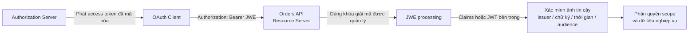
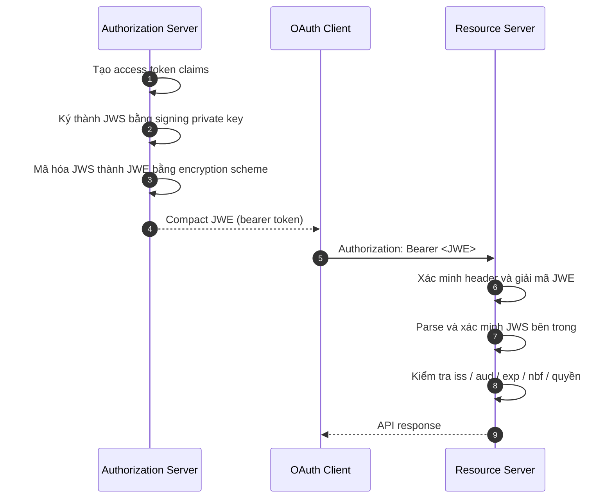
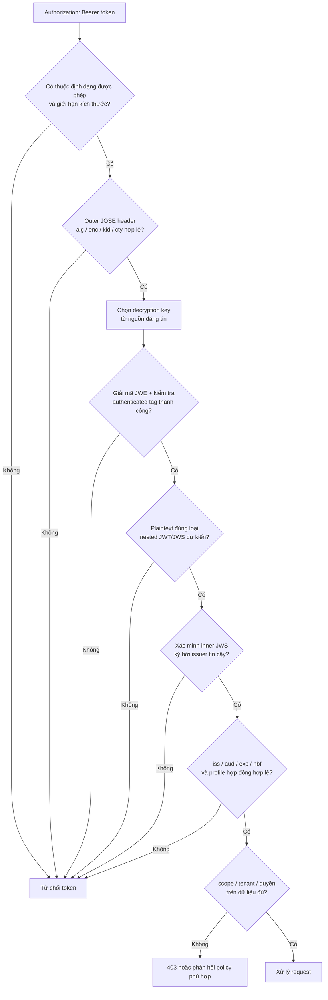
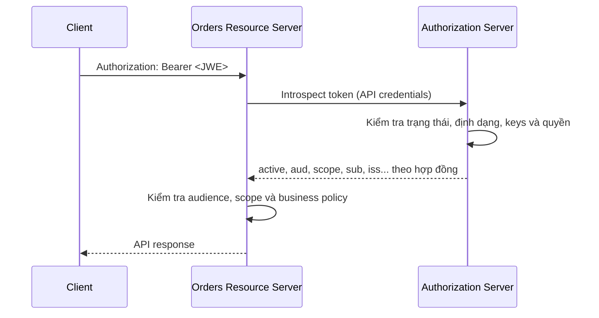

# JWE hoặc bộ xử lý token khác và nhu cầu kiểm chứng hỗ trợ tường minh

Khi cấu hình **Spring Security OAuth 2.0/OIDC Resource Server** để nhận JWT access token, developer thường khai báo `issuer-uri` và bật `oauth2ResourceServer().jwt()`. Cấu hình này phù hợp với trường hợp phổ biến: **JWT được ký số (JWS)**, Resource Server kiểm chứng chữ ký và các claim theo hợp đồng của Authorization Server.

Tuy nhiên, “JWT” không mặc nhiên có nghĩa “chuỗi ba phần mà thư viện chỉ cần kiểm tra chữ ký”. Một JWT có thể được **ký (JWS)**, **mã hóa (JWE)**, hoặc **lồng nhau** (*nested JWT*, ví dụ ký trước rồi mã hóa). Một Authorization Server cũng có thể phát hành **opaque token** hoặc token thuộc định dạng riêng. Mỗi loại cần một chiến lược xử lý và các bảo đảm tin cậy khác nhau.

Chủ đề quan trọng của bài là **kiểm chứng hỗ trợ tường minh**: trước khi chọn `JwtDecoder`, cần biết chính xác hệ thống đang chấp nhận loại token nào, phép toán mật mã nào phải thực hiện, khóa nào thuộc bên nào, cách xác thực issuer/audience/claim ra sao, và Spring Security có sẵn đường xử lý tương ứng hay cần bổ sung thành phần riêng.

## 1. Đầu tiên phải phân biệt OAuth 2.0, JWT, JWS và JWE

Trong OAuth 2.0, **access token** là credential để client yêu cầu quyền truy cập Resource Server. **Định dạng access token không bắt buộc phải là JWT**. Authorization Server và Resource Server thống nhất định dạng cũng như cách kiểm chứng token trong một hợp đồng riêng.

Các thuật ngữ thường xuất hiện:

| Thuật ngữ | Bản chất | Chức năng chính | Điều không tự bảo đảm |
|---|---|---|---|
| **Access token** | Credential được phát hành theo OAuth 2.0 | Truy cập resource/API trong quyền được cấp | Không mặc định là JWT, không mặc định dành cho mọi API |
| **JWT** (JSON Web Token) | Cách biểu diễn một tập claim theo RFC 7519 | Chứa thông tin như `iss`, `sub`, `aud`, `exp` | Bản thân từ “JWT” không chứng minh đã được ký hoặc mã hóa đúng |
| **JWS** (JSON Web Signature) | Cơ chế bảo vệ payload bằng chữ ký/MAC theo RFC 7515 | Bảo đảm tính toàn vẹn và nguồn phát hành trong mô hình khóa tin cậy | Không che nội dung payload khỏi người đọc token |
| **JWE** (JSON Web Encryption) | Cơ chế mã hóa có bảo vệ toàn vẹn theo RFC 7516 | Bảo mật nội dung đối với bên không sở hữu khóa giải mã | Không tự chứng minh người gửi là Authorization Server tin cậy nếu thiết kế khóa không cung cấp bảo đảm đó |
| **Nested JWT** | Một JWT nằm bên trong một lớp JOSE khác | Kết hợp các bảo đảm, thường là ký rồi mã hóa | Vẫn cần kiểm tra chữ ký, claim, audience và cấu hình thuật toán |
| **Opaque token** | Access token được API xem như chuỗi không tự diễn giải | Thường xác thực bằng token introspection | Không có mặc định khả năng giải nghĩa token trực tiếp |
| **OIDC ID token** | Token thông báo kết quả xác thực cho OIDC client | OIDC client kiểm chứng danh tính người dùng | Không thay access token của Resource Server |

Điều đặc biệt dễ nhầm: **JWS/JWE là các chuẩn JOSE bảo vệ dữ liệu; JWT là định dạng claim được bảo vệ bằng những chuẩn đó**. JWE có thể chứa một JWT, nhưng JWE cũng có thể mã hóa nội dung không phải JWT. Chỉ dựa vào việc nhìn thấy một đối tượng JWE không đủ để kết luận plaintext bên trong có thể tin cậy như access token.

### 1.1. JWT ký số không phải JWT được mã hóa

Ví dụ mô hình **JWS Compact Serialization**:

```text
BASE64URL(protected-header).
BASE64URL(payload).
BASE64URL(signature)

=> 3 phần ngăn cách bằng dấu "."
```

Payload của JWS thông thường có thể được người cầm token **giải mã Base64URL để đọc**, ngay cả khi họ không có khóa xác minh chữ ký. Vì vậy, ký JWT **không giấu được** email, vai trò, tenant hoặc claim nhạy cảm.

Ví dụ mô hình **JWE Compact Serialization**:

```text
BASE64URL(protected-header).
BASE64URL(encrypted-key).
BASE64URL(initialization-vector).
BASE64URL(ciphertext).
BASE64URL(authentication-tag)

=> 5 phần ngăn cách bằng dấu "."
```

JWE che nội dung ciphertext với bên không có khóa giải mã. Các giá trị `alg` và `enc` trong protected header nói về hai phần của quá trình mã hóa:

- `alg`: thuật toán **quản lý/trao đổi khóa nội dung** (*key management*), ví dụ `RSA-OAEP-256`, `ECDH-ES` hoặc `dir` theo hợp đồng.
- `enc`: thuật toán **mã hóa nội dung có xác thực** (*content encryption*), ví dụ `A256GCM`.

Đừng dùng `alg` của JWE như thể nó là thuật toán chữ ký `RS256` của JWS. Chúng thuộc hai bước bảo vệ khác nhau.

**Lưu ý:** dạng ba phần/năm phần nói về *Compact Serialization*. JOSE còn có JSON Serialization và các trường hợp token được đóng gói theo giao thức khác. Số dấu chấm chỉ có ích để **định tuyến cú pháp sơ bộ**, không phải phép kiểm chứng rằng token an toàn hoặc được hỗ trợ.

## 2. JWE giải quyết vấn đề gì trong hệ thống Resource Server?

Giả sử hệ thống thương mại có:

- Authorization Server phát hành access token cho các API.
- Orders API là Resource Server nhận access token.
- Một số claim liên quan cấu trúc tổ chức hoặc thông tin nhạy cảm cần được bảo vệ khi token di chuyển qua client, proxy, gateway và log/telemetry.

JWS bảo vệ claim không bị sửa trái phép nhưng không che claim. JWE có thể được lựa chọn để mã hóa thông tin trong access token, giúp chỉ bên nắm **khóa giải mã phù hợp** đọc được claim bên trong.



Tuy nhiên, mã hóa token **không thay** việc bảo vệ bearer credential. Ai đánh cắp được chuỗi bearer token có thể trình token cho API cho đến khi hết hiệu lực hoặc bị vô hiệu theo chính sách, dù họ không đọc được ciphertext. Vì vậy, JWE không loại bỏ nhu cầu dùng HTTPS, giới hạn thời gian sống, tránh ghi token vào log và kiểm soát quyền truy cập.

### 2.1. Bảo mật nội dung khác xác thực nguồn phát hành

Hãy phân biệt hai câu hỏi:

1. **Confidentiality:** bên ngoài có đọc được claim không?
2. **Issuer authenticity / integrity:** Resource Server có bằng chứng token do Authorization Server đáng tin phát hành và không bị thay đổi trái phép không?

Với một JWE dùng **khóa công khai của Resource Server** để mã hóa, về nguyên tắc **bất cứ ai biết khóa công khai cũng có thể mã hóa một plaintext gửi đến Resource Server**. Việc Orders API giải mã JWE thành công và xác minh authentication tag của JWE chỉ chứng minh ciphertext không bị thay đổi theo bảo đảm của thuật toán mã hóa, **không tự chứng minh người mã hóa là IdP tin cậy**.

Vì vậy, nếu access token JWE mang yêu cầu xác thực nguồn phát hành mạnh, mô hình phổ biến là **ký JWT bằng khóa của Authorization Server, rồi mã hóa kết quả cho Resource Server** (*sign-then-encrypt*). Khi nhận token, Resource Server giải mã JWE bên ngoài, xác minh JWS bên trong, rồi kiểm tra các claim và quyền.

Một hệ thống dùng JWE không có chữ ký bên trong vẫn có thể xây dựng hợp đồng tin cậy khác, ví dụ mô hình khóa đối xứng chỉ các bên có quyền phát hành mới sở hữu hoặc kiểm tra token qua introspection. Nhưng **phải chứng minh rõ ai có thể tạo credential được chấp nhận**, không suy ra điều đó chỉ từ khả năng giải mã.

## 3. Ba mô hình token quan trọng

### 3.1. Mô hình A: JWS access token

```text
Authorization Server
  -> ký JWS bằng signing key
  -> OAuth Client giữ bearer token
  -> Resource Server kiểm tra chữ ký bằng trusted signing keys
  -> kiểm tra iss / aud / exp / nbf / scope
```

Đây là trường hợp thường được cấu hình bằng `issuer-uri` và `oauth2ResourceServer().jwt()` trong Spring Security.

Ví dụ **JWS protected header**:

```json
{
  "alg": "RS256",
  "typ": "at+jwt",
  "kid": "issuer-signing-key-1"
}
```

Ví dụ payload minh họa:

```json
{
  "iss": "https://idp.example.com/realms/shop",
  "sub": "user-842",
  "aud": ["orders-api"],
  "exp": 1893459600,
  "iat": 1893456000,
  "scope": "orders.read"
}
```

Ví dụ không phải token được ký thực sự. Resource Server không được sử dụng `scope` hoặc `sub` từ payload do người gọi tự giải mã trước khi kiểm chứng chữ ký và những điều kiện bắt buộc.

### 3.2. Mô hình B: JWE chỉ chứa các claim đã mã hóa

```text
Authorization Server
  -> tạo plaintext là JWT Claims Set
  -> mã hóa thành JWE cho Resource Server
  -> Resource Server giải mã
  -> phải có cơ chế xác thực nguồn phát hành tường minh
  -> kiểm tra claims và phân quyền
```

JWE chỉ mang một JWT Claims Set không có chữ ký bên trong **có thể khác về tính bảo đảm** so với JWS có chữ ký. Đặc biệt nếu bất cứ bên nào có public key của API đều mã hóa được token mà API nhận, API không có bằng chứng rằng plaintext là do Authorization Server tạo. Vì thế không nên thiết kế một JWT decoder chỉ làm `decrypt()` rồi tin tất cả claim.

Mô hình này cần được đánh giá kỹ bằng thiết kế mật mã và quản lý khóa riêng; nếu không có lý do rõ ràng, ký rồi mã hóa hoặc introspection thường cho hợp đồng xác thực minh bạch hơn.

### 3.3. Mô hình C: Nested JWT, ký rồi mã hóa



Ví dụ **outer JWE protected header**:

```json
{
  "alg": "RSA-OAEP-256",
  "enc": "A256GCM",
  "cty": "JWT",
  "kid": "orders-encryption-key-2026"
}
```

Ví dụ **inner JWS protected header**:

```json
{
  "alg": "RS256",
  "typ": "at+jwt",
  "kid": "issuer-signing-key-2026"
}
```

Outer JWE có chức năng **bảo mật nội dung và tính toàn vẹn của lớp ciphertext**. Inner JWS có chức năng **xác minh chữ ký/issuer**. Sau cả hai bước, Resource Server mới sử dụng các claim để quyết định quyền.

`cty: "JWT"` của outer header thường được dùng để chỉ nội dung là một JWT lồng bên trong. Hợp đồng cần quyết định giá trị `typ`/`cty` nào được chấp nhận. Chỉ có `cty` hay `typ` đúng **không đủ** để chứng minh cấu trúc hoặc tính hợp lệ của token.

## 4. Spring Security hỗ trợ mặc định đến đâu?

Trong Servlet stack, Spring Security Resource Server có hai tuyến xác thực bearer token chính:

| Tuyến | Interface quan trọng | Hành vi |
|---|---|---|
| **JWT** | `JwtDecoder` | Xử lý token JWT qua decoder; cấu hình phổ biến dùng `NimbusJwtDecoder` để kiểm chứng JWS được ký |
| **Opaque / introspection** | `OpaqueTokenIntrospector` | Gửi token đến introspection endpoint hoặc xử lý introspection theo hợp đồng; không cần hiểu định dạng nội bộ của token |

Điểm cần nhấn mạnh: **cấu hình JWT mặc định bằng issuer/JWKS của Spring Security được tài liệu hóa chủ yếu cho access token là JWS có chữ ký**. Không nên coi việc thêm `spring-security-oauth2-jose` hoặc dùng `NimbusJwtDecoder.withIssuerLocation(...)` là bằng chứng Resource Server tự giải mã được JWE.

Thư viện **Nimbus JOSE + JWT** có các API xử lý JWE, và Spring Security dùng Nimbus cho nhiều chức năng JWT. Nhưng **khả năng của thư viện cấp thấp không tự động biến thành một đường xử lý JWE đã được bật, cấp khóa và kiểm thử trong Resource Server**. Nếu Authorization Server cấp JWE, ứng dụng phải kiểm tra hỗ trợ chính xác ở phiên bản sử dụng, cách định tuyến decoder và phần xác minh chữ ký/claim sau giải mã.

### 4.1. Cấu hình mặc định cho signed JWT

Ví dụ Spring Boot Servlet Resource Server:

```groovy
// build.gradle — Spring Boot 3.x
dependencies {
    implementation 'org.springframework.boot:spring-boot-starter-web'
    implementation 'org.springframework.boot:spring-boot-starter-oauth2-resource-server'
}
```

```yaml
# application.yml
spring:
  security:
    oauth2:
      resourceserver:
        jwt:
          issuer-uri: https://idp.example.com/realms/shop
          audiences:
            - orders-api
```

```java
import org.springframework.context.annotation.Bean;
import org.springframework.context.annotation.Configuration;
import org.springframework.security.config.Customizer;
import org.springframework.security.config.annotation.web.builders.HttpSecurity;
import org.springframework.security.web.SecurityFilterChain;

@Configuration
public class SecurityConfig {

    @Bean
    SecurityFilterChain apiSecurity(HttpSecurity http) throws Exception {
        return http
            .authorizeHttpRequests(auth -> auth
                .requestMatchers("/public/health").permitAll()
                .requestMatchers("/api/orders/**")
                    .hasAuthority("SCOPE_orders.read")
                .anyRequest().authenticated())
            .oauth2ResourceServer(oauth2 ->
                oauth2.jwt(Customizer.withDefaults()))
            .build();
    }
}
```

Với cấu hình này, Spring Boot/Spring Security sử dụng thông tin issuer, discovery và JWKS để xây dựng cách xác minh JWS theo phiên bản/các property được hỗ trợ. Bản thân mã mẫu không thêm khóa **giải mã JWE** hoặc logic **xác minh inner JWS sau khi giải mã JWE**.

Trong các phiên bản Spring Boot hỗ trợ `spring.security.oauth2.resourceserver.jwt.audiences`, cấu hình audience yêu cầu token được cấp cho API. Khi thay `JwtDecoder` bằng bean tự viết, ứng dụng phải bảo đảm vẫn kiểm chứng audience và những validator quan trọng theo hợp đồng.

### 4.2. Vì sao JWKS và khóa giải mã không thể đánh đồng?

JWKS mà IdP công bố cho Resource Server kiểm chứng JWT ký số thường chứa **public verification keys** của IdP. Ví dụ:

```text
JWS:
  IdP ký bằng signing private key
  Resource Server xác minh bằng IdP signing public key
```

Trong JWE ký rồi mã hóa cho Orders API:

```text
JWE outer:
  IdP mã hóa bằng public encryption key của Orders API
  Orders API giải mã bằng private decryption key của chính mình

JWS inner:
  IdP ký bằng signing private key của IdP
  Orders API xác minh bằng signing public key của IdP
```

Đây là **hai cặp khóa và hai trách nhiệm** trong ví dụ RSA bất đối xứng. Chỉ cấu hình `jwk-set-uri` trỏ tới JWKS của IdP không làm Resource Server sở hữu private key để giải mã JWE. Ngược lại, có private decryption key của Orders API cũng không chứng minh inner JWT được IdP ký.

JWE còn có các thuật toán quản lý khóa khác (ví dụ khóa đối xứng hoặc ECDH); cách cấp phát và tin cậy tùy thuật toán/hợp đồng. Không áp dụng sơ đồ RSA bất đối xứng cho mọi thuật toán mà bỏ qua điều kiện của chúng.

## 5. Khi nhận JWE, phải kiểm chứng những gì?

Nếu một Resource Server được phép nhận nested JWE/JWS access token, pipeline nên được thiết kế từ **ngoài vào trong** với mỗi bước có hợp đồng tường minh:



Các bước không thể bỏ:

1. **Giới hạn đầu vào:** từ chối chuỗi quá lớn hoặc sai định dạng được hỗ trợ. Không thử parse đệ quy không giới hạn đối với các lớp nested; tránh các đường xử lý có độ sâu tùy ý.
2. **Xác định token profile:** API chấp nhận loại access token nào? Outer `typ`, `cty`, inner `typ` có giá trị nào, algorithm nào? Phân biệt access token với ID token hoặc JWT của giao thức khác.
3. **Allowlist thuật toán:** chấp nhận chính xác các giá trị `alg`/`enc` đã được duyệt cho JWE, và JWS `alg` được phép cho issuer. Không chọn thuật toán chỉ theo đề nghị của token.
4. **Chọn khóa đáng tin:** `kid` chỉ giúp chọn khóa trong **tập khóa do API cấu hình/quản lý**. Không tải khóa từ URL tùy ý do header `jku`/`x5u` của token chưa kiểm chứng cung cấp.
5. **Giải mã an toàn:** dùng JWE implementation thực hiện cả xác minh tính toàn vẹn của ciphertext/tag; từ chối khi giải mã hoặc kiểm tra tag thất bại.
6. **Xác minh bên phát hành:** với nested signed token, kiểm tra chữ ký JWS bên trong bằng signing key được tin cậy của issuer. Nếu dùng JWE-only, phải có cơ chế tương đương để xác thực nguồn phát hành được phân tích từ thiết kế khóa và chính sách.
7. **Kiểm tra claims:** `iss`, `aud`, `exp`, `nbf` và các claim bắt buộc theo profile. `scope`/`roles` phải được ánh xạ theo hợp đồng đã xác minh.
8. **Phân quyền tài nguyên:** API vẫn kiểm tra owner/tenant/trạng thái nghiệp vụ; decrypt thành công không đồng nghĩa cho phép truy cập.

Đặc biệt, **không nên lấy inner plaintext vừa giải mã và cho phép đọc ngay các trường `sub`, `scope`, `roles` nếu chưa thỏa bước xác thực nguồn phát hành**.

### 5.1. Kiểm soát header JOSE

JOSE protected header có thể chứa:

| Header | Ý nghĩa | Chính sách bên nhận |
|---|---|---|
| `alg` (JWE) | Phương thức quản lý khóa | So khớp thuật toán được cho phép; khóa phải phù hợp |
| `enc` | Thuật toán mã hóa nội dung | Chỉ chấp nhận thuật toán mã hóa có xác thực được phê duyệt |
| `kid` | Định danh/selector khóa | Chỉ chọn trong key ring tin cậy của API |
| `cty` | Loại nội dung bên trong, thường `JWT` cho nested | Đối chiếu profile, rồi kiểm tra plaintext thật |
| `typ` | Loại token/JOSE object | Nếu profile yêu cầu thì kiểm tra, không coi là bằng chứng duy nhất |
| `zip` | Yêu cầu nén plaintext khi dùng JWE | Chỉ hỗ trợ có chủ đích; kiểm soát decompression bomb |
| `crit` | Các mở rộng bắt buộc phải hiểu | Từ chối khi chứa giá trị không hiểu/hỗ trợ |
| `jku` / `x5u` (nếu có) | Gợi ý nguồn khóa/chứng chỉ | Không dùng URL do token quyết định để lấy khóa tin cậy |

Một số thuật toán cũ hoặc các chế độ mã hóa không phù hợp có thể chứa rủi ro đã biết. Không tự bật `RSA1_5`, `none`, thuật toán yếu hoặc hỗ trợ “mọi thuật toán Nimbus biết” để tương thích. Với JWE, cần phân biệt thuật toán quản lý khóa và thuật toán mã hóa nội dung. Với JWS, chỉ cho phép các thuật toán chữ ký được hợp đồng chấp nhận.

### 5.2. Xác thực claim không phụ thuộc mã hóa

Sau khi token đã được xác thực đúng, API vẫn cần trả lời:

| Claim | Câu hỏi | Sai lầm phổ biến |
|---|---|---|
| `iss` | Ai phát hành token? | Chấp nhận mọi chuỗi issuer có chữ ký bất kỳ |
| `aud` | Token dành cho API nào? | Dùng token của Payments API để gọi Orders API |
| `exp` | Token hết hạn lúc nào? | Tin token vì giải mã được dù đã hết hạn |
| `nbf` | Token được dùng từ lúc nào? | Bỏ qua token chưa đến thời điểm hiệu lực |
| `sub` | Token nói về chủ thể nào? | Coi mọi subject là người dùng có đủ quyền |
| `scope` / `scp` | Phạm vi quyền được cấp? | Nhầm scope với quyền xem mọi bản ghi |
| `client_id` / `azp` nếu có | Ứng dụng/authorized party nào liên quan? | Coi client id là bằng chứng quyền admin |

Việc mã hóa JWE **không thay đổi các yêu cầu này**. Clock skew có thể được cấu hình trong giới hạn nhỏ, nhưng không nên nới rộng để hợp thức hóa token phát hành sai.

## 6. Ba chiến lược triển khai khi Authorization Server phát hành JWE

Không có một cấu hình duy nhất phù hợp mọi IdP. Cần chọn chiến lược dựa trên mục tiêu: API có thực sự cần đọc claim tại chỗ, có thể bảo vệ private key không, và có cần kiểm tra trạng thái thu hồi mỗi request không?

| Chiến lược | Hệ thống xác minh bằng cách nào? | Ưu điểm | Đổi lại |
|---|---|---|---|
| **A. Đổi hợp đồng để dùng signed JWT (JWS)** | `NimbusJwtDecoder` chuẩn, issuer/JWKS và claim validators | Tích hợp Spring Security trực tiếp, ít custom crypto | Payload của JWS có thể đọc được, nên chỉ chứa claim phù hợp |
| **B. Dùng opaque token introspection cho token JWE** | Resource Server gửi chuỗi token đến AS; AS xác thực/giải mã theo hợp đồng rồi trả kết quả | API không phải giữ khóa giải mã hoặc tự xử lý JWE | Phụ thuộc introspection endpoint, credentials, độ trễ và availability |
| **C. Tự thêm JWE/nested JWT processor** | API giải mã theo key/config tin cậy, xác minh inner JWS, validate claims | API kiểm tra token local, giữ được payload mã hóa | Phức tạp về khóa, crypto, version, rotation, kiểm chứng và vận hành |

Tùy hệ thống, Authorization Server cũng có thể cung cấp cách phát hành token khác nhau theo từng API/resource indicator. Nếu Orders API không cần JWE, có thể xin AS phát hành JWS với audience và claims hẹp; nếu dữ liệu thật sự nhạy cảm hoặc cần không cho client đọc, cần đánh giá JWE hoặc giảm dữ liệu trong token.

### 6.1. Lựa chọn A: signed JWT chuẩn

Nếu AS cấp JWS, Resource Server dùng `JwtDecoder` mặc định là lựa chọn tự nhiên. Nó cần xác minh khóa ký/issuer, audience, thời hạn và profile. Ví dụ:

```yaml
spring:
  security:
    oauth2:
      resourceserver:
        jwt:
          issuer-uri: https://idp.example.com/realms/shop
          audiences: orders-api
```

Không tự viết một parser JWE nếu hợp đồng thực tế là signed JWT. Chỉ cần bảo đảm JWT không mang dữ liệu nhạy cảm mà người giữ token không được phép đọc, vì JWS payload thường không được mã hóa.

### 6.2. Lựa chọn B: dùng token introspection, kể cả token trông giống JWE

Spring Security opaque token support **không buộc credential phải là một chuỗi có định dạng “opaque nhìn bằng mắt”**. Nó gửi token đến introspection endpoint, không tự phân tích thành JWT. Vì vậy nó có thể được dùng khi token là JWE hoặc thậm chí JWS nhưng chính sách yêu cầu hỏi Authorization Server về hiệu lực hiện tại.

Ví dụ:

```yaml
spring:
  security:
    oauth2:
      resourceserver:
        opaquetoken:
          introspection-uri: https://idp.example.com/oauth2/introspect
          client-id: orders-resource-server
          client-secret: YOUR_SECRET_FROM_SECURE_CONFIGURATION
```

Biến `client-secret` trong ví dụ chỉ là chỗ giữ chỗ: dùng secret manager hoặc cấu hình an toàn, không commit secret thật.

```java
@Bean
SecurityFilterChain apiSecurity(HttpSecurity http) throws Exception {
    return http
        .authorizeHttpRequests(auth -> auth
            .requestMatchers("/api/orders/**")
                .hasAuthority("SCOPE_orders.read")
            .anyRequest().authenticated())
        .oauth2ResourceServer(oauth2 ->
            oauth2.opaqueToken(Customizer.withDefaults()))
        .build();
}
```



Kết quả introspection có thể cung cấp `active`, `scope`, `aud`, `sub` và những thuộc tính khác theo IdP. **Đừng coi `active: true` là quyền truy cập mọi API**: nếu audience/issuer/tenant là điều kiện nghiệp vụ bắt buộc, API phải có dữ liệu đáng tin để kiểm chứng chúng. Nếu introspection endpoint không trả đủ thuộc tính, phải điều chỉnh hợp đồng IdP/API trước khi cho phép thao tác.

Lợi ích của phương án này là Resource Server không phải nắm private decryption key của JWE. Đổi lại, nó cần bảo vệ introspection credentials, HTTPS, timeout và xử lý sự cố mạng. Cache có thể cải thiện hiệu năng nhưng tạo độ trễ giữa thời điểm thu hồi token và thời điểm API nhìn thấy thu hồi. Thời hạn cache cần theo chính sách rủi ro.

### 6.3. Lựa chọn C: custom JwtDecoder có bộ xử lý nested JWE/JWS

Spring Security cho phép ứng dụng cung cấp bean `JwtDecoder` riêng để tích hợp với luồng `oauth2ResourceServer().jwt()`. Điều kiện quan trọng là **đối tượng `Jwt` trả về phải là kết quả sau khi bộ xử lý đã xác minh đầy đủ token**, không phải chỉ Base64 decode hay JWE decrypt.

Một cấu trúc trách nhiệm có thể là:

```text
BearerTokenAuthenticationFilter
    |
    v
JwtAuthenticationProvider
    |
    v
Custom JwtDecoder
    |
    +--> kiểm tra format/giới hạn input
    +--> JWE Decryption Processor
    |      - allowlist alg/enc/kid
    |      - trusted decryption key
    |      - authenticated decrypt
    |
    +--> Inner JWS Signature Verifier
    |      - trusted issuer signing keys
    |      - allowed signing algorithms
    |
    +--> Claims/Profile Validator
           - iss, aud, exp, nbf, typ, tenant...
    |
    v
Verified Jwt -> JwtAuthenticationToken -> SecurityContext
```

Ví dụ **điểm tích hợp với Spring Security**, dùng interface của ứng dụng để mô tả processor cần cài đặt:

```java
import org.springframework.context.annotation.Bean;
import org.springframework.context.annotation.Configuration;
import org.springframework.security.oauth2.jwt.Jwt;
import org.springframework.security.oauth2.jwt.JwtDecoder;
import org.springframework.security.oauth2.jwt.JwtException;

interface VerifiedJweAccessTokenProcessor {
    // Chỉ trả Jwt SAU KHI đã:
    // 1. Xác thực profile/outer header và giải mã JWE đúng key;
    // 2. Xác minh chữ ký JWS bên trong với signing keys tin cậy;
    // 3. Validate issuer, audience, thời hạn và claim bắt buộc.
    // Bất kỳ sai lệch nào phải ném JwtException (hoặc subclass).
    Jwt verifyAndDecode(String encryptedToken) throws JwtException;
}

@Configuration
class ResourceServerDecoderConfiguration {

    @Bean
    JwtDecoder jwtDecoder(VerifiedJweAccessTokenProcessor processor) {
        return processor::verifyAndDecode;
    }
}
```

Đây là **mẫu phân chia trách nhiệm và cách nối bean**, không phải implementation JWE đầy đủ có thể copy để chạy. Ứng dụng phải cung cấp implementation thực tế của `VerifiedJweAccessTokenProcessor` với chính sách mật mã đã được xác định. Nếu thiếu implementation bean, ứng dụng sẽ không khởi động theo cấu hình này.

Một custom decoder có thể xây đối tượng `Jwt` bằng `Jwt.withTokenValue(...).headers(...).claims(...).build()` **sau khi** verified processor đã hoàn tất kiểm chứng; không tạo `Jwt` từ các claim chưa được xác minh rồi coi đó là Authentication tin cậy.

Nếu luồng không thể biểu diễn trung thực như JWT đã xác minh (ví dụ định dạng token sở hữu riêng với nguyên tắc trust khác), cân nhắc **custom AuthenticationProvider/AuthenticationConverter** hoặc opaque introspection thay vì ép dữ liệu bất kỳ thành `Jwt` để đi qua JWT provider.

### 6.4. Nimbus JOSE + JWT giúp xử lý lớp nào?

Nimbus JOSE + JWT có các kiểu như:

```java
// Minh họa tên API của thư viện Nimbus JOSE + JWT:
com.nimbusds.jose.JWEObject
com.nimbusds.jose.crypto.RSADecrypter
com.nimbusds.jwt.SignedJWT
com.nimbusds.jwt.proc.DefaultJWTProcessor
```

Ví dụ về mặt khái niệm:

```text
parse outer JWE
  -> kiểm tra protected header / key selection
  -> decrypt + verify authenticated ciphertext
  -> parse inner SignedJWT (nếu hợp đồng là nested JWT)
  -> verify inner JWS signature bằng trusted keys
  -> validate claims, audience, thời gian, token type
  -> chuyển verified claims thành Spring Security Jwt
```

Không có câu lệnh `JWEObject.parse(...).decrypt(...)` đơn lẻ nào đủ để chứng minh access token hợp lệ. Cần cài đặt và kiểm tra toàn bộ các bước; sử dụng một JOSE processor hỗ trợ policy cụ thể là cách an toàn hơn tự xử lý byte/string.

Ngoài ra, Spring Security thường hỗ trợ cấu hình `NimbusJwtDecoder` bằng một Nimbus JWT processor. **Phải kiểm chứng processor cụ thể có xử lý được loại JWE/nested token dự kiến không**, có key selector và validators phù hợp không; không kết luận chỉ dựa vào tên class “Nimbus” hoặc “JWT”.

## 7. Spring Boot auto-configuration và việc tự khai báo decoder

Với signed JWT, Spring Boot thường tự cấu hình `JwtDecoder` khi có dependency/properties phù hợp và ứng dụng chưa khai báo bean cùng loại. Nếu tự cung cấp `@Bean JwtDecoder` cho JWE, **auto-config mặc định có thể nhường chỗ**.

Hệ quả: trách nhiệm bảo đảm các validator quan trọng phải được xét lại. Không giả định rằng sau khi ứng dụng tạo custom decoder, Boot vẫn tự động áp mọi property JWT như:

```yaml
spring:
  security:
    oauth2:
      resourceserver:
        jwt:
          issuer-uri: https://idp.example.com/realms/shop
          audiences: orders-api
```

Với custom decoder, nếu không chủ động kiểm chứng `iss` và `aud` trong processor/validator thì chúng có thể không còn được áp dụng như bạn kỳ vọng. Tương tự, decryption processor không tự kiểm tra `exp` hoặc `nbf` trừ khi bạn gắn logic đó.

Mặt khác, **khai báo decoder không tự bật bộ lọc JWT** nếu developer đã tự khai báo `SecurityFilterChain`. Trong custom chain, cần lựa chọn tường minh:

```java
.oauth2ResourceServer(oauth2 ->
    oauth2.jwt(jwt -> jwt.decoder(customJwtDecoder)))
```

hoặc giữ `jwt(Customizer.withDefaults())` khi muốn Spring Security tìm `JwtDecoder` bean trong context. Nếu dùng opaque token, cấu hình tương ứng là `opaqueToken()`. Không mặc định rằng một chain tự thử JWT rồi fallback sang opaque.

### 7.1. Không cho phép “thử mọi decoder cho tới khi một cái chạy”

Giả sử API nhận hai loại credential:

```text
JWS (signed JWT)  -> verified JWS decoder
JWE (nested JWT)  -> verified JWE+JWS processor
```

Có thể cần định tuyến trên định dạng hoặc metadata đáng tin theo cấu hình ứng dụng. Tuy nhiên, **định tuyến không phải xác thực**. Cần quyết định trước:

- Token type/profile nào được chấp nhận tại từng endpoint/client/audience?
- Bộ xử lý nào được phép xử lý profile nào?
- Nếu token sai chuẩn, liệu có bị “fallback” sang parser khác yếu hơn không?
- Nếu một token bị từ chối vì issuer/audience/thuật toán sai, hệ thống có vô tình thử đường khác rồi chấp nhận không?

Một thiết kế cho phép “bất kỳ decoder nào chấp nhận thì cho qua” có nguy cơ **downgrade và cross-protocol confusion**, đặc biệt khi một nhánh có validator yếu hơn. Tốt hơn nên giới hạn rõ chiến lược theo route hoặc hợp đồng token, rồi từ chối dứt khoát khi sai.

## 8. Mối quan hệ với OIDC ID token

OIDC ID token thường là JWT, có thể ký và trong một số hợp đồng có thể được mã hóa. Nhưng **ID token và access token có đối tượng nhận khác nhau**.

Ví dụ:

| Loại token | Audience thường thấy | Bên sử dụng |
|---|---|---|
| ID token | `client_id` của OIDC client, ví dụ `shop-web` | OIDC client để xử lý kết quả xác thực |
| Access token | Resource Server, ví dụ `orders-api` | API bảo vệ đơn hàng |

Nếu browser gửi một **JWE ID token** đến Orders API và Orders API giải mã được, API vẫn phải từ chối nếu token **không phải access token được cấp cho mình**. Không coi decryption thành công là lý do bỏ qua token type/audience.

Tương tự, một JWS ID token có chữ ký hợp lệ cũng không được dùng thay access token chỉ vì cả hai được cùng IdP phát hành. Nếu ứng dụng hỗ trợ nhiều JWT profile, cần tách các quy tắc validation theo từng profile để tránh token substitution.

### 8.1. Các tên “JWT” dễ gây nhầm

Khi thảo luận với IdP hoặc đội frontend, nên hỏi chính xác:

- “Access token của IdP ở môi trường này là **signed JWT**, **encrypted JWT** hay **opaque**?”
- “Nếu là JWE, plaintext là JWT Claims Set hay một **signed JWT lồng bên trong**?”
- “Bên nhận token có cần **private decryption key** không, khóa được cấp bằng cơ chế nào?”
- “Nội dung token có phải **access token** được cấp cho `orders-api` hay **ID token** được cấp cho ứng dụng web?”

Những câu trả lời này quyết định cách cấu hình Resource Server; **không thể chỉ nhìn token có ba hoặc năm đoạn rồi tự kết luận khả năng hỗ trợ**.

## 9. Vòng đời khóa: ký, mã hóa, xoay vòng và thu hồi

Một hệ thống nested JWS/JWE thường cần quản lý hai nhóm khóa:

| Nhóm khóa | Ai giữ phần bí mật? | Bên dùng khóa công khai | Khi xoay vòng cần gì? |
|---|---|---|---|
| **Signing key của IdP** | Authorization Server | Resource Server kiểm tra inner JWS | JWKS cho phép coexist khóa cũ/mới trong thời gian token còn hiệu lực |
| **Decryption key của Resource Server** | Resource Server hoặc KMS/HSM thay mặt Resource Server | Authorization Server mã hóa cho recipient | API duy trì khóa giải mã cũ cho token còn hạn, cập nhật public key để AS mã hóa mới |

`kid` là gợi ý chọn khóa; nó **không phải URL động tự cho phép tải khóa bất kỳ**. Hệ thống cần xác định nguồn provisioning và chu kỳ rotate độc lập cho signing key và decryption key.

Một số vấn đề thực tế:

- **Khóa mã hóa công khai bị cập nhật trước khi mọi API có private key mới:** token vừa phát hành có thể không giải mã được.
- **Xóa private key cũ quá sớm:** bearer token JWE còn hạn phát hành trước khi rotate không thể được xử lý.
- **Khóa signing mới chưa được Resource Server đồng bộ:** inner JWS hợp lệ bị từ chối.
- **Decryption private key bị lộ:** bên tấn công có thể đọc các JWE lưu được (tùy cơ chế và tính chất trao đổi khóa), cần kế hoạch xử lý sự cố và giới hạn lưu token.
- **Signing key bị lộ:** bên tấn công có thể giả mạo JWS trong phạm vi khóa bị ảnh hưởng; mã hóa JWE không tự khắc phục rủi ro này.

Không lưu khóa riêng giải mã trong Git/source code, không ghi vào log/debug dump và tránh gửi qua email/ticket. Có thể dùng secret manager, KMS hoặc HSM phù hợp, với phân quyền tối thiểu và cơ chế rotate.

### 9.1. JWE không thay thế TLS

JWE bảo mật nội dung token ở lớp ứng dụng nhưng bearer token vẫn có thể bị **sử dụng lại** nếu một bên đánh cắp được nguyên chuỗi token. HTTPS/TLS vẫn cần thiết để bảo vệ truyền tải và endpoint tương ứng.

Tương tự, token được mã hóa không cho phép lưu chuỗi bearer raw trong access log, URL query, exception, trace hoặc analytics. Đường truyền HTTP vẫn cần header `Authorization: Bearer ...` theo hợp đồng thay vì đặt token vào URL.

## 10. Kiểm thử hành vi cần thiết khi hỗ trợ định dạng mới

Khi bổ sung một token processor mới, “test happy path giải mã được” chưa chứng minh Resource Server đáng tin cậy. Đây là **những tình huống hợp đồng cần được hỗ trợ và xác minh ở bước kiểm thử của dự án**, đặc biệt khi dùng custom JWE:

| Tình huống | Kết quả mong đợi |
|---|---|
| Nested JWE có khóa đúng, inner JWS chữ ký đúng, claim hợp lệ | Chuyển tiếp tới authorization |
| JWE bị sửa ciphertext hoặc authentication tag | Từ chối xác thực |
| JWE được mã hóa bằng recipient key không thuộc API | Từ chối xác thực |
| JWE hợp lệ về giải mã nhưng inner JWS ký bởi issuer/key không tin cậy | Từ chối xác thực |
| Outer `alg`/`enc` hoặc inner `alg` không thuộc allowlist | Từ chối xác thực |
| Header `kid` trỏ khóa không có trong key ring tin cậy | Từ chối xác thực |
| Header `jku`/`x5u` trỏ host do attacker kiểm soát | Không dùng để lựa chọn trusted key |
| JWE giải mã thành JSON tùy ý thay vì profile JWT được cho phép | Từ chối xác thực |
| Nested JWE/JWS hợp lệ nhưng `aud=payments-api`, API là Orders API | Từ chối token |
| Token đã hết hạn hoặc chưa đến `nbf` | Từ chối token theo clock-skew policy |
| Token hợp lệ, scope không đủ | Từ chối authorization, thường 403 |
| Token và scope hợp lệ nhưng chủ thể không phải owner/khác tenant | Từ chối theo business policy |
| Token JWE quá lớn hoặc nesting không có giới hạn | Từ chối theo input/profile policy |
| IdP rotate signing key | Token ký bằng khóa đang được tin cậy vẫn kiểm chứng được |
| API rotate decryption key | Token mới/cũ được xử lý theo thời hạn chuyển đổi đã công bố |
| Token loại ID token được gửi thay access token | Từ chối dù giải mã/chữ ký có thể hợp lệ |

Đây là danh sách tình huống **mang tính hướng dẫn thiết kế và kiểm thử**, không phải kết quả đã chạy hay đánh giá một implementation hiện có.

### 10.1. Lỗi HTTP nên được phản ánh ở tầng phù hợp

Khi bộ xử lý từ chối token vì sai định dạng, giải mã, chữ ký, issuer hoặc audience, Resource Server coi đó là **lỗi xác thực**; với Bearer API thường trả **401** kèm challenge phù hợp.

Khi token đã xác thực nhưng thiếu scope hoặc không đủ quyền trên tài nguyên, đó là **lỗi phân quyền**, thường **403** hoặc lựa chọn khác theo chính sách che giấu tài nguyên.

Không trả ra thông điệp chứa ciphertext, plaintext của JWE, private key, stack trace JOSE hoặc chi tiết phân biệt quá mức giữa các lỗi giải mã; thông báo gửi client nên chung chung, còn log vận hành nên chỉ chứa metadata cần thiết, được kiểm soát.

## 11. Trường hợp dùng bộ xử lý token khác JWE

Yêu cầu “bộ xử lý token khác” không chỉ bao gồm một lớp giải mã JWE. Các hệ thống có thể sử dụng:

| Dạng token/hợp đồng | Hướng xử lý khả thi | Kiểm chứng tường minh cần có |
|---|---|---|
| Signed JWT (JWS) chuẩn | `NimbusJwtDecoder` | Signing algorithm/key, issuer, audience, thời gian, token profile |
| Encrypted JWT/JWE | Custom JWE processor hoặc introspection | Decryption key, outer algorithm/header, issuer authentication, claims |
| Nested JWT (JWE chứa JWS) | Custom decoder/processor giải mã rồi kiểm chứng inner JWS | Cả lớp mã hóa lẫn lớp chữ ký; token type và claims |
| Opaque access token | `OpaqueTokenIntrospector` | Endpoint/client authentication, `active`, audience/scope/claims cần thiết |
| JWT ký bằng thuật toán đặc thù được phép | JwtDecoder với JWS algorithm/key selector được cấu hình | Chỉ chấp nhận thuật toán/key đã phê duyệt, issuer/audience |
| Token nhà cung cấp tự định nghĩa | Introspection hoặc custom authentication mechanism | Đặc tả format, nguồn tin cậy, replay/expiry, quyền và lỗi |
| ID token của OIDC client | OIDC client validation, không làm access token của API | ID token audience/client và nonce/authentication semantics |

Nếu một token format không được framework hỗ trợ theo cách mong muốn, **không tự động hạ thấp yêu cầu xác thực** để “nhận cho được token”. Trước khi tự viết bộ xử lý, cần có tài liệu/hợp đồng phát hành, thuật toán/keys, cách validate, danh tính chủ thể, audience, trạng thái thu hồi và chiến lược lỗi.

### 11.1. Khi nào custom AuthenticationProvider phù hợp hơn custom JwtDecoder?

`JwtDecoder` biểu diễn hàm chuyển chuỗi JWT sang `Jwt` đã được kiểm chứng. Nó phù hợp nếu token sau xử lý thực sự có **các claim JWT đáng tin cậy** và muốn sử dụng `JwtAuthenticationProvider`/`JwtAuthenticationToken`.

Nếu token là một định dạng hoàn toàn khác, cần các tương tác đặc biệt hoặc không thể mô tả kết quả như JWT, việc ép nó vào `JwtDecoder` có thể gây hiểu nhầm. Khi đó:

1. Dùng introspection nếu Authorization Server hỗ trợ một hợp đồng kiểm tra token thích hợp.
2. Hoặc xây custom `AuthenticationProvider` và các thành phần xác thực đi kèm, để tạo `Authentication` theo loại principal thực sự.
3. Giữ HTTP authorization và business authorization ở Resource Server.

Với cách nào, **không được trả một authenticated principal chỉ vì parser đọc được dữ liệu**. Phải hoàn thành bằng chứng nguồn phát hành và quyền sử dụng tương ứng.

## 12. Tình huống thực tế: Orders API nhận token JWE

Giả sử:

```text
Issuer tin cậy:
  https://idp.example.com/realms/shop

Resource Server:
  Orders API, audience bắt buộc = orders-api

Token được IdP cấp:
  outer = JWE (RSA-OAEP-256, A256GCM)
  inner = JWS (RS256, typ=at+jwt)
  claims = iss, sub, aud, exp, nbf, scope
```

Client gửi:

```http
GET /api/orders/ord-123 HTTP/1.1
Host: orders.example.com
Authorization: Bearer <COMPACT_JWE_ACCESS_TOKEN>
```

Resource Server thực hiện theo trình tự:

1. Đọc bearer token trong header chuẩn.
2. Xác định request thuộc endpoint/chế độ được phép nhận nested JWE/JWS.
3. Từ chối token vượt size limit hoặc chứa outer JOSE header/thuật toán không thuộc hợp đồng.
4. Chọn decryption key của Orders API từ key ring được bảo vệ, giải mã JWE và kiểm tra authentication tag.
5. Xác định plaintext phải là **signed JWT** đúng profile, không phải JSON tùy ý.
6. Dùng signing key tin cậy của IdP để xác minh inner JWS.
7. Kiểm tra issuer, audience, thời hạn và claim bắt buộc.
8. Ánh xạ scope thành authority, ví dụ `orders.read` thành `SCOPE_orders.read`.
9. Tải đơn hàng `ord-123` và kiểm tra owner/tenant/trạng thái theo chính sách.
10. Chỉ sau khi các điều kiện đúng, trả dữ liệu được phép.

Nếu Orders API không muốn hoặc không thể sở hữu private decryption key, đổi sang **introspection** là một hướng thực tế: gửi nguyên chuỗi JWE cho IdP qua kênh đã xác thực, nhận metadata đáng tin từ IdP rồi áp authorization riêng. Trong trường hợp này Orders API không thực hiện bước 3–6 tại chỗ; nhưng vẫn phải biết contract introspection và kiểm tra những điều kiện mà API chịu trách nhiệm.

### 12.1. Cùng issuer, khác resource: không được tái sử dụng mù quáng

```text
Token A:
  iss = trusted issuer
  aud = orders-api

Token B:
  iss = trusted issuer
  aud = payments-api
```

Dù Token B cũng giải mã được và có inner JWS đúng chữ ký, Orders API phải từ chối nếu nó chỉ chấp nhận `aud=orders-api`. Encryption key/signing key và audience là các ranh giới khác nhau; token được bảo vệ mật mã không đồng nghĩa phù hợp với mọi API.

Nếu Orders API cần gọi Payments API phía sau, nên dùng token có audience phù hợp do Authorization Server cấp qua token exchange hoặc client credentials theo hợp đồng, thay vì chuyển tiếp token của Orders API một cách mặc định.

## 13. Các bẫy triển khai cần tránh

| Bẫy | Hậu quả | Cách xử lý |
|---|---|---|
| Coi JWE là JWT được Spring Boot tự nhận chỉ vì có `issuer-uri` | Decoder không xử lý đúng token, có thể thất bại khi xác thực | Kiểm tra hỗ trợ token format/processor tường minh |
| Tưởng có thư viện Nimbus nghĩa Spring Resource Server đã bật giải mã JWE | Bỏ sót decryption key và validation | Thiết kế/đăng ký processor, key management, validator riêng |
| Giải mã JWE rồi tin ngay `sub`/`roles` | Bị giả mạo nếu nguồn phát hành chưa được chứng minh | Xác minh inner JWS hoặc cơ chế issuer authentication tương đương |
| Dùng public JWKS signing của IdP làm decryption private key | Nhầm chiều và mục đích khóa | Tách signing verification keys với recipient decryption keys |
| Cho token tự cung cấp URL JWKS hoặc khóa | Bên ngoài điều khiển trust source/SSRF | Allowlist issuer, key ring, nguồn khóa cố định |
| Cho phép mọi `alg`/`enc` để tương thích | Downgrade/nhận thuật toán yếu | Allowlist theo hợp đồng và phiên bản thư viện |
| Bỏ qua `aud` vì JWE decrypt thành công | Token dùng sai Resource Server | Kiểm tra audience trên claims đã xác thực |
| Nhận ID token đã mã hóa như access token | Token substitution giữa OIDC client và API | Phân biệt token type và audience |
| Log plaintext sau giải mã hoặc bearer JWE raw | Lộ claim hoặc credential | Tránh log; chỉ quan sát metadata tối thiểu |
| Xóa decryption key cũ ngay khi xoay vòng | Token còn hạn không giải mã được | Có thời gian chuyển đổi khóa an toàn |
| Tự động thử parser fallback kém chặt hơn | Token sai bị nhận bởi nhánh yếu | Cố định route/profile và từ chối dứt khoát |
| Coi JWE là bằng chứng chống replay | Bearer token bị lấy cắp vẫn dùng lại được | HTTPS, TTL, hạn chế lưu token, sender constraint nếu cần |
| Chỉ kiểm tra token hợp lệ rồi cho truy cập mọi object | Bỏ qua ownership/tenant | Áp business authorization sau authentication |

## 14. Hợp đồng hỗ trợ token nên được ghi thành tài liệu

Trước khi viết mã xử lý JWE, nhóm phát triển API và IdP nên thống nhất ít nhất:

| Thành phần hợp đồng | Ví dụ lựa chọn cụ thể |
|---|---|
| Token type | OAuth 2.0 access token, **không phải** OIDC ID token |
| Serialisation | JWE Compact Serialization |
| Plaintext | Nested JWS JWT access token |
| Outer `alg` | Chỉ `RSA-OAEP-256` |
| Outer `enc` | Chỉ `A256GCM` |
| Inner signing `alg` | Chỉ `RS256` |
| Issuer | `https://idp.example.com/realms/shop` |
| Audience | `orders-api` |
| Time validation | `exp`, `nbf`, clock-skew policy hữu hạn |
| Claims bắt buộc | Theo profile JWT access token đã thống nhất |
| Scope/authorization | `orders.read`, `orders.write` và quyền owner/tenant |
| Recipient encryption key | Public key cho IdP, private key ở Orders API/KMS |
| Issuer signing key | Private key ở IdP; public key từ JWKS đáng tin |
| Key rotation | Công bố, chuyển đổi, duy trì khóa cũ đến khi hết hạn tương ứng |
| Failure behavior | Reject token malformed/sai ký/sai audience; lỗi HTTP theo bearer semantics |
| Logging | Không lưu bearer token, decryption key hoặc plaintext nhạy cảm |
| Revocation | TTL ngắn hoặc introspection/denylist theo yêu cầu hệ thống |

Đây là một hợp đồng ví dụ, **không có nghĩa các thuật toán cụ thể trên là lựa chọn bắt buộc cho mọi sản phẩm**. Thuật toán, kích thước khóa, chiến lược cấp phát và thời gian sống phải theo tiêu chuẩn và chính sách bảo mật của hệ thống.

### Những câu hỏi trước khi chọn kiến trúc

1. Token thật sự phát hành là **JWS, JWE, nested JWT hay opaque**?
2. Spring Security của **phiên bản cụ thể đang dùng** hỗ trợ chính xác bộ xử lý nào? Có cần custom decoder/provider không?
3. Resource Server có cần đọc claim tại chỗ, hay introspection trả được đủ thông tin?
4. Ai giữ **private decryption key**, ai giữ **private signing key**? Có KMS/HSM/rotation không?
5. Có bằng chứng nào chứng minh token **do issuer tin cậy phát hành**, nhất là khi JWE không có inner JWS?
6. API yêu cầu audience, token type, scope, thời gian và tenant như thế nào?
7. Nếu nhận nhiều token format, định tuyến xử lý bằng cách nào để tránh fallback yếu hơn?
8. Hệ thống xử lý token bị thu hồi, token hết hạn và sự cố IdP/key service ra sao?

## 15. Kết luận: hỗ trợ một định dạng nghĩa là hỗ trợ cả hợp đồng xác thực của nó

Có thể nhớ theo chuỗi quyết định:

```text
Access token từ client
    |
    +--> JWS?
    |      -> Kiểm chứng chữ ký + issuer/audience/time/profile
    |
    +--> JWE?
    |      -> Có decryption processor/keys tường minh?
    |      -> Giải mã và xác thực nguồn phát hành
    |      -> Nếu nested: xác minh inner JWS
    |      -> Kiểm tra issuer/audience/time/profile
    |
    +--> Opaque/format khác?
           -> Introspection hoặc authentication mechanism theo hợp đồng
    |
    v
Authentication đáng tin
    |
    v
Spring Security authorization + business ownership/tenant policy
```

**`NimbusJwtDecoder` dùng theo cấu hình JWT thông thường là điểm xuất phát cho JWT ký số, không phải cam kết rằng mọi JWT mã hóa đều tự hoạt động.** Khi access token là JWE hoặc một định dạng đặc thù, phải kiểm chứng và cấu hình rõ **khả năng xử lý, nguồn khóa, thuật toán, xác thực issuer, audience và vòng đời token**. Giải mã thành công chỉ là một bước; quyết định tin cậy chỉ hoàn chỉnh khi xác minh toàn bộ hợp đồng và áp dụng phân quyền tại Resource Server.

## Tài liệu tham khảo

- [RFC 7515 — JSON Web Signature (JWS)](https://www.rfc-editor.org/rfc/rfc7515): biểu diễn và kiểm chứng chữ ký/MAC.
- [RFC 7516 — JSON Web Encryption (JWE)](https://www.rfc-editor.org/rfc/rfc7516): bảo vệ nội dung, header và serialization.
- [RFC 7518 — JSON Web Algorithms (JWA)](https://www.rfc-editor.org/rfc/rfc7518): thuật toán JOSE và các thông số.
- [RFC 7519 — JSON Web Token (JWT)](https://www.rfc-editor.org/rfc/rfc7519): claims, Nested JWT và ngữ nghĩa token.
- [RFC 8725 — JSON Web Token Best Current Practices](https://www.rfc-editor.org/rfc/rfc8725): algorithm verification, cross-JWT confusion và yêu cầu kiểm chứng theo ứng dụng.
- [RFC 9068 — JWT Profile for OAuth 2.0 Access Tokens](https://www.rfc-editor.org/rfc/rfc9068): hợp đồng JWT access token và phân biệt loại token.
- [RFC 7662 — OAuth 2.0 Token Introspection](https://www.rfc-editor.org/rfc/rfc7662): kiểm tra trạng thái và metadata token qua Authorization Server.
- [Spring Security — OAuth 2.0 Resource Server JWT (Servlet)](https://docs.spring.io/spring-security/reference/servlet/oauth2/resource-server/jwt.html): cấu hình JWT decoder/JWKS và validator.
- [Spring Security — OAuth 2.0 Resource Server Opaque Token](https://docs.spring.io/spring-security/reference/servlet/oauth2/resource-server/opaque-token.html): introspection, bao gồm khi token có định dạng JWT.
- [Spring Security — OAuth 2.0 Servlet](https://docs.spring.io/spring-security/reference/servlet/oauth2/): các đường xử lý JWT và opaque token.
