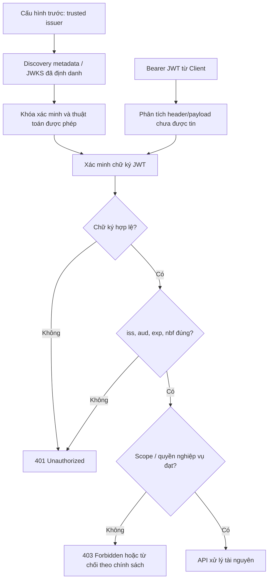

# Issuer là định danh nhà phát hành và là một phần của gốc tin cậy

## 1. Vì sao Resource Server phải quan tâm issuer?

Giả sử hệ thống thương mại điện tử có API `orders-api`, một máy chủ định danh `https://id.example.com/realms/shop` và nhiều ứng dụng Client. Một request được gửi đến API:

```http
GET /api/orders/42 HTTP/1.1
Host: orders.example.com
Authorization: Bearer <access-token>
Accept: application/json
```

Client có thể cung cấp một JWT được mã hóa theo dạng ba phần `header.payload.signature`. Payload chứa các claim như `sub`, `scope` và `exp`. Nhưng trước khi tin những claim này, API phải trả lời một câu hỏi nền tảng:

**Ai là bên được hệ thống cho phép phát hành token mà API sẽ chấp nhận?**

Trong JWT, claim **`iss` (issuer)** biểu diễn định danh của bên phát hành. Ví dụ:

```json
{
  "iss": "https://id.example.com/realms/shop",
  "sub": "user-417",
  "aud": ["orders-api"],
  "exp": 1893456000,
  "scope": "orders.read"
}
```

Giá trị `iss` ở đây chỉ là ví dụ. Trong hệ thống thật, nó phải đúng với định danh issuer mà Authorization Server công bố và Resource Server đã được cấu hình **tin cậy từ trước**.

Nếu API chấp nhận token của bất kỳ issuer nào chỉ vì JWT có chữ ký hợp lệ với một khóa mà nó vừa tìm thấy trên mạng, một bên không được ủy quyền có thể tạo Authorization Server riêng, phát hành token và tự gán quyền truy cập. Ngược lại, nếu API ràng buộc issuer đúng nhưng không kiểm tra chữ ký, kẻ tấn công chỉ cần tự ghi giá trị `iss` được mong đợi vào payload.

Vì vậy, **issuer là một phần của gốc tin cậy (*trust anchor*) trong cấu hình Resource Server**, đi cùng với nguồn khóa tin cậy, thuật toán được phép, audience và chính sách xác minh token. Chuỗi chữ `iss` tự nó không phải khóa mật mã, không phải chữ ký và không đủ để xác thực một JWT.

### Kết quả học tập

Sau bài này, bạn có thể:

- Giải thích chính xác claim `iss` và mối quan hệ với Authorization Server/OpenID Provider.
- Phân biệt **issuer identifier**, **discovery metadata URL** và **JWKS URI**.
- Mô tả quá trình Resource Server đi từ issuer tin cậy đến khóa xác minh JWT.
- Hiểu vì sao phải xác minh chữ ký, issuer, audience và thời hạn **cùng nhau**.
- Cấu hình `issuer-uri` trong Spring Security Resource Server và biết trường hợp nào cần chỉ định thêm `jwk-set-uri`.
- Nhận diện nguy cơ khi dùng `iss` chưa xác minh để tự động tin một issuer hoặc chọn khóa tùy ý.
- Phân biệt trường hợp một issuer với nhiều issuer trong API đa tổ chức.

## 2. Issuer là gì trong JWT và OAuth 2.0/OIDC?

### 2.1. Claim `iss` là định danh, không phải một URL gọi API ngẫu nhiên

`iss` là một **registered JWT claim name** theo JWT (RFC 7519). Claim này xác định bên phát hành JWT; giá trị của nó là một chuỗi `StringOrURI` có phân biệt chữ hoa/chữ thường. Theo định dạng JWT, `iss` không bắt buộc luôn là URL, nhưng trong triển khai OAuth 2.0/OIDC hiện đại, issuer thường là một URL HTTPS được cấu hình rõ ràng.

Ví dụ:

```text
https://id.example.com/realms/shop
```

Đây có thể là **issuer identifier**. Nó không đồng nghĩa với:

```text
https://id.example.com/realms/shop/oauth2/token
https://id.example.com/realms/shop/authorize
https://id.example.com/realms/shop/keys
```

Những địa chỉ phía sau, nếu có, phục vụ các chức năng như cấp token, yêu cầu ủy quyền hoặc công bố khóa; chúng **không tự thay thế** issuer identifier.

Cần phân biệt các định danh:

| Thành phần | Nêu điều gì? | Ví dụ |
|---|---|---|
| `iss` / issuer identifier | Token tự khai bên nào phát hành; phải được xác minh | `https://id.example.com/realms/shop` |
| `sub` | Chủ thể token nói đến | `user-417` |
| `aud` | Token được cấp cho bên nhận/tài nguyên nào | `orders-api` |
| `client_id` | Client được cấp token nếu profile cung cấp claim này | `shop-web` |
| `scope` hoặc `scp` | Quyền OAuth đã cấp | `orders.read` |
| `jwks_uri` | Nơi công bố tập khóa theo metadata đã tin cậy | `https://id.example.com/realms/shop/keys` |

**Một issuer có thể phát hành token cho nhiều Client, nhiều người dùng và nhiều Resource Server.** Issuer không phải là user ID, tenant ID, scope hoặc audience.

### 2.2. Issuer trong OpenID Connect

Trong OpenID Connect (OIDC), **OpenID Provider (OP)** là thành phần xác thực danh tính và phát hành ID token cho OIDC Client. ID token phải mang claim `iss` để Client xác minh nó đến từ provider đã được lựa chọn.

Cùng một nhà cung cấp có thể hoạt động như OAuth Authorization Server, phát hành **access token** cho Resource Server. Trong kiến trúc JWT access token, API thường xác minh `iss` theo profile access token và hợp đồng của Authorization Server.

Cần tránh nhầm:

- **ID token:** dành cho OIDC Client, chứa thông tin về sự kiện xác thực của người dùng.
- **Access token:** dành cho Resource Server, dùng để truy cập API theo quyền được cấp.
- Cả hai có thể chứa `iss` và cùng là JWT, nhưng **không thể dùng ID token thay access token** chỉ vì issuer giống nhau.

Ví dụ, ID token có `aud=web-client` không trở thành access token hợp lệ của `orders-api` khi API chỉ nhìn thấy đúng `iss`.

### 2.3. So sánh giá trị issuer phải theo đúng hợp đồng

Nếu Resource Server đã tin:

```text
https://id.example.com/realms/shop
```

thì những chuỗi sau có thể được coi là **khác nhau** khi so khớp chính xác:

```text
https://id.example.com/realms/shop/
http://id.example.com/realms/shop
https://ID.example.com/realms/shop
https://id.example.com/realms/other
```

Dù một số quy tắc URL có thể xem những địa chỉ nhất định là tương đương ở tầng mạng, việc so sánh issuer ở tầng token phải tuân theo quy ước của giao thức và validator đang dùng. **Không tự cắt dấu `/` cuối, đổi `http` thành `https`, đổi path hoặc chuẩn hóa issuer theo phỏng đoán để token được chấp nhận.**

Nếu gặp lỗi `Invalid issuer`, hãy xác định issuer thật từ metadata/hợp đồng nhà phát hành rồi sửa cấu hình cho khớp. Tránh nới lỏng validator chỉ vì khác biệt chuỗi chưa được giải thích.

## 3. Vì sao issuer là một phần của gốc tin cậy?

### 3.1. Tính xác thực của token là một chuỗi kiểm tra

Khi Resource Server chấp nhận JWT, nó cần tối thiểu các điều kiện:

1. **Issuer được tin cậy:** API đã có cấu hình cho phép issuer cụ thể phát hành token.
2. **Khóa xác minh thuộc nguồn tin cậy:** token được xác minh bằng khóa do issuer được phép quản lý hoặc được hệ thống cấu hình theo hợp đồng.
3. **Thuật toán ký được chấp nhận:** không tin tùy ý một `alg` mà Client gửi.
4. **Chữ ký hợp lệ:** header/payload chưa bị thay đổi trái phép đối với khóa ký tin cậy.
5. **Claim issuer đúng:** `iss` trong token đã xác minh khớp issuer mong đợi.
6. **Token còn hiệu lực:** thỏa `exp`, `nbf` và chính sách thời gian.
7. **Đúng Resource Server:** `aud` phù hợp với API.
8. **Đủ quyền:** scope/authority và quy tắc quyền trên tài nguyên đáp ứng request.

Một số yếu tố không được biểu diễn trong mọi token, hoặc nằm ở chính sách/metadata của hệ thống. Vì vậy, **issuer là điểm xuất phát của quyết định tin cậy**, không phải toàn bộ quyết định.



Sơ đồ trên là quá trình logic; thư viện có thể tối ưu, cache khóa và kiểm tra một số điều kiện trong thứ tự khác nhau. **API chỉ nên sử dụng claim để phân quyền sau khi token đã trải qua quá trình xác thực cần thiết.**

### 3.2. Vì sao không được chỉ kiểm tra `iss`?

Kẻ tấn công có thể tự tạo JWT payload:

```json
{
  "iss": "https://id.example.com/realms/shop",
  "sub": "admin",
  "aud": ["orders-api"],
  "scope": "orders.read orders.write"
}
```

Các chuỗi JSON này rất dễ tạo và Base64URL-encode. **Đọc được `iss` trong payload chưa xác minh chỉ cho biết token đang *tự khai* nguồn phát hành.** Nó không chứng minh token thực sự được nhà phát hành đó ký.

Chỉ khi chữ ký/MAC được xác minh bằng khóa thích hợp từ nguồn tin cậy, cùng với các validator, API mới có cơ sở tin những claim cần thiết.

### 3.3. Vì sao không được chỉ kiểm tra chữ ký?

Một JWT có chữ ký hợp lệ dưới public key của issuer B nhưng API chỉ được phép tin issuer A vẫn phải bị từ chối. Tương tự, token do issuer A ký để gọi `billing-api` không thể dùng tại `orders-api` nếu audience không phù hợp.

Ví dụ:

```text
Token 1:
  iss = https://id.example.com/realms/shop
  aud = orders-api
  signature = valid under trusted issuer key

Token 2:
  iss = https://id.example.com/realms/partner
  aud = orders-api
  signature = valid under partner key

Token 3:
  iss = https://id.example.com/realms/shop
  aud = billing-api
  signature = valid under trusted issuer key
```

Nếu chính sách `orders-api` chỉ tin issuer `/realms/shop` và audience `orders-api`:

- Token 1 có thể tiếp tục qua bước kiểm tra quyền.
- Token 2 phải bị từ chối nếu issuer partner không nằm trong tập tin cậy.
- Token 3 phải bị từ chối vì sai audience.

**Chữ ký hợp lệ chỉ có ý nghĩa trong bối cảnh “ký bởi khóa nào, khóa thuộc bên được phép nào và token cấp cho ai”.**

## 4. Discovery: từ issuer identifier đến metadata và JWKS

### 4.1. Discovery giải quyết điều gì?

Nếu biết issuer tin cậy là:

```text
https://id.example.com/realms/shop
```

Resource Server cần biết cách tìm **khóa xác minh**. Thay vì tự chép public key vào code và cập nhật thủ công mỗi khi nhà phát hành đổi khóa, hệ thống có thể dùng **discovery metadata** do Authorization Server hoặc OpenID Provider công bố.

Metadata thường có các trường như:

- `issuer`: định danh nhà phát hành, phải khớp giá trị tin cậy mà Client/API kỳ vọng.
- `jwks_uri`: endpoint công bố tập JWK.
- `authorization_endpoint`: endpoint cho Client thực hiện các bước ủy quyền.
- `token_endpoint`: endpoint Client dùng để lấy token.
- Các thông số hỗ trợ khác về thuật toán, scope, grant type và khả năng của server.

API Resource Server xác minh JWT chủ yếu cần định danh issuer, nguồn khóa và chính sách xác thực token. **Nó không cần tự chạy Authorization Code hoặc Client Credentials chỉ để kiểm tra một access token đã được phát hành.**

### 4.2. OIDC Discovery và OAuth Authorization Server Metadata

Có hai họ chuẩn discovery thường gặp:

| Nguồn metadata | Vai trò | Ví dụ hoặc lưu ý |
|---|---|---|
| **OpenID Connect Discovery** | Công bố cấu hình OpenID Provider | Thường dùng đường dẫn `.well-known/openid-configuration` theo quy tắc OIDC |
| **OAuth 2.0 Authorization Server Metadata (RFC 8414)** | Công bố cấu hình Authorization Server | Dùng `.well-known/oauth-authorization-server` theo quy tắc RFC 8414 |
| **JWKS endpoint** | Công bố tập public JWK phục vụ xác minh | URL được công bố qua `jwks_uri` hoặc cấu hình tin cậy |

Với issuer không có path, các kiểu địa chỉ phổ biến là:

```text
Issuer:
  https://auth.example.com

OIDC discovery:
  https://auth.example.com/.well-known/openid-configuration

OAuth AS metadata:
  https://auth.example.com/.well-known/oauth-authorization-server
```

Với issuer có path, **quy tắc xây dựng đường dẫn metadata có thể khác giữa OIDC Discovery và RFC 8414**. Ví dụ minh họa:

```text
Issuer:
  https://auth.example.com/realms/shop

OIDC discovery (dạng nối theo issuer path thường gặp):
  https://auth.example.com/realms/shop/.well-known/openid-configuration

OAuth AS metadata theo RFC 8414 (well-known chèn trước issuer path):
  https://auth.example.com/.well-known/oauth-authorization-server/realms/shop
```

Các server có thể công bố những endpoint discovery tương thích cụ thể; Spring Security cũng có cơ chế tìm metadata từ các vị trí được hỗ trợ theo phiên bản. **Không đoán một URL discovery chỉ dựa trên tên endpoint**: hãy dùng metadata đã được nhà phát hành công bố, kiểm tra response `issuer` và lựa chọn đúng chuẩn/giao diện mà môi trường hỗ trợ.

### 4.3. Ví dụ metadata OIDC

Một phản hồi JSON **minh họa**, đã rút gọn:

```json
{
  "issuer": "https://id.example.com/realms/shop",
  "authorization_endpoint": "https://id.example.com/realms/shop/authorize",
  "token_endpoint": "https://id.example.com/realms/shop/token",
  "jwks_uri": "https://id.example.com/realms/shop/keys",
  "response_types_supported": ["code"],
  "id_token_signing_alg_values_supported": ["RS256"]
}
```

Địa chỉ và giá trị trên không phải cấu hình của một nhà cung cấp cụ thể. `id_token_signing_alg_values_supported` nói về thuật toán ký **ID token** được công bố trong OIDC, **không tự thay thế** chính sách thuật toán mà Resource Server dùng khi xác minh **access token**. Với access token, phải dựa trên token profile và cấu hình API.

Khi sử dụng discovery an toàn:

1. API hoặc thư viện bắt đầu từ **issuer đã được cấu hình tin cậy**, không từ một URL bất kỳ trong token.
2. Truy vấn metadata qua HTTPS và xác minh kết nối TLS.
3. Kiểm tra `issuer` metadata theo quy tắc của protocol/client, nhất quán với issuer mong đợi.
4. Dùng `jwks_uri` và thông tin hỗ trợ thích hợp theo chính sách của thư viện.
5. Chỉ chấp nhận chữ ký/claim của JWT đáp ứng bộ validator và khóa tin cậy.

### 4.4. JWKS và quan hệ với `kid`

Metadata có thể chỉ ra một JWKS endpoint như:

```text
https://id.example.com/realms/shop/keys
```

Phản hồi JWK Set công khai có thể chứa:

```json
{
  "keys": [
    {
      "kty": "RSA",
      "kid": "key-2026-11",
      "use": "sig",
      "alg": "RS256",
      "n": "<public-modulus-base64url>",
      "e": "AQAB"
    }
  ]
}
```

Các giá trị `n`, `e` ở trên chỉ là placeholder, không tạo được public key thật. `kid` giúp chọn khóa từ tập khóa đã được tin cậy; `kty` và `use` mô tả loại/mục đích khóa.

Khi JWT có JOSE header:

```json
{
  "alg": "RS256",
  "typ": "at+jwt",
  "kid": "key-2026-11"
}
```

Resource Server có thể dùng `kid` làm gợi ý lựa chọn khóa tương ứng, rồi kiểm tra thuật toán và chữ ký. **`kid` do token cung cấp không tự xác lập niềm tin với khóa; JWKS phải đến từ nguồn đã cấu hình tin cậy.**

JWT header có thể chứa những trường liên quan khóa như `jku` hoặc `jwk`. Resource Server **không nên tự động tin một URL/khóa mới chỉ vì token yêu cầu**, nếu không sẽ có nguy cơ chấp nhận token do attacker tự ký hoặc tạo truy vấn mạng tới địa chỉ không mong muốn.

### 4.5. TLS và issuer là hai lớp tin cậy khác nhau

Issuer URL HTTPS giúp Resource Server lấy metadata/khóa qua kênh được xác thực bởi cơ chế TLS. Tuy nhiên:

- TLS xác thực máy chủ/kênh truyền theo mô hình chứng thư được hệ thống tin cậy.
- Cấu hình issuer xác định **nhà phát hành mà ứng dụng cho phép**.
- Chữ ký JWT xác thực dữ liệu token đối với **khóa ký đã tin cậy**.
- Audience/scope/quyền nghiệp vụ xác định token có thể dùng **để làm gì**.

Một HTTPS endpoint hợp lệ không có nghĩa tổ chức của bạn đã cho phép endpoint đó phát hành token cho API. **Gốc tin cậy bắt đầu từ quyết định cấu hình issuer và khóa thích hợp**, không tự xuất hiện chỉ vì một URL sử dụng HTTPS.

## 5. Spring Security Resource Server làm gì với `issuer-uri`?

### 5.1. Cấu hình tối thiểu

Với ứng dụng Spring Boot dùng Gradle:

```groovy
dependencies {
    implementation 'org.springframework.boot:spring-boot-starter-web'
    implementation 'org.springframework.boot:spring-boot-starter-security'
    implementation 'org.springframework.boot:spring-boot-starter-oauth2-resource-server'
}
```

Trong `src/main/resources/application.yml`:

```yaml
spring:
  security:
    oauth2:
      resourceserver:
        jwt:
          issuer-uri: https://id.example.com/realms/shop
```

Đây là một ví dụ cấu hình Spring Boot OAuth 2.0 Resource Server dùng **JWT access token**. Địa chỉ issuer phải thay bằng giá trị thật đã được hệ thống phê duyệt.

Khi hoạt động theo chế độ discovery issuer, Spring Security có thể tìm cấu hình nhà phát hành và nguồn JWK phù hợp, dùng khóa tin cậy để kiểm tra chữ ký JWT và áp dụng các validator cơ bản về issuer/thời gian. Chi tiết thời điểm truy vấn metadata/JWKS phụ thuộc phiên bản và cách tạo `JwtDecoder`; không nên giả định mọi phiên bản đều cần kết nối mạng tại đúng một thời điểm cố định.

Điều `issuer-uri` **không tự làm**:

- Không biến ứng dụng thành Authorization Server.
- Không tự đăng nhập người dùng hay phát access token.
- Không tự bảo đảm JWT được cấp cho đúng audience nghiệp vụ của API nếu chưa cấu hình audience.
- Không tự giải quyết owner/tenant/role trên từng tài nguyên.
- Không biến ID token OIDC thành access token dùng để gọi API.
- Không thay thế yêu cầu cấu hình thuật toán/khóa phù hợp với profile token thực tế.

### 5.2. Bật Resource Server và phân quyền endpoint

Ví dụ một ứng dụng dùng Spring Security hiện đại:

```java
package com.example.orders;

import org.springframework.context.annotation.Bean;
import org.springframework.context.annotation.Configuration;
import org.springframework.http.HttpMethod;
import org.springframework.security.config.Customizer;
import org.springframework.security.config.annotation.web.builders.HttpSecurity;
import org.springframework.security.config.http.SessionCreationPolicy;
import org.springframework.security.web.SecurityFilterChain;

@Configuration
public class SecurityConfig {

    @Bean
    SecurityFilterChain apiSecurity(HttpSecurity http) throws Exception {
        return http
            .csrf(csrf -> csrf.disable())
            .sessionManagement(s -> s
                .sessionCreationPolicy(SessionCreationPolicy.STATELESS))
            .authorizeHttpRequests(auth -> auth
                .requestMatchers("/api/public/**").permitAll()
                .requestMatchers(HttpMethod.GET, "/api/orders/**")
                    .hasAuthority("SCOPE_orders.read")
                .requestMatchers(HttpMethod.POST, "/api/orders/**")
                    .hasAuthority("SCOPE_orders.write")
                .anyRequest().denyAll()
            )
            .oauth2ResourceServer(oauth2 ->
                oauth2.jwt(Customizer.withDefaults()))
            .build();
    }
}
```

Trong cấu hình trên, Spring Security xử lý Bearer JWT, tạo `Authentication` khi token hợp lệ, rồi kiểm tra `SCOPE_orders.read` hoặc `SCOPE_orders.write` ở endpoint tương ứng.

Thông thường, claim `scope` hoặc `scp` của JWT được ánh xạ thành authority có tiền tố `SCOPE_`. Với issuer dùng định dạng claim khác, cần cấu hình converter riêng.

`csrf.disable()` chỉ là ví dụ cho REST API không dùng cookie để xác thực, nơi Bearer token được Client chủ động gửi trong header. Nếu dùng cookie/session trình duyệt, cần xem xét CSRF theo kiến trúc thực tế.

### 5.3. Cấu hình issuer cùng JWKS URI được chỉ định trước

Một số hệ thống cần quản lý cách liên hệ metadata/JWKS chặt hơn hoặc muốn giảm phụ thuộc vào discovery tại thời điểm khởi tạo. Spring Boot hỗ trợ cấu hình cả `issuer-uri` và `jwk-set-uri` trong những phiên bản phù hợp:

```yaml
spring:
  security:
    oauth2:
      resourceserver:
        jwt:
          issuer-uri: https://id.example.com/realms/shop
          jwk-set-uri: https://id.example.com/realms/shop/keys
```

Vai trò của từng property:

- `issuer-uri`: giữ danh tính issuer dự kiến để kiểm tra claim `iss`.
- `jwk-set-uri`: chỉ định nguồn public key mà API đã chấp nhận.

Cấu hình hai property có thể tránh bước tìm `jwks_uri` qua issuer metadata trong quá trình tạo decoder, tùy phiên bản, đồng thời vẫn giữ kiểm tra issuer. Khi API cần xác minh token, endpoint JWKS vẫn phải sẵn có hoặc có cache khóa tương ứng.

**Lưu ý:** Nếu chỉ cấu hình `jwk-set-uri` mà không thiết lập issuer validator theo cách khác, không nên mặc nhiên kết luận `iss` đã được kiểm tra. Cần phân biệt việc “biết lấy khóa ở đâu” với việc “chỉ tin một issuer cụ thể”.

### 5.4. Thêm audience validator

Resource Server `orders-api` cần từ chối token dành cho `billing-api`, dù cùng issuer và cùng khóa ký. Ví dụ có thể tạo decoder với kiểm tra issuer/thời hạn và `aud`:

```java
package com.example.orders;

import org.springframework.context.annotation.Bean;
import org.springframework.context.annotation.Configuration;
import org.springframework.security.oauth2.core.DelegatingOAuth2TokenValidator;
import org.springframework.security.oauth2.core.OAuth2Error;
import org.springframework.security.oauth2.core.OAuth2TokenValidator;
import org.springframework.security.oauth2.core.OAuth2TokenValidatorResult;
import org.springframework.security.oauth2.jwt.Jwt;
import org.springframework.security.oauth2.jwt.JwtDecoder;
import org.springframework.security.oauth2.jwt.JwtDecoders;
import org.springframework.security.oauth2.jwt.JwtValidators;
import org.springframework.security.oauth2.jwt.NimbusJwtDecoder;

@Configuration
public class JwtValidationConfig {

    @Bean
    JwtDecoder jwtDecoder() {
        String expectedIssuer =
            "https://id.example.com/realms/shop";
        String expectedAudience = "orders-api";

        NimbusJwtDecoder decoder =
            (NimbusJwtDecoder) JwtDecoders.fromIssuerLocation(expectedIssuer);

        OAuth2TokenValidator<Jwt> audienceValidator = jwt ->
            jwt.getAudience().contains(expectedAudience)
                ? OAuth2TokenValidatorResult.success()
                : OAuth2TokenValidatorResult.failure(
                    new OAuth2Error(
                        "invalid_token", "Invalid audience", null));

        decoder.setJwtValidator(
            new DelegatingOAuth2TokenValidator<>(
                JwtValidators.createDefaultWithIssuer(expectedIssuer),
                audienceValidator
            ));

        return decoder;
    }
}
```

Đây là đoạn minh họa cho các phiên bản Spring Security hỗ trợ API được dùng. Nó thay thế cơ chế tự động tạo `JwtDecoder` bằng bean do ứng dụng khai báo, đồng thời giữ validator mặc định thông qua `JwtValidators.createDefaultWithIssuer(...)`.

Nếu sử dụng `jwk-set-uri` cố định thay cho discovery trong code, có thể xây decoder bằng API tương ứng với JWK Set URI và **vẫn** thiết lập issuer/audience validators; không nên vô tình bỏ một validator khi tự cấu hình decoder.

Tùy phiên bản Spring Boot/Spring Security, có thể có property cấu hình audience trực tiếp. Chọn cách phù hợp với version dự án, nhưng nguyên tắc không đổi: **issuer và audience phải được kiểm tra độc lập**.

### 5.5. Đọc issuer sau khi token đã được xác minh

Một Controller có thể nhận principal JWT:

```java
package com.example.orders;

import java.util.Map;
import org.springframework.security.core.annotation.AuthenticationPrincipal;
import org.springframework.security.oauth2.jwt.Jwt;
import org.springframework.web.bind.annotation.GetMapping;
import org.springframework.web.bind.annotation.RestController;

@RestController
public class ProfileController {

    @GetMapping("/api/profile")
    public Map<String, Object> profile(
            @AuthenticationPrincipal Jwt jwt) {

        return Map.of(
            "subject", jwt.getSubject(),
            "issuer", jwt.getIssuer().toString(),
            "audience", jwt.getAudience()
        );
    }
}
```

Ví dụ này giả định issuer/subject tồn tại theo hợp đồng token. Muốn endpoint thực thi với `SecurityConfig` ở mục 5.2, cần khai báo thêm matcher `/api/profile` với yêu cầu scope/authority phù hợp; nếu để `anyRequest().denyAll()` nguyên trạng thì request bị từ chối trước Controller.

**Chỉ dùng `Jwt` từ SecurityContext sau bước xác thực của Spring Security** để dựa vào issuer/subject. Không tin chuỗi issuer do Client đưa riêng qua header như `X-Issuer` hoặc payload JWT mới Base64URL-decode mà chưa xác minh.

## 6. Các sai lầm liên quan discovery và gốc tin cậy

### 6.1. Lấy `iss` từ token chưa xác minh rồi tự động tin issuer đó

Ví dụ một API cố gắng làm theo cách sau:

```text
1. Client gửi JWT.
2. API Base64URL-decode payload, đọc iss.
3. API tự gọi metadata từ URL iss.
4. API tải JWKS do URL đó công bố.
5. API xác minh chữ ký và chấp nhận token.
```

Nếu API **không kiểm tra issuer đó có nằm trong tập đã tin cậy hay không**, một attacker có thể:

1. Dựng một máy chủ HTTPS của họ.
2. Công bố metadata và JWKS với public key của họ.
3. Tự ký JWT có `scope=orders.read`, `sub=admin`.
4. Gửi JWT tới API.

Nếu API tùy ý tin issuer mới, chữ ký có thể hợp lệ dưới khóa do chính attacker sở hữu và request bị cấp quyền nhầm.

**Nguyên tắc:** Định danh issuer phải được **allowlist/cấu hình tin cậy trước**. Có thể dùng `iss` chưa xác thực như **gợi ý tìm cấu hình đã tồn tại**, nhưng không dùng nó để tự động **mở rộng tập issuer được tin cậy**.

### 6.2. Tin `jku` hoặc `jwk` do JWT header yêu cầu

JOSE header có thể mang các tham số về khóa hoặc URL khóa. Nếu decoder tự động chấp nhận khóa ngoài cấu hình dựa trên `jku`/`jwk`, kẻ tấn công có thể đưa khóa do họ kiểm soát vào quá trình xác minh.

Resource Server nên chọn khóa từ JWKS/keystore thuộc issuer đã được tin cậy, giới hạn thuật toán phù hợp và áp dụng chính sách xử lý header an toàn. `kid` chỉ là gợi ý tìm khóa trong tập tin cậy, không phải quyền tự chọn một nguồn khóa mới.

### 6.3. Dùng issuer chung nhưng không kiểm tra audience

Một Authorization Server có thể phát hành token cho `orders-api`, `inventory-api` và `billing-api`. Tất cả token cùng `iss`, nhưng `aud` khác nhau.

Nếu `orders-api` chỉ xác minh chữ ký và issuer, nó có thể chấp nhận nhầm token được cấp cho `inventory-api`.

**Cách xử lý:** Ràng buộc `aud` theo định danh Resource Server, đồng thời kiểm tra scope và quyền nghiệp vụ. Đặc biệt quan trọng nếu nhiều API chia sẻ issuer và public key.

### 6.4. Dùng ID token của OIDC Client để gọi Resource Server

ID token có thể có:

```json
{
  "iss": "https://id.example.com/realms/shop",
  "sub": "user-417",
  "aud": "shop-web"
}
```

Nếu `orders-api` tin issuer trên nhưng không kiểm tra audience/mục đích token, API có nguy cơ chấp nhận loại token không dành cho mình.

**Cách xử lý:** Client phải gửi **access token** dành cho API. Nếu hệ thống sử dụng profile JWT access token có `typ=at+jwt` hoặc ràng buộc loại token khác, Resource Server nên thực thi đúng chính sách đó. Không coi riêng chữ ký và issuer là đủ để phân biệt ID token với access token.

### 6.5. Tự động bỏ qua lỗi issuer khi chuyển môi trường

Ví dụ môi trường staging dùng:

```text
https://id-staging.example.com/realms/shop
```

còn production dùng:

```text
https://id.example.com/realms/shop
```

Nếu API production chấp nhận cả token staging chỉ để tiện thử nghiệm, quyền truy cập production có thể được cấp bởi một môi trường có quản trị khóa/định danh yếu hơn.

Cần quản lý allowlist issuer cho từng môi trường theo đúng yêu cầu vận hành, tách issuer/khóa/audience và không mở rộng tập tin cậy tùy tiện.

## 7. Khi có nhiều issuer: ranh giới tin cậy phức tạp hơn

### 7.1. Một API có thể tin nhiều Authorization Server

Trong hệ thống đa doanh nghiệp, `reports-api` có thể nhận token từ:

```text
https://login.company-a.example
https://login.company-b.example
```

Hoặc trong kiến trúc nhiều realm:

```text
https://auth.example.com/realms/tenant-a
https://auth.example.com/realms/tenant-b
```

Khi đó Resource Server phải biết trước **tập issuer được phép** và có cơ chế xác thực JWT theo issuer tương ứng.

| Việc cần ràng buộc | Tại sao cần? |
|---|---|
| Allowlist issuer | Ngăn Client tự đưa một issuer lạ vào hệ thống |
| JWKS/khóa riêng theo issuer | Tránh xác minh token issuer A bằng khóa issuer B hoặc nguồn tùy ý |
| Audience phù hợp API | Ngăn sử dụng token cấp cho API khác |
| Claim mapping theo issuer | `sub`, `scope`, `roles`, `tenant` có thể có cấu trúc khác |
| Subject key theo issuer | Tránh trùng user ID giữa các issuer |
| Chính sách tenant/quyền | Token từ issuer A không tự có quyền trên dữ liệu tenant B |

### 7.2. Định danh user nên gắn với issuer

Giả sử cả issuer A và issuer B đều phát hành token có:

```text
sub = 123
```

Hai chuỗi `sub` giống nhau **không nhất thiết đại diện cùng một người dùng**. Khi ánh xạ danh tính bên ngoài sang hệ thống nội bộ, cần dùng cặp:

```text
(issuer, subject)
```

Ví dụ:

```text
(https://login.company-a.example, 123)
(https://login.company-b.example, 123)
```

là hai định danh bên ngoài khác nhau, trừ khi hệ thống chủ động liên kết tài khoản qua một cơ chế được xác thực.

Điều này đặc biệt quan trọng khi lưu chủ sở hữu tài nguyên, dữ liệu tenant hoặc audit log. Chỉ lưu `sub=123` có thể tạo ra xung đột nếu nhiều issuer cùng được chấp nhận.

### 7.3. Chọn validator theo issuer một cách an toàn

Spring Security có cơ chế giải quyết `AuthenticationManager` theo issuer, ví dụ `JwtIssuerAuthenticationManagerResolver` trong cấu hình Servlet hỗ trợ nhiều issuer. Ý tưởng:

```text
Incoming JWT
   |
   +-- read iss as routing hint (not trusted yet)
   |
   +-- iss in configured trusted set?
   |       no  -> reject
   |       yes -> select issuer-specific AuthenticationManager
   |
   +-- verify JWT with keys/validators for that issuer
   |
   +-- enforce audience, time, scope, tenant and resource permissions
```

Đối với một số phiên bản Spring Security, có thể cấu hình resolver từ danh sách issuer tin cậy thông qua một API tương ứng với `fromTrustedIssuers`. Cú pháp/cơ chế khởi tạo cụ thể tùy version; điều bắt buộc trong mọi thiết kế là **resolver chỉ chọn giữa những issuer đã được phê duyệt**, sau đó decoder vẫn xác minh chữ ký và claim issuer.

Không sử dụng mọi URL `iss` từ JWT đầu vào làm issuer tin cậy chỉ vì JWT có trường đó.

### 7.4. Issuer không phải tenant ID mặc định

Một issuer có thể phục vụ hàng nghìn tenant; ngược lại, hệ thống có thể dùng một issuer riêng cho từng tenant. Nếu API cần tenant isolation, phải xác định hợp đồng:

- Tenant được ánh xạ từ issuer đã tin cậy?
- Hay AS cấp claim `tenant_id` đã xác minh?
- Khi user thuộc nhiều tenant, token đại diện tenant hiện hành nào?
- API đối chiếu tenant của token với tenant trong dữ liệu như thế nào?

**Không tự coi `iss` là tenant ID** nếu chưa có quy ước dữ liệu và chính sách ủy quyền cụ thể.

## 8. Discovery, JWKS cache và luân chuyển khóa

### 8.1. Khóa ký có thể thay đổi nhưng issuer vẫn giữ nguyên

Authorization Server có thể đổi private key theo chu kỳ hoặc khi ứng phó sự cố. Một cấu hình tốt giữ issuer identifier ổn định trong khi cho phép sử dụng nhiều public key ở giai đoạn chuyển tiếp.

Ví dụ:

```text
Issuer: https://id.example.com/realms/shop

JWT cũ: kid=key-2026-10
JWT mới: kid=key-2026-11

JWKS trong giai đoạn chuyển tiếp:
  - key-2026-10 (public key cũ)
  - key-2026-11 (public key mới)
```

Resource Server có thể cache JWKS, làm mới theo chính sách cache hoặc khi gặp `kid` mới. Quá trình này nhằm đảm bảo token còn hạn dùng khóa cũ vẫn có thể được xác minh trong giai đoạn được phép.

### 8.2. Vì sao cache khóa phải có giới hạn và nguồn tin cậy?

Cache giúp hạn chế request mạng và giảm độ trễ. Tuy nhiên, API vẫn cần:

- Giới hạn nguồn JWKS theo issuer đã tin cậy.
- Đảm bảo có cách cập nhật khi khóa luân chuyển.
- Xác định hành vi nếu JWKS endpoint không thể truy cập.
- Không dùng khóa đã bị thu hồi vượt quá chính sách bảo mật.
- Không tự chấp nhận khóa từ token header hoặc issuer mới do Client tự chỉ định.

Khi JWKS tạm thời mất kết nối, việc xác minh token có thể vẫn thành công nếu decoder có **khóa tin cậy đã cache** phù hợp và còn được chấp nhận. Với token mới dùng `kid` chưa được cache, xác minh có thể thất bại cho tới khi lấy được khóa mới.

### 8.3. Nếu khóa bị lộ thì sao?

Chỉ đổi `iss` không giải quyết việc private key bị lộ. Nếu attacker nắm private key còn được Resource Server tin cậy, họ có thể tạo token có chữ ký hợp lệ với khóa đó.

Phản ứng thường cần:

1. Ngừng sử dụng/thu hồi khóa bị lộ.
2. Cập nhật JWKS hoặc cấu hình khóa tin cậy.
3. Đảm bảo các API không tiếp tục chấp nhận khóa cũ trái chính sách.
4. Kiểm tra vòng đời token, khả năng thu hồi và ảnh hưởng đến request đã được xử lý.
5. Rà soát log/audit theo quy định vận hành.

Issuer định danh nhà phát hành; **khóa ký và chính sách xác minh quyết định khả năng chứng thực token**, nên việc bảo vệ khóa là một phần không thể tách rời.

## 9. Các dạng lỗi và cách chẩn đoán

### 9.1. Sai issuer

Một request có JWT được issuer khác ký nhưng API chỉ tin issuer được cấu hình:

```http
GET /api/orders/42 HTTP/1.1
Authorization: Bearer <jwt-from-other-issuer>
```

Nếu JWT không đạt kiểm tra chữ ký/issuer, kết quả thường là:

```http
HTTP/1.1 401 Unauthorized
WWW-Authenticate: Bearer error="invalid_token"
```

Chi tiết header có thể khác tùy Spring Security, bộ decoder và cấu hình exception handling. **`401` là phản hồi điển hình của token không được chấp nhận**.

### 9.2. Sai audience dù issuer đúng

Một JWT hợp lệ từ đúng issuer:

```json
{
  "iss": "https://id.example.com/realms/shop",
  "aud": ["billing-api"],
  "scope": "orders.read"
}
```

phải bị `orders-api` từ chối **nếu audience validator yêu cầu `orders-api`**. Có issuer đúng và scope tên `orders.read` không làm token tự nhiên có quyền với tất cả API.

### 9.3. Token hợp lệ nhưng không đủ scope

Nếu issuer, chữ ký, thời hạn và audience đều hợp lệ nhưng token chỉ có `scope=orders.list`, trong khi `GET /api/orders/**` yêu cầu `SCOPE_orders.read`, phản hồi thường là:

```http
HTTP/1.1 403 Forbidden
WWW-Authenticate: Bearer error="insufficient_scope"
```

Trong trường hợp này, vấn đề nằm ở **authorization**, không phải issuer. Sửa issuer validator để ép token qua là sai hướng.

### 9.4. Lỗi metadata discovery hoặc JWKS

Có thể gặp:

- Issuer URL không tồn tại hoặc sai path.
- Metadata trả về `issuer` khác cấu hình.
- TLS kết nối đến discovery/JWKS không hợp lệ.
- Metadata không có `jwks_uri` phù hợp.
- JWKS endpoint không truy cập được hoặc thiếu `kid` mà token yêu cầu.
- Thuật toán/loại khóa không được decoder hỗ trợ hoặc cho phép.

Tùy cấu hình và phiên bản framework, những sự cố này có thể xuất hiện ở **khởi động**, **khởi tạo decoder**, hoặc **lúc request cần xác minh JWT**. Không nên nhầm mọi sự cố network/discovery với việc người dùng thiếu quyền `403`.

### 9.5. Bảng tra cứu nhanh

| Dấu hiệu | Kiểm tra đầu tiên | Hướng xử lý |
|---|---|---|
| JWT có `iss` khác `issuer-uri` | Claim `iss` và issuer thực tế từ metadata | Khớp cấu hình đúng issuer, không bỏ validator |
| JWT đúng issuer nhưng sai `aud` | Audience của token và API | Cấu hình cấp token/audience validator chính xác |
| `401` sau khi đổi khóa ký | `kid`, JWKS cache và khóa công khai mới | Kiểm tra key rotation, metadata/JWKS và cấu hình tin cậy |
| App không khởi động do issuer | Metadata endpoint/TLS và phiên bản Spring Security | Kiểm tra endpoint discovery hoặc cấu hình JWKS chủ động |
| Token hợp lệ nhưng `403` | `scope`, `SCOPE_` mapping, quyền nghiệp vụ | Sửa rule/phạm vi cấp quyền, không nới issuer |
| Token từ staging chạy được ở production | Trusted issuers/keys của môi trường | Rà soát và tách ranh giới tin cậy |
| ID token vẫn qua API | Audience, loại token và profile access token | Yêu cầu access token dành cho API |
| Hệ thống chấp nhận issuer lạ | Cách chọn decoder/JWKS từ `iss` | Chỉ dùng allowlist issuer và khóa tin cậy |
| Hai user khác issuer bị hiểu là một | Lưu `sub` mà thiếu `iss` | Định danh theo cặp `(iss, sub)` |

## 10. Thực hành: xác nhận issuer và token tại Resource Server

Các ví dụ sau là **lệnh minh họa để chạy trong project và môi trường có issuer thật**. Chúng không phải kết quả thực thi sẵn.

### 10.1. Chuẩn bị hai endpoint

Với `SecurityConfig` ở mục 5.2, một Controller có thể cung cấp:

```java
package com.example.orders;

import java.util.Map;
import org.springframework.security.core.annotation.AuthenticationPrincipal;
import org.springframework.security.oauth2.jwt.Jwt;
import org.springframework.web.bind.annotation.GetMapping;
import org.springframework.web.bind.annotation.RestController;

@RestController
public class DemoController {

    @GetMapping("/api/public/ping")
    public Map<String, String> ping() {
        return Map.of("status", "ok");
    }

    @GetMapping("/api/orders/me")
    public Map<String, String> privateInfo(
            @AuthenticationPrincipal Jwt jwt) {
        return Map.of("subject", jwt.getSubject());
    }
}
```

Đây là demo đơn giản về yêu cầu công khai và yêu cầu có token; trong ứng dụng thực, API đơn hàng phải kiểm tra ownership/tenant khi truy cập bản ghi nghiệp vụ.

### 10.2. Không có token

```bash
curl -i http://localhost:8080/api/public/ping
curl -i http://localhost:8080/api/orders/me
```

Kết quả dự kiến:

- `GET /api/public/ping` trả `200 OK`.
- `GET /api/orders/me` trả `401 Unauthorized` vì thiếu Bearer token.

### 10.3. Token không hợp lệ

```bash
curl -i \
  -H 'Authorization: Bearer invalid.jwt.token' \
  http://localhost:8080/api/orders/me
```

API phải từ chối token không hợp lệ, thường `401`. Đây là đường xác thực thất bại, không chứng minh tính đúng đắn của discovery/JWKS trong mọi trường hợp.

### 10.4. Token hợp lệ từ đúng issuer

Giả sử `ACCESS_TOKEN` là access token thật, được phát hành bởi issuer tin cậy, audience phù hợp, chưa hết hạn và có `orders.read`:

```bash
curl -i \
  -H "Authorization: Bearer $ACCESS_TOKEN" \
  http://localhost:8080/api/orders/me
```

Kết quả dự kiến `200 OK` và body chứa subject của token. Không dùng ID token thay cho access token.

### 10.5. Token được phát hành bởi issuer khác

Nếu có token thật từ một issuer không nằm trong cấu hình tin cậy, thử:

```bash
curl -i \
  -H "Authorization: Bearer $OTHER_ISSUER_ACCESS_TOKEN" \
  http://localhost:8080/api/orders/me
```

Kết quả dự kiến là từ chối, thường `401`. Để có phép thử thực sự có ý nghĩa, token của issuer khác phải là một token được phát hành hợp lệ ở nơi của nó; chỉ thay `iss` bằng cách sửa payload JWT sẽ phá chữ ký và không giúp phân biệt rõ nguyên nhân.

### 10.6. Kiểm tra metadata với curl

Nếu nhà phát hành hỗ trợ endpoint OIDC Discovery tại vị trí tương ứng với issuer, có thể xem metadata:

```bash
curl -i \
  'https://id.example.com/realms/shop/.well-known/openid-configuration'
```

Cần kiểm tra các field `issuer` và `jwks_uri` trong phản hồi, nhưng **không đưa thông tin hoặc khóa nội bộ nhạy cảm vào log**. Endpoint trên chỉ là URL minh họa; trong môi trường thật cần dùng URL discovery được nhà cung cấp xác nhận.

Khi xác nhận issuer, đừng chỉ xem chuỗi `iss` của JWT bằng trình decode payload rồi coi như đã kiểm tra chữ ký. Việc xác thực token thuộc `JwtDecoder` với khóa tin cậy và validator.

### 10.7. Ma trận kết quả mong đợi

| Trường hợp | Token | Điều kiện chính | Kết quả |
|---|---|---|---|
| Public request | Không có | `permitAll()` | `200` |
| Protected request | Không có | Chưa xác thực | `401` |
| Protected request | Token sai cấu trúc/chữ ký | Xác thực JWT thất bại | `401` |
| Protected request | Token từ issuer lạ | Không nằm trong trust configuration | `401` |
| Protected request | Đúng issuer, sai audience | Audience validator từ chối | `401` |
| Protected request | Đúng issuer/audience, hết hạn | Expiration validator từ chối | `401` |
| Protected request | Đúng issuer/audience, thiếu scope | Không có `SCOPE_orders.read` | `403` |
| Protected request | Token hợp lệ và đủ scope | Kiểm tra endpoint đạt | `200` nếu Controller xử lý thành công |

HTTP status thực tế còn có thể bị ảnh hưởng bởi nhiều filter chain, handler tùy chỉnh và nghiệp vụ ứng dụng. Phép thử JWT thật cần Authorization Server/JWKS thật; không thể thay thế bằng một chuỗi tự điền vào payload.

## 11. Opaque token và vai trò issuer

Không phải access token nào cũng là JWT. Authorization Server có thể phát hành **opaque token**, tức một chuỗi mà Resource Server không giải mã cục bộ để đọc `iss`.

Với opaque token, Resource Server thường xác thực token qua **introspection endpoint** mà hệ thống đã cấu hình tin cậy:

```yaml
spring:
  security:
    oauth2:
      resourceserver:
        opaque-token:
          introspection-uri: https://id.example.com/oauth2/introspect
          client-id: resource-api
          client-secret: PLACEHOLDER_SECRET
```

`PLACEHOLDER_SECRET` chỉ là chuỗi đại diện; triển khai thật phải lấy credential từ biến môi trường hoặc secret manager, không đưa secret vào repository.

Ở trường hợp này, gốc tin cậy được thể hiện qua **introspection endpoint tin cậy, cách Resource Server xác thực tới endpoint đó và chính sách kiểm tra phản hồi**. Nếu phản hồi introspection có issuer/claim định danh, API diễn giải theo hợp đồng với nhà phát hành, nhưng không mặc nhiên có một JWT payload chứa `iss` để tự đọc.

Vì bài đang bàn về `issuer-uri` và discovery với JWT, cần phân biệt: **cấu hình JWT decoder qua issuer khác với cấu hình opaque-token introspection**. Không nên giả định hai cách xác thực đều được thực hiện chỉ bằng một property `issuer-uri`.

## 12. Câu hỏi tự kiểm tra

**Câu 1.** Vì sao `iss` đúng không tự chứng minh access token hợp lệ?

**Trả lời:** `iss` là một chuỗi trong payload. Người gửi có thể tự tạo chuỗi đó. Resource Server phải xác minh chữ ký bằng khóa tin cậy cùng các validator trước khi dựa vào claim.

**Câu 2.** Issuer identifier, `jwks_uri` và `token_endpoint` có phải cùng một URL không?

**Trả lời:** Không nhất thiết. Issuer là định danh nhà phát hành; `jwks_uri` là URL tập khóa xác minh; `token_endpoint` là nơi Client xin token. Discovery metadata liên kết những giá trị này theo chuẩn thích hợp.

**Câu 3.** Một JWT có chữ ký hợp lệ do issuer tin cậy phát hành, nhưng `aud=billing-api`. `orders-api` có được chấp nhận token không?

**Trả lời:** Không nếu `orders-api` yêu cầu audience riêng. Issuer/chữ ký đúng chưa đủ; token phải dành cho chính Resource Server đó.

**Câu 4.** API có thể lấy bất kỳ `iss` nào trong JWT rồi tải JWKS từ issuer đó để xác minh không?

**Trả lời:** Không. API chỉ nên dùng issuer nằm trong tập đã cấu hình tin cậy. `iss` chưa xác thực có thể làm gợi ý chọn một cấu hình cho phép sẵn, không được tự tạo lòng tin mới.

**Câu 5.** Vì sao có thể dùng `(iss, sub)` để lưu định danh bên ngoài?

**Trả lời:** `sub` có thể trùng giữa hai issuer. Cặp `(issuer, subject)` giúp phân biệt các chủ thể của hai nhà phát hành khác nhau.

**Câu 6.** Nếu issuer được cấu hình đúng nhưng khóa ký bị thay đổi, Resource Server cần xử lý gì?

**Trả lời:** Cần lấy/cập nhật public key từ nguồn JWKS tin cậy hoặc cấu hình tương ứng, đảm bảo `kid` và thuật toán được phép. Không bỏ xác minh chữ ký chỉ để token mới đi qua.

**Câu 7.** Vì sao ID token OIDC thường không thể dùng để gọi API dù `iss` trùng access token?

**Trả lời:** ID token phục vụ OIDC Client và thường có audience của Client. Resource Server cần access token được cấp cho API và thỏa các quy tắc về audience, loại token, scope/quyền.

## 13. Ghi nhớ

**Issuer là định danh của nhà phát hành token được ứng dụng chọn tin cậy.** Nó cho Resource Server biết *bên nào có thẩm quyền phát hành token*, đồng thời là đầu mối để thiết lập discovery metadata và nguồn khóa xác minh trong những cấu hình JWT phổ biến.

Tuy nhiên, **issuer không phải toàn bộ gốc tin cậy**. Một request chỉ nên được chấp nhận khi kết hợp đầy đủ: **issuer nằm trong tập cho phép → khóa và thuật toán xác minh đáng tin → chữ ký hợp lệ → `iss`, `aud`, thời hạn đạt yêu cầu → scope và quyền tài nguyên phù hợp**.

Với Spring Security OAuth 2.0 Resource Server, `issuer-uri` là cách khai báo một ranh giới tin cậy quan trọng. Khi cần, có thể kiểm soát thêm nguồn `jwk-set-uri`, audience và cơ chế chọn issuer. Các lớp bảo vệ đó giúp API nhận đúng token từ đúng Authorization Server và ngăn một JWT từ bên khác hoặc dành cho tài nguyên khác bị sử dụng nhầm.
