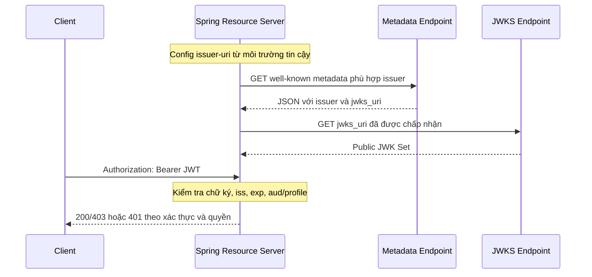

# OIDC Provider Configuration và OAuth Authorization Server Metadata

## 1. Bài toán: Resource Server biết và tin Authorization Server bằng cách nào?

Khi một API Spring Security chạy ở vai trò **OAuth 2.0 Resource Server**, API nhận access token từ client. Nếu access token là JWT đã ký, Resource Server cần biết ít nhất: token được phát hành bởi **issuer nào**, sử dụng **khóa xác minh nào**, và những điều kiện nào phải đúng trước khi cho phép request.

Trong một triển khai đơn giản, ta có thể cấu hình:

```yaml
spring:
  security:
    oauth2:
      resourceserver:
        jwt:
          issuer-uri: https://identity.example.com/realms/shop
```

Giá trị `issuer-uri` là **định danh bên phát hành** được Resource Server tin cậy. Spring Security có thể dùng định danh này để tìm tài liệu metadata qua cơ chế **discovery**. Metadata chỉ ra địa chỉ các endpoint, đặc biệt `jwks_uri` để lấy **JSON Web Key Set (JWKS)**, từ đó Resource Server xác minh chữ ký JWT.

Hai loại tài liệu metadata thường được nhắc đến:

1. **OpenID Connect Provider Configuration**, được định nghĩa bởi **OpenID Connect Discovery 1.0**.
2. **OAuth 2.0 Authorization Server Metadata**, được định nghĩa bởi **RFC 8414**.

Chúng có nhiều trường tương tự và có thể cùng do một nhà cung cấp danh tính công bố, nhưng **không phải một tài liệu được đặt hai tên**. Hai chuẩn có phạm vi, quy tắc xây dựng URL và một số trường metadata khác nhau. Hiểu đúng sự khác nhau giúp tránh lỗi issuer mismatch, sai `/.well-known/` URL và lỗi Resource Server không tải được JWKS.

## 2. Phân biệt issuer, Authorization Server, OpenID Provider và Resource Server

| Khái niệm | Trách nhiệm | Quan hệ với metadata |
|---|---|---|
| **Authorization Server (AS)** | Cấp OAuth 2.0 access token, có thể cấp refresh token; vận hành các endpoint cấp quyền | Có thể công bố **OAuth Authorization Server Metadata** theo RFC 8414 |
| **OpenID Provider (OP)** | Authorization Server có hỗ trợ OpenID Connect để xác thực người dùng | Công bố **OIDC Provider Configuration** phục vụ OIDC discovery |
| **OAuth 2.0 Client** | Thực hiện flow để có token và gọi API | Có thể dùng metadata để tìm authorization/token endpoint và cấu hình OIDC |
| **OIDC Relying Party (RP)** | OIDC Client dựa vào ID token để xác minh kết quả đăng nhập | Dùng OIDC metadata để xác minh đặc điểm và endpoint của OP |
| **Resource Server (RS)** | API nhận access token, xác thực token và áp dụng quyền | Với JWT, chủ yếu quan tâm `issuer`, `jwks_uri` và hợp đồng access token |
| **Issuer identifier** | URL định danh tổ chức/bộ phận phát hành token theo giao thức | Xuất hiện dưới dạng `issuer` trong metadata và thường là `iss` trong JWT |

Ví dụ hệ thống bán hàng:

```text
                       Authorization Server / OpenID Provider
                          issuer: https://identity.example.com/realms/shop
                           |                      |
                           | phát hành token      | công bố metadata
                           v                      v
Web Client --------> Bearer access token     /.well-known/... JSON
    |
    | Authorization: Bearer <access_token>
    v
Orders Resource Server  ---- discovery / JWKS ----> identity.example.com
    |
    | xác minh chữ ký, issuer, thời hạn, audience, quyền
    v
Protected orders API
```

Resource Server **không nhất thiết cần OIDC login**. Một OAuth 2.0 Authorization Server có thể phát hành access token cho API mà không hỗ trợ OIDC/ID token. Trong trường hợp đó, RFC 8414 có thể là cơ chế discovery phù hợp, còn `openid-configuration` có thể hoàn toàn không tồn tại.

### Issuer không đồng nghĩa với URL của một endpoint

Giả sử:

```text
issuer: https://identity.example.com/realms/shop
token endpoint: https://identity.example.com/realms/shop/protocol/openid-connect/token
JWKS endpoint: https://identity.example.com/realms/shop/protocol/openid-connect/certs
```

Ba URL phục vụ **ba mục đích khác nhau**. Không gán `issuer-uri` bằng token endpoint hay JWKS endpoint. API cần giữ nguyên định danh issuer đã được công bố, rồi dùng metadata để tìm địa chỉ endpoint thích hợp.

## 3. OIDC Provider Configuration là gì?

**OpenID Connect Discovery 1.0** mô tả cách một OIDC Client tìm thông tin cấu hình của **OpenID Provider (OP)**. Tài liệu đó thường gọi là *OpenID Provider Configuration Response*, được công bố dưới dạng JSON qua HTTPS tại một URL well-known.

Ví dụ issuer:

```text
https://identity.example.com/realms/shop
```

OIDC discovery endpoint thường là:

```text
https://identity.example.com/realms/shop/.well-known/openid-configuration
```

Ví dụ JSON minh họa:

```json
{
  "issuer": "https://identity.example.com/realms/shop",
  "authorization_endpoint": "https://identity.example.com/realms/shop/protocol/openid-connect/auth",
  "token_endpoint": "https://identity.example.com/realms/shop/protocol/openid-connect/token",
  "userinfo_endpoint": "https://identity.example.com/realms/shop/protocol/openid-connect/userinfo",
  "jwks_uri": "https://identity.example.com/realms/shop/protocol/openid-connect/certs",
  "end_session_endpoint": "https://identity.example.com/realms/shop/protocol/openid-connect/logout",
  "response_types_supported": ["code", "id_token", "code id_token"],
  "subject_types_supported": ["public", "pairwise"],
  "id_token_signing_alg_values_supported": ["RS256"],
  "scopes_supported": ["openid", "profile", "email", "orders.read"],
  "grant_types_supported": ["authorization_code", "refresh_token"],
  "code_challenge_methods_supported": ["S256"]
}
```

Đây là **ví dụ cấu trúc**, không phải cấu hình được bảo đảm bởi một OP cụ thể. Những URI, flow, scope và trường tùy chọn mà từng nhà cung cấp công bố có thể khác nhau; một số trường ví dụ chỉ xuất hiện khi tính năng tương ứng được hỗ trợ.

### Những trường nên nhận diện trong OIDC metadata

| Trường | Ý nghĩa | Thường được ai dùng? |
|---|---|---|
| `issuer` | Định danh chuẩn xác của OP/issuer | OIDC Client và Resource Server khi kiểm tra `iss` |
| `authorization_endpoint` | Endpoint mở authorization flow với người dùng | OAuth/OIDC Client |
| `token_endpoint` | Endpoint đổi authorization code, refresh token và các grant phù hợp | OAuth/OIDC Client |
| `userinfo_endpoint` | Endpoint lấy claim về người dùng qua access token OIDC phù hợp | OIDC Client |
| `jwks_uri` | Nơi công bố JWK Set, thường chứa khóa công khai xác minh chữ ký | OIDC Client và JWT Resource Server |
| `response_types_supported` | Các response type được OP hỗ trợ | OIDC Client |
| `subject_types_supported` | Các dạng subject identifier của OP | OIDC Client |
| `id_token_signing_alg_values_supported` | Thuật toán ký **ID token** OP công bố | OIDC Client |
| `scopes_supported` | Các scope OP công bố | Client, discovery/tooling |
| `grant_types_supported` | Những OAuth grant mà provider công bố | Client |
| `code_challenge_methods_supported` | Các phương thức PKCE công bố, như `S256` | Client |
| `end_session_endpoint` | Endpoint logout nếu có extension tương ứng | OIDC Client/RP |

Cần đặc biệt lưu ý: `id_token_signing_alg_values_supported` là danh sách thuật toán ký **ID token**, không phải cam kết rằng mọi **JWT access token** cũng được ký bằng đúng danh sách đó. Access token phải được xác thực theo **hợp đồng của issuer và Resource Server**, cùng thuật toán JWT mà API được cấu hình tin cậy.

### OIDC metadata không phải ID token

Tài liệu JSON well-known chỉ mô tả **cấu hình của OP**, được tải trước hoặc trong quá trình xác thực. Nó không chứa bằng chứng đăng nhập của một user cụ thể. **ID token** lại là JWT được OP phát hành cho một **OIDC Client/Relying Party**, thường có `aud=client_id`.

Resource Server chỉ dùng metadata để thiết lập trust và tải key; nó **không được chấp nhận ID token làm access token** chỉ vì ID token cũng dùng key từ cùng một JWKS.

## 4. OAuth 2.0 Authorization Server Metadata theo RFC 8414 là gì?

**RFC 8414 — OAuth 2.0 Authorization Server Metadata** chuẩn hóa cơ chế công bố metadata cho **Authorization Server**, bao gồm các hệ thống thuần OAuth 2.0 không hỗ trợ OIDC.

Tên well-known suffix mặc định:

```text
oauth-authorization-server
```

Ví dụ issuer ở gốc origin:

```text
issuer:
  https://identity.example.com

OAuth metadata:
  https://identity.example.com/.well-known/oauth-authorization-server
```

Ví dụ JSON minh họa:

```json
{
  "issuer": "https://identity.example.com",
  "authorization_endpoint": "https://identity.example.com/oauth2/authorize",
  "token_endpoint": "https://identity.example.com/oauth2/token",
  "jwks_uri": "https://identity.example.com/oauth2/jwks",
  "response_types_supported": ["code"],
  "grant_types_supported": ["authorization_code", "refresh_token", "client_credentials"],
  "token_endpoint_auth_methods_supported": ["client_secret_basic", "private_key_jwt"],
  "code_challenge_methods_supported": ["S256"],
  "revocation_endpoint": "https://identity.example.com/oauth2/revoke",
  "introspection_endpoint": "https://identity.example.com/oauth2/introspect"
}
```

Các field như `introspection_endpoint`, `revocation_endpoint` hoặc danh sách grant là **tùy khả năng và cấu hình** của Authorization Server. Không phải metadata nào cũng công bố chúng hoặc cho mọi client sử dụng.

### Một vài trường thường có ý nghĩa với Resource Server

| Trường | Ý nghĩa | Quan hệ với xác thực API |
|---|---|---|
| `issuer` | Định danh Authorization Server | JWT `iss` phải phù hợp với issuer được API tin |
| `jwks_uri` | URL JWKS được công bố nếu server hỗ trợ | Dùng cho JWT signature validation |
| `introspection_endpoint` | Endpoint token introspection, nếu hỗ trợ | Hữu ích khi access token opaque hoặc cần metadata từ AS |
| `token_endpoint` | Endpoint các client xin hoặc làm mới access token | API Resource Server thông thường **không** đổi token ở đây |
| `revocation_endpoint` | Endpoint thu hồi token theo khả năng triển khai | Không mặc nhiên làm JWT Resource Server biết tức thời token bị thu hồi |
| `authorization_endpoint` | Endpoint tương tác authorization với user | Chủ yếu dành cho client, không phải xử lý Bearer request của API |

**Không suy ra access token là JWT chỉ vì metadata có `jwks_uri`.** Một Authorization Server có thể có JWKS để ký ID token, client assertion, JWT access token hoặc artifact khác, đồng thời phát hành **opaque access token**. Định dạng access token cần được xác nhận từ hợp đồng phát hành của AS.

## 5. So sánh hai chuẩn metadata

| Tiêu chí | OIDC Provider Configuration | OAuth Authorization Server Metadata |
|---|---|---|
| Tiêu chuẩn | OpenID Connect Discovery 1.0 | RFC 8414 |
| Chủ thể công bố | OpenID Provider | OAuth 2.0 Authorization Server |
| Mục đích chính | Cho OIDC Client khám phá thông tin đăng nhập/OP | Cho OAuth Client và thành phần liên quan khám phá tính năng AS |
| Well-known suffix | `openid-configuration` | `oauth-authorization-server` theo suffix mặc định |
| Đường dẫn khi issuer có path | Theo convention OIDC, thường **nối suffix vào cuối issuer** | Theo RFC 8414, **chèn suffix sau host và trước issuer path** |
| Ví dụ field đặc thù | `userinfo_endpoint`, `subject_types_supported`, `id_token_signing_alg_values_supported` | Metadata OAuth grant, token endpoint authentication, introspection... |
| `issuer` | Cần tương ứng issuer OP | Cần tương ứng issuer AS |
| `jwks_uri` | Công bố nguồn JWK khi cần để xác minh chữ ký | Công bố nguồn JWK nếu có hỗ trợ tương ứng |
| Có buộc AS phát ID token không? | Đây là discovery của OP OIDC | **Không** |
| Spring JWT Resource Server có thể dùng? | Có thể là một trong nguồn discovery | Có thể là một trong nguồn discovery |

Một nhà cung cấp vừa là AS vừa là OP có thể công bố **cả hai**. Nội dung có thể chồng lấn hoặc khác ở các extension. Không nên viết client parser chỉ hoạt động nếu hai JSON giống hệt nhau. Cũng không nên tự đổi tên suffix khi một endpoint trả 404 mà chưa xác định chuẩn nhà cung cấp hỗ trợ.

## 6. Quy tắc xây URL well-known: trường hợp issuer chứa path

Đây là phần dễ gây nhầm lẫn nhất. Lấy issuer giả định:

```text
https://id.example.com/tenants/acme
```

**OIDC Discovery** thường có dạng nối well-known path **ở cuối issuer**:

```text
https://id.example.com/tenants/acme/.well-known/openid-configuration
```

**OAuth Authorization Server Metadata theo RFC 8414** chèn well-known suffix **ngay sau host**, trước thành phần path của issuer:

```text
https://id.example.com/.well-known/oauth-authorization-server/tenants/acme
```

Đặt cạnh nhau:

| Issuer identifier | OIDC Provider Configuration | RFC 8414 OAuth Metadata |
|---|---|---|
| `https://id.example.com` | `https://id.example.com/.well-known/openid-configuration` | `https://id.example.com/.well-known/oauth-authorization-server` |
| `https://id.example.com/tenant-a` | `https://id.example.com/tenant-a/.well-known/openid-configuration` | `https://id.example.com/.well-known/oauth-authorization-server/tenant-a` |
| `https://id.example.com/realms/demo` | `https://id.example.com/realms/demo/.well-known/openid-configuration` | `https://id.example.com/.well-known/oauth-authorization-server/realms/demo` |

### Tại sao một số thư viện còn thử URL khác?

Các phiên bản và implementation discovery có thể hỗ trợ thêm **biến thể tương thích** của OIDC well-known, ví dụ đặt:

```text
https://id.example.com/.well-known/openid-configuration/tenants/acme
```

Đừng nhầm biến thể hỗ trợ tương thích này với URL OIDC theo convention thường thấy ở trên. Khi cấu hình Spring Security Resource Server bằng `issuer-uri`, framework có thể thử những endpoint well-known đã biết theo khả năng phiên bản. **Thứ tự probe và fallback là chi tiết triển khai có thể thay đổi**; cần dựa trên phiên bản Spring Security thực sự dùng và endpoint issuer công bố.

Với thiết kế độc lập framework, hãy xây URL theo **chuẩn mà metadata endpoint tuyên bố hỗ trợ**, kiểm tra `issuer` trong JSON, không dựa vào giả định rằng một đường dẫn trả JSON tức là được chấp nhận.

### Trailing slash và path normalization

Định danh issuer thường là URL HTTPS không chứa query hoặc fragment. Chuỗi:

```text
https://id.example.com/realms/demo
```

và:

```text
https://id.example.com/realms/demo/
```

có thể khác nhau khi so sánh issuer. Tương tự, chuyển path sang chữ hoa/thường, thêm đường dẫn `/oauth2`, thay host bằng tên máy nội bộ hoặc đổi `http` thành `https` có thể khiến `iss` và metadata `issuer` **không khớp**.

**Thực hành nên làm:** cấu hình đúng chuỗi issuer chuẩn do Authorization Server công bố; không “sửa” sai khác bằng cách bỏ qua kiểm tra issuer. Nếu hệ thống sau reverse proxy công bố sai URL, sửa cấu hình public issuer/forwarded headers/trust proxy ở AS trước.

## 7. Metadata response và JWKS response là hai tài liệu khác nhau

Một sai lầm phổ biến là truy cập được JSON metadata rồi tưởng đó là tập khóa để xác minh JWT.

**Metadata** chứa endpoint:

```json
{
  "issuer": "https://id.example.com/realms/demo",
  "jwks_uri": "https://id.example.com/realms/demo/protocol/openid-connect/certs"
}
```

**JWKS** lại chứa tập JWK, có cấu trúc ví dụ:

```json
{
  "keys": [
    {
      "kty": "RSA",
      "use": "sig",
      "kid": "signing-key-2026-11",
      "alg": "RS256",
      "n": "PUBLIC_MODULUS_BASE64URL_PLACEHOLDER",
      "e": "AQAB"
    }
  ]
}
```

Các chuỗi modulus trong JSON ví dụ chỉ là placeholder, **không phải khóa công khai thực sự**. Private key dùng để ký access token **không được** công bố trong JWKS của issuer.

Quan hệ với JOSE header:

```text
JWS header:
  { "alg": "RS256", "kid": "signing-key-2026-11", "typ": "at+jwt" }

      |
      v

Metadata của issuer đã tin:
  "jwks_uri": "https://.../certs"

      |
      v

JWKS công bố:
  key[kid="signing-key-2026-11", kty="RSA", use="sig", ...]

      |
      v

Resource Server dùng public key phù hợp kiểm tra chữ ký
      |
      v

Tiếp tục kiểm tra iss, aud, exp, nbf, token profile, scope...
```

`kid` chỉ giúp **chọn khóa ứng viên**; nó không chứng minh issuer đáng tin. `alg` trong JWT phải thuộc danh sách thuật toán được Resource Server cho phép. `typ` có thể giúp nhận diện token profile như `at+jwt`, nhưng không tự cấp quyền truy cập API.

### Key rotation liên quan thế nào đến discovery?

Authorization Server có thể định kỳ thay khóa ký và cập nhật JWKS:

1. Công bố khóa công khai mới trong JWKS, có `kid` riêng.
2. Chuyển sang ký access token mới bằng private key tương ứng.
3. Resource Server làm mới JWKS/cache khi cần theo cơ chế decoder.
4. Duy trì khả năng xác minh token cũ trong thời gian chuyển tiếp phù hợp với lifetime của token.
5. Loại bỏ khóa cũ theo chính sách sau khi token tương ứng hết hiệu lực.

Thông thường **issuer URL và metadata endpoint không cần thay đổi** mỗi khi xoay khóa; nội dung JWKS mới được cập nhật. Không nên hard-code một `kid` duy nhất hoặc vô hiệu hóa kiểm tra chữ ký khi xảy ra cache miss.

## 8. Từ issuer discovery đến JWT validation trong Spring Security

Đối với Servlet Resource Server với JWT access token, Spring Security sử dụng các thành phần:

- `BearerTokenAuthenticationFilter`: đọc Bearer credential HTTP.
- `BearerTokenResolver`: trích xuất access token; không trực tiếp khám phá issuer.
- `JwtAuthenticationProvider`: chuyển token tới `JwtDecoder`.
- `NimbusJwtDecoder`: xác minh JWT bằng key/algorithm và validators.
- `JwtAuthenticationConverter`: chuyển JWT đã xác minh thành `Authentication` và authorities.
- `AuthorizationFilter` / các authorization rules: quyết định request có đủ quyền.

Khi chỉ cấu hình `issuer-uri`, ứng dụng sử dụng issuer để hỗ trợ **discovery public keys** và kiểm tra JWT `iss`. Một đường xử lý điển hình:



Sơ đồ thể hiện các **phụ thuộc logic**. Thời điểm thực hiện request metadata/JWKS và cách cache hoặc lazy initialization **phụ thuộc phiên bản và cấu hình**; không mặc định tất cả request discovery luôn chạy trước request API đầu tiên, cũng không mặc định metadata bị tải lại ở mỗi Bearer request.

### 8.1. Cấu hình cơ bản với `issuer-uri`

```yaml
spring:
  security:
    oauth2:
      resourceserver:
        jwt:
          issuer-uri: https://identity.example.com/realms/shop
```

Với dependencies Spring Boot phù hợp, ví dụ `spring-boot-starter-security` và `spring-boot-starter-oauth2-resource-server`, Resource Server có thể dùng issuer discovery/JWKS. Cấu hình servlet security chain:

```java
import org.springframework.context.annotation.Bean;
import org.springframework.context.annotation.Configuration;
import org.springframework.http.HttpMethod;
import org.springframework.security.config.Customizer;
import org.springframework.security.config.annotation.web.builders.HttpSecurity;
import org.springframework.security.web.SecurityFilterChain;

@Configuration
public class ApiSecurityConfig {

    @Bean
    SecurityFilterChain apiSecurity(HttpSecurity http) throws Exception {
        return http
                .authorizeHttpRequests(auth -> auth
                        .requestMatchers(HttpMethod.GET, "/api/orders/**")
                        .hasAuthority("SCOPE_orders.read")
                        .anyRequest().authenticated())
                .oauth2ResourceServer(oauth2 ->
                        oauth2.jwt(Customizer.withDefaults()))
                .build();
    }
}
```

Ý nghĩa:

- API dùng Resource Server authentication cho Bearer JWT access token.
- Issuer là trust anchor trong cấu hình; không lấy issuer bất kỳ từ JWT của client rồi tự động tin nó.
- Authorization của endpoint vẫn kiểm tra `SCOPE_orders.read`, tương ứng với scope/claim được ánh xạ theo quy ước mặc định.
- **Discovery không tự thiết lập audience validation cho mọi API** và không biết quyền object-level. Phần access-token contract phải được cấu hình riêng tùy issuer và framework version.

### 8.2. `issuer-uri` khác `jwk-set-uri` như thế nào?

Hai cấu hình thường gặp:

**Chỉ khai báo issuer:**

```yaml
spring:
  security:
    oauth2:
      resourceserver:
        jwt:
          issuer-uri: https://identity.example.com/realms/shop
```

Framework dùng issuer để tìm thông tin discovery, trong đó có JWKS URI, rồi xác thực JWT theo cấu hình.

**Khai báo issuer và JWKS URI tường minh:**

```yaml
spring:
  security:
    oauth2:
      resourceserver:
        jwt:
          issuer-uri: https://identity.example.com/realms/shop
          jwk-set-uri: https://identity.example.com/realms/shop/protocol/openid-connect/certs
```

Với các phiên bản Spring Boot/Spring Security hỗ trợ hai property này, cấu hình JWKS URI giúp Resource Server biết trực tiếp địa chỉ khóa và có thể **bỏ bước discovery qua well-known metadata**, trong khi `issuer-uri` tiếp tục dùng làm điều kiện xác minh `iss`. JWKS endpoint vẫn cần được truy cập để lấy hoặc làm mới keys theo cơ chế decoder.

**Chỉ đặt `jwk-set-uri`** có thể đủ để kiểm tra chữ ký, nhưng **không nên giả định decoder sẽ tự biết issuer tin cậy**. Khi đó cần khai báo issuer validator tương đương. Tách khả năng **tìm khóa** khỏi yêu cầu **xác minh ai phát hành token** là một lỗi cấu hình dễ bỏ sót.

Khi nào khai báo trực tiếp `jwk-set-uri`?

- Metadata endpoint không được truy cập từ mạng của Resource Server, nhưng JWKS endpoint nội bộ đã được quản lý tin cậy.
- Môi trường deployment muốn kiểm soát chặt địa chỉ endpoint.
- Cần tránh phụ thuộc discovery trong một giai đoạn khởi tạo nhất định theo hành vi phiên bản đang dùng.

Không dùng `jwk-set-uri` đến một endpoint tùy ý chỉ để “chữ ký qua được”; đó vẫn phải là nguồn khóa **gắn với issuer đã tin cậy**.

### 8.3. Ví dụ dùng `JwtDecoder` với issuer và audience

Khi API cần bắt buộc `aud` chứa `orders-api`, có thể khai báo decoder và validators:

```java
import org.springframework.context.annotation.Bean;
import org.springframework.context.annotation.Configuration;
import org.springframework.security.oauth2.core.DelegatingOAuth2TokenValidator;
import org.springframework.security.oauth2.core.OAuth2Error;
import org.springframework.security.oauth2.core.OAuth2TokenValidator;
import org.springframework.security.oauth2.core.OAuth2TokenValidatorResult;
import org.springframework.security.oauth2.jwt.Jwt;
import org.springframework.security.oauth2.jwt.JwtDecoder;
import org.springframework.security.oauth2.jwt.JwtValidators;
import org.springframework.security.oauth2.jwt.NimbusJwtDecoder;

@Configuration
public class JwtValidationConfig {

    private static final String ISSUER =
            "https://identity.example.com/realms/shop";

    @Bean
    JwtDecoder jwtDecoder() {
        NimbusJwtDecoder decoder =
                NimbusJwtDecoder.withIssuerLocation(ISSUER).build();

        OAuth2TokenValidator<Jwt> defaultAndIssuer =
                JwtValidators.createDefaultWithIssuer(ISSUER);

        OAuth2TokenValidator<Jwt> expectedAudience = jwt ->
                jwt.getAudience().contains("orders-api")
                    ? OAuth2TokenValidatorResult.success()
                    : OAuth2TokenValidatorResult.failure(
                            new OAuth2Error(
                                    "invalid_token",
                                    "Token is not intended for orders-api",
                                    null));

        decoder.setJwtValidator(
                new DelegatingOAuth2TokenValidator<>(
                        defaultAndIssuer, expectedAudience));

        return decoder;
    }
}
```

Cách hiểu:

1. `withIssuerLocation` dùng **issuer tin cậy** để tìm cấu hình/keys theo cơ chế thư viện.
2. `createDefaultWithIssuer` giữ kiểm tra issuer và các điều kiện thời hạn mặc định liên quan đến JWT.
3. Validator audience chỉ cho access token được phát hành cho `orders-api` đi tiếp.
4. `setJwtValidator` thay tập validators gắn với decoder, nên phải duy trì mọi điều kiện bắt buộc, không chỉ thêm một validator tùy ý rồi bỏ issuer/time.
5. Nếu Authorization Server áp dụng **RFC 9068 JWT Access Token Profile**, API còn cần token-type/profile validation phù hợp, ngoài audience. Đừng lấy OIDC ID token làm access token chỉ vì nó cùng issuer và ký bằng cùng JWKS.

Đoạn Java là một cấu hình ví dụ độc lập; khi tích hợp, cần kết hợp với security chain phù hợp của dự án. Một số Spring Boot version hỗ trợ cấu hình audience qua property, nhưng việc thực thi hợp đồng profile/token type vẫn cần được xem xét riêng.

## 9. Những gì metadata không tự giải quyết cho Resource Server

Dù có thể tự discovery JWKS, API vẫn phải quy định **access-token acceptance contract**:

| Điều kiện | Metadata có giúp không? | Resource Server vẫn phải làm gì? |
|---|---|---|
| Đúng issuer | Có trường `issuer` để đối chiếu | Kiểm tra JWT `iss` hoặc thông tin tin cậy tương đương |
| Đúng public key | Có thể công bố `jwks_uri` | Chọn khóa đúng loại và xác minh signature |
| Đúng thuật toán | Có thể có metadata liên quan thuật toán | Dùng **allow-list thuật toán tin cậy** của API, không tin giá trị JWT `alg` tùy ý |
| Đúng access token, không nhầm ID token | Metadata không tự định nghĩa cách mọi provider phân biệt token | Kiểm tra `typ=at+jwt` nếu theo RFC 9068, hoặc provider-specific profile |
| Đúng audience | Metadata không biết API hiện tại muốn audience nào | Kiểm tra `aud`/resource phù hợp |
| Đúng thời hạn | Không thể quyết định từ metadata | Kiểm tra `exp`, `nbf` và chính sách clock skew |
| Đúng scope | Metadata có thể liệt kê scope hỗ trợ | Áp dụng authority và authorization theo API |
| Đúng tenant/record | Không biết tài nguyên nghiệp vụ | Kiểm tra quyền object-level trong service/domain |
| Token có bị thu hồi | Không mặc nhiên | Chọn cơ chế revocation/introspection/short TTL theo yêu cầu |

Ví dụ:

```text
Metadata issuer = https://identity.example.com/realms/shop
JWT signature   = hợp lệ với JWKS
JWT iss         = https://identity.example.com/realms/shop
JWT aud         = web-client
```

Đây có thể là **ID token dành cho OIDC Client**, nên API `orders-api` phải từ chối vì sai audience/mục đích. Metadata discovery giúp xác minh **ai có thể ký token**, không tự quyết định **mọi token do issuer đó ký đều gọi được API**.

### Discovery không phải OAuth login flow

Một Resource Server chỉ nhận bearer token không tự chuyển người dùng đến `authorization_endpoint`. Tương tự, nó thường không sử dụng `token_endpoint` để xin token mới cho request. Đó là công việc của **OAuth Client / OIDC Relying Party**.

Một backend có thể vừa là OIDC Client dùng `oauth2Login()` vừa là Resource Server dùng `oauth2ResourceServer()`. Hai vai trò có thể cùng đọc metadata của một OP nhưng phục vụ mục đích khác nhau: **đăng nhập và ID token** ở phía Client; **access token bảo vệ API** ở phía Resource Server.

## 10. OAuth-only issuer và opaque access token

Nếu Authorization Server không triển khai OIDC, `/.well-known/openid-configuration` có thể không tồn tại, nhưng metadata RFC 8414 vẫn có thể được công bố:

```text
Issuer:
  https://auth.example.com/tenant-a

RFC 8414 metadata:
  https://auth.example.com/.well-known/oauth-authorization-server/tenant-a
```

Nếu AS phát hành **JWT access token**, Resource Server có thể dùng `jwks_uri` trong OAuth metadata nếu nó phù hợp với cơ chế discovery của framework.

Nếu AS phát hành **opaque access token**, API không thể tự xác minh bằng cách lấy JWKS rồi decode chuỗi. Khi đó API thường cần **OAuth 2.0 Token Introspection**:

```yaml
spring:
  security:
    oauth2:
      resourceserver:
        opaquetoken:
          introspection-uri: https://auth.example.com/oauth2/introspect
          client-id: orders-api
          client-secret: ${INTROSPECTION_CLIENT_SECRET}
```

Resource Server có thể biết địa chỉ introspection từ metadata của AS, nhưng cấu hình opaque token của Spring Boot thông dụng yêu cầu **introspection URI và credentials** theo môi trường ứng dụng. Không tự suy luận framework sẽ luôn lấy `introspection_endpoint` từ metadata khi chỉ đặt `issuer-uri` cho JWT.

Khi introspection trả `active=true`, Resource Server vẫn cần kiểm tra **token dành cho API** (audience/resource nếu hợp đồng cung cấp), scope và quyền đối tượng. `active=true` không đồng nghĩa “token này được dùng cho mọi Resource Server”.

## 11. HTTP discovery: thử endpoint và đọc response

Trong môi trường có quyền truy cập server, có thể dùng `curl` để xem metadata. Những ví dụ sau chỉ minh họa lệnh; `example.com` là domain giả, không phải endpoint thật.

**OIDC Provider Configuration:**

```bash
curl --fail-with-body --show-error --silent \
  https://identity.example.com/realms/shop/.well-known/openid-configuration
```

**OAuth Authorization Server Metadata cho issuer có path:**

```bash
curl --fail-with-body --show-error --silent \
  https://identity.example.com/.well-known/oauth-authorization-server/realms/shop
```

**JWKS do metadata công bố:**

```bash
curl --fail-with-body --show-error --silent \
  https://identity.example.com/realms/shop/protocol/openid-connect/certs
```

Từ response, phân biệt:

1. HTTP có thành công qua TLS/certificate trust không?
2. JSON metadata có `issuer` khớp **issuer cấu hình ở Resource Server** không?
3. Có `jwks_uri` phù hợp định dạng và mạng của Resource Server không?
4. JWKS có JWK công khai theo key type/algorithm mong đợi không?
5. Metadata chỉ mô tả issuer và endpoints hay có nhầm sang `/.well-known/jwks.json` không?
6. Access token của client có `iss`, `aud`, thời hạn và profile phù hợp không?

Không dùng endpoint mới tìm được bằng cách dò mù rồi tự thay đổi trust root. Phải xác nhận endpoint thuộc cùng issuer mà tổ chức đã đăng ký tin cậy.

### Header HTTP, cache và nội dung

Metadata và JWKS thường là JSON qua HTTPS; JWKS có thể được cache với thời hạn phù hợp. Cần thiết kế thời gian cache để cân bằng hiệu năng, key rotation và availability.

- Tránh truy vấn metadata/JWKS bằng tay cho **mỗi request** nếu framework đã có decoder/cache quản lý.
- Không phụ thuộc tuyệt đối vào việc JWKS không bao giờ đổi.
- Khi khóa `kid` mới xuất hiện, cho phép cơ chế refresh keys đúng chính sách của thư viện.
- Không log hoặc công bố private key. JWKS public chứa public verification key; shared HMAC secret không được công bố ở đó.
- Tránh lưu JWT access token thật trong log khi điều tra lỗi; metadata public không đồng nghĩa bearer credential là dữ liệu public.

## 12. Các lỗi cấu hình thường gặp

### 12.1. `issuer-uri` đang trỏ đến well-known URL

Sai ý nghĩa:

```yaml
spring:
  security:
    oauth2:
      resourceserver:
        jwt:
          issuer-uri: https://identity.example.com/realms/shop/.well-known/openid-configuration
```

`issuer-uri` cần là **issuer identifier**, thường:

```yaml
issuer-uri: https://identity.example.com/realms/shop
```

Framework tự xác định well-known endpoint theo discovery. Nếu truyền cả well-known URL làm issuer, đường dẫn discovery có thể bị nối sai và `iss` không khớp.

### 12.2. Dùng URL RFC 8414 theo quy tắc OIDC khi issuer có path

Nếu issuer là `https://id.example.com/realms/demo`, URL RFC 8414 chính tắc là:

```text
https://id.example.com/.well-known/oauth-authorization-server/realms/demo
```

Không xây nhầm:

```text
https://id.example.com/realms/demo/.well-known/oauth-authorization-server
```

trừ khi nhà cung cấp công bố một endpoint tương thích riêng. Dạng nối suffix ở cuối issuer là convention của **OIDC Provider Configuration**, không phải quy tắc path mặc định của RFC 8414.

### 12.3. Metadata issuer khác JWT `iss`

Ví dụ metadata:

```json
{"issuer":"https://id.example.com/realms/shop"}
```

JWT:

```json
{"iss":"http://id-internal:8080/realms/shop"}
```

Đây là lỗi kiến trúc public issuer/proxy. API phải từ chối token sai `iss` theo hợp đồng. Không giải quyết bằng cách tắt issuer validation; sửa cấu hình phát hành token và URL công bố của AS qua reverse proxy.

### 12.4. Metadata có `jwks_uri` nhưng API không truy cập được

Một lỗi phổ biến là metadata public được tải thành công nhưng `jwks_uri` trỏ đến địa chỉ chỉ truy cập được từ mạng khác, sai TLS hoặc bị firewall chặn. Resource Server không thể xác minh chữ ký nếu thiếu khóa.

Hướng xử lý là sửa URL công bố, routing, certificate trust, DNS hoặc cung cấp `jwk-set-uri` tường minh đáng tin cậy cho môi trường đó. Không chuyển sang bỏ kiểm tra signature.

### 12.5. Nhầm ID token với access token

ID token của OIDC Client có thể ký bằng key từ cùng JWKS. Nếu API chỉ kiểm tra chữ ký/issuer mà không kiểm tra audience, JWT dành cho `web-client` có thể bị dùng sai làm access token của `orders-api`.

Giải pháp là xác định đúng **access-token profile** và validator audience/loại token theo hợp đồng của AS. RFC 9068 `typ=at+jwt` hữu ích khi provider thực sự phát hành token theo profile này; không giả định mọi AS đều làm vậy.

### 12.6. Nhầm thuật toán ký ID token với thuật toán ký access token

OIDC metadata có `id_token_signing_alg_values_supported`, nhưng Resource Server xác minh **access token**. Nếu access token theo hợp đồng dùng PS256 hoặc ES256, API cần cấu hình thuật toán phù hợp. Không suy ra access-token algorithm từ danh sách ID-token algorithms mà không có hợp đồng.

### 12.7. Issuer hoạt động lúc chạy local nhưng lỗi sau khi triển khai

Trong môi trường local, host/port issuer có thể khác môi trường staging/production. Nếu token phát hành với `iss=https://id.example.com` nhưng service trong container cấu hình `http://identity:8080`, việc ký đúng cũng không cứu được issuer mismatch.

Dùng một issuer identifier ổn định và nhất quán. Cấu hình đường mạng để Resource Server **tới được các endpoint cần thiết** trong khi giữ trust identity theo URL issuer chuẩn.

### 12.8. Discovery endpoint có JSON nhưng thiếu trường cần thiết

Một file JSON tự viết có thể trả 200 nhưng thiếu `issuer` hoặc `jwks_uri` khi JWT Resource Server cần khóa. Library có thể báo lỗi discovery hoặc decoder initialization. Không coi status HTTP 200 là đủ; tài liệu phải thỏa yêu cầu của chuẩn và provider/consumer áp dụng.

### 12.9. JWKS đổi khóa, nhưng cache chưa cập nhật

Token mới dùng `kid` mới, còn cache JWKS chỉ có `kid` cũ. Decoder có thể tự refresh tùy cơ chế và cấu hình; lỗi kéo dài cần xem JWKS endpoint, cache policy, proxy caching và thời điểm AS xoay key. Không sửa bằng cách cho `alg=none` hoặc tự dùng khóa bất kỳ.

## 13. Discovery và ranh giới tin cậy

Metadata phục vụ **khám phá cấu hình**, nhưng chính nó cũng nằm trên một trust boundary: Resource Server có thể đang tải JSON qua mạng để lấy địa chỉ tiếp theo.

Một số nguyên tắc khi triển khai:

1. **Issuer được xác định từ cấu hình đáng tin**, không phải bất kỳ chuỗi `iss` do client gửi rồi tự tin nó.
2. **HTTPS và kiểm tra chứng thư TLS** là một phần của xác thực kênh kết nối đến metadata/JWKS.
3. **Kiểm tra metadata `issuer` khớp issuer mong đợi.** Không chỉ tin URL vì server trả JSON.
4. **JWKS phải thuộc nguồn đáng tin cậy của issuer.** Không thực thi tự động `jku`, `x5u` hoặc đường dẫn khóa mà JWT header chưa xác minh tự khai báo.
5. **Giới hạn thuật toán JWS được chấp nhận.** `alg` trong JWT là dữ liệu để bộ xác minh lựa chọn trong danh sách cho phép, không phải chính sách tin cậy mới.
6. **Không tự mở rộng trust đến issuer lạ** khi token của issuer quen thuộc bị từ chối.
7. **Kiểm tra audience và token purpose** sau khi xác minh mật mã. Metadata/JWKS không làm mọi JWT của issuer trở thành access token cho API.
8. **Thận trọng với SSRF và chuyển hướng ngoài ý muốn.** Nếu ứng dụng tự viết discovery resolver, URL tải metadata/JWKS phải giới hạn trong các nguồn cho phép; không xây URL tự do từ request parameter.
9. **Có chính sách cho thời điểm issuer hoặc JWKS tạm thời không truy cập được.** Không được “fail open” bằng cách bỏ xác thực.
10. **Bảo vệ token trong log và trace.** Metadata thường công khai, nhưng Bearer access token là credential cần giữ bí mật.

### Thiết kế đa issuer

Nếu một API chấp nhận nhiều issuer tin cậy (ví dụ mỗi tenant có một AS), phải có mapping rõ:

```text
trusted issuer A -> metadata A -> JWKS A -> validators A
trusted issuer B -> metadata B -> JWKS B -> validators B
unlisted issuer  -> reject
```

Spring Security có các cơ chế lựa chọn `AuthenticationManager` theo request/tenant ở Servlet stack. Nếu đọc claim `iss` chưa xác minh để **định tuyến**, chỉ được chọn trong tập issuer đã allow-list, sau đó vẫn kiểm tra chữ ký và `iss` đúng issuer đã chọn. Không coi `iss` chưa xác thực là sự xác nhận nguồn phát hành.

## 14. Checklist tư duy khi cấu hình issuer discovery

Khi thiết kế Resource Server, hãy xác định theo thứ tự:

1. **Issuer của access token là URL nào?** Lấy từ cấu hình/hợp đồng của AS, không lấy token endpoint hay JWKS endpoint làm issuer.
2. **AS hỗ trợ chuẩn metadata nào?** OIDC Provider Configuration, OAuth Authorization Server Metadata, hay cả hai?
3. **Issuer có path không?** Xây URL OIDC và RFC 8414 bằng đúng quy tắc tương ứng.
4. **Response metadata có `issuer` khớp không?** Kiểm tra scheme, host, port, path và trailing slash.
5. **`jwks_uri` có tồn tại và truy cập được từ Resource Server không?** Nếu cần, cấu hình JWKS URI tin cậy trực tiếp.
6. **API chấp nhận định dạng token nào?** JWT access token hay opaque token; định dạng JWT có profile RFC 9068 hay profile riêng?
7. **Thuật toán JWS nào được phép?** Đừng lấy `id_token_signing_alg_values_supported` làm nguồn xác định access token algorithm duy nhất.
8. **Audience của API là gì?** Kiểm tra `aud` hoặc resource binding phù hợp, không chấp nhận token cho client/API khác.
9. **Token có authority phù hợp không?** Scope/role từ token đã xác thực chỉ là bước trước authorization nghiệp vụ.
10. **Lỗi metadata/JWKS/revocation sẽ xử lý ra sao?** Cần log nguyên nhân an toàn, giữ fail-closed và kế hoạch key rotation.

Đây là các câu hỏi thiết kế và cấu hình, không phải kết quả một phiên kiểm thử đã chạy.

## 15. Sơ đồ ghi nhớ

```text
                  ISSUER URI (được cấu hình tin cậy)
                    https://id.example.com/tenant
                               |
                 +-------------+-------------+
                 |                           |
                 v                           v
       OIDC Provider Metadata         OAuth AS Metadata (RFC 8414)
       .../tenant/.well-known/        /.well-known/oauth-authorization-
          openid-configuration          server/tenant
                 |                           |
                 +-------------+-------------+
                               |
                               v
                   JSON chứa issuer, jwks_uri
                               |
                               v
                     JWKS / khóa công khai
                               |
                               v
                     Kiểm tra chữ ký JWS
                               |
                               v
                  Kiểm tra iss, exp, aud,
                    token profile và scope
                               |
                               v
                  Resource Server authorization
                               |
                               v
                      Protected API
```

**Điểm cần ghi nhớ:** OIDC Provider Configuration và OAuth Authorization Server Metadata đều giúp thành phần tích hợp **tìm cấu hình của một issuer**. Với Spring Security JWT Resource Server, ích lợi thực tế là xác định nguồn key tin cậy và hỗ trợ kiểm tra issuer. Hai cơ chế có quy tắc URL khác nhau, đặc biệt khi issuer có path. Dù discovery thành công và chữ ký hợp lệ, API vẫn phải kiểm tra **đúng access token, đúng audience và đúng quyền** trước khi trả dữ liệu.

## 16. Tài liệu nền tảng để tìm hiểu sâu

- **OpenID Connect Discovery 1.0** — OpenID Provider Configuration, đường dẫn `/.well-known/openid-configuration` và các trường OIDC metadata: https://openid.net/specs/openid-connect-discovery-1_0.html
- **RFC 8414 — OAuth 2.0 Authorization Server Metadata** — quy tắc well-known URI, issuer path và các metadata field: https://www.rfc-editor.org/rfc/rfc8414
- **RFC 7517 — JSON Web Key (JWK)** — cấu trúc JWK/JWKS và trường `kid`: https://www.rfc-editor.org/rfc/rfc7517
- **RFC 7519 — JSON Web Token (JWT)** — JWT claims, `iss`, `aud`, thời gian hiệu lực: https://www.rfc-editor.org/rfc/rfc7519
- **RFC 8725 — JWT Best Current Practices** — issuer/audience validation và rủi ro token confusion: https://www.rfc-editor.org/rfc/rfc8725
- **RFC 9068 — JWT Profile for OAuth 2.0 Access Tokens** — profile `at+jwt` và yêu cầu Resource Server kiểm tra access token: https://www.rfc-editor.org/rfc/rfc9068
- **RFC 7662 — OAuth 2.0 Token Introspection** — khi cần xác minh trạng thái opaque token: https://www.rfc-editor.org/rfc/rfc7662
- **Spring Security Reference — OAuth 2.0 Resource Server (Servlet)** — cách Resource Server nhận JWT hoặc opaque access token: https://docs.spring.io/spring-security/reference/servlet/oauth2/resource-server/index.html
- **Spring Security Reference — JWT Resource Server** — `issuer-uri`, `jwk-set-uri`, JWT decoder và validators: https://docs.spring.io/spring-security/reference/servlet/oauth2/resource-server/jwt.html
