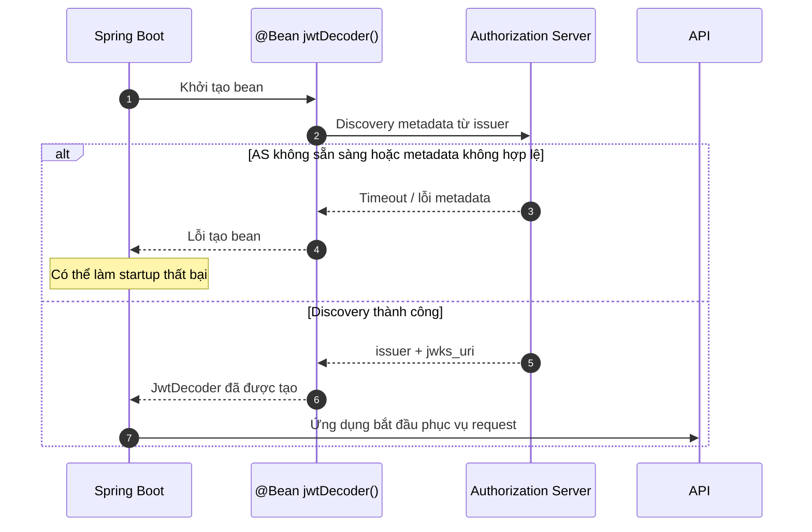
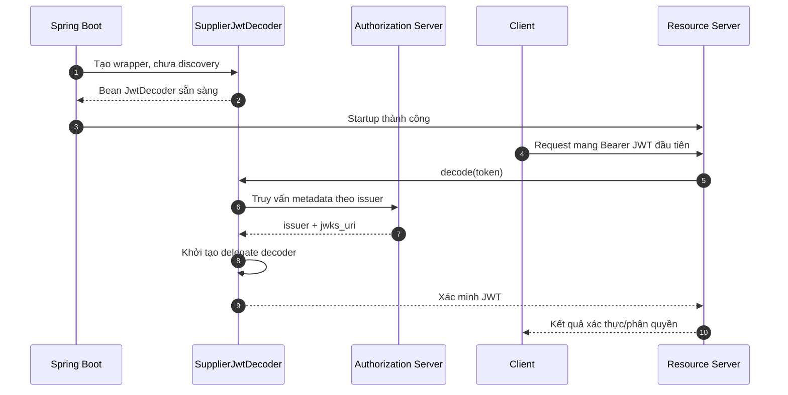
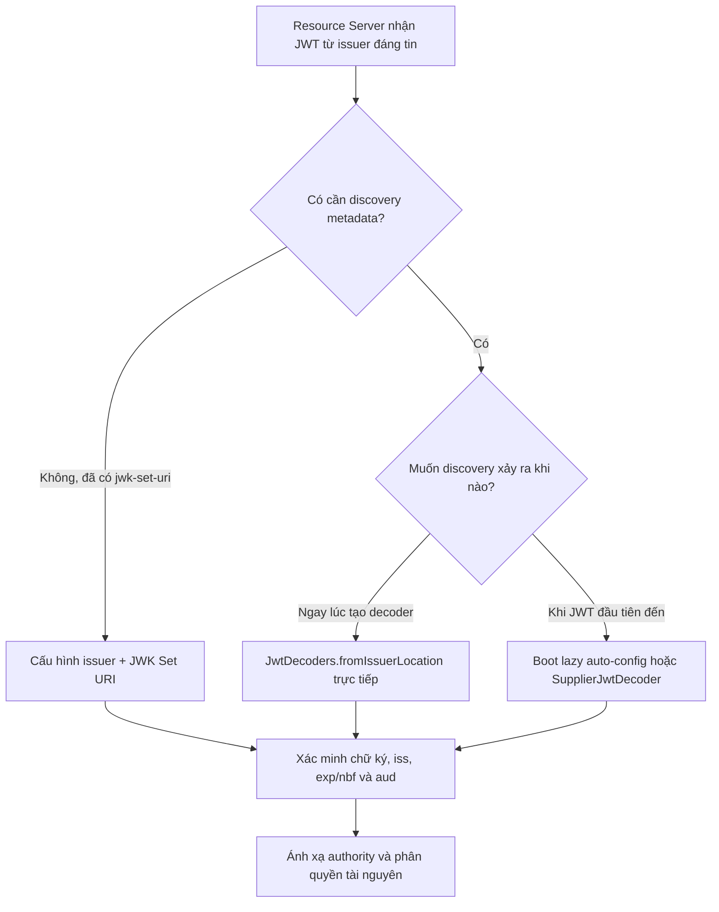

# Khởi tạo sớm, khởi tạo khi nhận yêu cầu và khác biệt theo phiên bản

Khi Spring Security OAuth 2.0 Resource Server xác thực access token dạng JWT, ứng dụng thường được cấu hình bằng **issuer URI**: địa chỉ định danh Authorization Server/OpenID Provider (OP) được tin cậy. Từ issuer, Resource Server có thể khám phá metadata để tìm **JWK Set URI**, sau đó dùng khóa công khai để xác minh chữ ký JWT và kiểm tra các claim như `iss`, `exp`, `nbf`.

Một khác biệt có ảnh hưởng lớn đến triển khai là **thời điểm việc khám phá issuer được thực hiện**:

- **Khởi tạo sớm (*eager initialization*)**: ứng dụng truy vấn metadata khi tạo `JwtDecoder`, thường trong giai đoạn xây dựng Spring ApplicationContext.
- **Khởi tạo trì hoãn (*deferred/lazy initialization*)**: ứng dụng có thể tạo bean/wiring bảo mật trước, còn khám phá issuer xảy ra khi JWT đầu tiên thực sự cần được xác minh.

Hai cách này đều có thể **xác thực cùng một kiểu JWT và áp dụng cùng chính sách bảo mật**, nhưng khác nhau về thời gian khởi động, mức phụ thuộc vào Authorization Server và vị trí xuất hiện lỗi. Đặc biệt, **không thể kết luận “chỉ cần `issuer-uri` thì ứng dụng luôn phải gọi Authorization Server ngay khi startup”**: hành vi phụ thuộc phiên bản Spring Boot/Spring Security và việc ứng dụng có tự tạo decoder hay không.

Bài học tập trung vào Spring Security **Servlet Resource Server**, với cú pháp Java/Spring Boot 3 và Spring Security 6. Các phiên bản cũ và WebFlux được so sánh riêng khi cần thiết.

## 1. Trước hết phân biệt bốn thời điểm

Trong một ứng dụng nhận JWT, ít nhất bốn hoạt động có thể diễn ra ở các thời điểm khác nhau:

| Hoạt động | Mục đích | Thời điểm có thể xảy ra |
| --- | --- | --- |
| **Tạo bean** `JwtDecoder` | Đưa thành phần xác thực JWT vào Spring context. | Khi startup hoặc khi một bean lazy được thực sự yêu cầu. |
| **Issuer discovery** | Truy vấn metadata để xác định issuer và tìm `jwks_uri`. | Khi dựng decoder ngay lập tức hoặc khi decode JWT đầu tiên. |
| **Tải JWK Set** | Lấy khóa công khai dùng để xác minh chữ ký. | Khi cần xác minh JWT và chưa có khóa phù hợp trong cache; một số cách dựng decoder có thể trao đổi mạng sớm hơn. |
| **Xác minh JWT** | Kiểm tra chữ ký, thời gian, issuer, audience và validators. | Khi xử lý request có Bearer JWT. |

**Tạo được `JwtDecoder` không luôn đồng nghĩa đã kết nối đến issuer**, nếu bean chỉ là một wrapper trì hoãn. **Đã discovery thành công cũng không bảo đảm JWK Set sẽ luôn sẵn sàng** khi có khóa mới hoặc cache cần làm mới.

Ví dụ một request:

```http
GET /api/orders/42 HTTP/1.1
Host: api.example.com
Authorization: Bearer <access-token>
```

Trong một Resource Server có lazy decoder, đây có thể là request đầu tiên kích hoạt discovery. Còn trong cấu hình eager, discovery có thể đã kết thúc trước khi cổng HTTP bắt đầu phục vụ request.

## 2. `issuer-uri`, metadata và JWK Set có vai trò khác nhau

Giả sử issuer được tin cậy là:

```text
https://identity.example.com/realms/shop
```

JWT minh họa có claim:

```json
{
  "iss": "https://identity.example.com/realms/shop",
  "sub": "user-123",
  "aud": ["orders-api"],
  "scope": "orders.read",
  "exp": 1900000000
}
```

JSON trên chỉ là payload minh họa, không phải token được ký thực sự. Để xác minh token, Resource Server có thể truy vấn các endpoint metadata chuẩn hỗ trợ bởi provider, ví dụ OIDC Discovery:

```text
https://identity.example.com/realms/shop/.well-known/openid-configuration
```

Một response metadata rút gọn:

```json
{
  "issuer": "https://identity.example.com/realms/shop",
  "jwks_uri": "https://identity.example.com/realms/shop/protocol/openid-connect/certs",
  "authorization_endpoint": "https://identity.example.com/realms/shop/authorize",
  "token_endpoint": "https://identity.example.com/realms/shop/token"
}
```

**`issuer` là định danh bên phát hành; `jwks_uri` là nơi lấy khóa công khai.** Chúng không phải cùng một URL và không dùng thay thế tùy ý. Spring Security hỗ trợ cơ chế khám phá dựa trên metadata OIDC và OAuth 2.0 Authorization Server, với cách hình thành URL theo chuẩn và phiên bản thư viện.

Quá trình xác thực bao gồm:

1. Tìm metadata của issuer mà ứng dụng đã **cấu hình tin cậy**.
2. Xác định JWK Set URI và nguồn khóa phù hợp.
3. Xác minh chữ ký JWT theo thuật toán và khóa được chấp nhận.
4. Xác minh `iss`, các giới hạn thời gian `exp`/`nbf` và những ràng buộc khác của API.
5. Kiểm tra **audience** của API nếu hợp đồng access token yêu cầu, rồi ánh xạ authority để phân quyền.

Một token có chữ ký hợp lệ nhưng `aud = payments-api` không được sử dụng cho `orders-api` nếu chính sách của API yêu cầu `aud = orders-api`. Việc chọn thời điểm discovery **không thay thế** yêu cầu xác minh audience, scope hay quyền trên tài nguyên.

## 3. Khởi tạo sớm (*eager*): discovery diễn ra khi tạo decoder

Một cấu hình Java trực tiếp:

```java
import org.springframework.context.annotation.Bean;
import org.springframework.context.annotation.Configuration;
import org.springframework.security.oauth2.jwt.JwtDecoder;
import org.springframework.security.oauth2.jwt.JwtDecoders;

@Configuration
public class EagerJwtDecoderConfig {

    @Bean
    JwtDecoder jwtDecoder() {
        return JwtDecoders.fromIssuerLocation(
            "https://identity.example.com/realms/shop"
        );
    }
}
```

`JwtDecoders.fromIssuerLocation(...)` là một **factory method thực sự tạo decoder bằng thông tin issuer**. Khi Spring gọi phương thức bean ở thời điểm khởi tạo context, lời gọi factory này có thể truy vấn discovery metadata **ngay lúc đó** để lấy JWK Set URI. Nếu issuer không sẵn sàng hoặc metadata không hợp lệ, quá trình tạo bean có thể thất bại, từ đó làm **ApplicationContext không khởi động thành công**.

Một hình thức tương tự:

```java
import org.springframework.security.oauth2.jwt.NimbusJwtDecoder;

NimbusJwtDecoder decoder =
    NimbusJwtDecoder
        .withIssuerLocation("https://identity.example.com/realms/shop")
        .build();
```

Ở cách dựng này, metadata discovery gắn với việc gọi `build()` của builder; nếu câu lệnh chạy trong quá trình tạo bean, nó vẫn là **eager**. Có bean tên `jwtDecoder` trong Spring context không tự biến `fromIssuerLocation` hoặc `withIssuerLocation(...).build()` thành lazy.

### Diễn biến khi startup



Ưu điểm của eager là một số lỗi cấu hình issuer và discovery **được phát hiện sớm**, trước khi API nhận lưu lượng. Đổi lại, khả năng startup có thể phụ thuộc vào mạng và Authorization Server.

Lưu ý: discovery thành công không có nghĩa một JWT thật đã được kiểm chứng. Lỗi do khóa ký, token hết hạn, audience sai hoặc thiếu scope vẫn chỉ xuất hiện khi xử lý request tương ứng.

## 4. Khởi tạo khi nhận yêu cầu (*lazy*): `SupplierJwtDecoder`

Spring Security cung cấp `SupplierJwtDecoder`, một implementation của `JwtDecoder` nhận một `Supplier<JwtDecoder>` và **chỉ tạo decoder thực sự khi cần giải mã token**.

Ví dụ tự khai báo lazy decoder:

```java
import org.springframework.context.annotation.Bean;
import org.springframework.context.annotation.Configuration;
import org.springframework.security.oauth2.jwt.JwtDecoder;
import org.springframework.security.oauth2.jwt.JwtDecoders;
import org.springframework.security.oauth2.jwt.SupplierJwtDecoder;

@Configuration
public class DeferredJwtDecoderConfig {

    @Bean
    JwtDecoder jwtDecoder() {
        String issuer =
            "https://identity.example.com/realms/shop";

        return new SupplierJwtDecoder(
            () -> JwtDecoders.fromIssuerLocation(issuer)
        );
    }
}
```

Trong code trên:

- Lúc tạo bean, ứng dụng chỉ xây một **wrapper** giữ `Supplier`.
- **Lambda chưa được thực thi** ở dòng `new SupplierJwtDecoder(...)`.
- Khi request đầu tiên cần decode JWT, wrapper mới gọi supplier để xây decoder thật, có thể dẫn tới metadata discovery.
- Các lần sử dụng tiếp theo có thể dùng decoder đã khởi tạo trong wrapper thay vì discovery lại cho mọi request.

Điều này chuyển **rủi ro của discovery** từ lúc khởi động sang lúc xác thực JWT đầu tiên. Nếu Authorization Server đang down lúc ứng dụng start nhưng hoạt động khi request đầu tiên đến, request có thể xác thực thành công. Ngược lại, nếu issuer không thể truy cập khi request đầu tiên kích hoạt discovery, request đó có thể thất bại dù ứng dụng đã khởi động và báo đang chạy.



**“First request” ở đây là request khiến JWT decoder được sử dụng**, thường là request mang Bearer JWT qua filter chain được cấu hình. Nó không nhất thiết là HTTP request đầu tiên của toàn ứng dụng. Một request đến endpoint health công khai không có Bearer token thường không buộc JWT decoder thực hiện discovery.

Đối với lần khởi tạo bị lỗi, kiểu exception, chiến lược retry và HTTP status cuối cùng phụ thuộc implementation/version và exception handling của ứng dụng. Không nên cam kết rằng mọi lỗi discovery khi lazy đều trở thành `401` hoặc luôn tự retry ở request kế tiếp.

## 5. Khác biệt theo phiên bản: vì sao tài liệu có thể nói ngược nhau?

Các tài liệu Spring Security cũ mô tả quá trình startup sẽ gọi issuer discovery và có thể thất bại khi Authorization Server không sẵn sàng. Các tài liệu mới của Spring Security 6.5 mô tả **deferred discovery khi nhận JWT đầu tiên** đối với cấu hình Boot tiêu chuẩn. Hai mô tả khác nhau vì **lựa chọn decoder mặc định đã thay đổi theo thời gian**, không phải issuer discovery đã bị loại bỏ.

Mốc đáng chú ý:

| Nền tảng/cách cấu hình | Hành vi discovery điển hình | Điều cần ghi nhớ |
| --- | --- | --- |
| **Spring Boot 2.5 và các hướng dẫn cũ** với cấu hình issuer mặc định | Thường discovery **trong startup** khi decoder mặc định được xây. | Authorization Server có thể là dependency cho việc khởi động. |
| **Spring Security 5.6 trở đi** | Có `SupplierJwtDecoder` cho Servlet và cơ chế tương tự ở WebFlux. | Framework hỗ trợ trì hoãn việc tạo decoder thật. |
| **Spring Boot 2.6 trở đi** với `issuer-uri` và auto-configuration tương ứng | Boot bắt đầu tự cấu hình `SupplierJwtDecoder` thay cho decoder eager, nên discovery thường trì hoãn đến **JWT đầu tiên**. | Đây là thay đổi được ghi nhận trong release notes Boot 2.6. |
| **Spring Boot 3.x / Spring Security 6.x** theo cấu hình JWT Resource Server tiêu chuẩn | Tài liệu Spring Security 6.5 mô tả deferred discovery qua `SupplierJwtDecoder`. | Vẫn phải kiểm tra nếu ứng dụng cung cấp bean/DSL custom. |
| **Ứng dụng tự gọi `JwtDecoders.fromIssuerLocation(...)` trong `@Bean`** | Có thể **eager**, bất kể Boot mới hỗ trợ lazy. | Custom bean có thể khiến Boot không tạo `SupplierJwtDecoder` mặc định. |
| **Ứng dụng tự bọc factory trong `new SupplierJwtDecoder(...)`** | **Lazy** cho đến khi wrapper cần decode. | Cách bảo toàn deferred discovery khi cần custom decoder. |
| **Khai báo cả `issuer-uri` và `jwk-set-uri`** | Không cần issuer discovery để tìm JWKS. | Phải xét riêng việc tải JWK Set khi xác minh JWT. |

Mốc chính xác: Spring Boot **2.6.0 RC1 release notes** công bố việc thay decoder tự động từ `NimbusJwtDecoder` sang `SupplierJwtDecoder`; `SupplierJwtDecoder` được Spring Security giới thiệu từ nhánh **5.6**. Tài liệu Spring Security **6.5 Servlet JWT** mô tả discovery ở request có JWT đầu tiên và khuyên bọc custom `JwtDecoder` trong `SupplierJwtDecoder` khi cần giữ hành vi này.

**Cẩn thận với câu “Spring Boot 3 luôn lazy”.** Nhận định đó chỉ an toàn khi nói về cấu hình tự động tiêu chuẩn phù hợp. Một custom bean, trực tiếp gọi factory method, custom resolver, `@PostConstruct` gọi `decode`, hoặc readiness/warm-up logic hoàn toàn có thể khiến metadata được truy vấn sớm. Tên version chỉ là một phần của lời giải thích; **đường đi cấu hình thực tế** mới quyết định thời điểm.

## 6. Cấu hình Spring Boot 3 tiêu chuẩn: để Boot quyết định lazy

Trước hết thêm dependency:

```gradle
dependencies {
    implementation 'org.springframework.boot:spring-boot-starter-security'
    implementation 'org.springframework.boot:spring-boot-starter-oauth2-resource-server'
}
```

Trong Spring Boot, starter Resource Server thường mang đủ các thư viện cần cho JWT decoding/verifying, bao gồm Spring Security OAuth2 JOSE. Khi tự quản lý dependency, cần đảm bảo cả phần Resource Server và JOSE JWT có mặt.

Khai báo issuer:

```yaml
spring:
  security:
    oauth2:
      resourceserver:
        jwt:
          issuer-uri: https://identity.example.com/realms/shop
          audiences:
            - orders-api
```

Với phiên bản Boot hỗ trợ property `audiences` như trong ví dụ, Boot có thể thiết lập kiểm tra `aud` cho JWT; nếu phiên bản không có property này, cần validator audience riêng.

Một chain do ứng dụng cấu hình:

```java
import org.springframework.context.annotation.Bean;
import org.springframework.context.annotation.Configuration;
import org.springframework.http.HttpMethod;
import org.springframework.security.config.Customizer;
import org.springframework.security.config.annotation.web.builders.HttpSecurity;
import org.springframework.security.config.http.SessionCreationPolicy;
import org.springframework.security.web.SecurityFilterChain;

@Configuration
public class ApiSecurityConfig {

    @Bean
    SecurityFilterChain apiSecurity(HttpSecurity http) throws Exception {
        return http
            .securityMatcher("/api/**")
            .csrf(csrf -> csrf.disable())
            .sessionManagement(session -> session
                .sessionCreationPolicy(SessionCreationPolicy.STATELESS))
            .authorizeHttpRequests(auth -> auth
                .requestMatchers(HttpMethod.GET, "/api/orders/**")
                    .hasAuthority("SCOPE_orders.read")
                .anyRequest().denyAll())
            .oauth2ResourceServer(oauth2 -> oauth2
                .jwt(Customizer.withDefaults()))
            .build();
    }
}
```

Trong cấu hình này:

- Custom `SecurityFilterChain` xác định API endpoint nào cần scope.
- `.oauth2ResourceServer(...jwt(...))` bật Bearer JWT authentication.
- Nếu **không** có custom `JwtDecoder` và các điều kiện Boot phù hợp, Boot có thể cung cấp decoder từ properties với chiến lược lazy của phiên bản mới.
- `securityMatcher("/api/**")` giới hạn phạm vi chain; cần policy/chain khác cho URL ngoài `/api/**`.
- `csrf.disable()` ở đây chỉ dành cho API stateless nhận Bearer token tường minh qua header và không phụ thuộc vào cookie browser tự gửi để xác thực. API có session/cookie phải đánh giá CSRF riêng.

**Thêm `SecurityFilterChain` không nhất thiết làm mất Boot-managed decoder.** Nhưng nếu bạn tự thêm bean `JwtDecoder`, Boot thường nhường chỗ cho bean đó; từ đây hành vi eager/lazy tùy cách bạn viết bean.

## 7. Cùng một issuer, hai cách khai báo bean nhưng thời điểm rất khác

Đặt cạnh nhau:

### Cách A: eager

```java
@Bean
JwtDecoder jwtDecoder() {
    return JwtDecoders.fromIssuerLocation(
        "https://identity.example.com/realms/shop"
    );
}
```

### Cách B: lazy

```java
@Bean
JwtDecoder jwtDecoder() {
    String issuer =
        "https://identity.example.com/realms/shop";
    return new SupplierJwtDecoder(
        () -> JwtDecoders.fromIssuerLocation(issuer)
    );
}
```

Các import cần thiết tương ứng:

```java
import org.springframework.context.annotation.Bean;
import org.springframework.security.oauth2.jwt.JwtDecoder;
import org.springframework.security.oauth2.jwt.JwtDecoders;
import org.springframework.security.oauth2.jwt.SupplierJwtDecoder;
```

**Sự khác biệt là vị trí lời gọi factory**:

| Dòng code | Thời điểm thực thi |
| --- | --- |
| `JwtDecoders.fromIssuerLocation(issuer)` trực tiếp trong body `@Bean` | Trong quá trình tạo bean. |
| `() -> JwtDecoders.fromIssuerLocation(issuer)` được truyền vào `SupplierJwtDecoder` | Khi wrapper cần khởi tạo decoder thật, thường tại request JWT đầu tiên. |
| `NimbusJwtDecoder.withIssuerLocation(issuer).build()` trực tiếp trong `@Bean` | Khi xây bean. |
| `() -> NimbusJwtDecoder.withIssuerLocation(issuer).build()` truyền vào wrapper | Khi supplier được sử dụng. |

Không cần thêm `@Lazy` vào `SecurityFilterChain` chỉ để trì hoãn metadata discovery. `@Lazy` của Spring bean và `SupplierJwtDecoder` là **hai cơ chế khác nhau**; `SupplierJwtDecoder` trì hoãn riêng phần khởi tạo JWT delegate trong khi bean vẫn có thể được wiring vào filter chain ngay từ startup.

## 8. Giữ lazy discovery khi decoder cần audience validator tùy chỉnh

Đôi khi Resource Server phải kiểm tra audience và một số claim riêng mà property Boot không đáp ứng, vì thế cần custom decoder. Có thể cấu hình một supplier mà toàn bộ việc dựng decoder và validator chỉ thực hiện khi nó được gọi:

```java
import java.util.List;

import org.springframework.beans.factory.annotation.Value;
import org.springframework.context.annotation.Bean;
import org.springframework.context.annotation.Configuration;
import org.springframework.security.oauth2.core.DelegatingOAuth2TokenValidator;
import org.springframework.security.oauth2.core.OAuth2TokenValidator;
import org.springframework.security.oauth2.jwt.Jwt;
import org.springframework.security.oauth2.jwt.JwtClaimValidator;
import org.springframework.security.oauth2.jwt.JwtDecoder;
import org.springframework.security.oauth2.jwt.JwtValidators;
import org.springframework.security.oauth2.jwt.NimbusJwtDecoder;
import org.springframework.security.oauth2.jwt.SupplierJwtDecoder;

@Configuration
public class DeferredValidatedJwtDecoderConfig {

    @Bean
    JwtDecoder jwtDecoder(
        @Value("${app.security.issuer}") String issuer,
        @Value("${app.security.audience}") String audience
    ) {
        return new SupplierJwtDecoder(() -> {
            NimbusJwtDecoder decoder =
                NimbusJwtDecoder.withIssuerLocation(issuer).build();

            OAuth2TokenValidator<Jwt> defaults =
                JwtValidators.createDefaultWithIssuer(issuer);

            OAuth2TokenValidator<Jwt> audienceValidator =
                new JwtClaimValidator<List<String>>(
                    "aud",
                    values -> values != null &&
                        values.contains(audience)
                );

            decoder.setJwtValidator(
                new DelegatingOAuth2TokenValidator<>(
                    defaults,
                    audienceValidator
                )
            );
            return decoder;
        });
    }
}
```

Giả định ứng dụng có các property tùy chỉnh:

```yaml
app:
  security:
    issuer: https://identity.example.com/realms/shop
    audience: orders-api
```

Điểm cần hiểu:

1. Bean được tạo sớm nhưng supplier **chưa thực thi**.
2. Discovery qua `NimbusJwtDecoder.withIssuerLocation(...).build()` xảy ra khi cần decode.
3. Custom decoder giữ các validation mặc định, issuer và audience, thay vì chỉ kiểm tra chữ ký.
4. Nếu metadata discovery thất bại, lỗi chuyển đến đường xử lý request đầu tiên cần JWT; ứng dụng phải có chiến lược quan sát và vận hành phù hợp.

Khi issuer cấp token với claim `aud` theo một profile khác ví dụ minh họa, validator phải được điều chỉnh đúng hợp đồng. **Không làm mất `iss`/thời gian validator** khi thay đổi decoder. Nếu phiên bản Boot đã hỗ trợ `audiences` và chỉ cần ràng buộc này, cấu hình property có thể đơn giản hơn việc tự tạo bean.

## 9. Cấu hình đồng thời `issuer-uri` và `jwk-set-uri`: một lựa chọn khác

Nếu đã biết chính xác JWK Set URI của issuer, có thể tránh bước khám phá endpoint khóa:

```yaml
spring:
  security:
    oauth2:
      resourceserver:
        jwt:
          issuer-uri: https://identity.example.com/realms/shop
          jwk-set-uri: https://identity.example.com/realms/shop/keys
          audiences:
            - orders-api
```

Trong cấu hình Boot/Spring Security hỗ trợ các property này:

- `jwk-set-uri` cho Resource Server biết **nguồn public key** mà không cần discovery chỉ để tìm nó.
- `issuer-uri` vẫn xác định `iss` được chấp nhận.
- `audiences` (nếu phiên bản hỗ trợ) áp dụng kiểm tra `aud`.
- **Việc tải JWK Set khi cần** vẫn có thể phụ thuộc mạng, nhất là khi chưa có key hoặc key được xoay vòng.

Điều này giúp Resource Server **không buộc truy vấn issuer metadata ở startup**, đồng thời giữ khả năng kiểm tra issuer. Nó không có nghĩa ứng dụng đã tải trước toàn bộ khóa hoặc có thể mãi mãi xác minh JWT khi Authorization Server không truy cập được.

### Chỉ dùng `jwk-set-uri` có đủ không?

Nếu chỉ cấu hình:

```yaml
spring:
  security:
    oauth2:
      resourceserver:
        jwt:
          jwk-set-uri: https://identity.example.com/realms/shop/keys
```

Resource Server biết nguồn khóa, nhưng **không có giá trị issuer từ property `issuer-uri` để tự áp dụng cùng kiểu issuer validation**. Nếu API phải giới hạn token đúng issuer, hãy tiếp tục khai báo issuer ở nơi hỗ trợ hoặc gắn validator issuer trên decoder custom:

```java
NimbusJwtDecoder decoder =
    NimbusJwtDecoder.withJwkSetUri(jwkSetUri).build();
decoder.setJwtValidator(
    JwtValidators.createDefaultWithIssuer(issuer)
);
```

Thêm audience validator nếu API yêu cầu. Chữ ký hợp lệ với một key thuộc JWK Set **chưa đủ** để kết luận token được phát hành cho đúng API hoặc được phép truy cập tài nguyên.

## 10. Lỗi startup và lỗi request đầu tiên không giống nhau

Giả sử issuer không thể kết nối:

| Kiểu khởi tạo | Khi nào lỗi thường lộ diện? | Ứng dụng có thể start không? | Hệ quả vận hành |
| --- | --- | --- | --- |
| `JwtDecoders.fromIssuerLocation(...)` trực tiếp trong eager `@Bean` | Tạo bean/context. | Có thể **không** start. | Deployment phát hiện lỗi trước khi phục vụ lưu lượng. |
| `SupplierJwtDecoder` bọc factory theo issuer | Khi decode JWT đầu tiên. | **Có thể** start dù issuer down. | API có thể lỗi tại request đầu tiên nếu discovery vẫn không được. |
| Boot auto-config dùng lazy issuer decoder | Khi JWT đầu tiên được xác thực. | Thường không phụ thuộc discovery ở startup. | Cần phân biệt readiness của tiến trình và khả năng xác thực thực tế. |
| Chỉ định trước `jwk-set-uri` | Không cần issuer metadata discovery để tìm URL JWKS. | Thường không phụ thuộc discovery ở startup. | Vẫn cần lấy key khi xác minh JWT nếu cache chưa có khóa. |

**Không nên gán cứng HTTP 401 cho mọi lỗi ở cột thứ hai.** `401 Unauthorized` thường dành cho **token không hợp lệ**; còn timeout hoặc lỗi discovery/JWK Set là **hạ tầng xác thực không sẵn sàng**. Với lazy decoder, lỗi khởi tạo có thể được bọc thành `JwtDecoderInitializationException` và được đưa qua cơ chế xử lý exception của phiên bản/framework/ứng dụng, nên status cuối cùng có thể khác nhau.

Ví dụ phân biệt:

```text
Lỗi A — token sai chữ ký:
  JWT decoder hoạt động
  -> chữ ký không hợp lệ
  -> authentication từ chối token

Lỗi B — issuer metadata không truy cập được:
  lazy decoder được kích hoạt
  -> chưa xây dựng được decoder vì lỗi discovery
  -> request không thể xác thực, cần xử lý lỗi hạ tầng

Lỗi C — JWK Set không tải được khóa mới:
  decoder đã được tạo
  -> chưa có key phù hợp / cần refresh
  -> không thể xác minh token trong điều kiện hiện tại
```

Không xử lý các lỗi B/C bằng cách **cho phép bỏ qua xác thực** hoặc tin payload JWT chưa được kiểm tra. Khi thiếu điều kiện chứng minh token đáng tin, Resource Server phải từ chối sử dụng credential đó.

## 11. Startup thành công, readiness và khả năng xác thực là ba tín hiệu khác nhau

Lazy discovery làm ứng dụng **ít phụ thuộc vào Authorization Server tại lúc start**, nhưng tạo một đánh đổi:

- Tiến trình có thể khởi động, mở cổng HTTP, trả health endpoint thành công.
- Decoder thật vẫn chưa được dựng vì chưa có request cần JWT.
- Khi lưu lượng nghiệp vụ đầu tiên đến, API mới thử discovery và có thể bị chậm, timeout hoặc lỗi.

Nếu một môi trường cần chắc chắn API có thể xác thực token trước khi đưa traffic vào, phải quyết định cách chứng minh **authentication readiness**:

1. Dùng eager discovery để phát hiện lỗi cấu hình/issuer ngay lúc start, chấp nhận phụ thuộc startup.
2. Giữ lazy discovery nhưng có cơ chế kiểm tra/warm-up có chủ đích trước khi ứng dụng được đánh dấu sẵn sàng nhận traffic.
3. Cấu hình JWK Set URI trực tiếp, rồi giám sát việc lấy khóa, cache và tình trạng Authorization Server.

Không nên dùng một request `/actuator/health` công khai làm bằng chứng rằng JWT decoder đã được khởi tạo. Đồng thời, không nên đặt một token thật dài hạn vào script hoặc log của readiness chỉ để kích hoạt decoder.

### Warm-up là thay đổi có chủ đích

Một cơ chế warm-up (nếu thực sự cần) có thể chủ động gọi một endpoint kiểm thử nội bộ với JWT hợp lệ, hoặc thực hiện validation với credential test ngắn hạn theo quy trình an toàn. Làm vậy **biến một phần hành vi lazy thành hành vi sớm** ở bước readiness. Cần hiểu rõ trade-off, không âm thầm đổi thời điểm init trong `@PostConstruct` mà vẫn mô tả hệ thống là lazy.

Với hạ tầng triển khai nhiều replica, cần quản lý timeout và số lượng kết nối đồng thời tới issuer khi nhiều instance cùng khởi động hoặc cùng gặp request JWT đầu tiên.

## 12. Discovery một lần không có nghĩa không liên hệ Authorization Server nữa

Ngay cả với JWT validation cục bộ, Resource Server có thể cần **lấy hoặc refresh JWKS**:

```text
1. Decoder biết jwks_uri từ discovery hoặc cấu hình trực tiếp
2. Nhận JWT có header kid=key-A
3. Có key-A trong cache -> xác minh cục bộ
4. Issuer đổi sang key-B
5. Nhận JWT kid=key-B -> có thể phải refresh JWKS
6. Dùng key-B nếu lấy được, hoặc từ chối khi chưa xác minh được
```

`SupplierJwtDecoder` chỉ trì hoãn **khởi tạo delegate decoder**; nó không vô hiệu hóa logic cache/JWKS của decoder thật. Tương tự, eager initialization không đảm bảo toàn bộ khóa xác minh sẽ có sẵn vĩnh viễn khi authorization server gặp sự cố.

**Phân biệt hai câu hỏi:**

| Câu hỏi | Thành phần trả lời |
| --- | --- |
| Resource Server biết JWKS URI từ lúc nào? | Issuer discovery hoặc `jwk-set-uri` trực tiếp. |
| Resource Server đã có public key cần cho token này chưa? | Cơ chế lấy/caching/refresh JWK Set của decoder. |

Khi đánh giá khả năng hoạt động trong trường hợp OP tạm thời không sẵn sàng, cần xét cả hai giai đoạn và thời gian sống/cache của khóa, không chỉ chọn eager hay lazy.

## 13. Nhiều issuer / nhiều tenant có thể làm lazy trở nên phức tạp hơn

Một API multi-tenant có thể chấp nhận token từ nhiều issuer tin cậy, ví dụ:

```text
https://identity.example.com/realms/tenant-a
https://identity.example.com/realms/tenant-b
```

Spring Security có các cơ chế như `JwtIssuerAuthenticationManagerResolver`/`AuthenticationManagerResolver` cho phép chọn cơ chế authentication theo issuer. Trong một số cấu hình, `JwtAuthenticationProvider` tương ứng tenant chỉ được tạo khi token thuộc issuer đó lần đầu xuất hiện; do vậy **discovery có thể được trì hoãn theo từng tenant**.

Nhưng cần giữ nguyên nguyên tắc bảo mật:

- Chỉ cho phép **issuer nằm trong tập nguồn tin cậy** hoặc registry được quản lý; không biến claim `iss` chưa xác thực thành quyền tải khóa từ bất kỳ URL nào.
- Sau khi chọn decoder theo issuer, vẫn phải xác minh **chữ ký, issuer, thời gian, audience** và các ràng buộc token profile.
- Mỗi issuer/tenant có thể cần cache khóa, timeout và giám sát độc lập.
- Trong một hệ thống thay đổi tenant động, thời điểm thêm tenant vào registry và thời điểm xây decoder là hai quyết định riêng.

Một token có `iss` trông giống một tenant hợp lệ **không phải bằng chứng** rằng tenant đó có quyền được đăng ký tự động. Chỉ sử dụng issuer được ứng dụng cho phép trước khi tin metadata hoặc key của nó.

## 14. Servlet và WebFlux: cùng ý tưởng, khác API

Những ví dụ Java ở trên sử dụng Servlet stack:

```text
JwtDecoder
SupplierJwtDecoder
JwtDecoders.fromIssuerLocation
SecurityFilterChain
```

Với Spring WebFlux, các API tương ứng thuộc mô hình reactive:

```text
ReactiveJwtDecoder
ReactiveSupplierJwtDecoder
ReactiveJwtDecoders.fromIssuerLocation
SecurityWebFilterChain
```

Spring Boot 2.6 cũng ghi nhận việc tự cấu hình `ReactiveSupplierJwtDecoder` đối với Resource Server reactive. Ý tưởng trì hoãn discovery tương đồng, nhưng **không sao chép trực tiếp bean `JwtDecoder` của Servlet vào một WebFlux-only Resource Server**.

Ví dụ cấu hình WebFlux ở mức khái niệm:

```java
@Bean
ReactiveJwtDecoder jwtDecoder() {
    String issuer = "https://identity.example.com/realms/shop";
    return new ReactiveSupplierJwtDecoder(
        () -> ReactiveJwtDecoders.fromIssuerLocation(issuer)
    );
}
```

Ví dụ này nhấn mạnh **khác loại decoder và kiểu reactive supplier**. Khi sử dụng thực tế, kiểm tra signature của constructor/builder trong đúng phiên bản Spring Security mà dự án chọn; một số phiên bản nhận `Supplier<Mono<ReactiveJwtDecoder>>` hoặc có helper khác, nên không coi đoạn này là mẫu có thể copy sang mọi version mà không điều chỉnh.

Vì bài tập trung Servlet, các ví dụ hoàn chỉnh tiếp tục dùng `JwtDecoder` và `SecurityFilterChain`.

## 15. Custom bean và DSL có thể thay đổi thời điểm discovery

Spring Boot auto-configuration mang tính **có điều kiện**. Việc ứng dụng khai báo một bean `JwtDecoder` làm Boot không cần tạo bean decoder mặc định của chính nó. Từ đây, nếu bean do ứng dụng tạo bằng factory eager thì **hành vi lazy mặc định của Boot không còn áp dụng**.

Ngoài ra, trong JWT DSL có thể chỉ định trực tiếp decoder cho chain:

```java
.oauth2ResourceServer(oauth2 -> oauth2
    .jwt(jwt -> jwt.decoder(customJwtDecoder)))
```

Khi đó chain dùng decoder đã được truyền vào. Nếu `customJwtDecoder` được tạo eager, discovery có thể xảy ra ngay trong quá trình chuẩn bị cấu hình. Nếu đó là `SupplierJwtDecoder`, discovery được trì hoãn đến khi nó decode.

Phân biệt:

| Thành phần | Tác động |
| --- | --- |
| `@Bean JwtDecoder` | Quyết định **đối tượng decoder** được tạo và có thể khiến Boot back off. |
| `SupplierJwtDecoder` | Quyết định **khi nào** tạo delegate decoder thực sự. |
| `JwtDecoders.fromIssuerLocation` | Thực hiện **issuer discovery** khi factory được gọi. |
| `jwt.decoder(customJwtDecoder)` | Gắn **decoder cụ thể** vào một security chain. |
| `securityMatcher` + `@Order` | Quyết định chain nào tiếp nhận request. |
| `authorizeHttpRequests` | Quyết định authorization rule trong chain đã được chọn. |

Một ứng dụng có hai `SecurityFilterChain` với decoder khác nhau cũng có thể có **hai thời điểm discovery khác nhau**. Điều đó là bình thường nếu được thiết kế rõ ràng.

## 16. Lỗi thường gặp trong môi trường production

### 16.1. Đọc tài liệu Spring Security cũ rồi kết luận Boot mới luôn phải fail startup

Một tài liệu cũ có thể mô tả eager initialization; nhưng Boot 2.6+ với auto-config phù hợp có cơ chế lazy. Hãy xác định **phiên bản thực tế, bean decoder thực sự, cách nó được dựng và đường đi của request**, thay vì áp một câu mô tả cho mọi version.

### 16.2. Tự tạo `JwtDecoder` và vô tình đánh mất lazy

Trước đó chỉ dùng `issuer-uri` và Boot tạo wrapper lazy. Sau khi thêm:

```java
@Bean
JwtDecoder jwtDecoder() {
    return JwtDecoders.fromIssuerLocation(issuer);
}
```

discovery có thể chuyển sang startup. Nếu muốn giữ lazy, bọc lời gọi bằng `SupplierJwtDecoder` theo phần 4.

### 16.3. Dùng `jwk-set-uri` rồi nghĩ có thể xác thực khi không có key

JWK Set URI chỉ là địa chỉ khóa. Nếu decoder chưa có public key cần thiết, nó vẫn phải tải JWKS; lỗi mạng có thể khiến JWT không được xác minh. Cần xem cache, key rotation và kế hoạch vận hành.

### 16.4. Chỉ cấu hình JWKS, bỏ qua issuer

Một key hợp lệ không đủ chứng minh token có `iss` đúng. Nếu API cần ràng buộc issuer, giữ `issuer-uri` hoặc custom issuer validator đúng contract, và thêm audience validator khi cần.

### 16.5. Kiểm tra `/health` thành công rồi cho rằng JWT cũng hoạt động

Với lazy decoder, health công khai có thể không chạm vào authentication path. Thực tế API cần được kiểm chứng theo cơ chế riêng trước khi đưa vào phục vụ nghiệp vụ quan trọng.

### 16.6. Trả `401` cho mọi lỗi mạng mà không phân loại

Một token sai chữ ký là credential lỗi. Một issuer/JWKS tạm thời không thể truy cập là tình huống hạ tầng xác thực không sẵn sàng. Cách xử lý HTTP có thể khác theo phiên bản/config và không được che khuất thông tin phục vụ điều tra; tuyệt đối không giải quyết bằng cách bỏ qua validation.

### 16.7. Khởi tạo trước bằng cách tự gọi `decode` với token giả

Việc cố kích hoạt lazy decoder bằng một chuỗi token giả trong `@PostConstruct` có thể tạo lỗi không cần thiết, phụ thuộc startup và làm sai mục đích của cơ chế lazy. Nếu cần warm-up, phải có quy trình rõ, credential kiểm thử hợp lệ và chính sách không rò rỉ token.

### 16.8. Nhầm metadata với UserInfo

OIDC **UserInfo endpoint** dùng cho Client lấy claim hồ sơ người dùng khi cần. Resource Server discovery dùng **Provider Configuration/Authorization Server Metadata** và **JWK Set** để xác minh JWT. Không gọi UserInfo mỗi request chỉ vì đang sử dụng issuer OIDC.

## 17. Quan sát hành vi theo giai đoạn thay vì suy đoán

Để xác định khi nào discovery xảy ra, có thể quan sát các mốc trong môi trường phát triển hoặc staging:

```text
T0: ApplicationContext bắt đầu tạo bean
T1: Ứng dụng hoàn tất startup
T2: Request công khai không có Bearer token
T3: Request được bảo vệ mang Bearer JWT đầu tiên
T4: Request Bearer JWT tiếp theo dùng cùng issuer
T5: Issuer xoay vòng khóa ký
```

Đối chiếu với truy vấn mạng đến metadata/JWKS và log an toàn:

| Mốc | Với eager issuer decoder | Với lazy issuer decoder |
| --- | --- | --- |
| T0–T1 | Có thể gọi issuer metadata. | Thông thường chưa discovery. |
| T2 | Không cần discovery lại chỉ vì request công khai. | Thông thường vẫn chưa discovery. |
| T3 | Dùng decoder đã dựng; có thể tải JWKS khi cần. | Thường kích hoạt discovery và có thể tải JWKS. |
| T4 | Có thể dùng decoder/key cache. | Có thể dùng delegate/key cache. |
| T5 | Có thể cần refresh JWKS. | Cũng có thể cần refresh JWKS. |

Trong Spring Boot, condition evaluation report giúp xác định auto-configuration nào tạo bean và nhánh nào back off. Khi cần quan sát security chain, có thể bật log phù hợp trong môi trường kiểm soát:

```yaml
logging:
  level:
    org.springframework.security: DEBUG
```

Không log raw Bearer token, client secret, refresh token, toàn bộ header `Authorization` hoặc dữ liệu cá nhân không cần thiết. Nên ghi trace ID, issuer kỳ vọng, giai đoạn khởi tạo, kiểu lỗi và thời gian thực hiện request metadata/JWKS theo chính sách log.

## 18. Tình huống kiểm thử nên tách riêng

| Tình huống | Eager | Lazy |
| --- | --- | --- |
| Issuer down **trước startup** | Có thể thất bại khi tạo bean. | Có thể start vì chưa cần discovery. |
| Issuer down tại **JWT request đầu tiên** | Nếu decoder đã dựng và key cache đủ, có thể tiếp tục; nếu cần JWKS có thể lỗi. | Có thể lỗi vì chưa hoàn thành discovery. |
| Issuer hoạt động khi startup nhưng down trước JWT đầu tiên | Eager có thể đã có metadata, nhưng vẫn phụ thuộc JWKS nếu cần key. | Lazy có thể lỗi discovery ngay tại request. |
| Metadata issuer công bố sai issuer | Discovery/validation thất bại khi dựng decoder. | Thất bại khi decoder được khởi tạo lần đầu. |
| JWT sai chữ ký hoặc hết hạn | Authentication từ chối token. | Authentication từ chối token sau khi decoder sẵn sàng. |
| JWT đúng issuer nhưng sai audience | Từ chối nếu đã thiết lập audience validation. | Kết quả tương tự; lazy không làm yếu policy. |
| JWT hợp lệ thiếu scope | Authentication thành công, authorization từ chối. | Kết quả tương tự. |
| Key mới xuất hiện sau rotation | Có thể cần refresh JWK Set. | Cũng có thể cần refresh JWK Set. |

Trong Spring Security Test, MockMvc helper `jwt()` thường tạo principal JWT giả lập để kiểm tra authorization; nó **không mặc định thực hiện discovery metadata hoặc xác minh JWT thật**. Vì thế muốn quan sát eager/lazy và lỗi issuer, cần kiểm thử đường đi của decoder/Resource Server thực tế, tách với kiểm thử scope và ownership.

Không nhất thiết biến mọi tình huống thành một test phức tạp. Điều cần biết là **kiểm thử nào xác nhận bean lifecycle/discovery**, kiểm thử nào xác nhận validation JWT và kiểm thử nào xác nhận authorization.

## 19. Lựa chọn cấu hình theo yêu cầu triển khai

| Mục tiêu vận hành | Hướng cấu hình nên cân nhắc | Đánh đổi |
| --- | --- | --- |
| Ưu tiên startup không phụ thuộc issuer metadata | Boot lazy default hoặc `SupplierJwtDecoder`. | First JWT request có thể chậm hoặc lỗi vì discovery. |
| Phát hiện lỗi cấu hình issuer ngay khi startup | Custom eager decoder hoặc warm-up có chủ đích. | Startup phụ thuộc issuer và mạng. |
| Đã biết JWK Set URI, muốn bỏ discovery | Cấu hình cả `issuer-uri` và `jwk-set-uri`. | Cần quản lý URL đúng, JWKS vẫn phải tải khi cần. |
| Custom audience/token profile nhưng vẫn muốn lazy | `SupplierJwtDecoder` bọc custom validated decoder. | Code tùy chỉnh nhiều hơn; cần bảo toàn validators. |
| Nhiều issuer/tenant | Resolver/decoder theo issuer tin cậy, có chiến lược lazy từng tenant khi phù hợp. | Phức tạp hơn về registry, cache và giám sát. |
| API yêu cầu sẵn sàng xác thực trước khi nhận lưu lượng | Readiness/warm-up kiểm tra đường đi thực tế. | Có thể tái tạo phụ thuộc sớm ở bước readiness. |

Một sơ đồ quyết định ngắn:



Tất cả các hướng đi đều phải **giữ nguyên ranh giới tin cậy**: access token do client gửi chưa đáng tin cho đến khi Resource Server xác minh chữ ký và các validation bắt buộc. Eager hay lazy chỉ thay đổi **thời điểm chuẩn bị cơ chế xác minh**, không cho phép bỏ qua issuer, audience, thời gian, scope và chính sách quyền nghiệp vụ.

## 20. Cách đọc một hệ thống đang chạy theo đúng phiên bản

Khi tiếp nhận một dự án hoặc nâng cấp từ Boot 2.x lên 3.x, có thể lần lượt trả lời:

1. **Spring Boot và Spring Security phiên bản nào?** Kiểm tra BOM/dependency thực tế, vì tài liệu cũ có thể mô tả eager trong khi phiên bản mới dùng lazy.
2. **Ứng dụng chỉ khai báo `issuer-uri`, hay có thêm custom `JwtDecoder`?** Nếu có bean tùy chỉnh, xem chính code tạo decoder.
3. **Có sử dụng `SupplierJwtDecoder` hay không?** Xác định supplier đang bọc factory nào, không suy ra từ tên bean.
4. **Có `jwk-set-uri` trực tiếp không?** Nếu có, discovery metadata có thể được bỏ qua nhưng cần giữ validation issuer.
5. **Chain nào xử lý request?** Kiểm tra `.oauth2ResourceServer().jwt()`, `securityMatcher`, `@Order`, decoder truyền trực tiếp trong DSL.
6. **Audience và token profile đã được kiểm tra chưa?** Mốc startup không nói gì về mức độ đầy đủ của validator.
7. **Đã phân biệt readiness của tiến trình và readiness của JWT authentication chưa?** Đặc biệt quan trọng khi dùng deferred discovery.
8. **Có cơ chế JWKS refresh/key rotation không?** Một decoder đã được tạo không đủ đảm bảo xác minh mọi khóa mới trong thời gian dài.

### Tài liệu gốc để đối chiếu đúng phiên bản

- [Spring Security 6.5 — OAuth 2.0 Resource Server JWT](https://docs.spring.io/spring-security/reference/6.5/servlet/oauth2/resource-server/jwt.html): mô tả deferred discovery khi request có JWT đầu tiên và cách dùng `SupplierJwtDecoder`.
- [Spring Security 6.5 — `SupplierJwtDecoder` API](https://docs.spring.io/spring-security/reference/6.5/api/java/org/springframework/security/oauth2/jwt/SupplierJwtDecoder.html): xác nhận đây là JWT decoder khởi tạo delegate theo kiểu lazy, được giới thiệu từ Spring Security 5.6.
- [Spring Boot 2.6.0 RC1 Release Notes — Deferred OpenID Connect Discovery](https://github.com/spring-projects/spring-boot/wiki/Spring-Boot-2.6.0-RC1-Release-Notes): ghi nhận việc Boot chuyển auto-config sang `SupplierJwtDecoder` và `ReactiveSupplierJwtDecoder`.

**Điểm cốt lõi:** Khởi tạo sớm và khởi tạo khi nhận yêu cầu là hai **chiến lược về thời điểm issuer discovery**, không phải hai tiêu chuẩn xác thực JWT khác nhau. `JwtDecoders.fromIssuerLocation(...)` gọi trực tiếp trong bean thường dẫn đến eager discovery; `SupplierJwtDecoder` có thể trì hoãn discovery tới lần decode đầu tiên; Spring Boot từ nhánh 2.6 đã có cơ chế tự cấu hình deferred discovery. Khi nâng cấp phiên bản hoặc thêm bean tùy chỉnh, phải quan sát **decoder thực tế được tạo và được security chain sử dụng** để biết một lỗi issuer sẽ xuất hiện lúc startup hay lúc xử lý request.
