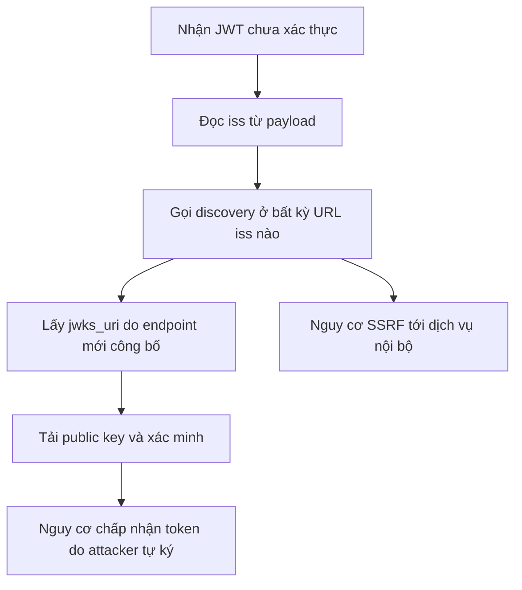
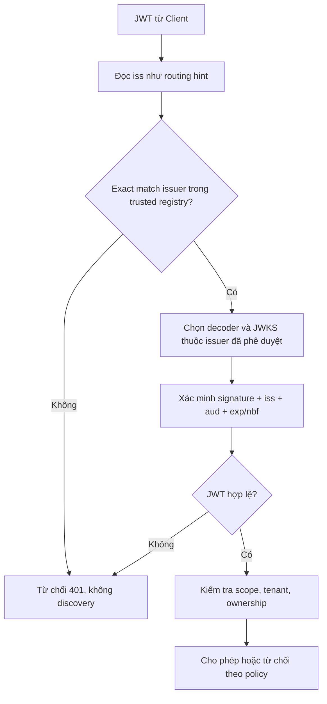
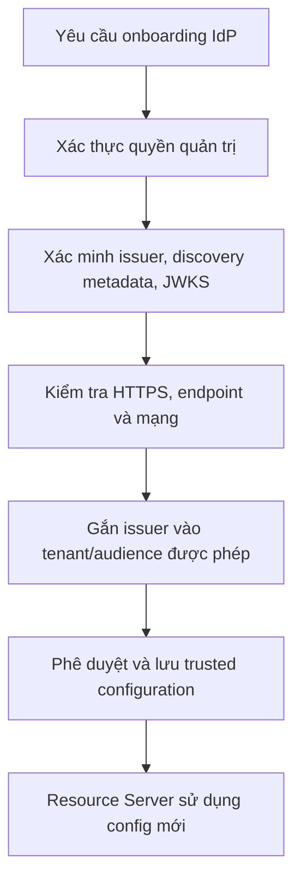

# Giới hạn endpoint tin cậy và tránh discovery theo dữ liệu chưa xác thực

## 1. Vấn đề bảo mật: ai được quyền quyết định nguồn phát hành token?

Trong ứng dụng Spring Boot sử dụng **Spring Security OAuth 2.0 Resource Server**, một Client gửi Bearer access token để truy cập tài nguyên:

```http
GET /api/orders/42 HTTP/1.1
Host: orders.example.com
Authorization: Bearer <access-token>
```

Với JWT, Resource Server cần biết **issuer nào được tin cậy** và **public key nào được dùng để xác minh chữ ký**. Nhiều Authorization Server và OpenID Provider công bố cấu hình thông qua *discovery metadata*, trong đó có đường dẫn đến tập khóa công khai (*JWKS*).

Giả sử nhà phát hành hợp lệ của ứng dụng là:

```text
https://login.example.com/realms/shop
```

Một token giả có thể tự khai:

```json
{
  "iss": "https://identity.attacker.example",
  "sub": "admin",
  "aud": ["orders-api"],
  "scope": "orders.read orders.write"
}
```

Claim `iss` trên **chưa được xác thực**: bất cứ ai cũng có thể tạo JSON tương tự. Nếu Resource Server đọc `iss` và ngay lập tức tìm metadata/JWKS từ issuer đó mà **không kiểm tra một danh sách issuer đã được phê duyệt**, kẻ tấn công có thể công bố JWKS của chính họ, tự ký JWT và khiến ứng dụng tin nhầm token.

Việc phát HTTP request tới URL được token chưa xác thực chỉ định còn tạo nguy cơ **Server-Side Request Forgery (SSRF)**: server bị điều khiển kết nối tới host không mong muốn, có thể gồm dịch vụ nội bộ, loopback, hoặc địa chỉ mạng nhạy cảm.

**Quy tắc nền tảng:** Issuer và endpoint dùng cho discovery/JWKS/introspection phải xuất phát từ **cấu hình tin cậy được quản trị trước**. Thông tin `iss` chưa xác minh chỉ được dùng làm gợi ý chọn trong tập cấu hình ấy, rồi vẫn phải kiểm tra chữ ký và các claim.

### Sau bài học, bạn cần nắm

- Phân biệt issuer identifier, discovery endpoint, JWKS endpoint và introspection endpoint.
- Hiểu vì sao `iss`, `kid`, `jku`, `Host` và tenant ID của request chưa đủ để quyết định tin cậy.
- Thiết kế allowlist issuer và endpoint có kiểm soát.
- Cấu hình Spring Security với một hoặc nhiều issuer, tránh discovery động từ URL tùy ý.
- Giới hạn outbound HTTP để giảm SSRF qua redirect, DNS, IP, proxy và endpoint metadata.
- Xác nhận cả việc token lạ bị từ chối **lẫn** việc ứng dụng không gọi endpoint không được phép.

## 2. Những khái niệm dễ nhầm trong discovery

| Thành phần | Chức năng | Ví dụ minh họa |
|---|---|---|
| **Issuer identifier** | Định danh Authorization Server hoặc OpenID Provider; JWT thường chứa ở claim `iss` | `https://login.example.com/realms/shop` |
| **OIDC Discovery** | Tài liệu metadata của OpenID Provider | `.../.well-known/openid-configuration` |
| **OAuth AS Metadata** | Tài liệu metadata Authorization Server theo RFC 8414 | `.../.well-known/oauth-authorization-server` |
| **JWKS URI** | Endpoint chứa tập public key dạng JWK | `https://login.example.com/realms/shop/keys` |
| **Introspection URI** | Endpoint để Resource Server kiểm tra opaque token | `https://login.example.com/realms/shop/introspect` |

Ví dụ phản hồi metadata OIDC đã rút gọn:

```json
{
  "issuer": "https://login.example.com/realms/shop",
  "authorization_endpoint": "https://login.example.com/realms/shop/authorize",
  "token_endpoint": "https://login.example.com/realms/shop/token",
  "jwks_uri": "https://login.example.com/realms/shop/keys"
}
```

Metadata này có ý nghĩa khi Resource Server đã bắt đầu từ **issuer tin cậy**. Nó không phải một lời mời tin tất cả URL được ghi trong một JSON bất kỳ.

### 2.1. Đường dẫn well-known không phải lúc nào cũng giống nhau

Với issuer có path, các chuẩn có thể quy định vị trí well-known khác nhau. Ví dụ:

```text
Issuer:
  https://login.example.com/realms/shop

OIDC Discovery thường gặp:
  https://login.example.com/realms/shop/.well-known/openid-configuration

OAuth Authorization Server Metadata (RFC 8414):
  https://login.example.com/.well-known/oauth-authorization-server/realms/shop
```

Phải dùng chuẩn và endpoint mà nhà phát hành thực sự hỗ trợ; không tự tạo URL rồi coi nó là hợp lệ. Các phiên bản thư viện Spring Security có thể thử những vị trí metadata được hỗ trợ theo cơ chế của chúng.

### 2.2. Issuer khác JWKS URI và audience

Một issuer có thể phát hành token cho nhiều API. Ví dụ cùng `iss=https://login.example.com/realms/shop` nhưng token có `aud=orders-api` hoặc `aud=billing-api`.

Điều đó tạo ra các ràng buộc độc lập:

- **Issuer:** Token đến từ nhà phát hành được phép hay không?
- **Nguồn khóa:** Chữ ký được xác minh bằng khóa tin cậy của nhà phát hành đó hay không?
- **Audience:** Token được cấp cho chính Resource Server này hay không?
- **Thời hạn:** `exp` và `nbf` có hợp lệ không?
- **Scope/quyền:** Token có quyền gọi endpoint và truy cập bản ghi cụ thể hay không?

JWT đúng chữ ký và issuer nhưng sai audience vẫn phải bị từ chối khi API có chính sách audience phù hợp.

## 3. Dữ liệu đọc được trước khi xác minh JWT là dữ liệu chưa tin cậy

Một JWT dạng JWS Compact thường gồm:

```text
BASE64URL(JOSE-header).BASE64URL(payload).BASE64URL(signature)
```

Header và payload có thể đọc bằng Base64URL-decode mà chưa cần xác minh chữ ký. **Base64URL không phải encryption và không phải authentication.**

### 3.1. Claim `iss` trong payload

```json
{
  "iss": "https://unapproved.example",
  "sub": "user-417"
}
```

Đây mới là một **tuyên bố**. Nếu ứng dụng cho phép mọi chuỗi `iss` tự tạo ra decoder hoặc nguồn khóa mới, ứng dụng đã để Client tự mở rộng tập issuer tin cậy.

Cách sử dụng hợp lệ: đọc `iss` chưa xác minh để **tra cứu chính xác** trong một map trusted issuer đã tồn tại. Nếu không có khóa tương ứng trong map, **từ chối trước khi thực hiện discovery**. Sau đó decoder được chọn vẫn phải xác minh chữ ký và xác nhận `iss` khớp issuer mong đợi.

### 3.2. `kid` trong JOSE header

Header có thể chứa:

```json
{
  "alg": "RS256",
  "typ": "at+jwt",
  "kid": "shop-key-2026"
}
```

`kid` là gợi ý để tìm khóa trong JWKS **được cấu hình tin cậy**. Nó không phải bằng chứng rằng khóa đó thuộc Authorization Server được phép.

Không dùng trực tiếp `kid` như:

- Tên file/đường dẫn tuyệt đối để đọc khóa.
- Chuỗi SQL chưa được ràng buộc.
- Tên host hoặc URL để tải khóa từ một server mới.
- Căn cứ để bỏ kiểm tra `alg`, issuer hoặc audience.

Khi `kid` không có trong JWKS đã tin, có thể thực hiện refresh key theo cơ chế thư viện và chính sách giới hạn, nhưng phải từ chối token nếu không xác minh được.

### 3.3. Header `jku`, `jwk` và `x5u`

JOSE hỗ trợ các header parameter liên quan khóa hoặc URL chứng thư. Ví dụ:

```json
{
  "alg": "RS256",
  "jku": "https://keys.attacker.example/jwks.json",
  "kid": "attack-key"
}
```

Nếu decoder tự tải `jku` rồi tin khóa đó, kẻ tấn công có thể tự ký token và tự cung cấp public key cho chính chữ ký của mình.

Resource Server phải sử dụng khóa của issuer đã được phê duyệt. Chỉ cho phép các cơ chế header mở rộng khi có profile bảo mật rõ ràng và implementation xác minh nguồn khóa đúng chính sách.

### 3.4. Header HTTP, host và tenant parameter

Đừng lấy endpoint discovery trực tiếp từ:

```http
GET /api/tenants/alpha/orders/42 HTTP/1.1
Host: alpha.example.com
X-Forwarded-Host: login.attacker.example
X-Issuer: https://identity.attacker.example
Authorization: Bearer <access-token>
```

Header có thể do Client gửi hoặc chịu ảnh hưởng từ proxy. Ngay cả khi `X-Forwarded-Host` được quản lý bởi reverse proxy tin cậy, việc chọn Authorization Server cho một tenant vẫn cần hợp đồng và registry issuer được quản trị riêng.

Tenant ID từ path/header **chỉ nên chọn trong tập cấu hình tenant được phép**, rồi hệ thống phải kiểm tra quyền của principal đối với tenant đó. Không ghép `tenantId` thành một hostname để khám phá IdP mới mà không qua phê duyệt.

## 4. Hai lỗi thiết kế: issuer tự khai và SSRF

### 4.1. Đường xử lý nguy hiểm



Chỉ xác minh chữ ký ở bước E không giải quyết được vấn đề: chữ ký có thể hợp lệ **dưới khóa do attacker sở hữu**. Ứng dụng phải quyết định trước **ai có quyền ký token cho API**.

Ví dụ code không phù hợp:

```java
// MINH HỌA LỖI, KHÔNG DÙNG TRONG ỨNG DỤNG THẬT
String unverifiedIssuer = readIssuerWithoutVerifying(token);
JwtDecoder decoder = JwtDecoders.fromIssuerLocation(unverifiedIssuer);
Jwt jwt = decoder.decode(token);
```

Nếu không có bước allowlist trước khi gọi `fromIssuerLocation`, một token có thể điều khiển outbound HTTP của server.

### 4.2. SSRF có thể vượt quá việc thay hostname

Giả sử URL do token quyết định, resource server có khả năng:

- Kết nối đến `127.0.0.1` hoặc `::1`.
- Truy cập IP private, link-local hoặc các dịch vụ mạng nội bộ.
- Đi qua HTTP redirect sang địa chỉ chưa được phê duyệt.
- Kết nối tới hostname có bản ghi DNS thay đổi sau khi kiểm tra.
- Sử dụng proxy có quyền vào những mạng nội bộ khác.
- Đọc dữ liệu metadata cloud từ địa chỉ mạng đặc biệt.

Chặn vài chuỗi như `localhost` hoặc `127.0.0.1` trong URL **không đủ** để phòng SSRF. Với môi trường nhạy cảm phải phối hợp whitelist endpoint, giới hạn kết nối, chính sách DNS/IP và egress firewall/network policy.

### 4.3. Hành vi mong đợi của thiết kế an toàn



Trong sơ đồ này, `iss` chưa xác minh chỉ là **routing hint**, không phải một lệnh gọi HTTP hoặc quyết định cấp lòng tin.

## 5. Registry issuer và chính sách endpoint tin cậy

Một trust registry có thể được quản lý như cấu hình triển khai:

```yaml
# Ví dụ định dạng cấu hình TÙY BIẾN, không phải Spring Boot property mặc định.
security:
  trusted-issuers:
    - issuer: https://login.alpha.example/realms/main
      jwks-uri: https://login.alpha.example/realms/main/keys
      audience: orders-api
    - issuer: https://login.beta.example/realms/main
      jwks-uri: https://keys.beta.example/oidc/jwks.json
      audience: orders-api
```

Phần cấu hình ví dụ thể hiện ba điều:

1. Issuer được quyết định **trước khi JWT được nhận**.
2. JWKS endpoint gắn với issuer cụ thể, có thể nằm trên domain khác nếu đã được phê duyệt.
3. Audience được ràng buộc để token cấp cho API khác không được sử dụng nhầm.

### 5.1. So khớp issuer chính xác

Tránh:

```java
// Dễ cho phép host khác có cùng tiền tố:
boolean trusted = issuer.startsWith("https://login.example.com");
```

Chuỗi `https://login.example.com.attacker.example` cũng có tiền tố tương tự nhưng là domain khác.

Một registry nên dùng key issuer identifier **khớp chính xác** với giá trị được phép, theo quy tắc giao thức/validator. Không tự cắt dấu gạch cuối, chuyển `http` sang `https`, sửa case hoặc bỏ path để ép token được nhận.

### 5.2. Không dùng wildcard tùy tiện

Chính sách kiểu:

```text
Trusted issuers:
  https://*.example.com/**
```

có thể trở nên quá rộng nếu một subdomain do khách hàng/đối tác quản lý riêng hoặc có thể được cấp phát động. Chỉ mở phạm vi theo đúng ranh giới quyền quản trị của tên miền và IdP.

### 5.3. HTTPS không tự chứng minh issuer được phép

Một HTTPS endpoint có certificate hợp lệ chứng minh kết nối theo mô hình TLS, **không chứng minh tổ chức của bạn đã ủy quyền cho nó phát hành access token**.

Trình tự tin cậy gồm:

```text
Approved issuer identity
    → Approved metadata/JWKS retrieval
    → Trusted signing key and algorithm
    → Valid signature
    → Valid issuer/audience/time claims
    → Authorized endpoint and object
```

Nếu bất kỳ bước quan trọng nào thiếu, token có thể được chấp nhận sai mục đích.

### 5.4. Khi metadata công bố JWKS ở domain khác

Có hệ thống lưu JWKS tại CDN hoặc một service riêng:

```text
Issuer:
  https://login.example.com/realms/shop

JWKS:
  https://keys.example.net/shop/jwks.json
```

Không nên tự động cấm mọi trường hợp JWKS khác hostname issuer, vì kiến trúc hợp lệ có thể dùng domain khác. Thay vào đó, phê duyệt/giới hạn endpoint riêng, kiểm soát TLS, redirect, egress và đánh giá metadata issuer đúng cấu hình.

### 5.5. Onboarding một issuer mới

Việc thêm một nhà phát hành mới nên diễn ra trong luồng quản trị riêng:



Một request JWT từ issuer chưa biết **không thể tự biến thành lệnh onboarding issuer**. Cấu hình mới chỉ được kích hoạt sau khi kiểm tra và phê duyệt từ nguồn có thẩm quyền.

## 6. Spring Security Resource Server: cấu hình một issuer

### 6.1. Dependency

Ví dụ Spring Boot REST API dùng Gradle:

```groovy
dependencies {
    implementation 'org.springframework.boot:spring-boot-starter-web'
    implementation 'org.springframework.boot:spring-boot-starter-security'
    implementation 'org.springframework.boot:spring-boot-starter-oauth2-resource-server'
}
```

### 6.2. Issuer cố định trong application.yml

```yaml
spring:
  security:
    oauth2:
      resourceserver:
        jwt:
          issuer-uri: https://login.example.com/realms/shop
```

`issuer-uri` là giá trị do người triển khai ứng dụng cấu hình. Spring Security có thể khám phá metadata/JWKS **cho issuer đã cấu hình**, dùng khóa phù hợp để xác minh chữ ký và áp dụng issuer/time validators.

Nếu Client gửi JWT tự khai issuer `https://identity.attacker.example`, token đó không làm `issuer-uri` thay đổi. Resource Server chỉ được chấp nhận nó nếu tất cả validator trên token đáp ứng chính sách, trong đó có issuer đã cấu hình.

Thời điểm khám phá metadata và tải JWKS phụ thuộc phiên bản framework, cách khởi tạo decoder và caching; không nên giả định server sẽ luôn kết nối IdP tại một thời điểm cố định.

### 6.3. Cấu hình cả issuer và JWKS URI

Khi muốn quản lý rõ nguồn khóa và hạn chế bước discovery metadata, có thể dùng:

```yaml
spring:
  security:
    oauth2:
      resourceserver:
        jwt:
          issuer-uri: https://login.example.com/realms/shop
          jwk-set-uri: https://login.example.com/realms/shop/keys
```

Ý nghĩa:

- `issuer-uri` ràng buộc nhà phát hành mong đợi.
- `jwk-set-uri` chỉ định nguồn khóa công khai được phê duyệt.

Khi cấu hình cả hai theo cơ chế được phiên bản Spring Boot hỗ trợ, việc tìm `jwks_uri` từ metadata có thể không còn cần thiết trong quá trình tạo decoder, trong khi issuer vẫn được xác minh. Lưu ý JWKS endpoint có thể được gọi khi cần khóa hoặc key rotation.

**Không mặc nhiên coi việc đặt duy nhất `jwk-set-uri` là đã xác minh `iss`.** Nếu tự tạo `JwtDecoder`, hãy cấu hình validator issuer rõ ràng.

### 6.4. SecurityFilterChain

```java
package com.example.orders;

import org.springframework.context.annotation.Bean;
import org.springframework.context.annotation.Configuration;
import org.springframework.http.HttpMethod;
import org.springframework.security.config.Customizer;
import org.springframework.security.config.annotation.web.builders.HttpSecurity;
import org.springframework.security.config.http.SessionCreationPolicy;
import org.springframework.security.web.SecurityFilterChain;

@Configuration
public class SecurityConfig {

    @Bean
    SecurityFilterChain apiSecurity(HttpSecurity http) throws Exception {
        return http
            .csrf(csrf -> csrf.disable())
            .sessionManagement(session ->
                session.sessionCreationPolicy(SessionCreationPolicy.STATELESS))
            .authorizeHttpRequests(auth -> auth
                .requestMatchers("/api/public/**").permitAll()
                .requestMatchers(HttpMethod.GET, "/api/orders/**")
                    .hasAuthority("SCOPE_orders.read")
                .anyRequest().denyAll())
            .oauth2ResourceServer(oauth2 ->
                oauth2.jwt(Customizer.withDefaults()))
            .build();
    }
}
```

`hasAuthority("SCOPE_orders.read")` kiểm tra quyền truy cập endpoint sau khi token được xác thực. Tầng Service/Repository vẫn phải kiểm tra owner/tenant để ngăn đọc đơn hàng của người khác.

Ví dụ tắt CSRF chỉ phù hợp với REST API stateless dùng Bearer token trong Authorization header, không dùng cookie để tự động xác thực. Nếu có cơ chế cookie/session, cần đánh giá lại CSRF.

### 6.5. Thêm audience validator

Không có audience validator, một token đúng issuer nhưng dành cho Resource Server khác có thể bị dùng nhầm. Ví dụ bean `JwtDecoder` kiểm tra `orders-api`:

```java
package com.example.orders;

import org.springframework.context.annotation.Bean;
import org.springframework.context.annotation.Configuration;
import org.springframework.security.oauth2.core.DelegatingOAuth2TokenValidator;
import org.springframework.security.oauth2.core.OAuth2Error;
import org.springframework.security.oauth2.core.OAuth2TokenValidator;
import org.springframework.security.oauth2.core.OAuth2TokenValidatorResult;
import org.springframework.security.oauth2.jwt.Jwt;
import org.springframework.security.oauth2.jwt.JwtDecoder;
import org.springframework.security.oauth2.jwt.JwtDecoders;
import org.springframework.security.oauth2.jwt.JwtValidators;
import org.springframework.security.oauth2.jwt.NimbusJwtDecoder;

@Configuration
public class JwtValidationConfig {
    @Bean
    JwtDecoder jwtDecoder() {
        String trustedIssuer = "https://login.example.com/realms/shop";

        NimbusJwtDecoder decoder =
            (NimbusJwtDecoder) JwtDecoders.fromIssuerLocation(trustedIssuer);

        OAuth2TokenValidator<Jwt> audience = jwt ->
            jwt.getAudience().contains("orders-api")
                ? OAuth2TokenValidatorResult.success()
                : OAuth2TokenValidatorResult.failure(
                    new OAuth2Error("invalid_token", "Invalid audience", null));

        decoder.setJwtValidator(
            new DelegatingOAuth2TokenValidator<>(
                JwtValidators.createDefaultWithIssuer(trustedIssuer),
                audience));

        return decoder;
    }
}
```

Ở đây `trustedIssuer` là hằng cấu hình được phê duyệt, không lấy từ JWT đầu vào. Bean này tự cung cấp decoder nên cần bảo đảm bộ validator gốc được duy trì như ví dụ. Có thể thay cách xây decoder bằng `NimbusJwtDecoder.withJwkSetUri(approvedJwksUri).build()` để cố định nguồn JWKS, rồi áp dụng cùng bộ issuer/audience validators.

Đoạn mã minh họa cách triển khai trên các phiên bản Spring Security tương ứng; API cấu hình property hoặc Java có thể thay đổi giữa các phiên bản.

## 7. Hỗ trợ nhiều issuer theo allowlist

### 7.1. Nhu cầu thực tế

Một API B2B có thể tin hai Authorization Server:

```text
https://login.alpha.example/realms/main
https://login.beta.example/realms/main
```

JWT gửi đến API mang `iss` khác nhau. Resource Server cần chọn đúng manager/decoder và khóa của issuer tương ứng. Có thể đọc `iss` trước bước xác minh **chỉ để chọn một cấu hình được phép đã tồn tại**.

### 7.2. Factory dùng trusted issuers

Một số phiên bản Spring Security hỗ trợ `JwtIssuerAuthenticationManagerResolver` và factory `fromTrustedIssuers`, ví dụ:

```java
package com.example.orders;

import org.springframework.context.annotation.Bean;
import org.springframework.context.annotation.Configuration;
import org.springframework.security.config.annotation.web.builders.HttpSecurity;
import org.springframework.security.oauth2.server.resource.authentication.JwtIssuerAuthenticationManagerResolver;
import org.springframework.security.web.SecurityFilterChain;

@Configuration
public class MultiIssuerSecurityConfig {

    @Bean
    SecurityFilterChain apiSecurity(HttpSecurity http) throws Exception {
        JwtIssuerAuthenticationManagerResolver resolver =
            JwtIssuerAuthenticationManagerResolver.fromTrustedIssuers(
                "https://login.alpha.example/realms/main",
                "https://login.beta.example/realms/main");

        return http
            .authorizeHttpRequests(auth -> auth
                .requestMatchers("/api/public/**").permitAll()
                .anyRequest().authenticated())
            .oauth2ResourceServer(oauth2 ->
                oauth2.authenticationManagerResolver(resolver))
            .build();
    }
}
```

Đoạn mã minh họa **giới hạn issuer** với factory trong những phiên bản có API tương ứng. Nó chưa thực thi yêu cầu audience/scope của từng endpoint: cần thêm các validator và `authorizeHttpRequests` cụ thể theo hợp đồng token của dự án.

Đặc điểm quan trọng là resolver **không được xem mọi `iss` mới là trusted issuer**. Với issuer lạ, request bị từ chối. Còn với issuer nằm trong danh sách, quá trình discovery/khởi tạo manager phải tuân thủ nguồn tin cậy của issuer đã được cấu hình.

### 7.3. Dùng map issuer → manager có JWKS cố định

Nếu cần quản lý cả JWKS URI và audience theo từng issuer, hệ thống có thể tạo trước các manager:

```java
import java.util.Map;

import org.springframework.context.annotation.Bean;
import org.springframework.security.authentication.AuthenticationManager;
import org.springframework.security.config.annotation.web.builders.HttpSecurity;
import org.springframework.security.oauth2.core.DelegatingOAuth2TokenValidator;
import org.springframework.security.oauth2.core.OAuth2Error;
import org.springframework.security.oauth2.core.OAuth2TokenValidator;
import org.springframework.security.oauth2.core.OAuth2TokenValidatorResult;
import org.springframework.security.oauth2.jwt.Jwt;
import org.springframework.security.oauth2.jwt.JwtValidators;
import org.springframework.security.oauth2.jwt.NimbusJwtDecoder;
import org.springframework.security.oauth2.server.resource.authentication.JwtAuthenticationProvider;
import org.springframework.security.oauth2.server.resource.authentication.JwtIssuerAuthenticationManagerResolver;
import org.springframework.security.web.SecurityFilterChain;

// Các method minh họa đặt trong một lớp @Configuration phù hợp.
private AuthenticationManager managerFor(String issuer, String jwksUri) {
    NimbusJwtDecoder decoder =
        NimbusJwtDecoder.withJwkSetUri(jwksUri).build();

    OAuth2TokenValidator<Jwt> audience = jwt ->
        jwt.getAudience().contains("orders-api")
            ? OAuth2TokenValidatorResult.success()
            : OAuth2TokenValidatorResult.failure(
                new OAuth2Error("invalid_token", "Invalid audience", null));

    decoder.setJwtValidator(
        new DelegatingOAuth2TokenValidator<>(
            JwtValidators.createDefaultWithIssuer(issuer), audience));

    JwtAuthenticationProvider provider = new JwtAuthenticationProvider(decoder);
    return provider::authenticate;
}

@Bean
SecurityFilterChain apiSecurity(HttpSecurity http) throws Exception {
    Map<String, AuthenticationManager> trusted = Map.of(
        "https://login.alpha.example/realms/main",
        managerFor(
            "https://login.alpha.example/realms/main",
            "https://login.alpha.example/realms/main/keys"),
        "https://login.beta.example/realms/main",
        managerFor(
            "https://login.beta.example/realms/main",
            "https://keys.beta.example/oidc/jwks.json"));

    JwtIssuerAuthenticationManagerResolver resolver =
        new JwtIssuerAuthenticationManagerResolver(trusted::get);

    return http
        .authorizeHttpRequests(auth -> auth
            .requestMatchers("/api/public/**").permitAll()
            .anyRequest().hasAuthority("SCOPE_orders.read"))
        .oauth2ResourceServer(oauth2 ->
            oauth2.authenticationManagerResolver(resolver))
        .build();
}
```

Đây là mẫu Java trình bày trong một `@Configuration` của các phiên bản hỗ trợ constructor nhận `AuthenticationManagerResolver<String>`. Trong project thật, cần thêm class/nhập cấu hình theo tổ chức code và phiên bản đang dùng.

`trusted::get` chỉ trả manager nếu issuer khớp key đã được định nghĩa trước. Nếu gặp unknown issuer, không có manager để xác thực. Manager hợp lệ vẫn kiểm tra **chữ ký, claim issuer, thời hạn và audience**.

Cần đặc biệt phân biệt việc **đọc `iss` để routing** và việc **tin issuer đã xác minh**. Việc thực thi phải đảm bảo các validator không bị bỏ qua.

### 7.4. Phản ví dụ: tạo manager động cho mọi issuer

```java
// KHÔNG AN TOÀN: issuer lấy từ JWT chưa xác minh.
AuthenticationManagerResolver<String> unsafe = issuer -> {
    JwtDecoder decoder = JwtDecoders.fromIssuerLocation(issuer);
    return new JwtAuthenticationProvider(decoder)::authenticate;
};
```

Cấu hình trên có thể phát discovery request tới URL do Client điều khiển. Chỉ thêm cache vào resolver cũng không giải quyết vấn đề nếu mọi issuer mới đều được đưa vào cache trước khi kiểm tra trust.

**Chỉ tạo manager động cho issuer đã được phê duyệt**, sau khi kiểm tra allowlist và endpoint policy. Có thể tạo sẵn tất cả manager từ cấu hình để dễ kiểm soát ranh giới.

## 8. Kiểm soát kết nối mạng đến discovery/JWKS

Allowlist issuer bảo vệ quyết định logic. HTTP client lấy metadata/JWKS vẫn cần những giới hạn kết nối.

### 8.1. Scheme, host, port và path

Trong môi trường production:

1. Dùng HTTPS và xác minh TLS/certificate/hostname.
2. Giới hạn host, port và path của endpoint được cho phép.
3. Không dựng URL bằng string nối `Host`, `tenantId`, `iss` hoặc `jku` từ request chưa xác thực.
4. Nếu JWKS đặt ở domain khác issuer, chỉ cho phép **đúng domain/endpoint được phê duyệt**.
5. Không tự vô hiệu hóa xác minh TLS để giải quyết lỗi kết nối issuer.

Một hostname sử dụng HTTPS có certificate hợp lệ vẫn có thể thuộc attacker; chỉ HTTPS **không thay thế trust registry**.

### 8.2. Redirect

HTTP client có thể tự theo `301`, `302`, `307` hoặc các redirect khác. Nếu JWKS endpoint đã phê duyệt chuyển hướng sang địa chỉ không được phép, kiểm tra URL ban đầu không còn đủ.

Có thể lựa chọn:

- Không theo redirect nếu kiến trúc không cần.
- Hoặc chỉ theo redirect sau khi đích mới cũng vượt qua cùng chính sách allowlist/network.
- Không hạ HTTPS xuống HTTP.
- Giới hạn số redirect và không chuyển thông tin xác thực tới host ngoài phạm vi cho phép.

### 8.3. DNS, private IP và network policy

Ngay cả hostname hợp lệ về cú pháp cũng có thể phân giải về loopback, IP private/link-local hoặc đổi IP qua DNS.

Với môi trường có yêu cầu chặt, nên dùng nhiều lớp:

- Validate scheme/URL theo policy.
- Xem xét IP đích thực tế, bao gồm cả IPv4/IPv6.
- Chặn truy cập tới network nội bộ, loopback và dịch vụ metadata nhạy cảm khi không cần.
- Sử dụng outbound proxy/egress firewall/network policy giới hạn địa chỉ mà Resource Server được kết nối.
- Tránh lỗ hổng **DNS rebinding** hoặc khoảng cách giữa kiểm tra DNS và kết nối thực tế.

Không chỉ chặn chữ `localhost`. Các biểu diễn địa chỉ và redirect có thể vượt qua kiểm tra chuỗi đơn giản.

### 8.4. Timeout, kích thước và cache

| Kiểm soát | Mục đích |
|---|---|
| Connect timeout | Ngăn kết nối treo vô hạn |
| Read timeout | Giới hạn thời gian chờ metadata/JWKS |
| Giới hạn kích thước response | Tránh tiêu tốn bộ nhớ bởi payload bất thường |
| Redirect policy | Tránh chuyển sang endpoint trái phép |
| Cache JWKS | Giảm request mạng lặp lại khi xác minh JWT |
| Bounded refresh | Tránh token có `kid` lạ kích hoạt quá nhiều lần tải JWKS |
| Audit/log | Theo dõi lỗi/issuer đích được phép mà không lộ token |
| Network egress policy | Chặn kết nối tới dải IP/host trái phép ở tầng mạng |

JWKS có thể được làm mới khi key rotation; việc refresh vẫn phải dùng **nguồn khóa tin cậy đã được cấu hình**. Nếu JWKS tạm thời không truy cập được, token sử dụng khóa đã cache có thể vẫn được xác minh theo chính sách cache; token cần khóa mới có thể thất bại. Không fallback sang JWKS URL tự khai trong token.

## 9. Metadata phải được kiểm tra lại

Giả sử ứng dụng chấp nhận issuer:

```text
https://login.alpha.example/realms/main
```

nhưng metadata được tải từ endpoint dự kiến lại trả:

```json
{
  "issuer": "https://login.beta.example/realms/main",
  "jwks_uri": "https://keys.beta.example/oidc/jwks.json"
}
```

Metadata này **không phù hợp** với issuer mà API đang thiết lập trust. Không được tự chuyển từ Alpha sang Beta chỉ vì metadata nói thế.

Một quy trình discovery đúng cần:

1. Xuất phát từ issuer định danh được cấu hình tin cậy.
2. Sử dụng URL discovery hợp lệ theo chuẩn/IdP đã lựa chọn.
3. Lấy metadata qua kênh được bảo vệ, với policy kết nối.
4. Xác nhận giá trị `issuer` trong metadata phù hợp issuer mong đợi.
5. Sử dụng `jwks_uri` chỉ khi endpoint đáp ứng chính sách trust/egress.
6. Xác minh token bằng khóa và thuật toán phù hợp.
7. Kiểm tra claim `iss`, `aud`, thời hạn và quyền.

Với hệ thống một issuer, `issuer-uri` kết hợp `jwk-set-uri` cố định có thể giúp hạn chế logic discovery. Với hệ thống multi-issuer, registry cần kiểm soát nguồn metadata/khóa của từng issuer.

## 10. Opaque token cũng cần endpoint tin cậy

OAuth access token không bắt buộc là JWT. Một **opaque token** thường được kiểm tra bằng introspection tại Authorization Server.

Ví dụ Spring Boot:

```yaml
spring:
  security:
    oauth2:
      resourceserver:
        opaque-token:
          introspection-uri: https://login.example.com/realms/shop/introspect
          client-id: INTROSPECTION_CLIENT_ID_FROM_ENV
          client-secret: INTROSPECTION_CLIENT_SECRET_FROM_ENV
```

Hai giá trị `...FROM_ENV` là placeholder: ứng dụng thật phải dùng cơ chế nhận bí mật từ biến môi trường hoặc secret manager, **không đưa credential thật vào mã nguồn**.

Điểm cần nhớ:

- Introspection URI phải được cấu hình tin cậy.
- Resource Server cần xác thực khi gọi introspection endpoint theo chính sách AS.
- Phản hồi introspection phải cho thấy token đang hoạt động và có scope/claims phù hợp.
- Không đem opaque token gửi lần lượt tới mọi Authorization Server để đoán token của ai.
- Không để một Client tự chỉ định introspection endpoint, vì Bearer token có thể bị **lộ cho bên không đáng tin**.

Đối với opaque token, không có yêu cầu Resource Server phải tự decode claim `iss` từ một JWT; trust boundary nằm ở endpoint introspection và cách xác minh phản hồi.

## 11. Tenant và issuer trong hệ thống B2B

Một tổ chức có thể dùng một issuer chung cho nhiều tenant, hoặc mỗi tenant có issuer riêng. Không nên mặc định:

```text
issuer = tenant_id
```

Nếu hệ thống dùng issuer riêng theo tenant, hãy có **ánh xạ tenant → trusted issuer** được quản trị. Việc tenant gửi URL IdP của họ phải trải qua onboarding xác thực quyền quản trị và kiểm tra endpoint trước khi dùng cho authentication.

Khi request tới:

```http
GET /api/tenants/tenant-alpha/orders/42 HTTP/1.1
Authorization: Bearer <access-token>
```

Resource Server cần đồng thời xác minh:

1. Token được cấp bởi issuer nằm trong allowlist và đã được xác thực chữ ký.
2. Issuer/tenant claim cho phép chủ thể hành động trong tenant Alpha.
3. Token có audience của API và scope yêu cầu.
4. Đơn hàng `42` thuộc tenant và user/role được phép.

Nếu chỉ biết token phát hành bởi một issuer được tin, chưa đủ để kết luận được truy cập dữ liệu của mọi tenant. **Phân quyền tenant và object-level authorization là một lớp riêng**, sau xác thực token.

## 12. Xác nhận hành vi của API qua HTTP

Giả sử cấu hình:

```text
Trusted issuer:
  https://login.example.com/realms/shop

Approved JWKS:
  https://login.example.com/realms/shop/keys

Audience:
  orders-api

GET /api/orders/**:
  SCOPE_orders.read
```

Và ứng dụng chạy trên `localhost:8080`.

### 12.1. Request công khai, không gửi token

```bash
curl -i http://localhost:8080/api/public/ping
```

Nếu Controller và matcher công khai được triển khai đúng, dự kiến `200 OK`.

### 12.2. Endpoint bảo vệ, không có token

```bash
curl -i http://localhost:8080/api/orders/42
```

Dự kiến `401 Unauthorized` và thường có `WWW-Authenticate: Bearer`.

### 12.3. Token sai định dạng

```bash
curl -i \
  -H 'Authorization: Bearer invalid.jwt.value' \
  http://localhost:8080/api/orders/42
```

Dự kiến `401 Unauthorized`. Phép thử này chứng minh token sai bị từ chối, nhưng **không tự chứng minh hệ thống đã giới hạn discovery**, vì token không hợp lệ có thể bị từ chối trước khi phải tìm metadata.

### 12.4. Token ký thật từ issuer không được phép

Nếu có access token JWT hợp lệ từ một IdP khác nhưng IdP đó không nằm trong allowlist, API phải từ chối, thường là `401`. Điều quan trọng là **không có outbound discovery/JWKS request tới issuer lạ**.

Không chỉ sửa `iss` trên token có sẵn: sửa payload sẽ phá chữ ký và chỉ thử được tình huống chữ ký sai. Muốn kiểm tra chính xác routing trust, cần token fixture được ký bằng khóa thử nghiệm của issuer khác, cùng công cụ theo dõi outbound HTTP.

### 12.5. Token đúng issuer nhưng audience sai

Với token đã ký đúng và `aud=billing-api`, `orders-api` phải từ chối khi audience validator yêu cầu `orders-api`.

### 12.6. Token đúng issuer/audience nhưng thiếu scope

Một token xác thực thành công nhưng thiếu `orders.read` thường nhận `403 Forbidden`. Đây là lỗi **authorization**, không phải dấu hiệu discovery endpoint không tin cậy.

### 12.7. Ma trận phản hồi

| Request | Điều kiện | Kết quả điển hình |
|---|---|---|
| `/api/public/ping` | Không có token | `200` |
| `/api/orders/42` | Không token | `401` |
| `/api/orders/42` | JWT sai cấu trúc/chữ ký | `401` |
| `/api/orders/42` | JWT từ issuer không trong allowlist | `401` và không discovery issuer lạ |
| `/api/orders/42` | JWT đúng issuer, sai audience | `401` |
| `/api/orders/42` | JWT hết hạn | `401` |
| `/api/orders/42` | JWT hợp lệ, thiếu scope | `403` |
| `/api/orders/42` | JWT đủ scope, sai owner/tenant | `403` hoặc `404` theo policy |
| `/api/orders/42` | JWT hợp lệ và đủ quyền | `2xx` phù hợp |

Status có thể chịu ảnh hưởng của exception handler và cấu hình thực tế; về mặt ranh giới trust, issuer không được phê duyệt luôn phải bị từ chối.

## 13. Cách xác nhận **không có discovery** tới endpoint lạ

Chỉ xem HTTP status có thể bỏ sót SSRF: ứng dụng có thể trả `401` **sau khi** đã gửi request tới endpoint nguy hiểm. Cần quan sát outbound HTTP.

Những phép thử nên có:

1. JWT có `iss` ngoài allowlist: request bị từ chối và **không có** kết nối tới host issuer lạ.
2. JWT issuer hợp lệ: decoder chỉ dùng metadata/JWKS theo registry của issuer đó.
3. JWT có JOSE `jku` trỏ URL khác: không tải JWKS từ URL do token cung cấp.
4. JWT có `kid` không tìm thấy: có thể refresh JWKS từ **nguồn đã phê duyệt**, không đi tìm endpoint mới.
5. Metadata trả `issuer` khác issuer mong đợi: cấu hình không âm thầm chuyển trust.
6. JWKS/metadata trả redirect tới endpoint không được phép: HTTP client chặn theo chính sách.
7. JWKS hết khả dụng: API thất bại an toàn hoặc dùng cache còn được phép, không fallback sang URL lạ.
8. Token đúng issuer nhưng sai audience: vẫn bị từ chối.
9. Token đúng issuer/audience nhưng thiếu scope: nhận phân quyền phù hợp, thường `403`.

Có thể dùng HTTP stub/mock server trong môi trường kiểm thử, network proxy có log, firewall counters hoặc tracing để biết **host thực sự được kết nối**. Khi sử dụng `spring-security-test` với `with(jwt())`, hãy nhớ nó **giả lập Authentication**, không chạy `JwtDecoder`/JWKS thực; vì vậy nó không chứng minh được việc discovery đã được giới hạn.

### Vì sao logging cần cẩn thận?

Không nên log toàn bộ Bearer token, Client secret hay private key. Log phù hợp có thể ghi:

- Correlation/request ID.
- Issuer đã được ánh xạ vào trusted registry hoặc trạng thái “unknown”.
- Mã lỗi decoder/validator không chứa token.
- Tên endpoint **đã phê duyệt** được dùng để lấy metadata/JWKS.
- Thời gian truy vấn/cảnh báo key rotation khi phù hợp.

## 14. Các sai lầm thường gặp

| Sai lầm | Tác hại | Cách xử lý |
|---|---|---|
| Gọi discovery từ `iss` bất kỳ | Tin issuer giả, SSRF | Exact allowlist trước khi tạo decoder |
| Dùng `startsWith` để tin hostname | Có thể khớp domain giả có tiền tố giống | So khớp issuer chính xác |
| Chấp nhận `jku` do JWT tự khai | Lấy public key của attacker | Dùng JWKS nguồn tin cậy |
| Tự thêm issuer khi nhận token đầu tiên | Trust on first use không có phê duyệt | Onboarding issuer riêng |
| Theo mọi HTTP redirect | Thoát khỏi allowlist endpoint | Giới hạn/chặn redirect |
| Chỉ chặn chuỗi `localhost` | Bỏ sót IP/IPv6/DNS nội bộ | Egress policy + network validation |
| Không kiểm tra issuer metadata | Chấp nhận metadata không nhất quán | So khớp `issuer` đã định cấu hình |
| Chỉ xác minh chữ ký, bỏ `aud` | Token cấp cho API khác được dùng nhầm | Ràng buộc audience |
| Chỉ cấu hình JWKS, bỏ issuer validator | Không xác nhận đúng nhà phát hành | Giữ issuer/time validators |
| Thử opaque token ở nhiều introspection server | Lộ token cho bên không đáng tin | Introspection endpoint cố định/tin cậy |
| Dùng `Host` hoặc tenant path để tạo discovery URL | Client điều khiển endpoint ra ngoài | Dùng registry tenant–issuer đã phê duyệt |
| Không kiểm soát JWKS refresh | Token có `kid` lạ gây tải mạng lớn | Cache và bounded refresh |

## 15. Câu hỏi tự kiểm tra

**Câu 1.** Có thể đọc `iss` trước khi xác minh chữ ký không?

**Trả lời:** Có thể đọc để làm **gợi ý chọn trong allowlist**. Không được dùng nó để tự tạo lòng tin mới; decoder được chọn vẫn phải kiểm tra chữ ký và claim issuer.

**Câu 2.** Vì sao `JwtDecoders.fromIssuerLocation(unverifiedIss)` có thể nguy hiểm?

**Trả lời:** Vì `unverifiedIss` do Client điều khiển và có thể khiến server truy vấn metadata/JWKS ở URL ngoài phạm vi cho phép. Cần kiểm tra issuer thuộc trusted registry **trước** khi dùng nó cho discovery.

**Câu 3.** JWT có `kid` lạ và `jku` trỏ tới một JWKS khác. API có nên tải khóa từ `jku` không?

**Trả lời:** Không. Chỉ dùng nguồn khóa đã phê duyệt cho issuer được tin cậy. Token không được tự thay đổi JWKS endpoint.

**Câu 4.** Một URL discovery dùng HTTPS có đủ để trở thành issuer tin cậy không?

**Trả lời:** Không. HTTPS bảo vệ/định danh kết nối theo TLS. Issuer phải được ứng dụng ủy quyền rõ ràng và xác minh token đúng khóa/claim.

**Câu 5.** Chặn IP loopback đã đủ để phòng SSRF chưa?

**Trả lời:** Chưa. Cần xem IP private/link-local, IPv6, DNS rebinding, redirect, proxy, port và outbound network policy.

**Câu 6.** Một token do issuer tin cậy ký nhưng có `aud=billing-api`, trong khi yêu cầu gửi tới `orders-api`, nên xử lý ra sao?

**Trả lời:** Từ chối nếu token không dành cho `orders-api`. Chữ ký và issuer hợp lệ không thay thế audience validation.

**Câu 7.** Vì sao xác nhận HTTP 401 cho unknown issuer chưa đủ?

**Trả lời:** Vì API có thể đã phát request discovery tới host lạ trước khi trả 401. Cần quan sát network side effects và xác nhận không có kết nối trái phép.

**Câu 8.** Opaque token có nên được gửi thử tới tất cả introspection endpoints để tìm issuer không?

**Trả lời:** Không. Việc đó có thể làm lộ Bearer token. Endpoint introspection phải được chọn từ cấu hình đáng tin.

## 16. Ghi nhớ

Một Resource Server an toàn **không để JWT chưa xác thực quyết định nơi lấy metadata, nơi lấy khóa hoặc bên nào có quyền phát hành token**. Issuer, discovery endpoint, JWKS và introspection endpoint phải thuộc ranh giới tin cậy đã được ứng dụng quản trị.

Với Spring Security, cấu hình một issuer nên bắt đầu từ `issuer-uri` cố định và khi cần `jwk-set-uri` được phê duyệt. Với nhiều issuer, dùng resolver dựa trên allowlist và decoder của từng issuer, rồi xác minh chữ ký, `iss`, `aud`, thời hạn, scope và quyền nghiệp vụ.

Đồng thời, áp dụng giới hạn HTTP egress, TLS, redirect, DNS/IP, timeout và cache. **Giới hạn nguồn tin cậy ở tầng ứng dụng** cùng **giới hạn kết nối mạng** là hai lớp bảo vệ bổ trợ giúp tránh discovery theo dữ liệu chưa xác thực, ngăn token giả và giảm nguy cơ SSRF.
