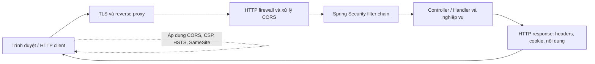
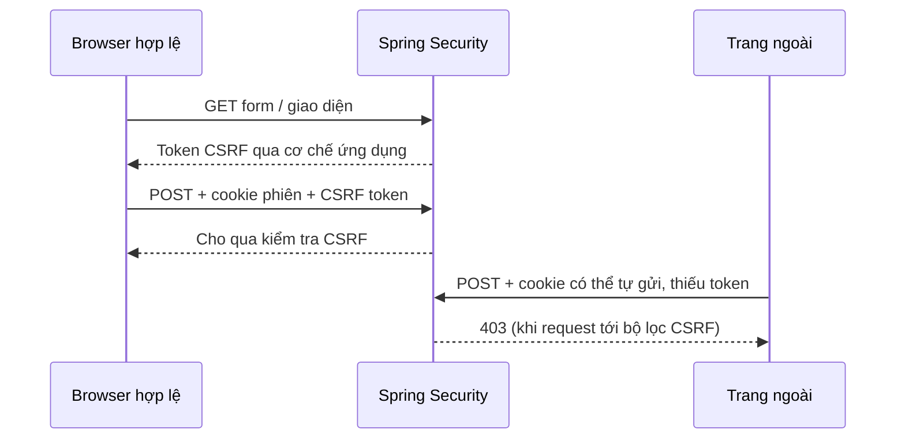

# Spring Security Protection là gì và các nhóm nguy cơ cần xử lý

> **Chương:** Bản đồ bảo vệ  
> **Phạm vi:** SPRING_SECURITY_HTTP_PROTECTION — bảo vệ HTTP và trình duyệt với Spring Security, bao gồm CSRF, CORS, security headers, CSP, HSTS, HTTP firewall và session; áp dụng cho cả Servlet và Reactive (WebFlux).

## 1. Vì sao một ứng dụng đã đăng nhập vẫn có thể bị tấn công?

Một hệ thống đã xác thực người dùng và phân quyền API vẫn có thể mất an toàn ở các ranh giới khác: trình duyệt tự gửi cookie cho một yêu cầu giả mạo; JavaScript ở website lạ cố đọc dữ liệu của API; nội dung trang bị nhúng vào `iframe` để lừa người dùng bấm nút; proxy và ứng dụng hiểu URL theo hai cách khác nhau; hoặc kẻ tấn công chiếm một session đã đăng nhập.

**Spring Security Protection** là tập hợp các cơ chế giúp giảm những rủi ro đó trong quá trình xử lý HTTP. Nó bổ sung cho xác thực (*authentication*) và phân quyền (*authorization*), đồng thời phối hợp với các biện pháp do trình duyệt, web server, reverse proxy, TLS và mã ứng dụng thực thi.

Sau bài này, người học cần có khả năng:

- Phân loại nguy cơ theo **điểm bị khai thác** và lựa chọn lớp phòng vệ phù hợp.
- Phân biệt chính xác CSRF với CORS, CSP với chống XSS, HSTS với HTTPS, HTTP firewall với phân quyền URL.
- Xác định cơ chế tương đương trong Servlet và WebFlux; kiểm tra hành vi bảo mật bằng yêu cầu HTTP và công cụ kiểm thử.
- Chẩn đoán lỗi `400`, `401`, `403`, preflight bị từ chối, CSP violation hoặc session mất hiệu lực mà không vội tắt biện pháp bảo vệ.

### Tình huống xuyên suốt

Giả sử `https://app.example.com` là giao diện quản lý tài khoản, `https://api.example.com` phục vụ API, và người dùng đăng nhập bằng cookie phiên. Hệ thống có các thao tác xem hồ sơ, đổi email, chuyển tiền và quản trị. Những câu hỏi phải trả lời gồm:

1. Có thể khiến trình duyệt người dùng **gửi** thao tác đổi email từ một trang độc hại không?
2. JavaScript trên một origin không được tin cậy có thể **đọc** phản hồi API không?
3. Khi HTML/JavaScript không đáng tin cậy lọt vào trang, trình duyệt được phép thực thi những gì?
4. URL `/admin` qua proxy có được Spring Security và controller hiểu giống nhau không?
5. Session và cookie còn an toàn khi đăng nhập, đăng xuất, đổi mạng hoặc chuyển qua HTTPS không?

Không có một cấu hình duy nhất giải quyết cả năm câu hỏi.

## 2. Bản đồ lớp phòng vệ theo luồng HTTP



Sơ đồ thể hiện vị trí trách nhiệm, **không phải thứ tự cố định của mọi filter**. Thứ tự thật phụ thuộc ngăn xếp Servlet/WebFlux, cấu hình và hạ tầng. Đặc biệt, **CORS preflight cần được xử lý trước phần xác thực có thể từ chối yêu cầu không mang cookie**.

| Ranh giới | Nhiệm vụ chính | Ví dụ |
| --- | --- | --- |
| Trình duyệt | Áp dụng chính sách same-origin, CORS, CSP, HSTS, cookie attributes | Không cho script ở origin lạ đọc response thiếu `Access-Control-Allow-Origin` |
| Edge/proxy/TLS | Mã hóa đường truyền, chuẩn hóa chuyển tiếp, lựa chọn host hợp lệ | HTTPS, giới hạn kích thước yêu cầu, cấu hình `Forwarded` |
| Spring Security | Xác thực, phân quyền, kiểm tra CSRF, firewall, ghi security headers, quản lý session | Từ chối POST thiếu token CSRF |
| Ứng dụng | Kiểm tra đầu vào, escape output, phân quyền theo đối tượng, bảo đảm method không gây tác dụng phụ | Người dùng A không được đọc đơn hàng của B |

**Nguyên tắc:** một header hoặc filter không thay thế được kiểm tra ở lớp nghiệp vụ. Ví dụ, firewall ngăn một số URL bất thường nhưng không chứng minh rằng người dùng được quyền truy cập `/admin/reports`.

### Bản đồ nguy cơ → lớp bảo vệ

| Nhóm nguy cơ | Kịch bản đại diện | Phòng vệ cốt lõi | Cách nhận biết/kiểm thử |
| --- | --- | --- | --- |
| **CSRF** | Trang ngoài khiến trình duyệt đã đăng nhập gửi POST đổi email | CSRF token, phương thức HTTP đúng, cookie SameSite bổ trợ | POST có cookie nhưng thiếu/sai token bị từ chối |
| **Lộ dữ liệu qua origin khác** | Script từ origin lạ đọc response cá nhân | CORS allowlist, xác thực và phân quyền API | Preflight/response không cấp quyền đọc cho origin lạ |
| **XSS và nội dung chủ động** | Dữ liệu không tin cậy chạy thành script | Encode/sanitize tại ứng dụng; CSP giới hạn tác động | Script không hợp lệ bị chặn, có báo cáo CSP |
| **Clickjacking** | Trang khác nhúng màn hình giao dịch vào iframe | `frame-ancestors` và/hoặc `X-Frame-Options` | Thử nhúng từ origin không được phép |
| **Downgrade/MITM** | Điều hướng từ HTTP bị can thiệp trên đường truyền | HTTPS/TLS, HSTS sau HTTPS hợp lệ | Response HTTPS có HSTS; đường truyền không hạ về HTTP |
| **MIME sniffing và cache nhạy cảm** | Trình duyệt đoán sai loại nội dung; cache giữ trang riêng tư | `X-Content-Type-Options`, `Cache-Control` | Kiểm tra headers thực tế trên response |
| **Path/method ambiguity** | URL mã hóa hoặc phương thức lạ vượt qua matcher | `StrictHttpFirewall` / `StrictServerWebExchangeFirewall`, quy tắc deny-by-default | Yêu cầu bất thường bị từ chối trước handler |
| **Session fixation/hijacking** | ID phiên bị biết trước hoặc cookie bị lộ | Đổi session ID, cookie `Secure`/`HttpOnly`/`SameSite`, logout/invalidation | Quan sát ID trước/sau login, cookie và logout |
| **Nhầm cấu hình giữa nhiều lớp** | Proxy, CORS, Spring chain và ứng dụng áp chính sách mâu thuẫn | Một nguồn cấu hình rõ ràng, quan sát request–response, kiểm thử tích hợp | Xác định chính xác lớp nào trả lỗi |

## 3. Ba khái niệm nền: origin, site và thông tin xác thực tự gửi

**Origin** được xác định bởi bộ ba **scheme + host + port**. Vì vậy `https://app.example.com` và `https://api.example.com` là *cross-origin*, dù thường là *same-site*. `https://app.example.com` và `http://app.example.com` cũng khác origin.

**Site** phục vụ các chính sách như cookie `SameSite`; với trình duyệt hiện đại, việc xét same-site còn phụ thuộc scheme và miền đăng ký (registrable domain). Không nên dùng hai từ *same-origin* và *same-site* thay thế cho nhau.

**Ambient credentials** là thông tin xác thực trình duyệt có thể tự đính kèm theo quy tắc của nó, điển hình là cookie phiên. Đây là điều kiện quan trọng của CSRF. Ngược lại, JavaScript chủ động thêm bearer token vào header `Authorization` là mô hình khác; tuy nhiên nếu ứng dụng vẫn chấp nhận cookie xác thực hoặc cách xác thực tự gửi khác, rủi ro CSRF vẫn cần được đánh giá.

Ba phép thử hữu ích:

- **Request có được gửi không?** CORS không phải cơ chế tổng quát chặn trình duyệt gửi mọi cross-origin request.
- **Script có được đọc response không?** Đây là điều CORS kiểm soát trong trình duyệt.
- **Server có được phép thực hiện thao tác không?** Đây là trách nhiệm của xác thực, phân quyền, CSRF và quy tắc nghiệp vụ.

## 4. CSRF: bảo vệ thao tác dùng cookie phiên

### 4.1. Cơ chế tấn công

Người dùng đăng nhập `https://api.example.com`. Khi họ mở một trang khác, trang đó có thể khiến trình duyệt phát sinh yêu cầu đến API. Nếu cookie xác thực được trình duyệt đính kèm và endpoint chấp nhận thao tác, server có thể tưởng đó là ý định của người dùng.

Ví dụ minh họa (endpoint giả định):

```html
<!-- Một trang không thuộc ứng dụng vẫn có thể tạo form gửi yêu cầu -->
<form action="https://api.example.com/profile/email" method="post">
  <input name="email" value="attacker@example.net">
  <button type="submit">Gửi</button>
</form>
```

Một form HTML đơn giản không cần đọc response để gây thay đổi trạng thái. Vì vậy **CORS không thay thế CSRF**.

### 4.2. Phòng vệ bằng token

Với cơ chế *synchronizer token*, server phát token gắn với ngữ cảnh người dùng; form hoặc script hợp lệ gửi token trong hidden input/header. Kẻ tấn công ở origin khác thông thường không đọc được token hợp lệ để gửi kèm.



Các điểm cần nhớ:

- Mặc định Spring Security bảo vệ các phương thức **không an toàn** (thường là POST, PUT, PATCH, DELETE); **GET/HEAD/OPTIONS/TRACE phải không gây thay đổi trạng thái nghiệp vụ**. Một endpoint `GET /transfer?amount=...` tự nó là thiết kế nguy hiểm.
- Ở Servlet, token thường lưu qua `HttpSessionCsrfTokenRepository`; có thể dùng `CookieCsrfTokenRepository` cho một số ứng dụng JavaScript. Ở WebFlux, mặc định dùng `WebSessionServerCsrfTokenRepository`.
- Trong các phiên bản Spring Security hiện đại, token Servlet có cơ chế **deferred loading** và **BREACH protection**. SPA đọc token từ cookie cần cơ chế xử lý phù hợp; token có thể cần phát lại sau login/logout. Không nên chỉ đổi repository rồi giả định frontend đã hoạt động đúng.
- `SameSite=Lax/Strict` giúp giảm một số CSRF qua cookie nhưng không bao phủ mọi môi trường và trường hợp same-site cross-origin; token CSRF vẫn hữu ích với hệ thống cookie-based.
- Nếu một API **thực sự** không dùng cookie hoặc thông tin xác thực tự gửi, chỉ nhận bearer token qua header và đã xác minh mọi đường xác thực, có thể cân nhắc miễn CSRF theo phạm vi hẹp. Gọi ứng dụng là “REST” hoặc đặt `STATELESS` **không đủ** để kết luận CSRF không cần thiết.
- Sau khi dùng `csrf().ignoringRequestMatchers(...)` hoặc vô hiệu hóa CSRF, cần tài liệu hóa mô hình xác thực và kiểm thử endpoint tương ứng.

**Điểm chẩn đoán:** POST trả `403` dù tài khoản đã đăng nhập có thể là do **CSRF token thiếu/hết hiệu lực**, hoặc do **phân quyền**. Kiểm tra log phù hợp, token, phương thức, cookie và security chain trước khi sửa.

## 5. CORS: chính sách cho JavaScript truy cập khác origin

CORS (*Cross-Origin Resource Sharing*) là cơ chế để server cho trình duyệt biết origin nào được phép đọc response cross-origin theo điều kiện nào. CORS **không phải hệ thống đăng nhập**, **không bảo vệ API khỏi curl hoặc server-to-server client**, và **không phải cơ chế chống CSRF**.

Một request JavaScript có thể dẫn đến **preflight**:

```http
OPTIONS /api/account HTTP/1.1
Host: api.example.com
Origin: https://app.example.com
Access-Control-Request-Method: PUT
Access-Control-Request-Headers: content-type,x-csrf-token
```

Server có thể trả:

```http
HTTP/1.1 204 No Content
Access-Control-Allow-Origin: https://app.example.com
Access-Control-Allow-Methods: GET,POST,PUT
Access-Control-Allow-Headers: content-type,x-csrf-token
Access-Control-Allow-Credentials: true
Vary: Origin
```

Preflight thường **không mang cookie phiên**. Nếu xác thực chạy trước khi CORS xử lý yêu cầu này, ứng dụng có thể trả `401/403` cho `OPTIONS` và trình duyệt báo lỗi CORS dù API thực tế vẫn hoạt động với client khác.

### Nguyên tắc cấu hình

1. Khai báo **origin cụ thể** được tin cậy, ví dụ `https://app.example.com`; không phản chiếu tùy tiện header `Origin`.
2. Khi bật `allowCredentials(true)`, **không dùng `allowedOrigins("*")`**; chỉ cho các origin cần thiết. Nếu cần pattern, đánh giá thật chặt các miền khớp.
3. Giới hạn methods, request headers, exposed response headers theo nhu cầu; với nhiều origin, kiểm tra cách cache xử lý `Vary: Origin`.
4. Chỉ có CORS đúng **chưa đủ**: JavaScript gửi cookie cross-origin còn phụ thuộc `credentials` của fetch/XHR, thiết lập cookie và các quy định của trình duyệt.
5. Trong Spring Security, bật tích hợp CORS và để CORS xử lý trước phần xác thực có thể bác bỏ preflight.

Nếu trang frontend và API **cùng origin**, trình duyệt không cần CORS cho luồng đó. Chỉ cấu hình CORS khi có yêu cầu cross-origin thực sự.

## 6. Security headers: hướng dẫn trình duyệt xử lý response an toàn

Security headers được server gửi trong **HTTP response**, nhưng phần lớn hiệu lực được **trình duyệt** áp dụng. Bộ mặc định có thể thay đổi theo phiên bản và cách cấu hình; cần kiểm tra response thực tế.

| Header / cơ chế | Công dụng | Lưu ý |
| --- | --- | --- |
| `Cache-Control: no-cache, no-store...` | Hạn chế lưu response chứa dữ liệu nhạy cảm | Tùy biến riêng cho tài nguyên tĩnh cần cache |
| `X-Content-Type-Options: nosniff` | Hạn chế trình duyệt tự đoán MIME type | Vẫn phải trả `Content-Type` đúng |
| `X-Frame-Options: DENY` hoặc `SAMEORIGIN` | Giảm clickjacking ở trình duyệt có hỗ trợ | `frame-ancestors` trong CSP linh hoạt hơn |
| `Content-Security-Policy` | Giới hạn nguồn script, style, frame và tài nguyên | **Không tự được thêm mặc định**; phải thiết kế theo ứng dụng |
| `Strict-Transport-Security` | Ghi nhớ chính sách truy cập HTTPS | Trình duyệt chỉ chấp nhận qua HTTPS đáng tin cậy |
| `Referrer-Policy` | Kiểm soát lượng thông tin URL truyền trong `Referer` | Chọn chính sách theo yêu cầu riêng tư/chức năng |
| Cookie `Secure`, `HttpOnly`, `SameSite` | Hạn chế đường gửi cookie, truy cập từ JavaScript, bối cảnh cross-site | Là thuộc tính cookie, **không** phải security response header độc lập |

Trong cấu hình thường gặp, Spring Security tự thêm một số header như cache control, `nosniff`, frame options và HSTS trên response HTTPS. **CSP cần được khai báo**; đừng coi header `X-XSS-Protection` cũ là lớp chống XSS chính.

### 6.1. CSP và giới hạn tác động của XSS

**XSS** xuất hiện khi dữ liệu không tin cậy trở thành HTML/JavaScript có thể thực thi. Biện pháp gốc là **escape theo ngữ cảnh đầu ra**, tránh ghép HTML tùy tiện và sanitize nội dung cho phép HTML. **CSP** là lớp phòng vệ bổ sung khi ứng dụng có lỗi hoặc khi nguồn bên thứ ba bị xâm phạm.

Ví dụ policy khởi điểm cho một ứng dụng kiểm soát được toàn bộ tài nguyên của mình:

```http
Content-Security-Policy: default-src 'self'; script-src 'self'; object-src 'none'; base-uri 'self'; frame-ancestors 'none'; form-action 'self'
```

Giải thích một số directive:

- `default-src 'self'`: quy tắc mặc định cho những loại tài nguyên có dùng fallback.
- `script-src 'self'`: chỉ nhận script từ cùng origin theo chính sách này; tránh mở rộng bằng `'unsafe-inline'`.
- `object-src 'none'`: không tải plugin object/embed.
- `base-uri 'self'`: giới hạn URL làm cơ sở của tài liệu.
- `frame-ancestors 'none'`: cấm origin khác nhúng trang vào frame; dùng allowlist nếu có nhu cầu nhúng hợp lệ.
- `form-action 'self'`: giới hạn nơi form có thể gửi dữ liệu.

Ứng dụng có script inline/dynamic có thể cần **nonce hoặc hash**; không nên thêm `'unsafe-inline'` chỉ để hết lỗi console. CSP cũng phải cân nhắc CDN, font, WebSocket, báo cáo vi phạm và template engine. Có thể triển khai **`Content-Security-Policy-Report-Only`** trước, thu thập các vi phạm hợp lệ, sau đó mới chuyển sang chế độ chặn. Report-only **không tự ngăn** script chạy.

### 6.2. HSTS và cấu hình HTTPS

HTTPS/TLS mã hóa và xác thực kết nối hiện tại; HSTS yêu cầu trình duyệt **ưu tiên HTTPS cho những lần truy cập sau** đến host đã ghi nhớ. Một ví dụ:

```http
Strict-Transport-Security: max-age=31536000; includeSubDomains
```

- HSTS được trình duyệt ghi nhận từ **response HTTPS có chứng chỉ hợp lệ**; thêm header trên HTTP không đạt hiệu quả mong muốn.
- `includeSubDomains` tác động tới các subdomain, kể cả host chưa sẵn sàng HTTPS. Chỉ bật sau khi rà soát toàn bộ phạm vi.
- `preload` là cam kết vận hành riêng; không thêm tùy tiện. HSTS không tự thay thế việc cấu hình TLS, redirect, certificate và proxy đúng.
- Khi kết thúc TLS ở reverse proxy, cần bảo đảm ứng dụng và hạ tầng xử lý scheme/forwarded headers có kiểm soát, tránh trường hợp không phát HSTS hoặc tạo redirect sai.

### 6.3. Clickjacking và MIME sniffing

Một màn hình có nút “Xác nhận” nếu bị nhúng vào iframe từ website độc hại có thể bị phủ giao diện để lừa thao tác. `X-Frame-Options` và CSP `frame-ancestors` giới hạn khả năng nhúng. Chọn chính sách theo nhu cầu thực tế (ví dụ có dùng iframe của đối tác hay không).

`X-Content-Type-Options: nosniff` giảm trường hợp trình duyệt đoán nội dung trái `Content-Type`. Nó không chữa được file upload thiếu kiểm soát; ứng dụng vẫn phải kiểm tra loại file, quyền truy cập và cách trả file.

## 7. HTTP firewall: giữ cách hiểu request nhất quán

Bộ quy tắc phân quyền theo URL chỉ có ý nghĩa khi reverse proxy, container, firewall, matcher và handler **hiểu đường dẫn giống nhau**. Các biến thể như dấu chấm bất thường, `//`, dấu chấm phẩy, dấu `\` hoặc slash đã mã hóa `%2F` có thể khiến các thành phần xử lý khác nhau. Một lớp có thể kiểm tra `/public/**` nhưng lớp khác diễn giải lại thành đường dẫn được bảo vệ.

Spring Security cung cấp:

- **Servlet:** `HttpFirewall`, thường dùng mặc định `StrictHttpFirewall` trong `FilterChainProxy`.
- **WebFlux:** `ServerWebExchangeFirewall`, mặc định `StrictServerWebExchangeFirewall` trong `WebFilterChainProxy`.

Các firewall nghiêm ngặt từ chối nhiều URL chưa chuẩn hóa, method không được phép và ký tự nguy hiểm ở một số thành phần request. Một yêu cầu bị firewall chặn thường biểu hiện dưới dạng **`400 Bad Request`** (hoặc mã do handler/gateway được cấu hình trả), **khác với `403` do từ chối quyền**.

Nếu API hợp lệ cần matrix variables với `;` hoặc định dạng URL đặc biệt:

1. Xác minh nhu cầu bằng endpoint thực tế và kiểm tra toàn tuyến proxy → ứng dụng.
2. Xác định chính xác quy tắc nào bị chặn.
3. Chỉ nới đúng quy tắc cần thiết, kèm regression test; tránh thay hàng loạt cơ chế kiểm tra bằng một firewall quá lỏng.
4. Đặt luật phân quyền theo URL đơn giản, có fallback từ chối; kiểm soát quyền ở service/domain để tránh phụ thuộc vào biểu diễn URL.

Ví dụ Servlet cho trường hợp **đã có lý do nghiệp vụ và kiểm thử rõ ràng**:

```java
@Bean
StrictHttpFirewall httpFirewall() {
    StrictHttpFirewall firewall = new StrictHttpFirewall();
    firewall.setAllowSemicolon(true); // Chỉ dùng nếu ứng dụng thực sự cần
    return firewall;
}
```

WebFlux có lớp tương ứng `StrictServerWebExchangeFirewall` và phương thức cấu hình riêng. Không dùng API của Servlet cho WebFlux hoặc ngược lại.

## 8. Bảo vệ session: từ login đến logout

Một cookie phiên đại diện cho quyền truy cập của người dùng, nên việc quản lý vòng đời session cũng quan trọng như kiểm tra mật khẩu.

### 8.1. Session fixation và chiếm phiên

**Session fixation** xảy ra khi kẻ tấn công khiến nạn nhân dùng một session ID đã biết trước rồi đăng nhập. Spring Security trên Servlet hỗ trợ thay đổi ID khi xác thực thành công; với Servlet container hiện đại, chiến lược `changeSessionId` là mặc định thường gặp. Nếu tự xây dựng luồng đăng nhập hay tích hợp SSO, cần xác minh bảo vệ này vẫn hoạt động.

**Session hijacking** là việc kẻ khác sử dụng cookie/token phiên đã bị lộ. Các lớp giảm rủi ro gồm HTTPS, cookie có thuộc tính phù hợp, vòng đời ngắn hợp lý, logout vô hiệu hóa session, hạn chế XSS và giám sát hành vi bất thường. `HttpOnly` hạn chế script đọc cookie nhưng **không chặn mọi XSS**: script chạy trong origin hợp lệ vẫn có thể thực hiện request với cookie.

### 8.2. Cookie và giới hạn thực tế

```http
Set-Cookie: JSESSIONID=random-session-id; Path=/; Secure; HttpOnly; SameSite=Lax
```

Đây là một **ví dụ cấu trúc**, không cam kết các thuộc tính này đã được ứng dụng tự thiết lập.

| Thuộc tính | Ý nghĩa |
| --- | --- |
| `Secure` | Chỉ gửi cookie qua kết nối HTTPS trong các trường hợp phù hợp |
| `HttpOnly` | Không cho JavaScript đọc trực tiếp cookie |
| `SameSite=Lax/Strict/None` | Điều chỉnh việc gửi cookie theo bối cảnh site; `None` phải đi cùng `Secure` trong trình duyệt hiện đại |
| `Path`, `Domain` | Giới hạn phạm vi gửi cookie; không mở rộng domain nếu không cần |
| `Max-Age`/`Expires` | Xác định thời hạn lưu cookie; phải phối hợp timeout session phía server |

Trong Spring Boot Servlet, cookie phiên có thể do servlet container hoặc Spring Session quản lý; trong WebFlux, cơ chế `WebSession` và bộ giải quyết cookie có API khác. Cần cấu hình ở **đúng nơi tạo cookie**, kiểm tra thực tế header `Set-Cookie` sau login và phản hồi khi logout.

### 8.3. Stateful và stateless

- **Stateful:** server lưu trạng thái phiên, browser thường mang `JSESSIONID`. Cần CSRF với thao tác dùng cookie, session timeout, session fixation protection và logout.
- **Stateless bearer API:** client gửi token trong `Authorization` theo từng request; thường không cần HTTP session. Tuy nhiên phải đánh giá chỗ lưu token, XSS, refresh token, revocation và các đường xác thực dự phòng.
- `SessionCreationPolicy.STATELESS` là chính sách về phiên trong phần Servlet security; không tự bảo đảm toàn hệ thống không sử dụng cookie ở nơi khác và không biến XSS/CSRF thành vô hại.

Giới hạn số phiên đồng thời có thể hữu ích với tài khoản nhạy cảm, nhưng thay đổi tùy kiến trúc lưu session, cụm server, kiểu xác thực và phiên bản framework. Đừng áp dụng ví dụ Servlet nguyên xi cho WebFlux.

## 9. Cấu hình khung cho Servlet và WebFlux

Hai ví dụ dưới đây minh họa **điểm nối các lớp bảo vệ** và dùng DSL Java lambda của Spring Security. Chúng giả định ứng dụng đăng nhập bằng form/cookie và có trang HTML do chính ứng dụng phục vụ. Khi triển khai thực tế, cần bổ sung import, endpoint, cấu hình CORS cho topology cụ thể và chính sách CSP phù hợp assets đang dùng.

### 9.1. Servlet: `SecurityFilterChain` với `HttpSecurity`

```java
@Configuration
@EnableWebSecurity
class ServletSecurityConfig {

    @Bean
    SecurityFilterChain securityFilterChain(HttpSecurity http) throws Exception {
        return http
            .cors(Customizer.withDefaults())
            .csrf(Customizer.withDefaults())
            .headers(headers -> headers
                .contentSecurityPolicy(csp -> csp
                    .policyDirectives(
                        "default-src 'self'; script-src 'self'; " +
                        "object-src 'none'; base-uri 'self'; frame-ancestors 'none'"
                    )
                )
            )
            .authorizeHttpRequests(auth -> auth
                .requestMatchers("/assets/**", "/login", "/error").permitAll()
                .anyRequest().authenticated()
            )
            .formLogin(Customizer.withDefaults())
            .build();
    }
}
```

Giải thích:

- `csrf(withDefaults())` giữ CSRF bảo vệ các request không an toàn; form phải gửi token hợp lệ.
- `cors(withDefaults())` bật tích hợp CORS nhưng **không tự định nghĩa allowlist**. Nếu ứng dụng có frontend cross-origin, phải khai báo nguồn cấu hình CORS.
- `headers(...contentSecurityPolicy(...))` thêm CSP riêng; các header mặc định khác vẫn cần được kiểm tra trên response.
- `anyRequest().authenticated()` chỉ bảo đảm đăng nhập; quyền tài nguyên cụ thể vẫn phải có điều kiện `hasRole`, `hasAuthority` hoặc kiểm tra ở service.
- Chính sách `script-src 'self'` sẽ chặn script inline nếu không có nonce/hash; cần điều chỉnh frontend tương ứng.

Ví dụ **CORS source Servlet** cho API dùng cookie và chỉ cho phép giao diện ở một origin:

```java
@Bean
UrlBasedCorsConfigurationSource corsConfigurationSource() {
    CorsConfiguration cors = new CorsConfiguration();
    cors.setAllowedOrigins(List.of("https://app.example.com"));
    cors.setAllowedMethods(List.of("GET", "POST", "PUT", "DELETE"));
    cors.setAllowedHeaders(List.of(
        "Content-Type", "X-CSRF-TOKEN", "X-XSRF-TOKEN"
    ));
    cors.setAllowCredentials(true);

    UrlBasedCorsConfigurationSource source =
        new UrlBasedCorsConfigurationSource();
    source.registerCorsConfiguration("/api/**", cors);
    return source;
}
```

Cần import `org.springframework.web.cors.UrlBasedCorsConfigurationSource` (Servlet). Trong mô hình SPA cross-origin, đây **chưa phải cấu hình CSRF hoàn chỉnh**: phải thiết kế cách cấp/đổi token, cookie SameSite phù hợp và cơ chế frontend gửi token.

### 9.2. WebFlux: `SecurityWebFilterChain` với `ServerHttpSecurity`

```java
@Configuration
@EnableWebFluxSecurity
class ReactiveSecurityConfig {

    @Bean
    SecurityWebFilterChain securityWebFilterChain(ServerHttpSecurity http) {
        return http
            .cors(Customizer.withDefaults())
            .csrf(Customizer.withDefaults())
            .headers(headers -> headers
                .contentSecurityPolicy(csp -> csp
                    .policyDirectives(
                        "default-src 'self'; script-src 'self'; " +
                        "object-src 'none'; base-uri 'self'; frame-ancestors 'none'"
                    )
                )
            )
            .authorizeExchange(auth -> auth
                .pathMatchers("/assets/**", "/login", "/error").permitAll()
                .anyExchange().authenticated()
            )
            .formLogin(Customizer.withDefaults())
            .build();
    }
}
```

WebFlux sử dụng `ServerWebExchange`/`WebFilter` và `WebSession` thay vì `HttpServletRequest`/`Filter` và `HttpSession`. Nếu triển khai CORS source trong WebFlux, import `org.springframework.web.cors.reactive.UrlBasedCorsConfigurationSource` hoặc cấu hình `CorsWebFilter` phù hợp. Hai lớp cùng tên `UrlBasedCorsConfigurationSource` ở Servlet và Reactive **không có cùng package**.

| Điểm cấu hình | Servlet (Spring MVC) | Reactive (WebFlux) |
| --- | --- | --- |
| Chuỗi bảo mật | `SecurityFilterChain` / `HttpSecurity` | `SecurityWebFilterChain` / `ServerHttpSecurity` |
| Matcher quyền truy cập | `authorizeHttpRequests` / `requestMatchers` | `authorizeExchange` / `pathMatchers` |
| CSRF token mặc định | Session HTTP qua `HttpSessionCsrfTokenRepository` | WebSession qua `WebSessionServerCsrfTokenRepository` |
| CORS integration | `CorsFilter`, `CorsConfigurationSource` | `CorsWebFilter`, reactive `CorsConfigurationSource` |
| HTTP firewall mặc định | `StrictHttpFirewall` | `StrictServerWebExchangeFirewall` |
| Công cụ test HTTP | `MockMvc` + spring-security-test | `WebTestClient` + spring-security-test |
| Session và cookie | Servlet container, có thể kết hợp Spring Session | `WebSession` và reactive session infrastructure |

**Cảnh báo về phạm vi ví dụ:** không chép cả hai cấu hình vào cùng một ứng dụng rồi giả định cả hai stack cùng tham gia xử lý một request. Hãy chọn đúng stack ứng dụng chạy, rà soát phiên bản Spring Security, thứ tự filter và các `SecurityFilterChain`/`SecurityWebFilterChain` đang được khai báo.

## 10. Kiểm thử: đo hành vi thực tế, không chỉ xem cấu hình

### 10.1. Ma trận kiểm thử tối thiểu

| Kịch bản | Request cần tạo | Kỳ vọng khi cấu hình đúng |
| --- | --- | --- |
| CSRF thiếu | User đã đăng nhập, POST thay đổi dữ liệu, không có token | `403` từ cơ chế CSRF khi đi qua chain liên quan |
| CSRF sai | POST có token giả/hết hạn | Bị từ chối; không phát sinh thay đổi dữ liệu |
| CSRF hợp lệ | POST có session và token khớp | Vượt CSRF; kết quả cuối còn phụ thuộc authz/validation |
| CORS cho origin được phép | OPTIONS với `Origin` và `Access-Control-Request-Method` | Response có các `Access-Control-Allow-*` phù hợp |
| CORS cho origin không được phép | Cùng preflight nhưng đổi `Origin` | Browser không được cấp quyền đọc; server có thể trả lỗi hoặc thiếu CORS headers |
| CSP | HTML thử tải script từ nguồn không được phép | Browser chặn, console xuất hiện vi phạm CSP |
| HSTS | GET HTTPS từ host đúng | Header HSTS đáp ứng chính sách; HTTP không phải nơi cấp HSTS tin cậy |
| Clickjacking | Origin lạ thử nhúng trang nhạy cảm trong iframe | Browser chặn nhúng theo `frame-ancestors`/`X-Frame-Options` |
| Firewall | Path lạ như slash mã hóa hoặc `//` | Bị từ chối ở firewall/proxy theo chính sách |
| Session fixation | Ghi session ID trước và sau login | Session ID đổi theo cơ chế bảo vệ được cấu hình |
| Logout | Logout xong gửi lại cookie cũ | Không truy cập được nội dung cần xác thực |
| Phân quyền theo tài nguyên | User A gọi tài nguyên chỉ thuộc user B | Bị từ chối tại API/service dù URL hợp lệ |

Không gắn cứng mọi kiểm thử với một mã status duy nhất: proxy, firewall, handler lỗi và nghiệp vụ có thể trả khác nhau. Đánh giá quan trọng nhất là **người dùng hoặc tác nhân không được phép không tạo được tác dụng phụ và không đọc được dữ liệu**.

### 10.2. Test CSRF với Servlet `MockMvc`

Ví dụ theo `spring-security-test` (giả sử endpoint `/profile/confirm` trả thành công khi payload hợp lệ):

```java
// Thiếu token: request không vượt qua kiểm tra CSRF.
mvc.perform(post("/profile/confirm").with(user("alice")))
   .andExpect(status().isForbidden());

// Token hợp lệ: request vượt CSRF;
// còn có thể bị từ chối bởi authz/validation hoặc logic endpoint.
mvc.perform(post("/profile/confirm")
        .with(user("alice"))
        .with(csrf()));
```

Dùng `csrf().asHeader()` để test token qua header, hoặc `csrf().useInvalidToken()` để mô phỏng token sai. Khi kiểm thử response thực tế, cần cấu hình `springSecurity()`/security filter integration cho `MockMvc`.

### 10.3. Test CSRF với Reactive `WebTestClient`

```java
webTestClient.mutateWith(csrf())
    .post()
    .uri("/profile/confirm")
    .exchange();
```

Dùng helper của `spring-security-test` cho WebFlux và kết hợp mock authentication/expectation phù hợp. Hãy test **cả yêu cầu có token và yêu cầu không có token** để phát hiện lỗi bỏ qua filter.

### 10.4. Tự quan sát CORS và headers

```bash
# Kiểm tra preflight từ một origin được cho phép
curl -i -X OPTIONS https://api.example.com/api/account \
  -H 'Origin: https://app.example.com' \
  -H 'Access-Control-Request-Method: PUT' \
  -H 'Access-Control-Request-Headers: content-type,x-csrf-token'

# Kiểm tra headers trên HTTPS
curl -I https://app.example.com/
```

Chạy tương tự với `Origin: https://untrusted.example.net` rồi so sánh. **curl không áp dụng CORS như trình duyệt**: curl dùng để xem header và response, còn bằng chứng cuối cùng về CORS/CSP phải có kiểm thử browser. Không ghi session ID, bearer token hay token CSRF thật vào log chia sẻ.

## 11. Chẩn đoán xung đột bảo mật khi triển khai

Khi phát sinh lỗi, hãy bắt đầu từ request và response thực tế:

1. **Đóng khung tình huống:** request URL, method, origin, scheme, cookies có được gửi không, request headers, response headers/status, thời điểm trước/sau login hoặc logout, stack Servlet hay WebFlux. Ẩn giá trị bí mật khi lưu trace.
2. **Nhìn dấu hiệu đầu tiên:** `400` thường hướng đến HTTP parser/firewall/proxy; `401` là chưa có xác thực phù hợp; `403` có thể do CSRF hoặc quyền; `302` có thể là redirect login; lỗi CSP được báo trong console; lỗi CORS có thể do browser không được cấp quyền đọc response.
3. **Xác định security chain nhận request:** nhiều chain có matcher và thứ tự ưu tiên riêng. Một endpoint chạy qua chain khác dự kiến sẽ có chính sách CSRF/CORS/header khác.
4. **So sánh browser và non-browser client:** nếu curl trả 200 nhưng browser bị chặn, kiểm tra origin, preflight, CSP và cookie policy. Nếu cả hai đều bị từ chối, kiểm tra chính sách server/gateway trước.
5. **Kiểm tra edge/proxy:** TLS termination, forwarding headers, redirect HTTP→HTTPS, host/path rewrite, header bị xóa/ghi đè và cache.
6. **Sửa đúng nguyên nhân rồi chạy lại ma trận regression:** tránh tắt CSRF, CORS, CSP hoặc firewall toàn cục chỉ vì một endpoint.

| Triệu chứng | Câu hỏi gợi ý | Hướng xử lý |
| --- | --- | --- |
| `OPTIONS` trả `401/403` | Preflight có chạy qua xác thực trước CORS? | Khai báo CORS integration đúng stack và route |
| Form POST sau login bị `403` | Token có bị xóa sau login/logout, form/SPA có cấp lại token? | Sửa luồng lấy token, không bỏ qua CSRF toàn ứng dụng |
| API chạy bằng curl nhưng frontend báo CORS | Header allow-origin/credentials có khớp request không? | Giới hạn origin và bảo đảm preflight/actual response nhất quán |
| Inline JavaScript bị chặn | CSP có cấm inline script? | Chuyển script ra file hoặc dùng nonce/hash có kiểm soát |
| Trang đối tác không nhúng được iframe | `frame-ancestors` hoặc `X-Frame-Options` có chặn? | Quyết định đối tác nào được phép nhúng và cập nhật policy |
| `400` với URL chứa `%2F` hoặc `;` | Parser, gateway hay HTTP firewall từ chối? | Giữ URL nhất quán; chỉ nới đúng quy tắc có nhu cầu |
| Cookie mất sau redirect cross-site | `SameSite`, `Secure`, scheme và credentials có tương thích? | Sửa kiến trúc cookie/redirect theo luồng thực |
| Không thấy HSTS sau triển khai | TLS có kết thúc ở proxy, response tới browser có thật sự HTTPS? | Cấu hình HTTPS và forwarded headers tin cậy |

## 12. Cách xây dựng một lớp bảo vệ có thể vận hành

Đối với một ứng dụng mới hoặc đang rà soát bảo mật, triển khai theo trình tự sau:

1. **Vẽ sơ đồ thật:** frontend origins, backend origins, host qua proxy, protocol, cách xác thực, nơi tạo session/cookie.
2. **Phân loại endpoint:** read-only, thay đổi trạng thái, công khai, cần đăng nhập, cần vai trò/quyền đối tượng. Đặt quy tắc phân quyền đủ chặt và kiểm tra tại service.
3. **Chọn chiến lược CSRF:** giữ token cho luồng dùng cookie; chứng minh rõ phạm vi miễn nếu là API bearer thuần túy.
4. **Chỉ mở CORS nếu cần:** allowlist các frontend hợp lệ, kiểm thử preflight không cookie và credentialed requests.
5. **Kiểm tra headers ở browser:** giữ mặc định hữu ích, thiết kế CSP theo assets, lên kế hoạch HSTS theo toàn bộ miền và proxy.
6. **Kiểm tra HTTP firewall và session:** URL bất thường, cookie attributes, đổi session ID, logout, timeout; rà soát cấu hình Servlet/WebFlux tương ứng.
7. **Tự động hóa regression tests:** bổ sung các trường hợp bị từ chối và trường hợp hợp lệ; kiểm tra lại sau thay đổi proxy, CDN, Spring Security và frontend.

### Những nhầm lẫn cần tránh

- **“Bật CORS là hết CSRF.”** Sai: CORS chủ yếu điều khiển khả năng script đọc response; form request vẫn có thể gây tác dụng phụ.
- **“Bật CSP là tự hết XSS.”** Sai: cần encode/sanitize ở nguồn; CSP là phòng vệ thêm.
- **“Có HTTPS là HSTS không quan trọng.”** HTTPS bảo vệ phiên kết nối hiện tại, HSTS giảm cơ hội hạ cấp ở lần truy cập sau.
- **“Có HTTP firewall là đủ phân quyền.”** Firewall xử lý cấu trúc request bất thường, không kiểm tra quyền trên dữ liệu nghiệp vụ.
- **“STATELESS tự động hết CSRF.”** Cần xét trình duyệt có tự gửi thông tin xác thực cho endpoint hay không.
- **“Cấu hình của Servlet áp dụng nguyên xi cho WebFlux.”** Hai stack có filter, session, firewall, CORS type và test utilities riêng.
- **“Status 403 nghĩa là sai vai trò.”** Có thể do CSRF, authz hoặc một chính sách ứng dụng khác; phải xác định lớp từ chối.

## 13. Tài liệu tham khảo chính thức

Các đường dẫn dưới đây dẫn tới tài liệu Spring Security/Spring Framework; hãy đối chiếu phiên bản ứng dụng đang dùng vì API và mặc định có thể thay đổi.

- [Spring Security — CSRF trong Servlet](https://docs.spring.io/spring-security/reference/servlet/exploits/csrf.html)
- [Spring Security — CSRF trong WebFlux](https://docs.spring.io/spring-security/reference/reactive/exploits/csrf.html)
- [Spring Security — CORS trong Servlet](https://docs.spring.io/spring-security/reference/servlet/integrations/cors.html)
- [Spring Security — CORS trong WebFlux](https://docs.spring.io/spring-security/reference/reactive/integrations/cors.html)
- [Spring Security — Security HTTP response headers trong Servlet](https://docs.spring.io/spring-security/reference/servlet/exploits/headers.html)
- [Spring Security — Security HTTP response headers trong WebFlux](https://docs.spring.io/spring-security/reference/reactive/exploits/headers.html)
- [Spring Security — HTTP firewall trong Servlet](https://docs.spring.io/spring-security/reference/servlet/exploits/firewall.html)
- [Spring Security — HTTP firewall trong WebFlux](https://docs.spring.io/spring-security/reference/reactive/exploits/firewall.html)
- [Spring Security — Servlet session management](https://docs.spring.io/spring-security/reference/servlet/authentication/session-management.html)
- [Spring Security Test — MockMvc CSRF](https://docs.spring.io/spring-security/reference/servlet/test/mockmvc/csrf.html)
- [Spring Security Test — WebTestClient CSRF](https://docs.spring.io/spring-security/reference/reactive/test/web/csrf.html)

**Kết quả mong đợi:** người học nhìn vào một request HTTP và có thể nêu rõ *mối đe dọa*, *ranh giới cần bảo vệ*, *cơ chế Spring Security tương ứng*, *tác dụng mà trình duyệt thực thi* và *bằng chứng kiểm thử* để chứng minh cơ chế đó có hiệu lực.

