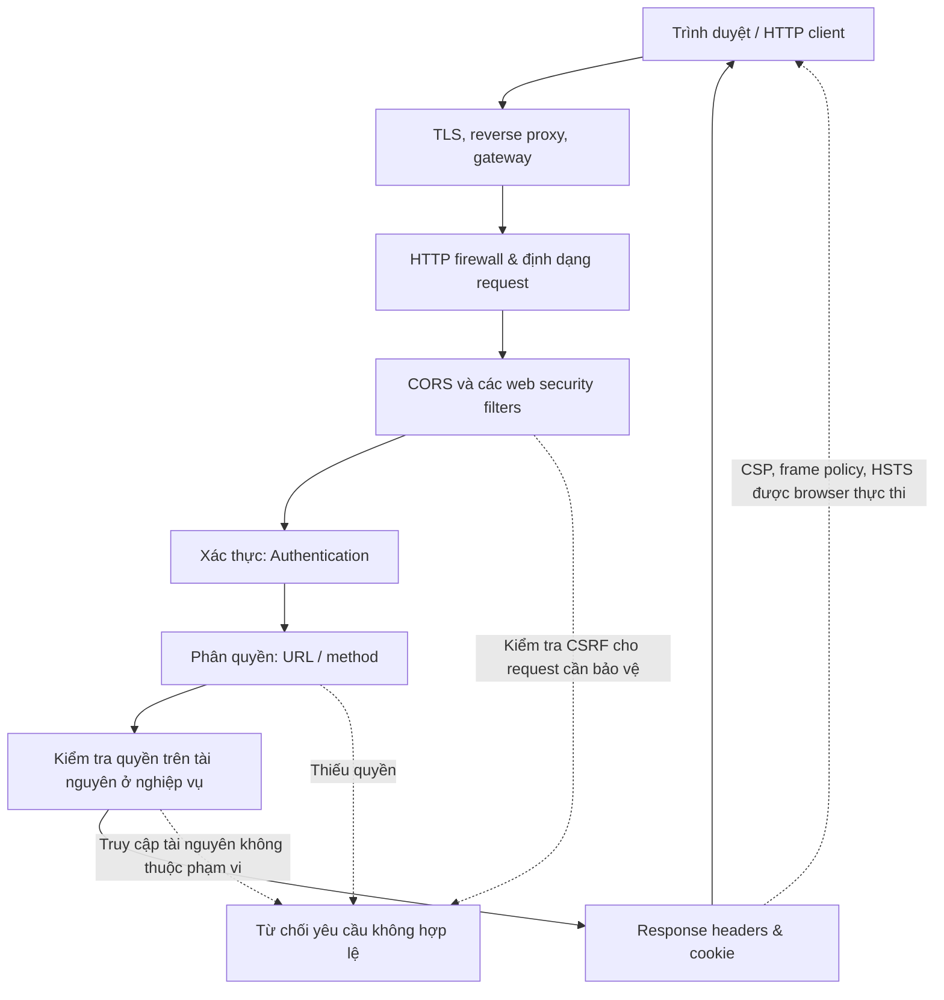
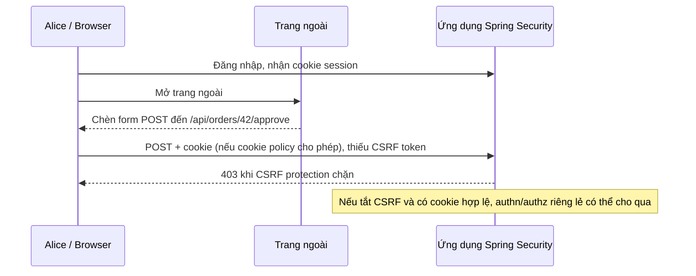
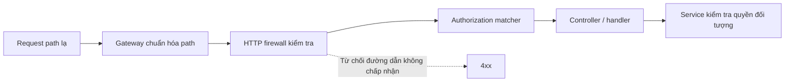

# Quan hệ giữa xác thực, phân quyền và bảo vệ trước kiểu tấn công

> **Chương:** Bản đồ bảo vệ  
> **Phạm vi:** `SPRING_SECURITY_HTTP_PROTECTION` — phối hợp xác thực, phân quyền và các lớp phòng vệ HTTP/trình duyệt trong Spring Security: CSRF, CORS, security headers, CSP, HSTS, HTTP firewall và session; áp dụng với Servlet và Reactive (WebFlux).

## 1. Vấn đề: đã đăng nhập và đủ quyền vẫn có thể không an toàn

Xét hệ thống quản lý đơn hàng:

- Nhân viên `alice` đăng nhập và được cấp quyền `ORDER_APPROVE`.
- API `POST /api/orders/42/approve` dùng để phê duyệt đơn số 42.
- Trình duyệt gửi cookie phiên để chứng minh người dùng đã đăng nhập.

Một yêu cầu chỉ nên thực hiện phê duyệt khi **đồng thời** thỏa các điều kiện:

1. Server xác định được **danh tính đáng tin cậy** của bên gọi.
2. Danh tính đó có **quyền thao tác** và **quyền trên chính đơn 42**.
3. Yêu cầu không được lợi dụng để vượt qua ràng buộc **HTTP, trình duyệt và session**, ví dụ CSRF, URL nhập nhằng hoặc session bị chiếm.

**Xác thực** (*authentication*) trả lời “ai đang gửi yêu cầu?”. **Phân quyền** (*authorization*) trả lời “người đó được phép làm gì trên tài nguyên nào?”. **Phòng vệ trước kiểu tấn công** (*exploit protection*) trả lời “có thể lợi dụng cơ chế HTTP/trình duyệt hoặc trạng thái đăng nhập để ép hệ thống thực hiện việc sai hay không?”.

Không lớp nào tự thay thế hoàn toàn hai lớp còn lại. Một trang độc hại có thể phát sinh request mang cookie của `alice`; một tài khoản đăng nhập hợp lệ có thể thử truy cập đơn của người khác; và một URL bị chuẩn hóa không nhất quán có thể làm sai kết quả matcher phân quyền.

### Mục tiêu học tập

Sau bài này, người học có thể:

- Phân biệt chức năng, dữ liệu đầu vào, kết quả và giới hạn của xác thực, phân quyền, phòng vệ HTTP.
- Phân tích các chuỗi tấn công kết hợp như **CSRF sau đăng nhập**, **IDOR/BOLA với tài khoản hợp lệ**, **session hijacking** hoặc **CORS bị cấu hình sai**.
- Thiết kế chuỗi kiểm tra đúng cho ứng dụng dùng **cookie/session** và API dùng **bearer token**.
- Cấu hình mức cơ bản trên **Servlet** và **WebFlux**, kiểm thử cả yêu cầu hợp lệ lẫn yêu cầu cố tình vi phạm.
- Chẩn đoán một lỗi `400`, `401`, `403`, redirect đăng nhập, preflight hoặc CSP violation theo lớp gây ra lỗi.

## 2. Ba nhiệm vụ bảo mật và điểm giao nhau

| Nhiệm vụ | Câu hỏi | Thông tin sử dụng | Kết quả điển hình | Không tự bảo đảm |
| --- | --- | --- | --- | --- |
| **Xác thực** | Chủ thể là ai? | Mật khẩu, session, bearer token, chứng chỉ, IdP | `Authentication`, principal, authorities hoặc lỗi xác thực | Chủ thể có quyền trên từng tài nguyên; request do người dùng cố ý khởi tạo |
| **Phân quyền** | Chủ thể có quyền làm hành động này trên tài nguyên này không? | Principal, vai trò/scope, thuộc tính tài nguyên, ngữ cảnh | Cho qua hoặc từ chối truy cập | Cookie/session chưa bị đánh cắp; không có CSRF/XSS |
| **Phòng vệ kiểu tấn công** | Có đang lợi dụng đặc tính HTTP/trình duyệt hoặc biểu diễn request không? | CSRF token, `Origin`, URL, method, cookie, TLS, response headers | Chặn request, hạn chế hành vi trình duyệt, bảo vệ phiên | Danh tính đúng; quyền nghiệp vụ chính xác |

Khi Spring Security xác thực thành công, một đối tượng `Authentication` có thể được đặt trong `SecurityContext`. Phân quyền sau đó dùng đối tượng này để quyết định truy cập. Nhưng **một `Authentication` hợp lệ chỉ chứng minh request có thông tin xác thực được hệ thống chấp nhận**, không chứng minh mọi tác động của request đều là ý định của người dùng.

Ở phía trình duyệt, cookie có thể được **tự đính kèm** vào request theo quy tắc cookie. Vì vậy, một thao tác “có cookie hợp lệ” vẫn có thể là thao tác CSRF. Tương tự, một bearer token hợp lệ có thể thuộc về tài khoản không sở hữu tài nguyên được yêu cầu.

### Ba câu hỏi phải giữ tách biệt

Giả sử `POST /api/orders/42/approve` được gửi:

- **Ai?** `alice` đã đăng nhập bằng session hoặc bearer token?
- **Được làm gì?** `alice` có authority `ORDER_APPROVE` **và** thuộc nhóm được phép duyệt đơn 42?
- **Yêu cầu có hợp lệ trong ngữ cảnh HTTP không?** Nếu dựa vào cookie, request thay đổi trạng thái đã vượt CSRF chưa? URL có được firewall và ứng dụng diễn giải nhất quán chưa? Cookie và kết nối có đáp ứng chính sách an toàn không?

Đây là những điều kiện **đồng thời**. Đạt một hoặc hai điều kiện chưa đủ để thực thi nghiệp vụ.

## 3. Chuỗi xử lý HTTP: các lớp đặt ở đâu?



**Lưu ý về sơ đồ:** đây là bản đồ **trách nhiệm**, không phải thứ tự cứng của mọi filter. Trong thực tế, các filter xác thực, CSRF, CORS, xử lý exception, header và authorization được sắp xếp theo framework và cấu hình. **CORS preflight** phải được xử lý trước thành phần xác thực có thể từ chối request không có cookie; **CSRF** không đợi đến sau khi endpoint thực thi.

Trong Servlet:

- `FilterChainProxy` dùng một hoặc nhiều `SecurityFilterChain` chọn theo request matcher.
- `HttpSecurity` cấu hình authentication, authorization, CSRF, CORS, HTTP headers và các filter liên quan.
- `HttpFirewall` (thường là `StrictHttpFirewall`) giúp từ chối nhiều request có biểu diễn URL/method đáng ngờ trước khi được xử lý như request thông thường.
- `SecurityContextHolder` liên quan tới cách lưu/truy cập `SecurityContext` trong ngữ cảnh Servlet. Không tự giả định `SecurityContext` đã được lưu sau khi tự tạo `Authentication`.

Trong WebFlux:

- `WebFilterChainProxy` và các `SecurityWebFilterChain` xử lý luồng Reactive.
- `ServerHttpSecurity` cấu hình các cơ chế tương ứng.
- `StrictServerWebExchangeFirewall` là lớp firewall ở ngăn xếp Reactive.
- `ReactiveSecurityContextHolder` truyền ngữ cảnh bảo mật trong **Reactor context**, khác mô hình thread-local của Servlet. Tránh đọc chủ thể bằng thread-local trực tiếp trong luồng Reactive.

Việc một request đi qua **chain nào** phụ thuộc `securityMatcher`/`securityMatchers` (Servlet) hoặc `securityMatcher` (Reactive), thứ tự chain và các matcher bên trong. Đây là nguyên nhân phổ biến của cấu hình “trông đúng” nhưng endpoint lại không nhận chính sách mong muốn.

## 4. Kịch bản A — CSRF vượt qua ý định người dùng, dù xác thực và phân quyền đều hợp lệ

### 4.1. Diễn biến

Giả sử `alice` đã đăng nhập ứng dụng quản lý đơn hàng bằng cookie session. Cô có quyền duyệt đơn 42. Cô tình cờ mở website không tin cậy; website đó cố khiến trình duyệt gửi POST tới endpoint phê duyệt.



Ở đây, **authentication có thể thành công** (cookie xác định `alice`) và **authorization có thể thành công** (`alice` được duyệt đơn). Lỗi nằm ở việc **request không xuất phát từ ý định hợp lệ** của người dùng.

CORS không giải quyết triệt để vấn đề này: trình duyệt có thể **gửi** nhiều dạng cross-origin request mà không cần trang nguồn được cấp quyền **đọc** response. CORS và CSRF thực hiện các nhiệm vụ khác nhau.

### 4.2. Phòng vệ đúng

- Giữ bảo vệ **CSRF token** cho thao tác thay đổi trạng thái khi dùng xác thực có thể tự gửi, đặc biệt là cookie/session.
- Đảm bảo GET, HEAD, OPTIONS và TRACE không làm thay đổi trạng thái nghiệp vụ; một request `GET /approve?id=42` không phải thiết kế an toàn.
- Chỉ công khai CSRF token cho giao diện hợp lệ, gửi kèm form hoặc header được kỳ vọng.
- Kết hợp `SameSite`, HTTPS, cookie `Secure`/`HttpOnly`; chúng là phòng vệ bổ trợ, không tự thay thế CSRF token.
- Sau login/logout hoặc khi session đổi, kiểm tra cách token được cấp/làm mới, nhất là ứng dụng SPA có cơ chế token riêng.
- Chỉ miễn CSRF sau khi chứng minh **chính endpoint đó** không dựa vào cookie hoặc thông tin xác thực trình duyệt tự gửi. `SessionCreationPolicy.STATELESS` hay nhãn “REST API” không đủ làm bằng chứng.

**Kết luận của kịch bản:** CSRF là ví dụ rõ ràng cho trường hợp **đúng danh tính, đúng quyền nhưng sai ý định khởi tạo thao tác**.

## 5. Kịch bản B — IDOR/BOLA: đã xác thực nhưng dùng tài nguyên không thuộc quyền

**IDOR** (*Insecure Direct Object Reference*) hoặc **BOLA** (*Broken Object Level Authorization*) là lỗi thiếu kiểm tra quyền đối với đối tượng được chỉ định. Một người dùng có thể biết hoặc đoán ID của tài nguyên, rồi sử dụng endpoint vẫn yêu cầu đăng nhập.

Ví dụ:

```http
GET /api/orders/42 HTTP/1.1
Host: api.example.com
Authorization: Bearer <token-cua-bob>
```

Nếu `bob` đăng nhập hợp lệ nhưng đơn 42 thuộc phòng ban chỉ `alice` được xem, cả xác thực và kiểm tra “đã đăng nhập” đều **không đủ**.

### 5.1. Kiểm tra theo đường dẫn, chức năng và đối tượng

Ba tầng phân quyền thường cần kết hợp:

| Tầng | Câu hỏi | Ví dụ |
| --- | --- | --- |
| URL/HTTP route | Request có thể vào nhóm endpoint này không? | `/api/admin/**` yêu cầu `ADMIN` |
| Method/service | Chủ thể có quyền thực thi chức năng nghiệp vụ không? | `approveOrder` yêu cầu `ORDER_APPROVE` |
| Object-level / dữ liệu | Chủ thể có quyền trên **đơn 42** không? | Đơn có cùng tenant, chi nhánh, người sở hữu hoặc phạm vi được giao? |

Ví dụ ý tưởng kiểm tra:

```java
public Order approveOrder(long orderId, Authentication actor) {
    Order order = orderRepository.findById(orderId)
        .orElseThrow(NotFoundException::new);

    if (!actor.getAuthorities().stream()
            .anyMatch(a -> a.getAuthority().equals("ORDER_APPROVE"))) {
        throw new AccessDeniedException("Missing approval authority");
    }

    if (!orderPolicy.canApprove(actor, order)) {
        throw new AccessDeniedException("Order is outside permitted scope");
    }

    order.approve();
    return orderRepository.save(order);
}
```

Đây là **mã minh họa chính sách nghiệp vụ**, giả định các interface, exception và giao dịch persistence đã tồn tại. Với WebFlux, thao tác repository có thể trả `Mono<Order>` và cần thực hiện kiểm tra trong pipeline Reactive.

**Điểm cốt lõi:** một role `ADMIN` hoặc authority `ORDER_APPROVE` vẫn có thể chưa đủ. Nếu hệ thống phân vùng theo khách hàng/tenant, phải kiểm tra tenant và phạm vi trên **từng tài nguyên**. Không lấy một `tenantId` do client gửi để tự chứng minh họ được phép xem dữ liệu tenant đó.

### 5.2. Vì sao CSRF, CORS và CSP không sửa được lỗi này?

- CSRF token hợp lệ chỉ chứng minh một điều kiện chống request giả mạo; nó **không xác nhận quyền đối tượng**.
- CORS chặn một số JavaScript cross-origin đọc response; người dùng vẫn có thể gửi request trực tiếp qua trình duyệt, curl hoặc ứng dụng khác.
- CSP hạn chế tài nguyên và script ở trình duyệt; **không phải luật kiểm soát dữ liệu trên server**.

**Kết luận của kịch bản:** xác thực cung cấp danh tính, phân quyền chuyển danh tính thành quyết định trên **hành động và tài nguyên cụ thể**.

## 6. Kịch bản C — Session bị đánh cắp hoặc cố định: quyền hợp lệ thuộc về kẻ cầm sai thông tin

Khi hệ thống dùng session, kẻ sở hữu cookie phiên có thể gửi request giống người dùng đã đăng nhập. Spring Security không thể tự biết **người cầm session ID hiện tại có thực sự là chủ tài khoản** trong mọi trường hợp.

### 6.1. Session fixation

Kẻ tấn công cố khiến nạn nhân dùng một session ID đã biết trước khi đăng nhập. Nếu hệ thống không đổi ID khi xác thực thành công, kẻ tấn công có thể tiếp tục dùng phiên đó sau login.

Phòng vệ gồm thay đổi session ID khi đăng nhập, vô hiệu hóa session vào logout, timeout hợp lý và không để session ID lộ qua URL/log. Spring Security trên Servlet hỗ trợ session fixation protection; với container Servlet hiện đại, `changeSessionId` là chiến lược thường dùng theo mặc định. Với đăng nhập tự xây dựng hoặc SSO đặc biệt, cần xác minh đường xử lý thật.

### 6.2. Session hijacking và cookie attributes

Ví dụ cookie do server gửi:

```http
Set-Cookie: JSESSIONID=<opaque-value>; Path=/; Secure; HttpOnly; SameSite=Lax
```

- `Secure` hạn chế gửi cookie qua HTTP không mã hóa.
- `HttpOnly` ngăn JavaScript đọc trực tiếp cookie; **không làm XSS vô hại** vì script độc hại đang chạy trong origin hợp lệ vẫn có thể gửi request bằng cookie.
- `SameSite` tác động việc gửi cookie trong bối cảnh cross-site, hỗ trợ giảm CSRF; cần hiểu khác biệt giữa **site** và **origin**.
- `Path` và `Domain` hạn chế phạm vi gửi cookie; không mở rộng phạm vi cookie hơn cần thiết.
- Server cần invalidation session/logout đúng và chính sách timeout; xóa cookie phía client **không đương nhiên** vô hiệu mọi trạng thái phía server.

Đây là cấu trúc ví dụ, không phải khẳng định Spring Security luôn tự phát đủ các thuộc tính trên. Nơi tạo cookie có thể là servlet container, Spring Session hoặc WebFlux session subsystem. Phải kiểm tra `Set-Cookie` thực tế.

### 6.3. Xác thực mạnh hơn giúp gì?

MFA, password hashing đáng tin cậy, rate limiting đăng nhập, phát hiện credential stuffing và đăng nhập bất thường giúp giảm khả năng chiếm tài khoản. Tuy nhiên Spring Security **không tự bật đầy đủ rate limiting/chống bot** chỉ bằng việc gọi `formLogin()`; nhiều hệ thống cần gateway, bộ đếm hạn mức, cơ chế identity provider và giám sát.

Xác thực mạnh giảm xác suất bị chiếm tài khoản, nhưng nếu application có IDOR hoặc XSS thì **tăng độ mạnh đăng nhập không tự sửa lỗi phân quyền hay xử lý nội dung**.

## 7. Kịch bản D — CORS bị hiểu là phân quyền API

CORS điều khiển khả năng **JavaScript trong trình duyệt đọc response từ origin khác**. Ví dụ:

- Frontend: `https://app.example.com`
- API: `https://api.example.com`
- Trang lạ: `https://evil.example.net`

`app.example.com` và `api.example.com` là **khác origin** dù có thể là **same-site**. Nếu frontend dùng `fetch()` với cookie, API cần chính sách CORS tương thích; nếu không cấu hình, request có thể xử lý ở server nhưng browser vẫn không cho script đọc kết quả.

### 7.1. CORS, authentication và authorization áp dụng theo hướng nào?

| Thành phần | Điều kiện mẫu | Tác dụng |
| --- | --- | --- |
| CORS | `Origin: https://app.example.com` có trong allowlist | Browser được phép đọc response cross-origin đáp ứng điều kiện |
| Authentication | Cookie phiên / bearer token hợp lệ | Server có thể biết chủ thể |
| Authorization | Chủ thể có `ORDER_VIEW` và quyền trên đơn 42 | Server cho đọc dữ liệu đơn 42 |
| CSRF | POST dùng cookie phải có CSRF token | Server chặn một số thao tác giả mạo dù cookie hợp lệ |

Nếu chỉ bật CORS mà không bắt đăng nhập, API vẫn có thể để lộ dữ liệu; nếu chặn CORS nhưng không có authorization, API vẫn có thể bị truy cập từ công cụ khác trình duyệt.

### 7.2. Preflight không đại diện cho người dùng đã đăng nhập

```http
OPTIONS /api/orders/42 HTTP/1.1
Host: api.example.com
Origin: https://app.example.com
Access-Control-Request-Method: PUT
Access-Control-Request-Headers: content-type,x-csrf-token
```

Browser thường không gửi cookie trên preflight. Nếu bộ xác thực bác bỏ `OPTIONS` trước khi CORS được xử lý, frontend sẽ báo lỗi CORS. Giải pháp là tích hợp CORS vào chuỗi bảo mật **đúng thứ tự**, không mở endpoint nghiệp vụ cho mọi origin.

Khi cho phép credentials, `Access-Control-Allow-Origin` phải là origin cụ thể được phép; không dùng wildcard `*` với credentialed response. Giới hạn origins, methods, headers và kiểm tra response thực tế. Nếu có nhiều origins, lưu ý cache/`Vary: Origin`.

**CORS không xác định ai là người dùng và không cấp quyền nghiệp vụ.** Chính sách CORS vẫn cần được thiết kế cẩn thận vì một allowlist quá rộng, đặc biệt khi kết hợp cookie credential và origin bị xâm phạm, có thể làm lộ dữ liệu mà người dùng có quyền đọc.

## 8. Kịch bản E — XSS, CSP, clickjacking: request hợp lệ chưa có nghĩa giao diện đáng tin

### 8.1. XSS có thể mượn quyền phiên đã đăng nhập

Giả sử một ô ghi chú đơn hàng chứa HTML không được escape và bị render thành mã JavaScript. Khi `alice` xem đơn, script chạy trong origin ứng dụng có thể gửi request như người dùng đang đăng nhập.

Các lớp ứng phó:

1. **Chống XSS ở gốc** bằng output encoding theo ngữ cảnh HTML/attribute/JavaScript/URL, API DOM an toàn và sanitize nếu ứng dụng thật sự cho phép HTML.
2. **CSP** giảm những nguồn script và tài nguyên được thực thi; tránh `'unsafe-inline'` và thiết kế nonce/hash khi ứng dụng cần script inline.
3. **Cookie `HttpOnly`** giúp tránh đọc cookie trực tiếp; vẫn phải nhận thức script có thể gửi request trong origin.
4. **Phân quyền** tiếp tục hạn chế quyền và phạm vi tài nguyên; tài khoản có ít quyền giảm tác động khi XSS xảy ra.
5. **CSRF** chủ yếu chống request giả mạo từ ngữ cảnh khác; XSS chạy trong origin hợp lệ thường có thể tiếp cận cách lấy/gửi CSRF token, nên không coi CSRF token là biện pháp chống XSS.

Một CSP minh họa cho trang không cần script inline:

```http
Content-Security-Policy: default-src 'self'; script-src 'self'; object-src 'none'; base-uri 'self'; frame-ancestors 'none'
```

**CSP không được tự bật đầy đủ như một chính sách do ứng dụng lựa chọn.** Spring Security có cơ chế cấu hình security headers, nhưng application phải tự chọn CSP phù hợp tài nguyên thực tế. Có thể thăm dò với `Content-Security-Policy-Report-Only` trước khi áp dụng blocking policy.

### 8.2. Clickjacking lợi dụng giao diện, không cần phá mật khẩu

Kẻ tấn công nhúng ứng dụng có người dùng đang đăng nhập vào `iframe`, che phủ hoặc đánh lừa vị trí click. Họ lợi dụng chính thao tác người dùng trong giao diện.

Phòng vệ:

- `X-Frame-Options: DENY` / `SAMEORIGIN` (tùy nhu cầu).
- CSP `frame-ancestors` để định nghĩa bên nào được phép nhúng ứng dụng.
- Với giao dịch nhạy cảm, thêm các bước xác nhận nghiệp vụ có ý nghĩa và bảo vệ thao tác ở server.

`frame-ancestors` kiểm soát **ai được nhúng trang này**. Nó không đồng nghĩa `frame-src`, là directive về **trang này được nhúng nội dung từ đâu**.

### 8.3. Security headers và TLS thuộc lớp nào?

| Header/cơ chế | Lớp chủ yếu | Tác động | Điều không bảo đảm |
| --- | --- | --- | --- |
| `Content-Security-Policy` | Browser | Hạn chế nguồn tài nguyên/script; có thể hạn chế frame | Không sửa lỗi encode output tại server |
| `X-Frame-Options` / CSP `frame-ancestors` | Browser | Hạn chế clickjacking qua frame | Không thay thế CSRF hoặc kiểm tra quyền |
| `X-Content-Type-Options: nosniff` | Browser | Giảm diễn giải sai MIME | Không kiểm tra file upload hợp lệ |
| `Cache-Control` | Browser/proxy | Giới hạn cache nội dung nhạy cảm | Không mã hóa kết nối |
| `Referrer-Policy` | Browser | Điều chỉnh dữ liệu URL gửi trong `Referer` | Không thay thế bảo vệ token |
| HTTPS/TLS | Kết nối | Bảo vệ tính bí mật/toàn vẹn, xác thực endpoint | Không kiểm tra quyền tài nguyên |
| `Strict-Transport-Security` (HSTS) | Browser | Ghi nhớ chính sách HTTPS cho lần truy cập sau | Không thay thế triển khai TLS hợp lệ |

Spring Security thường thêm một số security headers mặc định như `X-Content-Type-Options`, cache control, `X-Frame-Options` và HSTS trên response HTTPS; hành vi chi tiết phụ thuộc stack/phiên bản/cấu hình. **Phải kiểm tra response thực tế**, nhất là hệ thống có gateway, CDN hoặc nhiều security chain.

Không thêm `includeSubDomains`/`preload` vào HSTS nếu chưa kiểm soát HTTPS của toàn bộ phạm vi liên quan. HSTS được trình duyệt ghi nhận qua response HTTPS hợp lệ; gửi header HSTS trên HTTP không đạt tác dụng đó.

## 9. Kịch bản F — HTTP firewall và URL nhập nhằng có thể làm sai phân quyền

Một luật phân quyền như `/admin/**` giả định mọi thành phần hiểu path giống nhau. Trên thực tế, gateway, container, filter, matcher và controller có thể có quy tắc khác nhau đối với:

- `//`, dấu `;` trong path, path parameters.
- Slash mã hóa `%2F` hoặc các kiểu encoding bất thường.
- Backslash, dot segments và URL được chuẩn hóa khác nhau.
- HTTP method không hợp lệ/bất thường.

Nếu thành phần A dùng path để **quyết định quyền** trong khi thành phần B lại dùng path đã biến đổi để **thực thi handler**, có nguy cơ bypass luật được dự kiến.

Trong Servlet, `StrictHttpFirewall` giúp từ chối nhiều dạng request bị coi là nguy hiểm. Trong Reactive, `StrictServerWebExchangeFirewall` đảm nhiệm vai trò tương ứng. Tuy nhiên:

- HTTP firewall **không phải** authentication hoặc business authorization.
- Một request bị firewall chặn thường có thể thành `400`; bị authorization chặn thường thành `403` hoặc chuyển hướng/cơ chế phù hợp. Không gắn cứng tất cả kết quả vào một mã vì gateway/error handler có thể thay đổi.
- Nếu ứng dụng có nhu cầu hợp lệ với ký tự/path đặc biệt, chỉ nới quy tắc cần thiết và kiểm thử toàn tuyến proxy → ứng dụng.
- Luôn kiểm tra quyền trên **đối tượng nghiệp vụ**; đừng chỉ dựa vào matcher chuỗi URL.

Ví dụ hình dung đường đi:



## 10. Cách thiết kế phòng vệ theo mô hình xác thực

Lựa chọn CSRF, CORS, cookie và session phải bắt đầu từ việc **request mang thông tin xác thực như thế nào**.

| Mô hình | Xác thực | Phân quyền | CSRF | Những bảo vệ cần chú ý |
| --- | --- | --- | --- | --- |
| **Web app login bằng cookie/session** | Cookie gửi kèm phiên | Route + method + object-level | **Giữ cho các request thay đổi trạng thái** | Session fixation, cookie attributes, CSP, HSTS, CORS nếu frontend khác origin |
| **SPA dùng cookie phiên** | Cookie với `credentials` theo browser | Route + service/object | **Giữ**, thiết kế cách cấp/đổi CSRF token | SameSite/same-site vs cross-site, CORS credentials, XSS, timeout/login/logout |
| **Bearer-only API** | `Authorization: Bearer ...` do client chủ động gửi | Scope/authority + object-level | Có thể miễn **khi đã xác minh không có đường xác thực tự gửi** | Token validation, TLS, XSS nếu token được xử lý ở browser, rate limiting, CORS cho browser client |
| **Gateway + backend nhiều tầng** | Edge có thể xác thực, backend vẫn cần cơ chế tin cậy | Chính sách ở gateway và ở dịch vụ/tài nguyên | Phụ thuộc cách browser xác thực tới edge | Header forwarding tin cậy, route rewrite, chống giả mạo identity header, kiểm thử nhiều hop |

### 10.1. Cookie tự gửi và bearer token là khác nhau

Với `fetch()` tới API sử dụng bearer token, client chủ động đặt header `Authorization`. Một form từ website ngoài không thể tự biết bearer token để gắn header đó. Khi API **chỉ** chấp nhận bearer token trong header, không có session/cookie auth hay cơ chế tự gửi khác, mô hình CSRF khác biệt rõ.

Nhưng nếu cùng API còn chấp nhận cookie phiên, HTTP Basic auth của browser hoặc cơ chế tự gửi khác, không thể kết luận “đã dùng JWT” là được tắt CSRF cho tất cả endpoint. **Đánh giá theo đường xác thực thực tế**, không theo tên công nghệ.

### 10.2. CORS quyết định theo topology frontend/API

Nếu frontend và API cùng origin, trình duyệt không cần CORS cho chính luồng đó. Nếu khác origin, hãy định nghĩa chính xác allowed origins và credentials policy. Authentication và object authorization vẫn bắt buộc bất kể có CORS hay không.

### 10.3. Defense in depth cho hành động nhạy cảm

Một thao tác như đổi email, chuyển tiền, phê duyệt đơn giá trị lớn nên có thêm:

- Kiểm tra quyền trên đối tượng và điều kiện nghiệp vụ hiện tại.
- Cơ chế phát hiện yêu cầu lặp, kiểm soát trạng thái và tính idempotent khi phù hợp.
- Audit trail ghi ai, thao tác gì, đối tượng nào, kết quả nào, không ghi thông tin nhạy cảm.
- Step-up authentication/xác nhận lại khi mức rủi ro cao và được thiết kế theo yêu cầu sản phẩm.
- Đoạn mã thay đổi dữ liệu và kiểm tra chính sách nên chạy trong ranh giới giao dịch nhất quán để tránh **time-of-check vs time-of-use**.

Các lớp này bổ sung cho HTTP security; chúng không thể thay bằng cấu hình một HTTP filter.

## 11. Cấu hình minh họa: Servlet dùng cookie/session

Giả định ứng dụng Spring MVC có trang login, frontend phục vụ cùng origin và endpoint duyệt đơn yêu cầu quyền `ORDER_APPROVE`. Ví dụ sau minh họa cách **giữ cả ba lớp**:

```java
@Configuration
@EnableWebSecurity
@EnableMethodSecurity
class WebSecurityConfig {

    @Bean
    SecurityFilterChain securityFilterChain(HttpSecurity http) throws Exception {
        http
            .csrf(Customizer.withDefaults())
            .cors(Customizer.withDefaults())
            .headers(headers -> headers
                .contentSecurityPolicy(csp -> csp.policyDirectives(
                    "default-src 'self'; script-src 'self'; " +
                    "object-src 'none'; base-uri 'self'; frame-ancestors 'none'"
                )))
            .authorizeHttpRequests(authorize -> authorize
                .requestMatchers(HttpMethod.GET, "/health").permitAll()
                .requestMatchers("/login", "/assets/**", "/error").permitAll()
                .requestMatchers(HttpMethod.POST, "/api/orders/*/approve")
                    .hasAuthority("ORDER_APPROVE")
                .anyRequest().authenticated())
            .formLogin(Customizer.withDefaults())
            .logout(Customizer.withDefaults());

        return http.build();
    }
}
```

Ví dụ cần các import Spring Security/Spring Framework thông thường, giả định đã khai báo nguồn xác thực (UserDetailsService/AuthenticationProvider hoặc cơ chế tương ứng), và cần frontend gửi CSRF token cho form POST. Nó cũng **không cài đặt** quyền sở hữu đơn hàng; việc đó phải được thêm ở service.

**Phân tích ba lớp trong ví dụ:**

1. `formLogin(...)` tạo luồng xác thực trên session/cookie; ứng dụng cần cấu hình nguồn tài khoản và lưu session phù hợp.
2. `authorizeHttpRequests(...)` chặn truy cập route theo trạng thái đăng nhập/authority; `.anyRequest().authenticated()` **không** thay thế chính sách quyền dữ liệu.
3. `csrf(...)` giữ phòng vệ với request thay đổi trạng thái; `headers(...)` thêm CSP riêng; `cors(...)` tích hợp CORS khi có cấu hình nguồn chính sách.

Nếu có frontend `https://app.example.com` gọi API `https://api.example.com`, cần cung cấp `CorsConfigurationSource` cụ thể và chính sách cookie/CSRF tương thích. Chỉ gọi `cors(withDefaults())` không tự định nghĩa allowlist cho hai origin.

Ví dụ CORS chỉ cho **một origin** với cookie credential, khi topology thật cần:

```java
@Bean
CorsConfigurationSource corsConfigurationSource() {
    CorsConfiguration cors = new CorsConfiguration();
    cors.setAllowedOrigins(List.of("https://app.example.com"));
    cors.setAllowedMethods(List.of("GET", "POST", "PUT", "DELETE"));
    cors.setAllowedHeaders(List.of("Content-Type", "X-CSRF-TOKEN"));
    cors.setAllowCredentials(true);

    UrlBasedCorsConfigurationSource source =
        new UrlBasedCorsConfigurationSource();
    source.registerCorsConfiguration("/api/**", cors);
    return source;
}
```

Trong **Servlet**, import `org.springframework.web.cors.UrlBasedCorsConfigurationSource`. Nếu API thực tế không dùng origin khác, không cần mở CORS để “cho chắc”.

**Một lưu ý về chain:** nếu ứng dụng khai báo nhiều `SecurityFilterChain`, phải bảo đảm endpoint duyệt đơn đi qua chain có đúng CSRF và authorization. Một chain khác có `csrf.disable()` nhưng matcher quá rộng có thể làm chính sách ở trên không có hiệu lực như dự kiến.

## 12. Cấu hình minh họa: Reactive WebFlux dùng bearer token

Giả định đây là API WebFlux **chỉ nhận bearer JWT qua header `Authorization`**; không có login cookie, không nhận Basic auth của browser, không dùng session để xác thực các request API. Trong mô hình cụ thể đó, nhóm endpoint API có thể được miễn kiểm tra CSRF. Quyết định này **không áp dụng** nếu ứng dụng WebFlux có browser login cookie.

```java
@Configuration
@EnableWebFluxSecurity
@EnableReactiveMethodSecurity
class ApiSecurityConfig {

    @Bean
    SecurityWebFilterChain apiSecurityWebFilterChain(ServerHttpSecurity http) {
        return http
            .securityContextRepository(
                NoOpServerSecurityContextRepository.getInstance())
            .csrf(csrf -> csrf.disable()) // Chỉ cho bearer-only API đã xác minh
            .cors(Customizer.withDefaults())
            .authorizeExchange(authorize -> authorize
                .pathMatchers(HttpMethod.GET, "/api/public/**").permitAll()
                .pathMatchers(HttpMethod.POST, "/api/orders/*/approve")
                    .hasAuthority("SCOPE_orders.approve")
                .anyExchange().authenticated())
            .oauth2ResourceServer(oauth2 ->
                oauth2.jwt(Customizer.withDefaults()))
            .build();
    }
}
```

Giải thích:

- Spring Security Resource Server cần cấu hình hợp lệ để **xác thực JWT** (ví dụ issuer/JWK set URI và các validation quan trọng); đoạn code không tự cung cấp token signing key hay toàn bộ JWT validation policy.
- Scope `orders.approve` được ánh xạ thành authority `SCOPE_orders.approve` theo mapping JWT thông dụng của Spring Security. Nếu hệ thống dùng claim khác, phải cấu hình converter cho đúng.
- `NoOpServerSecurityContextRepository` minh họa việc không lưu security context vào `WebSession` cho token-only API. Cần kiểm tra tổng thể ứng dụng nếu có filter khác tạo session/cookie.
- Việc miễn CSRF **chỉ có cơ sở** vì giả định “bearer-only”; không sao chép `csrf.disable()` sang ứng dụng browser dùng cookie.
- WebFlux dùng `authorizeExchange` và `SecurityWebFilterChain`; không dùng `HttpSecurity`, Servlet `Filter` hoặc `HttpSession` để giải quyết vấn đề ở stack Reactive.
- `cors(withDefaults())` vẫn cần reactive CORS policy nếu ứng dụng có browser client khác origin. Với WebFlux, `UrlBasedCorsConfigurationSource` thuộc package `org.springframework.web.cors.reactive`; không dùng class Servlet cùng tên.

Với một ứng dụng **WebFlux dùng form login/session**, hãy giữ CSRF:

```java
@Bean
SecurityWebFilterChain browserSecurityWebFilterChain(
        ServerHttpSecurity http) {
    return http
        .csrf(Customizer.withDefaults())
        .authorizeExchange(exchange -> exchange
            .pathMatchers("/login", "/assets/**").permitAll()
            .anyExchange().authenticated())
        .formLogin(Customizer.withDefaults())
        .build();
}
```

Đây là hai **mô hình thay thế nhau** cho những kiến trúc khác nhau. Nếu một WebFlux application thực tế có cả browser endpoints và bearer API, cần thiết kế matchers/order của các chain rõ ràng; không đặt cả hai ví dụ vào project rồi coi chúng tự phối hợp đúng.

### 12.1. So sánh các API cấu hình cần nhớ

| Chủ đề | Servlet | Reactive WebFlux |
| --- | --- | --- |
| Security chain | `SecurityFilterChain` / `HttpSecurity` | `SecurityWebFilterChain` / `ServerHttpSecurity` |
| Route authorization | `authorizeHttpRequests` | `authorizeExchange` |
| Phân quyền method | `@EnableMethodSecurity` | `@EnableReactiveMethodSecurity` |
| Security context | `SecurityContextHolder` và cơ chế thread/request | `ReactiveSecurityContextHolder` / Reactor context |
| CSRF mặc định thường dùng | `HttpSessionCsrfTokenRepository` | `WebSessionServerCsrfTokenRepository` |
| CORS classes | `org.springframework.web.cors.*` | `org.springframework.web.cors.reactive.*` |
| Firewall | `StrictHttpFirewall` | `StrictServerWebExchangeFirewall` |
| Kiểm thử HTTP | `MockMvc` + `spring-security-test` | `WebTestClient` + `spring-security-test` |

Từng phiên bản Spring Security có thể điều chỉnh API hoặc mặc định; khi dùng tài liệu thực tế, đối chiếu phiên bản dependency đang chạy.

## 13. Ma trận kiểm thử mối quan hệ giữa ba lớp

Không chỉ test một “happy path” khi người dùng đã đăng nhập. Một bộ kiểm thử có giá trị phải biến đổi **từng yếu tố**: danh tính, quyền, ngữ cảnh HTTP, tài nguyên.

### 13.1. Tình huống với endpoint duyệt đơn

Giả sử đơn 42 thuộc phạm vi mà `alice` được duyệt và **không** thuộc phạm vi của `bob`. Ứng dụng Servlet dùng cookie/session và CSRF.

| Test | Authentication | Authorization | CSRF / HTTP | Kỳ vọng về nghiệp vụ |
| --- | --- | --- | --- | --- |
| T1 | Không đăng nhập | Chưa xét | Request hợp lệ | Không duyệt được; thường redirect login/`401` |
| T2 | `bob` đã đăng nhập | Thiếu authority | CSRF hợp lệ | Bị từ chối, không thay đổi đơn |
| T3 | `bob` có authority chung | **Không thuộc phạm vi đơn 42** | CSRF hợp lệ | Bị từ chối ở kiểm tra quyền đối tượng |
| T4 | `alice` đã đăng nhập | Có quyền trên đơn 42 | **POST không token CSRF** | Bị CSRF chặn, không đổi trạng thái |
| T5 | `alice` đã đăng nhập | Có quyền trên đơn 42 | Token CSRF sai/hết hạn | Bị chặn, không đổi trạng thái |
| T6 | `alice` đã đăng nhập | Có quyền trên đơn 42 | CSRF hợp lệ, URL/method hợp lệ | Duyệt được nếu quy tắc nghiệp vụ khác cũng cho phép |
| T7 | `alice` đã đăng nhập | Có quyền | Path biểu diễn bất thường | Bị firewall/proxy từ chối theo chính sách |
| T8 | `alice` đã đăng nhập | Có quyền | Trang ngoài không được phép đọc bằng CORS | Script ngoài không đọc được response; **không kết luận server không xử lý request** |

Với bearer-only API, thay bài test token CSRF bằng kiểm thử **JWT thiếu/hết hạn/sai signature/audience/issuer**, scope thiếu và quyền đối tượng; xác minh endpoint không chấp nhận cookie để “đi đường tắt”.

### 13.2. Servlet: mô phỏng sự khác nhau giữa phân quyền và CSRF

Ví dụ dưới đây dùng `MockMvc` với `spring-security-test`. Phải bảo đảm `MockMvc` đã tích hợp Spring Security filter chain. Endpoint giả định tồn tại và dùng chính sách quyền đối tượng tương ứng.

```java
// Alice có authority, nhưng thiếu CSRF token:
// yêu cầu phải dừng trước khi nghiệp vụ duyệt đơn chạy.
mvc.perform(post("/api/orders/42/approve")
        .with(user("alice").authorities(
            new SimpleGrantedAuthority("ORDER_APPROVE"))))
   .andExpect(status().isForbidden());

// Có token CSRF hợp lệ: request có thể vượt lớp CSRF.
// Kết quả cuối phụ thuộc vào authorization và nghiệp vụ.
mvc.perform(post("/api/orders/42/approve")
        .with(user("alice").authorities(
            new SimpleGrantedAuthority("ORDER_APPROVE")))
        .with(csrf()));

// Không có quyền route: kể cả token CSRF hợp lệ vẫn bị từ chối.
mvc.perform(post("/api/orders/42/approve")
        .with(user("bob"))
        .with(csrf()))
   .andExpect(status().isForbidden());
```

`with(user(...))` tạo principal giả cho test, không thay thế kiểm thử đăng nhập thật. `with(csrf())` tạo request có token CSRF để test lớp tiếp theo. Hãy bổ sung test không đọc/ghi được tài nguyên của tenant khác và kiểm tra dữ liệu không đổi sau các trường hợp bị từ chối.

### 13.3. Reactive WebFlux: bearer authorization

Với `WebTestClient` và `spring-security-test`:

```java
// Quyền scope giả lập chỉ cho phép vượt qua kiểm tra route;
// quyền trên đơn hàng vẫn do nghiệp vụ xác định.
webTestClient.mutateWith(mockJwt()
        .authorities(new SimpleGrantedAuthority("SCOPE_orders.approve")))
    .post()
    .uri("/api/orders/42/approve")
    .exchange();

// Thiếu scope approve: request không được phép thực hiện endpoint.
webTestClient.mutateWith(mockJwt()
        .authorities(new SimpleGrantedAuthority("SCOPE_orders.read")))
    .post()
    .uri("/api/orders/42/approve")
    .exchange()
    .expectStatus().isForbidden();
```

`mockJwt()` phục vụ **kiểm thử các quy tắc phân quyền** với một JWT principal giả. Nó không tự kiểm thử cryptographic signature/issuer/audience của decoder thật; những kiểm thử đó cần đường tích hợp resource server thích hợp.

Nếu WebFlux dùng cookie/session, test phải bật CSRF tương ứng, ví dụ dùng `csrf()` của reactive test support. Mục đích kiểm thử luôn là chứng minh mỗi lớp chặn đúng loại lỗi và cho qua request hợp lệ, chứ không phải chỉ so sánh status code.

### 13.4. Kiểm thử trình duyệt, proxy và response headers

Dùng `curl` để quan sát request/response:

```bash
curl -i -X OPTIONS https://api.example.com/api/orders/42 \
  -H 'Origin: https://app.example.com' \
  -H 'Access-Control-Request-Method: PUT' \
  -H 'Access-Control-Request-Headers: content-type,x-csrf-token'

curl -I https://app.example.com/
```

Sau đó dùng trình duyệt thật để xác minh:

- Origin ngoài allowlist không được phép **đọc** response.
- Cookie được gửi theo chính sách `SameSite` và `Secure` phù hợp.
- CSP có chặn tài nguyên/script không được phép và báo vi phạm.
- Trang không bị nhúng trong iframe trái chính sách.
- HSTS được gửi trên HTTPS hợp lệ với phạm vi đã triển khai.
- Logout làm mất hiệu lực session; người dùng không thể tiếp tục truy cập bằng cookie cũ.

**curl không thực thi CORS/CSP như trình duyệt**. Ngoài ra, không dùng token, cookie, dữ liệu cá nhân thật trong ví dụ hoặc log được chia sẻ.

## 14. Chẩn đoán lỗi: lớp nào đã từ chối request?

Một lỗi từ frontend có thể phát sinh ở những vị trí khác nhau; xác định sai lớp thường dẫn đến “sửa” bằng cách vô hiệu hóa một cơ chế bảo vệ đang hoạt động đúng.

| Quan sát | Lớp cần điều tra đầu tiên | Câu hỏi tìm nguyên nhân |
| --- | --- | --- |
| `400 Bad Request` với URL lạ | Parser/proxy/HTTP firewall | Có `%2F`, `//`, `;`, path/method không được phép không? |
| `302` tới trang login | Cơ chế xác thực form login | User đã có session chưa? Endpoint ở chain nào? |
| `401 Unauthorized` | Authentication/token validation | Token có mặt, còn hạn, issuer/audience/signature hợp lệ? |
| `403 Forbidden` khi POST có cookie | CSRF **hoặc** authorization | Token CSRF hợp lệ chưa, user có đủ quyền và đúng đối tượng không? |
| `403` với user đúng role | Object-level authorization / policy | Có kiểm tra tenant, owner, trạng thái nghiệp vụ không? |
| Browser báo preflight CORS | CORS integration/proxy | `OPTIONS` có bị auth chặn, allowed origin/method/header có đúng? |
| Script hoặc iframe không chạy | CSP/X-Frame-Options | Directive nào bị vi phạm, policy từ server hay CDN? |
| Cookie không gửi sau cross-site redirect | Cookie policy/TLS/browser | SameSite, Secure, Domain, Path, fetch credentials có phù hợp? |
| Không có HSTS khi deploy | TLS termination/response headers | Response browser nhận là HTTPS thật không, gateway có lọc header? |
| `GET` “vô tình” đổi dữ liệu | HTTP semantics và application design | Có đang đưa thao tác thay đổi trạng thái vào safe method không? |

### Quy trình điều tra hiệu quả

1. **Ghi lại request tối thiểu:** URL, method, scheme, origin, headers không nhạy cảm, auth mechanism, response status/headers, tên chain dự kiến. Che token và session ID.
2. **Phân biệt browser với server:** thử cùng endpoint từ trình duyệt và client HTTP; quan sát preflight riêng với actual request nếu có cross-origin.
3. **Xác định chain và ranh giới tin cậy:** gateway, firewall, CSRF, authentication, route authorization, service authorization, response headers.
4. **Kiểm tra đúng trạng thái:** người dùng đã đăng nhập, session sau login/logout, token CSRF/ JWT và quyền của **đối tượng**.
5. **Chỉnh cấu hình hoặc logic nhỏ nhất có thể kiểm chứng:** sửa origin allowlist, cấp CSRF token đúng, điều chỉnh matcher/authority hoặc bổ sung object authorization, thay vì tắt toàn bộ CSRF/CORS/firewall.
6. **Chạy lại kiểm thử tấn công và hợp lệ:** xác nhận sửa lỗi chính đáng nhưng vẫn từ chối những trường hợp ban đầu cần bảo vệ.

Khi có nhiều security chains, nên log/quan sát **chain nào nhận request**, đặc biệt với route public và route API có cơ chế xác thực khác nhau. Cũng cần kiểm tra tình huống proxy rewrite path, tin tưởng `Forwarded`/`X-Forwarded-*` quá mức và nhầm HTTP/HTTPS sau TLS termination.

## 15. Bài tập phân tích: chọn lớp sửa đúng

Đọc các tình huống và tự trả lời ba câu hỏi: **ai được nhận diện, ai có quyền, và kiểu tấn công khai thác ranh giới nào?**

### Tình huống 1 — “Có role MANAGER nhưng vẫn lộ đơn hàng”

Endpoint `GET /api/orders/{id}` chỉ cấu hình `authenticated()`. Quản lý phòng A đổi ID để xem đơn phòng B.

**Phân tích:** authentication hoạt động, có thể route authorization cũng hoạt động như đã cấu hình, nhưng **thiếu object-level authorization**. Cần kiểm tra tenant/phòng ban/người sở hữu trong service hoặc truy vấn dữ liệu ràng buộc theo chủ thể, và có test cross-tenant.

### Tình huống 2 — “POST bị 403, bật tắt CSRF là hết”

Người dùng đăng nhập bằng cookie, gọi `POST /profile/email` mà không gửi CSRF token. Tắt CSRF thì POST thành công.

**Phân tích:** nguy cơ CSRF có thật; cần tích hợp cơ chế cấp/gửi token và rà soát frontend, không suy luận 403 luôn là phân quyền. Khi token hợp lệ, vẫn phải kiểm tra quyền, đầu vào và trạng thái nghiệp vụ.

### Tình huống 3 — “Đặt CORS wildcard để frontend chạy”

API dùng cookie credential, frontend khác origin, developer muốn `Access-Control-Allow-Origin: *` và `Access-Control-Allow-Credentials: true`.

**Phân tích:** browser không chấp nhận wildcard allow-origin cho credentialed response; mở rộng origin vô tội vạ cũng tăng rủi ro lộ dữ liệu. Thiết lập allowlist origin cụ thể, xử lý preflight trước bước xác thực có thể bác bỏ `OPTIONS` và giữ CSRF phù hợp.

### Tình huống 4 — “Admin đăng nhập vẫn bị chiếm quyền thao tác”

Trang admin có XSS qua trường “ghi chú”. Script độc hại gọi API quản trị bằng session hiện tại.

**Phân tích:** xác thực/authorization có thể đúng với admin nhưng script đã chạy trong origin đáng tin. Sửa output encoding/sanitization, thiết kế CSP, hạn chế quyền, cân nhắc xác nhận lại cho hành động nhạy cảm, giám sát thay đổi. `HttpOnly` không tự chặn request do XSS phát ra.

### Tình huống 5 — “URL lạ vượt matcher theo path”

Proxy và server xử lý slash mã hóa khác nhau; route phân quyền dựa trên một biểu diễn, controller thực thi theo biểu diễn khác.

**Phân tích:** kiểm tra HTTP firewall và cách chuẩn hóa URL toàn tuyến; thêm regression tests cho path bất thường và object-level authorization. Không nên nới firewall bừa bãi để giải quyết mọi lỗi `400`.

## 16. Checklist thiết kế kiến trúc phòng vệ

Dùng checklist sau khi mở endpoint mới hoặc đổi mô hình đăng nhập:

- [ ] Xác định endpoint dùng cookie/session, bearer header hay cả hai; không kết luận theo tên “REST”.
- [ ] Có chính sách route **và** quyền đối tượng/tenant cho dữ liệu nhạy cảm.
- [ ] Các thao tác thay đổi trạng thái dùng HTTP method đúng; với xác thực tự gửi có CSRF protection phù hợp.
- [ ] CORS chỉ cấp quyền đọc cross-origin cho các frontend hợp lệ; preflight được xử lý trước khi bị xác thực chặn.
- [ ] Cookie có thuộc tính phù hợp; kiểm thử login, session rotation, timeout và logout.
- [ ] CSP, frame policy, MIME/cache headers và HSTS được kiểm tra trên response thực tế sau gateway.
- [ ] HTTP firewall và URL matcher nhất quán với proxy/controller; có test biểu diễn URL bất thường.
- [ ] Các chain Servlet/WebFlux có matcher và thứ tự rõ ràng; endpoint không vô tình đi qua chain ít bảo vệ hơn.
- [ ] Có ít nhất một test bị từ chối cho mỗi lớp: chưa đăng nhập, thiếu quyền, sai quyền đối tượng, CSRF thiếu/sai hoặc JWT sai, CORS origin lạ, và kiểm thử header/browser.
- [ ] Giữ log audit hữu ích nhưng không lộ password, cookie phiên, bearer token hay CSRF token.

## 17. Ghi nhớ những quan hệ cốt lõi

| Phát biểu | Đúng/Sai | Lý do |
| --- | --- | --- |
| “Đã xác thực là được xem mọi tài nguyên.” | **Sai** | Còn route, method và object-level authorization |
| “Đủ role nghĩa là request không thể là CSRF.” | **Sai** | Trình duyệt có thể tự gửi cookie của người dùng đủ quyền |
| “CORS là cơ chế phân quyền endpoint.” | **Sai** | CORS là chính sách browser cho việc đọc response cross-origin |
| “CSP có thể giảm tác động XSS.” | **Đúng** | Nhưng vẫn phải encode/sanitize và tuân thủ least privilege |
| “HttpOnly giúp ngăn JavaScript đọc cookie.” | **Đúng** | Không ngăn script trong origin thực hiện request với cookie |
| “HTTP firewall thay cho quyền đối tượng.” | **Sai** | Firewall kiểm tra biểu diễn request, không hiểu ai sở hữu đơn hàng |
| “Một bearer-only API được xác minh có thể có CSRF policy khác cookie app.” | **Đúng** | Phụ thuộc thông tin xác thực có tự gửi hay không |
| “Một lỗi 403 chắc chắn do thiếu role.” | **Sai** | Có thể do CSRF hoặc một chính sách authorization khác |

Nếu không chắc nên thay đổi bộ lọc nào, hãy lấy **một request cụ thể**, xác định chủ thể và cơ chế xác thực, xác định quyền trên hành động/tài nguyên, rồi xác định ranh giới HTTP/browser bị lợi dụng. Cách kiểm tra theo ba câu hỏi này giúp chọn đúng lớp bảo vệ trong cả Servlet và WebFlux.

## 18. Tài liệu tham khảo để đối chiếu theo phiên bản

- [Spring Security — Servlet authentication architecture](https://docs.spring.io/spring-security/reference/servlet/authentication/architecture.html)
- [Spring Security — Authorize HTTP requests](https://docs.spring.io/spring-security/reference/servlet/authorization/authorize-http-requests.html)
- [Spring Security — Method security (Servlet)](https://docs.spring.io/spring-security/reference/servlet/authorization/method-security.html)
- [Spring Security — Reactive authorization](https://docs.spring.io/spring-security/reference/reactive/authorization/authorize-http-requests.html)
- [Spring Security — Servlet CSRF](https://docs.spring.io/spring-security/reference/servlet/exploits/csrf.html)
- [Spring Security — WebFlux CSRF](https://docs.spring.io/spring-security/reference/reactive/exploits/csrf.html)
- [Spring Security — Servlet CORS](https://docs.spring.io/spring-security/reference/servlet/integrations/cors.html)
- [Spring Security — WebFlux CORS](https://docs.spring.io/spring-security/reference/reactive/integrations/cors.html)
- [Spring Security — Servlet security HTTP response headers](https://docs.spring.io/spring-security/reference/servlet/exploits/headers.html)
- [Spring Security — Reactive security HTTP response headers](https://docs.spring.io/spring-security/reference/reactive/exploits/headers.html)
- [Spring Security — Servlet HTTP firewall](https://docs.spring.io/spring-security/reference/servlet/exploits/firewall.html)
- [Spring Security — Reactive HTTP firewall](https://docs.spring.io/spring-security/reference/reactive/exploits/firewall.html)
- [Spring Security — Servlet session management](https://docs.spring.io/spring-security/reference/servlet/authentication/session-management.html)
- [Spring Security — Spring MVC test / MockMvc](https://docs.spring.io/spring-security/reference/servlet/test/mockmvc/index.html)
- [Spring Security — Reactive testing with WebTestClient](https://docs.spring.io/spring-security/reference/reactive/test/web/index.html)

**Đầu ra kiến thức cần đạt:** với một tình huống tấn công web, người học phải xác định được **danh tính**, **quyền trên thao tác/tài nguyên**, **mối đe dọa HTTP/trình duyệt**, **lớp Spring Security tương ứng** và **một kiểm thử cụ thể** chứng minh hệ thống chặn điều không được phép mà vẫn phục vụ yêu cầu hợp lệ.

