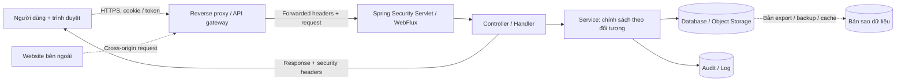
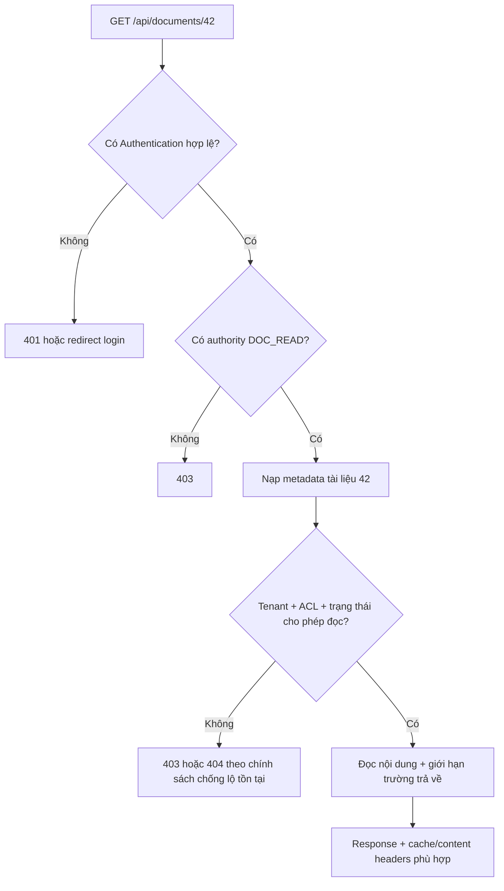
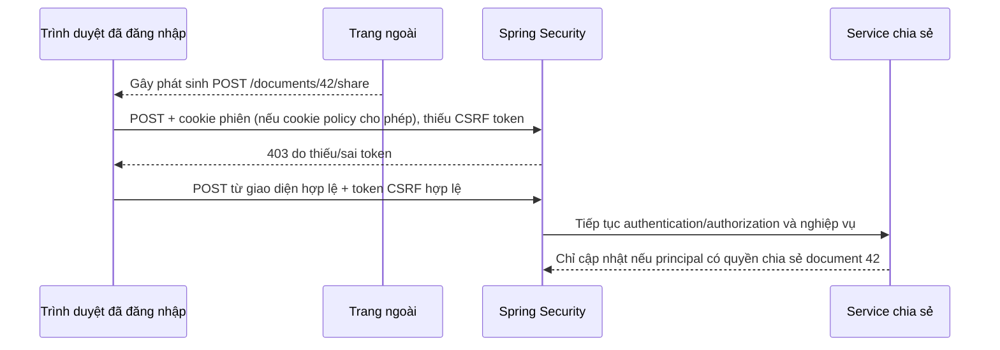

# Tài nguyên, dữ liệu và hành động cần được bảo vệ

> **Chương:** Bản đồ bảo vệ  
> **Phạm vi học phần:** `SPRING_SECURITY_HTTP_PROTECTION` — áp dụng các lớp phòng vệ HTTP và trình duyệt trong Spring Security, từ CSRF, CORS, security headers, CSP, HSTS tới HTTP firewall và bảo vệ session. Nội dung được đặt trong bối cảnh cả **Servlet** lẫn **Reactive (WebFlux)**, bao gồm thiết kế chính sách, kiểm thử tình huống tấn công web và chẩn đoán xung đột bảo mật khi triển khai.

## 1. Bắt đầu từ tài sản cần bảo vệ, không bắt đầu từ một filter

Một ứng dụng web có nhiều thứ cần bảo vệ hơn URL `/admin` hoặc một form đăng nhập:

- **Dữ liệu:** hồ sơ người dùng, đơn hàng, hợp đồng, tệp đính kèm, dữ liệu thanh toán, nhật ký hoạt động.
- **Thông tin chứng minh danh tính:** mật khẩu, session ID, access token, refresh token, cookie, khóa ký.
- **Hành động:** xem, tạo, sửa, xóa, tải xuống, xuất dữ liệu, duyệt giao dịch, thay đổi quyền, đăng xuất, khôi phục mật khẩu.
- **Chính sách và cấu hình:** vai trò, tenant, quan hệ sở hữu, CORS allowlist, header bảo mật, trusted proxies.
- **Sự tin cậy của người dùng:** trang chính thức, biểu mẫu, thao tác click và các thông tin mà trình duyệt tự gắn vào request.

Ví dụ, một hệ thống quản lý tài liệu cho phép nhân viên đọc hợp đồng và quản trị viên thu hồi quyền chia sẻ. Nếu bảo vệ đúng `GET /api/documents` nhưng quên `GET /api/documents/{id}/download`, dữ liệu vẫn có thể bị lộ. Nếu bảo vệ nội dung tài liệu mà quên chức năng `POST /api/documents/{id}/share`, người dùng có thể chia sẻ tài liệu cho người không được phép. Nếu endpoint có phân quyền đúng nhưng trang dễ bị CSRF hoặc session bị đánh cắp, hành động vẫn có thể bị khởi tạo trái ý người dùng.

**Luận điểm chính:** mỗi tài nguyên cần một **chủ thể được phép**, một **phạm vi sử dụng**, một **tập hành động hợp lệ** và các **biện pháp bảo vệ phù hợp với cách tài nguyên đi qua HTTP/trình duyệt**.

### Mục tiêu sau bài học

Người học có thể:

1. Liệt kê tài sản và luồng dữ liệu của ứng dụng, bao gồm tài nguyên không hiển thị trực tiếp trên giao diện.
2. Phân loại dữ liệu, hành động và ranh giới tin cậy để xác định yêu cầu bảo mật.
3. Thiết kế ma trận **chủ thể × tài nguyên × hành động × điều kiện** thay cho chỉ kiểm tra “đã đăng nhập”.
4. Ánh xạ tài sản tới authentication, authorization, CSRF, CORS, security headers/CSP/HSTS, HTTP firewall và session.
5. Triển khai cấu hình mẫu cho Servlet/WebFlux, kiểm thử đường đi hợp lệ và đường đi tấn công.
6. Tìm nguyên nhân bảo mật khi trình duyệt, reverse proxy và Spring Security trả kết quả khác nhau.

## 2. Phân biệt tài nguyên, dữ liệu, hành động và ngữ cảnh

### 2.1. Tài nguyên không đồng nghĩa với endpoint

**Tài nguyên** là đối tượng hệ thống quản lý: tài liệu 42, tài khoản 17, đơn hàng 1001, báo cáo doanh thu tháng 10. Một tài nguyên có thể xuất hiện qua nhiều endpoint, URL, giao diện và định dạng phản hồi.

Một tài liệu có thể truy cập qua:

| Đường truy cập | Tài nguyên liên quan | Nguy cơ bỏ sót |
| --- | --- | --- |
| `GET /api/documents/42` | Metadata, tiêu đề, người sở hữu | Lộ thông tin qua ID có thể đoán |
| `GET /api/documents/42/content` | Nội dung tài liệu | Đọc dữ liệu trái quyền qua route thứ hai |
| `GET /api/documents/42/preview` | Ảnh/HTML preview | Preview làm rò rỉ nội dung hoặc chạy HTML nguy hiểm |
| `GET /api/documents/42/download` | Bản tải xuống | URL tải xuống không kiểm tra quyền |
| `POST /api/documents/42/share` | Danh sách người được chia sẻ | Mở rộng người có quyền xem mà không được phép |
| `POST /api/documents/42/export` | File xuất từ nhiều nguồn | Export vượt quyền trên từng tài liệu |
| `DELETE /api/documents/42` | Tài liệu và bản sao liên quan | Xóa dữ liệu trái quyền |
| `GET /api/search?q=...` | Chỉ mục tìm kiếm, snippet | Kết quả tìm kiếm lộ tài liệu bị cấm |
| `GET /api/reports` | Báo cáo tổng hợp | Kênh đọc dữ liệu vòng qua quyền gốc |

Không thể kết luận “tài liệu đã được bảo vệ” chỉ vì một controller yêu cầu `authenticated()`. Cần xem **tất cả đường đi** có thể đọc hoặc thay đổi chính tài nguyên đó.

### 2.2. Dữ liệu cũng có trạng thái và bản sao

Dữ liệu cần bảo vệ cả khi:

- **Đang truyền:** request/response body, URL/query string, cookie, Authorization header.
- **Đang xử lý:** object trong memory, context xác thực, kết quả truy vấn, dữ liệu đưa vào template.
- **Đang lưu:** cơ sở dữ liệu, object storage, search index, hàng đợi, cache, phiên làm việc.
- **Được sao chép:** bản xuất CSV/PDF, log, audit event, backup, screenshot, email thông báo.
- **Được trả về trình duyệt:** DOM, browser cache, download, iframe, script hoặc dữ liệu bị hiển thị qua CORS.

Một quyết định phân quyền có thể đúng tại endpoint gốc nhưng bị vô hiệu nếu một bản copy hoặc URL tải xuống bỏ qua kiểm tra tương ứng.

### 2.3. Hành động mang ý nghĩa nghiệp vụ

Một HTTP method chỉ nói cách request được biểu diễn; **hành động nghiệp vụ** mới quyết định mức độ nguy hiểm.

Ví dụ:

- `GET /api/documents/42`: đọc nội dung nhạy cảm.
- `POST /api/documents`: tạo tài liệu.
- `PUT /api/documents/42`: thay nội dung.
- `POST /api/documents/42/share`: thay đổi người được quyền xem.
- `POST /api/documents/42/approve`: phê duyệt có thể có giá trị pháp lý.
- `DELETE /api/documents/42`: xóa hoặc đánh dấu xóa.
- `POST /api/users/17/roles`: cấp quyền, ảnh hưởng phạm vi của nhiều tài nguyên khác.

**Đọc** cũng có thể có rủi ro cao: tải danh sách khách hàng không làm thay đổi trạng thái nhưng có thể gây rò rỉ dữ liệu lớn. **Ghi** còn cần quan tâm CSRF, kiểm tra trạng thái chuyển tiếp và phát hiện yêu cầu lặp.

## 3. Lập danh mục tài sản và phân loại theo mức tác động

Một bảng kiểm kê hiệu quả ghi lại: tài nguyên, bên sở hữu, mức nhạy cảm, cách truy cập, thao tác, kênh truyền và người chịu trách nhiệm chính sách.

| Nhóm tài sản | Ví dụ | Tác động khi bị xâm phạm | Phòng vệ ưu tiên |
| --- | --- | --- | --- |
| Thông tin định danh và quyền | Account ID, vai trò, membership, tenant | Chiếm quyền, mở rộng phạm vi truy cập | Authentication mạnh, authorization theo đối tượng, audit |
| Thông tin xác thực/bí mật | Mật khẩu, session cookie, access/refresh token, API key | Mạo danh, truy cập diện rộng | TLS, bảo vệ secret, cookie attributes, giới hạn thời hạn và thu hồi |
| Dữ liệu cá nhân | Hồ sơ, số điện thoại, địa chỉ | Mất bí mật, lộ dữ liệu cá nhân | Quyền đọc theo đối tượng, tránh log dữ liệu, hạn chế cache/xuất |
| Dữ liệu doanh nghiệp | Hợp đồng, báo giá, báo cáo | Lộ bí mật thương mại, sửa trái phép | Tenant scoping, integrity, phân quyền theo hành động |
| Tệp và nội dung upload | PDF, ảnh, HTML, file đính kèm | Phát tán mã, XSS, rò rỉ file, chiếm lưu trữ | Kiểm tra upload và download, MIME, `nosniff`, xử lý content |
| Hành động tài chính/quản trị | Duyệt lệnh, hoàn tiền, đổi quyền | Mất tiền hoặc quyền kiểm soát | Object-level authorization, CSRF, xác nhận bổ sung, audit |
| Endpoint công khai | Login, reset password, webhook, health | Brute force, lộ thông tin, giả mạo bên gửi | Rate limiting/verification, giới hạn dữ liệu trả về |
| Chính sách và hạ tầng | Reverse proxy, CORS, CSP, HSTS, firewall | Bỏ qua nhiều tầng bảo vệ | Quản lý cấu hình, HTTPS, kiểm thử toàn tuyến |
| Telemetry và bản sao | Log, trace, export, cache, backup | Lộ thông tin dù endpoint chính an toàn | Redaction, retention, giới hạn truy cập, kiểm soát export |

Độ nhạy cảm là một thuộc tính **theo ngữ cảnh**. Tên người dùng có thể là thông tin công khai trong diễn đàn nhưng lại nhạy cảm trong hồ sơ nhân sự. Tệp PDF có thể là tài liệu hướng dẫn công khai hoặc hợp đồng chứa dữ liệu mật. Đừng xếp loại chỉ theo phần mở rộng file hoặc HTTP method.

### 3.1. Đặt mức phân loại đơn giản

Một tổ chức có thể bắt đầu bằng quy ước nội bộ:

- **Công khai:** có thể chia sẻ cho mọi người; vẫn cần chống sửa trái phép, cache và MIME đúng.
- **Nội bộ:** người trong tổ chức mới được truy cập; cần kiểm tra membership.
- **Hạn chế:** chỉ nhóm, dự án hoặc tenant cụ thể; cần kiểm tra quyền trên từng tài nguyên.
- **Rất nhạy cảm:** thông tin xác thực, dữ liệu thanh toán, hành động quản trị cấp cao; cần kiểm soát bổ sung, audit và giảm bề mặt hiển thị.

Các mức trên là **mô hình ví dụ**, không phải chuẩn phân loại bắt buộc. Với mỗi loại, cần ghi rõ tiêu chí “ai được đọc, ai được thay đổi, ai có thể xuất và thời gian lưu”.

### 3.2. Ưu tiên rủi ro, không chỉ ưu tiên trang dễ thấy

Hai hệ quả thường quan trọng hơn lượng code:

1. **Tác động:** tài sản bị đọc, thay đổi, xóa, sử dụng để mạo danh hay làm gián đoạn?
2. **Khả năng tiếp cận:** tài sản có truy cập từ Internet không, có yêu cầu đăng nhập không, có thể đoán ID không, có bao nhiêu đường đi qua proxy/cache/export?

Ví dụ, một endpoint export toàn bộ dữ liệu thuộc diện “hạn chế” thường cần được kiểm tra trước trang xem từng bản ghi vì phạm vi lộ dữ liệu có thể lớn hơn. Tuy nhiên một endpoint đổi mật khẩu có thể còn quan trọng hơn nếu bị CSRF hoặc session hijacking.

## 4. Xác định ranh giới tin cậy trên luồng dữ liệu

Đánh dấu nơi một thành phần **không thể tự tin tưởng** thành phần còn lại.



Những ranh giới thường bị bỏ qua:

- **Browser → server:** client có thể sửa URL, header, body, cookie được gửi và ID đối tượng; server phải xác minh lại.
- **Origin khác → browser:** CORS quyết định script bên ngoài có đọc response hay không; browser vẫn có thể gửi một số request cross-origin.
- **Proxy → ứng dụng:** chỉ tin cậy `Forwarded`/`X-Forwarded-*` từ proxy đã cấu hình; path rewriting, scheme và host cần nhất quán.
- **Controller → service:** route được cho phép chưa đủ để kết luận đối tượng thuộc quyền principal.
- **Dịch vụ → database/object storage:** không công khai đường dẫn hoặc storage key như bằng chứng quyền truy cập.
- **Ứng dụng → browser:** nội dung động phải được encode/sanitize; security headers điều chỉnh hành vi browser.
- **Dữ liệu chính → các bản sao:** log, cache, export, preview và backup cần cùng nguyên tắc bảo vệ dữ liệu.

**Trust boundary** quan trọng vì request “đã được xác thực ở gateway” vẫn có thể đi qua route giả mạo identity header, và dữ liệu “đã kiểm tra quyền ở controller” vẫn có thể bị lộ qua endpoint download khác.

## 5. Từ danh mục tài sản đến ma trận quyền

Một chính sách rõ ràng cần ít nhất bốn chiều:

**Chủ thể (subject)** × **tài nguyên (resource)** × **hành động (action)** × **điều kiện (context)**.

Trong ứng dụng quản lý tài liệu:

| Chủ thể | Tài nguyên | Hành động | Điều kiện bắt buộc |
| --- | --- | --- | --- |
| Khách chưa đăng nhập | Trang giới thiệu | Đọc | Có thể công khai; tránh lộ tài liệu nội bộ |
| Nhân viên | Tài liệu được chia sẻ | Đọc metadata/nội dung | Cùng tenant và có membership hợp lệ |
| Tác giả | Tài liệu do mình sở hữu | Sửa | Chưa khóa/phê duyệt, cùng tenant |
| Reviewer | Tài liệu đang chờ duyệt | Duyệt | Được phân công, không tự duyệt khi quy trình cấm |
| Quản trị tenant | Quyền chia sẻ tài liệu | Cấp/thu hồi | Trong phạm vi tenant, tránh tự nâng quyền vượt chính sách |
| Nhân sự được cấp quyền export | Tập tài liệu | Export | Phải có quyền trên **tất cả** dữ liệu được xuất |
| Quản trị hệ thống | Cấu hình dịch vụ | Sửa | Quyền đặc biệt, audit và bảo vệ thao tác nhạy cảm |

### 5.1. Authentication: ai đang yêu cầu?

Spring Security xác thực từ credential thích hợp: form login/session, bearer token, OAuth2 login, resource server, v.v. Một `Authentication` hợp lệ cung cấp principal và authorities; nhưng không chứng minh principal sở hữu từng document ID.

Với phiên đăng nhập bằng cookie, server nhận session ID qua cookie do browser gửi theo chính sách của browser. Với bearer API, client thường chủ động gửi `Authorization: Bearer ...`. **Cách mang credential** ảnh hưởng trực tiếp đến thiết kế CSRF và session.

### 5.2. Authorization: chủ thể có quyền gì?

Phải phân biệt:

- **Route-level:** người dùng có được gọi nhóm endpoint đó?
- **Function-level:** người dùng có authority thực hiện chức năng `DOC_APPROVE`?
- **Object-level:** người dùng có được duyệt **document 42**?
- **Field-level:** người dùng có được đọc trường `salary` hoặc sửa trường `ownerId`?
- **Tenant-level:** principal có thuộc tenant và dữ liệu tenant tương ứng?
- **State-level:** tài liệu đang ở trạng thái `PENDING_APPROVAL` hay đã `LOCKED`?

Spring Security hỗ trợ rule theo request và method; quy tắc theo đối tượng thường cần logic nghiệp vụ truy cập tài nguyên và kiểm tra chính sách trong service. **Đừng xem ID khó đoán là một lớp phân quyền**.

### 5.3. Mẫu quyết định quyền trước khi trả dữ liệu



`404` có thể được dùng thay `403` khi muốn tránh tiết lộ một tài nguyên có tồn tại, nhưng việc lựa chọn phải nhất quán và kiểm thử; chỉ đổi status code không thay thế được kiểm tra quyền.

## 6. Hành động nào cần bảo vệ mạnh hơn?

### 6.1. Nhóm thao tác theo ý nghĩa

| Hành động | Nguy cơ | Điều kiện đặc biệt |
| --- | --- | --- |
| Xem dữ liệu của chính mình | Rò rỉ thông tin | Xác thực, quyền object, field filtering, cache |
| Tìm kiếm/list | Lộ dữ liệu hàng loạt qua filter hoặc pagination | Scope theo tenant/người dùng trước khi phân trang |
| Download/preview | Lộ file; thực thi nội dung không tin cậy | Kiểm tra quyền lúc truy cập, MIME, `nosniff`, attachment policy |
| Upload | Chèn mã, lưu malware, chiếm dung lượng | Kiểm tra file type/size, nơi lưu, scan nếu cần, authorization |
| Create/update | Sửa dữ liệu trái quyền, mass assignment | CSRF nếu dựa cookie, validation, phân quyền field |
| Delete/revoke | Mất dữ liệu, gián đoạn | Quyền riêng, trạng thái, audit, bảo vệ CSRF |
| Share/invite | Mở rộng người xem dữ liệu | Phân quyền đối tượng, giới hạn phạm vi và recipient |
| Approve/pay/refund | Tổn thất tài chính/pháp lý | Chính sách nghiệp vụ, CSRF, xác nhận bổ sung, idempotency |
| Change role/reset credential | Chiếm quyền/đổi danh tính | Kiểm tra quyền rất chặt, xác nhận phù hợp, audit |
| Export/bulk operation | Lộ hoặc sửa lượng dữ liệu lớn | Quyền trên tập kết quả, giới hạn khối lượng, báo cáo audit |

### 6.2. Semantics của HTTP method quan trọng với CSRF

Theo HTTP, **GET, HEAD, OPTIONS, TRACE** là phương thức an toàn theo nghĩa không được dùng để yêu cầu thay đổi trạng thái nghiệp vụ. Trong Spring Security, cơ chế CSRF mặc định thường bỏ qua các phương thức được coi là an toàn và kiểm tra những phương thức còn lại.

Vì vậy:

- `GET /api/documents/42` chỉ đọc.
- `POST /api/documents/42/approve` mới thực hiện duyệt.
- Không dùng `GET /api/documents/42/delete` hoặc `GET /transfer?amount=...` để thay đổi dữ liệu.
- Khi có side effect nội bộ như ghi log truy cập, vẫn cần phân biệt với thay đổi trạng thái nghiệp vụ có thể bị lạm dụng.
- Không coi việc thay `POST` bằng `PUT` hoặc `DELETE` là đủ chống CSRF; các phương thức thay đổi trạng thái đều cần phòng vệ theo mô hình xác thực.

`Idempotent` và `safe` là hai đặc tính khác nhau. Một `DELETE` có thể idempotent về trạng thái cuối nhưng **không phải phương thức safe**. CSRF token không ngăn request lặp hợp lệ; các thao tác thanh toán cần thêm transaction/idempotency key và quy tắc chống thực thi hai lần.

### 6.3. Chính sách field-level và mass assignment

Nếu API nhận đối tượng JSON chứa cả `title`, `ownerId`, `tenantId`, `approved`, client có thể tự gửi những trường không được phép sửa. Ngay cả khi đã được quyền gọi endpoint sửa tài liệu, người dùng có thể **không có quyền thay owner/tenant hoặc đánh dấu approved**.

Nên dùng DTO chỉ gồm trường được phép sửa cho chức năng cụ thể; ở service xác định `ownerId` và `tenantId` từ bối cảnh được tin cậy, không lấy giá trị client làm bằng chứng quyền. Cần kiểm tra dữ liệu sau khi áp dụng thay đổi để đảm bảo các bất biến nghiệp vụ.

## 7. Tài liệu, file upload, preview và bản export là những tài nguyên khác nhau

Một lỗi phổ biến: API đọc metadata kiểm tra đúng quyền, nhưng link file được trả về là URL công khai vô thời hạn.

### 7.1. Truy cập storage qua một lớp kiểm soát quyền

Dòng xử lý khuyến nghị:

1. Authentication xác định người gọi.
2. Authorization route kiểm tra quyền đọc tài liệu.
3. Service lấy metadata đủ để xác định tenant/ACL và kiểm tra tài liệu cụ thể.
4. Sau khi hợp lệ, ứng dụng mới đọc dữ liệu từ object storage hoặc cấp URL tải xuống có phạm vi/thời hạn phù hợp.
5. Response đặt `Content-Type`, `Content-Disposition`, cache và security headers theo loại nội dung.
6. Ghi audit theo nhu cầu, **không đưa secret/token vào log**.

`documentId`, `storageKey`, URL nội bộ hoặc một signed URL chưa hết hạn **không nên tự được xem là bằng chứng lâu dài về quyền truy cập**. Nếu dùng signed URL, cần đánh giá TTL, phạm vi object, quyền chia sẻ lại, revocation và việc URL có thể lọt vào log/history/referrer.

### 7.2. Nội dung do người dùng upload

Các rủi ro nổi bật:

- Upload HTML/SVG có script rồi ứng dụng render cùng origin → có thể phát sinh XSS.
- File có phần mở rộng PDF nhưng nội dung/MIME không đúng → parser/browser xử lý không như dự kiến.
- File cực lớn hoặc lượng upload lớn → tốn tài nguyên, từ chối dịch vụ.
- URL file cho phép đoán đường dẫn → truy cập file của người khác.
- Export CSV chứa giá trị bắt đầu bằng ký tự công thức → khi mở bằng spreadsheet có thể phát sinh **formula injection** nếu không xử lý dữ liệu xuất phù hợp.

Biện pháp thuộc nhiều lớp: xác thực/phân quyền upload, giới hạn kích thước/số lượng và loại file, cách đặt tên ngẫu nhiên, scan theo mức rủi ro, cách phục vụ file an toàn, `X-Content-Type-Options: nosniff` và có thể tách origin phục vụ nội dung không tin cậy. **Spring Security headers không thay thế toàn bộ validation và xử lý file.**

### 7.3. Cẩn trọng với cache và bản sao

Dữ liệu nhạy cảm có thể tồn tại trong browser cache, proxy cache, CDN, search index, file tạm, log, kết quả export và backup. Các bản sao này có **quyền truy cập, vòng đời và chính sách xóa riêng**. Cần quyết định response nào dùng `Cache-Control: no-store`, response nào là tài nguyên tĩnh có thể cache lâu, thay vì vô hiệu cache của toàn ứng dụng một cách thiếu phân biệt.

## 8. Ánh xạ nguy cơ HTTP/trình duyệt theo tài sản

| Tài sản / hành động | Tình huống tấn công | Bảo vệ ở Spring Security / trình duyệt | Bảo vệ bổ sung ở ứng dụng |
| --- | --- | --- | --- |
| Tài khoản và session | Session bị đoán/cố định/đánh cắp | Session fixation protection, security context, logout; cookie `Secure`/`HttpOnly`/`SameSite` | MFA theo mức rủi ro, session expiry, phát hiện bất thường |
| Form thay đổi email | CSRF khi browser tự gửi cookie | CSRF token, xác thực và phân quyền phù hợp | Xác minh trạng thái, thông báo thay đổi |
| Dữ liệu cá nhân qua frontend khác origin | CORS cấp quyền đọc cho origin không tin cậy | CORS allowlist, credentials policy | Authorization theo đối tượng, giảm dữ liệu phản hồi |
| Tài liệu chứa HTML không tin cậy | XSS, script mượn quyền người dùng | CSP và security headers | Encode/sanitize theo ngữ cảnh, không render HTML thô |
| Màn hình duyệt giao dịch | Clickjacking qua iframe | `X-Frame-Options`, CSP `frame-ancestors` | Confirmation step, business guard |
| File upload/preview | MIME sniffing, script trong file | `X-Content-Type-Options`, CSP nếu phù hợp | Validate file, content disposition, storage isolation |
| API dưới nhiều proxy | URL encoding/normalization bypass | HTTP firewall: `StrictHttpFirewall` hoặc `StrictServerWebExchangeFirewall` | Route authorization, quyền đối tượng, proxy alignment |
| Trang chứa dữ liệu mật | Browser/proxy lưu response ngoài ý muốn | Cache security headers | Không đưa bí mật vào URL/log; cache policy phù hợp |
| Toàn bộ phiên làm việc | Downgrade xuống HTTP hoặc MITM | HTTPS, HSTS response trên HTTPS | TLS/proxy/certificate đúng, điều hướng hợp lệ |
| Export/bulk delete | Người có quyền cơ bản đọc/xóa tập lớn | Authentication và route/method authorization | Scope từng tài nguyên, hạn mức, audit, giao dịch |

Bảng này chỉ ra **mối quan hệ nhiều–nhiều**: một tài sản cần nhiều cơ chế, và một cơ chế phục vụ nhiều tài sản. Không có một filter nào tự hiểu nghiệp vụ “tài liệu thuộc tenant A”.

## 9. CSRF: bảo vệ hành động khi credential được trình duyệt tự gửi

Giả sử nhân viên đăng nhập bằng session cookie và có quyền chia sẻ tài liệu 42. Một website độc hại có thể tìm cách khiến trình duyệt của người đó gửi request thay đổi người được chia sẻ.

- Authentication có thể vẫn xác định đúng nhân viên.
- Authorization có thể kết luận nhân viên đủ quyền chia sẻ.
- Nhưng request **không phải thao tác người dùng chủ động tạo trong ứng dụng**.

Đó là lý do cần CSRF protection khi ứng dụng dùng cookie/session hoặc credential khác được browser tự gửi.



Các nguyên tắc thiết kế:

- Giữ CSRF cho request thay đổi trạng thái dựa trên cookie/session; truyền token qua form hoặc header.
- Đảm bảo giao diện có cơ chế **nhận/đổi token**, nhất là SPA, sau login/logout hoặc khi session thay đổi.
- Cookie `SameSite` hỗ trợ giảm một phần request giả mạo nhưng **không** thay thế CSRF token trong mọi bối cảnh.
- **CORS không chặn tất cả cross-origin request gửi đến server** và không thay CSRF.
- Một API bearer-only gửi token qua `Authorization` có thể có CSRF policy khác nếu đã xác minh không còn đường xác thực bằng cookie/ambient credentials. Không dựa vào nhãn “REST” hoặc `STATELESS` để kết luận.
- CSRF token hợp lệ **không có nghĩa** người dùng có quyền trên tài liệu cụ thể.

## 10. CORS: bảo vệ quyết định chia sẻ response giữa các origin

**Origin** là tập hợp `scheme + host + port`. `https://app.example.com` và `https://api.example.com` khác origin dù có thể là same-site.

Nếu frontend tải danh sách tài liệu từ API khác origin, browser dùng CORS để xác định JavaScript có được đọc response hay không. Server chỉ nên cho phép origin cần thiết; với request có cookie, chính sách CORS phải tương thích credentials.

Ví dụ preflight:

```http
OPTIONS /api/documents/42/share HTTP/1.1
Host: api.example.com
Origin: https://app.example.com
Access-Control-Request-Method: POST
Access-Control-Request-Headers: content-type,x-csrf-token
```

Một phản hồi hợp lệ theo allowlist ứng dụng có thể chứa:

```http
HTTP/1.1 204 No Content
Access-Control-Allow-Origin: https://app.example.com
Access-Control-Allow-Credentials: true
Access-Control-Allow-Methods: GET,POST,PUT,DELETE
Access-Control-Allow-Headers: content-type,x-csrf-token
Vary: Origin
```

**Preflight thường không chứa cookie/session**, nên cấu hình cần đảm bảo phần CORS được xử lý trước chỗ xác thực có thể chặn `OPTIONS`. Đồng thời:

- Không dùng wildcard `*` cho `Access-Control-Allow-Origin` của response có credentials.
- Không phản chiếu mọi header `Origin` mà không kiểm tra allowlist.
- CORS **không phải** cơ chế bảo mật API trước curl hay client server-to-server.
- CORS **không phải** authorization: API vẫn phải xác minh principal và quyền trên document 42.
- Có thể không cần CORS nếu frontend và backend cùng origin.

CORS nới quyền **đọc response bởi script ở origin khác**; chính sách dữ liệu nào được phép trả về vẫn nằm ở server.

## 11. Security headers, CSP và HSTS bảo vệ dữ liệu khi rời server

Các header dưới đây được gửi cùng HTTP response; nhiều cơ chế chỉ có ý nghĩa khi **trình duyệt áp dụng**.

| Header | Dữ liệu/hành vi liên quan | Nguyên tắc |
| --- | --- | --- |
| `Content-Security-Policy` | Script, style, frame, tài nguyên nhúng | Giới hạn nguồn; thiết kế theo frontend và chuẩn hóa output |
| `X-Frame-Options` | Trang nhạy cảm bị nhúng iframe | Chọn `DENY`/`SAMEORIGIN` hoặc CSP `frame-ancestors` thích hợp |
| `X-Content-Type-Options: nosniff` | Browser đoán MIME file/script/style | Trả content type chính xác, hạn chế sniffing |
| `Cache-Control` | Trang cá nhân, response API, file download | Không lưu bản nhạy cảm ngoài ý muốn; cấu hình riêng tài nguyên tĩnh |
| `Referrer-Policy` | URL được chuyển sang bên thứ ba | Hạn chế rò rỉ đường dẫn/query string qua referrer |
| `Strict-Transport-Security` | Host cần sử dụng HTTPS | Chỉ phát/ghi nhận qua HTTPS hợp lệ; cân nhắc toàn bộ subdomain |

### 11.1. CSP không thay được escape dữ liệu

Nếu một document title hoặc comment do người dùng nhập được ghép trực tiếp thành HTML/script, nguy cơ XSS xuất hiện. Cần **output encoding theo ngữ cảnh** và sanitize khi có nhu cầu cho phép HTML. CSP là lớp giảm tác động tiếp theo.

Ví dụ CSP nền tảng cho trang không cần script inline:

```http
Content-Security-Policy: default-src 'self'; script-src 'self'; object-src 'none'; base-uri 'self'; frame-ancestors 'none'; form-action 'self'
```

Policy này cần điều chỉnh nếu ứng dụng dùng CDN, WebSocket, font, script inline hoặc tích hợp iframe. Có thể chạy `Content-Security-Policy-Report-Only` để quan sát vi phạm trước khi chuyển sang chặn; **Report-Only không tự chặn mã**.

### 11.2. HSTS không phải là cấu hình SSL hoàn chỉnh

HTTPS/TLS bảo vệ kết nối hiện tại. `Strict-Transport-Security` hướng dẫn browser ưu tiên HTTPS cho những lần truy cập tiếp theo sau khi nhận header qua HTTPS hợp lệ.

```http
Strict-Transport-Security: max-age=31536000
```

Đừng thêm `includeSubDomains` hoặc `preload` nếu chưa sẵn sàng HTTPS cho toàn bộ phạm vi tương ứng. Nếu TLS kết thúc tại gateway, cần kiểm tra browser thực sự nhận response HTTPS và HSTS, đồng thời chỉ tin forwarded headers từ proxy đáng tin.

### 11.3. Cache của tài liệu nhạy cảm khác cache tài nguyên tĩnh

`Cache-Control: no-store` có thể phù hợp với response chứa nội dung bí mật hoặc dữ liệu người dùng nhạy cảm. Ngược lại, JS/CSS có fingerprint hash có thể cache dài để tăng hiệu năng. Tách chính sách cache theo **loại tài sản và đường truy cập**; không coi một header áp dụng đồng loạt là giải pháp cho mọi dữ liệu.

## 12. HTTP firewall: bảo vệ tính nhất quán của tài nguyên được yêu cầu

Trước khi xác thực và phân quyền theo URL, các thành phần trong tuyến cần hiểu thống nhất request. Một path có dấu `;`, double slash, encoded slash `%2F`, backslash hoặc encoding không bình thường có thể được reverse proxy và ứng dụng chuẩn hóa khác nhau.

Khi policy kiểm tra một biểu diễn còn handler thao tác trên biểu diễn khác, luật `/admin/**` hoặc `/api/documents/**` có thể hoạt động không như dự kiến.

Spring Security cung cấp:

- **Servlet:** `HttpFirewall`; cấu hình mặc định thông dụng dùng `StrictHttpFirewall`.
- **WebFlux:** `ServerWebExchangeFirewall`; cấu hình mặc định tương ứng dùng `StrictServerWebExchangeFirewall`.

Mục tiêu của firewall là ngăn request có biểu diễn nguy hiểm và giảm sai khác giữa các lớp. Firewall **không biết** document thuộc tenant nào, và không thay thế kiểm tra ở service.

Nếu API cần một mẫu URL đặc biệt như matrix variables, phải kiểm thử toàn tuyến browser/client → gateway → firewall → matcher → handler rồi chỉ nới quy tắc đúng mục đích. Không tắt kiểm tra firewall toàn cục chỉ vì một request trả `400`.

## 13. Phiên làm việc và token cũng là tài sản cần được bảo vệ

Một session ID hoặc token có thể đại diện cho quyền của người dùng. Kẻ chiếm được nó có thể yêu cầu tài nguyên như người dùng hợp lệ.

### 13.1. Session fixation, hijacking và logout

- **Session fixation:** kẻ tấn công biết hoặc kiểm soát session ID trước khi nạn nhân login. Với Servlet, Spring Security hỗ trợ đổi ID sau đăng nhập; xác minh cơ chế này trong đường login thực tế.
- **Session hijacking:** cookie/token phiên bị đánh cắp hoặc bị sử dụng trái phép. HTTPS, `Secure`/`HttpOnly`/`SameSite`, timeout và hạn chế XSS giúp giảm rủi ro.
- **Logout:** cần invalidation/thu hồi trạng thái server phù hợp; chỉ xóa giao diện hoặc nút logout không đủ.
- **Quản lý đồng thời:** nếu bài toán yêu cầu, đặt giới hạn phiên và chiến lược xử lý login mới, nhưng phải tính tới mô hình lưu session và cluster.

Ví dụ cấu trúc cookie:

```http
Set-Cookie: JSESSIONID=<opaque-session-id>; Path=/; Secure; HttpOnly; SameSite=Lax
```

Các thuộc tính này có thể được thiết lập bởi servlet container, Spring Session hoặc phần quản lý WebSession/cookie của Reactive. **Không giả định** cấu hình Spring Security đơn lẻ đã tự sinh đủ mọi thuộc tính. Kiểm tra response `Set-Cookie` từ môi trường triển khai.

### 13.2. Bearer token cần cách bảo vệ khác

Nếu API chỉ chấp nhận bearer token chủ động gửi trong header `Authorization`, rủi ro CSRF khác cookie session. Tuy vậy, token bị lộ qua XSS, log hoặc browser storage vẫn có thể bị lạm dụng. Phải xác minh issuer, signature, audience, expiry, scopes và cơ chế revocation/rotation theo kiến trúc thực tế.

Không đặt token bí mật vào query string URL vì có thể bị ghi vào log/history/referrer. Không mặc định tin mọi claim từ token chưa qua validation.

## 14. Ví dụ ứng dụng: kiểm soát tài liệu trên Servlet (Spring MVC)

Giả định ứng dụng phục vụ giao diện và API **cùng origin**, nhân viên đăng nhập bằng cookie/session; có các authority `DOC_READ`, `DOC_WRITE`, `DOC_SHARE`, `DOC_DELETE`. Spring Security xử lý quyền ở URL, còn service kiểm tra owner, tenant, ACL và trạng thái.

### 14.1. SecurityFilterChain cho các loại tài nguyên

```java
@Configuration
@EnableWebSecurity
@EnableMethodSecurity
class DocumentWebSecurityConfig {

    @Bean
    SecurityFilterChain securityFilterChain(HttpSecurity http)
            throws Exception {
        return http
            // Ứng dụng dùng cookie/session và có thao tác ghi.
            .csrf(Customizer.withDefaults())
            .headers(headers -> headers
                .contentSecurityPolicy(csp -> csp.policyDirectives(
                    "default-src 'self'; script-src 'self'; " +
                    "object-src 'none'; base-uri 'self'; frame-ancestors 'none'"
                ))
            )
            .authorizeHttpRequests(auth -> auth
                .requestMatchers(HttpMethod.GET, "/assets/**").permitAll()
                .requestMatchers(HttpMethod.GET, "/health").permitAll()

                .requestMatchers(HttpMethod.GET,
                    "/api/documents", "/api/documents/**")
                    .hasAuthority("DOC_READ")
                .requestMatchers(HttpMethod.POST,
                    "/api/documents/*/share")
                    .hasAuthority("DOC_SHARE")
                .requestMatchers(HttpMethod.POST,
                    "/api/documents")
                    .hasAuthority("DOC_WRITE")
                .requestMatchers(HttpMethod.PUT,
                    "/api/documents/*")
                    .hasAuthority("DOC_WRITE")
                .requestMatchers(HttpMethod.DELETE,
                    "/api/documents/*")
                    .hasAuthority("DOC_DELETE")

                // Những endpoint chưa có chính sách được từ chối.
                .anyRequest().denyAll()
            )
            .formLogin(login -> login.permitAll())
            .logout(logout -> logout.permitAll())
            .build();
    }
}
```

Đây là **ví dụ học thuật** trên Spring Security phiên bản hiện đại dùng lambda DSL, giả định đã có user store và các controller; cần bổ sung import và kiểm tra matcher với route thực tế. Lưu ý:

- Endpoint `/api/documents/*/share` đặt **trước** rule POST rộng; quy tắc request matcher được xét theo thứ tự khai báo.
- Rule `GET /api/documents/**` bảo vệ cả metadata và đường download/preview nếu chúng nằm dưới prefix đó.
- `anyRequest().denyAll()` làm lộ rõ các route chưa được phân loại; các endpoint khác của sản phẩm phải được cho phép có chủ đích.
- CSRF mặc định bảo vệ các phương thức không an toàn; frontend cần cung cấp token đúng cách.
- CSP là chính sách ví dụ; script inline hoặc CDN hiện có có thể bị chặn và cần thiết kế điều chỉnh.
- Route-level chỉ kiểm tra **authority**, chưa kiểm tra quyền trên từng tài liệu và từng trường.
- Form login và logout tự có các endpoint liên quan; `permitAll()` được khai báo để tránh khóa nhầm luồng đăng nhập/đăng xuất.

Nếu frontend khác origin, phải bổ sung cấu hình CORS có origin allowlist thật. Không cấu hình wildcard credentials cho API chứa dữ liệu cá nhân.

### 14.2. Service vẫn phải xác minh quyền trên document cụ thể

Ví dụ minh họa một phương thức service; `Document`, `DocumentRepository`, `DocumentView`, `DocumentPolicy` và `DocumentNotFoundException` là các lớp nghiệp vụ được giả định:

```java
@Service
class DocumentService {
    private final DocumentRepository repository;
    private final DocumentPolicy policy;

    DocumentService(DocumentRepository repository, DocumentPolicy policy) {
        this.repository = repository;
        this.policy = policy;
    }

    @PreAuthorize("hasAuthority('DOC_READ')")
    @Transactional(readOnly = true)
    public DocumentView readDocument(
            String documentId,
            Authentication authentication) {
        Document document = repository.findById(documentId)
            .orElseThrow(DocumentNotFoundException::new);

        if (!policy.canRead(authentication, document)) {
            throw new AccessDeniedException(
                "Not permitted to read this document");
        }

        return DocumentView.fromAuthorizedDocument(document);
    }
}
```

Controller cần truyền đúng `Authentication` đã được Spring Security xác thực và không lấy identity do client gửi trong JSON/header làm bằng chứng. Policy phải đối chiếu tenant, người sở hữu, ACL và trường được phép hiển thị.

Một phương thức khác như `shareDocument` cần điều kiện mạnh hơn `canRead`: ví dụ `canShare`, danh sách recipient hợp lệ, hạn chế mở rộng quyền và audit. **Phân quyền đọc không tự suy ra quyền chia sẻ**.

### 14.3. Phòng vệ riêng cho download và upload

Với route `GET /api/documents/{id}/download`:

1. Đọc metadata theo ID.
2. Kiểm tra quyền trên tài liệu trước khi lấy file.
3. Đặt `Content-Type` từ giá trị đã được kiểm chứng và `Content-Disposition` phù hợp.
4. Áp dụng cache policy theo mức nhạy cảm.
5. Không đưa storage key, internal path hoặc secret vào lỗi/log trả về.

Với upload, ngoài quyền `DOC_WRITE` cần kiểm tra loại và kích thước file, trạng thái tài liệu, quyền của tenant và cách phục vụ lại nội dung. Spring Security không thay thế bộ xử lý upload của ứng dụng.

## 15. Ví dụ ứng dụng: kiểm soát tài liệu trên Reactive (WebFlux)

Giả định đây là **API bearer-only**: client gửi JWT qua `Authorization`, không sử dụng cookie/session hoặc cơ chế xác thực trình duyệt tự gửi cho các endpoint này.

```java
@Configuration
@EnableWebFluxSecurity
@EnableReactiveMethodSecurity
class DocumentReactiveSecurityConfig {

    @Bean
    SecurityWebFilterChain documentApi(ServerHttpSecurity http) {
        return http
            // Chỉ phù hợp khi mọi đường xác thực của API đều bearer-only.
            .csrf(csrf -> csrf.disable())
            .authorizeExchange(auth -> auth
                .pathMatchers(HttpMethod.GET, "/health").permitAll()
                .pathMatchers(HttpMethod.GET, "/api/documents/**")
                    .hasAuthority("SCOPE_documents.read")
                .pathMatchers(HttpMethod.POST, "/api/documents/*/share")
                    .hasAuthority("SCOPE_documents.share")
                .pathMatchers(HttpMethod.POST, "/api/documents")
                    .hasAuthority("SCOPE_documents.write")
                .pathMatchers(HttpMethod.DELETE, "/api/documents/*")
                    .hasAuthority("SCOPE_documents.delete")
                .anyExchange().denyAll()
            )
            .oauth2ResourceServer(oauth2 ->
                oauth2.jwt(Customizer.withDefaults()))
            .build();
    }
}
```

Lưu ý triển khai:

- Cần cấu hình JWT decoder/issuer/JWK và kiểm tra issuer, signature, expiry, audience theo yêu cầu, đồng thời bảo đảm mapping claim/scope sang authorities như mong đợi.
- Quy tắc URL ở trên cũng **không thay** quyền object/tenant trong reactive service.
- `csrf.disable()` trong ví dụ dựa trên giả định bearer-only đã được kiểm chứng. Nếu WebFlux phục vụ form login/cookie session, cần **giữ CSRF** và cơ chế token thích hợp.
- Khi frontend khác origin, cần cấu hình CORS Reactive theo topology thực. `CorsConfigurationSource` và `UrlBasedCorsConfigurationSource` của WebFlux nằm trong package `org.springframework.web.cors.reactive`, khác Servlet.
- WebFlux có `SecurityWebFilterChain`/`ServerHttpSecurity` và xử lý `Authentication` qua reactive context; không chuyển nguyên logic thread-local của Servlet sang Reactive.

### 15.1. Kiểm tra object-level trong luồng Reactive

Dưới đây là ý tưởng xử lý Reactive, giả định `policy`, `repository`, `documentMapper` và các kiểu nghiệp vụ đã tồn tại:

```java
Mono<DocumentView> readDocument(
        String documentId,
        Authentication authentication) {
    return repository.findById(documentId)
        .switchIfEmpty(Mono.error(new DocumentNotFoundException()))
        .flatMap(document -> {
            if (!policy.canRead(authentication, document)) {
                return Mono.error(new AccessDeniedException(
                    "Not permitted to read this document"));
            }
            return Mono.just(documentMapper.toView(document));
        });
}
```

Nếu policy cần truy vấn Reactive, hãy dùng `flatMap` để kết hợp `Mono<Boolean>`/`Flux` thay vì gọi `block()` trong luồng request. Quyết định cho phép phải được đánh giá bằng **principal đã xác thực và document đã nạp**, không chỉ theo ID do client gửi.

## 16. Kiểm thử: chứng minh tài sản không bị lộ hoặc sửa trái quyền

Một bài kiểm thử bảo mật có ích cần trả lời:

1. **Ai** được phép gửi request?
2. **Tài nguyên nào** được trả về hay thay đổi?
3. **Hành động nào** được thực hiện?
4. **Điều kiện nào** đã được xác minh?
5. Khi request bị từ chối, **dữ liệu có thực sự không thay đổi** không?

### 16.1. Ma trận kiểm thử theo tài nguyên

| Tình huống | Request / trạng thái | Kỳ vọng |
| --- | --- | --- |
| Không đăng nhập | GET tài liệu hạn chế | Không trả nội dung; có thể redirect login hoặc `401` theo cơ chế |
| Đăng nhập nhưng thiếu scope/authority | GET/download tài liệu | Bị từ chối |
| Có authority, tài liệu khác tenant | GET/document ID của tenant khác | Bị từ chối hoặc trả `404` theo chính sách; không rò rỉ nội dung |
| Có quyền đọc nhưng thiếu quyền share | POST /share + CSRF token hợp lệ | Bị từ chối; ACL không đổi |
| Có quyền share nhưng thiếu CSRF | POST /share dùng cookie/session | Bị CSRF từ chối; ACL không đổi |
| Có quyền share và CSRF hợp lệ | POST /share trên tài liệu được phép | Chỉ cập nhật ACL theo policy, audit hợp lệ |
| Export dữ liệu | Chọn nhiều document ID | Chỉ xuất các tài liệu được phép; xử lý một ID cấm theo chính sách rõ ràng |
| Mass assignment | PUT kèm `tenantId`/`ownerId`/`approved` trái quyền | Không thay các field bị cấm |
| Download file riêng tư | GET trực tiếp theo storage key / URL | Không bypass được quyền qua đường dẫn khác |
| URL bất thường | Path có encoded slash/semicolons đáng ngờ | Bị xử lý nhất quán theo firewall/proxy |
| CORS origin không tin cậy | Browser JS từ origin lạ | Không được cấp quyền đọc response ngoài allowlist |
| XSS/CSP | Preview chứa script không được tin cậy | Dữ liệu được encode/sanitize; CSP giới hạn thực thi |
| Clickjacking | Origin lạ nhúng trang quản trị | Browser chặn theo frame policy |
| Logout | Dùng lại session cookie cũ | Không truy cập được tài nguyên cần xác thực |
| Cache | Đọc tài liệu bí mật rồi kiểm tra response | Không bị lưu ở cache ngoài ý muốn |
| HSTS | Truy cập HTTPS hợp lệ | Nhận chính sách HSTS theo phạm vi đã triển khai |

Đừng chỉ assert mã `403`. Với thao tác ghi, cần assert **database/ACL không đổi** sau request bị từ chối. Với thao tác đọc, cần assert **không lộ payload nhạy cảm** qua response, download hay log. `400` có thể đến từ parser/firewall/proxy; `403` có thể đến từ CSRF, route authorization hoặc object policy.

### 16.2. MockMvc: test phân quyền và CSRF ở Servlet

Ví dụ dùng `spring-security-test`; test fixture phải có tài liệu 42 thuộc tenant A và người `bob` thuộc tenant B. Tích hợp `MockMvc` với Spring Security filter chain.

```java
// Bob có quyền DOC_READ nói chung nhưng không thuộc tenant của 42.
mvc.perform(get("/api/documents/42")
        .with(user("bob").authorities(
            new SimpleGrantedAuthority("DOC_READ"))))
    .andExpect(status().isForbidden());

// Alice có DOC_SHARE, nhưng POST thiếu CSRF token.
mvc.perform(post("/api/documents/42/share")
        .with(user("alice").authorities(
            new SimpleGrantedAuthority("DOC_SHARE"))))
    .andExpect(status().isForbidden());

// Với token CSRF hợp lệ, request vượt qua lớp CSRF;
// vẫn phải kiểm tra quyền trên document và recipient.
mvc.perform(post("/api/documents/42/share")
        .with(user("alice").authorities(
            new SimpleGrantedAuthority("DOC_SHARE")))
        .with(csrf()));
```

`with(user(...))` và `with(csrf())` là các helper kiểm thử; chúng không kiểm chứng password hashing, login flow hoặc token thực. Bổ sung các integration test theo mô hình xác thực thật để xác minh session rotation, cookie attributes và logout.

### 16.3. WebTestClient: test authorization trên WebFlux

Với bearer-only WebFlux, có thể dùng `mockJwt()` để thử quyền endpoint:

```java
// Chỉ có scope đọc: không được thực hiện thao tác chia sẻ.
webTestClient.mutateWith(mockJwt()
        .authorities(new SimpleGrantedAuthority(
            "SCOPE_documents.read")))
    .post()
    .uri("/api/documents/42/share")
    .exchange()
    .expectStatus().isForbidden();

// Có scope chia sẻ: còn phải kiểm tra owner, tenant, ACL.
webTestClient.mutateWith(mockJwt()
        .authorities(new SimpleGrantedAuthority(
            "SCOPE_documents.share")))
    .post()
    .uri("/api/documents/42/share")
    .exchange();
```

`mockJwt()` tạo principal giả để kiểm tra chính sách phân quyền; nó **không chứng minh** JWT decoder thật đã kiểm tra chữ ký, issuer hoặc audience đúng. Cần test riêng token lỗi và decoder/resource server. Nếu ứng dụng WebFlux dùng cookie, dùng CSRF test support như `csrf()` và kiểm tra request bị từ chối khi thiếu token.

### 16.4. Kiểm tra CORS, headers và cookie

```bash
# Quan sát preflight. curl không tự thực thi chính sách CORS của browser.
curl -i -X OPTIONS https://api.example.com/api/documents/42 \
  -H 'Origin: https://app.example.com' \
  -H 'Access-Control-Request-Method: GET'

# Quan sát CSP, HSTS, cache, frame và cookie headers qua HTTPS.
curl -I https://app.example.com/
```

So sánh với `Origin: https://untrusted.example.net`. Sau đó kiểm tra bằng **trình duyệt thật** để xác nhận CORS/CSP/frame policy được thực thi và cookie được gửi theo chính sách SameSite/Secure. Nếu SSL/TLS kết thúc tại proxy, hãy nhìn response **browser nhận được**, không chỉ response trực tiếp từ backend.

## 17. Chẩn đoán khi một tài nguyên không được bảo vệ như kỳ vọng

Một sự cố thường diễn ra theo chuỗi: browser gửi request → proxy thay đổi URL/scheme → security chain được chọn → firewall/CSRF/authentication/authorization đưa ra quyết định → service kiểm tra đối tượng → response được cache hoặc trình duyệt xử lý. Tìm đúng điểm sai giúp tránh tắt nhầm biện pháp bảo vệ.

| Triệu chứng | Khả năng cần kiểm tra | Hướng điều tra |
| --- | --- | --- |
| API trả nội dung tài liệu cho người không thuộc tenant | Thiếu object authorization, route phụ bỏ sót | Kiểm tra mọi đường read/download/export/preview; thêm test cross-tenant |
| GET danh sách an toàn nhưng export làm lộ dữ liệu | Export không áp scope theo object | Lọc/kiểm tra tập kết quả trước khi xuất |
| POST bị `403` dù đã đăng nhập | CSRF thiếu/hết hạn hoặc thiếu quyền | Xem token, cookie, chain, sau đó kiểm tra route và service |
| OPTIONS bị `401/403` | Preflight bị auth chặn, CORS cấu hình sai | Đặt xử lý CORS đúng trước auth có thể chặn preflight |
| Browser báo lỗi CORS, curl trả 200 | Browser không được phép đọc response | Kiểm tra allow-origin, credentials, methods, headers, `Vary` |
| URL chứa `%2F` trả `400` | Parser, proxy hoặc HTTP firewall | Xác định lớp từ chối và quy tắc normalize path |
| Trang preview chặn script | CSP hoạt động hoặc frontend dùng inline script | Đọc violation report, sửa template/nonce/hash và dữ liệu |
| Cookie mất sau redirect | SameSite/Secure/Domain/Path, scheme | Kiểm tra browser devtools, HTTPS và trusted proxy |
| Không có HSTS trên production | TLS termination, header bị gateway lọc | Kiểm tra response HTTPS tới browser |
| File đã bị thu hồi nhưng signed URL vẫn xem được | TTL/thu hồi URL, storage policy | Rà soát cơ chế cấp link, cache và kiểm tra truy cập |
| Thấy secret trong access log | Token nằm ở URL/header được log | Redaction, thay cách truyền secret, kiểm soát retention |

### Quy trình phân tích một request

1. **Xác định tài sản và hành động cụ thể:** document nào, field nào, thao tác read/share/delete/export?
2. **Xác định caller và credential:** cookie/session, bearer token, service-to-service, webhook? Có dùng ambient credential không?
3. **Kiểm tra ranh giới mạng:** scheme, host, path trước/sau proxy, trusted headers, CORS preflight nếu có.
4. **Xác định security chain:** Servlet hay Reactive, matcher nào, thứ tự chain, CSRF/CORS/header policy đang áp dụng.
5. **Kiểm tra quyền ở cả route và service:** authority, tenant, owner, ACL, trạng thái, các bản copy.
6. **Quan sát response và browser:** status, body, CSP/cache/frame/HSTS, cookie attributes; không ghi token thật vào log chia sẻ.
7. **Tạo regression test:** xác nhận người hợp lệ vẫn truy cập được nhưng người/đường đi không hợp lệ vẫn bị từ chối.

## 18. Bài tập: xây dựng bản đồ bảo vệ cho một tính năng

Giả sử phát triển tính năng **“Chia sẻ hợp đồng nội bộ”** gồm:

- Nhân viên upload PDF và xem nội dung của chính mình.
- Quản lý duyệt hợp đồng của nhóm được giao.
- Chủ tài liệu chia sẻ hợp đồng với đồng nghiệp cùng tenant.
- Nhân viên được phép export danh sách hợp đồng đã được duyệt.
- Giao diện SPA gọi API khác origin; browser dùng cookie session.

Hãy xây dựng bản đồ như sau:

**Bước 1 — Tài sản:** metadata, PDF gốc, preview, ACL chia sẻ, chữ ký duyệt, session cookie, CSRF token, bản export, log và audit.

**Bước 2 — Hành động:** upload, read, download, preview, approve, share, revoke, export. Đánh dấu action nào gây thay đổi trạng thái.

**Bước 3 — Quyền:** người đọc có quyền đối với từng hợp đồng theo tenant/ACL; người duyệt cần được giao nhiệm vụ; export phải kiểm tra toàn tập; share không được vượt tenant.

**Bước 4 — HTTP/trình duyệt:** vì dùng cookie session, giữ CSRF khi POST/PUT/DELETE; CORS chỉ cho origin SPA hợp lệ; cookie và HTTPS/HSTS phù hợp; file preview có content type và CSP an toàn; response nhạy cảm cần cache policy đúng.

**Bước 5 — Kiểm thử:** tạo một người dùng cùng tenant nhưng không được chia sẻ, một người khác tenant, một quản lý không được phân công, một request share thiếu CSRF, một origin ngoài allowlist, một file upload có nội dung giả mạo và một request GET tải file qua URL lưu trữ trực tiếp. Kiểm tra các hành vi bị từ chối không làm thay đổi ACL hoặc lộ PDF.

### Mẫu bảng rà soát dùng cho tính năng thật

| Câu hỏi cần điền | Ví dụ đối với `POST /api/contracts/42/share` |
| --- | --- |
| Tài sản nào được tác động? | ACL chia sẻ hợp đồng 42 |
| Chủ thể nào được phép? | Owner hoặc người có quyền share theo policy |
| Kiểm tra object-level ở đâu? | Service kiểm tra tenant, owner, ACL |
| Credential truyền thế nào? | Session cookie |
| Kiểu tấn công HTTP/browser? | CSRF, session hijacking, CORS sai, URL nhập nhằng |
| Bảo vệ server? | Authentication, route/method authorization, CSRF, HTTP firewall |
| Bảo vệ browser? | HTTPS, HSTS, cookie attributes, CSP nếu giao diện nhạy cảm |
| Kiểm thử từ chối? | Share khác tenant, thiếu token, origin lạ, session hết hạn |
| Kiểm thử thành công? | Owner share đúng người và ACL thay đổi đúng một lần |
| Log/audit nào cần thiết? | Ai chia sẻ, tài liệu nào, với ai, kết quả; không ghi cookie |

Bảng này phù hợp để rà soát mọi endpoint mới, đặc biệt là những đường đi có bản sao như download/export/preview.

## 19. Checklist tổng hợp trước khi phát hành

- [ ] Mỗi loại tài nguyên có danh mục các endpoint, bản sao, owner và mức nhạy cảm.
- [ ] Mỗi thao tác có quy tắc **subject × resource × action × context**.
- [ ] Các route nhạy cảm yêu cầu xác thực và quyền chức năng phù hợp.
- [ ] Service kiểm tra tenant/owner/ACL và field-level authorization, kể cả download/export.
- [ ] Mọi thao tác thay đổi trạng thái dùng HTTP method thích hợp; với cookie/session có CSRF token hợp lệ.
- [ ] CORS chỉ cấp quyền đọc cross-origin cho frontend cần thiết; preflight không bị chặn sai do thiếu cookie.
- [ ] Có chính sách nội dung cho upload, preview và download; phản hồi có MIME/cache headers hợp lý.
- [ ] CSP, frame policy và HSTS được kiểm chứng trên browser sau reverse proxy.
- [ ] HTTP firewall và route matcher xử lý nhất quán URL bất thường.
- [ ] Session/cookie/token có lifecycle rõ ràng: login, rotation, timeout, logout, revocation theo nhu cầu.
- [ ] Có test cho tài khoản khác tenant, thiếu authority, thiếu CSRF, file URL vòng, origin lạ và export số lượng lớn.
- [ ] Log/audit đủ phục vụ truy vết mà không lộ password, session ID, CSRF token hoặc bearer token.

## 20. Tài liệu tham khảo chính thức

Các tài liệu dưới đây giúp đối chiếu API, mặc định và cách kiểm thử của **phiên bản Spring Security thực tế**. Các đoạn mã trong bài là ví dụ học tập, cần hoàn thiện import, dependency và nghiệp vụ trước khi sử dụng trong ứng dụng.

- [Spring Security — Authorize HTTP Requests (Servlet)](https://docs.spring.io/spring-security/reference/servlet/authorization/authorize-http-requests.html)
- [Spring Security — Method Security (Servlet)](https://docs.spring.io/spring-security/reference/servlet/authorization/method-security.html)
- [Spring Security — Authorization trong Reactive](https://docs.spring.io/spring-security/reference/reactive/authorization/authorize-http-requests.html)
- [Spring Security — CSRF trong Servlet](https://docs.spring.io/spring-security/reference/servlet/exploits/csrf.html)
- [Spring Security — CSRF trong WebFlux](https://docs.spring.io/spring-security/reference/reactive/exploits/csrf.html)
- [Spring Security — CORS trong Servlet](https://docs.spring.io/spring-security/reference/servlet/integrations/cors.html)
- [Spring Security — CORS trong WebFlux](https://docs.spring.io/spring-security/reference/reactive/integrations/cors.html)
- [Spring Security — HTTP response headers trong Servlet](https://docs.spring.io/spring-security/reference/servlet/exploits/headers.html)
- [Spring Security — HTTP response headers trong WebFlux](https://docs.spring.io/spring-security/reference/reactive/exploits/headers.html)
- [Spring Security — HTTP Firewall trong Servlet](https://docs.spring.io/spring-security/reference/servlet/exploits/firewall.html)
- [Spring Security — HTTP Firewall trong WebFlux](https://docs.spring.io/spring-security/reference/reactive/exploits/firewall.html)
- [Spring Security — Session Management (Servlet)](https://docs.spring.io/spring-security/reference/servlet/authentication/session-management.html)
- [Spring Security — Testing với MockMvc](https://docs.spring.io/spring-security/reference/servlet/test/mockmvc/index.html)
- [Spring Security — Testing với WebTestClient](https://docs.spring.io/spring-security/reference/reactive/test/web/index.html)

**Điều cần ghi nhớ:** chỉ khi biết **tài sản nào có giá trị, ai được làm gì với tài sản đó, tài sản đi qua các ranh giới HTTP/trình duyệt nào và cách kiểm chứng từng ranh giới**, chúng ta mới có thể thiết kế cấu hình Spring Security đúng mục tiêu. Bảo vệ đường dẫn là bước đầu; bảo vệ dữ liệu và hành động xuyên suốt vòng đời của chúng mới là kết quả cần đạt.

