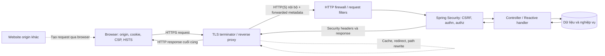
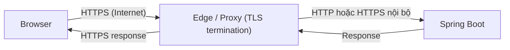
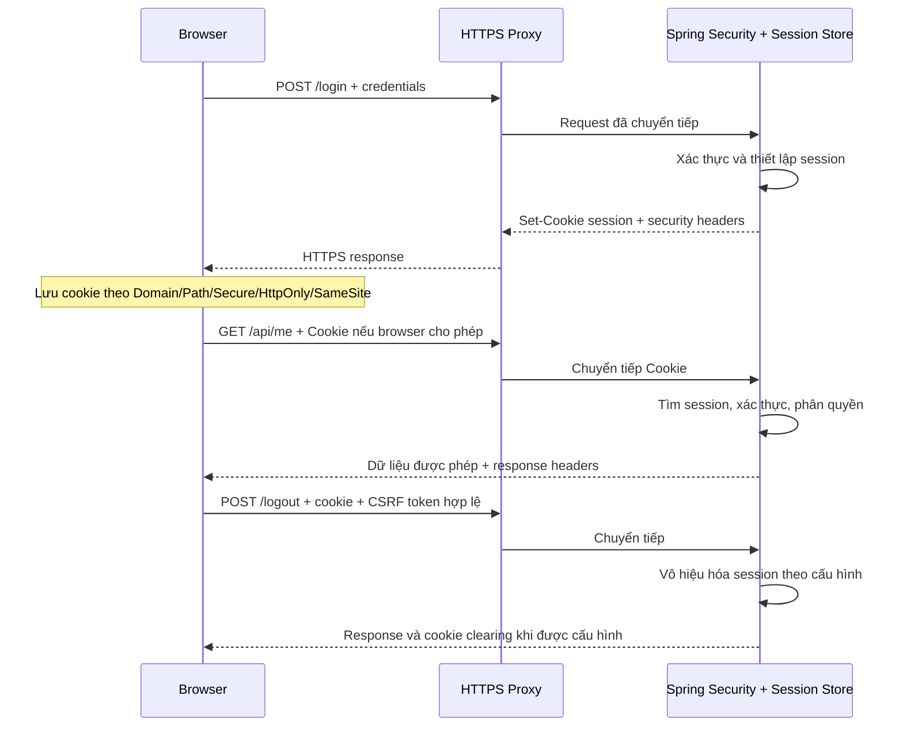

# Vai trò của máy chủ, trình duyệt và hạ tầng trung gian

> **Chương:** Bản đồ bảo vệ  
> **Học phần:** `SPRING_SECURITY_HTTP_PROTECTION` — áp dụng các lớp phòng vệ HTTP và trình duyệt trong Spring Security: CSRF, CORS, security headers, Content Security Policy (CSP), HSTS, HTTP firewall và session; triển khai cho Servlet và Reactive (WebFlux), kiểm thử kịch bản tấn công web và chẩn đoán lỗi bảo mật trên hệ thống thực tế.

## 1. Vì sao cần nhìn cả ba phía của một request?

Xét một ứng dụng quản lý tài khoản có giao diện tại `https://app.example.com`, API tại `https://api.example.com`, và một reverse proxy phía trước API. Người dùng đã đăng nhập, trình duyệt lưu cookie phiên, còn Spring Security xác thực và kiểm tra quyền trên request.

Lúc này một thao tác thay đổi email liên quan tới **ít nhất ba bên**:

1. **Trình duyệt**: quyết định khi nào gửi cookie; phát sinh CORS preflight khi cần; chỉ cho JavaScript đọc response theo same-origin policy và CORS; thực thi CSP, HSTS, quy tắc iframe và cache.
2. **Máy chủ ứng dụng**: xác thực phiên, kiểm tra quyền, kiểm tra token CSRF, áp dụng HTTP firewall, thực thi nghiệp vụ, trả response và security headers có chủ đích.
3. **Hạ tầng trung gian**: nhận TLS, chuyển tiếp method/host/path, có thể redirect HTTP sang HTTPS, xử lý `Forwarded`/`X-Forwarded-*`, cache response, áp dụng giới hạn request và đôi khi tự ghi CORS hoặc security headers.

**Một bên không thể thay thế tất cả các bên còn lại.** CORS là chính sách trình duyệt được server công bố; nó không trở thành “tường lửa API” cho mọi client. HSTS do server gửi nhưng chủ yếu được trình duyệt áp dụng. Reverse proxy có thể bảo vệ kênh truyền nhưng không tự biết user có quyền sửa tài khoản người khác hay không. Spring Security có thể kiểm tra token CSRF nhưng không tự sửa HTML bị XSS.

### Mục tiêu học tập

Sau bài này, người học có thể:

- Xác định bên nào **quyết định**, bên nào **thực thi** từng cơ chế trong CSRF, CORS, CSP, HSTS, HTTP firewall và session.
- Vẽ luồng request/response qua trình duyệt, TLS proxy và Spring Security, chỉ ra ranh giới tin cậy ở mỗi hop.
- Phân biệt *same-origin* với *same-site* và giải thích tác động lên fetch, cookie, CORS và CSRF.
- Cấu hình và kiểm thử một số luồng điển hình trên **Servlet** và **WebFlux**, có tính đến reverse proxy.
- Chẩn đoán lỗi `400`, `401`, `403`, preflight, redirect loop, HSTS thiếu, CSP violation, cookie không gửi và cache dữ liệu nhạy cảm.

## 2. Bản đồ tổng thể: yêu cầu đi qua những đâu?



Đây là **sơ đồ trách nhiệm**, không biểu diễn thứ tự thực thi cố định của mọi filter. Trong thực tế Spring Security sắp xếp filter theo ngăn xếp và cấu hình. Một số quyết định như HSTS có thể được thực thi ở lần truy cập **sau**, bởi trình duyệt đã ghi nhớ policy từ trước.

| Câu hỏi | Bên chịu trách nhiệm chính | Điểm cần xác minh |
| --- | --- | --- |
| Ai là người dùng? | Spring Security/identity provider | Credential hợp lệ, principal, session hoặc token |
| Người dùng được phép làm gì? | Spring Security và nghiệp vụ | Authority, role, quyền trên đối tượng/tenant |
| Request POST dùng cookie có thực sự vượt CSRF? | Spring Security; frontend cung cấp token | Token đúng, phiên/token lifecycle, method |
| Script của origin lạ được đọc response không? | **Trình duyệt** dựa vào CORS headers do server cung cấp | `Origin`, allow-origin, credentials, preflight |
| Script hoặc iframe nào được chạy/nhúng? | **Trình duyệt** theo CSP/frame policy | `Content-Security-Policy`, `X-Frame-Options` |
| Browser có buộc dùng HTTPS cho host? | **Trình duyệt** theo HSTS đã nhận qua HTTPS | HSTS trên response HTTPS hợp lệ, toàn bộ subdomain |
| URL/method bất thường có được chấp nhận? | HTTP parser, gateway, Spring Security HTTP firewall | Canonicalization, encoding, matcher |
| Cookie/session được tạo, gửi, thu hồi ra sao? | Server/session store và browser cùng tham gia | `Set-Cookie`, `SameSite`, `Secure`, timeout, logout |
| Request/response có bị đổi trong đường truyền? | TLS, proxy, network/edge | TLS termination, forwarding, header rewriting, caching |

**Cần phân biệt ba động từ:** server **công bố** một chính sách, browser **thực thi** phần dành cho browser, còn proxy có thể **chuyển tiếp hoặc thay đổi** dữ liệu mang chính sách đó.

## 3. Trình duyệt: không chỉ là một HTTP client

Một trình duyệt hiện đại có các cơ chế bảo vệ riêng mà `curl`, ứng dụng mobile hoặc máy chủ gọi API trực tiếp không bắt buộc áp dụng.

### 3.1. Origin và same-origin policy

**Origin = scheme + host + port**. Những địa chỉ sau có quan hệ:

| Địa chỉ A | Địa chỉ B | Quan hệ |
| --- | --- | --- |
| `https://app.example.com` | `https://app.example.com` | Cùng origin |
| `https://app.example.com` | `https://api.example.com` | Khác origin, có thể cùng site |
| `https://app.example.com` | `http://app.example.com` | Khác origin; thường khác site theo cách xét schemeful same-site |
| `https://api.example.com` | `https://api.example.com:8443` | Khác origin do port |

**Same-origin policy** hạn chế một script của origin này đọc dữ liệu nhạy cảm từ origin khác. CORS là một cơ chế để server cho phép **một số quyền đọc cross-origin** trong browser.

**Site** là khái niệm khác origin. Cookie `SameSite` thường xét scheme và miền có thể đăng ký (*registrable domain*); vì vậy `app.example.com` và `api.example.com` có thể là **same-site** dù **cross-origin**. Không dùng hai khái niệm này thay thế nhau.

### 3.2. Browser tự gửi cookie theo quy tắc riêng

Cookie có thể được trình duyệt gửi kèm request dù JavaScript không đọc được nội dung cookie. Việc gửi phụ thuộc:

- Host/domain, path, thời hạn và scheme.
- `Secure`, `SameSite` và bối cảnh top-level/cross-site.
- `credentials` của `fetch()` hoặc XHR khi request được phát ra bằng JavaScript.
- Chính sách third-party cookies của trình duyệt, chế độ riêng tư và môi trường nhúng.

Ví dụ:

```javascript
// app.example.com gọi API khác origin với cookie phiên.
fetch("https://api.example.com/profile", {
  method: "GET",
  credentials: "include"
});
```

`credentials: "include"` cho phép browser gửi thông tin xác thực phù hợp và xử lý response có cookie trong bối cảnh cross-origin. Nó **không vượt qua** `SameSite`, `Secure` hoặc chính sách chặn third-party cookie. Đồng thời API cần trả CORS headers cho phép origin cụ thể nếu JavaScript được đọc response.

### 3.3. Browser được phép gửi request chưa chắc được phép đọc response

Trang `https://untrusted.example.net` có thể kích hoạt một số request cross-origin, ví dụ điều hướng hoặc submit một HTML form. Browser có thể gửi request theo quy tắc hiện hành, nhưng sẽ chặn JavaScript đọc response khi không có CORS permission.

Điều này dẫn tới hai câu hỏi **khác nhau**:

- **Request có đến server và gây tác dụng phụ không?** Cần authentication, authorization, CSRF và nghiệp vụ trả lời.
- **JavaScript của một origin khác có đọc được response không?** Browser áp dụng same-origin policy/CORS.

Sai lầm thường gặp là “đã chặn CORS nên form ngoài không thể thay đổi dữ liệu”. CORS không cung cấp đảm bảo đó.

### 3.4. Browser thực thi headers, không tự chọn chính sách phù hợp ứng dụng

Với `Content-Security-Policy`, `X-Frame-Options`, `Strict-Transport-Security`, `Referrer-Policy` và `X-Content-Type-Options`, browser đọc response và áp dụng giới hạn tương ứng. Server/proxy phải gửi header đúng, nhưng **giá trị bảo vệ thực tế** được kiểm tra trong browser.

Nếu cùng một trang đi qua CDN hoặc proxy ghi đè header, browser chỉ thấy **response cuối cùng**, không thấy “ý định” của cấu hình Spring Security.

## 4. Máy chủ: ra quyết định truy cập và bảo vệ request

Spring Security được đặt ở phía server (Servlet filter chain hoặc Reactive web filter chain), chịu trách nhiệm những điều **phải đúng với mọi client**, kể cả client không phải trình duyệt.

### 4.1. Authentication, authorization và kiểm tra nghiệp vụ

Một server không được tin rằng trình duyệt đã ẩn nút “Xóa tài khoản” thì user không thể gọi API xóa. User có thể sửa request hoặc dùng một HTTP client khác.

Ví dụ:

```http
DELETE /api/users/42 HTTP/1.1
Host: api.example.com
Cookie: JSESSIONID=<opaque-session-id>
X-CSRF-TOKEN: <valid-token>
```

Ngay cả khi cookie hợp lệ và CSRF token đúng, server vẫn phải kiểm tra **principal có quyền xóa tài khoản 42 hay không**. Authentication và CSRF không thay quyền đối tượng.

- **Route/method authorization**: chặn nhóm endpoint hoặc hành động chưa đủ quyền.
- **Object-level authorization**: kiểm tra owner, tenant, ACL hoặc các trạng thái nghiệp vụ.
- **Validation**: kiểm tra giá trị đầu vào; chặn mass assignment và trạng thái không hợp lệ.
- **Audit**: ghi chủ thể, đối tượng, hành động và kết quả; tránh log credential nhạy cảm.

### 4.2. CSRF là kiểm tra phía server

Với request dùng cookie phiên, browser có thể tự đính kèm cookie vào request giả mạo. Spring Security kiểm tra **CSRF token** đối với các phương thức cần bảo vệ; form hoặc JavaScript hợp lệ phải gửi token theo luồng ứng dụng thiết kế.

Browser không tự bảo đảm rằng một POST có cookie là ý muốn thực của người dùng. `SameSite` hỗ trợ giảm một số trường hợp CSRF nhưng không thay toàn bộ token CSRF.

### 4.3. HTTP firewall xử lý biểu diễn request

Một URL có path đã mã hóa, ký tự lạ hoặc dấu chấm phẩy có thể được proxy, container và request matcher hiểu khác nhau. Spring Security có các lớp để từ chối nhiều biểu diễn request đáng ngờ:

- **Servlet:** `HttpFirewall`, thường dùng `StrictHttpFirewall`.
- **Reactive:** `ServerWebExchangeFirewall`, thường dùng `StrictServerWebExchangeFirewall`.

Firewall góp phần giữ tính nhất quán của request được kiểm tra. Nó không xác nhận tenant/owner của resource và không thay phân quyền nghiệp vụ.

### 4.4. Server tạo response headers và trạng thái phiên

Trong một cấu hình Spring Security thông thường, framework có thể thêm một số security response headers mặc định. **CSP là policy cần ứng dụng thiết kế và cấu hình riêng**; HSTS có điều kiện theo HTTPS và phiên bản/cấu hình. Server còn cần quản lý login, logout, session timeout và vòng đời token.

Không giả định mọi response đều đi qua security filter chain của ứng dụng; lỗi do gateway trả trực tiếp có thể không mang những headers mà backend vốn thêm.

## 5. Hạ tầng trung gian: chuyển tiếp, bảo vệ đường truyền và có thể làm sai chính sách

“Hạ tầng trung gian” có thể bao gồm: DNS, CDN, WAF, reverse proxy, API gateway, ingress controller, load balancer, service mesh, edge cache và hệ thống xử lý TLS.

Không phải thành phần nào cũng được triển khai cùng lúc. Cần xác định chính xác các hop thực tế thay vì giả định một topology mẫu.

### 5.1. TLS termination và HTTPS

Một tuyến triển khai thường gặp:



Nếu backend nhận HTTP từ proxy sau khi TLS đã kết thúc, ứng dụng có thể tưởng request là HTTP nếu không có cơ chế nhận biết scheme bên ngoài. Hậu quả có thể là:

- Chuyển hướng HTTPS sai, vòng lặp redirect hoặc callback OAuth2 sai.
- Không phát HSTS ở lớp ứng dụng khi nó chỉ phát cho request được nhận diện là HTTPS.
- Cookie `Secure` hoặc URL tuyệt đối được sinh không phù hợp.
- Phân quyền dựa trên `Host`/scheme hoặc CORS origin xử lý sai.

Cách giải quyết là cấu hình **trusted reverse proxy** và cơ chế forwarded headers đúng stack, đồng thời bảo đảm headers này chỉ do proxy đáng tin cậy cung cấp. Nếu ứng dụng trực tiếp tin `X-Forwarded-Proto` do bất kỳ client nào đặt, attacker có thể **giả mạo scheme**.

Đường truyền **proxy → ứng dụng** có dùng HTTPS/mTLS hay không phụ thuộc kiến trúc và yêu cầu rủi ro; HTTPS từ browser tới edge **không tự bảo vệ** một hop nội bộ chạy HTTP qua mạng không tin cậy.

### 5.2. Path rewriting và HTTP firewall

Nếu gateway chuyển `/service/api/documents/42` thành `/api/documents/42`, cần kiểm tra rule ở gateway và Spring Security có đang áp dụng trên biểu diễn nào.

Một đường dẫn chứa `%2F`, `;`, `//` hoặc encoding khác có thể bị một lớp từ chối, một lớp chuẩn hóa và một lớp route tới handler. **Nhất quán cách hiểu URL** là điều kiện cần để matcher phân quyền hoạt động như mong đợi.

Không nới `StrictHttpFirewall` chỉ để giải quyết lỗi HTTP `400` khi chưa xác định xem yêu cầu có hợp lệ, có thể biểu diễn bằng URL an toàn hơn và có gây nhầm matcher hay không.

### 5.3. Proxy có thể thêm, xóa hoặc gộp response headers

Nếu backend thêm CSP nhưng CDN ghi đè CSP khác, chính sách browser nhận được có thể không đúng mong muốn. Nếu proxy thêm CORS headers, còn Spring Security cũng thêm CORS headers, kết quả có thể chứa nhiều header `Access-Control-Allow-Origin` gây lỗi browser.

Cần quyết định rõ **lớp nào sở hữu chính sách** cho từng loại route. Có thể đặt CORS hoặc HSTS ở edge, hoặc ở ứng dụng; điều quan trọng là response cuối cùng chính xác và nhất quán, kể cả trang lỗi, redirect, preflight, CDN cache hit.

### 5.4. Cache ở CDN và reverse proxy

Proxy cache không tự hiểu “response này thuộc riêng Alice”. Nếu cache `GET /api/profile` như dữ liệu công khai và trả cho Bob, phân quyền backend có thể đã hoàn toàn đúng **trong lần xử lý đầu tiên**, nhưng dữ liệu vẫn bị lộ do một lớp ở sau.

Đối với dữ liệu người dùng riêng tư, cần chiến lược `Cache-Control` phù hợp, thường dùng `no-store` cho dữ liệu đặc biệt nhạy cảm hoặc `private` theo thiết kế; kiểm tra CDN có tuân thủ header và cache key không. `Vary: Origin` hữu ích với CORS theo nhiều origin nhưng **không biến một response chứa dữ liệu cá nhân thành an toàn để cache công khai**.

## 6. CSRF: browser tự gửi credential, server phải kiểm tra ý định của request

Giả sử người dùng đăng nhập `api.example.com` bằng session cookie. Trang khác cố gắng khiến browser gửi form đổi email:

```html
<form action="https://api.example.com/profile/email" method="post">
  <input name="email" value="someone@example.net">
  <button type="submit">Submit</button>
</form>
```

Tùy cookie policy và bối cảnh, browser có thể gửi cookie phiên. Server sẽ nhận request với thông tin xác thực hợp lệ **nếu cookie được đính kèm**. Nếu server không kiểm tra CSRF, thao tác có thể chạy trái ý người dùng.

### 6.1. Ai thực hiện việc gì?

```mermaid
sequenceDiagram
    participant U as Người dùng / Browser
    participant F as Frontend hợp lệ
    participant P as Reverse proxy
    participant S as Spring Security
    participant E as Trang độc hại
    U->>F: Mở giao diện
    F->>P: Yêu cầu trang/form/token
    P->>S: Chuyển tiếp request
    S-->>U: Cơ chế cấp CSRF token cho giao diện
    F->>P: POST + cookie + CSRF token
    P->>S: Chuyển tiếp headers/body
    S-->>F: Vượt CSRF nếu token hợp lệ; còn kiểm tra quyền
    E-->>U: Khiến browser phát sinh POST khác
    U->>P: POST + cookie nếu policy cho phép, thiếu CSRF token
    P->>S: Chuyển tiếp request
    S-->>U: Từ chối nếu request nằm trong phạm vi CSRF protection
```

- **Frontend/trình duyệt:** lấy và gửi token khi cần, áp dụng cookie policy; browser không tự tạo token hợp lệ cho Spring Security.
- **Spring Security:** cung cấp cơ chế quản lý/kiểm tra token và từ chối request cần CSRF khi token thiếu hoặc sai.
- **Proxy:** không được làm mất header/parameter chứa token hoặc rewrite method/path sai; nếu muốn thực thi CSRF ở edge phải có một thiết kế nhất quán, tránh hai lớp bất đồng.

### 6.2. Khi nào có thể cân nhắc miễn CSRF?

Một API **thực sự chỉ chấp nhận** bearer token do client chủ động đặt vào header `Authorization` có nguy cơ CSRF khác ứng dụng cookie/session. Có thể miễn CSRF cho phạm vi đó sau khi xác minh **không có đường xác thực cookie hoặc credential được tự đính kèm**. Chỉ gọi ứng dụng là “REST”, dùng JWT hoặc chọn `STATELESS` không tự chứng minh điều kiện này.

CSRF token hợp lệ cũng không chứng minh rằng user có quyền trên dữ liệu cụ thể. Phải kết hợp với authentication và authorization.

## 7. CORS: server công bố, browser thực thi, proxy phải giữ nhất quán

CORS thường gây nhầm lẫn nhất khi nhiều lớp cùng tham gia.

### 7.1. Một preflight đi qua những đâu?

Frontend `https://app.example.com` muốn gửi `PUT` với custom header đến `https://api.example.com`. Trước actual request, browser có thể gửi:

```http
OPTIONS /api/profile HTTP/1.1
Host: api.example.com
Origin: https://app.example.com
Access-Control-Request-Method: PUT
Access-Control-Request-Headers: content-type,x-csrf-token
```

Server, hoặc edge được giao sở hữu CORS, phản hồi ví dụ:

```http
HTTP/1.1 204 No Content
Access-Control-Allow-Origin: https://app.example.com
Access-Control-Allow-Methods: GET,POST,PUT
Access-Control-Allow-Headers: content-type,x-csrf-token
Access-Control-Allow-Credentials: true
Vary: Origin
```

Browser đánh giá response preflight rồi mới cho actual request diễn ra nếu chính sách cho phép.

**Preflight không mang cookie phiên theo cách request thông thường.** Nếu authentication filter chặn `OPTIONS` vì thiếu session trước khi CORS xử lý, browser báo lỗi CORS. Cấu hình Spring Security cần đảm bảo CORS được xử lý **trước authentication có thể bác bỏ preflight**.

### 7.2. CORS không biến request thành được phân quyền

Giả sử server cho phép origin `https://app.example.com`. Một script từ origin này được browser cho phép đọc response CORS phù hợp, nhưng server vẫn phải:

- Xác thực cookie/JWT.
- Kiểm tra role/scope và quyền trên đối tượng.
- Kiểm tra CSRF cho thay đổi trạng thái dựa trên cookie.
- Hạn chế dữ liệu được trả về theo principal.

CORS không ngăn `curl`, chương trình Java hoặc mobile client gọi endpoint. Các client đó không bị same-origin policy như browser.

### 7.3. Những xung đột thường gặp

| Triệu chứng | Nguồn gốc có thể xảy ra | Điều cần kiểm tra |
| --- | --- | --- |
| Preflight `OPTIONS` trả `401` | Bước xác thực chạy trước CORS | CORS integration và chain matcher |
| Browser báo thiếu `Access-Control-Allow-Origin` | Response lỗi do gateway sinh không có header, origin không được phép | Response cuối cùng và allowlist |
| Có hai giá trị `Access-Control-Allow-Origin` | Proxy và app cùng thêm header | Quyền sở hữu CORS policy |
| Bật credentials nhưng dùng `*` | CORS policy không hợp lệ cho credentialed response | Origin cụ thể và `allowCredentials` |
| CORS đúng nhưng cookie không gửi | `fetch credentials`, `SameSite`, `Secure`, browser policy | Browser Network/Cookies và site/origin |
| GET được nhưng PUT bị chặn | Method/header không được phép ở preflight | `Access-Control-Allow-Methods/Headers` |
| Response từ CDN cho sai origin | Cache key/Vary không tương thích | `Vary: Origin` và cache configuration |

**Khi nào không cần CORS?** Nếu giao diện và API có cùng origin và không có yêu cầu truy cập cross-origin khác, không cần tạo allowlist chỉ để “bật thêm bảo mật”. CORS là cơ chế cấp quyền đọc, không phải lớp deny-by-default cho toàn bộ API.

## 8. CSP, clickjacking, MIME sniffing và cache: bảo vệ khi response tới browser

Các lớp này đặc biệt thể hiện rõ phân chia trách nhiệm: **server/edge tạo header, browser áp dụng**.

| Chính sách | Bên gửi cấu hình | Bên thực thi | Mục tiêu |
| --- | --- | --- | --- |
| `Content-Security-Policy` | Spring Security hoặc edge | Browser | Giới hạn script/resource/frame/form |
| `X-Frame-Options` | Server/edge | Browser | Giảm clickjacking qua iframe |
| CSP `frame-ancestors` | Server/edge | Browser | Giới hạn ai được phép nhúng trang |
| `X-Content-Type-Options: nosniff` | Server/edge | Browser | Hạn chế sniff MIME với một số resource |
| `Referrer-Policy` | Server/edge | Browser | Hạn chế dữ liệu URL truyền qua `Referer` |
| `Cache-Control` | Server/edge | Browser và cache trung gian | Điều khiển việc lưu/tái sử dụng response |

### 8.1. CSP hạn chế tác động của XSS

Ví dụ một policy khởi điểm cho trang có thể tải tài nguyên từ cùng origin:

```http
Content-Security-Policy: default-src 'self'; script-src 'self'; object-src 'none'; base-uri 'self'; frame-ancestors 'none'; form-action 'self'
```

Server gửi policy, nhưng browser quyết định script/frame nào bị chặn. **CSP không thay thế output encoding hoặc sanitization**: nếu dữ liệu không tin cậy bị chèn vào HTML/script, lỗi XSS cần được sửa ở ứng dụng. CSP giúp giảm phạm vi thực thi nhưng script chạy hợp lệ trong origin vẫn có thể mượn quyền session.

Nếu frontend có script inline, dùng thiết kế nonce/hash thích hợp; không tự mở `'unsafe-inline'` để hết warning. Có thể quan sát vi phạm qua `Content-Security-Policy-Report-Only` trước khi bật chế độ chặn; report-only không ngăn thực thi.

### 8.2. Clickjacking qua iframe

Một website độc hại có thể nhúng màn hình chuyển tiền, phủ lớp giao diện và lừa người dùng click. `X-Frame-Options` và CSP `frame-ancestors` giúp browser quyết định ai được nhúng trang. Cần phân biệt `frame-ancestors` (ai được nhúng **trang này**) với `frame-src` (trang này được nhúng nguồn **nào**).

Một hệ thống bắt buộc có iframe đối tác phải đặt allowlist rõ ràng; việc nới iframe policy không tự cho đối tác quyền gọi API hoặc xem dữ liệu bí mật.

### 8.3. Cache của dữ liệu nhạy cảm

`Cache-Control: no-store` phù hợp cho nhiều response chứa dữ liệu cực kỳ nhạy cảm. Với assets có tên fingerprint, cache dài có thể hợp lý. Các response riêng tư cần được cấu hình trên cả backend và CDN, đặc biệt khi cache key không phân biệt principal/cookie.

Browser cache, proxy cache và CDN cache đều có thể giữ nội dung. **Không thấy lỗi từ Spring Security** không đồng nghĩa cache sẽ không phát lại dữ liệu cho người khác.

## 9. HSTS: server chỉ yêu cầu, browser ghi nhớ và thực thi

`Strict-Transport-Security` yêu cầu browser ưu tiên HTTPS cho host sau khi browser **đã nhận header qua kết nối HTTPS hợp lệ**.

```http
Strict-Transport-Security: max-age=31536000
```

Nếu dùng `includeSubDomains`, chính sách có thể áp dụng đến những subdomain chưa sẵn sàng HTTPS. `preload` còn đặt ra cam kết và điều kiện triển khai riêng. Không bật các tùy chọn này khi chưa kiểm kê toàn bộ host liên quan.

### 9.1. HSTS không phải một redirect HTTP đơn thuần

- **Redirect HTTP → HTTPS** do server/proxy thực hiện cho request HTTP đã tới server; lần request đầu vẫn có thể đi qua HTTP trước khi nhận redirect.
- **HSTS đã được ghi nhớ** khiến browser tự nâng lên HTTPS trong những lần sau trước khi phát request.
- **HSTS preload** có thể hỗ trợ giảm khoảng trống của lần truy cập đầu nếu host được đưa vào preload list theo cơ chế của trình duyệt, nhưng cần điều kiện và kế hoạch vận hành.

HSTS không thay chứng chỉ, cấu hình TLS, redirect và kiểm soát proxy. HSTS trên HTTP không được browser tin như trên HTTPS hợp lệ.

### 9.2. Trường hợp TLS termination

Nếu TLS dừng ở load balancer và backend dùng HTTP, backend có thể không nhận biết external HTTPS. Một triển khai có thể chọn cho **edge phát HSTS**, hoặc cấu hình nhận scheme đã được proxy xác thực để ứng dụng phát header đúng. Tránh vô tình thêm hai header HSTS với chính sách mâu thuẫn.

Kiểm tra **HTTPS response cuối** ở browser, bao gồm cả redirect và trang lỗi từ edge. Khi dùng staging trên miền dùng chung subdomain với production, đặc biệt cẩn trọng với HSTS `includeSubDomains`.

## 10. HTTP firewall và proxy: nhất quán biểu diễn request là điều kiện của phân quyền

Giả sử:

- Gateway kiểm tra path ban đầu theo một quy tắc.
- Servlet container hoặc Reactive server decode path theo quy tắc khác.
- Spring Security matcher nhìn thấy một biểu diễn.
- Handler/service lại thao tác trên biểu diễn đã được chuẩn hóa.

Khi đó một path lạ có thể lọt qua policy không đúng ý định. Những biểu diễn cần kiểm tra bao gồm slash mã hóa `%2F`, dấu chấm phẩy, backslash, double slash, và các method không được phép.

| Thành phần | Việc thực hiện | Rủi ro khi bất đồng |
| --- | --- | --- |
| Edge/WAF | Parse, normalize, rewrite, route HTTP request | Route tới ứng dụng khác với rule đã kiểm tra |
| HTTP parser/container | Hiểu path, query, method, encoding | Biểu diễn URL khác security matcher |
| Spring Security HTTP firewall | Từ chối nhiều request không hợp lệ/đáng ngờ | Nếu nới quá mức, mở lại biểu diễn có khả năng bypass |
| Authorization matcher | Kiểm tra route/function theo path và method | Policy có thể áp sai endpoint |
| Service | Kiểm tra tài nguyên/tenant/ACL thực tế | Nếu thiếu sẽ lộ dữ liệu dù route matcher đúng |

Trong Servlet, dùng `StrictHttpFirewall` khi tích hợp `FilterChainProxy`. Trong WebFlux, dùng `StrictServerWebExchangeFirewall` tương ứng. Nếu ứng dụng thật cần matrix variables hoặc URL đặc thù, hãy xác định yêu cầu và kiểm thử toàn tuyến trước khi thay quy tắc firewall.

Firewall có thể dẫn đến HTTP `400` hoặc mã do lớp xử lý lỗi cấu hình trả về; authentication thường dẫn đến `401` hoặc redirect login, authorization/CSRF có thể dẫn đến `403`. **Status code chỉ là tín hiệu khởi đầu**, không đủ kết luận vị trí lỗi.

## 11. Session: ranh giới trách nhiệm giữa browser, server và proxy

Một phiên đăng nhập được bảo vệ bằng nhiều cơ chế phối hợp:



**Cookie thuộc browser, session state thường thuộc server/session store.** Cookie mang ID hoặc một giá trị xác thực; server cần xác định giá trị đó còn hợp lệ. Browser có thể xóa cookie nhưng việc bảo đảm một session đã bị vô hiệu phải được server thực hiện đúng.

### 11.1. Thuộc tính cookie và giới hạn của chúng

```http
Set-Cookie: JSESSIONID=<opaque-id>; Path=/; Secure; HttpOnly; SameSite=Lax
```

Ví dụ này minh họa thuộc tính, không khẳng định Spring Security hoặc servlet container tự cấu hình chính xác như vậy.

- `Secure` giới hạn gửi cookie qua kết nối HTTPS theo quy tắc browser; proxy phải bảo đảm kết nối bên ngoài đúng.
- `HttpOnly` giảm khả năng script đọc cookie, nhưng script XSS chạy ở origin hợp lệ vẫn có thể thực hiện request dùng cookie.
- `SameSite=Strict/Lax/None` điều chỉnh gửi cookie theo ngữ cảnh site. Với trình duyệt hiện đại, `SameSite=None` cần `Secure`; chính sách chặn third-party cookie có thể còn giới hạn thêm.
- `Domain`/`Path` xác định phạm vi gửi cookie; chỉ dùng phạm vi cần thiết.
- `Max-Age`/`Expires` và session timeout server cần nhất quán với lifecycle ứng dụng.

### 11.2. Session fixation, logout và login

Nếu một kẻ tấn công biết session ID trước khi nạn nhân đăng nhập, hệ thống cần chống **session fixation**, thường bằng đổi session ID sau xác thực. Spring Security Servlet hỗ trợ cơ chế này (thường dùng `changeSessionId` với container hiện đại); kiểm chứng khi tùy biến login, SSO hoặc lưu session ngoài.

Logout cần vô hiệu hóa session/credential theo cơ chế đang sử dụng. Với bearer token độc lập, logout browser không tự làm token đang còn hạn trở nên vô hiệu trừ khi kiến trúc đã có cơ chế revocation hoặc vòng đời phù hợp.

### 11.3. Nguồn phát cookie thuộc ngăn xếp nào?

- **Servlet**: cookie có thể do servlet container hoặc Spring Session tạo; cấu hình ở nơi phát `Set-Cookie`.
- **Reactive**: `WebSession` và các thành phần liên quan quản lý session/cookie; API không hoàn toàn giống Servlet.
- **Edge**: gateway đôi khi phát cookie riêng cho sticky sessions hoặc identity. Cần phân biệt cookie của edge với cookie xác thực của ứng dụng; tránh chính sách cookie hoặc `Set-Cookie` bị rewrite trái dự kiến.

## 12. Servlet: một cấu hình Spring Security trong hệ thống có frontend khác origin

Ví dụ sau dùng **Spring MVC/Servlet** với form login và session cookie. Frontend ở `https://app.example.com`, API ở `https://api.example.com`. Ứng dụng bảo vệ CSRF cho thao tác thay đổi trạng thái, xử lý CORS theo origin được phép và thêm CSP.

```java
@Configuration
@EnableWebSecurity
class ServletProtectionConfig {

    @Bean
    SecurityFilterChain securityFilterChain(HttpSecurity http)
            throws Exception {
        return http
            .cors(Customizer.withDefaults())
            .csrf(Customizer.withDefaults())
            .headers(headers -> headers
                .contentSecurityPolicy(csp -> csp.policyDirectives(
                    "default-src 'self'; script-src 'self'; " +
                    "object-src 'none'; base-uri 'self'; frame-ancestors 'none'"
                ))
            )
            .authorizeHttpRequests(auth -> auth
                .requestMatchers("/login", "/assets/**", "/error").permitAll()
                .requestMatchers(HttpMethod.GET, "/api/profile")
                    .authenticated()
                .requestMatchers(HttpMethod.POST, "/api/profile/email")
                    .authenticated()
                .anyRequest().denyAll()
            )
            .formLogin(Customizer.withDefaults())
            .build();
    }

    @Bean
    UrlBasedCorsConfigurationSource corsConfigurationSource() {
        CorsConfiguration cors = new CorsConfiguration();
        cors.setAllowedOrigins(List.of("https://app.example.com"));
        cors.setAllowedMethods(List.of("GET", "POST", "PUT"));
        cors.setAllowedHeaders(List.of(
            "Content-Type", "X-CSRF-TOKEN", "X-XSRF-TOKEN"
        ));
        cors.setAllowCredentials(true);

        UrlBasedCorsConfigurationSource source =
            new UrlBasedCorsConfigurationSource();
        source.registerCorsConfiguration("/api/**", cors);
        return source;
    }
}
```

Trong Servlet cần import `org.springframework.web.cors.UrlBasedCorsConfigurationSource`. Đây là **khung minh họa** với lambda DSL, chưa bao gồm import, nguồn tài khoản, cách frontend nhận/gửi CSRF token, object-level authorization và cách phát cookie. Do frontend khác origin, `fetch()` cần cấu hình credentials phù hợp và cookie phải được browser chấp nhận theo chính sách same-site/cross-site thực tế.

Phân tích trách nhiệm:

- `cors(withDefaults())` và `corsConfigurationSource()` khiến Spring Security trả CORS headers phù hợp cho API khi request đến backend theo đúng chain.
- `csrf(withDefaults())` giữ kiểm tra token trên POST. Cần tích hợp token vào frontend; **không** tắt CSRF vì frontend gọi cross-origin.
- `authorizeHttpRequests` kiểm tra authentication ở route; service vẫn kiểm tra quyền thực sự của user với profile.
- `contentSecurityPolicy` là policy ví dụ; nếu frontend được phục vụ từ host khác, policy phải được đặt trên **response HTML của frontend** (ở host phục vụ trang), không kỳ vọng header CSP trên JSON API tự kiểm soát script của trang frontend.
- CORS policy áp dụng cho `/api/**`, nhưng form login hoặc endpoint cấp token nếu được gọi cross-origin cũng cần được thiết kế rõ ràng; không mặc định mọi luồng đăng nhập đã hoạt động.

### 12.1. Server có cần biết scheme bên ngoài không?

Nếu backend thấy request là HTTP sau TLS termination, có thể cần cơ chế xử lý `Forwarded`/`X-Forwarded-*` phù hợp, chẳng hạn cấu hình Spring Boot forward headers cho môi trường thật hoặc `ForwardedHeaderFilter` ở Servlet **khi proxy đã loại bỏ giá trị client tự gửi và chỉ chuyển tiếp metadata đáng tin**.

Không bật tin forwarded headers một cách mù quáng khi ứng dụng có thể được truy cập trực tiếp từ Internet hoặc proxy không quản lý nguồn giá trị header.

## 13. Reactive WebFlux: cơ chế tương đương nhưng API khác

WebFlux dùng `ServerHttpSecurity` và `SecurityWebFilterChain` thay vì `HttpSecurity` và `SecurityFilterChain`. Việc áp dụng CORS, CSRF và headers vẫn theo **cùng nguyên tắc bảo mật**, nhưng loại filter, context và session khác.

Ví dụ **WebFlux form login/session**, tức vẫn **cần CSRF** cho thao tác thay đổi trạng thái:

```java
@Configuration
@EnableWebFluxSecurity
class ReactiveProtectionConfig {

    @Bean
    SecurityWebFilterChain securityWebFilterChain(ServerHttpSecurity http) {
        return http
            .cors(cors -> cors.configurationSource(reactiveCorsSource()))
            .csrf(Customizer.withDefaults())
            .headers(headers -> headers
                .contentSecurityPolicy(csp -> csp.policyDirectives(
                    "default-src 'self'; script-src 'self'; " +
                    "object-src 'none'; base-uri 'self'; frame-ancestors 'none'"
                ))
            )
            .authorizeExchange(auth -> auth
                .pathMatchers("/login", "/assets/**", "/error").permitAll()
                .pathMatchers("/api/profile/**").authenticated()
                .anyExchange().denyAll()
            )
            .formLogin(Customizer.withDefaults())
            .build();
    }

    @Bean
    org.springframework.web.cors.reactive.CorsConfigurationSource
            reactiveCorsSource() {
        CorsConfiguration cors = new CorsConfiguration();
        cors.setAllowedOrigins(List.of("https://app.example.com"));
        cors.setAllowedMethods(List.of("GET", "POST", "PUT"));
        cors.setAllowedHeaders(List.of(
            "Content-Type", "X-CSRF-TOKEN", "X-XSRF-TOKEN"
        ));
        cors.setAllowCredentials(true);

        org.springframework.web.cors.reactive.UrlBasedCorsConfigurationSource
            source = new org.springframework.web.cors.reactive
                .UrlBasedCorsConfigurationSource();
        source.registerCorsConfiguration("/api/**", cors);
        return source;
    }
}
```

Đoạn code minh họa cần import các class thông thường và được đối chiếu với phiên bản Spring Security cụ thể. Đặc biệt:

- `CorsConfigurationSource` thuộc **package reactive** khác Servlet.
- `SecurityWebFilterChain` áp dụng cho WebFlux; không dùng servlet `HttpServletRequest`/`HttpSession` để suy luận session của `WebSession`.
- Xử lý authentication context trong Reactive dựa trên Reactor context, không tự lấy từ thread-local như mô hình Servlet.
- Nếu triển khai **bearer-only API** không có credential được browser tự gửi, có thể thiết kế CSRF policy khác sau khi xác minh toàn bộ đường xác thực. Trong ví dụ cookie/session ở trên, **giữ CSRF**.
- CSP hiệu lực trên response tài liệu HTML được browser render. Nếu WebFlux chủ yếu trả JSON còn HTML nằm ở một máy chủ khác, CSP cần được gắn ở host phục vụ HTML.

### 13.1. Mẫu so sánh hai ngăn xếp

| Khía cạnh | Servlet | Reactive WebFlux |
| --- | --- | --- |
| Cấu hình bảo mật | `HttpSecurity` | `ServerHttpSecurity` |
| Security chain | `SecurityFilterChain` | `SecurityWebFilterChain` |
| Filter | Servlet `Filter` / `FilterChainProxy` | `WebFilter` / `WebFilterChainProxy` |
| Xác thực và quyền | `authorizeHttpRequests` | `authorizeExchange` |
| CSRF token repository mặc định thường gặp | `HttpSessionCsrfTokenRepository` | `WebSessionServerCsrfTokenRepository` |
| CORS | `org.springframework.web.cors.*` | `org.springframework.web.cors.reactive.*` |
| Firewall | `StrictHttpFirewall` | `StrictServerWebExchangeFirewall` |
| Security context | `SecurityContextHolder` và cơ chế request/thread | `ReactiveSecurityContextHolder` trong Reactor context |
| Session | Servlet `HttpSession` | Reactive `WebSession` |
| Test request | `MockMvc` | `WebTestClient` |

## 14. Proxy và forwarded headers: định tuyến đúng trước khi bảo mật đúng

Reverse proxy có thể nhận:

```http
GET /api/profile HTTP/1.1
Host: api.example.com
Origin: https://app.example.com
Cookie: JSESSIONID=<opaque-id>
```

Và chuyển đến service nội bộ ở `http://profile-service:8080`. Ứng dụng cần biết **host/scheme bên ngoài đáng tin**, nhưng không được tin header do client tự gắn.

### 14.1. Quy trình thiết kế trusted forwarding

1. Proxy chỉ nhận yêu cầu cho những host/service hợp lệ.
2. Proxy **loại bỏ/ghi đè** những forwarded headers do client gửi và tạo metadata mới từ thông tin kết nối đáng tin.
3. Chỉ các địa chỉ/hop proxy được tin cậy mới được truy cập backend hoặc được phép cung cấp forwarding metadata.
4. Ứng dụng bật cơ chế nhận forwarded headers tương ứng với stack và topology.
5. Kiểm thử redirect URL, cookie `Secure`, HSTS, CORS origin, absolute links và route matching từ **browser tới backend**, không chỉ gọi backend nội bộ.

Ví dụ forwarding metadata thường gặp:

```http
Forwarded: for=198.51.100.10;proto=https;host=api.example.com
X-Forwarded-Proto: https
X-Forwarded-Host: api.example.com
```

Các giá trị này chỉ là **ví dụ minh họa**. Không tự tin rằng request “đến từ proxy” đã đáng tin nếu backend vẫn nhận request trực tiếp từ Internet hoặc proxy giữ nguyên header giả mạo do client đặt.

### 14.2. Cấu hình TLS và header nên có một nguồn chính sách rõ ràng

Một kiến trúc có thể để:

- Edge xử lý HTTPS redirect, HSTS và một số headers của trang lỗi.
- Spring Security xử lý CORS, CSRF, authentication/authorization và phần lớn headers cho tài nguyên do ứng dụng phát.
- CDN chỉ cache tĩnh, không cache dữ liệu cá nhân.

Hoặc phân chia khác nếu có lý do vận hành. Cần xác định **ai là chủ sở hữu cuối** và kiểm tra response cuối cùng. Hạn chế cấu hình chồng chéo, đặc biệt với `Access-Control-Allow-Origin`, `Content-Security-Policy`, `Strict-Transport-Security` và cache headers.

### 14.3. Tránh tin nhầm response do edge tạo

Một yêu cầu có thể bị CDN/WAF/gateway từ chối trước khi đến Spring Boot. Response lỗi đó có thể thiếu CSP, frame policy, CORS hay HSTS, dẫn tới kết quả browser khác những gì test ở local. Tách riêng test **200**, **redirect**, **401/403**, **400** và **edge-generated error response**.

## 15. Ma trận trách nhiệm: ai phát hiện, ai chặn, ai xác minh?

| Kịch bản | Browser | Server/Spring Security | Proxy/Edge | Bằng chứng mong đợi |
| --- | --- | --- | --- | --- |
| Form CSRF từ origin lạ | Có thể gửi cookie theo policy, không tự xác minh ý định | Kiểm tra token và từ chối request không hợp lệ | Chuyển tiếp chính xác cookie/token | POST thiếu token không đổi dữ liệu |
| Origin lạ cố đọc API | Áp dụng same-origin policy/CORS | Trả CORS allowlist và kiểm tra quyền | Không thêm wildcard sai | Browser chặn đọc response; API vẫn yêu cầu authn/authz |
| XSS trong HTML | Có thể áp CSP | Encode/sanitize output; phát CSP | Không ghi đè policy | Script độc hại không chạy; vi phạm CSP được phát hiện |
| Nhúng màn hình quản trị vào iframe | Áp frame policy | Phát CSP `frame-ancestors`/XFO | Giữ header đến browser | Origin lạ không nhúng được |
| SSL downgrade | Ghi nhớ và áp HSTS | Chạy qua HTTPS; có thể phát HSTS | TLS + redirect + HSTS theo thiết kế | Browser dùng HTTPS sau khi đã ghi nhớ HSTS |
| URL path đáng ngờ | Gửi request | Firewall và route/method authorization | Parse, rewrite nhất quán | Request bị từ chối hoặc route đúng, không bypass |
| Cookie/session bị chiếm | Quản lý gửi cookie theo attributes | Session timeout, fixation protection, logout, authn | TLS trên các hop thích hợp | Phiên cũ không dùng được sau invalidation |
| Response riêng tư được cache | Áp cache directives | Phát cache policy, hạn chế payload | Tuân thủ cache policy và cache key | Người B không nhận response của người A |
| Preflight OPTIONS bị từ chối | Phát preflight và báo lỗi | CORS được xử lý trước auth từ chối | Forward method/headers và xử lý đúng nếu edge sở hữu CORS | Browser preflight thành công cho origin hợp lệ |
| Callback/redirect sai scheme | Dùng URL server trả | Sinh redirect với scheme đáng tin | Cung cấp forwarding metadata tin cậy | Redirect cuối dùng HTTPS host đúng |

Khi debug, cần quan sát **request thực tế tới Spring Security** và **response thực tế tới browser**. Chỉ một trong hai bức ảnh đó thường chưa đủ.

## 16. Kiểm thử end-to-end theo từng bên

### 16.1. Chụp request/response và so sánh các hop

Nên thu thập các thông tin sau, đồng thời che dữ liệu nhạy cảm:

- URL, scheme, host, path, method, request Origin.
- Cookie **có được gửi không**, nhưng không ghi giá trị session ID.
- Có header `Authorization` hoặc CSRF token không, chỉ ghi trạng thái có/không.
- Response status, `Location`, `Set-Cookie` attributes, CORS và security headers.
- Chain/filter nào chặn request; response được backend hay proxy tạo.
- Có xảy ra preflight trước actual request không và preflight đi qua tầng nào.

Lưu ý **không đưa mật khẩu, JWT, cookie hay token CSRF thật vào log chia sẻ**.

### 16.2. Công cụ HTTP: kiểm tra headers và preflight

```bash
# Preflight hợp lệ từ frontend.
curl -i -X OPTIONS https://api.example.com/api/profile \
  -H 'Origin: https://app.example.com' \
  -H 'Access-Control-Request-Method: PUT' \
  -H 'Access-Control-Request-Headers: content-type,x-csrf-token'

# Preflight origin ngoài allowlist.
curl -i -X OPTIONS https://api.example.com/api/profile \
  -H 'Origin: https://untrusted.example.net' \
  -H 'Access-Control-Request-Method: PUT' \
  -H 'Access-Control-Request-Headers: content-type,x-csrf-token'

# Quan sát security response headers trên HTTPS.
curl -I https://app.example.com/
```

**curl không thực thi CORS, CSP, HSTS, SameSite và iframe policy như browser.** Nó chỉ giúp xem request/response HTTP. Nếu curl thành công nhưng browser báo lỗi, kiểm tra Network/Console/Cookies/HSTS ở trình duyệt thật.

### 16.3. Servlet: dùng MockMvc để phân biệt các lớp

Với `spring-security-test`, ví dụ endpoint `POST /api/profile/email` đã được định nghĩa:

```java
// Có principal nhưng thiếu CSRF: mặc định bị từ chối.
mvc.perform(post("/api/profile/email").with(user("alice")))
   .andExpect(status().isForbidden());

// Có CSRF token: request vượt kiểm tra CSRF.
// Kết quả cuối phụ thuộc validation và quyền nghiệp vụ.
mvc.perform(post("/api/profile/email")
        .with(user("alice"))
        .with(csrf()));

// CORS preflight: cần kiểm tra Origin, method và headers theo policy.
mvc.perform(options("/api/profile")
        .header("Origin", "https://app.example.com")
        .header("Access-Control-Request-Method", "PUT"));
```

Đảm bảo `MockMvc` tích hợp security filter chain; helper `user()`/`csrf()` giả lập chủ thể và token trong test, không tự kiểm chứng login/session thực qua proxy.

### 16.4. WebFlux: WebTestClient theo chính sách CSRF

Với WebFlux login/session:

```java
// Có token CSRF: request có thể vượt CSRF,
// nhưng authn/authz và handler vẫn quyết định kết quả cuối.
webTestClient.mutateWith(csrf())
    .post()
    .uri("/api/profile/email")
    .exchange();

// Thực hiện thêm request tương tự thiếu csrf(), bảo đảm bị từ chối.
```

Nếu test có mock authentication, cấu hình `spring-security-test` và `WebTestClient` tương thích. Nếu API bearer-only, cần test JWT decoder, scopes và quyền trên tài nguyên thay vì mặc định áp mọi test CSRF của cookie app.

### 16.5. Kiểm thử browser và edge

Các test thật cần có:

1. `fetch` cross-origin với `credentials: "include"`, xác nhận cookie và CORS headers.
2. Origin ngoài allowlist không đọc được response ngay cả khi cố gửi credential.
3. Script vi phạm CSP bị chặn; trong report-only chỉ ghi nhận chứ không chặn.
4. Trang giao dịch không bị nhúng bởi origin lạ nếu frame policy cấm.
5. HTTPS response có HSTS đúng; redirect từ HTTP không tạo vòng lặp và callback giữ đúng HTTPS.
6. Login/logout kiểm tra session ID rotation, cookie attributes, session invalidation.
7. CDN/proxy cache không trả dữ liệu của user A cho user B.
8. Request path bất thường và response do gateway từ chối vẫn tuân thủ yêu cầu bảo mật.

### 16.6. Khi nào dùng integration test có proxy thật?

Nếu lỗi chỉ xuất hiện sau deploy, test local Servlet `MockMvc` hoặc `WebTestClient` có thể không tái hiện vì không có TLS termination, path rewriting, WAF hoặc CDN. Lúc đó cần môi trường thử nghiệm đi qua **cùng kiểu proxy** hoặc một cấu hình tương đương, đồng thời giới hạn test vào tài khoản và dữ liệu mẫu.

## 17. Những lỗi chẩn đoán điển hình

### Trường hợp A: “curl API được, browser lại báo CORS”

**Dấu hiệu:** curl GET trả `200`, frontend báo preflight blocked.

**Giải thích:** curl không áp same-origin policy/CORS. Browser có thể phát `OPTIONS` không cookie và bị filter auth chặn hoặc nhận response thiếu `Access-Control-Allow-Origin`. Nếu proxy cũng thêm CORS headers, có thể bị trùng.

**Hướng xử lý:** xem preflight trong DevTools, response cuối sau proxy, `Origin`, allow-origin, methods/headers và credentials; cấu hình CORS đúng stack và đúng chain.

### Trường hợp B: “POST lỗi 403, tắt CSRF thì hoạt động”

**Dấu hiệu:** app login bằng cookie; request đổi email thiếu token hoặc token không hợp lệ.

**Giải thích:** server đang chặn thao tác có thể bị CSRF, dù user đã login.

**Hướng xử lý:** thiết kế frontend nhận/gửi token và làm mới token sau login/logout/session change; giữ kiểm tra quyền tại endpoint. Không tắt CSRF toàn cục chỉ để hết lỗi.

### Trường hợp C: “Ứng dụng chỉ thấy HTTP dù người dùng truy cập HTTPS”

**Dấu hiệu:** redirect loop, callback OAuth2 sai scheme, thiếu HSTS hoặc cookie `Secure`.

**Giải thích:** TLS kết thúc tại proxy; backend nhận HTTP hoặc không nhận đúng forwarded metadata.

**Hướng xử lý:** xác minh cấu hình TLS termination, proxy host/scheme, trusted forwarding, phản hồi HTTPS cuối; ngăn client giả mạo `Forwarded`. Có thể giao edge phát HSTS nếu đó là nguồn chính sách đã được thống nhất.

### Trường hợp D: “Proxy trả lỗi, security headers biến mất”

**Dấu hiệu:** response từ backend có CSP/HSTS nhưng response `403` của WAF lại không có.

**Giải thích:** request bị chặn trước Spring Security; response tạo ở edge không đi qua backend header filter.

**Hướng xử lý:** áp chính sách bảo mật cần thiết cho response do edge tạo và kiểm tra response thực tế browser nhận. Đừng nghĩ mọi response đều do backend trả.

### Trường hợp E: “Cookie có SameSite=None vẫn không gửi”

**Dấu hiệu:** browser không gửi session trong iframe hoặc cross-site fetch.

**Giải thích:** có thể thiếu `Secure`, fetch không bật credentials, domain/path sai, browser chặn third-party cookies hoặc kiến trúc cross-site bị giới hạn.

**Hướng xử lý:** xác định *site*, *origin* và luồng request cụ thể, đọc browser cookies diagnostic; ưu tiên kiến trúc hạn chế phụ thuộc vào third-party cookies khi có thể.

### Trường hợp F: “Chỉ thay path ở gateway mà phân quyền sai”

**Dấu hiệu:** một URL lạ đi vào handler khác với policy dự kiến.

**Giải thích:** normalize/rewrite path không đồng nhất ở WAF, container, Spring Security matcher và controller.

**Hướng xử lý:** kiểm tra các biểu diễn URL qua từng hop, giữ `StrictHttpFirewall` khi có thể và bổ sung test hồi quy path/method. Luôn giữ quyền tài nguyên ở service.

### Trường hợp G: “Dữ liệu cá nhân của user khác hiện trên dashboard”

**Dấu hiệu:** API backend kiểm tra quyền đúng khi gọi trực tiếp, nhưng qua CDN lại xuất hiện dữ liệu của người khác.

**Giải thích:** cache key hoặc cache policy không phân biệt dữ liệu theo principal/cookie.

**Hướng xử lý:** chặn shared caching cho response nhạy cảm hoặc thiết kế cache partition đáng tin; xác minh `Cache-Control`, CDN rules và test hai phiên người dùng khác nhau.

### Trường hợp H: “Thêm CSP ở API JSON nhưng XSS trên SPA vẫn chạy”

**Dấu hiệu:** backend API có header CSP, frontend HTML từ CDN không có.

**Giải thích:** CSP điều khiển document mà browser render. Header trên một response JSON **không tự trở thành CSP của document HTML đang chạy SPA**.

**Hướng xử lý:** đặt CSP trên **response HTML được browser tải** ở host frontend, phối hợp CSP với escape/sanitize và kiểm thử mã không tin cậy.

## 18. Checklist phân chia trách nhiệm khi triển khai

| Câu hỏi | Bên kiểm tra | Cách xác minh |
| --- | --- | --- |
| User thật sự vào ứng dụng qua HTTPS? | Browser, edge | Certificate, redirect, URL cuối |
| HSTS được nhận và đúng phạm vi? | Edge/app phát, browser áp | Response HTTPS và policy tại browser |
| Backend chỉ tin forwarded headers từ proxy đáng tin? | Edge + app | Kiểm thử spoof header và trusted proxies |
| URL/method/host được hiểu nhất quán? | Gateway, firewall, handler | Test path encoding, rewrite, unexpected methods |
| CORS có đúng origin, method, header và credentials? | App/edge phát, browser áp | Preflight + actual response ở browser |
| Có CSRF cho thao tác ghi dùng cookie? | App | POST thiếu token bị chặn, có token được xét quyền |
| Cookie `Secure`, `HttpOnly`, `SameSite` đúng? | Server phát, browser áp | `Set-Cookie`, DevTools, cross-site scenario |
| CSP/frame policy nằm ở document HTML đúng không? | Frontend server/edge + browser | CSP violation, iframe test |
| Cache của dữ liệu nhạy cảm được kiểm soát? | App, CDN, browser | Response headers, A/B user cache tests |
| Quyền truy cập theo người dùng/tài nguyên đủ chặt? | Spring Security + service | Negative authorization tests, tenant boundaries |
| Logout/expiry/rotation có tác dụng? | Session store + browser | Cookie cũ không còn truy cập được |
| Lỗi do gateway sinh có headers phù hợp? | Edge | Kiểm tra response 4xx/5xx từ gateway |

## 19. Bài tập thực hành tổng hợp

### Bối cảnh

Một hệ thống thanh toán có:

- Frontend SPA: `https://pay.example.com`.
- API Spring Boot: `https://api.example.com`.
- Reverse proxy chịu trách nhiệm TLS termination và route traffic.
- Browser login bằng cookie phiên.
- API `POST /api/transfers` tạo chuyển tiền.
- API `GET /api/transfers/{id}` đọc thông tin giao dịch.

### Nhiệm vụ

1. Vẽ luồng request qua **browser → proxy → Spring Security → service**.
2. Chỉ rõ **ai** áp dụng HSTS, CSP, CORS, CSRF, cookie và quyền trên giao dịch.
3. Với request `POST /api/transfers`, liệt kê mọi điều kiện cần thỏa: session xác thực, token CSRF, quyền tạo giao dịch, kiểm tra hạn mức, người nhận, chống request lặp.
4. Thiết kế CORS chỉ cho frontend SPA, giải thích vì sao preflight không dựa vào cookie phiên.
5. Kiểm tra tác động của `SameSite` đối với hai origin trên; không kết luận chúng cross-site chỉ vì khác subdomain.
6. Khi proxy chuyển HTTP nội bộ đến backend, nêu cách xác minh HSTS, redirect, forwarded headers và cookie `Secure`.
7. Xây dựng test cho hai account khác nhau, token CSRF thiếu, origin lạ, XSS qua mô tả giao dịch và cache không an toàn.
8. Dùng browser kiểm chứng headers trên **HTML của SPA** và **JSON response của API**, giải thích sự khác nhau về hiệu lực CSP.

### Gợi ý đáp án theo trách nhiệm

| Câu hỏi | Cơ chế chính |
| --- | --- |
| Có thể dùng tài khoản này không? | Authentication/session |
| Tài khoản được chuyển tiền không? | Authorization |
| Có quyền xem giao dịch số 42 không? | Object-level authorization |
| POST có thể bị ép từ website khác? | CSRF token và cookie policy |
| Origin lạ có đọc response API được không? | CORS do server trả, browser thực thi |
| Script độc hại có chạy trên SPA không? | Output encoding/sanitization và CSP của trang HTML |
| Trình duyệt có tiếp tục ưu tiên HTTPS không? | HSTS được browser ghi nhớ |
| URL lạ có bypass matcher không? | Proxy normalization, Spring Security HTTP firewall |
| Session có còn hiệu lực sau logout? | Server-side session invalidation, cookie lifecycle |
| CDN có phát lại dữ liệu người dùng khác không? | Cache policy và proxy cache key |

## 20. Tóm tắt để tự kiểm tra kiến thức

Hãy nhớ ba câu hỏi trước khi thêm một cấu hình bảo mật:

**(1) Ai công bố chính sách?** Spring Security, frontend server, API gateway, CDN hay identity provider?

**(2) Ai thực thi?** Server ra quyết định authentication/authorization/CSRF/firewall; browser áp CORS/CSP/HSTS/cookie/frame; proxy duy trì TLS, route, forwarding và cache theo chính sách.

**(3) Kiểm chứng ở đâu?** Server unit/integration test, HTTP response nhìn từ edge, và trình duyệt thật. Nếu chỉ nhìn một tầng, có thể bỏ qua lỗi phát sinh ở tầng khác.

Các nhầm lẫn phải tránh:

- **“Bật CORS là bảo vệ API.”** CORS chủ yếu áp dụng khả năng đọc cross-origin trong browser; server vẫn cần authentication và authorization.
- **“Có HSTS ở backend là browser chắc chắn đang được bảo vệ.”** Browser phải nhận header qua HTTPS hợp lệ; proxy có thể xóa hoặc thay header.
- **“HTTPS tại edge đủ bảo vệ mọi hop.”** Đường từ proxy tới backend phải được đánh giá riêng.
- **“CSP trên API JSON sẽ bảo vệ SPA.”** CSP cần có trên document HTML để điều khiển script của trang đang chạy.
- **“Cookie HttpOnly khiến XSS vô hại.”** XSS trong origin có thể thực hiện request dù không đọc trực tiếp cookie.
- **“Spring Security HTTP firewall thay authorization.”** Firewall giúp kiểm soát biểu diễn request; quyền đối tượng vẫn thuộc service.
- **“Servlet và WebFlux có cấu hình filter/session giống nhau.”** Hai stack chia sẻ nguyên tắc nhưng có các type, filter, context và test helper khác.

## 21. Tài liệu tham khảo chính thức

Đối chiếu phiên bản dependency đang chạy trước khi dùng API/mặc định trong project thực tế:

- [Spring Security — Servlet Security Architecture](https://docs.spring.io/spring-security/reference/servlet/architecture.html)
- [Spring Security — Reactive Security Architecture](https://docs.spring.io/spring-security/reference/reactive/architecture.html)
- [Spring Security — Servlet CSRF](https://docs.spring.io/spring-security/reference/servlet/exploits/csrf.html)
- [Spring Security — WebFlux CSRF](https://docs.spring.io/spring-security/reference/reactive/exploits/csrf.html)
- [Spring Security — Servlet CORS](https://docs.spring.io/spring-security/reference/servlet/integrations/cors.html)
- [Spring Security — WebFlux CORS](https://docs.spring.io/spring-security/reference/reactive/integrations/cors.html)
- [Spring Security — HTTP Security Headers (Servlet)](https://docs.spring.io/spring-security/reference/servlet/exploits/headers.html)
- [Spring Security — HTTP Security Headers (Reactive)](https://docs.spring.io/spring-security/reference/reactive/exploits/headers.html)
- [Spring Security — Servlet HTTP Firewall](https://docs.spring.io/spring-security/reference/servlet/exploits/firewall.html)
- [Spring Security — Reactive HTTP Firewall](https://docs.spring.io/spring-security/reference/reactive/exploits/firewall.html)
- [Spring Security — Servlet Session Management](https://docs.spring.io/spring-security/reference/servlet/authentication/session-management.html)
- [Spring Security — MockMvc Security Testing](https://docs.spring.io/spring-security/reference/servlet/test/mockmvc/index.html)
- [Spring Security — Reactive WebTestClient Security Testing](https://docs.spring.io/spring-security/reference/reactive/test/web/index.html)
- [Spring Framework — Forwarded Headers](https://docs.spring.io/spring-framework/reference/web/webmvc/filters.html#filters-forwarded-headers)
- [MDN — Cross-Origin Resource Sharing](https://developer.mozilla.org/en-US/docs/Web/HTTP/CORS)
- [MDN — Content-Security-Policy](https://developer.mozilla.org/en-US/docs/Web/HTTP/Headers/Content-Security-Policy)
- [MDN — Strict-Transport-Security](https://developer.mozilla.org/en-US/docs/Web/HTTP/Headers/Strict-Transport-Security)

**Kết quả học tập cần đạt:** Khi một request chạy sai hoặc một biện pháp bảo mật có vẻ không có tác dụng, người học xác định được **bên phát policy**, **bên thực thi**, **ranh giới tin cậy**, **cách kiểm thử** và **điểm sửa cấu hình** cụ thể trên cả Servlet và WebFlux.

