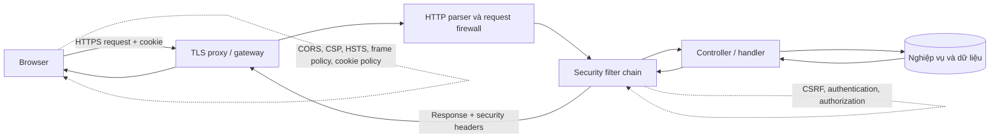
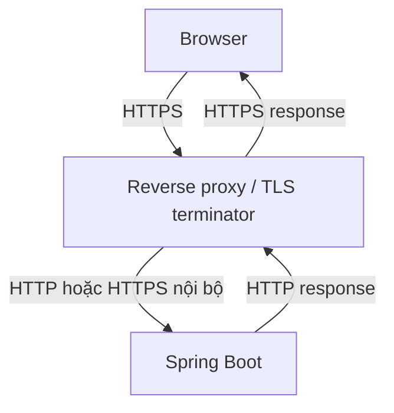
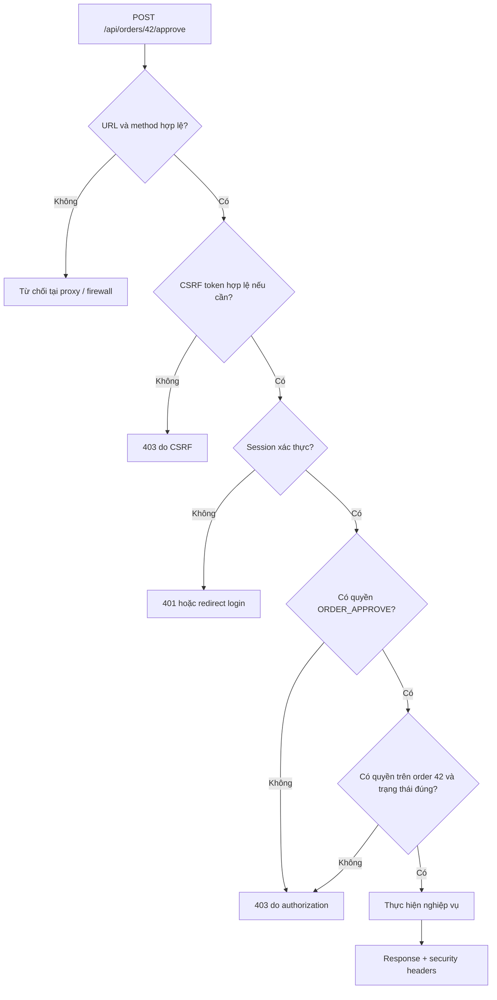

# Các lớp CSRF, HTTP headers, HTTPS và request firewall

> **Chương:** Bản đồ bảo vệ  
> **Phạm vi:** `SPRING_SECURITY_HTTP_PROTECTION` — áp dụng các lớp phòng vệ HTTP và trình duyệt trong Spring Security, gồm CSRF, CORS, HTTP security headers, CSP, HSTS, request firewall và bảo vệ session. Bài minh họa cách phối hợp các lớp này trong **Servlet (Spring MVC)** và **Reactive (WebFlux)**, cách kiểm thử kịch bản tấn công web và chẩn đoán xung đột khi triển khai.

## 1. Vì sao cần nhiều lớp phòng vệ cho cùng một request?

Giả sử một ứng dụng quản lý tài khoản có giao diện tại `https://app.example.com`, API tại `https://api.example.com` và đăng nhập bằng cookie phiên. Người dùng mở biểu mẫu thay đổi email, rồi gửi yêu cầu:

```http
POST /api/profile/email HTTP/1.1
Host: api.example.com
Origin: https://app.example.com
Cookie: JSESSIONID=<session-id>
Content-Type: application/x-www-form-urlencoded
X-CSRF-TOKEN: <csrf-token>

email=alice%40example.com
```

Một yêu cầu như vậy đặt ra những vấn đề khác nhau:

- **Tài khoản và quyền:** cookie có trỏ tới một session đã xác thực không, người dùng có được sửa hồ sơ này không?
- **CSRF:** request thay đổi trạng thái có được tạo theo luồng hợp lệ, có kèm token CSRF đúng không?
- **Security headers:** response có hướng dẫn trình duyệt chống nhúng trang, thực thi script ngoài ý muốn, sniffing MIME và cache dữ liệu nhạy cảm không?
- **HTTPS/HSTS:** đường truyền bên ngoài có được bảo vệ bằng TLS, trình duyệt có ghi nhớ yêu cầu sử dụng HTTPS không?
- **Request firewall:** URL, method và ký tự đặc biệt có được các thành phần mạng và Spring Security hiểu nhất quán không?
- **CORS và session:** frontend khác origin có được phép đọc response không, browser có được gửi cookie theo quy tắc của nó không?

**Không lớp nào thay thế được toàn bộ các lớp còn lại.** Một token CSRF hợp lệ không cấp quyền trên tài nguyên; HSTS không ngăn XSS; HTTP firewall không quyết định quyền nghiệp vụ; CORS không phải cơ chế xác thực và không ngăn mọi request từ origin lạ đi đến server.

### Mục tiêu học tập

Sau bài này, người học có thể:

1. Mô tả chính xác **nguy cơ**, **điểm áp dụng** và **giới hạn** của CSRF, security headers, HTTPS/HSTS và HTTP firewall.
2. Giải thích sự khác nhau giữa **server-side request checks** và **browser-enforced response policies**.
3. Cấu hình các lớp bảo vệ trong Spring Security cho Servlet và Reactive, đặc biệt khi dùng cookie/session.
4. Thiết kế cấu hình bổ sung khi có frontend cross-origin, reverse proxy hoặc TLS termination.
5. Viết kiểm thử thể hiện yêu cầu hợp lệ và yêu cầu bị chặn: thiếu/sai CSRF token, path bất thường, thiếu quyền, headers và HTTPS.
6. Chẩn đoán lỗi `400`, `401`, `403`, lỗi browser CSP/CORS, redirect loop và HSTS không xuất hiện.

## 2. Bản đồ vị trí: lớp nào xử lý request, lớp nào xử lý response?



Sơ đồ trình bày **trách nhiệm logic**, không cố định thứ tự mọi filter. Thứ tự xử lý phụ thuộc stack, các security chain và phiên bản Spring Security; **CORS preflight** thường cần được xử lý trước bước xác thực có thể từ chối request không có cookie.

| Lớp | Phía thực thi chính | Đầu vào | Bảo vệ điều gì? | Không thay thế được |
| --- | --- | --- | --- | --- |
| **CSRF** | Server (Spring Security) | Method, session, CSRF token | Request gây tác dụng phụ khi browser tự gửi credential | Authentication, quyền đối tượng, chống XSS |
| **CORS** | Trình duyệt, dựa trên response của server | `Origin`, preflight, CORS headers | Quyền script đọc response cross-origin | CSRF, authentication, phân quyền |
| **Security headers** | Phần lớn do browser thực thi | Response headers | Quy tắc script, iframe, MIME, cache, referrer | Kiểm tra input, encode HTML, phân quyền |
| **HTTPS/TLS** | Client + TLS endpoint; có thể là proxy | Chứng chỉ, TLS handshake | Bí mật/toàn vẹn dữ liệu trên từng kết nối | CSRF, IDOR, XSS |
| **HSTS** | Browser, sau khi nhận policy trên HTTPS hợp lệ | `Strict-Transport-Security` | Tự ưu tiên HTTPS cho host ở lần truy cập sau | Triển khai TLS và kiểm soát proxy |
| **HTTP firewall** | Server-side, trong tuyến xử lý request | Path, method, header/URL bất thường | Từ chối request có biểu diễn nguy hiểm/không nhất quán | Quyền dữ liệu nghiệp vụ |
| **Session protection** | Server/session store + browser | Session ID, cookie attributes | Giảm nguy cơ cố định/chiếm phiên | Chống lộ mật khẩu, CSRF toàn phần |

Để debug, nên luôn phân biệt:

- **Quyết định server đã cho phép xử lý chưa?** Xem log chain, status code, dữ liệu đã thay đổi chưa.
- **Browser có cho JavaScript đọc/hiển thị kết quả không?** Xem Network, Console, cookie và CSP violation.
- **Proxy có đổi method/path/scheme/headers hoặc tự trả response không?** Xem tuyến triển khai thật.

## 3. Xây dựng mô hình đe dọa trước khi cấu hình

Một bài toán bảo vệ HTTP phải định nghĩa trước **cách người dùng xác thực**, **origin phục vụ frontend**, **endpoint nào thay đổi dữ liệu** và **lớp nào kết thúc TLS**.

### 3.1. Cookie, bearer token và ambient credentials

Cookie phiên có thể được browser **tự gửi** khi các điều kiện Domain, Path, SameSite, Secure và loại request cho phép. Đây là hình thức *ambient credential* quan trọng đối với CSRF. Ngược lại, bearer token chủ động đặt trong header `Authorization` bằng ứng dụng client không được một HTML form từ origin lạ tự biết để gửi.

| Kiến trúc | Cách xác thực gửi đi | Đánh giá CSRF |
| --- | --- | --- |
| Web form + session cookie | Browser gửi cookie theo policy | **Giữ CSRF** cho request thay đổi trạng thái |
| SPA + API dùng cookie | Browser gửi cookie; `fetch` cần credentials phù hợp | **Giữ CSRF**, thiết kế cơ chế frontend nhận/gửi token |
| API chỉ nhận bearer trong `Authorization` | Client chủ động thêm header | Có thể miễn CSRF **nếu đã xác minh mọi đường xác thực** không dựa vào credential được browser tự gửi |
| API hỗn hợp cookie + bearer | Có request vẫn chấp nhận cookie | Không được tắt CSRF toàn cục chỉ vì có JWT |
| Proxy xác thực và gắn identity header | Credential được xử lý tại edge | Phải đánh giá browser/edge thực sự gửi gì, xác minh header chỉ do proxy đáng tin tạo |

`SessionCreationPolicy.STATELESS` không tự chứng minh rằng cookie hay HTTP Basic auth không còn được chấp nhận ở một phần khác của hệ thống.

### 3.2. Phân biệt origin và site

**Origin** = scheme + host + port. `https://app.example.com` và `https://api.example.com` là **cross-origin**; chúng có thể là **same-site**. `SameSite` của cookie không đồng nghĩa với chính sách same-origin/CORS.

CORS dùng để kiểm soát **JavaScript đọc response cross-origin**, trong khi CSRF quan tâm liệu **request gây tác dụng phụ** có thể bị khởi tạo bởi ngữ cảnh không đáng tin hay không. Một website lạ có thể tạo HTML form tới API dù không được đọc response.

### 3.3. Xác định safe và unsafe HTTP methods

GET, HEAD, OPTIONS, TRACE được xem là **safe methods** theo ngữ nghĩa HTTP và thường không bị bộ lọc CSRF mặc định yêu cầu token. Do đó:

- `GET /orders/42`: chỉ đọc.
- `POST /orders/42/approve`: phê duyệt.
- `PUT /profile/email`: thay đổi email.
- `DELETE /sessions/current`: thay đổi trạng thái.

Nếu một `GET` thực hiện chuyển tiền hoặc xóa dữ liệu, đó là lỗi thiết kế: Spring Security có thể coi nó là safe request và không buộc CSRF token. “Idempotent” khác “safe”: `DELETE` có thể idempotent nhưng không phải safe method.

## 4. CSRF: tấn công diễn ra như thế nào?

Người dùng đã đăng nhập ứng dụng bằng cookie session. Trong khi session còn hiệu lực, họ mở một website khác; trang đó chèn một form gửi tới endpoint đổi email.

```html
<!-- Tình huống giả lập cho kiểm thử bảo mật trên hệ thống tự sở hữu -->
<form action="https://api.example.com/api/profile/email"
      method="post">
  <input type="hidden" name="email" value="attacker@example.net">
  <button type="submit">Continue</button>
</form>
```

Tùy thiết lập `SameSite` và bối cảnh browser, cookie có thể đi theo request. Server nhận credential xác thực của người dùng, nhưng request không nhất thiết là ý định thật của họ.

```mermaid
sequenceDiagram
    participant B as Browser đã đăng nhập
    participant X as Trang không tin cậy
    participant S as Spring Security
    participant A as Nghiệp vụ
    B->>S: Login, nhận cookie phiên
    X-->>B: Gây phát sinh POST đổi email
    B->>S: POST + cookie (nếu cookie policy cho phép), thiếu token
    S-->>B: 403 khi CSRF protection chặn
    B->>S: POST hợp lệ + cookie + CSRF token
    S->>A: Vượt CSRF; tiếp tục kiểm tra quyền và dữ liệu
    A-->>B: Chỉ cập nhật nếu nghiệp vụ cho phép
```

**Điểm cốt lõi:** authentication có thể thành công vì cookie hợp lệ; authorization có thể thành công vì người dùng có quyền tự đổi email; nhưng **CSRF xác minh thêm một điều kiện nhằm chống request bị giả mạo**.

CSRF **không giải quyết** trường hợp script XSS đang chạy trong origin hợp lệ: script đó có thể lấy hoặc sử dụng token CSRF theo cơ chế ứng dụng. Vì vậy cần thêm output encoding/sanitization và CSP.

## 5. Spring Security kiểm tra CSRF token như thế nào?

Cơ chế mặc định phổ biến dùng một **CSRF token repository** để liên kết token với ngữ cảnh người dùng. Khi request thuộc phạm vi cần bảo vệ, token được gửi trong form parameter hoặc request header và được kiểm tra với giá trị kỳ vọng.

### 5.1. Với Servlet

Trong Spring Security Servlet:

- `CsrfFilter` thực hiện kiểm tra trên request phù hợp.
- `CsrfTokenRepository` quản lý cách lưu và lấy token; mặc định thường dùng `HttpSessionCsrfTokenRepository`.
- Có thể dùng `CookieCsrfTokenRepository` khi cần hỗ trợ frontend JavaScript, nhưng **không phải chỉ đổi repository là SPA tự hoạt động an toàn**.
- Các phiên bản hiện đại có cơ chế **deferred token loading** và xử lý chống **BREACH** qua masked/XOR token; một SPA lấy token từ cookie rồi gửi header phải có cơ chế đọc/giải mã và làm mới token thích hợp.

Tại server-rendered form, token có thể được nhúng thành hidden input:

```html
<!-- Minh họa với template Thymeleaf -->
<form th:action="@{/orders/42/approve}" method="post">
  <input type="hidden"
         th:name="${_csrf.parameterName}"
         th:value="${_csrf.token}">
  <button type="submit">Approve</button>
</form>
```

Đoạn trên minh họa cách bind token trong template; trong tích hợp Thymeleaf/Spring Security, token còn có thể được thêm tự động qua cơ chế xử lý form. Cần tránh phát **hai hidden input CSRF trùng nhau** nếu framework đã tự chèn.

### 5.2. Với Reactive WebFlux

Trong WebFlux:

- `CsrfWebFilter` là cơ chế kiểm tra CSRF tương ứng ở Reactive.
- Token repository mặc định phổ biến là `WebSessionServerCsrfTokenRepository`.
- `ServerCsrfTokenRepository` được dùng thay cho kiểu Servlet `CsrfTokenRepository`.
- Form/SPA phải nhận token và gửi lại theo hợp đồng ứng dụng; request dùng cookie vẫn cần CSRF protection.

Dù hai stack có tên API khác nhau, **threat model không thay đổi**: browser có thể tự gửi cookie, còn server cần bảo vệ thao tác thay đổi trạng thái trước request giả mạo.

### 5.3. Các trường hợp token không hợp lệ

| Tình huống | Nguyên nhân có thể | Hướng xử lý |
| --- | --- | --- |
| POST không có token | Form/SPA chưa gửi token, header bị proxy xóa | Tích hợp token vào form/header |
| POST có token cũ sau login/logout | Session/token thay đổi | Cấp lại token, cập nhật luồng frontend |
| Token gửi trong cookie nhưng server vẫn báo sai | Cookie token khác expected/masked token; request handler không phù hợp | Kiểm tra repository, request handler và token lifecycle |
| Token đúng nhưng vẫn `403` | Authorization hoặc quyền tài nguyên từ chối | Kiểm tra authority, owner/tenant và chain |
| Preflight `OPTIONS` không có token | Preflight là safe method | Xử lý CORS trước auth; không biến preflight thành request thay đổi trạng thái |
| API bearer-only bị yêu cầu CSRF | Chain khác dùng cookie policy hoặc cấu hình chưa tách | Đánh giá lại credential và matcher theo endpoint |

**Không sửa bằng cách tắt CSRF toàn cục** khi chưa xác minh mô hình xác thực và tình huống tấn công.

## 6. CORS không phải CSRF: phối hợp cho frontend cross-origin

Một request từ `https://app.example.com` tới `https://api.example.com` là cross-origin. Với một số method/header, browser sẽ gửi **preflight**:

```http
OPTIONS /api/profile/email HTTP/1.1
Host: api.example.com
Origin: https://app.example.com
Access-Control-Request-Method: POST
Access-Control-Request-Headers: content-type,x-csrf-token
```

Phản hồi có thể là:

```http
HTTP/1.1 204 No Content
Access-Control-Allow-Origin: https://app.example.com
Access-Control-Allow-Credentials: true
Access-Control-Allow-Methods: GET,POST,PUT
Access-Control-Allow-Headers: content-type,x-csrf-token
Vary: Origin
```

CORS preflight thường **không chứa cookie phiên**. Nếu bộ xác thực chặn `OPTIONS` trước khi CORS được xử lý, frontend nhận lỗi CORS dù credential của actual request có thể hoàn toàn hợp lệ.

Nguyên tắc:

- Server chỉ định **origin đáng tin**; nếu có credentials, không sử dụng wildcard `*` trong `Access-Control-Allow-Origin`.
- `fetch(credentials: "include")` không tự vượt qua cookie `SameSite`, `Secure` hoặc chính sách third-party cookies.
- CORS không quyết định caller có được thao tác trên tài nguyên; phải có authentication/authorization.
- Form cross-origin có thể **gửi** request không cần đọc response; vì vậy CORS không thể thay token CSRF.
- Nếu frontend và API cùng origin, không cần bật CORS chỉ để “tăng bảo mật”.

## 7. Security headers: các chính sách được gửi trong HTTP response

Spring Security hỗ trợ ghi **security response headers**. Một số header có thể được thêm mặc định theo phiên bản và loại response; một số khác, đặc biệt là **CSP**, cần ứng dụng tự thiết kế.

| Header / thuộc tính | Mục đích chính | Lưu ý triển khai |
| --- | --- | --- |
| `Cache-Control`, `Pragma`, `Expires` | Hạn chế lưu thông tin nhạy cảm | Không nhất thiết áp cùng cách cho assets tĩnh |
| `X-Content-Type-Options: nosniff` | Hạn chế browser tự đoán MIME | Phải trả `Content-Type` chính xác |
| `X-Frame-Options: DENY` hoặc `SAMEORIGIN` | Giảm clickjacking | Cân nhắc với CSP `frame-ancestors` |
| `Content-Security-Policy` | Kiểm soát script, style, frame, tài nguyên | **Không được tự sinh thành policy phù hợp ứng dụng** |
| `Strict-Transport-Security` | Browser ưu tiên HTTPS sau khi đã nhận HSTS hợp lệ | Thường chỉ trên response được xem là HTTPS |
| `Referrer-Policy` | Hạn chế dữ liệu URL rò qua `Referer` | Cần chọn chính sách phù hợp chức năng |
| `Permissions-Policy` | Giới hạn một số tính năng browser | Phụ thuộc hỗ trợ browser và yêu cầu sản phẩm |
| `Set-Cookie: ...; Secure; HttpOnly; SameSite=...` | Bảo vệ vòng đời cookie | Là **thuộc tính cookie**, không phải security header độc lập có cùng kiểu cấu hình |

### 7.1. Mặc định không đồng nghĩa “bảo vệ hoàn chỉnh”

Khi dùng Spring Security với Servlet hoặc WebFlux, một số header phổ biến như cache control, `nosniff`, frame options và HSTS có thể được bật mặc định; **chính xác header nào được phát và giá trị nào phụ thuộc phiên bản, stack, cách cấu hình và scheme HTTPS**.

CSP cần thiết kế dựa trên tài nguyên frontend. Việc có `X-XSS-Protection` trong tài liệu cũ không có nghĩa đây là lớp chống XSS đáng tin cho browser hiện đại.

**Cách xác minh đúng** là đọc response HTTP **tại browser**, kể cả response thành công, redirect, lỗi và response do reverse proxy tạo.

### 7.2. Header trên JSON API và header trên trang HTML

Một trang SPA có HTML được phục vụ từ `https://app.example.com` nhưng API trả JSON ở `https://api.example.com`. **CSP của trang SPA phải nằm trên response HTML chứa document đó**; gắn CSP lên JSON API không tự trở thành chính sách script của document đã tải từ frontend.

Trong hệ thống có CDN phục vụ frontend, CSP có thể cần được cấu hình ở CDN/hosting layer tương ứng. Spring Security API chỉ điều khiển những response thực sự đi qua application security chain của nó.

## 8. CSP: bảo vệ trình duyệt trước nội dung chủ động không đáng tin

**Cross-Site Scripting (XSS)** là lỗi khiến dữ liệu không đáng tin chạy thành HTML hoặc JavaScript. Cần sửa ở gốc bằng output encoding theo ngữ cảnh, sanitization khi cho phép HTML, DOM API an toàn và tránh render string thành mã.

**Content Security Policy** là lớp bảo vệ bổ sung: server cung cấp allowlist hoặc nonce/hash, browser áp dụng chính sách khi tải/thực thi tài nguyên.

Ví dụ CSP cơ bản cho trang không có script inline:

```http
Content-Security-Policy: default-src 'self'; script-src 'self'; object-src 'none'; base-uri 'self'; frame-ancestors 'none'; form-action 'self'
```

| Directive | Ý nghĩa |
| --- | --- |
| `default-src 'self'` | Mặc định cho các directive có kế thừa nguồn tải |
| `script-src 'self'` | Cho script cùng origin; chặn nhiều dạng inline script theo policy |
| `object-src 'none'` | Chặn object/embed plugin |
| `base-uri 'self'` | Giới hạn khả năng thay cơ sở URL |
| `frame-ancestors 'none'` | Không cho trang này bị nhúng vào frame |
| `form-action 'self'` | Giới hạn đích submit form |

Các điểm cần đánh giá:

1. Frontend dùng CDN, font, analytics, worker, WebSocket hoặc iframe nào? Policy phải phù hợp các luồng cần thiết.
2. Nếu dùng script inline, thiết kế **nonce/hash**; tránh thêm `'unsafe-inline'` chỉ để hết lỗi console.
3. Có thể chạy `Content-Security-Policy-Report-Only` để quan sát trước. **Report-only không chặn script**.
4. CSP không có nghĩa dữ liệu đầu vào tự an toàn: JavaScript hợp lệ trong origin vẫn có thể thực hiện request với cookie phiên.
5. Nếu cần nhúng trang của đối tác, `frame-ancestors` cần allowlist chặt, không mở cho mọi origin.

### 8.1. Clickjacking và X-Frame-Options

Clickjacking là việc trang độc hại nhúng màn hình nhạy cảm vào iframe và điều khiển bối cảnh click. Hai công cụ:

- `X-Frame-Options: DENY` hoặc `SAMEORIGIN`: cơ chế header truyền thống để chặn nhúng.
- CSP `frame-ancestors`: chính sách linh hoạt hơn, cho phép cấu hình nguồn được nhúng theo nhu cầu.

**`frame-ancestors`** quyết định **ai được nhúng trang này**, còn **`frame-src`** quyết định **trang này có thể nhúng nội dung từ đâu**. Nếu cấu hình cả X-Frame-Options và CSP với các giá trị mâu thuẫn, hành vi có thể khác theo trình duyệt; cần kiểm thử đúng trình duyệt mục tiêu.

### 8.2. MIME, cache và dữ liệu bí mật

`X-Content-Type-Options: nosniff` làm giảm nguy cơ browser đoán loại nội dung trái với header khai báo, nhất là script/style. Nó không thay việc xác minh upload và trả `Content-Type`/`Content-Disposition` phù hợp.

`Cache-Control: no-store` phù hợp với nhiều response chứa dữ liệu cực kỳ nhạy cảm; với file JS/CSS có fingerprint có thể dùng cache dài. CDN và proxy phải có cache policy cho dữ liệu theo người dùng; nếu shared cache phát lại hồ sơ của Alice cho Bob thì permission check của backend không đủ ngăn lộ dữ liệu.

## 9. HTTPS/TLS: bảo vệ đường truyền trước khi nói đến HSTS

**HTTPS = HTTP qua TLS**. TLS cung cấp tính bí mật và toàn vẹn khi truyền giữa hai TLS peers, đồng thời xác minh endpoint theo cơ chế chứng chỉ. HTTPS hạn chế nghe lén hoặc sửa request/response trên đường truyền đó.

Nhưng HTTPS **không** quyết định user có quyền truy cập `/admin`, không chống CSRF và không ngăn một script XSS chạy trong browser.

### 9.1. Hai mô hình triển khai phổ biến



- **TLS đến ứng dụng:** Spring Boot nhận HTTPS trực tiếp, có thể tự biết request là secure.
- **TLS kết thúc tại proxy:** Browser dùng HTTPS đến edge, nhưng backend có thể nhận HTTP từ proxy. Cần bảo đảm hop nội bộ có mức bảo vệ phù hợp, đồng thời ứng dụng nhận biết **external scheme/host** một cách đáng tin.

Nếu backend tưởng request là HTTP, hệ quả có thể là redirect loop, absolute URL sai, thiếu HSTS, cookie `Secure` không như dự kiến hoặc OAuth callback sai scheme.

### 9.2. Trusted forwarded headers

Proxy thường truyền thông tin:

```http
Forwarded: for=198.51.100.17;proto=https;host=api.example.com
X-Forwarded-Proto: https
X-Forwarded-Host: api.example.com
```

Các header này **không đáng tin nếu client có thể tự gửi trực tiếp tới backend**. Cách triển khai an toàn:

1. Chặn đường truy cập trực tiếp từ Internet đến backend không đi qua proxy.
2. Proxy **xóa hoặc ghi đè** các forwarded headers từ client, sau đó tạo giá trị thật từ kết nối tin cậy.
3. Ứng dụng chỉ chấp nhận forwarding metadata từ hop đáng tin.
4. Kiểm thử URL redirect, cookie, HSTS và request URL sau khi qua edge.

Ví dụ cấu hình Spring Boot trong môi trường proxy **đã được kiểm soát**:

```yaml
# application.yml - chỉ dùng sau khi thiết kế trusted proxy rõ ràng
server:
  forward-headers-strategy: framework
```

`framework` là cách Spring Framework xử lý forwarded headers khi đã bật qua Spring Boot. Với một số môi trường, chiến lược `native` của container/proxy phù hợp hơn. Lựa chọn phụ thuộc kiến trúc thật; không bật tin header do Internet tự cung cấp.

## 10. HSTS: trình duyệt ghi nhớ HTTPS cho các request sau

**HSTS (HTTP Strict Transport Security)** là cơ chế browser ghi nhớ host phải được truy cập bằng HTTPS. Server hoặc edge gửi response header qua **HTTPS hợp lệ**:

```http
Strict-Transport-Security: max-age=31536000
```

Browser ghi nhớ policy trong khoảng `max-age` và tự ưu tiên HTTPS với host đó cho những lần truy cập tiếp theo. Trên một số browser và trong phạm vi policy đã ghi nhận, HTTP URL được nâng cấp trước khi gửi lên mạng.

### 10.1. HSTS không phải redirect

| Cơ chế | Ai thực hiện? | Thời điểm | Hạn chế |
| --- | --- | --- | --- |
| HTTP → HTTPS redirect | Server/proxy | Sau khi request HTTP đã tới server | Request HTTP đầu tiên có thể diễn ra trước redirect |
| HSTS đã được ghi nhớ | Browser | Trước các request tiếp theo đến host | Cần trước đó nhận policy HTTPS hợp lệ, trừ preload |
| HSTS preload | Browser phân phối trước policy | Có thể áp dụng ngay lần đầu trong browser hỗ trợ | Điều kiện/chi phí vận hành cao, cần quy trình đăng ký và gỡ phù hợp |

HSTS **không làm HTTPS hợp lệ nếu chứng chỉ sai**, và không thay cơ chế cấu hình TLS, cipher, certificate, redirect, proxy.

### 10.2. includeSubDomains và preload có ảnh hưởng lâu dài

Ví dụ:

```http
Strict-Transport-Security: max-age=31536000; includeSubDomains
```

Nếu bật `includeSubDomains` trên `example.com`, các subdomain thuộc phạm vi policy cần sẵn sàng HTTPS, kể cả dịch vụ cũ hoặc staging. `preload` còn liên quan quy trình browser preload list và điều kiện riêng. Chỉ bật khi tổ chức quản lý được toàn bộ miền và có kế hoạch rollback.

HSTS gửi trên HTTP không được browser tin để thiết lập chính sách; kiểm tra response cuối cùng qua HTTPS.

### 10.3. HSTS và Spring Security phía sau proxy

Trong những cấu hình Spring Security, HSTS thường chỉ được ghi lên response khi request được nhận diện là **secure**. Khi edge đã kết thúc TLS nhưng backend nhận HTTP, header có thể không xuất hiện.

Giải pháp có thể là:

- Để **edge** chịu trách nhiệm phát HSTS trên HTTPS response tới browser.
- Hoặc cấu hình xử lý scheme qua trusted forwarded headers rồi để **ứng dụng** phát HSTS.

Không để hai lớp phát chính sách mâu thuẫn hoặc chỉ có HSTS trên một số route mà response lỗi/redirect bỏ qua không có chủ đích.

## 11. Request firewall: chống URL/method bị diễn giải không nhất quán

Bộ phân quyền theo URL thường giả định cùng một request path được gateway, container, matcher và handler hiểu như nhau. Nếu một lớp nhìn thấy `/public/...` nhưng lớp khác decode/normalize thành đường dẫn nhạy cảm, có khả năng vượt qua luật định trước.

Ví dụ biểu diễn cần kiểm tra:

- Slash mã hóa `%2F` và double slash `//`.
- Dấu chấm phẩy `;` và matrix parameters.
- Backslash, dot segments, ký tự điều khiển hoặc biểu diễn mã hóa bất thường.
- HTTP method không chấp nhận hoặc cách parser xử lý method khác nhau.
- Host/port/forwarded metadata bị biến đổi không phù hợp giữa các hop.

**HTTP firewall** giúp từ chối nhiều request bất thường trước khi những request đó được đem đi so khớp quyền như request bình thường.

### 11.1. Servlet: StrictHttpFirewall

Trong Servlet, `HttpFirewall` là thành phần được dùng bởi `FilterChainProxy`. `StrictHttpFirewall` là triển khai nghiêm ngặt được dùng phổ biến làm mặc định; nó hạn chế nhiều dạng path không chuẩn và method không được phép.

Ví dụ chỉ để minh họa cách nới **một** quy tắc khi ứng dụng có nhu cầu hợp lệ và đã kiểm thử toàn tuyến:

```java
@Bean
StrictHttpFirewall httpFirewall() {
    StrictHttpFirewall firewall = new StrictHttpFirewall();

    // Chỉ bật khi matrix parameters là yêu cầu hợp lệ
    // và đã đánh giá cách proxy, container và matcher xử lý ';'.
    firewall.setAllowSemicolon(true);

    return firewall;
}
```

Không coi đoạn code trên là “cấu hình bảo mật nên bật mặc định”. Việc cho phép semicolon có thể làm thay đổi cách matcher xử lý URL; tốt nhất giữ firewall nghiêm ngặt nếu không có nhu cầu thực tế.

### 11.2. Reactive: StrictServerWebExchangeFirewall

WebFlux dùng `ServerWebExchangeFirewall` và triển khai nghiêm ngặt tương ứng `StrictServerWebExchangeFirewall`. Đây là kiểu riêng của Reactive, không dùng trực tiếp Servlet `HttpFirewall` trong `SecurityWebFilterChain`.

Khi ứng dụng có cả Servlet và WebFlux ở những service khác nhau, phải kiểm tra firewall, route matching và request parsing **riêng từng service**. Không sao chép cấu hình của Servlet sang WebFlux mà giả định các method và chain giống nhau.

### 11.3. Firewall không cấp quyền nghiệp vụ

Một request `GET /api/orders/42` có path hoàn toàn hợp lệ vẫn cần:

- Authentication: người gọi là ai?
- Authorization: có quyền `ORDER_READ` không?
- Object-level authorization: order 42 thuộc owner/tenant nào?
- Validation: ID có hợp lệ, trạng thái tài nguyên có cho phép không?

Firewall chỉ giúp xác định request được biểu diễn an toàn hơn. Nó **không** xác minh owner/tenant và không sửa lỗi IDOR/BOLA.

## 12. Phối hợp CSRF, firewall và quyền trên một request

Xét endpoint `POST /api/orders/42/approve` dùng session cookie. Điều kiện đúng có thể là:

1. Gateway và HTTP parser nhận request có method/path hợp lệ.
2. HTTP firewall không từ chối biểu diễn URL.
3. Nếu cross-origin và cần preflight, CORS policy được xử lý phù hợp.
4. CSRF token hợp lệ nếu request thuộc phạm vi cần kiểm tra.
5. Authentication xác minh session còn hiệu lực.
6. Authorization cho phép chức năng duyệt đơn.
7. Service kiểm tra order 42 thuộc phạm vi user, đang ở trạng thái có thể duyệt và đáp ứng quy tắc nghiệp vụ.
8. Response được phát với headers phù hợp; browser thực thi các chính sách của mình.



Đây là **sơ đồ kiểm tra điều kiện**, không đại diện chính xác thứ tự mọi Spring Security filter. Ví dụ, quy trình xử lý lỗi/cors/request matching có thể xen vào ở vị trí khác; test cần dựa trên hành vi đã triển khai.

## 13. Cấu hình Servlet: cookie session, CSRF và response headers

Ví dụ sau dùng Spring MVC với form login/session cookie và các route minh họa:

- `GET /health` công khai.
- `GET /api/orders/{id}` đòi đăng nhập.
- `POST /api/orders/{id}/approve` yêu cầu authority `ORDER_APPROVE`.
- Một trang HTML do ứng dụng phục vụ có policy CSP.

```java
@Configuration
@EnableWebSecurity
@EnableMethodSecurity
class ServletProtectionConfig {

    @Bean
    SecurityFilterChain securityFilterChain(HttpSecurity http)
            throws Exception {
        return http
            .csrf(Customizer.withDefaults())
            .headers(headers -> headers
                .contentSecurityPolicy(csp -> csp.policyDirectives(
                    "default-src 'self'; " +
                    "script-src 'self'; " +
                    "object-src 'none'; " +
                    "base-uri 'self'; " +
                    "frame-ancestors 'none'; " +
                    "form-action 'self'"
                ))
            )
            .authorizeHttpRequests(auth -> auth
                .requestMatchers(HttpMethod.GET, "/health").permitAll()
                .requestMatchers("/login", "/assets/**", "/error")
                    .permitAll()
                .requestMatchers(HttpMethod.POST, "/api/orders/*/approve")
                    .hasAuthority("ORDER_APPROVE")
                .requestMatchers(HttpMethod.GET, "/api/orders/**")
                    .authenticated()
                .anyRequest().denyAll()
            )
            .formLogin(Customizer.withDefaults())
            .logout(Customizer.withDefaults())
            .build();
    }
}
```

Đây là **khung minh họa**: cần bổ sung imports, nguồn tài khoản, controllers, token form và authorization trong service. Mẫu wildcard và các endpoint phải được đối chiếu với router thực tế và phiên bản Spring Security.

Điểm cần chú ý:

- `csrf(withDefaults())` giữ token protection cho thao tác thay đổi trạng thái.
- `headers(...contentSecurityPolicy(...))` thêm CSP chủ đích, không làm ứng dụng tự encode/sanitize nội dung.
- `formLogin` và `logout` dùng session cookie; cần kiểm tra thời hạn phiên, cookie attributes và session fixation protection.
- `authorizeHttpRequests` kiểm tra authority route; method ở service vẫn phải kiểm tra quyền **trên order ID**.
- `anyRequest().denyAll()` khiến những route chưa được phân loại bị từ chối có chủ đích.
- Những headers khác như HSTS, frame options, cache control cần kiểm chứng ở response thực tế; chính sách cụ thể phụ thuộc phiên bản và bối cảnh HTTPS.

### 13.1. Khi frontend khác origin

Nếu SPA `https://app.example.com` gọi API `https://api.example.com`, Spring Security cần tích hợp CORS và cung cấp nguồn cấu hình allowlist:

```java
@Bean
UrlBasedCorsConfigurationSource corsConfigurationSource() {
    CorsConfiguration config = new CorsConfiguration();
    config.setAllowedOrigins(List.of("https://app.example.com"));
    config.setAllowedMethods(List.of("GET", "POST", "PUT", "DELETE"));
    config.setAllowedHeaders(List.of(
        "Content-Type", "X-CSRF-TOKEN", "X-XSRF-TOKEN"
    ));
    config.setAllowCredentials(true);

    UrlBasedCorsConfigurationSource source =
        new UrlBasedCorsConfigurationSource();
    source.registerCorsConfiguration("/api/**", config);
    return source;
}
```

Đồng thời bật `.cors(Customizer.withDefaults())` trong security chain khi cấu hình CORS tích hợp. Class `UrlBasedCorsConfigurationSource` ở Servlet thuộc `org.springframework.web.cors`.

Cấu hình này **chưa tự xây luồng SPA CSRF token**, cookie attributes và endpoint login cross-origin: các phần đó cần được thiết kế riêng. Không tự động trả CORS credentials cho mọi origin.

### 13.2. Ví dụ tùy chỉnh HSTS có kiểm soát

Khi ứng dụng trực tiếp sở hữu HSTS (và nhận diện HTTPS đúng), có thể định nghĩa chính sách phù hợp:

```java
.headers(headers -> headers
    .httpStrictTransportSecurity(hsts -> hsts
        .includeSubDomains(false)
        .maxAgeInSeconds(31536000)
    )
)
```

Đây là **đoạn DSL minh họa bên trong cấu hình `HttpSecurity`**, không phải lời khuyên chèn thêm `.headers(...)` vào bất kỳ vị trí nào mà không xem chain hiện tại. Nếu edge đã sở hữu HSTS, hãy tránh hai nguồn chính sách xung đột. Luôn kiểm tra response HTTPS tới browser.

## 14. Cấu hình Reactive WebFlux: CSRF và security headers

Với WebFlux, khái niệm tương ứng nhưng API khác: `ServerHttpSecurity`, `SecurityWebFilterChain`, `authorizeExchange`, `ServerCsrfTokenRepository` và `WebSession`.

Đoạn minh họa **WebFlux form login/session cookie**, nên **giữ CSRF**:

```java
@Configuration
@EnableWebFluxSecurity
@EnableReactiveMethodSecurity
class ReactiveProtectionConfig {

    @Bean
    SecurityWebFilterChain securityWebFilterChain(ServerHttpSecurity http) {
        return http
            .csrf(Customizer.withDefaults())
            .headers(headers -> headers
                .contentSecurityPolicy(csp -> csp.policyDirectives(
                    "default-src 'self'; " +
                    "script-src 'self'; " +
                    "object-src 'none'; " +
                    "base-uri 'self'; " +
                    "frame-ancestors 'none'"
                ))
            )
            .authorizeExchange(auth -> auth
                .pathMatchers(HttpMethod.GET, "/health").permitAll()
                .pathMatchers("/login", "/assets/**", "/error")
                    .permitAll()
                .pathMatchers(HttpMethod.POST, "/api/orders/*/approve")
                    .hasAuthority("ORDER_APPROVE")
                .pathMatchers(HttpMethod.GET, "/api/orders/**")
                    .authenticated()
                .anyExchange().denyAll()
            )
            .formLogin(Customizer.withDefaults())
            .build();
    }
}
```

Một số khác biệt quan trọng:

- `WebSessionServerCsrfTokenRepository` là kiểu repository của Reactive; không dùng `HttpSessionCsrfTokenRepository` trong WebFlux.
- `SecurityWebFilterChain` dùng các WebFilters; không dùng Servlet `FilterChainProxy` như cùng một class.
- `ReactiveSecurityContextHolder` truyền context trong Reactor; không lấy security context bằng thread-local theo cách tùy tiện.
- `StrictServerWebExchangeFirewall` là firewall tương ứng; không dùng bean `StrictHttpFirewall` của Servlet thay cho nó.
- CORS config dành cho Reactive nằm trong `org.springframework.web.cors.reactive`; nếu frontend cross-origin, khai báo policy tương ứng với stack.
- Nếu đây thực sự là **bearer-only API**, CSRF có thể được miễn cho scope được chứng minh không nhận cookie/ambient credentials; **không sao chép `csrf.disable()` vào cấu hình WebFlux form login**.

### 14.1. Bảng nhanh về hai stack

| Thành phần | Servlet | WebFlux |
| --- | --- | --- |
| Security config | `HttpSecurity` | `ServerHttpSecurity` |
| Chain | `SecurityFilterChain` | `SecurityWebFilterChain` |
| CSRF filter | `CsrfFilter` | `CsrfWebFilter` |
| Token repository | `CsrfTokenRepository` / `HttpSessionCsrfTokenRepository` | `ServerCsrfTokenRepository` / `WebSessionServerCsrfTokenRepository` |
| Route auth | `authorizeHttpRequests` | `authorizeExchange` |
| Session | `HttpSession` | `WebSession` |
| HTTP firewall | `StrictHttpFirewall` | `StrictServerWebExchangeFirewall` |
| Security context | `SecurityContextHolder` | `ReactiveSecurityContextHolder` |
| Test framework | `MockMvc` + `spring-security-test` | `WebTestClient` + `spring-security-test` |

## 15. Những rủi ro thường bị bỏ quên khi đặt sau reverse proxy

Một cấu hình có thể chạy đúng ở localhost nhưng sai trên production:

### 15.1. Không thấy HSTS

- Backend nhận HTTP sau TLS termination và không nhận diện external HTTPS.
- Proxy xóa header hoặc chỉ thêm header cho `200`, không có trên response lỗi.
- Frontend HTML ở host khác backend; bạn kiểm tra sai response.
- Một số security chain không áp dụng header writer tương ứng.

**Giải pháp:** xác định bên sở hữu HSTS, trusted forwarding, kiểm tra HTTPS response cuối cùng và chính sách theo host.

### 15.2. CSRF token “biến mất”

- Proxy không chuyển tiếp custom header `X-CSRF-TOKEN`.
- Frontend không lấy token mới sau khi login/logout.
- Có nhiều security chain/repository khác nhau cho các route.
- Browser không gửi cookie do SameSite/Secure hoặc fetch credentials; server thấy session khác.

**Giải pháp:** quan sát token **có/không** thay vì log giá trị thật, kiểm tra session và chain nào nhận request, đối chiếu token handler.

### 15.3. Lỗi request firewall do path rewrite

- Edge decode `%2F` nhưng Spring Security vẫn nhìn path khác.
- Một số route chứa `;` cho matrix variables.
- Gateway cho method khác với danh sách firewall.
- Firewall từ chối request mà UI chỉ hiển thị lỗi chung.

**Giải pháp:** xem request path/method trên từng hop; chỉ nới một quy tắc khi biết yêu cầu chính đáng và có kiểm thử.

### 15.4. Header xung đột giữa edge và ứng dụng

- Edge tự thêm `Access-Control-Allow-Origin`, Spring Security cũng thêm.
- CDN gửi CSP khác hoặc không gửi CSP cho trang HTML.
- Edge cache response riêng tư; browser nhận dữ liệu của user khác.
- HSTS có `includeSubDomains` tại edge trong khi ứng dụng không có kế hoạch hỗ trợ subdomain đó.

**Giải pháp:** giao rõ sở hữu policy cho từng host/route, kiểm tra response cuối cùng sau CDN/proxy và thử cả lỗi/redirect.

## 16. Kiểm thử: chứng minh từng lớp thực sự hoạt động

Một cấu hình “có bean” chưa chứng minh được tính an toàn. Cần kiểm thử **âm tính** (request bị chặn) và **dương tính** (request hợp lệ vẫn hoạt động).

### 16.1. Ma trận kiểm thử tối thiểu

| Kịch bản | Request/thao tác | Kỳ vọng cần quan sát |
| --- | --- | --- |
| CSRF thiếu token | POST hợp lệ về session/quyền nhưng không gửi token | `403` từ lớp CSRF; **nghiệp vụ không đổi** |
| CSRF token sai | POST kèm token giả | Bị từ chối, dữ liệu không đổi |
| CSRF hợp lệ | POST + session đúng + token đúng | Vượt CSRF; còn phụ thuộc authorization và validation |
| Không đăng nhập | GET tài nguyên cần đăng nhập | `401` hoặc redirect login, không trả dữ liệu |
| Thiếu quyền | POST có token đúng nhưng thiếu authority | `403` hoặc phản hồi từ chối thích hợp |
| Cross-origin được phép | Browser gửi preflight `OPTIONS` đúng origin/method/header | Preflight hợp lệ và actual response có CORS headers phù hợp |
| Origin không được phép | Preflight từ site lạ | Browser không được cấp quyền đọc response |
| CSP | Tài liệu HTML cố tải inline/third-party script không hợp lệ | Browser chặn hoặc báo vi phạm theo policy |
| Clickjacking | Nhúng trang nhạy cảm trong iframe từ site lạ | Browser chặn theo frame policy |
| HTTPS/HSTS | GET HTTPS qua proxy | Trình duyệt nhận HSTS đúng host, redirect không lặp |
| HTTP firewall | Path có `%2F`, `;` hoặc path bất thường | Bị từ chối hoặc xử lý an toàn theo policy, không bypass matcher |
| Session fixation | Login xong so session ID với trước login | ID được đổi theo cơ chế bảo vệ được dùng |
| Logout | Gửi lại cookie của phiên đã invalidated | Không truy cập được dữ liệu yêu cầu đăng nhập |
| Cache | Hai user liên tiếp dùng cùng URL nhạy cảm qua CDN | Không nhận response riêng tư của nhau |

Lưu ý: HTTP status từ firewall, container hoặc proxy có thể khác nhau tùy cách xử lý. Quan trọng hơn mã số là **request xấu không thực hiện được tác động và không lộ dữ liệu**.

### 16.2. Servlet: test CSRF bằng MockMvc

Với `spring-security-test` và `MockMvc` đã tích hợp Spring Security filter chain:

```java
// Người dùng có authority nhưng thiếu CSRF.
mvc.perform(post("/api/orders/42/approve")
        .with(user("alice").authorities(
            new SimpleGrantedAuthority("ORDER_APPROVE"))))
   .andExpect(status().isForbidden());

// Có CSRF token hợp lệ: kết quả cuối còn tùy nghiệp vụ.
mvc.perform(post("/api/orders/42/approve")
        .with(user("alice").authorities(
            new SimpleGrantedAuthority("ORDER_APPROVE")))
        .with(csrf()));

// CSRF hợp lệ nhưng không có authority: bị chặn.
mvc.perform(post("/api/orders/42/approve")
        .with(user("bob"))
        .with(csrf()))
   .andExpect(status().isForbidden());
```

`with(user(...))` giả principal, `with(csrf())` thêm token phù hợp cho test; các helper không thay thế kiểm thử login/session thực, phân quyền đối tượng hoặc hoạt động proxy.

Có thể kiểm tra headers trên response:

```java
mvc.perform(get("/login").secure(true))
   .andExpect(header().string(
       "X-Content-Type-Options", "nosniff"));
```

Với HSTS, tạo request được xem là HTTPS qua `secure(true)` và xác minh header nếu chain đang chịu trách nhiệm phát HSTS. Đừng viết test đòi HSTS trên request được xem là HTTP rồi kết luận cấu hình sai.

### 16.3. Reactive: test CSRF bằng WebTestClient

Giả sử ứng dụng WebFlux dùng session/form login và có handler ở `POST /api/orders/42/approve`:

```java
// Thiếu CSRF token.
webTestClient.mutateWith(mockUser("alice")
        .authorities(new SimpleGrantedAuthority("ORDER_APPROVE")))
    .post()
    .uri("/api/orders/42/approve")
    .exchange()
    .expectStatus().isForbidden();

// Có CSRF token; kết quả còn phụ thuộc quyền object và handler.
webTestClient.mutateWith(mockUser("alice")
        .authorities(new SimpleGrantedAuthority("ORDER_APPROVE")))
    .mutateWith(csrf())
    .post()
    .uri("/api/orders/42/approve")
    .exchange();
```

Các helper đến từ `spring-security-test` cho WebFlux. Đảm bảo `WebTestClient` được tích hợp Spring Security. Kiểm thử độc lập login flow, quyền dữ liệu, cookie lifecycle và thực tế HTTPS.

### 16.4. Kiểm tra HTTP từ bên ngoài

Dùng curl để **quan sát response**, không nhầm nó với việc browser áp dụng chính sách:

```bash
# Kiểm tra preflight với frontend hợp lệ.
curl -i -X OPTIONS https://api.example.com/api/profile/email \
  -H 'Origin: https://app.example.com' \
  -H 'Access-Control-Request-Method: POST' \
  -H 'Access-Control-Request-Headers: content-type,x-csrf-token'

# Kiểm tra cùng preflight với origin không được phép.
curl -i -X OPTIONS https://api.example.com/api/profile/email \
  -H 'Origin: https://untrusted.example.net' \
  -H 'Access-Control-Request-Method: POST' \
  -H 'Access-Control-Request-Headers: content-type,x-csrf-token'

# Kiểm tra security headers qua HTTPS.
curl -I https://app.example.com/
```

Trong browser DevTools cần kiểm tra riêng **Network**, **Console**, **Cookies** và CORS/CSP policy. `curl` có thể tải nội dung dù browser từ chối script đọc response vì CORS hoặc từ chối thực thi script vì CSP.

## 17. Chẩn đoán: nhìn lỗi để tìm đúng lớp

| Dấu hiệu | Khả năng cao | Việc cần làm |
| --- | --- | --- |
| POST dùng session cookie trả `403` | Thiếu/sai CSRF token hoặc authorization | Kiểm tra token, session, chain và authority |
| POST có CSRF token đúng nhưng vẫn `403` | Thiếu quyền route/object | Kiểm tra hasAuthority/hasRole và service policy |
| GET tài nguyên riêng tư trả `302` login | Chưa có xác thực phiên phù hợp | Cookie có được gửi và phiên còn hạn? |
| OPTIONS trả `401`/`403` | Preflight bị authentication chặn trước CORS | Kiểm tra thứ tự CORS integration |
| Browser báo CORS, curl trả `200` | Same-origin policy hoặc CORS response | Kiểm tra Origin, allow headers/methods, credentials, proxy |
| Script inline bị chặn | CSP `script-src` không cho inline | Sửa template hoặc thiết kế nonce/hash |
| iframe không nhúng được | XFO hoặc `frame-ancestors` | Chọn policy nhúng đúng đối tác |
| HSTS không thấy qua HTTPS | Backend tưởng HTTP hoặc proxy bỏ header | Kiểm tra TLS termination và trusted forwarding |
| HTTPS redirect loop | Backend/proxy bất đồng external scheme | Kiểm tra X-Forwarded-Proto và redirect owner |
| Path chứa `%2F` bị `400` | Parser, firewall hoặc WAF từ chối | Xác định hop từ chối, đánh giá URL hợp lệ |
| Có security headers ở backend nhưng mất sau CDN | Edge tự tạo/ghi đè response | Kiểm tra response browser nhận từ edge |
| Session logout rồi vẫn dùng được | Session chưa invalidated hoặc nhiều session/token | Kiểm tra lifecycle server, sticky session, token revocation |
| CORS đúng nhưng cookie không gửi | SameSite, Secure, Domain, credentials, browser policy | Đọc browser cookie diagnostics |
| HSTS làm staging hỏng HTTPS | includeSubDomains/preload áp quá rộng | Đánh giá phạm vi và kế hoạch vận hành tên miền |

### 17.1. Quy trình điều tra từ request tới response

1. **Chọn một request tái hiện cụ thể:** method, URL, origin, scheme, header names, status, thời điểm login/logout. Không ghi giá trị cookie hoặc token thật.
2. **Xác định request đi qua đâu:** browser → CDN/proxy/WAF → container → firewall → security chain → handler.
3. **Phân biệt request bị từ chối và browser từ chối response:** một lỗi CORS/CSP trong browser không luôn tương đương backend trả `403`.
4. **Xác nhận security chain nhận request:** có nhiều `SecurityFilterChain`/`SecurityWebFilterChain` không, matcher và thứ tự chain?
5. **Kiểm tra CSRF, authentication và quyền tách biệt:** token hợp lệ, session đã xác thực, authority và quyền dữ liệu.
6. **Kiểm tra headers ở response cuối cùng:** CSP ở HTML đúng host, HSTS trên HTTPS, cookie attributes, cache/frame policy.
7. **Kiểm tra proxy:** TLS termination, trusted forwarding, path/method rewriting, response header rewriting.
8. **Sửa nguyên nhân nhỏ nhất rồi chạy lại test dương tính và âm tính** để không làm yếu chính sách khác.

## 18. Thiết kế an toàn theo các tình huống thực tế

### 18.1. Trang quản trị cần chống clickjacking và CSRF

Một trang `/admin/roles` cho phép admin cấp quyền. Các lớp cần có:

- Authentication mạnh và quyền quản trị ở server.
- CSRF token cho POST thay đổi role nếu dùng cookie/session.
- CSP có `frame-ancestors 'none'` hoặc allowlist thực sự cần thiết, cùng frame policy thích hợp.
- TLS, HSTS và cookie attributes phù hợp.
- Audit log thay đổi quyền và xác nhận nghiệp vụ khi mức rủi ro cao.

Tắt CSRF vì admin đã đăng nhập là một sai lầm: CSRF thường lợi dụng **chính phiên đăng nhập hợp lệ**.

### 18.2. SPA khác origin sử dụng cookie session

Một SPA tại `app.example.com` và API tại `api.example.com`:

- CORS phải cho phép origin SPA, methods/headers cần thiết và credentials theo nhu cầu.
- CSRF token phải được cấp qua cơ chế SPA và gửi lại trên request thay đổi trạng thái.
- Cookie cần đúng Domain/Path, Secure, HttpOnly khi phù hợp, SameSite theo thực tế.
- CSP phải hiện diện trên HTML do frontend host phục vụ.
- HTTPS/HSTS phải được kiểm tra trên từng host và proxy tương ứng.
- Authentication và quyền tài nguyên luôn do API kiểm tra.

**Same-site không đồng nghĩa same-origin**: `app.example.com` và `api.example.com` có thể dùng cookie SameSite phù hợp nhưng vẫn cần CORS để JS đọc response cross-origin.

### 18.3. API cho máy chủ hoặc mobile client

API chỉ dùng bearer token do client chủ động gửi có thể thiết kế CSRF policy riêng theo mô hình không dùng ambient credentials. Tuy nhiên vẫn cần:

- TLS và validation token.
- Quyền route, method và đối tượng.
- HTTP firewall, validation URL và input.
- Rate limits ở hạ tầng phù hợp.
- Cookie/CORS/CSP chỉ khi có browser client hoặc trang HTML liên quan.

Không có browser **không đồng nghĩa** không cần HTTP firewall hay TLS.

### 18.4. Hệ thống có nhiều gateway

Một request có thể qua CDN, WAF, API gateway, ingress và service mesh. Với nhiều hop, cần tài liệu hóa:

- Hop nào kết thúc TLS, hop nào tái thiết lập TLS?
- Lớp nào tạo `Forwarded`, lớp nào có quyền tin header?
- Lớp nào chuẩn hóa URL và chọn route?
- Lớp nào phát HSTS, CORS, CSP, cache headers?
- Response lỗi từ WAF và API gateway có đúng headers cần thiết không?
- Cơ chế trace ID và audit có tránh lộ credential không?

Nếu nhiều nơi cùng “sở hữu” một header, lỗi chỉ có thể xuất hiện sau deploy khi response bị chồng chéo hoặc rewrite.

## 19. Bài tập tổng hợp: phân tích một thay đổi email có nhiều lỗi

### Mô tả

Ứng dụng chạy:

- SPA: `https://app.example.com` (HTML/CSS/JS do CDN phục vụ).
- API: `https://api.example.com` (Spring MVC sau reverse proxy).
- Form login/cookie session.
- `POST /api/profile/email` thay đổi email.
- Edge kết thúc TLS và chuyển HTTP nội bộ tới backend.

Sau khi deploy, đội phát triển gặp các tình huống:

1. Browser báo CORS trên `OPTIONS`.
2. Sửa CORS xong, POST trả `403`.
3. Tắt CSRF thì POST hoạt động.
4. HSTS có trên localhost HTTPS nhưng không có trên production.
5. CSP thêm vào API JSON nhưng script độc hại trong trang SPA không bị chặn.
6. Một số URL có `;` bị trả `400`.
7. API trả `200` trực tiếp nhưng CDN đôi khi cache nhầm profile của hai user.

### Phân tích theo lớp

| Tình huống | Lớp cần xem | Cách giải quyết có cơ sở |
| --- | --- | --- |
| 1 | CORS/preflight, chain, proxy | CORS chạy trước auth chặn OPTIONS; allowlist origin/method/headers phù hợp |
| 2 | CSRF, authn/authz, cookie | Kiểm tra token, session, quyền và xác định nguồn trả 403 |
| 3 | CSRF | Thiết kế cách cấp/gửi token, giữ protection cho cookie-based POST |
| 4 | HTTPS/HSTS/trusted proxy | Kiểm tra external scheme và bên phát HSTS ở edge/app |
| 5 | CSP/HTML frontend | Đặt CSP trên response HTML của SPA tại CDN/frontend, sửa XSS gốc |
| 6 | HTTP parser/firewall/proxy | Xem semicolon có thực sự cần, test normalize trước khi nới firewall |
| 7 | CDN cache | Cấm shared cache cho dữ liệu riêng tư hoặc phân vùng cache đáng tin |

### Kết quả kiểm thử cần có

- POST thiếu token **không đổi email**; POST token đúng và user hợp lệ **đổi đúng hồ sơ**.
- Preflight hợp lệ được phép, origin lạ không được browser cấp quyền đọc.
- HTML của SPA có CSP đúng, và script vi phạm bị chặn trong browser.
- HTTPS response tới browser có HSTS phù hợp sau proxy.
- Path bất thường không vượt route authorization.
- Hai session của hai người khác nhau không dùng lại response riêng tư qua CDN.

## 20. Checklist triển khai và kiểm thử các lớp phòng vệ

- [ ] Xác định cơ chế xác thực của từng endpoint; phân biệt cookie/ambient credentials với bearer-only.
- [ ] Các safe HTTP methods không làm thay đổi trạng thái nghiệp vụ.
- [ ] Với browser cookie session, CSRF token được cấp, gửi và kiểm tra trên request cần bảo vệ.
- [ ] Token sau login/logout hoặc thay đổi session được xử lý đúng cho form và SPA.
- [ ] CORS được cấu hình khi thật sự có frontend cross-origin; preflight không bị auth chặn sai.
- [ ] Response HTML có CSP phù hợp script/resource thực tế; ứng dụng dùng encode/sanitize để chống XSS.
- [ ] Frame policy, MIME, cache và Referrer-Policy được lựa chọn theo độ nhạy cảm dữ liệu.
- [ ] Browser nhận HTTPS/TLS hợp lệ; HSTS phù hợp phạm vi host và subdomain.
- [ ] TLS termination, trusted forwarding và redirects được xác minh qua proxy thực tế.
- [ ] Firewall nghiêm ngặt; các nới lỏng nếu có đều được giải thích và test path encoding.
- [ ] Route authorization và object-level authorization không phụ thuộc chỉ vào firewall.
- [ ] Cookie session có `Secure`/`HttpOnly`/`SameSite` và lifecycle phù hợp; logout vô hiệu hóa session.
- [ ] Không có xung đột CSP, CORS, HSTS hoặc cache headers giữa backend, gateway và CDN.
- [ ] Test âm tính và dương tính cho CSRF, quyền, CORS, path lạ, HTTPS/HSTS và browser policy.
- [ ] Response từ edge, lỗi `4xx/5xx` và redirect cũng được kiểm tra các header cần thiết.
- [ ] Không log password, session ID, bearer token, CSRF token hay dữ liệu nhạy cảm không cần thiết.

## 21. Câu hỏi tự kiểm tra

**1. Một POST dùng cookie có CSRF token hợp lệ có chắc được phép đổi email không?**  
Không. Nó còn cần authentication, authorization trên đúng người dùng/tài nguyên và validation.

**2. CORS có bảo vệ backend trước mọi POST từ website độc hại không?**  
Không. CORS chủ yếu điều chỉnh việc JavaScript cross-origin được đọc response trong browser. CSRF giải quyết một nhóm request giả mạo khi credential được tự gửi.

**3. HSTS có làm HTTP server tự trở thành HTTPS không?**  
Không. TLS và chứng chỉ vẫn phải được triển khai; HSTS được browser áp dụng sau khi nhận chính sách hợp lệ qua HTTPS hoặc nhờ preload.

**4. Khi đã có CSP thì có cần escape nội dung do user nhập không?**  
Có. XSS phải được chặn ở gốc bằng cách render output an toàn; CSP là lớp hạn chế bổ sung.

**5. StrictHttpFirewall có thay thế kiểm tra quyền trên tenant không?**  
Không. Firewall xử lý cấu trúc request bất thường; quyền dữ liệu thuộc authorization và logic nghiệp vụ.

**6. Vì sao HSTS đôi khi mất khi đặt Spring Boot sau load balancer?**  
Vì TLS có thể kết thúc ở load balancer, backend thấy scheme HTTP hoặc header bị edge thay đổi. Phải kiểm tra trusted forwarding và HTTPS response cuối.

**7. Vì sao code Servlet không thể sao chép nguyên xi sang WebFlux?**  
Vì các class như `HttpSecurity`, `SecurityFilterChain`, `HttpSessionCsrfTokenRepository`, `StrictHttpFirewall` khác các API Reactive tương ứng. Threat model giống nhau nhưng ngăn xếp xử lý khác.

**8. Một URL lạ trả `400` có nghĩa ứng dụng đã thiếu quyền truy cập không?**  
Chưa chắc. HTTP parser, proxy hoặc firewall có thể từ chối trước khi tới authorization. Cần xác định hop từ chối, không tự nới firewall.

## 22. Tài liệu tham khảo

Đối chiếu tài liệu với phiên bản dependency đang triển khai, đặc biệt khi API DSL và mặc định được thay đổi theo phiên bản:

- [Spring Security — Servlet CSRF](https://docs.spring.io/spring-security/reference/servlet/exploits/csrf.html)
- [Spring Security — Reactive CSRF](https://docs.spring.io/spring-security/reference/reactive/exploits/csrf.html)
- [Spring Security — Servlet CORS](https://docs.spring.io/spring-security/reference/servlet/integrations/cors.html)
- [Spring Security — Reactive CORS](https://docs.spring.io/spring-security/reference/reactive/integrations/cors.html)
- [Spring Security — Servlet HTTP Security Headers](https://docs.spring.io/spring-security/reference/servlet/exploits/headers.html)
- [Spring Security — Reactive HTTP Security Headers](https://docs.spring.io/spring-security/reference/reactive/exploits/headers.html)
- [Spring Security — Servlet HTTP Firewall](https://docs.spring.io/spring-security/reference/servlet/exploits/firewall.html)
- [Spring Security — Reactive HTTP Firewall](https://docs.spring.io/spring-security/reference/reactive/exploits/firewall.html)
- [Spring Security — Servlet Session Management](https://docs.spring.io/spring-security/reference/servlet/authentication/session-management.html)
- [Spring Security — MockMvc CSRF Testing](https://docs.spring.io/spring-security/reference/servlet/test/mockmvc/csrf.html)
- [Spring Security — Reactive WebTestClient Testing](https://docs.spring.io/spring-security/reference/reactive/test/web/index.html)
- [Spring Framework — Forwarded Headers](https://docs.spring.io/spring-framework/reference/web/webmvc/filters.html#filters-forwarded-headers)
- [MDN — Cross-Origin Resource Sharing](https://developer.mozilla.org/en-US/docs/Web/HTTP/CORS)
- [MDN — Content Security Policy](https://developer.mozilla.org/en-US/docs/Web/HTTP/Headers/Content-Security-Policy)
- [MDN — Strict Transport Security](https://developer.mozilla.org/en-US/docs/Web/HTTP/Headers/Strict-Transport-Security)
- [MDN — Set-Cookie](https://developer.mozilla.org/en-US/docs/Web/HTTP/Headers/Set-Cookie)

**Điều cần nắm:** thiết kế Spring Security Protection không chỉ là bật từng checkbox cấu hình. Cần hiểu **mối đe dọa → nơi kiểm tra request → nơi browser thực thi policy → tác động của proxy → kiểm thử chứng minh**. Khi các lớp phối hợp đúng, request hợp lệ vẫn chạy, còn request bị giả mạo, URL bất thường, thao tác trái quyền và nội dung trình duyệt không an toàn được xử lý ở đúng ranh giới.

