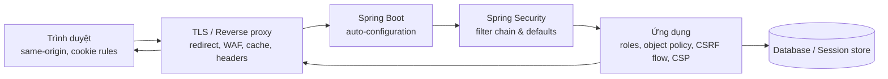
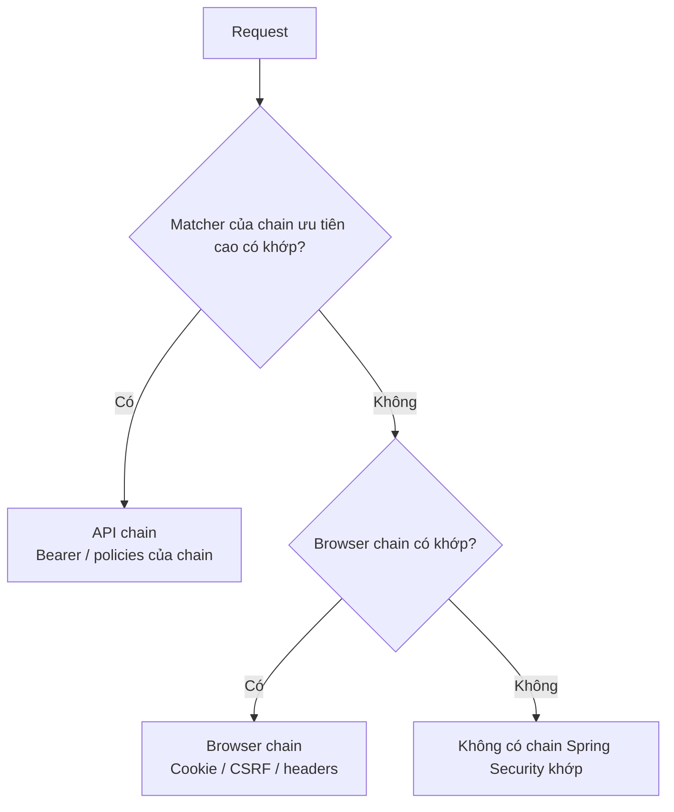
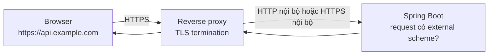

# Phân biệt cấu hình mặc định với chính sách riêng của ứng dụng

> **Chương:** Bản đồ bảo vệ  
> **Học phần:** `SPRING_SECURITY_HTTP_PROTECTION` — áp dụng các lớp phòng vệ HTTP và trình duyệt trong Spring Security, từ CSRF, CORS, security headers, CSP, HSTS đến HTTP firewall và bảo vệ session. Nội dung bao quát **Servlet (Spring MVC)** và **Reactive (WebFlux)**, kiểm thử tình huống tấn công và chẩn đoán xung đột trong triển khai thực tế.

## 1. “Spring Security đã bật sẵn” có nghĩa gì?

Một dự án thêm dependency Spring Security, chạy ứng dụng rồi thấy trang đăng nhập hoặc HTTP `401`. Điều này chứng minh hệ thống đã áp dụng **một số cấu hình bảo mật**, nhưng chưa chứng minh rằng mọi nguy cơ HTTP và trình duyệt của ứng dụng đã có chính sách phù hợp.

Ví dụ, một ứng dụng quản lý hợp đồng có hai loại người dùng và ba kênh truy cập:

- Nhân viên vào màn hình web, đăng nhập bằng **session cookie** và chỉnh sửa hợp đồng.
- Giao diện SPA tại `https://portal.example.com` gọi API tại `https://api.example.com`.
- Dịch vụ nội bộ gọi một số endpoint bằng **bearer token**, thông qua API gateway.

Các quyết định như “origin nào được phép đọc API?”, “ai được duyệt hợp đồng?”, “script từ CDN nào được chạy?”, “session cookie có thuộc tính SameSite nào?” hoặc “subdomain nào sẵn sàng HSTS?” **không thể suy ra** chỉ từ việc thêm `spring-boot-starter-security`.

Cần tách ba khái niệm:

1. **Cơ chế mặc định (*framework defaults*)**: hành vi Spring Security kích hoạt khi được dùng đúng ngăn xếp và chưa bị cấu hình ghi đè. Ví dụ CSRF được bật trong cấu hình web tiêu chuẩn.
2. **Cấu hình tự động (*auto-configuration*)**: Spring Boot cung cấp các bean, bộ lọc và ví dụ xác thực mặc định khi đáp ứng điều kiện. Hành vi này thay đổi nếu ứng dụng tự khai báo bean.
3. **Chính sách riêng (*application security policy*)**: lựa chọn dựa vào tài sản, kiến trúc, loại client, dữ liệu, yêu cầu doanh nghiệp và mô hình đe dọa. Ví dụ phải cấm người A đọc hợp đồng của người B, mặc dù cả hai đều đăng nhập.

**Mặc định là điểm xuất phát, không phải bằng chứng hoàn thành bảo mật ứng dụng.** Bất kỳ thay đổi nào cũng cần kiểm chứng bằng request/response thực và các test âm tính.

### Mục tiêu học tập

Sau bài này, người học có thể:

- Chỉ ra **điều framework có thể cung cấp sẵn** và **điều ứng dụng phải quyết định** trong CSRF, CORS, headers, CSP, HSTS, firewall, session và phân quyền.
- Nhận biết khác biệt giữa Spring Boot auto-configuration với việc khai báo `SecurityFilterChain` hoặc `SecurityWebFilterChain`.
- Phân tích cấu hình hiệu lực khi có nhiều filter chain, reverse proxy, frontend khác origin và các phiên bản Spring Security khác nhau.
- Viết ví dụ cấu hình Servlet/WebFlux, nêu rõ **giả định mô hình xác thực**.
- Kiểm thử mặc định đang hoạt động và chính sách riêng đang được áp dụng đúng, bao gồm cả trường hợp bị từ chối.
- Chẩn đoán vì sao hệ thống “đã bật security” nhưng vẫn thiếu CSP, sai CORS, POST bị `403` hoặc HSTS không xuất hiện.

## 2. Mặc định đến từ nhiều lớp, không chỉ từ Spring Security



Mỗi thành phần có một loại “mặc định” khác nhau:

| Nơi định nghĩa | Ví dụ mặc định hoặc hành vi sẵn có | Chính sách ứng dụng vẫn cần |
| --- | --- | --- |
| **Trình duyệt** | Same-origin policy; quy tắc cookie và chặn một số tài nguyên theo chính sách được nhận | Kiến trúc origin, cookie và cách cấp CORS; CSP trên trang HTML |
| **Spring Security** | Cơ chế xác thực/phân quyền và các bộ lọc; CSRF, một nhóm security headers, firewall theo cấu hình tiêu chuẩn | Quyền thật trên endpoint/dữ liệu, CSP phù hợp, loại authentication, ngoại lệ có kiểm soát |
| **Spring Boot** | Có thể tự tạo default web security và tài khoản thử nghiệm khi ứng dụng chưa khai báo cấu hình riêng | `SecurityFilterChain`/`SecurityWebFilterChain`, user store, IdP, chính sách production |
| **Servlet container / WebFlux runtime** | Xử lý request, session/cookie theo cơ chế tương ứng | Timeout, cookie attributes, session storage, trust proxy |
| **Reverse proxy/CDN/WAF** | Tùy hạ tầng: TLS termination, routing, caching, chặn request bất thường | Trusted forwarding, HSTS, policy cho response lỗi, không cache dữ liệu riêng tư |
| **Ứng dụng/nghiệp vụ** | Không tự có quy tắc ownership/tenant chỉ từ dependency | Kiểm tra quyền đối tượng, validation, audit, giới hạn hành động |

Một header có thể bị backend phát đúng nhưng **proxy xóa đi**. Một route có thể được bảo vệ bởi chain mặc định nhưng **không được bảo vệ như cũ** sau khi thêm một chain do lập trình viên tự cấu hình. Một cookie có thể được tạo bởi Servlet container hoặc Spring Session, nên thay đổi `HttpSecurity` không bảo đảm cookie có đủ thuộc tính.

## 3. Cần hiểu rõ hành vi tự cấu hình của Spring Boot

Với ứng dụng Spring Boot có Spring Security trên classpath và chưa định nghĩa web security chain riêng, Boot thường tạo một chuỗi bảo mật mặc định yêu cầu xác thực cho các request; hình thức đăng nhập thường có HTTP Basic và form login theo cấu hình áp dụng. Với môi trường phát triển và khi không có cấu hình user store riêng, Boot có thể cung cấp một user mặc định và mật khẩu được sinh ra trong log khởi động.

Đây là **phương tiện khởi đầu**, không phải mẫu quản trị danh tính cho production.

### 3.1. Điều gì thay đổi khi khai báo chain riêng?

Ví dụ Servlet:

```java
@Bean
SecurityFilterChain securityFilterChain(HttpSecurity http)
        throws Exception {
    return http
        .authorizeHttpRequests(auth -> auth
            .requestMatchers("/health").permitAll()
            .anyRequest().authenticated())
        .formLogin(Customizer.withDefaults())
        .build();
}
```

Khi có bean `SecurityFilterChain` do ứng dụng khai báo, Boot thường **không tiếp tục tạo default web security chain thay cho bạn**. Ứng dụng chịu trách nhiệm định nghĩa các matcher và cơ chế đăng nhập cần dùng.

Tuy nhiên **khai báo chain riêng không đồng nghĩa mọi framework default tự động bị tắt**. Những cấu hình như CSRF và nhiều HTTP headers vẫn có thể được Spring Security áp dụng khi chưa gọi `disable()` hoặc đổi chính sách. Cần phân biệt:

- **Boot không còn cung cấp chain mặc định**: bạn phải thiết kế rules và các cơ chế authentication cho các route.
- **Spring Security tiếp tục có default của từng configurer**: các tùy chọn CSRF, header writers và tương tự thường vẫn hoạt động, trừ khi bị thay đổi.
- **UserDetailsService/AuthenticationProvider có thể vẫn do nơi khác cung cấp**: việc thêm chain riêng không tự tạo tài khoản hoặc chứng minh password policy đủ an toàn.

Với WebFlux, khái niệm tương tự áp dụng cho `SecurityWebFilterChain` và `ServerHttpSecurity`; chi tiết auto-configuration và bean condition có thể khác Servlet.

### 3.2. Thêm nhiều chain cần kiểm tra thứ tự

Một ứng dụng có chain cho `/api/**` (JWT) và chain cho browser `/**` (session). Nếu matcher và order không rõ, request có thể đi vào chain sai. Spring Security chọn một chain phù hợp theo thứ tự ưu tiên; các chain còn lại không được áp dụng nối tiếp như các “lớp dự phòng”.



**Điểm phải kiểm chứng:** điều gì xảy ra khi request **không khớp chain nào**? Không nên xây hệ thống mà security chain bị bỏ qua trên những route quan trọng. Một fallback chain bảo vệ hoặc từ chối các route chưa khai báo thường là lựa chọn rõ ràng.

## 4. Bảng phân định: mặc định có thể trông đợi và điều phải tự quyết

Bảng dưới đây mô tả hành vi **thường gặp ở cấu hình web tiêu chuẩn của Spring Security hiện đại**. Không coi đây là hợp đồng bất biến cho mọi phiên bản, cả Servlet lẫn Reactive, hay ứng dụng đã có custom config. Phải đối chiếu version và quan sát hệ thống thực tế.

| Thành phần | Hành vi mặc định thường gặp | Quyết định của ứng dụng | Dấu hiệu cần kiểm thử |
| --- | --- | --- | --- |
| Authentication | Cấu hình khởi đầu của Boot có thể yêu cầu đăng nhập với form/Basic | User store, OIDC/SSO/JWT, MFA, logout, account lifecycle | Request chưa xác thực bị từ chối đúng |
| Route authorization | Default Boot web security thường yêu cầu xác thực | `permitAll`/`hasAuthority`/`denyAll` và quyền object/tenant | User A không đọc tài nguyên của user B |
| **CSRF** | Bật với request thay đổi trạng thái trong web security tiêu chuẩn | Lựa chọn token repository/handler, luồng SPA, ngoại lệ chính đáng | POST cookie thiếu token bị chặn |
| **CORS** | Không tự cho phép mọi origin; cần nguồn chính sách phù hợp | Allowed origins, credentials, methods/headers, preflight | Origin hợp lệ được đọc, origin lạ không |
| **Cache headers** | Một số header ngăn cache nhạy cảm được viết mặc định | Chính sách theo response, CDN và tài nguyên tĩnh | API riêng tư không cache chung |
| **X-Content-Type-Options** | Thường phát `nosniff` | Loại MIME chính xác, cách phục vụ upload | Browser không sniff nội dung script/style |
| **Frame protection** | Thường có `X-Frame-Options: DENY` | Có cần iframe hợp lệ? CSP `frame-ancestors` | Trang không bị nhúng trái phép |
| **CSP** | **Không tự có policy phù hợp ứng dụng** | Sources, nonces/hashes, script inline, form, frame, report-only | HTML response có CSP đúng |
| **HSTS** | Có thể phát trên request được nhận diện là HTTPS | `max-age`, subdomains, preload, TLS proxy owner | HTTPS response từ browser có header |
| **HTTPS/TLS** | Thêm Spring Security không tự dựng TLS cho toàn hệ thống | Chứng chỉ, redirect, proxy forwarding, TLS trên từng hop | Redirect đúng; không rơi về HTTP |
| **HTTP firewall** | Thường dùng firewall nghiêm ngặt | Nới quy tắc URL/method chỉ khi thật cần | Path đáng ngờ bị xử lý nhất quán |
| **Session fixation** | Servlet thường có bảo vệ đổi session ID khi login | Session store, expiry, logout, concurrency, SSO flow | ID trước/sau login và sau logout |
| **Cookie attributes** | Do nơi tạo cookie/container/config quyết định | `Secure`, `HttpOnly`, `SameSite`, `Domain`/`Path` | `Set-Cookie` trên response cuối |
| **Brute force/rate limiting** | Không tự có đầy đủ policy hạn mức/bot protection cho mọi endpoint | Chống dò mật khẩu, hạn mức, telemetry, edge controls | Nhiều request bị giới hạn theo policy |
| **Object-level authorization** | Không thể tự suy ra ownership từ route | Tenant, owner, ACL, field-level access | Đổi ID vẫn không vượt quyền |

**Quy tắc kiểm chứng:** Một dòng trong cột “mặc định” chỉ đáng tin khi được quan sát trong **phiên bản và chain đang chạy**. Một dòng trong cột “chính sách” cần có **lý do dựa trên threat model** và **test chứng minh**.

## 5. Nguyên tắc quản lý default khi nâng cấp phiên bản

Đừng đóng đinh giá trị mặc định của Spring Security một lần rồi coi nó bất biến. Khi nâng cấp Spring Boot, Spring Security, Servlet container, browser hoặc gateway, hành vi có thể đổi do:

- API cấu hình DSL đổi cách gọi hoặc bị loại bỏ.
- CSRF token lifecycle/handler thay đổi.
- Bộ header mặc định hoặc giá trị của header được điều chỉnh.
- Cách so khớp path, firewall rejection hoặc HTTP parser thay đổi.
- Browser cập nhật chính sách SameSite, third-party cookies, CSP hoặc HSTS.
- Reverse proxy có chính sách header/caching mới.

Nên ghi lại tối thiểu:

1. Phiên bản **Spring Security, Spring Boot**, loại stack Servlet/WebFlux.
2. Danh sách `SecurityFilterChain`/`SecurityWebFilterChain` và thứ tự/matcher.
3. Bộ lọc/chính sách đang bật hoặc tắt và **lý do**.
4. Chính sách gửi thực tế trên response HTTPS qua edge, bao gồm `Set-Cookie`.
5. Các negative tests cần phải tiếp tục thất bại sau upgrade.

Cấu hình explicit giúp người đọc hiểu ý định, nhưng **không có nghĩa phải viết lại toàn bộ các default**. Viết lại mọi giá trị mặc định có thể làm hệ thống chậm nhận cải tiến bảo mật từ framework hoặc gây trôi cấu hình. Hãy explicit ở nơi có **quyết định chính sách thực sự**, giữ default phù hợp và có test xác nhận.

## 6. CSRF: được bật mặc định không có nghĩa frontend đã gửi được token

Spring Security thông thường bật CSRF trên web security chain với các phương thức không an toàn (POST, PUT, PATCH, DELETE, ...). Các phương thức được coi là safe như GET, HEAD, OPTIONS và TRACE không được dùng để thực hiện thay đổi trạng thái nghiệp vụ.

### 6.1. Default có thể đảm nhận điều gì?

Trong Servlet:

- `CsrfFilter` kiểm tra token đối với request phù hợp.
- `HttpSessionCsrfTokenRepository` là repository mặc định thông dụng.
- Spring Security hiện đại có thể dùng deferred token loading và request handler hỗ trợ chống BREACH.

Trong WebFlux:

- `CsrfWebFilter` áp dụng kiểm tra tương ứng.
- `WebSessionServerCsrfTokenRepository` là repository mặc định thông dụng.

**Bật kiểm tra** không tự đảm bảo frontend biết **cách lấy, giữ và gửi** token hợp lệ, đặc biệt ở SPA hoặc ứng dụng có nhiều origin.

### 6.2. Chính sách riêng cần xác định gì?

| Quyết định | Câu hỏi thiết kế |
| --- | --- |
| Scope endpoint | Endpoint nào dùng cookie/session và thay đổi trạng thái? Có endpoint bearer-only? |
| Cách cấp token | Server-rendered form, endpoint lấy token hay cookie repository? |
| Cách gửi token | Hidden form field, `X-CSRF-TOKEN`, `X-XSRF-TOKEN`? |
| Token lifecycle | Sau login/logout, session rotation, token hết hiệu lực sẽ làm mới ra sao? |
| SPA/BREACH | Nếu đọc token từ cookie, request handler có tương thích cơ chế masked token không? |
| Ngoại lệ | Có webhook hoặc API thật sự không dùng ambient credentials không? |
| Kiểm thử | POST thiếu/sai token có bị chặn trước nghiệp vụ không? |

Không dùng `csrf().disable()` như “cách sửa nhanh” khi form hoặc SPA nhận `403`. Cần xác định có thiếu token, token hết hạn, cookie không gửi, chain sai hay authorization từ chối.

### 6.3. Ví dụ cấu hình Servlet giữ default

```java
@Bean
SecurityFilterChain browserSecurity(HttpSecurity http)
        throws Exception {
    return http
        .csrf(Customizer.withDefaults()) // Thể hiện chủ đích giữ CSRF
        .authorizeHttpRequests(auth -> auth
            .requestMatchers("/login", "/assets/**").permitAll()
            .anyRequest().authenticated())
        .formLogin(Customizer.withDefaults())
        .build();
}
```

`csrf(withDefaults())` ở ví dụ là **khẳng định chủ đích**, không tự triển khai luồng token. Với form do server render, tích hợp template có thể cung cấp token; với SPA, cần thiết kế cách khởi tạo và làm mới riêng.

### 6.4. Khi nào miễn CSRF có thể có cơ sở?

Một endpoint bearer-only **thực sự chỉ** chấp nhận `Authorization: Bearer ...` do client chủ động gửi có nguy cơ CSRF khác cookie-based app. Tuy nhiên cần kiểm tra:

- Không có session cookie hoặc HTTP Basic/browser ambient credential vẫn được chấp nhận.
- Endpoint bearer nằm đúng chain, không vô tình làm app browser cũng mất CSRF.
- Login/refresh/logout không dựa vào cookie hoặc có thiết kế bảo vệ riêng.
- Có test chứng minh request chỉ mang cookie không được xác thực theo cơ chế API.

Dòng code `csrf(csrf -> csrf.disable())` chỉ có thể được biện hộ trong **bối cảnh threat model phù hợp**, không phải mặc định khuyến nghị cho mọi ứng dụng REST.

## 7. CORS: framework có cơ chế, ứng dụng phải chọn origin và quyền chia sẻ

CORS không có một allowlist chung phù hợp cho mọi sản phẩm. Spring Security hỗ trợ tích hợp CORS với Servlet/WebFlux, nhưng không thể đoán frontend hợp pháp nằm ở origin nào.

### 7.1. Mặc định không có nghĩa “mở tất cả”

Nếu ứng dụng chưa cấu hình CORS cho một cross-origin browser request, JavaScript có thể không đọc được response, dù server xử lý request hợp lệ. Khi khai báo một policy quá rộng như wildcard origins trong API có credentials, trình duyệt có thể từ chối hoặc, nếu cấu hình phản chiếu origin tùy tiện, dữ liệu có nguy cơ bị lộ cho origin không tin cậy.

Một policy minh họa:

```java
@Bean
UrlBasedCorsConfigurationSource corsConfigurationSource() {
    CorsConfiguration cors = new CorsConfiguration();
    cors.setAllowedOrigins(List.of("https://portal.example.com"));
    cors.setAllowedMethods(List.of("GET", "POST", "PUT"));
    cors.setAllowedHeaders(List.of(
        "Content-Type", "X-CSRF-TOKEN", "X-XSRF-TOKEN"
    ));
    cors.setAllowCredentials(true);

    UrlBasedCorsConfigurationSource source =
        new UrlBasedCorsConfigurationSource();
    source.registerCorsConfiguration("/api/**", cors);
    return source;
}
```

Đây là code **Servlet**; cần import `org.springframework.web.cors.UrlBasedCorsConfigurationSource`. Trong chain phải tích hợp CORS (ví dụ `.cors(Customizer.withDefaults())`) nếu chọn cơ chế xử lý này. Với WebFlux, namespace CORS tương ứng là `org.springframework.web.cors.reactive`.

Các quyết định riêng cần trả lời: origin nào, method nào, request headers nào, response headers nào cho phép expose, có gửi credentials không, cache/preflight timeout bao lâu?

### 7.2. CORS preflight và thứ tự filter

Browser thường gửi `OPTIONS` preflight **không có cookie phiên** trước một actual request có method/header không đơn giản.

```http
OPTIONS /api/contracts/42 HTTP/1.1
Host: api.example.com
Origin: https://portal.example.com
Access-Control-Request-Method: PUT
Access-Control-Request-Headers: content-type,x-csrf-token
```

Nếu xác thực bắt buộc cookie **trước bước xử lý CORS**, preflight có thể bị `401/403` dù actual request có thể đăng nhập hợp lệ. Phải bảo đảm tích hợp CORS đúng chain và trước thành phần xác thực có thể chặn preflight.

**Đừng sửa bằng cách cấp `permitAll()` cho mọi request `OPTIONS` mà không hiểu CORS policy**: vẫn cần giới hạn allowed origins, methods, headers; `OPTIONS` không được mang tác dụng nghiệp vụ.

### 7.3. CORS không phải authorization hoặc CSRF

- CORS điều chỉnh quyền **JavaScript của origin khác đọc response** trong browser.
- Authentication xác định principal.
- Authorization xác định principal có quyền trên tài nguyên.
- CSRF kiểm tra request thay đổi trạng thái khi browser tự gửi credential.

Một origin được CORS cho phép **không tự biến mọi user ở origin đó thành admin**. Ngược lại, chặn CORS không thay được CSRF token: form cross-origin có thể gửi request mà không cần đọc response.

## 8. HTTP security headers: default có giá trị nhưng phải kiểm chứng giá trị thực

Một số headers Spring Security thường tự thêm khi dùng security chain mặc định hoặc các header configurers chưa bị tắt:

```http
Cache-Control: no-cache, no-store, max-age=0, must-revalidate
Pragma: no-cache
Expires: 0
X-Content-Type-Options: nosniff
X-Frame-Options: DENY
```

Đây là **ví dụ một tập header thường gặp**, không phải bảo đảm byte-for-byte cho mọi phiên bản, mọi response và mọi stack. `Strict-Transport-Security` thường được phát khi request được nhận diện là HTTPS; một số phiên bản có thể ghi `X-XSS-Protection: 0` để chủ động tắt bộ lọc XSS lỗi thời của browser.

**Điều phải tự quyết** bao gồm CSP, Referrer-Policy, Permissions-Policy (nếu cần), chính sách iframe, cache theo loại dữ liệu, HSTS scope và cách phát headers trên response do edge tạo.

### 8.1. Bảng “có thể mặc định” so với “phải chọn”

| Header | Hành vi thường gặp | Chính sách ứng dụng phải xác định |
| --- | --- | --- |
| `X-Content-Type-Options: nosniff` | Thường có | Trả `Content-Type` chính xác cho HTML, JS, CSS và file upload/download |
| `X-Frame-Options: DENY` | Thường có | Có ứng dụng đối tác nào cần iframe? Điều chỉnh với CSP `frame-ancestors` |
| `Cache-Control` | Thường hạn chế cache | API dữ liệu nhạy cảm khác assets fingerprint/ảnh công khai |
| `Content-Security-Policy` | Không có policy tự suy ra | `script-src`, `style-src`, `connect-src`, `frame-ancestors`, nonce/hash |
| `Strict-Transport-Security` | Thường có trên HTTPS | `max-age`, `includeSubDomains`, preload, reverse proxy ownership |
| `Referrer-Policy` | Không nên giả định có giá trị mong muốn | Giới hạn truyền URL/query ra bên thứ ba |
| `Permissions-Policy` | Không nên giả định framework sẽ tự cấp policy | Tính năng camera, microphone, geolocation, iframe và hỗ trợ browser |

### 8.2. Header bị ghi đè sau proxy

Trong thực tế browser nhận response từ edge/CDN. Nếu proxy gỡ CSP, thêm trùng `Access-Control-Allow-Origin` hoặc cache trang riêng tư, cấu hình backend đúng **không đủ chứng minh** hệ thống đúng.

Cần kiểm tra:

1. HTML document do host nào thực sự phục vụ?
2. Header nằm trên **response cuối cùng**, bao gồm redirect, lỗi `4xx/5xx` và CDN cache hit?
3. Có nhiều lớp tự thêm cùng header không?
4. Dữ liệu riêng tư có được cache chung qua CDN không?

## 9. CSP: không thể suy ra nguồn script hợp lệ từ mặc định

**Content Security Policy** do server công bố trong response nhưng **browser thực thi**. CSP hạn chế nguồn script, style, frame và nhiều loại tài nguyên nhằm giảm khả năng khai thác XSS, clickjacking và nội dung ngoài ý muốn.

Spring Security hỗ trợ API ghi CSP, nhưng **không có cách nào để framework biết CDN, nonce, frontend bundler, WebSocket hoặc iframe đối tác hợp lệ của từng ứng dụng**.

Ví dụ policy khởi đầu cho một trang không dùng script inline:

```http
Content-Security-Policy: default-src 'self'; script-src 'self'; object-src 'none'; base-uri 'self'; frame-ancestors 'none'; form-action 'self'
```

### 9.1. Những quyết định bắt buộc thuộc ứng dụng

- Có dùng inline script hay event handler HTML không? Nếu có, cân nhắc thay thành file script hoặc dùng **nonce/hash**; tránh `'unsafe-inline'` như giải pháp chung.
- Có dùng API qua origin khác không? `connect-src` cần phù hợp fetch/WebSocket theo chính sách.
- Có dùng CDN, ảnh, font, worker, sandbox iframe không? Bổ sung directive cụ thể và giới hạn nguồn.
- Có trang cần được đối tác nhúng iframe không? Dùng `frame-ancestors` rõ ràng.
- Có form gửi tới endpoint khác origin không? Xác định `form-action` phù hợp.
- Có cần quan sát rollout không? `Content-Security-Policy-Report-Only` **chỉ báo cáo vi phạm, không chặn**.

### 9.2. CSP và chống XSS ở ứng dụng

CSP là lớp bổ sung. Khi render dữ liệu không tin cậy, vẫn cần **output encoding theo ngữ cảnh**, DOM APIs an toàn và sanitize nếu chủ đích cho phép HTML. `HttpOnly` giúp script không đọc trực tiếp cookie nhưng không làm XSS vô hại; script chạy trong origin hợp lệ có thể gửi request bằng cookie.

Nếu SPA HTML nằm ở `https://portal.example.com` còn API JSON nằm ở `https://api.example.com`, header CSP để bảo vệ script của SPA phải nằm trên **response HTML của portal**, không trông chờ header CSP chỉ xuất hiện trên response JSON của API.

### 9.3. Code Servlet khai báo CSP explicit

```java
.headers(headers -> headers
    .contentSecurityPolicy(csp -> csp.policyDirectives(
        "default-src 'self'; " +
        "script-src 'self'; " +
        "object-src 'none'; " +
        "base-uri 'self'; " +
        "frame-ancestors 'none'"
    ))
)
```

Đây là **đoạn DSL bên trong cấu hình `HttpSecurity`**. Trong WebFlux, `ServerHttpSecurity` cũng có cấu hình `headers(...contentSecurityPolicy(...))` tương ứng. Cần đối chiếu phiên bản framework và thử trên frontend thật vì policy này có thể chặn những script hợp lệ nếu ứng dụng đang dùng inline scripts.

## 10. HTTPS, redirect và HSTS: default không triển khai hạ tầng giúp bạn

Spring Security có thể ghi header HSTS hoặc yêu cầu secure channel theo cấu hình. Tuy nhiên **việc thêm dependency không tự phát hành chứng chỉ hợp lệ, cấu hình load balancer hay buộc TLS trên mọi hop**.

### 10.1. HTTPS và HSTS là hai cơ chế khác nhau

| Cơ chế | Ai áp dụng | Mục đích | Điều ứng dụng/hạ tầng quyết định |
| --- | --- | --- | --- |
| HTTPS/TLS | TLS peers (browser ↔ edge, edge ↔ app nếu có) | Mã hóa và xác thực kết nối hiện tại | Certificate, protocols, redirect, TLS termination |
| HTTP → HTTPS redirect | Edge/server | Điều hướng HTTP sang HTTPS | Host/port, exception, thứ tự redirect |
| HSTS | Browser sau khi nhận header qua HTTPS hợp lệ | Ưu tiên HTTPS cho request sau | `max-age`, `includeSubDomains`, preload |
| Trusted forwarding | Edge/app | Backend hiểu external scheme/host hợp lệ | Proxy tin cậy, loại bỏ header giả mạo |

Ví dụ HSTS:

```http
Strict-Transport-Security: max-age=31536000
```

Một số cấu hình mặc định có thể dùng `includeSubDomains`. Chính sách nào được chọn cần dựa trên toàn bộ hostname thật: bật `includeSubDomains` cho miền gốc khi còn subdomain chỉ hỗ trợ HTTP có thể làm gián đoạn truy cập. `preload` còn có điều kiện và cam kết vận hành riêng.

### 10.2. TLS termination làm thay đổi cách server nhìn request



Nếu TLS kết thúc tại edge, Spring Boot phía sau có thể nhận request nội bộ là HTTP, dẫn tới:

- HSTS không được phát vì request không được đánh dấu secure.
- Redirect loop do app liên tục đòi HTTPS.
- `Location`, OAuth callback hoặc absolute URL có scheme/host sai.
- Cookie `Secure` không được thiết lập như mong đợi khi nơi tạo cookie suy luận từ scheme.

Cách xử lý cần **thiết kế trusted proxy**. Edge nên loại bỏ/ghi đè `Forwarded` và `X-Forwarded-*` từ client, sau đó cung cấp metadata thật; backend chỉ tin chúng khi request đến từ proxy được kiểm soát.

Ví dụ cấu hình Spring Boot trong kiến trúc đã kiểm soát forwarded headers:

```yaml
server:
  forward-headers-strategy: framework
```

Cần chọn `framework` hoặc `native` theo runtime và topology; không bật tin forwarded headers tùy tiện nếu backend có thể nhận request trực tiếp từ Internet.

### 10.3. Ai sở hữu HSTS?

Có hai thiết kế phổ biến:

- **Edge sở hữu HSTS:** proxy phát header nhất quán cho HTTPS response, kể cả lỗi/redirect ở edge.
- **App sở hữu HSTS:** Spring Security phát header và backend phải nhận biết request HTTPS bên ngoài chính xác.

Một hệ thống có thể phối hợp theo cách khác, nhưng tránh nhiều policy mâu thuẫn trên cùng host. **Kiểm tra response cuối từ browser** và kế hoạch tên miền trước khi bật `includeSubDomains`/`preload`.

## 11. HTTP firewall: mặc định nghiêm ngặt và bài toán ngoại lệ

HTTP firewall giúp giảm trường hợp reverse proxy, server, matcher phân quyền và handler **hiểu cùng một URL theo những cách khác nhau**. Những path bất thường có thể gồm:

- Slash mã hóa `%2F`, double slash `//`.
- Semicolon `;`, matrix parameters.
- Backslash, dot segments, control characters, encoding khác thường.
- Method HTTP lạ/không được phép.

Spring Security thường dùng:

- **Servlet:** `HttpFirewall` với triển khai `StrictHttpFirewall`.
- **Reactive WebFlux:** `ServerWebExchangeFirewall` với `StrictServerWebExchangeFirewall`.

Đây là **mặc định nên giữ nếu phù hợp**; không tự nới để mọi URL kỳ lạ “chạy được”.

### 11.1. Tại sao không tắt firewall để sửa `400`?

Một yêu cầu bị firewall chặn có thể trả `400 Bad Request` hoặc mã do integration/edge xử lý. Nới lỏng các path không chuẩn mà không kiểm tra hệ quả có thể tạo ra chênh lệch giữa URL được authorization matcher nhìn thấy và URL handler cuối thực thi.

Ví dụ nếu ứng dụng cần semicolon vì matrix variables:

```java
@Bean
StrictHttpFirewall httpFirewall() {
    StrictHttpFirewall firewall = new StrictHttpFirewall();
    firewall.setAllowSemicolon(true);
    return firewall;
}
```

Đây là ví dụ về **cách thay đổi một default**, **không phải cấu hình nên bật đại trà**. Trước khi nới, cần chứng minh route nghiệp vụ thực sự cần ký tự, xem gateway và container normalize path như thế nào, rồi test bypass authorization bằng nhiều dạng URL.

### 11.2. Firewall không thay quyền tài nguyên

Ngay cả path hoàn toàn hợp lệ `GET /api/contracts/42` vẫn cần authentication, route authorization và object-level authorization. Một tài khoản có quyền `CONTRACT_READ` nhưng không thuộc tenant sở hữu hợp đồng 42 vẫn phải bị từ chối.

Firewall kiểm tra **biểu diễn HTTP**, không tự biết tenant/owner hay trạng thái phê duyệt của hợp đồng.

## 12. Session và cookie: một số bảo vệ có sẵn, phần còn lại thuộc kiến trúc

Spring Security hỗ trợ quản lý bảo mật phiên, nhưng không kiểm soát mọi thuộc tính cookie hay toàn bộ vòng đời session chỉ bằng một đoạn `http.sessionManagement(...)`.

### 12.1. Session fixation và logout

**Session fixation** là tình huống attacker kiểm soát hoặc biết trước session ID, rồi nạn nhân login vào session đó. Với Servlet container hiện đại, Spring Security thường dùng `changeSessionId` khi xác thực thành công theo cơ chế tiêu chuẩn. Tuy nhiên đăng nhập tùy biến, SSO hoặc custom filter có thể thay đổi cách bảo vệ này.

Logout cần vô hiệu hóa session phía server theo thiết kế; chỉ xóa nút UI hoặc xóa cookie không đủ chứng minh session ID cũ không dùng được.

### 12.2. Cookie attributes phải kiểm tra tại nơi tạo cookie

```http
Set-Cookie: JSESSIONID=<opaque-id>; Path=/; Secure; HttpOnly; SameSite=Lax
```

Đây là **một ví dụ cookie mong muốn**, không phải cam kết tự sinh từ Spring Security trong mọi môi trường.

| Thuộc tính | Ý nghĩa | Chính sách cần chọn |
| --- | --- | --- |
| `Secure` | Chỉ gửi cookie qua kênh HTTPS phù hợp | HTTPS thật và proxy forwarding |
| `HttpOnly` | Ngăn JS đọc trực tiếp cookie | Xác định cookie nào frontend cần đọc, cookie nào là session secret |
| `SameSite` | Hạn chế gửi cookie theo ngữ cảnh site | Same-site/cross-site, iframe, OAuth redirects |
| `Domain`, `Path` | Giới hạn host/path gửi cookie | Không mở rộng phạm vi hơn cần thiết |
| `Max-Age`/`Expires` | Vòng đời cookie tại browser | Phối hợp session expiration server và logout |

Với Spring Boot Servlet, cấu hình cookie có thể do servlet container hoặc Spring Session điều khiển. Với WebFlux, `WebSession` và resolver cookie có API khác. Nên kiểm tra `Set-Cookie` trên **response thật**, sau CDN/proxy, cả lúc login và logout.

### 12.3. Concurrent sessions và session storage

Giới hạn số phiên đồng thời, timeout theo rủi ro, đăng xuất thiết bị khác, lưu session phân tán, kiểm soát cookie trong iframe và token revocation là những **quyết định sản phẩm/vận hành**. Đừng giả định một ứng dụng có Spring Security tự bật tất cả.

Với API bearer-only, session creation policy và cơ chế lưu security context phải phù hợp mô hình không dùng session; vẫn cần xử lý token expiry, revocation/rotation, storage phía client và XSS.

## 13. Authentication và authorization: default không biết nghiệp vụ của bạn

Một ứng dụng mặc định yêu cầu đăng nhập cho mọi request là khởi đầu hữu ích, nhưng chưa đủ:

- Một trang `/health` có thể cần công khai theo cách hạn chế.
- Một route `/admin/**` cần authority riêng, không chỉ `authenticated()`.
- Một endpoint `GET /api/contracts/42` cần quyền đọc **hợp đồng 42**.
- Một POST chỉnh sửa cần kiểm tra quyền trên field, tenant và trạng thái tài liệu.
- Một API export cần kiểm tra **tập dữ liệu xuất**, không chỉ quyền trên URL export.

### 13.1. Đừng thay chính sách đối tượng bằng tên role

`hasRole("ADMIN")` hay `hasAuthority("CONTRACT_READ")` kiểm tra authority, nhưng không tự xác định principal thuộc tenant nào. Vì thế ứng dụng cần kiểm tra trong service:

```java
public ContractView readContract(
        String contractId,
        Authentication actor) {
    Contract contract = repository.findById(contractId)
        .orElseThrow(ContractNotFoundException::new);

    if (!policy.canRead(actor, contract)) {
        throw new AccessDeniedException(
            "No access to this contract");
    }

    return mapper.toView(contract);
}
```

Các kiểu `ContractView`, `repository`, `policy`, `mapper` trong ví dụ là các thành phần nghiệp vụ cần triển khai. Spring Security có thể chặn request ở route nhưng không tự biết hàm `canRead` đúng cho hệ thống của bạn.

### 13.2. Fallback cần có chủ đích

Khi ứng dụng có các route public, browser và API riêng, hãy xác định điều gì xảy ra với route **chưa phân loại**. `anyRequest().authenticated()` có thể phù hợp nếu mọi route còn lại chỉ yêu cầu đăng nhập; `anyRequest().denyAll()` phù hợp khi muốn từ chối các route chưa khai báo rõ.

Không mở `permitAll()` rộng chỉ để nhanh chóng hết lỗi 403. Cần phân biệt: CSRF đang chặn, authentication chưa có, hay authorization thật sự thiếu?

## 14. Ví dụ cấu hình Servlet: giữ default có chủ đích, bổ sung policy nghiệp vụ

Giả sử Spring MVC phục vụ HTML và API **cùng origin** với login session cookie. Ứng dụng có các route public, hợp đồng và route phê duyệt dành cho reviewer.

```java
@Configuration
@EnableWebSecurity
@EnableMethodSecurity
class ContractServletSecurity {

    @Bean
    SecurityFilterChain webSecurity(HttpSecurity http) throws Exception {
        return http
            // CSRF thường bật mặc định; ghi rõ chủ đích giữ lại.
            .csrf(Customizer.withDefaults())

            // CSP là policy do ứng dụng lựa chọn.
            .headers(headers -> headers
                .contentSecurityPolicy(csp -> csp.policyDirectives(
                    "default-src 'self'; script-src 'self'; " +
                    "object-src 'none'; base-uri 'self'; " +
                    "frame-ancestors 'none'"
                ))
            )

            // Quyền theo route không được Boot tự biết.
            .authorizeHttpRequests(auth -> auth
                .requestMatchers("/login", "/assets/**", "/error").permitAll()
                .requestMatchers(HttpMethod.GET, "/health").permitAll()
                .requestMatchers(HttpMethod.POST,
                    "/api/contracts/*/approve")
                    .hasAuthority("CONTRACT_APPROVE")
                .requestMatchers(HttpMethod.GET, "/api/contracts/**")
                    .hasAuthority("CONTRACT_READ")
                .anyRequest().denyAll()
            )
            .formLogin(Customizer.withDefaults())
            .logout(Customizer.withDefaults())
            .build();
    }
}
```

Đoạn mã là **khung minh họa**, cần bổ sung imports, user store, controller, CSRF token trong frontend và quyền đối tượng tại service. `anyRequest().denyAll()` còn từ chối mọi route khác chưa khai báo; khi áp dụng thật phải bổ sung các endpoint cần thiết. Việc chọn default headers không loại bỏ trách nhiệm kiểm tra response sau proxy.

### 14.1. Điểm nào được framework làm, điểm nào được team quyết định?

| Trong ví dụ | Phân loại | Ý nghĩa |
| --- | --- | --- |
| `csrf(withDefaults())` | Giữ cơ chế framework | Bật kiểm tra token; frontend vẫn phải gửi token |
| `formLogin(withDefaults())` | Cấu hình cơ chế authn | Cần nguồn người dùng và lifecycle đúng |
| `headers().contentSecurityPolicy(...)` | **Chính sách ứng dụng** | Quyết định sources/frame của HTML |
| `requestMatchers(...).hasAuthority(...)` | **Chính sách ứng dụng** | Quyền chức năng cho endpoint |
| `anyRequest().denyAll()` | **Chính sách ứng dụng** | Từ chối route chưa phân loại |
| `policy.canRead(...)` ở service | **Chính sách nghiệp vụ** | Ownership/tenant/ACL trên từng đối tượng |
| `Secure`/`SameSite` cookie | Không có trong snippet | Cấu hình ở nơi phát cookie và kiểm tra thực tế |
| TLS/HSTS owner | Không có trong snippet | Cấu hình và kiểm thử edge/app theo kiến trúc |

### 14.2. Nếu dùng SPA cross-origin

Cần tích hợp `.cors(Customizer.withDefaults())` vào security chain và khai báo nguồn `CorsConfigurationSource` hạn chế đúng origin/credentials. Có thể dùng mẫu cấu hình tại mục 7.

CORS policy chưa hoàn thiện luồng CSRF: SPA vẫn cần cơ chế lấy/gửi token; cần kiểm tra cookie SameSite/Secure và những endpoint login/logout/token được gọi cross-origin.

## 15. Ví dụ cấu hình Reactive WebFlux: cùng nguyên tắc, API khác

Giả sử WebFlux phục vụ ứng dụng có **form login và WebSession**. Vì browser dùng session cookie, giữ CSRF.

```java
@Configuration
@EnableWebFluxSecurity
@EnableReactiveMethodSecurity
class ContractReactiveSecurity {

    @Bean
    SecurityWebFilterChain webSecurity(ServerHttpSecurity http) {
        return http
            .csrf(Customizer.withDefaults())
            .headers(headers -> headers
                .contentSecurityPolicy(csp -> csp.policyDirectives(
                    "default-src 'self'; script-src 'self'; " +
                    "object-src 'none'; base-uri 'self'; " +
                    "frame-ancestors 'none'"
                ))
            )
            .authorizeExchange(auth -> auth
                .pathMatchers("/login", "/assets/**", "/error").permitAll()
                .pathMatchers(HttpMethod.GET, "/health").permitAll()
                .pathMatchers(HttpMethod.POST,
                    "/api/contracts/*/approve")
                    .hasAuthority("CONTRACT_APPROVE")
                .pathMatchers(HttpMethod.GET, "/api/contracts/**")
                    .hasAuthority("CONTRACT_READ")
                .anyExchange().denyAll()
            )
            .formLogin(Customizer.withDefaults())
            .build();
    }
}
```

WebFlux có `SecurityWebFilterChain`, `ServerHttpSecurity`, `authorizeExchange`, `CsrfWebFilter` và `WebSessionServerCsrfTokenRepository`. Servlet sử dụng `SecurityFilterChain`, `HttpSecurity`, `authorizeHttpRequests`, `CsrfFilter` và `HttpSessionCsrfTokenRepository`.

Cả hai stack đều cần object-level authorization và policy CSP do ứng dụng quyết định. Không sao chép `HttpSession`, `StrictHttpFirewall` hoặc class CORS Servlet trực tiếp vào WebFlux.

### 15.1. Bảng so sánh ở nơi dễ cấu hình nhầm

| Thành phần | Servlet | Reactive WebFlux |
| --- | --- | --- |
| Configurer | `HttpSecurity` | `ServerHttpSecurity` |
| Security chain | `SecurityFilterChain` | `SecurityWebFilterChain` |
| Authorization route | `authorizeHttpRequests` | `authorizeExchange` |
| CSRF | `CsrfFilter`, `HttpSessionCsrfTokenRepository` | `CsrfWebFilter`, `WebSessionServerCsrfTokenRepository` |
| CORS source | `org.springframework.web.cors.*` | `org.springframework.web.cors.reactive.*` |
| HTTP firewall | `StrictHttpFirewall` | `StrictServerWebExchangeFirewall` |
| Session | `HttpSession` | `WebSession` |
| Security context | `SecurityContextHolder` | `ReactiveSecurityContextHolder` trong Reactor context |
| Test | `MockMvc` + spring-security-test | `WebTestClient` + spring-security-test |

Một service **bearer-only WebFlux** có thể lựa chọn `csrf(csrf -> csrf.disable())` theo threat model đã xác minh. **Không áp lựa chọn đó cho WebFlux form login/session** chỉ vì cả hai cùng dùng WebFlux.

## 16. Nhiều security chains: chính sách áp dụng theo chain nào?

Ví dụ một hệ thống có:

- Browser pages dùng cookie/session: giữ CSRF, form login.
- API nội bộ bearer-only: yêu cầu JWT, không chấp nhận session login.
- Health endpoint: public hoặc chỉ dành cho hệ thống giám sát.

Các chain có thể có matcher riêng; **chain khớp đầu tiên** quyết định filter/policy có hiệu lực cho request. Nếu API chain trùm `/**` hoặc browser chain trùm `/api/**` trước API chain, quyết định có thể bị áp sai.

Cách thiết kế:

1. Liệt kê mọi route và cách xác thực tương ứng.
2. Đặt matcher cụ thể cho từng chain và thứ tự ưu tiên rõ ràng.
3. Dùng fallback chain để chặn route không phân loại.
4. Kiểm thử request của từng route để xác nhận **chain nhận request** đúng.
5. Trong test, xác nhận cookie đơn thuần không được dùng để xác thực API chỉ dành cho bearer; CSRF không bị tắt ở browser chain.

**Đừng coi `permitAll()` trong authorization là “bỏ qua mọi filter”.** Các filter như CSRF có thể vẫn áp dụng cho request unsafe của endpoint permitAll; nếu endpoint public có hành động ghi như webhook, phải thiết kế exception hợp lệ và cơ chế xác minh webhook riêng.

## 17. Cấu hình riêng cần đi kèm kiểm thử: default không phải một tuyên bố trên giấy

Mỗi biện pháp nên có ít nhất:

- **Một yêu cầu hợp lệ** chứng minh hệ thống tiếp tục phục vụ đúng.
- **Một yêu cầu bị cấm** chứng minh chính sách không bị bỏ qua.
- **Một quan sát HTTP hoặc browser** chứng minh policy thật sự có mặt.
- **Một kiểm tra qua proxy** nếu chính sách phụ thuộc origin, scheme, cache hay header cuối.

### 17.1. Ma trận yêu cầu kiểm thử

| Cơ chế | Case hợp lệ | Case bị cấm | Bằng chứng |
| --- | --- | --- | --- |
| CSRF với cookie | POST có token đúng, user đủ quyền | POST thiếu/sai token | Không thay đổi dữ liệu khi bị chặn |
| CORS | Browser từ origin allowlist đọc API | Browser từ origin lạ | Preflight/response CORS đúng; browser chặn đọc |
| Authentication | Cookie/session hoặc JWT hợp lệ | Không có credential, token sai/hết hạn | `401`/redirect và không có dữ liệu |
| Authorization | User có quyền đúng tài nguyên | User khác tenant hoặc thiếu scope | Không đọc/ghi dữ liệu bị cấm |
| CSP | Script hợp lệ hoạt động | Script không nằm trong policy | Browser chặn hoặc report-only ghi nhận |
| Frame protection | Nhúng trang khi được phép | Origin không được nhúng | Browser chặn iframe |
| HSTS | HTTPS response đúng host | HTTP/redirect hoặc subdomain sai chính sách | Header HTTPS và browser HSTS state |
| HTTP firewall | URL bình thường | Path mã hóa/semicolon lạ | Parser/firewall xử lý an toàn, không bypass |
| Session | Login/logout theo luồng | Dùng lại cookie cũ sau logout | Session cũ không truy cập được |
| Cache | Public asset có cache hợp lý | Private API không cache chung | Hai user không nhận chéo dữ liệu |

### 17.2. Servlet: test CSRF và security headers qua MockMvc

Giả sử `MockMvc` đã được cấu hình sử dụng Spring Security filter chain, có endpoint `POST /api/contracts/42/approve`.

```java
// Người dùng có authority nhưng không có CSRF token.
mvc.perform(post("/api/contracts/42/approve")
        .with(user("alice").authorities(
            new SimpleGrantedAuthority("CONTRACT_APPROVE"))))
   .andExpect(status().isForbidden());

// Token CSRF hợp lệ cho phép request vượt CSRF.
// Kết quả cuối còn phụ thuộc quyền đối tượng và nghiệp vụ.
mvc.perform(post("/api/contracts/42/approve")
        .with(user("alice").authorities(
            new SimpleGrantedAuthority("CONTRACT_APPROVE")))
        .with(csrf()));

// Header thường có trong response được xử lý bởi Spring Security.
mvc.perform(get("/login").secure(true))
   .andExpect(header().string("X-Content-Type-Options", "nosniff"));
```

`with(user(...))` và `with(csrf())` là helper tạo trạng thái **giả cho test**; chúng không tự chứng minh user store, login, TLS hoặc session rotation trong production. Khi kiểm tra HSTS, phải dùng request được coi là secure và chain thực sự phát HSTS theo cấu hình.

### 17.3. WebFlux: test với WebTestClient

Với WebFlux dùng session, có thể dùng `mockUser()` và `csrf()` của `spring-security-test`:

```java
webTestClient.mutateWith(mockUser("alice")
        .authorities(new SimpleGrantedAuthority("CONTRACT_APPROVE")))
    .post()
    .uri("/api/contracts/42/approve")
    .exchange()
    .expectStatus().isForbidden();  // Thiếu CSRF token

webTestClient.mutateWith(mockUser("alice")
        .authorities(new SimpleGrantedAuthority("CONTRACT_APPROVE")))
    .mutateWith(csrf())
    .post()
    .uri("/api/contracts/42/approve")
    .exchange();  // Cần assert thêm kết quả nghiệp vụ thực tế
```

Test cần tích hợp `WebTestClient` với Spring Security. Với bearer API, dùng các helper như `mockJwt()` để kiểm tra route/authority nhưng test riêng decoder thật để xác minh signature, issuer, audience, expiry.

### 17.4. Quan sát CORS và HSTS bằng công cụ HTTP

```bash
# Xem preflight của một frontend được cho phép.
curl -i -X OPTIONS https://api.example.com/api/contracts/42 \
  -H 'Origin: https://portal.example.com' \
  -H 'Access-Control-Request-Method: PUT' \
  -H 'Access-Control-Request-Headers: content-type,x-csrf-token'

# Lặp lại với origin không được tin cậy.
curl -i -X OPTIONS https://api.example.com/api/contracts/42 \
  -H 'Origin: https://untrusted.example.net' \
  -H 'Access-Control-Request-Method: PUT'

# Quan sát headers sau khi qua proxy/CDN.
curl -I https://portal.example.com/
```

**curl không áp dụng CORS/CSP/HSTS và cookie rules như browser.** Dùng browser Network/Console/Application tools để xác minh policy được thực thi. Đồng thời kiểm tra `HTTPS response` từ đúng host: một CSP trên JSON API không tự bảo vệ HTML của frontend ở origin khác.

## 18. Chẩn đoán xung đột: mặc định nào đang gây ra kết quả?

Thay vì phỏng đoán, hãy xác định **chính xác request**, **chain**, **nơi response được tạo** và **policy cuối cùng**.

| Triệu chứng | Mặc định/chính sách có thể liên quan | Hướng phân tích |
| --- | --- | --- |
| POST bị `403` khi đã đăng nhập | CSRF mặc định hoặc authorization | Kiểm tra token, session, chain, quyền đối tượng |
| GET bị yêu cầu login dù muốn public | Boot default authn hoặc fallback chain | Thêm `permitAll` đúng route và verify scope |
| OPTIONS bị `401/403` | Preflight gặp auth trước CORS | Tích hợp CORS đúng chain, không mở mọi origin |
| Browser báo CORS, curl trả `200` | Browser same-origin policy, CORS headers | Kiểm tra allowlist, credentials, actual/preflight response |
| CSP không xuất hiện | Framework không tự định nghĩa policy | Đặt CSP trên HTML response đúng host |
| CSP làm vỡ frontend | Directive quá chặt với assets/inline script | Kiểm tra violation, nonce/hash hoặc điều chỉnh sources có cơ sở |
| iframe đối tác bị chặn | `X-Frame-Options` default hoặc `frame-ancestors` riêng | Thiết kế allowlist nhúng, kiểm tra browser target |
| Không thấy HSTS sau deploy | Backend thấy HTTP sau TLS termination; edge đổi header | Trusted proxy, HTTPS response và owner HSTS |
| HSTS làm hỏng subdomain cũ | `includeSubDomains`/preload quá rộng | Rà soát phạm vi miền và kế hoạch rollout |
| `400` với `%2F` hoặc `;` | Parser, gateway, StrictHttpFirewall | Xác định lớp từ chối trước khi nới rule |
| Login thành công nhưng cookie không gửi | SameSite/Secure/Domain/Path, fetch credentials | Browser cookie diagnostics, trusted scheme |
| Login/logout xong token CSRF không còn hợp lệ | CSRF token lifecycle/session rotation | Thiết kế refresh token sau login/logout |
| API trả đúng quyền nhưng CDN lộ dữ liệu | Proxy cache policy và cache key | Cache-Control, shared cache rules, user A/B tests |
| JWT API bị nhận cookie vô ý | Matcher hoặc authn configuration của chain sai | Test chỉ cookie, test chỉ bearer, rà lại securityMatcher |
| Đổi version rồi behavior khác | Framework default/DSL/browser changes | Kiểm tra dependency version, header snapshots, regression tests |

### 18.1. Lần theo một request có chủ đích

1. Xác nhận **stack** Servlet hay WebFlux và phiên bản dependency thực tế.
2. Liệt kê các security chains và matcher/order. Request đang vào chain nào?
3. Xác định request là **safe** hay **unsafe method**, credential là cookie hay bearer.
4. Tách lỗi **server từ chối request** với lỗi **browser từ chối đọc/hiển thị response**.
5. Kiểm tra sự khác nhau giữa **backend response** và **browser-visible response** qua edge.
6. Nếu có `400`, xem parser/firewall/path rewriting; nếu có `403`, kiểm tra riêng CSRF và authorization.
7. Sau khi chỉnh, chạy lại cả happy path và negative tests để tránh vô tình tắt một lớp bảo vệ.

### 18.2. Tránh ba kiểu “sửa nhanh” nguy hiểm

- **Tắt CSRF toàn hệ thống vì POST `403`:** có thể làm xuất hiện request giả mạo trên cookie session.
- **Cho CORS mọi origin vì SPA lỗi:** có thể làm lộ dữ liệu cho những origin không tin cậy, đặc biệt khi phản chiếu origin và cho credentials.
- **Nới StrictHttpFirewall hàng loạt vì path `400`:** có thể mở lại các biểu diễn URL làm matcher phân quyền và handler hiểu khác nhau.

Thay vào đó, xác định cơ chế đang bảo vệ đúng yêu cầu hay phát hiện một mismatch trong thiết kế client/server/proxy rồi sửa theo phạm vi.

## 19. Minh họa một chính sách theo ba môi trường triển khai

### 19.1. Môi trường A — Ứng dụng web cùng origin với cookie session

Đặc điểm:

- Frontend và API cùng origin.
- Authentication qua session cookie.
- Có POST/PUT/DELETE, form login và logout.

Chính sách gợi ý:

- Giữ CSRF protection và thiết kế cách gửi token qua form/SPA.
- Không cần mở CORS nếu không có browser client cross-origin.
- Phân quyền route và tài nguyên, kể cả download/export.
- CSP trên HTML, cache header theo dữ liệu, frame policy phù hợp.
- HTTPS/HSTS, cookie attributes và session lifecycle theo môi trường thật.
- Giữ HTTP firewall nghiêm ngặt nếu ứng dụng không có URL đặc thù.

### 19.2. Môi trường B — SPA khác origin dùng cookie/session

Đặc điểm:

- SPA `https://portal.example.com`, API `https://api.example.com`.
- Browser gửi cookie phiên trong request phù hợp.
- Hai host cross-origin nhưng có thể same-site.

Chính sách gợi ý:

- Giữ CSRF; thiết kế endpoint/token flow cho SPA.
- CORS allowlist chính xác origin SPA với credentials và methods/headers cần thiết.
- Cookie SameSite/Secure/Domain đúng; kiểm tra browser thực tế.
- CSP được đặt trên HTML **tại host frontend**; API JSON headers không tự thay CSP của SPA.
- HSTS và proxy forwarding phù hợp cho từng host.
- Kiểm thử preflight không cookie và actual request có token.

### 19.3. Môi trường C — Bearer-only API phía sau gateway

Đặc điểm:

- Client chủ động gửi bearer JWT trong `Authorization`.
- Các API endpoint được xác minh không dựa vào cookie/session/Basic auth của browser.
- Gateway có thể kết thúc TLS, route và áp hạn mức.

Chính sách gợi ý:

- Xác thực JWT, validate issuer/audience/signature/expiry, phân quyền theo scope và object.
- Có thể miễn CSRF **cho phạm vi API bearer-only** đã được kiểm chứng.
- CORS chỉ cần cho browser client thật, không phải công cụ chống mọi HTTP client.
- Giữ request firewall, URL validation và TLS/trusted proxy.
- Nếu có HTML frontend trên host riêng, CSP thuộc response HTML đó.
- Token lifecycle, logging/redaction, rate limits là quyết định riêng, không tự suy ra từ bearer auth.

### 19.4. So sánh nhanh

| Câu hỏi | Web cùng origin | SPA + cookie | Bearer-only API |
| --- | --- | --- | --- |
| Cần CORS? | Thường không | Có nếu gọi cross-origin | Chỉ khi phục vụ browser cross-origin |
| CSRF cho thao tác ghi? | Có | Có | Xem mô hình credential; có thể miễn theo phạm vi |
| Session cookie? | Có | Có | Không nên phụ thuộc để authn API |
| CSP trên HTML? | Cần thiết kế | Cần ở host SPA | Nếu có trang HTML liên quan |
| HTTPS/HSTS? | Cần | Cần cho frontend/API | Cần; HSTS cho browser-facing host |
| Firewall? | Có | Có | Có |
| Object authorization? | Có | Có | Có |

## 20. Bài tập thực hành: tìm phần do framework làm và phần bạn phải quyết

### Bối cảnh

Một nhóm phát triển cài `spring-boot-starter-security` rồi viết `SecurityFilterChain` với:

```java
@Bean
SecurityFilterChain security(HttpSecurity http) throws Exception {
    return http
        .authorizeHttpRequests(auth -> auth
            .requestMatchers("/health").permitAll()
            .anyRequest().authenticated())
        .formLogin(Customizer.withDefaults())
        .build();
}
```

Sau triển khai xuất hiện:

1. POST thay đổi email bị `403`.
2. Frontend SPA khác origin báo CORS.
3. Trang HTML không có CSP.
4. HSTS vắng mặt ở production sau TLS proxy.
5. URL có `;` bị từ chối.
6. Người dùng A đọc được hợp đồng B khi đổi ID.
7. Logout xong browser giữ lại session cookie theo cách khó hiểu.

### Phân tích

| Tình huống | Có thể do default đang hoạt động? | Phần ứng dụng phải quyết định/sửa |
| --- | --- | --- |
| 1. POST `403` | Có, CSRF mặc định có thể đang bảo vệ đúng | Cấp/gửi token, kiểm tra session/authorization |
| 2. Lỗi CORS | Không có allowlist tự suy ra frontend | Khai báo origin, credentials, methods/headers và preflight |
| 3. Thiếu CSP | CSP không tự có policy phù hợp | Viết CSP cho HTML, xử lý scripts/nonce và kiểm thử |
| 4. Thiếu HSTS | Backend có thể không nhận diện external HTTPS | Trusted forwarding hoặc HSTS tại edge, kiểm tra HTTPS cuối |
| 5. Semicolon bị từ chối | Strict firewall có thể làm đúng nhiệm vụ | Xác minh có cần matrix parameter không, test toàn tuyến |
| 6. BOLA/IDOR | Default authn không biết owner/tenant | Object-level authorization ở service và test cross-user |
| 7. Cookie/session | Cookie và session do nhiều thành phần cùng điều khiển | Timeout, logout invalidation, Secure/HttpOnly/SameSite tại nơi tạo |

**Bài tập mở rộng:** với mỗi dòng, hãy viết một integration test hoặc browser test cho trường hợp hợp lệ và một test cho request phải bị từ chối. Cần khẳng định trạng thái dữ liệu không đổi khi request bị chặn, không chỉ assert status code.

## 21. Checklist kiểm tra “default hay app policy?” trước khi phát hành

- [ ] Đã xác định phiên bản Spring Boot/Spring Security và stack Servlet/WebFlux.
- [ ] Đã liệt kê mọi `SecurityFilterChain`/`SecurityWebFilterChain`, matcher, order và fallback.
- [ ] Đã biết bean auto-configuration nào được thay bằng bean do ứng dụng tự khai báo.
- [ ] Đã tách authentication mechanism khỏi object authorization.
- [ ] Với cookie/session, CSRF đang bật và frontend gửi token đúng; các ngoại lệ được giải thích.
- [ ] CORS chỉ mở origin cần thiết, không dùng wildcard cho credentialed response; preflight xử lý đúng.
- [ ] HTTP headers mặc định được quan sát thực tế; CSP được cấu hình riêng trên HTML.
- [ ] Có chính sách frame, cache, MIME, referrer phù hợp dữ liệu và frontend.
- [ ] HTTPS/TLS, HSTS, redirect và trusted forwarding được kiểm tra qua proxy cuối.
- [ ] HSTS `includeSubDomains`/preload chỉ bật khi phạm vi miền sẵn sàng.
- [ ] Firewall nghiêm ngặt; các nới lỏng URL/method có lý do và regression tests.
- [ ] Cookie/session có Secure, HttpOnly, SameSite, timeout, rotation và logout phù hợp.
- [ ] Không nhầm `STATELESS`/JWT với việc mọi endpoint không thể bị CSRF.
- [ ] Không dùng CORS thay authorization và không dùng CSP thay output encoding.
- [ ] Dữ liệu theo owner/tenant/ACL được kiểm tra ở service cho mọi đường read/download/export.
- [ ] Headers trên response cuối của browser được kiểm tra, kể cả redirect, lỗi và CDN/proxy response.
- [ ] Có negative tests cho CSRF, CORS, quyền, firewall, session, HSTS và browser policy.
- [ ] Khi nâng cấp dependency, có regression tests và bản ghi chính sách chủ đích để so sánh.

## 22. Ghi nhớ các phân biệt quan trọng

| Phát biểu | Đánh giá | Giải thích |
| --- | --- | --- |
| “Khai báo SecurityFilterChain riêng đồng nghĩa CSRF mặc định biến mất.” | **Sai** | Boot default chain có thể không còn, nhưng Spring Security CSRF configurer thường vẫn bật nếu chưa tắt |
| “Cài Spring Security sẽ tự tạo CSP phù hợp SPA.” | **Sai** | CSP cần biết assets, script, frame, nonce/hash và host trả HTML |
| “HSTS mặc định có nghĩa TLS và certificate đã được cấu hình.” | **Sai** | HSTS chỉ là policy browser; hạ tầng TLS cần triển khai |
| “Strict firewall tự bảo vệ quyền tenant.” | **Sai** | Firewall kiểm tra request shape, không hiểu quyền dữ liệu |
| “Đã bật CORS nghĩa là mọi origin được đọc API.” | **Sai** | Cần allowlist; CORS không phải xác thực |
| “Một ứng dụng dùng JWT luôn có thể tắt CSRF.” | **Sai** | Cần kiểm tra cookie/ambient credentials trên từng đường xác thực |
| “Header trên backend là đủ chứng minh browser nhận header.” | **Sai** | Proxy/CDN có thể sửa hoặc tự tạo response |
| “Session cookie attributes có thể do container/Spring Session phát.” | **Đúng** | Kiểm tra `Set-Cookie` ở nơi tạo và response cuối |
| “Khi dùng nhiều chain, cần biết chain nào nhận request.” | **Đúng** | Policy có hiệu lực theo matcher/order |
| “Một default hữu ích vẫn cần negative test.” | **Đúng** | Test xác nhận default đang bảo vệ đúng route và phiên bản thực |

## 23. Tài liệu tham khảo chính thức

Các link sau cung cấp cách đối chiếu **mặc định, DSL và hành vi phiên bản thực tế**; khi dùng code ở bài, hãy kiểm tra dependency cụ thể đang chạy:

- [Spring Boot — Spring Security](https://docs.spring.io/spring-boot/reference/web/spring-security.html)
- [Spring Security — Servlet Architecture](https://docs.spring.io/spring-security/reference/servlet/architecture.html)
- [Spring Security — Reactive Architecture](https://docs.spring.io/spring-security/reference/reactive/architecture.html)
- [Spring Security — Servlet CSRF](https://docs.spring.io/spring-security/reference/servlet/exploits/csrf.html)
- [Spring Security — Reactive CSRF](https://docs.spring.io/spring-security/reference/reactive/exploits/csrf.html)
- [Spring Security — Servlet CORS](https://docs.spring.io/spring-security/reference/servlet/integrations/cors.html)
- [Spring Security — Reactive CORS](https://docs.spring.io/spring-security/reference/reactive/integrations/cors.html)
- [Spring Security — Servlet Security Headers](https://docs.spring.io/spring-security/reference/servlet/exploits/headers.html)
- [Spring Security — Reactive Security Headers](https://docs.spring.io/spring-security/reference/reactive/exploits/headers.html)
- [Spring Security — Servlet HTTP Firewall](https://docs.spring.io/spring-security/reference/servlet/exploits/firewall.html)
- [Spring Security — Reactive HTTP Firewall](https://docs.spring.io/spring-security/reference/reactive/exploits/firewall.html)
- [Spring Security — Servlet Session Management](https://docs.spring.io/spring-security/reference/servlet/authentication/session-management.html)
- [Spring Security — Servlet MockMvc Security Testing](https://docs.spring.io/spring-security/reference/servlet/test/mockmvc/index.html)
- [Spring Security — Reactive WebTestClient Security Testing](https://docs.spring.io/spring-security/reference/reactive/test/web/index.html)
- [Spring Framework — Forwarded Headers](https://docs.spring.io/spring-framework/reference/web/webmvc/filters.html#filters-forwarded-headers)
- [MDN — Cross-Origin Resource Sharing](https://developer.mozilla.org/en-US/docs/Web/HTTP/CORS)
- [MDN — Content Security Policy](https://developer.mozilla.org/en-US/docs/Web/HTTP/Headers/Content-Security-Policy)
- [MDN — HTTP Strict Transport Security](https://developer.mozilla.org/en-US/docs/Web/HTTP/Headers/Strict-Transport-Security)
- [MDN — Set-Cookie](https://developer.mozilla.org/en-US/docs/Web/HTTP/Headers/Set-Cookie)

**Đầu ra kiến thức cần đạt:** người học không chỉ đọc được một cấu hình và nói “đã bật security”. Họ có thể chỉ ra **điều do framework/Boot/container/browser/proxy mặc định thực hiện**, **điều ứng dụng phải chọn theo mô hình đe dọa**, **đường request nào chịu chính sách đó**, và **bằng chứng kiểm thử** cho cả Servlet lẫn Reactive.

