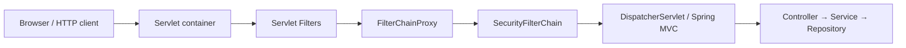
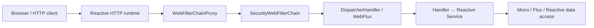
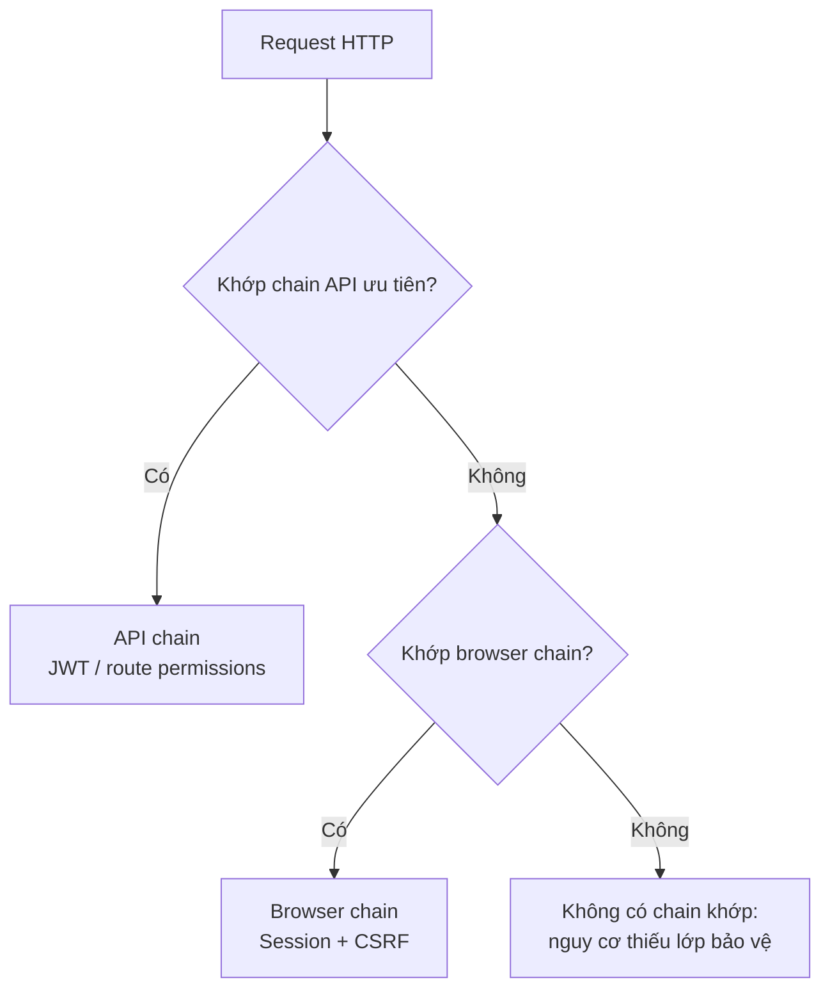

# Phạm vi hỗ trợ trên Servlet và WebFlux

> **Chương:** Bản đồ bảo vệ  
> **Học phần:** `SPRING_SECURITY_HTTP_PROTECTION` — phòng vệ HTTP và trình duyệt trong Spring Security, gồm CSRF, CORS, security headers, Content Security Policy (CSP), HSTS, HTTP firewall và bảo vệ session; tập trung vào cấu hình và kiểm thử cho cả **Servlet (Spring MVC)** lẫn **Reactive (Spring WebFlux)**.

## 1. Cùng một mục tiêu bảo mật, nhưng không cùng một bộ API

Một hệ thống quản lý đơn hàng có thể xây dựng trên Spring MVC hoặc Spring WebFlux. Dù chọn công nghệ nào, những yêu cầu bảo mật nền tảng vẫn tương tự:

- Chỉ người dùng xác thực mới đọc được đơn hàng riêng tư.
- Người đã đăng nhập không được sửa đơn của tenant khác.
- Request thay đổi trạng thái dùng session cookie phải được phòng vệ trước CSRF.
- Frontend khác origin cần CORS đúng mà không mở quyền đọc API vô tội vạ.
- Trình duyệt phải nhận response headers phù hợp: CSP, frame policy, HSTS, MIME và cache.
- URL/method bất thường không được dẫn tới bypass authorization.
- Phiên đăng nhập và cookie phải có vòng đời an toàn, kể cả login, logout và hết hạn.

Tuy nhiên, **Servlet và WebFlux không chia sẻ toàn bộ đối tượng, filter, session API và cách truyền security context**. Sao chép đoạn cấu hình `HttpSecurity` vào ứng dụng `ServerHttpSecurity` có thể không biên dịch; chuyển một kiểm tra quyền sử dụng `SecurityContextHolder` thread-local sang pipeline Reactive có thể đọc sai ngữ cảnh.

Bài này trả lời bốn câu hỏi:

1. **Những cơ chế nào có ở cả hai stack?**
2. **Cơ chế tương đương được biểu diễn bằng API nào?**
3. **Những giới hạn hoặc khác biệt cần thiết kế riêng?**
4. **Làm thế nào để xác nhận hệ thống thật sự bảo vệ đúng request qua test và môi trường deploy?**

### Mục tiêu học tập

Sau bài, người học có thể:

- Phân biệt `SecurityFilterChain`/`HttpSecurity` với `SecurityWebFilterChain`/`ServerHttpSecurity`.
- Chọn đúng loại CSRF repository, CORS source, HTTP firewall, context holder và test framework của từng stack.
- Hiểu khi nào các quy tắc về CSRF, CORS, CSP, HSTS và cookie **giống nhau về threat model** nhưng **khác nhau về cách hiện thực**.
- Viết cấu hình bảo mật cho ứng dụng Servlet và WebFlux dùng cookie/session; nhận biết trường hợp bearer-only API có policy khác.
- Kiểm thử request được phép, request bị từ chối và lỗi tích hợp với browser/proxy.
- Tránh trộn API Servlet vào luồng Reactor hoặc tưởng rằng gọi thư viện Reactive làm một ứng dụng Spring MVC tự biến thành WebFlux.

## 2. Servlet và Reactive khác nhau từ kiến trúc xử lý HTTP

### 2.1. Servlet: request được xử lý qua Servlet Filter chain

Trong Spring MVC truyền thống, request đến Servlet container và đi qua các `Filter`. Spring Security tích hợp một `DelegatingFilterProxy`, từ đó chuyển request tới `FilterChainProxy` chứa các `SecurityFilterChain`.

`HttpSecurity` tạo cấu hình các security filters, bao gồm authentication, authorization, CSRF, security headers và những bộ lọc khác tùy theo chain. Servlet có đối tượng `HttpServletRequest`, `HttpServletResponse`, `HttpSession` và các cơ chế request/thread liên quan.



Spring MVC có thể dùng kiểu bất đồng bộ và tích hợp một số thư viện Reactive; điều đó **không làm mất ngăn xếp Servlet** nếu yêu cầu HTTP vẫn được Spring MVC xử lý.

### 2.2. WebFlux: security được tích hợp bằng WebFilter và Reactor context

Trong Spring WebFlux, request được xử lý bởi mô hình HTTP Reactive và các `WebFilter`. Spring Security dùng `WebFilterChainProxy` cùng các `SecurityWebFilterChain` được cấu hình bởi `ServerHttpSecurity`.

Ngữ cảnh bảo mật đi theo **Reactor context** thay vì giả định một request nằm trên một thread duy nhất từ đầu tới cuối. Mã Reactive cần tránh lấy `Authentication` bằng cách tùy tiện đọc `SecurityContextHolder` thread-local ở các toán tử `Mono`/`Flux`.



**Reactive không tự mang lại an toàn hơn.** WebFlux vẫn cần authentication, quyền trên tài nguyên, CSRF nếu dùng cookie, CORS nếu khác origin, security headers, firewall và quản lý session. Nếu trong pipeline dùng blocking database driver hoặc gọi `block()` tùy tiện, còn có nguy cơ làm nghẽn event-loop.

### 2.3. Cách xác định stack thật sự

Cần xem hệ thống dùng **Spring MVC Servlet** hay **Spring WebFlux** để xử lý request. Không suy từ tên class hoặc sự xuất hiện của `Mono` ở service. Nếu cả Spring MVC và WebFlux nằm trên classpath trong một ứng dụng Spring Boot, Boot thường ưu tiên mô hình Servlet trừ khi được cấu hình khác. Hãy xác minh `ApplicationContext` và HTTP runtime của môi trường thực tế trước khi áp dụng cấu hình.

## 3. Ma trận phạm vi hỗ trợ Spring Security Protection

| Nhu cầu bảo mật | Servlet / Spring MVC | Reactive / WebFlux | Điều giữ nguyên về chính sách |
| --- | --- | --- | --- |
| Security chain | `SecurityFilterChain` | `SecurityWebFilterChain` | Chain phải khớp request, có fallback rõ ràng |
| Cấu hình HTTP | `HttpSecurity` | `ServerHttpSecurity` | Chọn cơ chế và phạm vi áp dụng |
| Route authorization | `authorizeHttpRequests` | `authorizeExchange` | Luôn cần quyền trên hành động và đối tượng |
| Method authorization | `@EnableMethodSecurity` | `@EnableReactiveMethodSecurity` | Kiểm tra quyền ở service khi phù hợp |
| Security context | `SecurityContextHolder` và cơ chế request/thread | `ReactiveSecurityContextHolder` trong Reactor context | Chỉ tin principal đã xác thực |
| CSRF filter | `CsrfFilter` | `CsrfWebFilter` | Giữ phòng vệ nếu credential được trình duyệt tự gửi |
| CSRF repository | `CsrfTokenRepository`, thường là `HttpSessionCsrfTokenRepository` | `ServerCsrfTokenRepository`, thường là `WebSessionServerCsrfTokenRepository` | Frontend phải có cách lấy/gửi token |
| CORS source | `org.springframework.web.cors.CorsConfigurationSource` | `org.springframework.web.cors.reactive.CorsConfigurationSource` | Origin/method/headers/credentials phải rõ |
| Response headers | `HttpSecurity.headers(...)` | `ServerHttpSecurity.headers(...)` | CSP và header policy phải phù hợp response |
| HSTS | HTTP response headers/TLS trong Servlet | HTTP response headers/TLS trong Reactive | Browser chỉ ghi nhận HSTS qua HTTPS hợp lệ |
| HTTP firewall | `HttpFirewall`, `StrictHttpFirewall` | `ServerWebExchangeFirewall`, `StrictServerWebExchangeFirewall` | Hạn chế path/method bất thường |
| Session | `HttpSession` | `WebSession` | Bảo vệ login/logout, cookie và hết hạn |
| Security context persistence | `SecurityContextRepository` | `ServerSecurityContextRepository` | Lưu/khôi phục context phải phù hợp mô hình authn |
| Request matcher | Servlet `RequestMatcher` | Reactive `ServerWebExchangeMatcher` | Chain selection và route rules phải nhất quán |
| Test HTTP | `MockMvc` + `spring-security-test` | `WebTestClient` + `spring-security-test` | Cần test cả request bị chặn và request hợp lệ |
| Bearer JWT resource server | `oauth2ResourceServer(...jwt(...))` trong `HttpSecurity` | Tương ứng trong `ServerHttpSecurity` | Token validation, scopes và quyền dữ liệu |
| Gateway và proxy | Servlet forwarded headers/container integration | Reactive forwarded headers/web integration | Chỉ tin forwarding metadata từ proxy đáng tin |

Các API được nêu là **họ API phổ biến của Spring Security hiện đại**, không phải lời khẳng định tất cả phiên bản đã phát hành đều có cùng phương thức hoặc mặc định. Khi dùng vào dự án, cần đối chiếu dependency và chữ ký API đang chạy.

## 4. Phạm vi bảo vệ không chỉ do stack quyết định mà còn do security chain

Một ứng dụng có thể có nhiều chuỗi bảo mật:

- Các trang browser dùng cookie/session và CSRF.
- `/api/**` dùng bearer token.
- Health/metrics có chính sách riêng.
- Webhook có xác minh chữ ký request thay vì form login.

Trong Servlet, Spring Security chọn một `SecurityFilterChain` phù hợp; trong WebFlux, chọn một `SecurityWebFilterChain` phù hợp. **Một request không mặc nhiên chạy qua tất cả chains nối tiếp nhau.** Rule ở chain khác không bảo vệ request đã được một chain ưu tiên cao hơn xử lý.



Vì vậy, trước khi debug `403` hay một endpoint không bị chặn, cần biết **request đi qua chain nào**, không chỉ nhìn thấy một cấu hình `csrf(...)` hoặc `headers(...)` ở đâu đó trong codebase.

### 4.1. Những câu hỏi kiểm kê chain

1. Stack thật sự của endpoint là Servlet hay WebFlux?
2. Chain nào có matcher khớp request này, với order nào?
3. Chain đó có authentication, authorization và CSRF policy gì?
4. Endpoint chưa được khai báo sẽ bị từ chối hay có thể vượt ngoài security chain?
5. Response được sinh ở ứng dụng hay gateway/CDN trước khi tới security chain?

## 5. CSRF: hai cách triển khai, một mô hình tấn công

### 5.1. Vì sao Servlet và WebFlux đều cần CSRF khi dùng cookie?

Giả sử người dùng đăng nhập bằng cookie phiên rồi mở một website không tin cậy. Website đó có thể tìm cách khiến browser gửi request thay đổi dữ liệu mang theo cookie theo các quy tắc cookie hiện hành.

Authentication có thể thành công vì cookie của nạn nhân được gửi, nhưng request không nhất thiết phản ánh ý định của họ. **CSRF token** là một biện pháp server-side để từ chối request thay đổi trạng thái không vượt kiểm tra phù hợp.

Phân biệt:

- Cookie session được browser tự gửi theo `Domain`, `Path`, `SameSite`, `Secure` và bối cảnh request.
- Bearer token do client chủ động gửi trong `Authorization` không thể bị một HTML form từ origin lạ tự biết và đính kèm, nếu API thật sự chỉ chấp nhận cơ chế đó.
- CORS không thay CSRF: một cross-origin form có thể **gửi** request ngay cả khi JavaScript nguồn không được **đọc** response.

### 5.2. Servlet CSRF: request filter và repository

Trong Servlet:

- `CsrfFilter` xử lý request cần bảo vệ.
- `CsrfTokenRepository` lưu/lấy expected token; `HttpSessionCsrfTokenRepository` là lựa chọn mặc định thông dụng.
- `CsrfTokenRequestHandler` điều khiển cách token được cung cấp/giải quyết trên request trong các phiên bản hiện đại.
- `CookieCsrfTokenRepository` có thể phục vụ một số kiểu SPA, nhưng không tự làm SPA an toàn nếu token lifecycle và request handler không được thiết kế phù hợp.

Ví dụ chủ đích giữ CSRF trong `HttpSecurity`:

```java
.csrf(Customizer.withDefaults())
```

Đoạn này **không tự tạo** biểu mẫu frontend hoặc khai báo endpoint cấp token. Với form server-rendered, tích hợp template có thể tự chèn token; với SPA cần thiết kế cách lấy và gửi lại token.

### 5.3. WebFlux CSRF: WebFilter và WebSession repository

Trong WebFlux:

- `CsrfWebFilter` thực hiện bảo vệ.
- `ServerCsrfTokenRepository` là abstraction tương ứng.
- `WebSessionServerCsrfTokenRepository` là repository thường dùng mặc định.
- Token có thể được cung cấp qua các đối tượng Reactive và attributes của exchange, không dùng `HttpServletRequest`/`HttpSession`.

Ví dụ:

```java
.csrf(Customizer.withDefaults())
```

Cú pháp tương tự nhưng **được gọi trên `ServerHttpSecurity`**, không phải `HttpSecurity`. Repository, context và các cách xử lý token của WebFlux khác Servlet.

### 5.4. Phạm vi kiểm tra CSRF: safe methods và ngoại lệ có chủ đích

Các phương thức `GET`, `HEAD`, `OPTIONS` và `TRACE` được coi là safe theo HTTP semantics. Cấu hình CSRF thông dụng không yêu cầu token cho các phương thức này, nên ứng dụng **không được dùng GET để duyệt đơn, chuyển tiền hoặc thay đổi email**.

Với API bearer-only, có thể xem xét miễn CSRF cho phạm vi đã chứng minh không chấp nhận cookie/session hoặc credential được browser tự gắn. Không dựa vào tên “REST”, “JWT” hoặc `STATELESS` để quyết định tắt CSRF toàn cục.

### 5.5. Ma trận lỗi CSRF ở hai stack

| Tình huống | Servlet cần kiểm tra | WebFlux cần kiểm tra |
| --- | --- | --- |
| POST thiếu token | `CsrfFilter`, form, request header | `CsrfWebFilter`, token trên exchange |
| Token sai sau login/logout | `HttpSession`, repository, handler, token lifecycle | `WebSession`, repository và lifecycle |
| SPA đọc token từ cookie | `CookieCsrfTokenRepository` + cách resolve token/masked token | Repository/handler phù hợp với SPA WebFlux |
| Request preflight OPTIONS | CORS integration trước auth từ chối | Reactive CORS integration trước auth từ chối |
| Test request có token | `MockMvc` với `with(csrf())` | `WebTestClient` với `mutateWith(csrf())` |
| Request bị `403` dù token đúng | URL/method/object authorization | `authorizeExchange` và quyền reactive service |

**Điều cần nhớ:** tên “CSRF” giống nhau không có nghĩa có thể dùng repository hoặc test helper từ Servlet trong WebFlux.

## 6. CORS: cùng quy tắc browser, khác nguồn cấu hình Spring

### 6.1. CORS hoạt động ngoài sự khác biệt Servlet/WebFlux

Giả sử frontend ở `https://portal.example.com` và API ở `https://api.example.com`. Đây là **hai origin khác nhau**. Browser có thể gửi preflight khi method/header của request yêu cầu:

```http
OPTIONS /api/orders/42 HTTP/1.1
Host: api.example.com
Origin: https://portal.example.com
Access-Control-Request-Method: PUT
Access-Control-Request-Headers: content-type,x-csrf-token
```

Preflight thường **không mang cookie phiên**. CORS cần được xử lý trước thành phần authentication có thể bác bỏ preflight. Server phản hồi allow-origin, allowed methods, allowed headers và credentials policy phù hợp; browser quyết định JavaScript có được đọc response hay không.

Khi trả credentialed CORS response, không dùng `Access-Control-Allow-Origin: *`. Chỉ cho phép những origin có thật trong topology, và không phản chiếu tùy tiện mọi `Origin` của client.

### 6.2. Servlet: CorsConfigurationSource của Spring Web

Trong Servlet, `UrlBasedCorsConfigurationSource` thuộc package `org.springframework.web.cors`:

```java
@Bean
UrlBasedCorsConfigurationSource servletCorsSource() {
    CorsConfiguration cors = new CorsConfiguration();
    cors.setAllowedOrigins(List.of("https://portal.example.com"));
    cors.setAllowedMethods(List.of("GET", "POST", "PUT"));
    cors.setAllowedHeaders(List.of("Content-Type", "X-CSRF-TOKEN"));
    cors.setAllowCredentials(true);

    UrlBasedCorsConfigurationSource source =
        new UrlBasedCorsConfigurationSource();
    source.registerCorsConfiguration("/api/**", cors);
    return source;
}
```

Có thể tích hợp vào `HttpSecurity` qua cấu hình `cors(...)` và source cụ thể:

```java
.cors(cors -> cors.configurationSource(servletCorsSource))
```

Trong ví dụ, `servletCorsSource` là dependency được inject vào cấu hình chain; đoạn code không tự nói ứng dụng đã thiết kế xong login, logout hoặc CSRF token flow.

### 6.3. WebFlux: CorsConfigurationSource của Spring Web Reactive

Trong WebFlux, class cùng tên nằm trong package Reactive. Vì tên trùng, cách import rất quan trọng.

```java
@Bean
org.springframework.web.cors.reactive.UrlBasedCorsConfigurationSource
        reactiveCorsSource() {
    CorsConfiguration cors = new CorsConfiguration();
    cors.setAllowedOrigins(List.of("https://portal.example.com"));
    cors.setAllowedMethods(List.of("GET", "POST", "PUT"));
    cors.setAllowedHeaders(List.of("Content-Type", "X-CSRF-TOKEN"));
    cors.setAllowCredentials(true);

    org.springframework.web.cors.reactive.UrlBasedCorsConfigurationSource
        source = new org.springframework.web.cors.reactive
            .UrlBasedCorsConfigurationSource();
    source.registerCorsConfiguration("/api/**", cors);
    return source;
}
```

Nguồn này có thể được truyền vào cấu hình `ServerHttpSecurity.cors(...)` bằng reactive CORS configuration source. **Không import `org.springframework.web.cors.UrlBasedCorsConfigurationSource` kiểu Servlet** chỉ vì IDE gợi ý class có cùng tên.

### 6.4. Những điều CORS không giải quyết

- Không xác thực principal.
- Không thay quyền trên đơn hàng/tài liệu.
- Không chặn mọi HTTP client như `curl`, ứng dụng mobile hay server-to-server.
- Không thay token CSRF khi browser tự gửi cookie.
- Không tự bật CORS cho response do proxy/WAF tự tạo trước Spring Security.

**Kiểm thử phải xem preflight và actual request**, cả trong browser và response cuối qua proxy; chỉ test `curl` GET thành công là không đủ.

## 7. Security headers: API ghi header ở cả hai stack, hiệu lực thuộc browser

Spring Security có cơ chế ghi security response headers trong cả Servlet và WebFlux:

- Servlet: `HttpSecurity.headers(...)`.
- Reactive: `ServerHttpSecurity.headers(...)`.

Một số header thông dụng có thể được bật theo mặc định ở cấu hình web tiêu chuẩn, như cache control, `X-Content-Type-Options: nosniff`, `X-Frame-Options` và HSTS với điều kiện HTTPS. Tập header và giá trị cụ thể **phụ thuộc phiên bản, cấu hình, chain, scheme và lớp proxy**.

### 7.1. Phân biệt header do framework hỗ trợ với policy do ứng dụng chọn

| Header/policy | Servlet | WebFlux | Điều do ứng dụng quyết định |
| --- | --- | --- | --- |
| `X-Content-Type-Options` | Header writer cho response Servlet | Header writer cho response Reactive | Content type đúng; policy upload/download |
| Cache headers | Header writer | Header writer | Đâu là dữ liệu riêng tư, đâu là asset được phép cache |
| `X-Frame-Options` | Header writer | Header writer | Cho phép frame nào? CSP `frame-ancestors` |
| `Content-Security-Policy` | DSL content security policy | DSL tương ứng | Sources, nonce/hash, iframe và frontend thực tế |
| `Referrer-Policy` | Có cấu hình hỗ trợ theo version | Có cấu hình hỗ trợ theo version | Mức dữ liệu được gửi qua referrer |
| `Strict-Transport-Security` | HTTP response trên HTTPS | HTTP response trên HTTPS | `max-age`, subdomain, preload và TLS owner |
| `Set-Cookie` | Container/Spring Session/cơ chế cookie | WebSession/cookie resolver | Secure, HttpOnly, SameSite, Domain, Path |

Một policy có hiệu lực khi **trình duyệt nhận header trên response đúng tài liệu**. Ví dụ SPA HTML do CDN ở `https://portal.example.com` phục vụ, còn API JSON từ `https://api.example.com`: header CSP trên JSON API không tự áp dụng cho script của HTML ở portal.

### 7.2. CSP trên cả hai stack

CSP không thể tự suy ra script/asset nào hợp lệ. Ví dụ policy cơ bản:

```http
Content-Security-Policy: default-src 'self'; script-src 'self'; object-src 'none'; base-uri 'self'; frame-ancestors 'none'
```

Với Servlet, định nghĩa trên `HttpSecurity`:

```java
.headers(headers -> headers
    .contentSecurityPolicy(csp -> csp.policyDirectives(
        "default-src 'self'; script-src 'self'; " +
        "object-src 'none'; base-uri 'self'; frame-ancestors 'none'"
    ))
)
```

Với WebFlux, cú pháp DSL có thể tương tự nhưng đặt trên `ServerHttpSecurity`:

```java
.headers(headers -> headers
    .contentSecurityPolicy(csp -> csp.policyDirectives(
        "default-src 'self'; script-src 'self'; " +
        "object-src 'none'; base-uri 'self'; frame-ancestors 'none'"
    ))
)
```

Các đoạn trên minh họa **DSL**, không phải chương trình Java độc lập. Nếu frontend dùng inline scripts, CDN, workers, WebSockets, frames hoặc font bên ngoài, cần chọn `script-src`/`connect-src`/`style-src`/`img-src` và các directive khác phù hợp.

CSP giảm tác động XSS nhưng **không thay output encoding hoặc sanitization**. Có thể thử nghiệm bằng `Content-Security-Policy-Report-Only` trước khi bật chế độ blocking. Với clickjacking, phân biệt `frame-ancestors` (ai được nhúng trang này) với `frame-src` (trang này được nhúng nguồn nào).

### 7.3. Dữ liệu nhạy cảm và cache

Các header cache ngăn việc lưu/tái sử dụng response theo chính sách, nhưng CDN có thể có rule riêng. Một response chứa hồ sơ Alice có thể bị phát cho Bob nếu shared cache được cấu hình sai, cho dù cả Servlet/WebFlux đã kiểm tra quyền của request đầu tiên.

- Dữ liệu đặc biệt nhạy cảm có thể cần `Cache-Control: no-store`.
- Static assets có hash tên file có thể cache dài.
- CORS có `Vary: Origin` không tự biến dữ liệu người dùng thành an toàn để cache công khai.

Kiểm tra response **sau gateway/CDN**, không chỉ header từ application trong test.

## 8. HTTPS và HSTS: cơ chế không phụ thuộc Servlet hay Reactive

TLS thường được kết thúc tại ứng dụng hoặc reverse proxy. HSTS được công bố trong `Strict-Transport-Security` nhưng **trình duyệt thực thi** sau khi đã nhận policy qua HTTPS hợp lệ.

```http
Strict-Transport-Security: max-age=31536000
```

Các điểm giống nhau giữa hai stack:

1. Thêm Spring Security không tự cấu hình chứng chỉ, TLS và redirect HTTP → HTTPS cho toàn bộ tuyến.
2. HSTS chỉ được browser ghi nhận khi đến qua HTTPS hợp lệ; HTTP response không thể thay việc triển khai TLS.
3. `includeSubDomains` có thể ảnh hưởng tới host cũ/staging; `preload` cần tuân thủ điều kiện và kế hoạch vận hành.
4. Backend sau TLS proxy có thể nhận HTTP nội bộ; nếu application dựa vào `request.isSecure()` hoặc equivalent reactive scheme không được khôi phục đúng, việc phát HSTS/redirect có thể sai.
5. Có thể giao **edge** hoặc **app** làm chủ HSTS; cần kiểm tra response cuối đến browser và tránh policy mâu thuẫn.

### 8.1. Forwarded headers: phân biệt abstraction nhưng cùng nguyên tắc tin cậy

Reverse proxy có thể gửi:

```http
Forwarded: for=198.51.100.10;proto=https;host=api.example.com
X-Forwarded-Proto: https
X-Forwarded-Host: api.example.com
```

Những header này **không đáng tin nếu client Internet được phép tự gắn rồi đưa trực tiếp tới backend**. Proxy cần xóa/ghi đè các giá trị do client tạo; backend chỉ nhận forwarding metadata từ hop đáng tin.

Cơ chế xử lý forwarded headers của Spring Framework khác nhau:

- Servlet có `ForwardedHeaderFilter` và cơ chế integration container/Boot.
- WebFlux có `ForwardedHeaderTransformer` và integration với Reactive server/Boot.

Ví dụ Spring Boot, **chỉ dùng khi đã thiết kế trusted proxy**:

```yaml
server:
  forward-headers-strategy: framework
```

Một số môi trường dùng `native` của container/server phù hợp hơn. Không giả định cấu hình này tự tạo trust boundary; phải hạn chế quyền truy cập backend và ngăn spoof forwarding headers tại edge.

### 8.2. Test đúng môi trường

Không chỉ test backend local:

- TLS thực sự hợp lệ ở browser?
- Redirect đến đúng `https://...` hay bị lặp?
- HSTS có trên response HTTPS đúng hostname?
- Cookie `Secure` được phát đúng?
- OAuth2 callback/absolute URL sử dụng external scheme/host chính xác?
- HSTS và CSP có còn sau khi CDN/WAF trả response lỗi?

## 9. HTTP firewall: hai implementation với mục tiêu tương ứng

Servlet sử dụng `HttpFirewall` và `StrictHttpFirewall` thường được tích hợp vào `FilterChainProxy`. WebFlux có `ServerWebExchangeFirewall` và `StrictServerWebExchangeFirewall` tương ứng.

Firewall giúp hạn chế request có path/method được biểu diễn theo cách gây nhập nhằng giữa proxy, parser, authorization matcher và handler:

- Slash mã hóa `%2F`, nhiều slash `//`.
- Dấu `;` trong path hoặc matrix variables.
- Backslash, ký tự điều khiển, dot segments, encoding bất thường.
- HTTP methods không mong đợi.

### 9.1. Servlet: mở một quy tắc chỉ khi có lý do

Ví dụ nới semicolon trong Servlet:

```java
@Bean
StrictHttpFirewall httpFirewall() {
    StrictHttpFirewall firewall = new StrictHttpFirewall();

    // Chỉ cho phép khi thực sự dùng matrix variables
    // và đã kiểm thử proxy → firewall → matcher → handler.
    firewall.setAllowSemicolon(true);

    return firewall;
}
```

**Không nên coi đây là cấu hình mặc định khuyến nghị.** Việc cho phép semicolon có thể làm thay đổi cách nhiều lớp diễn giải URL, tăng nguy cơ matcher/handler không nhất quán.

### 9.2. Reactive: không thể dùng Servlet HttpFirewall bean thay thế

Trong WebFlux, `StrictServerWebExchangeFirewall` làm việc với `ServerWebExchange` chứ không phải `HttpServletRequest`. Đăng ký bean `StrictHttpFirewall` kiểu Servlet **không tự cấu hình** firewall cho `WebFilterChainProxy`.

Phải xem API và integration của phiên bản Reactive được dùng nếu muốn tùy biến. Nếu mục tiêu chỉ là cho phép URL hợp lệ, tốt hơn nên chọn URL không nhập nhằng hoặc thay rule đúng phạm vi thay vì tắt firewall.

### 9.3. Firewall không biết quyền trên tài nguyên

Một path `GET /api/orders/42` hoàn toàn hợp lệ vẫn có thể là BOLA/IDOR nếu Bob truy cập đơn của Alice. Firewall không phân quyền owner/tenant; cả hai stack đều phải kiểm tra quyền trong service hoặc các thành phần authorization phù hợp.

## 10. Session: HttpSession khác WebSession và security context repository

### 10.1. Servlet session

Trong Servlet, `HttpSession` gắn với Servlet container/session store. Spring Security có các cơ chế lưu `SecurityContext` qua `SecurityContextRepository` và các tích hợp session management.

Với form login tiêu chuẩn:

- Authentication thành công có thể tạo/đổi session ID theo chính sách.
- Servlet hỗ trợ session fixation protection; `changeSessionId` là chiến lược thường dùng trên container hiện đại.
- Logout cần vô hiệu hóa session phù hợp, xóa cookie khi được cấu hình.
- Session timeout/concurrency/cluster storage phụ thuộc các quyết định ứng dụng và hạ tầng.

Không giả định mọi custom authentication filter tự lưu security context đúng; cần kiểm tra cơ chế persistence thực tế của framework/phiên bản.

### 10.2. Reactive WebSession

Trong WebFlux, `WebSession` và `ServerSecurityContextRepository` là các abstraction riêng. Context bảo mật có thể được lưu/khôi phục theo `WebSession` hoặc repository khác, tùy mô hình authn.

Điểm khác:

- Không dùng trực tiếp `HttpSession` và Servlet session event listeners.
- Không sao chép các API session concurrency/fixation của Servlet sang Reactive mà không kiểm tra hỗ trợ riêng ở phiên bản đang dùng.
- Reactive security context truyền qua Reactor context; request có thể chuyển thread.
- Logout/cookie lifecycle và persistence vẫn phải được kiểm tra bằng HTTP thực.

### 10.3. Cookie do ai phát?

Cookie có thể được tạo bởi Servlet container, Spring Session hoặc cơ chế WebSession/cookie của Reactive. Spring Security không đảm bảo chỉ bằng một chain rằng mọi cookie đã có đúng:

```http
Set-Cookie: SESSION=<opaque-value>; Path=/; Secure; HttpOnly; SameSite=Lax
```

Cần chọn:

- `Secure` nếu cookie chỉ được dùng trên HTTPS.
- `HttpOnly` cho session cookie mà JS không cần đọc.
- `SameSite` theo topology same-site/cross-site và login redirect.
- `Domain`/`Path` không quá rộng.
- Timeout cookie và expiration session ở server phù hợp.

`SameSite=None` thường cần `Secure` trong browser hiện đại, nhưng các hạn chế third-party cookie có thể vẫn tác động. `HttpOnly` ngăn JS đọc trực tiếp cookie, **không làm XSS vô hại**: script chạy trong origin vẫn có thể gửi request mang cookie.

### 10.4. Bearer-only API

Ở cả Servlet lẫn WebFlux, một API chỉ dựa trên bearer token có thể lựa chọn **không lưu authentication vào session** và áp dụng một chính sách CSRF khác cookie app. Phải xác minh token validation, expiry, issuer, audience, scopes và object authorization. Việc gọi `STATELESS` không phải bằng chứng mọi filter đã ngừng chấp nhận cookie/ambient credentials.

## 11. Authentication/authorization: API khác, quyết định nghiệp vụ giống nhau

### 11.1. Route và method authorization

Servlet dùng:

```java
.authorizeHttpRequests(auth -> auth
    .requestMatchers(HttpMethod.GET, "/api/orders/**")
        .hasAuthority("ORDER_READ")
    .anyRequest().authenticated())
```

WebFlux dùng:

```java
.authorizeExchange(auth -> auth
    .pathMatchers(HttpMethod.GET, "/api/orders/**")
        .hasAuthority("ORDER_READ")
    .anyExchange().authenticated())
```

Hai đoạn minh họa quyền **theo route**, chưa quyết định Bob có thể đọc order 42 của Alice hay không. Cả hai stack cần object-level authorization dựa vào tenant, owner, ACL và trạng thái nghiệp vụ.

### 11.2. Method security và Reactive return types

Với Servlet có thể bật `@EnableMethodSecurity` để áp dụng annotation như `@PreAuthorize` trên method phù hợp. Với WebFlux, dùng `@EnableReactiveMethodSecurity` và cần lưu ý các quy tắc được thực thi trong môi trường Reactive; method return types và context phải tương thích.

Ví dụ ý tưởng chính sách:

```java
// Ví dụ nghiệp vụ; policy, repository và kiểu Order là giả định.
boolean canRead(Authentication actor, Order order) {
    return actor.getAuthorities().stream()
        .anyMatch(a -> a.getAuthority().equals("ORDER_READ"))
        && sameTenant(actor, order)
        && orderAcl.allowsRead(actor, order);
}
```

Trong WebFlux, nếu policy cần truy vấn Reactive, dùng `Mono`/`Flux` và `flatMap` để kiểm tra; đừng `block()` trong request pipeline. Không lấy tenant do client gửi làm bằng chứng quyền.

### 11.3. Lỗi dễ gặp khi di chuyển từ Servlet sang WebFlux

Mã Servlet có thể đọc:

```java
Authentication authentication =
    SecurityContextHolder.getContext().getAuthentication();
```

Mẫu trên **không phải cách chung an toàn để lấy principal trong một Reactive pipeline**. Trong WebFlux có thể inject principal/`Authentication` qua handler arguments, hoặc truy cập ngữ cảnh qua:

```java
Mono<Authentication> currentAuthentication =
    ReactiveSecurityContextHolder.getContext()
        .map(SecurityContext::getAuthentication);
```

Mã này là mẫu Reactive, cần được thực hiện trong subscription mang Reactor security context. Không `block()` để lấy principal rồi mang ra ngoài bối cảnh request.

## 12. Cấu hình mẫu đầy đủ: Servlet dùng form login và session cookie

Giả định:

- Ứng dụng Servlet phục vụ HTML và API **cùng origin**.
- Người dùng đăng nhập bằng cookie/session.
- API `POST /api/orders/{id}/approve` là hành động thay đổi dữ liệu.
- Có authority `ORDER_APPROVE`, nhưng quyền trên từng đơn hàng được kiểm tra thêm ở service.
- Trình duyệt cần CSP cho HTML.

```java
@Configuration
@EnableWebSecurity
@EnableMethodSecurity
class ServletHttpProtectionConfig {

    @Bean
    SecurityFilterChain browserChain(HttpSecurity http) throws Exception {
        return http
            .csrf(Customizer.withDefaults())
            .headers(headers -> headers
                .contentSecurityPolicy(csp -> csp.policyDirectives(
                    "default-src 'self'; script-src 'self'; " +
                    "object-src 'none'; base-uri 'self'; " +
                    "frame-ancestors 'none'"
                ))
            )
            .authorizeHttpRequests(auth -> auth
                .requestMatchers("/login", "/assets/**", "/error")
                    .permitAll()
                .requestMatchers(HttpMethod.GET, "/health")
                    .permitAll()
                .requestMatchers(HttpMethod.POST,
                    "/api/orders/*/approve")
                    .hasAuthority("ORDER_APPROVE")
                .requestMatchers(HttpMethod.GET, "/api/orders/**")
                    .hasAuthority("ORDER_READ")
                .anyRequest().denyAll()
            )
            .formLogin(Customizer.withDefaults())
            .logout(Customizer.withDefaults())
            .build();
    }
}
```

**Giải thích cấu hình:**

- `csrf(withDefaults())` giữ bảo vệ cho các request unsafe dùng cookie; frontend phải gửi CSRF token.
- `headers(...contentSecurityPolicy(...))` thêm CSP chủ đích; cần sửa policy nếu frontend dùng script inline, CDN hoặc kết nối ngoài.
- `authorizeHttpRequests` xác định quyền chức năng, **không thay object authorization**.
- `formLogin` sử dụng cơ chế đăng nhập; cần nguồn xác thực và lưu session thích hợp.
- `anyRequest().denyAll()` là lựa chọn chặt để mọi route chưa khai báo bị từ chối; app thật cần bổ sung route cần hoạt động, kể cả page HTML.
- HSTS, cache, cookie và session phải được kiểm tra trên response thực tế; CSP chỉ bảo vệ **HTML thực sự đi qua chain này**.

Đây là **cấu hình học tập**, chưa phải chương trình biên dịch độc lập: cần imports, user store, controllers, token flow và mã kiểm tra quyền nghiệp vụ.

### 12.1. Nếu API và frontend khác origin

Bổ sung chính sách CORS cho đúng origin và bật tích hợp trong `HttpSecurity`. Với cookie session, vẫn cần CSRF token. Không thể chỉ gọi `cors(withDefaults())` rồi giả định một allowlist đúng đã được tạo.

### 12.2. Nếu ứng dụng có gateway và TLS termination

Kiểm tra forwarding metadata đáng tin, redirect, cookie Secure và HSTS. Nếu Spring Security thấy request nội bộ là HTTP, header HSTS có thể không được phát. Có thể giao edge phát HSTS nếu đây là kiến trúc đã được thống nhất.

## 13. Cấu hình mẫu đầy đủ: WebFlux dùng form login và WebSession

Giả định **cùng threat model** với mục 12 nhưng API chạy trên WebFlux:

```java
@Configuration
@EnableWebFluxSecurity
@EnableReactiveMethodSecurity
class ReactiveHttpProtectionConfig {

    @Bean
    SecurityWebFilterChain browserChain(ServerHttpSecurity http) {
        return http
            .csrf(Customizer.withDefaults())
            .headers(headers -> headers
                .contentSecurityPolicy(csp -> csp.policyDirectives(
                    "default-src 'self'; script-src 'self'; " +
                    "object-src 'none'; base-uri 'self'; " +
                    "frame-ancestors 'none'"
                ))
            )
            .authorizeExchange(auth -> auth
                .pathMatchers("/login", "/assets/**", "/error")
                    .permitAll()
                .pathMatchers(HttpMethod.GET, "/health")
                    .permitAll()
                .pathMatchers(HttpMethod.POST,
                    "/api/orders/*/approve")
                    .hasAuthority("ORDER_APPROVE")
                .pathMatchers(HttpMethod.GET, "/api/orders/**")
                    .hasAuthority("ORDER_READ")
                .anyExchange().denyAll()
            )
            .formLogin(Customizer.withDefaults())
            .build();
    }
}
```

Các nguyên tắc giống Servlet, nhưng **không thể hoán đổi class và request APIs**:

- `ServerHttpSecurity` cấu hình `SecurityWebFilterChain`.
- `authorizeExchange` dùng matcher của Reactive `ServerWebExchange`.
- CSRF dùng `CsrfWebFilter` và repository tương ứng.
- Session là `WebSession`; security context truyền trong Reactor context.
- CSP tác động lên response HTML; HSTS phụ thuộc HTTPS/trusted proxy.
- Route authorization vẫn không thay object authorization ở reactive service.

### 13.1. Reactive service: kiểm tra quyền đối tượng trong pipeline

Ví dụ với repository Reactive, chỉ để minh họa cấu trúc:

```java
Mono<OrderView> readOrder(
        String orderId,
        Authentication actor) {
    return orderRepository.findById(orderId)
        .switchIfEmpty(Mono.error(new OrderNotFoundException()))
        .flatMap(order -> {
            if (!orderPolicy.canRead(actor, order)) {
                return Mono.error(new AccessDeniedException(
                    "Order is outside permitted scope"));
            }
            return Mono.just(orderMapper.toView(order));
        });
}
```

Các component `orderRepository`, `orderPolicy`, `orderMapper` và exception giả định đã được ứng dụng khai báo. Nếu `canRead` thực hiện I/O Reactive, cần viết tương ứng thành `Mono<Boolean>` và kết hợp bằng `flatMap`, không dùng `block()`.

## 14. Cấu hình cho bearer-only API: khác biệt kiến trúc quan trọng hơn khác biệt stack

Không phải API nào cũng dùng cookie/session. Nếu ứng dụng **chỉ nhận JWT bearer trong `Authorization`**, không nhận cookie hay Basic browser auth trên các endpoint API, nguy cơ CSRF khác form-login app. Trong phạm vi đã được xác minh đó, có thể miễn CSRF.

### 14.1. Servlet bearer-only

```java
@Bean
SecurityFilterChain apiChain(HttpSecurity http) throws Exception {
    return http
        .securityMatcher("/api/**")
        .csrf(csrf -> csrf.disable()) // Chỉ cho API bearer-only
        .authorizeHttpRequests(auth -> auth
            .requestMatchers(HttpMethod.GET, "/api/public/**")
                .permitAll()
            .anyRequest().authenticated())
        .oauth2ResourceServer(oauth2 ->
            oauth2.jwt(Customizer.withDefaults()))
        .build();
}
```

### 14.2. Reactive bearer-only

```java
@Bean
SecurityWebFilterChain apiChain(ServerHttpSecurity http) {
    return http
        .securityMatcher(
            new PathPatternParserServerWebExchangeMatcher("/api/**"))
        .csrf(csrf -> csrf.disable()) // Chỉ cho API bearer-only
        .authorizeExchange(auth -> auth
            .pathMatchers(HttpMethod.GET, "/api/public/**")
                .permitAll()
            .anyExchange().authenticated())
        .oauth2ResourceServer(oauth2 ->
            oauth2.jwt(Customizer.withDefaults()))
        .build();
}
```

Cả hai ví dụ đều cần **JWT decoder/issuer/JWK config**, xác minh signature, issuer, audience, expiry và mapping authorities phù hợp. Các ví dụ không tự tạo một hệ thống xác thực hoàn chỉnh.

Nếu trong cùng ứng dụng còn có browser pages dùng cookie, cần chain riêng **giữ CSRF**, matcher/order chính xác và fallback phù hợp. Không gọi `csrf.disable()` trên toàn ứng dụng chỉ vì một tập endpoint dùng JWT.

Cũng không tự cho rằng gọi `sessionCreationPolicy(STATELESS)` hoặc không khai báo `formLogin` đủ chứng minh mọi đường xác thực cookie/ambient credential đều vắng mặt. Hãy viết test xác nhận **cookie đơn thuần không được chấp nhận** ở API bearer-only.

## 15. Kiểm thử trên Servlet bằng MockMvc

`MockMvc` tích hợp Spring Security qua `spring-security-test` để mô phỏng request mà không cần khởi chạy web server ngoài; phải bảo đảm filter chain được áp dụng trong cấu hình test.

### 15.1. Kiểm thử thiếu CSRF token

Giả sử Alice có authority `ORDER_APPROVE`:

```java
mvc.perform(post("/api/orders/42/approve")
        .with(user("alice").authorities(
            new SimpleGrantedAuthority("ORDER_APPROVE"))))
   .andExpect(status().isForbidden());
```

Nếu dùng cookie/session và CSRF mặc định được giữ, request unsafe không token bị từ chối. Test cũng cần xác minh database không thay đổi.

### 15.2. Kiểm thử token hợp lệ nhưng thiếu quyền

```java
mvc.perform(post("/api/orders/42/approve")
        .with(user("bob"))
        .with(csrf()))
   .andExpect(status().isForbidden());
```

`with(csrf())` giúp vượt lớp CSRF trong test, nhưng không cấp authority `ORDER_APPROVE` hoặc quyền trên đơn 42.

### 15.3. Kiểm thử header trên response của chain

```java
mvc.perform(get("/login").secure(true))
   .andExpect(header().string(
       "X-Content-Type-Options", "nosniff"));
```

Khi muốn test HSTS, request cần được xem là HTTPS và chain đang thực sự có trách nhiệm phát HSTS. Đừng kết luận backend thiếu HSTS chỉ vì test một request HTTP không có header này.

**Lưu ý:** `user()` và `csrf()` giả principal/token cho test. Chúng không kiểm chứng password hashing, OIDC login, cookie attributes, session fixation hoặc TLS tại proxy. Các kiểm thử đó cần integration/browser/e2e bổ sung.

## 16. Kiểm thử trên Reactive bằng WebTestClient

`WebTestClient` và `spring-security-test` cung cấp các test mutators tương ứng. Cần tích hợp Spring Security vào WebTestClient sử dụng cho ứng dụng Reactive.

### 16.1. CSRF thiếu token bị chặn

```java
webTestClient.mutateWith(mockUser("alice")
        .authorities(new SimpleGrantedAuthority("ORDER_APPROVE")))
    .post()
    .uri("/api/orders/42/approve")
    .exchange()
    .expectStatus().isForbidden();
```

### 16.2. CSRF hợp lệ không tự cấp quyền

```java
webTestClient.mutateWith(mockUser("bob"))
    .mutateWith(csrf())
    .post()
    .uri("/api/orders/42/approve")
    .exchange()
    .expectStatus().isForbidden();
```

### 16.3. JWT giả để test route permissions

Với Reactive API bearer-only, helper `mockJwt()` có thể tạo principal/scopes giả trong test:

```java
webTestClient.mutateWith(mockJwt()
        .authorities(new SimpleGrantedAuthority(
            "SCOPE_orders.read")))
    .get()
    .uri("/api/orders/42")
    .exchange();
```

Điểm cần nhớ: `mockJwt()` **không xác minh cryptographic signature, issuer hay audience** của JWT decoder thật. Cần integration test với resource server config đúng và token invalid/hết hạn để đảm bảo authentication có hiệu lực.

### 16.4. So sánh ngắn các helper

| Nhu cầu | Servlet | WebFlux |
| --- | --- | --- |
| Giả người dùng đăng nhập | `.with(user("alice"))` | `.mutateWith(mockUser("alice"))` |
| Thêm CSRF token hợp lệ | `.with(csrf())` | `.mutateWith(csrf())` |
| Giả bearer JWT | `jwt()` test support phù hợp Servlet | `mockJwt()` test support Reactive |
| Test HTTP request | `mvc.perform(...)` | `webTestClient...exchange()` |
| Kiểm tra response | `andExpect(...)` | `expectStatus()`, `expectHeader()` |
| Test token verification thật | Integration test decoder/resource server | Integration test decoder/resource server |

## 17. Kiểm thử HTTP và browser: cùng công cụ ngoài ứng dụng

Các kiểm thử HTTP bên ngoài không phụ thuộc stack:

```bash
# Quan sát CORS preflight tới API.
curl -i -X OPTIONS https://api.example.com/api/orders/42 \
  -H 'Origin: https://portal.example.com' \
  -H 'Access-Control-Request-Method: PUT' \
  -H 'Access-Control-Request-Headers: content-type,x-csrf-token'

# So sánh với origin không được phép.
curl -i -X OPTIONS https://api.example.com/api/orders/42 \
  -H 'Origin: https://untrusted.example.net' \
  -H 'Access-Control-Request-Method: PUT'

# Quan sát response headers browser có thể nhận qua HTTPS.
curl -I https://portal.example.com/
```

`curl` chỉ là HTTP client. Nó **không áp dụng** same-origin policy/CORS, CSP, HSTS, cookie SameSite hay clickjacking protection như browser. Vì vậy phải dùng trình duyệt thật để xác minh:

- JavaScript từ origin được phép đọc được API; origin ngoài allowlist bị chặn đọc.
- Cookie được gửi/không gửi theo `Secure`, `SameSite`, `Domain`, `Path` và fetch credentials.
- CSP của **HTML document** chặn script không hợp lệ.
- `X-Frame-Options`/`frame-ancestors` chặn iframe trái policy.
- HTTPS response có HSTS đúng và browser ghi nhận.
- Logout làm session cũ không dùng được.
- CDN không phát lại response dữ liệu riêng tư cho người khác.

## 18. Xung đột triển khai: lỗi có giống nhau ở Servlet và WebFlux không?

Nhiều lỗi có **triệu chứng giống nhau**, nhưng phải kiểm tra class và cấu hình của stack đúng.

| Triệu chứng | Servlet cần xem | WebFlux cần xem | Nguyên tắc chung |
| --- | --- | --- | --- |
| POST cookie trả `403` | `CsrfFilter`, Servlet repository/handler | `CsrfWebFilter`, Reactive repository/handler | Đừng tắt CSRF trước khi xác định token và session |
| Preflight `OPTIONS` bị `401/403` | Servlet CORS source, `HttpSecurity.cors` | Reactive CORS source, `ServerHttpSecurity.cors` | Xử lý CORS trước auth có thể chặn preflight |
| `GET /api/**` không đúng chain | `SecurityFilterChain` matcher/order | `SecurityWebFilterChain` matcher/order | Xác minh chain thực sự nhận request |
| Session không lưu authentication | `SecurityContextRepository`/`HttpSession` | `ServerSecurityContextRepository`/`WebSession` | Kiểm tra authn persistence và login flow |
| Cookie không gửi | Servlet container cookie config | WebSession cookie resolver/config | Kiểm tra attributes và browser |
| CSP thiếu trên HTML | Header writer ở HTML chain | Header writer ở HTML chain | CSP phải xuất hiện ở HTML document đúng origin |
| HSTS thiếu sau TLS proxy | `ForwardedHeaderFilter`/container | `ForwardedHeaderTransformer`/Reactive runtime | Trusted forwarded headers hoặc edge sở hữu HSTS |
| URL có `%2F` bị `400` | `StrictHttpFirewall`, Servlet parser | `StrictServerWebExchangeFirewall`, reactive parser | Xem proxy/path normalize trước khi nới firewall |
| `Authentication` null khi async | SecurityContext propagation tùy Servlet task/executor | Reactor context bị mất qua bridge sai | Đừng giả định một thread/context duy nhất |
| JWT test pass nhưng token thật bị từ chối | Decoder/issuer/audience/mapping | Decoder/issuer/audience/mapping | Mock principal không thay cryptographic validation |
| Browser CORS lỗi, curl lại thành công | Headers cuối qua Servlet/edge | Headers cuối qua WebFlux/edge | Browser thực thi CORS, curl thì không |
| Route đúng nhưng người khác tenant đọc được | Service object authorization | Reactive service object authorization | BOLA/IDOR không do CSRF/firewall sửa được |

### 18.1. Tìm lỗi ở đúng vị trí

1. **Xác định stack:** Servlet container + Spring MVC hay WebFlux?
2. **Xác định chain:** matcher nào, order nào, CSRF/headers/CORS của chain đó?
3. **Xác định credential:** cookie/session, bearer, SSO, gateway identity header?
4. **Xác định bên từ chối:** HTTP parser, proxy/WAF, firewall, CSRF, authentication, authorization hay browser?
5. **Xem response cuối:** headers, status, redirect, `Set-Cookie`, CDN cache.
6. **Sửa nhỏ nhất có thể kiểm chứng:** bổ sung token, sửa CORS allowlist, quyền object, forwarding metadata hoặc matcher, thay vì tắt một lớp protection.
7. **Chạy lại test hợp lệ và test bị cấm:** dữ liệu không thay đổi khi request bị chặn và không lộ qua bản sao/cache.

## 19. Giới hạn: những thành phần không được tự bảo vệ chỉ vì dùng Spring Security Web

Spring Security HTTP protection là một phần của phòng vệ ứng dụng, không bao trùm tất cả các giao thức hoặc lớp nghiệp vụ.

### 19.1. WebSocket, SSE và RSocket

- **WebSocket** có giai đoạn HTTP handshake nhưng các message sau khi kết nối thành công không đơn giản là HTTP request mới đi lại qua cùng security filter chain. Authorization ở cấp message/STOMP cần được thiết kế bằng cơ chế phù hợp.
- **Server-Sent Events (SSE)** là luồng HTTP dài hạn; authentication và authorization ban đầu không tự đảm bảo quyền không thay đổi trong suốt luồng hoặc không có dữ liệu vượt tenant.
- **RSocket** có cơ chế bảo mật và mô hình truyền tải riêng; không mặc định chịu toàn bộ `HttpSecurity`/`ServerHttpSecurity` như HTTP endpoint.

Không dùng cấu hình CSRF cho HTML form để kết luận đã bảo vệ đầy đủ các kênh giao tiếp đặc biệt này.

### 19.2. Nội dung upload, XSS và dữ liệu nghiệp vụ

CSP giúp giảm tác động script không tin cậy nhưng không thay:

- Output encoding/sanitization theo ngữ cảnh.
- Kiểm tra loại/kích thước tệp, lưu file và cách phục vụ download.
- Phân quyền owner/tenant trên tài liệu.
- Tránh mass assignment và business logic manipulation.
- Rate limiting và chống brute force theo nhu cầu sản phẩm.
- Audit, logging redaction và giám sát an ninh.

### 19.3. Frontend tách khỏi backend

Nếu HTML SPA được CDN phục vụ, cấu hình CSP trong Spring Security của API JSON **không tự đưa CSP vào HTML của SPA**. Phải quản lý security headers ở nơi thực sự gửi HTML, kể cả lỗi và cache responses.

## 20. Khi nào chọn Servlet, khi nào chọn WebFlux?

**Chọn stack là quyết định kiến trúc ứng dụng, không phải lựa chọn mức bảo mật.**

| Tiêu chí | Servlet/Spring MVC | Reactive/WebFlux |
| --- | --- | --- |
| Mô hình lập trình | Request/response và controller quen thuộc; hỗ trợ async tùy nhu cầu | Non-blocking pipelines `Mono`/`Flux` |
| Thư viện hiện có | Tương thích tốt với nhiều framework Servlet/JPA | Phù hợp hệ Reactive từ HTTP đến data client |
| Security context | Thường dựa vào tích hợp request/thread | Dựa vào Reactor context |
| Session | `HttpSession` | `WebSession` |
| HTTP protection | Đầy đủ các nhóm cơ bản nêu trong bài | Có các cơ chế tương ứng cho nhóm HTTP/web |
| Kiểm thử | `MockMvc`, Servlet integration tests | `WebTestClient`, Reactive integration tests |
| Điều cần tránh | Trộn cách đọc context vào async thread không kiểm soát | Blocking I/O và `block()` trên event-loop |
| Quyết định bảo mật | Dựa trên threat model và cấu hình thực | Cũng dựa trên threat model và cấu hình thực |

Nếu ứng dụng là MVC sử dụng JPA blocking và giao diện server-rendered, Servlet thường phù hợp về tính thực tiễn. Nếu ứng dụng dùng I/O non-blocking xuyên tuyến, WebFlux có thể hữu ích. **Không chuyển stack chỉ để mong CSRF, CORS hay CSP “mạnh hơn”.**

## 21. Bài tập tổng hợp: chuyển một cấu hình Servlet sang WebFlux

### Bối cảnh

Ứng dụng quản lý hợp đồng ban đầu chạy Servlet:

- User login bằng session cookie.
- Trang HTML và API cùng origin.
- GET `/api/contracts/42` xem hợp đồng.
- POST `/api/contracts/42/approve` duyệt hợp đồng.
- CSP chặn iframe và script ngoài origin.
- Reverse proxy kết thúc TLS; browser nhận HTTPS.

Nhóm kỹ thuật định chuyển API sang WebFlux nhưng giữ nguyên mô hình login và trình duyệt.

### Câu hỏi

1. Thay `SecurityFilterChain` bằng kiểu nào?
2. Thay `HttpSecurity.authorizeHttpRequests` bằng API nào?
3. CSRF có cần giữ không nếu vẫn dùng cookie?
4. Repository CSRF nên dựa vào `HttpSession` hay `WebSession`?
5. Security context trong Reactor được truy cập ở đâu?
6. Servlet `CorsConfigurationSource` có thể import nguyên cho WebFlux không?
7. Bean `StrictHttpFirewall` có tự bảo vệ WebFlux không?
8. CSP trên HTML có còn cần không? HSTS tại proxy thuộc trách nhiệm ai?
9. Test trước đây dùng `MockMvc.with(csrf())` thì chuyển sang công cụ nào?
10. Hai user cùng authority `CONTRACT_READ` có thể xem hợp đồng khác tenant không?

### Đáp án gợi ý

| Câu | Gợi ý |
| --- | --- |
| 1 | `SecurityWebFilterChain` |
| 2 | `ServerHttpSecurity.authorizeExchange(...)` |
| 3 | **Có**, vì browser vẫn dùng session cookie |
| 4 | Dùng `ServerCsrfTokenRepository`, thường là `WebSessionServerCsrfTokenRepository` |
| 5 | `ReactiveSecurityContextHolder`/handler principal trong Reactor context |
| 6 | **Không**, chọn package Reactive tương ứng |
| 7 | **Không**, dùng `ServerWebExchangeFirewall`/`StrictServerWebExchangeFirewall` |
| 8 | **Có** CSP trên HTML; HSTS cần có ở response HTTPS cuối từ bên được giao sở hữu |
| 9 | `WebTestClient.mutateWith(csrf())` và các test helper Reactive |
| 10 | **Không**, phải kiểm tra object-level authorization và tenant |

### Mẫu kiểm thử phải viết sau khi chuyển

- POST duyệt hợp đồng với session hợp lệ nhưng thiếu CSRF → bị từ chối, dữ liệu không đổi.
- POST có CSRF nhưng thiếu authority duyệt → bị từ chối.
- GET hợp đồng khác tenant dù user có authority đọc → không lộ dữ liệu.
- Preflight từ origin hợp lệ → được xử lý theo CORS; origin lạ không đọc được response.
- HTML có CSP phù hợp; iframe từ origin lạ bị chặn.
- HTTPS response qua proxy có HSTS hợp lệ, không redirect loop.
- Logout xong không thể dùng lại session cũ.
- URL có slash mã hóa/semicolon bất thường không bypass matcher.

## 22. Checklist rà soát trước khi triển khai cả hai stack

- [ ] Đã xác định runtime của từng service là Servlet hay Reactive thật sự, không suy từ tên dependency.
- [ ] Mỗi service có đúng loại security chain, matcher, order và fallback an toàn.
- [ ] Route và method authorization được thiết lập; object-level/tenant authorization nằm trong nghiệp vụ.
- [ ] Với cookie/session, CSRF bật và frontend gửi token hợp lệ trên unsafe methods.
- [ ] Với bearer-only, bất kỳ miễn CSRF nào đều có bằng chứng không còn ambient credentials.
- [ ] CORS source đúng package của stack; allowed origins/methods/headers/credentials được giới hạn.
- [ ] CORS preflight xử lý trước auth có thể chặn request thiếu cookie.
- [ ] CSP trên HTML response thực tế, không chỉ JSON API; có kiểm thử browser.
- [ ] Security headers, cache, X-Frame-Options/nosniff và HSTS được kiểm tra qua edge.
- [ ] HTTPS/trusted forwarding đúng; proxy không để client giả mạo forwarded headers.
- [ ] HTTP firewall đúng stack; chỉ nới URL/method rule khi có lý do và regression tests.
- [ ] Cookie `Secure`/`HttpOnly`/`SameSite`, session rotation/timeout/logout được kiểm tra thực.
- [ ] Không dùng `SecurityContextHolder` Servlet theo cách không kiểm soát trong Reactor pipeline.
- [ ] Không dùng `block()` trên event-loop để truy cập security context hoặc database.
- [ ] Test MockMvc hoặc WebTestClient đã gắn Spring Security; negative cases assert không thay đổi dữ liệu.
- [ ] JWT decoder thật được test riêng, không chỉ dựa vào `mockJwt()`.
- [ ] Những kênh ngoài HTTP request thông thường (WebSocket, SSE, RSocket) có đánh giá bảo mật riêng.
- [ ] Các response do proxy/CDN tạo không vô tình thiếu headers hoặc cache dữ liệu riêng tư.

## 23. Câu hỏi tự kiểm tra

**1. WebFlux có CSRF và security headers tương đương Servlet không?**  
Có, nhưng chúng được cấu hình bằng `ServerHttpSecurity`, `SecurityWebFilterChain` và các abstraction Reactive; không thể dùng trực tiếp mọi class của Servlet.

**2. Vì sao phải phân biệt `HttpSession` và `WebSession`?**  
Chúng thuộc hai ngăn xếp khác nhau, gắn với cơ chế lưu session và security context khác nhau. Cookie policy và session lifecycle phải được kiểm chứng riêng.

**3. Có thể dùng `SecurityContextHolder.getContext()` tùy tiện trong `Mono` không?**  
Không. Reactive security context được truyền qua Reactor context và thread có thể thay đổi.

**4. CORS khác CSRF như thế nào trên WebFlux?**  
Không khác về mô hình đe dọa so với Servlet: CORS là chính sách browser cho khả năng đọc response cross-origin; CSRF là kiểm tra phía server đối với request giả mạo khi dùng ambient credentials.

**5. Tắt CSRF khi chuyển từ MVC sang WebFlux có đúng không?**  
Không nếu vẫn dùng login cookie/session. Stack không quyết định có cần CSRF; cách xác thực và nguy cơ quyết định.

**6. Tại sao CSP trên JSON API chưa chắc bảo vệ SPA?**  
Vì CSP kiểm soát document được browser render. Cần có CSP trên response HTML của SPA ở host phục vụ trang.

**7. API bearer-only ở Servlet và WebFlux khác nhau ở đâu?**  
DSL, context, filter và test APIs khác; nguyên tắc validation JWT, scopes, quyền đối tượng và TLS tương tự.

**8. HTTP firewall WebFlux có tự dùng bean `StrictHttpFirewall` không?**  
Không. Reactive có abstraction và implementation firewall riêng.

**9. Vì sao một test địa phương pass nhưng HSTS mất trên production?**  
Proxy có thể kết thúc TLS làm backend nhận HTTP, hoặc CDN/edge tự tạo response không có header. Cần xem HTTPS response cuối.

**10. Khi migrate stack, đâu là mục tiêu quan trọng nhất?**  
Giữ nguyên **security invariants** (ai được truy cập gì, request giả mạo phải bị từ chối, response có header đúng, session được bảo vệ) thay vì chỉ chuyển đổi tên API.

## 24. Tài liệu tham khảo và hướng dẫn đối chiếu phiên bản

Nên kiểm tra tài liệu chính thức tương ứng **phiên bản Spring Security/Spring Boot đang sử dụng**, đặc biệt nếu method, matcher hoặc header mặc định thay đổi:

- [Spring Security — Servlet architecture](https://docs.spring.io/spring-security/reference/servlet/architecture.html)
- [Spring Security — Reactive architecture](https://docs.spring.io/spring-security/reference/reactive/architecture.html)
- [Spring Security — Servlet CSRF](https://docs.spring.io/spring-security/reference/servlet/exploits/csrf.html)
- [Spring Security — WebFlux CSRF](https://docs.spring.io/spring-security/reference/reactive/exploits/csrf.html)
- [Spring Security — Servlet CORS](https://docs.spring.io/spring-security/reference/servlet/integrations/cors.html)
- [Spring Security — WebFlux CORS](https://docs.spring.io/spring-security/reference/reactive/integrations/cors.html)
- [Spring Security — Servlet security response headers](https://docs.spring.io/spring-security/reference/servlet/exploits/headers.html)
- [Spring Security — Reactive security response headers](https://docs.spring.io/spring-security/reference/reactive/exploits/headers.html)
- [Spring Security — Servlet HTTP firewall](https://docs.spring.io/spring-security/reference/servlet/exploits/firewall.html)
- [Spring Security — Reactive HTTP firewall](https://docs.spring.io/spring-security/reference/reactive/exploits/firewall.html)
- [Spring Security — Servlet session management](https://docs.spring.io/spring-security/reference/servlet/authentication/session-management.html)
- [Spring Security — Servlet authorization](https://docs.spring.io/spring-security/reference/servlet/authorization/authorize-http-requests.html)
- [Spring Security — Reactive authorization](https://docs.spring.io/spring-security/reference/reactive/authorization/authorize-http-requests.html)
- [Spring Security — Servlet method security](https://docs.spring.io/spring-security/reference/servlet/authorization/method-security.html)
- [Spring Security — Reactive method security](https://docs.spring.io/spring-security/reference/reactive/authorization/method.html)
- [Spring Security — MockMvc testing](https://docs.spring.io/spring-security/reference/servlet/test/mockmvc/index.html)
- [Spring Security — Reactive testing with WebTestClient](https://docs.spring.io/spring-security/reference/reactive/test/web/index.html)
- [Spring Boot — Spring Security integration](https://docs.spring.io/spring-boot/reference/web/spring-security.html)
- [Spring Framework — Forwarded headers in Servlet](https://docs.spring.io/spring-framework/reference/web/webmvc/filters.html#filters-forwarded-headers)
- [MDN — Cross-Origin Resource Sharing](https://developer.mozilla.org/en-US/docs/Web/HTTP/CORS)
- [MDN — Content Security Policy](https://developer.mozilla.org/en-US/docs/Web/HTTP/Headers/Content-Security-Policy)
- [MDN — Strict Transport Security](https://developer.mozilla.org/en-US/docs/Web/HTTP/Headers/Strict-Transport-Security)

**Kết quả học tập cần đạt:** người học biết rằng **Servlet và WebFlux có các cơ chế HTTP/browser protection tương ứng nhưng không hoàn toàn hoán đổi API**. Họ có thể chọn đúng chain, CSRF/CORS repositories, header configurers, firewall, session và test toolkit của từng stack, đồng thời giữ nguyên các nguyên tắc bảo mật khi thiết kế, triển khai hoặc chuyển đổi kiến trúc.

