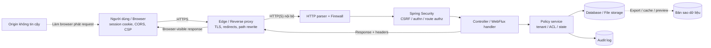
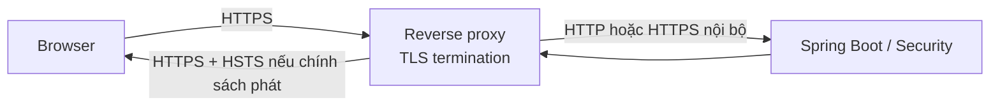
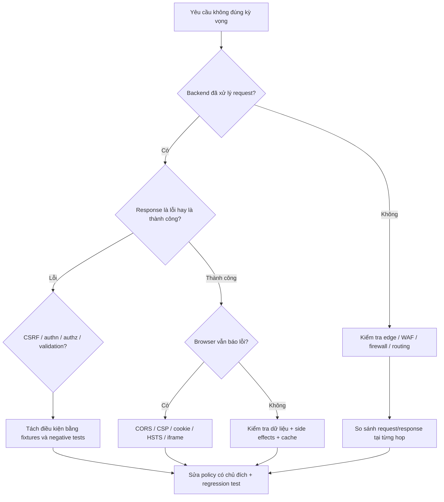

# Từ mô hình nguy cơ đến cơ chế bảo vệ và bằng chứng kiểm thử

> **Chương:** Bản đồ bảo vệ  
> **Học phần:** `SPRING_SECURITY_HTTP_PROTECTION` — các lớp phòng vệ HTTP và trình duyệt trong Spring Security: CSRF, CORS, HTTP security headers, CSP, HSTS, HTTP firewall và bảo vệ session. Bài tập trung cách chuyển **nguy cơ thực tế** thành **chính sách có thể kiểm chứng** trên Servlet (Spring MVC) và Reactive (Spring WebFlux), bao gồm hệ thống có trình duyệt, reverse proxy và nhiều security chain.

## 1. Bảo mật có thể kiểm chứng bắt đầu từ nguy cơ, không bắt đầu từ annotation

Một nhóm phát triển có thể viết:

```java
.requestMatchers("/api/invoices/**").authenticated()
```

Dòng này trả lời một câu hỏi: request khớp đường dẫn có cần principal đã xác thực không? Nó **không trả lời** người dùng có được duyệt hóa đơn của phòng ban khác, một trang lạ có thể gây ra request thay đổi trạng thái hay không, response có chứa script không tin cậy, hay gateway có bỏ qua lớp bảo vệ vì biến đổi URL.

Một thiết kế phòng vệ có trách nhiệm phải nối được:

1. **Tài sản có giá trị:** dữ liệu hoặc hành động nào cần bảo vệ?
2. **Kẻ tấn công và khả năng:** ai có thể làm gì, từ đâu, với những credential nào?
3. **Đường đi tấn công:** request/data đi qua các ranh giới tin cậy nào?
4. **Hậu quả:** mất bí mật, sửa dữ liệu, chiếm quyền, gián đoạn hay rò rỉ trên browser/cache?
5. **Bất biến an ninh (*security invariant*):** điều kiện nào phải luôn đúng dù client gửi request thế nào?
6. **Cơ chế bảo vệ:** kiểm tra ở lớp nào và ai chịu trách nhiệm?
7. **Bằng chứng kiểm thử:** request nào chứng minh bất biến đúng, lỗi bị chặn **trước khi có tác dụng phụ**, và luồng hợp lệ vẫn hoạt động?

Điểm cuối quan trọng: **“Đã bật CSRF”**, **“đã có CSP”** hay **“đã cấu hình HTTPS”** không phải bằng chứng đủ. Bằng chứng cần quan sát được tại đúng ranh giới: security filter, dữ liệu nghiệp vụ, phản hồi cuối cùng mà browser nhận, hoặc session sau logout.

### Mục tiêu học tập

Sau bài, người học có thể:

- Dựng mô hình nguy cơ cho một tính năng HTTP/web có session, API và hạ tầng trung gian.
- Chuyển từng nguy cơ thành yêu cầu/bất biến và chọn CSRF, CORS, authorization, security headers, CSP, HSTS, HTTP firewall hoặc session protection phù hợp.
- Lập bảng truy vết **Threat ID → Security invariant → Control → Test ID → Evidence → Owner**.
- Phân biệt các mức bằng chứng: test chính sách, integration test với Spring Security, kiểm thử trình duyệt thật và kiểm thử đi qua proxy.
- Viết kiểm thử âm tính/dương tính trên **Servlet** và **WebFlux**, kể cả kiểm tra trạng thái dữ liệu không thay đổi khi bị từ chối.
- Chẩn đoán khi cấu hình và bằng chứng mâu thuẫn, rồi chuyển phát hiện thành regression test.

## 2. Tình huống xuyên suốt: hệ thống duyệt hóa đơn

Giả sử một tổ chức xây hệ thống **Invoice Review**:

- Giao diện SPA: `https://portal.example.com`.
- API: `https://api.example.com`.
- API chạy Spring Security, có thể bằng Spring MVC hoặc WebFlux.
- Trình duyệt đăng nhập bằng **session cookie** do hệ thống phát.
- Reverse proxy kết thúc TLS và có thể chuyển tiếp request bằng HTTP nội bộ.
- Nhân viên được xem hóa đơn của **tenant** mình; reviewer được duyệt những hóa đơn được phân công.
- Hóa đơn có file PDF, ghi chú, người duyệt, trạng thái và bản export.

Một số endpoint minh họa:

| Endpoint | Hành động | Tài sản | Mức nguy cơ |
| --- | --- | --- | --- |
| `GET /api/invoices` | Tìm kiếm/danh sách | Metadata nhiều hóa đơn | Rò rỉ dữ liệu hàng loạt |
| `GET /api/invoices/42` | Đọc chi tiết | Hóa đơn 42 | BOLA/IDOR, dữ liệu riêng tư |
| `GET /api/invoices/42/download` | Tải PDF | File gốc hoặc bản sao | Lộ file qua route thứ hai |
| `POST /api/invoices/42/approve` | Duyệt | Trạng thái và audit | Sửa trái quyền, CSRF |
| `POST /api/invoices/42/comments` | Thêm ghi chú | Nội dung HTML/text | CSRF, XSS khi hiển thị |
| `POST /api/invoices/export` | Xuất dữ liệu | File chứa nhiều hóa đơn | Lộ dữ liệu diện rộng |
| `POST /logout` | Kết thúc phiên | Session cookie và server-side session | Phiên cũ còn dùng được |
| `GET /review` | Hiển thị HTML của SPA | Document và JavaScript | CSP, clickjacking, cache |

Mọi request đi qua nhiều nơi. Các lớp bảo vệ sẽ phải được kiểm thử tương ứng với nơi quyết định của chúng được thực thi.

## 3. Phác họa data flow và trust boundaries



**Trust boundary** là ranh giới mà dữ liệu phải được xác minh lại trước khi tin. Với ví dụ:

1. **Origin không tin cậy → browser:** một trang khác có thể tìm cách tạo request; browser tự gửi cookie theo policy, nhưng không kiểm tra CSRF thay server.
2. **Browser → edge:** request method, path, body và header do client gửi đều có thể bị sửa; chứng chỉ/TLS chỉ bảo vệ đường truyền, không xác minh quyền nghiệp vụ.
3. **Edge → ứng dụng:** `Forwarded`/`X-Forwarded-*`, URL rewrite, CORS response, cache và host/scheme phải được xử lý có kiểm soát.
4. **Security chain → service:** route có yêu cầu login chưa chứng minh được principal có quyền trên invoice ID cụ thể.
5. **Ứng dụng → browser:** nội dung người dùng nhập phải được encode/sanitize, response có các headers thích hợp; browser áp CSP, CORS và HSTS.
6. **Dữ liệu gốc → bản sao:** download, preview, export, log và cache không được trở thành đường vòng qua quyền truy cập.

Đường đi phụ thuộc sản phẩm, nên mô hình phải phản ánh **topology thực**, không mặc định mọi ứng dụng đều có CDN, WAF hay gateway.

## 4. Thu thập đầu vào cho mô hình nguy cơ

### 4.1. Danh mục tài sản, chủ thể, hành động và quyền

| Loại | Câu hỏi thu thập | Ví dụ |
| --- | --- | --- |
| Tài sản | Cần giữ bí mật/toàn vẹn/sẵn sàng cho cái gì? | PDF hóa đơn, trạng thái duyệt, ACL, session |
| Chủ thể | Ai có thể gửi request? | Khách, nhân viên, reviewer, admin, service account |
| Hành động | Đọc, sửa, duyệt, xuất, tải file, thu hồi? | `approve`, `download`, `export` |
| Phạm vi | Theo tenant, owner, ACL hay trạng thái? | Reviewer chỉ duyệt invoice đã được giao |
| Credential | Cookie, bearer, Basic, proxy assertion? | Session cookie trên SPA |
| Entry point | API, HTML, download URL, webhook? | `POST /api/invoices/42/approve` |
| Dữ liệu phụ | Bản sao, cache, log, presigned URL? | PDF export trong object storage |
| Hạ tầng | TLS, forwarded headers, CDN, path rewrite? | Edge TLS termination |
| Kỳ vọng từ chối | 401, 403, 404 hay 400? | 403 với CSRF, 404/403 theo object policy |
| Người chịu trách nhiệm | Ai sở hữu policy và test? | API team, frontend, platform/security team |

Một endpoint có thể đi qua nhiều lớp bảo vệ; một lớp lại phục vụ nhiều endpoint. Vì thế nên mô hình hóa **tài sản + hành động + ngữ cảnh**, thay vì chỉ một danh sách URL.

### 4.2. Xác định security invariants

Bất biến là một phát biểu **có thể kiểm chứng**, ví dụ:

- **INV-01:** Không người dùng chưa xác thực nào đọc được nội dung hóa đơn riêng tư.
- **INV-02:** Người dùng tenant A không xem/download/export hóa đơn tenant B, kể cả khi đoán đúng ID.
- **INV-03:** Request POST duyệt dùng session cookie mà không có CSRF token hợp lệ không đổi trạng thái hóa đơn.
- **INV-04:** Chỉ reviewer được phân công mới được duyệt hóa đơn đang chờ duyệt.
- **INV-05:** JavaScript từ origin ngoài allowlist không được browser cấp quyền đọc response API.
- **INV-06:** Ghi chú không tin cậy không được chạy thành script trong HTML, và CSP giảm tác động nếu một lỗi render lọt qua.
- **INV-07:** Trình duyệt nhận chính sách HTTPS/HSTS hợp lệ trên host cần bảo vệ; scheme/host không bị giả mạo qua forwarded headers.
- **INV-08:** URL/method bất thường không làm request vượt qua rule authorization hoặc xử lý thành hành động khác.
- **INV-09:** Sau logout hoặc session invalidation, session ID cũ không truy cập được API yêu cầu login.
- **INV-10:** Shared cache/CDN không trả hóa đơn của user A cho user B.

Bất biến không nên mơ hồ kiểu “bảo mật tốt” hoặc “chống được XSS”. Cần chỉ rõ **người nào, hành động nào, đối tượng nào, trong điều kiện nào và điều gì được quan sát**.

## 5. Nhận diện nguy cơ bằng STRIDE và abuse cases

**STRIDE** là một kỹ thuật gợi ý nhóm nguy cơ, không phải checklist bảo đảm đã tìm hết mọi lỗi:

| Nhóm STRIDE | Ý nghĩa | Kịch bản Invoice Review |
| --- | --- | --- |
| Spoofing | Giả mạo danh tính | Chiếm session cookie rồi truy cập dưới quyền reviewer |
| Tampering | Sửa trái phép dữ liệu/yêu cầu | POST duyệt bị giả mạo, sửa tenant ID trong body |
| Repudiation | Phủ nhận hành động | Duyệt hóa đơn nhưng audit thiếu chủ thể/trạng thái trước–sau |
| Information Disclosure | Lộ thông tin | Truy cập invoice khác tenant, file download không kiểm tra quyền |
| Denial of Service | Gián đoạn | Xuất PDF khối lượng lớn hoặc upload quá mức |
| Elevation of Privilege | Nâng quyền | Người thường lợi dụng route phụ hoặc mass assignment để tự duyệt |

**STRIDE không tự chỉ ra biện pháp chính xác.** Một sự kiện giả mạo request có thể được giảm bằng CSRF nếu browser tự gửi credential, nhưng cũng cần authentication và authorization. Rò rỉ dữ liệu qua export cần object-level policy và giới hạn dữ liệu; chỉ thêm CSP không giải quyết.

### 5.1. Viết abuse case theo khuôn

Một abuse case hữu ích gồm:

> **Given:** attacker có quyền gì và truy cập được entry point nào?  
> **When:** attacker gửi request hoặc tạo điều kiện gì?  
> **Then:** tác động nào không được phép xảy ra?  
> **Observed evidence:** kiểm tra response, thay đổi database, browser policy và log nào?

Ví dụ:

- **Given:** Bob thuộc tenant B, đã đăng nhập và có authority `INVOICE_READ`.
- **When:** Bob gọi `GET /api/invoices/42` với hóa đơn 42 thuộc tenant A.
- **Then:** API không trả dữ liệu hóa đơn 42, dù authority chức năng đã có.
- **Evidence:** status theo chính sách 403 hoặc 404; response không chứa thông tin nhạy cảm; truy vấn export/download phụ cũng bị chặn.

So với lời khẳng định “đã dùng `hasAuthority("INVOICE_READ")`”, abuse case này thể hiện chính xác **khoảng trống object-level authorization**.

## 6. Ưu tiên nguy cơ theo tác động và khả năng khai thác

Không nên gán điểm chính xác giả tạo khi thiếu dữ liệu. Có thể dùng thứ bậc nội bộ:

- **Tác động:** thấp / trung bình / cao / rất cao.
- **Khả năng khai thác:** thấp / trung bình / cao, dựa vào bề mặt public, credential cần có, độ khó, và độ phổ biến của đường tấn công.
- **Phạm vi:** một bản ghi, một tenant, toàn tổ chức; tác động có bền vững hoặc có thể khôi phục không?
- **Phát hiện/ứng phó:** có audit, cảnh báo, rate limit, thu hồi phiên và rollback không?

Ví dụ **bảng ưu tiên minh họa**, không phải thang điểm tiêu chuẩn:

| Threat ID | Nguy cơ | Tác động | Khả năng | Ưu tiên |
| --- | --- | --- | --- | --- |
| T-01 | Người khác tenant tải hóa đơn qua ID | Cao | Cao nếu ID dễ đoán | Rất cao |
| T-02 | CSRF làm reviewer duyệt ngoài ý muốn | Cao | Tùy cookie policy và endpoint | Cao |
| T-03 | XSS trong ghi chú trên trang reviewer | Cao | Tùy cách render và CSP | Cao |
| T-04 | HSTS thiếu sau TLS proxy | Trung bình–cao | Tùy đường vào HTTP và threat model | Cần đánh giá |
| T-05 | Path bất thường khiến matcher không nhất quán | Cao | Tùy parser/proxy | Cao nếu có đường bypass |
| T-06 | Shared cache phát file hóa đơn cho user khác | Rất cao | Tùy CDN/cache rules | Rất cao |
| T-07 | Không ghi nhận hành động duyệt | Trung bình–cao | Không phải khai thác trực tiếp | Quan trọng về truy vết |

Không dùng điểm ưu tiên để **bỏ qua** các yêu cầu thiết yếu như authorization đối tượng hoặc TLS. Ưu tiên chủ yếu quyết định thứ tự xử lý, độ sâu test và người phê duyệt rủi ro còn lại.

## 7. Ma trận truy vết: nguy cơ → bất biến → cơ chế → bằng chứng

Đây là **sản phẩm cốt lõi của bài học**. Mỗi dòng có ID ổn định để khi tính năng thay đổi vẫn biết phải cập nhật policy và test nào.

| Threat ID | Bất biến liên quan | Cơ chế bảo vệ | Bằng chứng tối thiểu | Chủ sở hữu |
| --- | --- | --- | --- | --- |
| T-01 BOLA/IDOR | INV-02 | Route authorization + tenant/ACL ở service | IT-01 cross-tenant GET; IT-02 download; IT-03 export | API/Domain |
| T-02 CSRF duyệt | INV-03, INV-04 | CSRF token + authority + policy trạng thái | IT-04 POST thiếu/sai token, state bất biến; IT-05 token đúng thiếu quyền | API/Frontend |
| T-03 XSS ghi chú | INV-06 | Encode/sanitize + CSP trên HTML | BT-01 browser script bị chặn; snapshot header HTML; test output | Frontend |
| T-04 HTTPS downgrade | INV-07 | TLS + HTTPS redirect + HSTS | E2E-01 HTTPS/HSTS sau proxy, redirect không lặp | Platform |
| T-05 URL parser mismatch | INV-08 | Strict firewall + matcher + proxy canonicalization | IT-06 URL bất thường; E2E-02 qua gateway | Platform/API |
| T-06 Session hijack/fixation | INV-09 | Session rotation, cookie attributes, logout invalidation | IT-07 session ID rotation; IT-08 cookie cũ không dùng được | API/Identity |
| T-07 CORS rộng | INV-05 | Origin allowlist, preflight integration | BT-02 origin hợp lệ/không hợp lệ trên browser | API/Frontend |
| T-08 Cache rò rỉ | INV-10 | Cache-Control, CDN cache policy/key | E2E-03 A/B user test qua CDN | Platform/API |
| T-09 Sửa trạng thái trái quyền | INV-04 | Role + object/state-level authorization | IT-09 reviewer không được giao; database không đổi | Domain |
| T-10 Export không lọc tenant | INV-02 | Scope tập kết quả + kiểm tra quyền export | IT-10 export nhiều tenant bị chặn/lọc đúng | Domain |

Chú ý một dòng có thể cần **nhiều cơ chế** và **nhiều bằng chứng ở các lớp khác nhau**. Test `POST` trả 403 không chứng minh lý do CSRF nếu authorization cũng có thể trả 403. Cần tạo fixture để cô lập nguyên nhân.

## 8. Phân biệt test thuộc tính bảo vệ với test một cấu hình cụ thể

Một security test tốt không chỉ xác nhận API của thư viện đã được gọi.

| Cách kiểm tra | Giá trị | Giới hạn |
| --- | --- | --- |
| Đọc mã `.csrf(withDefaults())` | Biết ý định cấu hình | Không biết request có vào chain đó không |
| Test Java gọi `hasAuthority(...)` | Kiểm tra một policy function | Không kiểm chứng HTTP filters, cookie hay proxy |
| `MockMvc`/`WebTestClient` qua Spring Security | Kiểm tra request routing, CSRF/authn/authz và response trên stack | Có thể chưa chạy browser, TLS termination hay CDN |
| Integration test với database/test fixture | Chứng minh từ chối không đổi state và không lộ data | Chưa kiểm chứng CSP/HSTS trong browser |
| Browser test thật | Chứng minh CORS/CSP/frame/cookie policy được browser áp dụng | Có thể chưa có proxy production tương đương |
| E2E qua gateway/CDN | Kiểm tra URL rewriting, HTTPS, HSTS, cache và headers cuối | Cần môi trường mẫu và quản lý dữ liệu test |
| Audit/telemetry ở production | Quan sát vận hành, tìm regressions | Không thay test; thiếu event không chứng minh không có tấn công |

### 8.1. Test oracle: điều gì cấu thành PASS?

**Oracle** là tiêu chí xác nhận test. Với hành động duyệt, oracle nên bao gồm:

1. Response thể hiện request được chấp nhận hoặc bị từ chối theo hợp đồng.
2. Hóa đơn **thật sự còn `PENDING`** khi request bị từ chối; không có dấu hiệu cập nhật giữa chừng.
3. Số sự kiện audit thành công không tăng vì một thao tác bị chặn.
4. Dữ liệu nhạy cảm không xuất hiện trong response hoặc file được tải xuống.
5. Với request hợp lệ, hóa đơn chuyển **đúng một lần** sang `APPROVED` và tạo audit event phù hợp.

`403` chỉ là một phần của oracle. Nếu middleware đã trả 403 nhưng service đã cập nhật dữ liệu trước khi lỗi xuất hiện, bất biến vẫn thất bại.

### 8.2. Positive tests và negative tests

- **Positive test:** reviewer được giao, session hợp lệ, CSRF token hợp lệ, hóa đơn `PENDING` → yêu cầu duyệt thành công và trạng thái đúng.
- **Negative test A:** cùng reviewer, cùng hóa đơn, **thiếu CSRF token** → bị từ chối, trạng thái không đổi.
- **Negative test B:** CSRF hợp lệ nhưng **thiếu authority `INVOICE_APPROVE`** → bị từ chối.
- **Negative test C:** CSRF và authority hợp lệ nhưng **không được giao hóa đơn** → bị từ chối.
- **Negative test D:** mọi điều kiện đúng trừ **hóa đơn đã `CANCELLED`** → nghiệp vụ từ chối.
- **Negative test E:** sử dụng session đã logout → không được thao tác.

Các test A–E giúp tránh **test che lấp lỗi**: một yêu cầu thiếu CSRF và đồng thời thiếu quyền không cho biết quyền đã được kiểm tra đúng hay chưa.

## 9. Xác định test fixtures và đối tượng kiểm tra

Để test có tính lặp lại, nên tạo dữ liệu mẫu với ID cố định chỉ trong môi trường kiểm thử.

| Fixture | Principal | Tenant | Quyền | Ghi chú |
| --- | --- | --- | --- | --- |
| Alice | `alice` | A | `INVOICE_READ`, `INVOICE_APPROVE` | Được phân công invoice 42 |
| Bob | `bob` | B | `INVOICE_READ` | Không được xem invoice 42 |
| Carol | `carol` | A | `INVOICE_READ` | Cùng tenant nhưng không có quyền duyệt |
| Dave | `dave` | A | `INVOICE_APPROVE` | Reviewer không được phân công invoice 42 |
| Anonymous | Không principal | — | Không có | Kiểm tra private endpoints |
| Invoice 42 | — | A | — | `PENDING`, giao Alice duyệt |
| Invoice 43 | — | A | — | `CANCELLED`, không thể duyệt |
| Invoice 99 | — | B | — | Thuộc tenant B |

**Test dữ liệu cá nhân/nhạy cảm phải dùng fixture giả lập**, không dùng hóa đơn thật hoặc credential production. Mọi test có thể thay đổi dữ liệu chỉ chạy trong môi trường được phép và có khả năng rollback/reset.

Các bất biến cần độc lập giữa test cases. Tránh trường hợp một test duyệt invoice 42 xong làm test tiếp theo thất bại vì đã thay trạng thái. Nên reset fixture theo transaction, database migration/test container hoặc cơ chế test isolation phù hợp.

## 10. Thiết kế chính sách theo cơ chế: lớp nào chứng minh bất biến nào?

### 10.1. Authentication không thay authorization

Spring Security xác định principal qua session, token hoặc các cơ chế xác thực đã cấu hình. `authenticated()` bảo vệ đường vào nhưng không cho biết user sở hữu hóa đơn.

Một bất biến đầy đủ cần:

- Authentication xác định Alice/Bob.
- Route authorization chỉ cho authority `INVOICE_READ` hoặc `INVOICE_APPROVE` gọi chức năng tương ứng.
- Service kiểm tra **tenant, ACL, reviewer assignment, trạng thái**, và những field được phép sửa.
- Download, preview và export kiểm tra quyền trên cùng dữ liệu chứ không dựa vào URL khó đoán.

### 10.2. CSRF bảo vệ sự khởi tạo request dùng ambient credentials

Với session cookie, một trang ngoài có thể tìm cách khiến browser gửi request thay đổi dữ liệu. CSRF token được server kiểm tra để từ chối request không có token hợp lệ.

- **Invariant:** POST duyệt thiếu/sai token không đổi state.
- **Control:** CSRF của chain thực sự xử lý route và luồng cấp token cho frontend.
- **Evidence:** test có principal đủ quyền và invoice hợp lệ nhưng thiếu token; kiểm tra `403` và state không đổi.

Với API **thực sự chỉ chấp nhận** bearer token chủ động gửi trong `Authorization`, CSRF policy có thể khác. Nhưng việc có JWT hoặc `STATELESS` không tự chứng minh mọi endpoint đã không còn cookie/ambient credential.

### 10.3. CORS bảo vệ quyền đọc response trong browser

Một origin khác có thể gửi một số request, nhưng browser áp same-origin policy và CORS khi JavaScript muốn đọc response.

- **Invariant:** script từ `https://untrusted.example.net` không được đọc response chứa hóa đơn cá nhân.
- **Control:** CORS allowlist, credentials, allowed methods/headers, xử lý preflight trước auth có thể từ chối.
- **Evidence:** browser test dùng origin được phép và không được phép; quan sát preflight/actual response; đồng thời test authorization ở server.

**Không coi CORS là cơ chế chặn request hoặc cấp quyền nghiệp vụ.**

### 10.4. Security headers và CSP bảo vệ cách browser xử lý response

- **Invariant:** trang reviewer không được nhúng vào iframe từ origin không tin cậy.
- **Control:** CSP `frame-ancestors` hoặc `X-Frame-Options` phù hợp.
- **Evidence:** browser test nhúng iframe từ origin lạ bị chặn.

- **Invariant:** ghi chú user cung cấp không chạy như script.
- **Control:** output encoding/sanitization theo ngữ cảnh + CSP `script-src` phù hợp.
- **Evidence:** test render output và browser test cho script không tin cậy.

CSP trên **response JSON của API** không tự biến thành CSP của SPA HTML nếu HTML được phục vụ tại host khác. Hãy kiểm tra header ở **document HTML thực tế**.

### 10.5. HTTPS/HSTS bảo vệ kênh truyền và hành vi nâng cấp

- **Invariant:** người dùng truy cập API và SPA qua TLS hợp lệ; browser nhận HSTS cho host phù hợp và không bị redirect loop.
- **Control:** TLS/certificate/redirect ở edge hoặc app; HSTS trên HTTPS; trusted forwarded headers.
- **Evidence:** E2E đi qua proxy, kiểm tra response HTTPS, HSTS, cookie `Secure` và địa chỉ redirect.

HSTS không tự cấp chứng chỉ và không sửa được một hop nội bộ qua mạng không tin cậy. Nếu edge TLS termination, backend cần thông tin external scheme đáng tin hoặc edge sở hữu HSTS.

### 10.6. HTTP firewall giảm đường vòng parser/matcher

- **Invariant:** encoded slash, semicolon hoặc các biểu diễn path không chuẩn không vượt qua chính sách route authorization.
- **Control:** `StrictHttpFirewall` (Servlet) hoặc `StrictServerWebExchangeFirewall` (Reactive) cùng quy tắc URL/proxy hợp lý.
- **Evidence:** integration/E2E gửi path bất thường vào hệ thống mẫu và xác nhận không đến tài nguyên/action bị cấm.

HTTP firewall **không biết** invoice thuộc tenant nào, vì thế không thay service authorization.

### 10.7. Session protection giảm lạm dụng phiên

- **Invariant:** session trước login không bị attacker cố định; session đã logout không dùng lại được.
- **Control:** session fixation protection, cookie attributes, invalidation và expiration.
- **Evidence:** test session ID trước/sau login, thử cookie cũ sau logout, inspect `Set-Cookie` trên response browser thấy.

`HttpOnly` giảm khả năng JS đọc cookie nhưng script XSS trong origin vẫn có thể gửi request bằng cookie; vì vậy không loại bỏ nhu cầu phòng XSS và CSRF.

## 11. Bộ quy tắc mẫu cho Servlet (Spring MVC)

Giả định ví dụ dùng form login/session cookie. Backend và frontend **có thể khác origin**; cách cấu hình CORS được tách riêng để không nhầm với CSRF và route auth.

```java
@Configuration
@EnableWebSecurity
@EnableMethodSecurity
class InvoiceServletSecurity {

    @Bean
    SecurityFilterChain securityFilterChain(HttpSecurity http)
            throws Exception {
        return http
            .cors(Customizer.withDefaults())
            .csrf(Customizer.withDefaults())
            .headers(headers -> headers
                .contentSecurityPolicy(csp -> csp.policyDirectives(
                    "default-src 'self'; " +
                    "script-src 'self'; " +
                    "object-src 'none'; " +
                    "base-uri 'self'; " +
                    "frame-ancestors 'none'"
                ))
            )
            .authorizeHttpRequests(auth -> auth
                .requestMatchers("/login", "/error", "/assets/**")
                    .permitAll()
                .requestMatchers(HttpMethod.GET, "/health")
                    .permitAll()
                .requestMatchers(HttpMethod.POST,
                    "/api/invoices/*/approve")
                    .hasAuthority("INVOICE_APPROVE")
                .requestMatchers(HttpMethod.GET, "/api/invoices/**")
                    .hasAuthority("INVOICE_READ")
                .requestMatchers(HttpMethod.POST,
                    "/api/invoices/export")
                    .hasAuthority("INVOICE_EXPORT")
                .anyRequest().denyAll()
            )
            .formLogin(Customizer.withDefaults())
            .logout(Customizer.withDefaults())
            .build();
    }

    @Bean
    UrlBasedCorsConfigurationSource corsConfigurationSource() {
        CorsConfiguration c = new CorsConfiguration();
        c.setAllowedOrigins(List.of("https://portal.example.com"));
        c.setAllowedMethods(List.of("GET", "POST", "PUT"));
        c.setAllowedHeaders(List.of(
            "Content-Type", "X-CSRF-TOKEN", "X-XSRF-TOKEN"
        ));
        c.setAllowCredentials(true);

        UrlBasedCorsConfigurationSource source =
            new UrlBasedCorsConfigurationSource();
        source.registerCorsConfiguration("/api/**", c);
        return source;
    }
}
```

Đây là **cấu hình minh họa**, giả định imports và các thành phần Spring đã được cung cấp; cần bổ sung `UserDetailsService`/identity integration, endpoints, frontend token flow, session/cookie config và đối tượng nghiệp vụ. Chú ý thứ tự matcher, giới hạn route `/api/invoices/export` và mở thêm các route cần thiết theo sản phẩm. Khi dùng source CORS trong Servlet, import `org.springframework.web.cors.UrlBasedCorsConfigurationSource`.

**Truy vết từ mã đến bất biến:**

| Cấu hình | Bất biến hỗ trợ | Vẫn cần |
| --- | --- | --- |
| `csrf(withDefaults())` | INV-03 | Luồng lấy/gửi token và test state |
| `authorizeHttpRequests` | INV-01, một phần INV-04 | Tenant/ACL/reviewer assignment ở service |
| `cors(withDefaults())` + allowlist | INV-05 | Browser test và response cuối sau edge |
| `contentSecurityPolicy(...)` | Một phần INV-06 | HTML đúng host, output encoding/sanitization |
| Default/security headers khác | Một phần INV-06/07/10 | Verify CSP, frame/cache/HSTS theo response và version |
| Firewall mặc định | Một phần INV-08 | Test URL qua gateway và object auth |
| Form login/logout | Một phần INV-09 | Session lifecycle, cookie attributes, audit |

Không dùng kết quả test riêng filter để khẳng định các bất biến nghiệp vụ đã đúng.

## 12. Kiểm soát nghiệp vụ ở service: điểm test không thể bỏ qua

Sau khi vượt route matcher, cần xác minh actor có quyền duyệt **hóa đơn này**.

Ví dụ code Servlet minh họa, giả định `InvoiceRepository`, `InvoicePolicy`, `Invoice`, `InvoiceState` và `AuditService` là các thành phần nghiệp vụ thực:

```java
@Service
class InvoiceApprovalService {
    private final InvoiceRepository invoices;
    private final InvoicePolicy policy;
    private final AuditService audit;

    InvoiceApprovalService(
            InvoiceRepository invoices,
            InvoicePolicy policy,
            AuditService audit) {
        this.invoices = invoices;
        this.policy = policy;
        this.audit = audit;
    }

    @PreAuthorize("hasAuthority('INVOICE_APPROVE')")
    @Transactional
    public void approve(String id, Authentication actor) {
        Invoice invoice = invoices.findById(id)
            .orElseThrow(InvoiceNotFoundException::new);

        if (!policy.canApprove(actor, invoice)) {
            throw new AccessDeniedException(
                "Not assigned to approve this invoice");
        }
        if (invoice.getState() != InvoiceState.PENDING) {
            throw new IllegalStateException("Invoice is not pending");
        }

        invoice.approve(actor.getName());
        audit.recordApproved(actor.getName(), invoice.getId());
    }
}
```

Các nguyên tắc:

- `canApprove` phải kiểm tra tenant, reviewer assignment và quy tắc không tự duyệt nếu có.
- ID của hóa đơn là tham số không đáng tin; không dựa vào ID khó đoán để thay quyền truy cập.
- Nếu cần chống request lặp/race condition, thiết kế transaction, optimistic lock, idempotency và audit theo yêu cầu; CSRF token không giải quyết các vấn đề đó.
- Test bị từ chối phải kiểm tra transaction **không cập nhật hóa đơn hoặc tạo audit thành công**.
- Với WebFlux, phần service tương ứng cần dùng Reactive repository/context và không `block()` trong request pipeline; các bất biến nghiệp vụ giữ nguyên.

## 13. Cấu hình mẫu cho WebFlux (Reactive)

WebFlux dùng `ServerHttpSecurity`, `SecurityWebFilterChain`, `authorizeExchange`, CSRF trong WebFilter và WebSession nếu xác thực bằng form login.

```java
@Configuration
@EnableWebFluxSecurity
@EnableReactiveMethodSecurity
class InvoiceReactiveSecurity {

    @Bean
    SecurityWebFilterChain securityWebFilterChain(ServerHttpSecurity http) {
        return http
            .cors(cors -> cors.configurationSource(corsSource()))
            .csrf(Customizer.withDefaults())
            .headers(headers -> headers
                .contentSecurityPolicy(csp -> csp.policyDirectives(
                    "default-src 'self'; " +
                    "script-src 'self'; " +
                    "object-src 'none'; " +
                    "base-uri 'self'; " +
                    "frame-ancestors 'none'"
                ))
            )
            .authorizeExchange(auth -> auth
                .pathMatchers("/login", "/error", "/assets/**")
                    .permitAll()
                .pathMatchers(HttpMethod.GET, "/health")
                    .permitAll()
                .pathMatchers(HttpMethod.POST,
                    "/api/invoices/*/approve")
                    .hasAuthority("INVOICE_APPROVE")
                .pathMatchers(HttpMethod.GET, "/api/invoices/**")
                    .hasAuthority("INVOICE_READ")
                .pathMatchers(HttpMethod.POST,
                    "/api/invoices/export")
                    .hasAuthority("INVOICE_EXPORT")
                .anyExchange().denyAll()
            )
            .formLogin(Customizer.withDefaults())
            .build();
    }

    @Bean
    org.springframework.web.cors.reactive.UrlBasedCorsConfigurationSource
            corsSource() {
        CorsConfiguration c = new CorsConfiguration();
        c.setAllowedOrigins(List.of("https://portal.example.com"));
        c.setAllowedMethods(List.of("GET", "POST", "PUT"));
        c.setAllowedHeaders(List.of(
            "Content-Type", "X-CSRF-TOKEN", "X-XSRF-TOKEN"
        ));
        c.setAllowCredentials(true);

        var source = new
            org.springframework.web.cors.reactive
                .UrlBasedCorsConfigurationSource();
        source.registerCorsConfiguration("/api/**", c);
        return source;
    }
}
```

Cấu hình là minh họa theo lambda DSL của Spring Security hiện đại; cần kiểm tra chữ ký API với phiên bản cụ thể, imports và phương thức cung cấp `corsSource()` cho bean đã khai báo. `CorsConfigurationSource` Reactive thuộc `org.springframework.web.cors.reactive`; không import nhầm kiểu Servlet.

Những điều không thay đổi so với Servlet:

- Cookie-session request cần CSRF token phù hợp.
- CORS là origin allowlist, không phải authorization.
- CSP phải nằm trên **response HTML thực sự được browser render**.
- Quyền tenant/ACL và trạng thái vẫn phải được kiểm tra trong domain/service.
- TLS/proxy/HSTS và HTTP firewall cần quan sát trên đường đi thực.

Những điều khác:

| Khía cạnh | Servlet | WebFlux |
| --- | --- | --- |
| HTTP security config | `HttpSecurity` | `ServerHttpSecurity` |
| Chain | `SecurityFilterChain` | `SecurityWebFilterChain` |
| CSRF filter | `CsrfFilter` | `CsrfWebFilter` |
| CSRF repository | `CsrfTokenRepository` / `HttpSessionCsrfTokenRepository` | `ServerCsrfTokenRepository` / `WebSessionServerCsrfTokenRepository` |
| Session | `HttpSession` | `WebSession` |
| Context | `SecurityContextHolder` trong tích hợp Servlet | `ReactiveSecurityContextHolder` trong Reactor context |
| Firewall | `StrictHttpFirewall` | `StrictServerWebExchangeFirewall` |
| CORS source | `org.springframework.web.cors.*` | `org.springframework.web.cors.reactive.*` |
| Request test | `MockMvc` | `WebTestClient` |

**Không chuyển nguyên mã Servlet dựa `HttpServletRequest`/thread-local sang pipeline Reactive.** Nếu chính sách cần I/O Reactive, xây `Mono<Boolean>`/`Flux` và kết hợp phi blocking trong service.

## 14. IT-04: viết test CSRF đủ sức phân biệt với authorization (Servlet)

Giả sử `MockMvc` đã được tích hợp Spring Security, invoice 42 ở trạng thái `PENDING` và Alice là reviewer hợp lệ. Các ví dụ dùng `spring-security-test` và một fixture repository có thể truy vấn trạng thái.

```java
@Test
void approveWithoutCsrfMustNotChangeInvoice() throws Exception {
    mvc.perform(post("/api/invoices/42/approve")
            .with(user("alice").authorities(
                new SimpleGrantedAuthority("INVOICE_APPROVE"))))
        .andExpect(status().isForbidden());

    assertThat(invoiceRepository.findById("42").orElseThrow()
            .getState())
        .isEqualTo(InvoiceState.PENDING);
    assertThat(auditRepository.countApprovalsFor("42"))
        .isZero();
}
```

Điều quan trọng:

- Alice được gán authority và quyền nghiệp vụ đối với invoice 42. Nếu bỏ qua fixture này, `403` có thể đến từ authorization và không chứng minh CSRF.
- Không có `with(csrf())` trong request, nên test cố tình thiếu token.
- Phải kiểm tra cả state và audit, không chỉ HTTP status.
- Các class repository/fixture, `assertThat` và kết quả audit là phần minh họa; ứng dụng thật cần cung cấp.

### 14.1. Test token đúng nhưng thiếu quyền

```java
@Test
void csrfTokenDoesNotGrantApprovalAuthority() throws Exception {
    mvc.perform(post("/api/invoices/42/approve")
            .with(user("carol").authorities(
                new SimpleGrantedAuthority("INVOICE_READ")))
            .with(csrf()))
        .andExpect(status().isForbidden());

    assertThat(invoiceRepository.findById("42").orElseThrow()
            .getState())
        .isEqualTo(InvoiceState.PENDING);
}
```

### 14.2. Test có authority nhưng khác điều kiện nghiệp vụ

```java
@Test
void unassignedReviewerCannotApprove() throws Exception {
    mvc.perform(post("/api/invoices/42/approve")
            .with(user("dave").authorities(
                new SimpleGrantedAuthority("INVOICE_APPROVE")))
            .with(csrf()))
        .andExpect(status().isForbidden());

    assertThat(invoiceRepository.findById("42").orElseThrow()
            .getState())
        .isEqualTo(InvoiceState.PENDING);
}
```

Đây là ba kiểm tra cho **ba nguyên nhân từ chối khác nhau**. Sau chúng cần một positive test với Alice, CSRF hợp lệ và payload hợp lệ để xác nhận chức năng duyệt không bị cấu hình bảo mật chặn nhầm.

### 14.3. Giới hạn của MockMvc helpers

`with(user(...))` giả lập principal và `with(csrf())` giả CSRF token cho kiểm thử Spring Security. Chúng **không** xác nhận password login flow, cookie flags, session rotation, token lifecycle của SPA, browser CORS hay TLS phía proxy. Những bằng chứng đó phải lấy từ integration/browser/e2e khác.

## 15. Kiểm thử tương đương trong WebFlux bằng WebTestClient

`spring-security-test` có các mutators `mockUser()` và `csrf()` cho WebFlux. Điều kiện tiên quyết là `WebTestClient` được tích hợp với Spring Security và fixture domain đã chuẩn bị.

```java
@Test
void reactivePostWithoutCsrfIsDenied() {
    webTestClient
        .mutateWith(mockUser("alice")
            .authorities(new SimpleGrantedAuthority(
                "INVOICE_APPROVE")))
        .post()
        .uri("/api/invoices/42/approve")
        .exchange()
        .expectStatus().isForbidden();

    StepVerifier.create(invoiceRepository.findById("42"))
        .assertNext(invoice ->
            assertThat(invoice.getState())
                .isEqualTo(InvoiceState.PENDING))
        .verifyComplete();
}
```

Đây là test minh họa; repository Reactive thực tế có thể cung cấp `Mono<Invoice>` và cách cô lập state riêng. Không `block()` trực tiếp trong request pipeline để kiểm tra security context.

### 15.1. CSRF đúng nhưng không đủ quyền

```java
@Test
void reactiveCsrfDoesNotBypassAuthorization() {
    webTestClient
        .mutateWith(mockUser("carol")
            .authorities(new SimpleGrantedAuthority(
                "INVOICE_READ")))
        .mutateWith(csrf())
        .post()
        .uri("/api/invoices/42/approve")
        .exchange()
        .expectStatus().isForbidden();
}
```

### 15.2. Positive test phải có điều kiện rõ ràng

Với Alice, `mutateWith(csrf())` và một fixture cho phép duyệt, cần assert response thành công theo hợp đồng và trạng thái chuyển sang `APPROVED`. Nếu chỉ gửi `exchange()` không assert gì, đó chưa phải bằng chứng.

### 15.3. JWT test không thay token validation thật

Trong API bearer-only, `mockJwt()` là helper để kiểm tra quyền route/scope, **không kiểm tra chữ ký JWT thật, issuer, audience hay expiry**. Cần test riêng decoder/resource server thực tế. Cũng cần test rằng API bearer-only không vô tình chấp nhận cookie/session làm credential, nếu dựa vào giả định đó để miễn CSRF.

## 16. IT-01/02/03/10: kiểm thử rò rỉ dữ liệu qua mọi đường đọc

Một policy đúng cho `GET /api/invoices/42` vẫn có thể bị bypass qua `/download` hoặc export.

### 16.1. Object authorization

Đối với Bob (tenant B), fixture invoice 42 (tenant A):

```java
mvc.perform(get("/api/invoices/42")
        .with(user("bob").authorities(
            new SimpleGrantedAuthority("INVOICE_READ"))))
    .andExpect(status().isForbidden());
```

Nếu ứng dụng chủ đích trả `404` để không tiết lộ sự tồn tại tài nguyên, chỉnh expectation cho đúng policy. **Quan trọng là response không chứa thông tin invoice 42**, và log/error payload không phát tán dữ liệu bí mật.

### 16.2. Download và preview

Với `GET /api/invoices/42/download` hoặc `preview`, lặp lại kịch bản Bob, kiểm tra:

- Không trả PDF hoặc nội dung preview.
- Không làm lộ storage key, presigned URL dài hạn hay đường dẫn nội bộ.
- Không có response cache công khai chứa tài liệu nhạy cảm.
- File hợp lệ có `Content-Type`/`Content-Disposition` và `X-Content-Type-Options: nosniff` phù hợp.

### 16.3. Export nhiều tài nguyên

Kiểm tra POST export có danh sách invoice IDs [42, 99] hoặc một bộ lọc rộng. Policy cần nêu rõ:

- Chỉ xuất dữ liệu được phép, hoặc từ chối toàn bộ request khi tập kết quả chứa dữ liệu cấm.
- Không tiết lộ metadata/bản export của tenant khác.
- Không xây export từ truy vấn không áp tenant scope.

**Test oracle:** nội dung file và số dòng phải khớp đúng quyền của principal, không chỉ `200 OK` hoặc `403`. Nếu export chạy bất đồng bộ, cần test cả job status, đường tải file kết quả và vòng đời URL cấp phát.

## 17. BT-02: bằng chứng CORS phải chạy trong trình duyệt

Giả sử SPA được phục vụ tại `https://portal.example.com`. API chỉ cho origin đó đọc response có credentials.

### 17.1. Quan sát preflight bằng HTTP client

```bash
# Origin được phép. Chỉ sử dụng endpoint môi trường test.
curl -i -X OPTIONS https://api.example.com/api/invoices/42/approve \
  -H 'Origin: https://portal.example.com' \
  -H 'Access-Control-Request-Method: POST' \
  -H 'Access-Control-Request-Headers: content-type,x-csrf-token'

# Origin không được phép.
curl -i -X OPTIONS https://api.example.com/api/invoices/42/approve \
  -H 'Origin: https://untrusted.example.net' \
  -H 'Access-Control-Request-Method: POST' \
  -H 'Access-Control-Request-Headers: content-type,x-csrf-token'
```

CORS có thể trả `Access-Control-Allow-Origin: https://portal.example.com` và `Access-Control-Allow-Credentials: true` cho origin hợp lệ. Với credentialed response, **không** dùng `Access-Control-Allow-Origin: *`.

### 17.2. Điều curl không chứng minh được

`curl` có thể gửi `Origin` giả và xem response bất kể CORS; nó **không thực thi same-origin policy**. Browser test cần xác nhận:

1. Frontend ở origin hợp lệ gửi request và đọc được response sau khi hoàn thành authentication/CSRF theo policy.
2. JavaScript ở origin không được phép **không được cấp quyền đọc response**.
3. Server vẫn xác thực và phân quyền ngay cả khi origin có trong allowlist.
4. Với request cần preflight, `OPTIONS` không bị filter authentication từ chối vì không có cookie.
5. `Vary: Origin` hoặc cache key tương thích khi response CORS khác theo origin.

**Lưu ý:** chặn JavaScript đọc response không đồng nghĩa chắc chắn request không đến server. Vì vậy INV-03 (CSRF) và INV-05 (CORS) vẫn cần **hai nhóm test** độc lập.

## 18. BT-01: bằng chứng CSP, XSS và chống clickjacking

### 18.1. CSP phải nằm trên tài liệu HTML đúng origin

Một CSP mẫu:

```http
Content-Security-Policy: default-src 'self'; script-src 'self'; object-src 'none'; base-uri 'self'; frame-ancestors 'none'
```

Nếu SPA HTML do CDN tại `portal.example.com` phát nhưng Spring Boot chỉ trả JSON từ `api.example.com`, CSP trên JSON không tự trở thành chính sách của SPA. **Đối tượng kiểm thử là response HTML thực tế trình duyệt tải.**

### 18.2. Hai loại bằng chứng khác nhau

**Bằng chứng ứng dụng render an toàn:**

- Tạo ghi chú thử nghiệm có chuỗi giống cú pháp HTML/script.
- Server/template render giá trị thành text an toàn bằng encode/sanitize.
- DOM không tạo script element hoạt động từ dữ liệu đó.
- Không để nội dung không tin cậy được gán vào sink nguy hiểm.

**Bằng chứng browser policy:**

- CSP hiện diện trên response HTML.
- Script không thuộc allowlist/nonce/hash không chạy.
- Iframe từ origin bị cấm không nhúng được màn hình reviewer khi `frame-ancestors`/`X-Frame-Options` được bật phù hợp.
- Nếu dùng `Content-Security-Policy-Report-Only`, browser có thể **chỉ báo cáo** mà không chặn; test phải phân biệt hai chế độ.

XSS cần được giải quyết tại nguồn bằng encode/sanitize, không dùng CSP làm bằng chứng duy nhất. `HttpOnly` của cookie làm JS khó đọc cookie hơn nhưng không ngăn script đã chạy ở origin hợp lệ gọi API dưới phiên hiện tại.

### 18.3. Browser test phải tính tới assets hợp lệ

Một CSP quá chặt có thể chặn chính bundle JS, CDN, font, WebSocket hoặc stylesheet cần thiết. Cần kiểm thử **hai chiều**:

- Script hoặc iframe độc hại bị chặn.
- Chức năng SPA chính, network calls, login/logout và các biểu mẫu vẫn hoạt động.

Không thêm `'unsafe-inline'` đại trà chỉ để tránh violation; xem xét chuyển inline scripts thành external files hoặc dùng nonce/hash đúng mô hình.

## 19. E2E-01: HTTPS và HSTS phải kiểm tra qua reverse proxy

HSTS là response policy được **trình duyệt ghi nhớ**, không phải cách tự tạo TLS. Ví dụ:

```http
Strict-Transport-Security: max-age=31536000
```

Để kiểm tra INV-07:

1. Gửi request đến **hostname public** qua HTTPS, không phải chỉ gọi backend qua HTTP nội bộ.
2. Xác nhận certificate/TLS hợp lệ.
3. Kiểm tra `Strict-Transport-Security` được gửi qua HTTPS với `max-age` và phạm vi phù hợp.
4. Nếu có `includeSubDomains`, xác minh các subdomain nằm trong phạm vi thật sự hỗ trợ HTTPS.
5. Nếu redirect từ HTTP, xác nhận không có loop và `Location` dẫn đúng host/scheme.
6. Kiểm tra `Set-Cookie` của session có `Secure` theo chính sách.
7. Kiểm tra response lỗi do edge/WAF sinh có headers cần thiết nếu được yêu cầu.

### 19.1. Trường hợp TLS termination



Khi backend chỉ thấy HTTP nội bộ, Spring Security có thể không phát HSTS vì không nhận diện request là HTTPS. Cách xử lý:

- **Edge phát HSTS** cho HTTPS response tới browser, hoặc
- Cấu hình app nhận biết external scheme qua **trusted forwarded headers** để phát HSTS chính xác.

Đừng tin `Forwarded`/`X-Forwarded-*` do bất kỳ client nào tự gửi. Proxy phải loại bỏ/ghi đè giá trị chưa đáng tin và backend chỉ chấp nhận metadata từ hop tin cậy.

### 19.2. HSTS không phải một cơ chế ở mọi client

Trình duyệt hiện đại thực thi HSTS theo quy tắc riêng, có thể preload; một HTTP client CLI có thể không ghi nhớ hoặc áp dụng như browser. Vì vậy `curl -I` chứng minh **có header** nhưng không thay hoàn toàn browser evidence về HSTS.

## 20. IT-06/E2E-02: bằng chứng HTTP firewall và đường đi URL

Một nguy cơ hay bị bỏ qua là chênh lệch giữa:

- Path được proxy/gateway kiểm tra.
- Path sau khi URL decode/normalize ở container.
- Path mà security matcher dùng.
- Path mà controller/handler cuối cùng thực thi.

Ký tự `%2F`, `;`, double slash `//` và các biểu diễn URL đặc biệt có thể dẫn tới kết quả khác nhau giữa các lớp.

### 20.1. Cơ chế trên hai stack

| Servlet | Reactive |
| --- | --- |
| `HttpFirewall` | `ServerWebExchangeFirewall` |
| `StrictHttpFirewall` | `StrictServerWebExchangeFirewall` |
| Tích hợp với `FilterChainProxy` | Tích hợp với `WebFilterChainProxy` |
| Quy tắc path/method áp lên request Servlet | Quy tắc áp lên `ServerWebExchange` |

**Đừng tự nới firewall chỉ vì URL có dấu `;` trả lỗi.** Cần xem route thực sự có yêu cầu hợp lệ, proxy/container xử lý như thế nào và có cách biểu diễn an toàn hơn không.

### 20.2. Test oracle

- Request URL bình thường dẫn đến route đúng và quyền vẫn được kiểm tra.
- Request bất thường được xử lý nhất quán: bị parser/firewall từ chối hoặc được chuẩn hóa có chủ đích mà **không bypass authorization**.
- Dữ liệu của tenant khác không bị đọc hoặc sửa bằng bất kỳ biểu diễn URL nào.
- Các status `400`, `403` hoặc mã proxy có thể khác theo tầng từ chối; test cần kiểm tra **không có side effect và không rò rỉ**.
- Test local và test qua gateway cùng bảo đảm bất biến, dù status có thể không giống hệt.

Nếu firewall đang từ chối `%2F` ở backend nhưng WAF lại decode path trước khi gửi, cần xem request ở **từng hop** để hiểu chính sách nào áp dụng thật.

## 21. IT-07/08: session và cookie cần bằng chứng vòng đời

Session cũng là tài sản có giá trị: một session ID bị đánh cắp có thể đại diện quyền của người dùng.

### 21.1. Trước và sau login

Với ứng dụng Servlet form login tiêu chuẩn, Spring Security hỗ trợ session fixation protection; trên Servlet container hiện đại thường sử dụng cơ chế đổi session ID khi xác thực thành công. Test phù hợp phải kiểm tra:

- Session ID trước đăng nhập (nếu đã có) so với sau đăng nhập.
- User mới có principal và quyền theo account thật.
- Không mang những quyền hoặc attribute chưa được phép từ trạng thái trước login.
- Các đăng nhập tùy biến/SSO có dùng cùng cơ chế bảo vệ không.

Với WebFlux, session và context sử dụng `WebSession`/`ServerSecurityContextRepository`; không mặc định sao chép API session fixation/concurrency của Servlet sang WebFlux.

### 21.2. Sau logout

Test gửi request với **cookie cũ** sau khi logout thành công:

- Không truy cập được API yêu cầu authentication.
- Session state đã invalidated hoặc credential được thu hồi theo kiến trúc.
- Cookie clearing thực tế có Domain/Path đúng để browser loại bỏ khi cần.
- Nếu có nhiều replica/session store, request đến instance khác cũng không khôi phục được phiên đã logout.

Không kết luận “logout an toàn” chỉ vì frontend chuyển về `/login`.

### 21.3. Cookie attributes trên response thật

Ví dụ mục tiêu cấu hình:

```http
Set-Cookie: JSESSIONID=<opaque-id>; Path=/; Secure; HttpOnly; SameSite=Lax
```

Đây là **một ví dụ**, không phải cam kết framework tự phát các thuộc tính này. Nơi phát cookie có thể là Servlet container, Spring Session, WebSession hoặc edge. Browser áp dụng `SameSite`, `Secure`, `Domain` và `Path` theo request thực; `SameSite=None` thường yêu cầu `Secure` và chính sách third-party cookies có thể còn giới hạn.

Đừng ghi **giá trị thật** của cookie/session ID hoặc CSRF token vào báo cáo kiểm thử; chỉ ghi có/không, attributes, kết quả và mã liên kết test.

## 22. E2E-03: cache có thể làm sụp đổ bằng chứng authorization

Giả sử Alice được phép xem hóa đơn 42. API kiểm tra đúng quyền và trả `200`. CDN sai cấu hình lưu response đó bằng cache key không bao gồm cơ chế phân tách theo người dùng.

Bob sau đó gọi **cùng URL**. Nếu CDN phát response của Alice **trước khi backend kiểm tra quyền**, Bob có thể nhìn thấy hóa đơn 42 dù service authorization đúng.

### 22.1. Bất biến cần chứng minh

**INV-10:** tài nguyên riêng tư không được shared cache phát cho người dùng khác.

### 22.2. Bằng chứng

1. Đăng nhập Alice, gửi request xem hóa đơn 42 qua **đường public đi qua CDN**.
2. Đăng nhập Bob trong phiên/browser profile khác, gửi URL tương tự.
3. Xác nhận Bob không nhận được nội dung hoặc file của Alice.
4. Quan sát `Cache-Control`, `Vary`, cache status headers nếu hệ thống cung cấp và cache key policy.
5. Kiểm tra những bản sao khác: PDF download, preview, export và URL cấp phát tạm thời.

Dữ liệu nhạy cảm thường cần `Cache-Control: no-store` hoặc chính sách cache riêng tư phù hợp, nhưng phải phối hợp với CDN/gateway. `Vary: Origin` phục vụ việc phân biệt response theo CORS origin, **không tự phân biệt người dùng**.

## 23. Một security chain đúng chưa chắc là policy của request đang chạy

Một hệ thống có thể dùng nhiều `SecurityFilterChain` hoặc `SecurityWebFilterChain`, chẳng hạn:

- Browser chain: form login/session cookie, CSRF.
- API bearer-only chain: JWT, không chấp nhận cookie.
- Health chain: public/giới hạn.
- Fallback chain: từ chối những route chưa xác định.

Spring Security chọn **chain phù hợp đầu tiên theo thứ tự**, không chạy tất cả chains nối tiếp. Một test chỉ tạo request ở `/api/**` không chứng minh `/review/**` hoặc route download đã được bảo vệ.

### 23.1. Bổ sung chứng cứ chain-selection

| Test | Ý định | Dấu hiệu cần kiểm tra |
| --- | --- | --- |
| API bearer-only chỉ gửi cookie | Cookie không được dùng để authn API | Không được coi là principal hợp lệ |
| Browser POST thiếu CSRF | Browser chain vẫn có CSRF | Request bị chặn |
| Health request | Chỉ thông tin tối thiểu public | Không lộ cấu hình/secret |
| Route lạ | Fallback deny | Không vô tình vào chain trống |
| Download URL | Khớp chain bảo vệ dữ liệu | Không bypass qua route phụ |
| Login/logout | Đi đúng chain theo thiết kế | Session và token lifecycle đúng |

**Cấu hình test phải khớp application thật.** Nếu dùng test slice bỏ mất filter chain, kết quả không chứng minh production secure.

## 24. Khi test thất bại: chẩn đoán theo triệu chứng và ranh giới

| Triệu chứng | Lớp có thể đang từ chối hoặc gây lỗi | Điều cần xác minh | Bằng chứng bổ sung |
| --- | --- | --- | --- |
| POST bị `403` dù đã login | CSRF hoặc authorization | Token, session, quyền, chain | Test thiếu token nhưng đủ quyền; token đúng thiếu quyền |
| Preflight `OPTIONS` bị `401/403` | CORS integration/auth order | Origin, methods, headers, cookie vắng mặt | Browser preflight và response sau proxy |
| CORS lỗi nhưng `curl` trả `200` | Browser same-origin/CORS | Allow-origin/credentials, actual response | Browser origin hợp lệ/lạ |
| Bob xem được invoice 42 | BOLA/IDOR | Tenant/ACL trên read/download/export | Cross-tenant fixture |
| Script ghi chú chạy | Render XSS, CSP thiếu/sai | DOM sink, encoding, CSP HTML | Output test + browser test |
| CSP có trên API nhưng không trên SPA | Sai host phát CSP | HTML được CDN/host nào phục vụ | Headers của HTML document |
| HSTS thiếu production | TLS termination, proxy rewrite | External scheme, HSTS owner | HTTPS response qua edge |
| Redirect HTTPS lặp | Trusted forwarded headers | Scheme/host trước và sau proxy | E2E redirect trace |
| Path `%2F` bị `400` | Parser/firewall/WAF | Hop nào từ chối, lý do path | Trace từng hop, URL thường/đặc biệt |
| Logout rồi cookie cũ vẫn dùng được | Session invalidation/store | Cookie path, session store, node khác | Multi-instance logout test |
| CDN lộ dữ liệu người khác | Shared cache | Cache key, cache policy, response headers | A/B user test qua CDN |
| JWT mock test pass nhưng JWT thật lỗi | Decoder/issuer/audience/expiry | Token validation thật | Integration test với decoder |

### 24.1. Decision tree rút gọn



Bắt đầu với một request cụ thể: method, URL, scheme, origin, có cookie/token không (không ghi giá trị), response status và nơi response được tạo. Không nới bảo vệ chỉ vì ứng dụng trả `403` hay `400`.

## 25. Bằng chứng phải có provenance và phạm vi rõ

Một báo cáo kiểm thử bảo mật nên trả lời:

- **Evidence ID:** số nhận diện không trùng, ví dụ `IT-04`.
- **Threat ID/Invariant:** bằng chứng cho điều gì?
- **Phiên bản triển khai:** commit/build, Spring Security/Boot version, browser/proxy configuration.
- **Môi trường:** local, integration, staging qua edge hay production observation? Có sự khác biệt nào?
- **Setup:** fixture, role, tenant, cookie/CSRF state, path, origin.
- **Input:** request/response được rút gọn an toàn, không để secret.
- **Expected/Observed:** điều cần đúng, điều test thực sự thấy.
- **State assertion:** database, audit, file/export, cache hoặc session sau request.
- **Kết quả:** PASS/FAIL/BLOCKED, người sở hữu, ticket khắc phục.
- **Giới hạn:** test này không bao phủ browser/TLS/cookie thật hoặc không bao phủ proxy nào?

### 25.1. Mẫu bằng chứng kiểm thử

```text
Evidence ID: IT-04
Threat ID: T-02
Invariant: INV-03
Environment: integration (Servlet, Spring Security configured)
Precondition: Alice has INVOICE_APPROVE and is assigned invoice 42;
              invoice 42 is PENDING.
Action: POST /api/invoices/42/approve without CSRF token.
Expected: Reject request, invoice 42 remains PENDING,
          no successful approval audit event.
Observed: [to be filled by the test execution]
Result: PASS / FAIL / BLOCKED
Limitations: No real browser, CDN or HTTPS proxy in this test.
Owner: API team
```

Đây là **mẫu trống**, không phải báo cáo một test đã chạy. Chỉ điền `Observed` và `PASS` khi đã thực sự chạy trên môi trường chỉ rõ. Không bao giờ bịa kết quả kiểm thử.

## 26. Đưa truy vết vào quy trình phát triển

Mục tiêu không phải tạo một bảng STRIDE rồi cất đi. Bảng nguy cơ cần **kết nối với thay đổi code và regression tests**.

### 26.1. Trước khi phát triển

1. Ghi lại tính năng, assets, trust boundaries và principal types.
2. Liệt kê abuse cases: cross-tenant, CSRF, XSS, cache, cookie, path rewriting.
3. Định nghĩa invariants rõ ràng.
4. Quyết định lớp sở hữu policy: backend, frontend, gateway, CDN hoặc browser.
5. Chọn test level phù hợp từng invariant.

### 26.2. Trong pull request

Khi thêm endpoint:

- Cập nhật bảng truy vết threat/invariant.
- Khai báo route/method authorization rõ ràng.
- Kiểm tra quyền trên đối tượng và field tại service.
- Xác định request có dùng session cookie và CSRF không.
- Nếu thay HTML/JS, cập nhật CSP và browser test.
- Nếu thêm gateway/CDN rule, cập nhật E2E header/cache/TLS tests.
- Đính kèm kết quả test; đừng chỉ viết “security đã bật”.

### 26.3. Trước khi phát hành

- Chạy negative tests và positive tests trên cả Servlet/WebFlux service tương ứng.
- Kiểm tra CSP/HSTS/CORS/cookie qua response cuối mà browser nhận.
- Chạy A/B user cache tests qua hạ tầng tương đương production.
- Kiểm tra path normalization khi có reverse proxy, WAF hoặc gateway mới.
- Rà soát các security chains và endpoint chưa phân loại.
- Xác nhận audit, incident response và thời hạn/session lifecycle.

### 26.4. Sau khi phát hành

Các log/cảnh báo an toàn nên hỗ trợ phát hiện:

- Số lượng CSRF validation failures tăng bất thường.
- Bất thường authentication/authorization theo user, tenant hoặc endpoint.
- CORS preflight lỗi sau deploy frontend mới.
- CSP violation reports tăng sau thay đổi script/CDN.
- Lỗi TLS/redirect/HSTS theo hostname.
- HTTP firewall rejections theo path pattern, tránh ghi credential.
- Session anomalies, logout failures, cache leaks.

**Telemetry không thay bằng chứng test**: thiếu log cảnh báo không chứng minh không có lỗi. Những dữ liệu này giúp cập nhật mô hình nguy cơ và tạo test regression mới.

## 27. Bài tập: xây một threat-to-test plan cho chức năng hoàn tiền

### Bối cảnh

Ứng dụng thương mại có:

- SPA tại `https://shop.example.com`; API tại `https://api.example.com`.
- Form login/session cookie.
- Endpoint `POST /api/refunds/{id}/approve` chỉ dành cho người quản lý.
- Trang HTML cho phép xem lý do hoàn tiền (text do khách hàng nhập).
- Reverse proxy xử lý TLS, gateway cache một số response.
- Backend có thể được triển khai bằng Servlet hoặc WebFlux.

### Yêu cầu

1. Liệt kê tối thiểu **6 tài sản** và **4 trust boundaries**.
2. Viết ít nhất **8 abuse cases**: CSRF, thiếu quyền, cross-tenant, XSS, CORS sai, HSTS/trusted forwarding, firewall path và shared cache.
3. Với mỗi case, viết một **invariant** có thể kiểm chứng.
4. Chọn cơ chế phù hợp và bên sở hữu: Spring Security, service, frontend, browser, proxy hoặc CDN.
5. Viết tối thiểu **2 positive tests**, **6 negative tests** và **2 browser/edge tests**.
6. Dùng cả Servlet và WebFlux ở ít nhất một test; chỉ rõ class/configurer khác nhau.
7. Thiết kế bằng chứng không lộ PII, cookie/session ID hay token trong log.
8. Với mỗi test, chỉ rõ **hành động nghiệp vụ có thay đổi thật hay không**.

### Bảng kết quả cần nộp

| Threat ID | Bất biến | Control | Test/Evidence | Pass condition |
| --- | --- | --- | --- | --- |
| RF-01 | POST thiếu CSRF không duyệt hoàn tiền | CSRF + session | Servlet MockMvc / WebFlux WebTestClient | 403 và `PENDING` không đổi |
| RF-02 | User ngoài tenant không thấy hồ sơ hoàn tiền | Object auth | Integration cross-tenant | Không lộ payload |
| RF-03 | Ghi chú không tin cậy không chạy script | Encode + CSP | Browser test | Script bị chặn, UI hợp lệ hoạt động |
| RF-04 | Origin lạ không đọc được API | CORS allowlist | Browser test | Không cấp quyền đọc response |
| RF-05 | HTTPS và HSTS đúng qua proxy | TLS + HSTS | Edge E2E | HTTPS hợp lệ, HSTS đúng |
| RF-06 | URL bất thường không bypass rule | Firewall + proxy | Integration/edge | Không thực thi action cấm |
| RF-07 | Phiên logout không còn dùng được | Session invalidation | Authn integration | Cookie cũ không truy cập API |
| RF-08 | CDN không cache lẫn hồ sơ refund | Cache policy | A/B user through CDN | Không nhận dữ liệu chéo |

**Tiêu chí chấm:** bảng có liên kết rõ ràng từ nguy cơ đến invariant, có test đủ cô lập nguyên nhân, có bằng chứng nghiệp vụ và chỉ rõ ranh giới chưa được test. Một bảng chỉ ghi “bật Spring Security” sẽ không đạt.

## 28. Checklist trước khi chốt mô hình nguy cơ và bộ kiểm thử

- [ ] Liệt kê assets, owner, actor, credential, endpoints và bản sao dữ liệu.
- [ ] Vẽ luồng browser → proxy → Spring Security → service → data và các trust boundaries.
- [ ] Mỗi threat có abuse case, tác động và điều kiện khai thác cụ thể.
- [ ] Mỗi threat có invariant kiểm chứng được, không chỉ câu “an toàn”.
- [ ] Chọn cơ chế đúng: authorization, CSRF, CORS, CSP/headers, TLS/HSTS, firewall, session, cache.
- [ ] Phân biệt cơ chế xử lý request ở server với chính sách browser xử lý response.
- [ ] Đã đối chiếu đúng stack Servlet/WebFlux và security chain mà endpoint đi qua.
- [ ] CSRF được kiểm tra cho request cookie-session unsafe; frontend token flow hoạt động.
- [ ] CORS allowlist phù hợp browser client; preflight được xử lý trước auth chặn thiếu cookie.
- [ ] CSP gắn trên HTML đúng host và kết hợp output encoding/sanitization.
- [ ] HTTPS/HSTS, forwarded headers, cookie `Secure` và redirect được kiểm tra sau proxy.
- [ ] Firewall xử lý URL bất thường nhất quán; không nới rule vô cớ.
- [ ] Session login/logout/timeout có test lifecycle, không dựa vào UI redirect.
- [ ] Download, preview, export và CDN cache được kiểm tra chống lộ dữ liệu vòng.
- [ ] Có positive/negative tests đủ tách biệt CSRF, authorization, object policy và trạng thái.
- [ ] Test bị từ chối kiểm tra database, audit hoặc side effect **không đổi**.
- [ ] Browser tests xác minh CORS/CSP/frame/HSTS mà `curl` không tự thực thi.
- [ ] E2E tests đi qua gateway/CDN thực hoặc topology tương đương khi cần.
- [ ] Evidence nêu môi trường, phiên bản, fixture, expected, observed và giới hạn rõ ràng.
- [ ] Không ghi secret/token/PII trong bằng chứng; chưa chạy test thì không tuyên bố PASS.
- [ ] Mọi thay đổi policy/endpoint tạo hoặc cập nhật regression tests có Threat ID liên kết.

## 29. Tài liệu tham khảo để xây bộ kiểm thử đáng tin

Đối chiếu API và mặc định với **phiên bản Spring Security/Spring Boot đang sử dụng**; các đoạn Java ở bài là ví dụ dạy học, cần bổ sung imports, fixture, repository, frontend và runtime thực tế.

- [Spring Security — Servlet authorization](https://docs.spring.io/spring-security/reference/servlet/authorization/authorize-http-requests.html)
- [Spring Security — Servlet method security](https://docs.spring.io/spring-security/reference/servlet/authorization/method-security.html)
- [Spring Security — Reactive authorization](https://docs.spring.io/spring-security/reference/reactive/authorization/authorize-http-requests.html)
- [Spring Security — Servlet CSRF](https://docs.spring.io/spring-security/reference/servlet/exploits/csrf.html)
- [Spring Security — Reactive CSRF](https://docs.spring.io/spring-security/reference/reactive/exploits/csrf.html)
- [Spring Security — Servlet CORS](https://docs.spring.io/spring-security/reference/servlet/integrations/cors.html)
- [Spring Security — Reactive CORS](https://docs.spring.io/spring-security/reference/reactive/integrations/cors.html)
- [Spring Security — Servlet HTTP security headers](https://docs.spring.io/spring-security/reference/servlet/exploits/headers.html)
- [Spring Security — Reactive HTTP security headers](https://docs.spring.io/spring-security/reference/reactive/exploits/headers.html)
- [Spring Security — Servlet HTTP firewall](https://docs.spring.io/spring-security/reference/servlet/exploits/firewall.html)
- [Spring Security — Reactive HTTP firewall](https://docs.spring.io/spring-security/reference/reactive/exploits/firewall.html)
- [Spring Security — Servlet session management](https://docs.spring.io/spring-security/reference/servlet/authentication/session-management.html)
- [Spring Security — MockMvc testing](https://docs.spring.io/spring-security/reference/servlet/test/mockmvc/index.html)
- [Spring Security — WebTestClient testing](https://docs.spring.io/spring-security/reference/reactive/test/web/index.html)
- [Spring Framework — Forwarded headers](https://docs.spring.io/spring-framework/reference/web/webmvc/filters.html#filters-forwarded-headers)
- [MDN — CORS](https://developer.mozilla.org/en-US/docs/Web/HTTP/CORS)
- [MDN — Content Security Policy](https://developer.mozilla.org/en-US/docs/Web/HTTP/Headers/Content-Security-Policy)
- [MDN — Strict Transport Security](https://developer.mozilla.org/en-US/docs/Web/HTTP/Headers/Strict-Transport-Security)
- [OWASP — Threat Modeling](https://owasp.org/www-community/Threat_Modeling)
- [OWASP — Application Security Verification Standard](https://owasp.org/www-project-application-security-verification-standard/)

**Kết luận:** cấu hình một cơ chế bảo vệ chỉ là **bước giữa** của quy trình. Kết quả kỹ thuật đáng tin phải truy vết được từ **tài sản và đường tấn công → bất biến an ninh → cơ chế bảo vệ trên đúng ranh giới → test với điều kiện rõ ràng → bằng chứng có thể kiểm tra lại**. Đây là cách chứng minh Spring Security Protection hoạt động đúng trên Servlet, WebFlux và cả tuyến browser–proxy–application, thay vì chỉ suy luận từ việc có dependency hoặc một dòng cấu hình.

