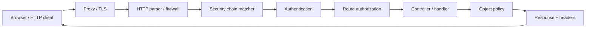
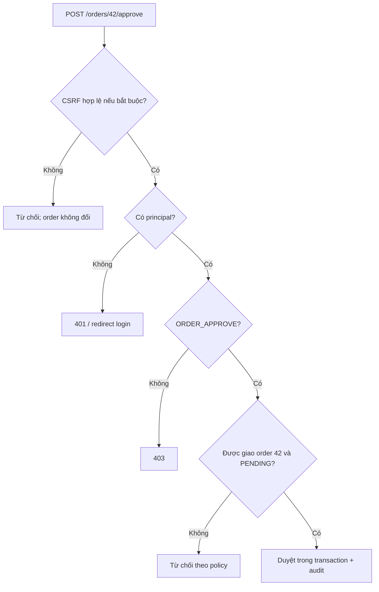
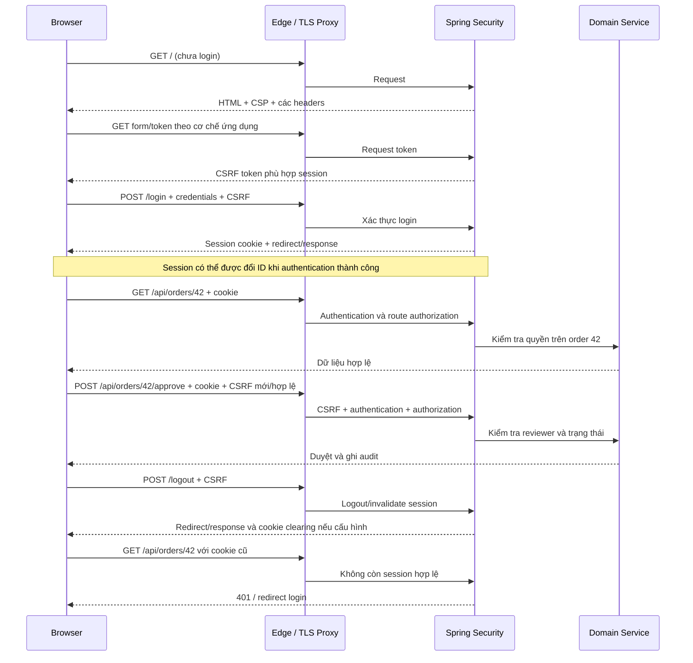
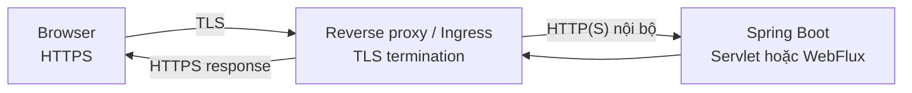
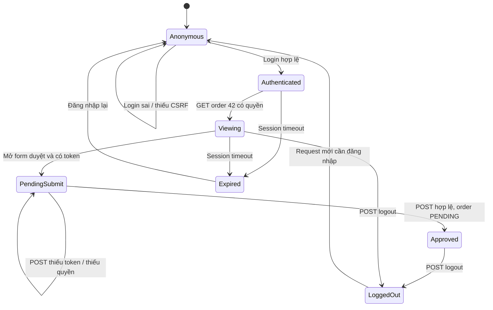

# Lộ trình học từ một yêu cầu HTTP đến hành trình người dùng hoàn chỉnh

> **Chương:** Bản đồ bảo vệ  
> **Phạm vi học phần:** `SPRING_SECURITY_HTTP_PROTECTION` — áp dụng các lớp phòng vệ HTTP và trình duyệt trong Spring Security: CSRF, CORS, security headers, CSP, HSTS, HTTP firewall và bảo vệ session. Lộ trình đi từ một request độc lập đến chuỗi tương tác thực tế, có ví dụ cho **Servlet (Spring MVC)** và **Reactive (WebFlux)**, kiểm thử kịch bản tấn công web và chẩn đoán xung đột trong triển khai.

## 1. Tại sao phải học theo hành trình thay vì học riêng từng filter?

Một test `GET /api/orders/42` trả `200` chỉ chứng minh được một lát cắt rất nhỏ. Người dùng thật thường bắt đầu từ một trình duyệt chưa đăng nhập, được chuyển đến trang login, nhận session cookie, tải dữ liệu, gửi biểu mẫu có CSRF token, mở một tab khác, chờ session hết hạn rồi đăng xuất.

Trong chuỗi đó, một request có thể hợp lệ **khi đứng một mình** nhưng thất bại khi đặt vào hành trình:

- Login thành công nhưng frontend không lấy lại được CSRF token sau khi session thay đổi.
- GET hoạt động bằng `curl` nhưng SPA bị CORS chặn đọc response.
- POST thiếu token trả `403`; lập trình viên tắt CSRF để “sửa nhanh”, làm mất lớp phòng vệ.
- Trình duyệt truy cập HTTPS qua gateway, còn backend tưởng là HTTP nên thiếu HSTS hoặc tạo redirect loop.
- Trang HTML có CSP đúng, nhưng đường trả lỗi từ CDN lại mất header.
- Sau logout, giao diện chuyển về login nhưng cookie phiên cũ vẫn dùng được trên node khác.

Vì vậy, đơn vị học tập nên tiến hóa theo thứ tự:

**Một HTTP request → một tập điều kiện bảo mật → một chuỗi request có trạng thái → một hành trình người dùng → một hệ thống sau proxy và trình duyệt thật.**

### Kết quả cần đạt

Sau bài học, người học có thể:

1. Theo dõi một request từ browser qua proxy, firewall, security chain, controller/handler và service.
2. Giải thích cách authentication, authorization, CSRF, CORS, security headers, HTTPS/HSTS và session ảnh hưởng đến **cùng một request**.
3. Xây dựng luồng login → xem tài nguyên → sửa tài nguyên → logout; chỉ ra thời điểm cookie và CSRF token được tạo, gửi, thay đổi hoặc mất hiệu lực.
4. Phân biệt một API cùng origin với SPA gọi API khác origin; hiểu sự khác nhau giữa **origin** và **site**.
5. Cấu hình các điểm bảo vệ tương ứng cho Servlet và WebFlux, không sao chép sai API.
6. Viết test cho từng chặng và một kịch bản end-to-end kiểm tra tính đúng đắn của **toàn hành trình**, không chỉ HTTP status.
7. Dùng bảng triệu chứng để chẩn đoán hành trình bị đứt mà không phải tắt ngẫu nhiên các lớp bảo mật.

## 2. Bản đồ lộ trình: các cột mốc cần vượt qua

| Chặng | Đơn vị quan sát | Khái niệm trọng tâm | Bằng chứng để qua chặng |
| --- | --- | --- | --- |
| 0. Đặt nền | Một tài nguyên và mô hình xác thực | Actor, asset, endpoint, trust boundary | Viết được kỳ vọng cho request hợp lệ và trái quyền |
| 1. Đọc một URL | Một `GET` | HTTP parser/firewall, chain, authentication, authorization | Anonymous bị từ chối, người đủ quyền được đọc |
| 2. Thay đổi dữ liệu | Một `POST` | Safe/unsafe methods, CSRF, quyền hành động | Thiếu token bị chặn và database không đổi |
| 3. Nhận response | Một HTML/JSON response | Headers, CSP, cache, frame policy | Browser thực thi CSP/frame policy, nội dung hợp lệ vẫn chạy |
| 4. Hai origin | Một request có preflight | CORS, cookies, credential mode, CSRF | Origin hợp lệ đọc được, origin lạ không đọc được |
| 5. Có phiên | Nhiều request nối tiếp | Login, session rotation, token lifecycle, logout | Phiên hợp lệ chạy; phiên cũ sau logout bị từ chối |
| 6. Có hạ tầng | Browser → edge → app | TLS, HSTS, forwarded headers, URL rewrite | HTTPS/redirect/HSTS đúng; path lạ không bypass |
| 7. Người dùng thật | Một hành trình hoàn chỉnh | Tất cả lớp phối hợp, trạng thái nhiều tab và lỗi | E2E test có cả nhánh thành công và nhánh bị từ chối |

Không cần viết mọi lớp ngay từ chặng 1. Mỗi chặng bổ sung **một loại câu hỏi bảo mật mới** và giữ lại các bất biến đã kiểm thử ở những chặng trước.

## 3. Một ví dụ thống nhất cho toàn lộ trình

Ta sử dụng ứng dụng **Order Review**:

- Trang web: `https://shop.example.com`.
- API minh họa: `https://api.example.com`.
- Người dùng đăng nhập bằng **session cookie**.
- Nhân viên đọc đơn hàng thuộc tenant của mình.
- Reviewer có thể duyệt đơn đang `PENDING` nếu được phân công.
- Trang HTML hiển thị ghi chú do người dùng nhập.
- Reverse proxy kết thúc HTTPS trước Spring Boot.

Dữ liệu thử nghiệm:

| Đối tượng | Tenant | Quyền | Trạng thái |
| --- | --- | --- | --- |
| Alice | A | `ORDER_READ`, `ORDER_APPROVE` | Reviewer được giao đơn 42 |
| Bob | B | `ORDER_READ` | Không được xem đơn 42 |
| Carol | A | `ORDER_READ` | Xem được đơn được chia sẻ, không được duyệt |
| Order 42 | A | Giao Alice duyệt | `PENDING` |
| Order 43 | A | Giao Alice duyệt | `CANCELLED`, không được duyệt |

Định nghĩa route của ví dụ:

| Route | Method | Mục đích | Chính sách |
| --- | --- | --- | --- |
| `/` | GET | Trang HTML | Tùy mức public, CSP và cache |
| `/login` | GET/POST | Đăng nhập | Authentication; POST cần CSRF nếu dùng form/session |
| `/api/orders/42` | GET | Đọc đơn | Authn + `ORDER_READ` + quyền theo đối tượng |
| `/api/orders/42/approve` | POST | Duyệt đơn | Authn + `ORDER_APPROVE` + CSRF + quyền nghiệp vụ |
| `/api/orders/42/download` | GET | Tải bản PDF | Quyền đọc order 42 và bảo vệ file/cache |
| `/logout` | POST | Đăng xuất | Session invalidation; CSRF nếu dùng cookie |
| `/health` | GET | Health check | Chỉ công khai nếu có chủ đích |

**Giả định quan trọng:** bài dùng cookie/session cho hành trình browser. Khi chuyển sang bearer-only API, chính sách CSRF và vòng đời session phải được đánh giá lại, không mặc định giữ hoặc tắt theo tên framework.

## 4. Chặng 0 — Trước khi gửi request: mô tả bất biến an ninh

Nếu không định nghĩa điều kiện đúng/sai, kiểm thử rất dễ biến thành “request trả mã mong muốn”. Hãy viết trước các bất biến:

- **S-01:** User chưa xác thực không đọc được đơn hàng riêng tư.
- **S-02:** User có `ORDER_READ` nhưng thuộc tenant khác không đọc/download được đơn 42.
- **S-03:** POST duyệt từ session cookie thiếu/sai CSRF token không thay đổi dữ liệu.
- **S-04:** Token đúng không tự cấp `ORDER_APPROVE` hoặc quyền trên đơn 42.
- **S-05:** Đơn đã hủy không thể duyệt dù người gửi có quyền.
- **S-06:** JavaScript từ origin ngoài allowlist không đọc được response API trong browser.
- **S-07:** Nội dung ghi chú không tin cậy không được chạy thành script; trang có CSP phù hợp.
- **S-08:** Browser nhận HTTPS/HSTS theo policy và không bị lừa bằng header proxy giả mạo.
- **S-09:** Sau logout, session đã vô hiệu không thể tiếp tục đọc/sửa đơn.
- **S-10:** Đường download/export/cache không làm lộ order của người khác.

Mỗi bất biến cần có **test hợp lệ** và **test bị từ chối**; với hành động ghi phải kiểm tra **trạng thái trước/sau**.

## 5. Chặng 1 — Theo dấu một GET duy nhất

Bắt đầu bằng yêu cầu:

```http
GET /api/orders/42 HTTP/1.1
Host: api.example.com
Accept: application/json
Cookie: JSESSIONID=<opaque-session-id>
```

Cần phân biệt **request được trình duyệt phát ra** với **request backend nhìn thấy** sau khi đi qua reverse proxy. Trong ứng dụng HTTP thực, chuỗi kiểm tra có thể bao gồm:



Thứ tự ở sơ đồ là **logic kiểm tra**, không phải sơ đồ filter order tuyệt đối của mọi bản Spring Security.

### 5.1. HTTP firewall giải quyết biểu diễn của URL

Proxy, Servlet container/Reactive runtime và request matcher cần hiểu URL thống nhất. Một số đường dẫn chứa `%2F`, dấu `;`, double slash hoặc encoding lạ có thể bị từ chối.

- **Servlet:** `StrictHttpFirewall`, tích hợp với `FilterChainProxy`.
- **WebFlux:** `StrictServerWebExchangeFirewall`, tích hợp với cơ chế Reactive tương ứng.

Chặng này kiểm tra: request với URL chuẩn được xử lý; URL đáng ngờ không đi vòng qua authorization. Firewall không xác minh Bob có quyền với order 42 hay không.

### 5.2. Authentication xác định principal, không xác định quyền sở hữu

Nếu cookie không mang phiên hợp lệ, ứng dụng có thể trả `401` hoặc redirect tới login tùy cơ chế entry point. Nếu có phiên, principal Alice/Bob được xác định.

**Đừng đồng nhất `authenticated()` với `authorized for this object`.** Bob đăng nhập hợp lệ vẫn không thể xem đơn của tenant A.

### 5.3. Route authorization và object authorization khác nhau

Route có thể yêu cầu `ORDER_READ`. Tiếp đó service phải kiểm tra tenant, owner, ACL, trạng thái hoặc điều kiện khác của order 42.

Ví dụ ý tưởng service (giả định các lớp nghiệp vụ đã tồn tại):

```java
public OrderView readOrder(String id, Authentication actor) {
    Order order = repository.findById(id)
        .orElseThrow(OrderNotFoundException::new);

    if (!orderPolicy.canRead(actor, order)) {
        throw new AccessDeniedException("Not allowed to read order");
    }

    return orderMapper.toView(order);
}
```

Đây là ví dụ Java Servlet-style đồng bộ; với Reactive repository cần dùng `Mono` và `flatMap` phù hợp. Quyền phải được xác minh **sau khi biết đối tượng nào được truy vấn**, không dựa vào ID khó đoán.

### 5.4. Bằng chứng hoàn thành chặng 1

| Test | Chủ thể | Request | Kỳ vọng |
| --- | --- | --- | --- |
| GET-01 | Anonymous | GET order 42 | Không trả nội dung |
| GET-02 | Alice | GET order 42 | Được đọc những field hợp lệ |
| GET-03 | Bob | GET order 42 | Bị từ chối/404 theo policy; không lộ nội dung |
| GET-04 | Alice | GET order không tồn tại | Không tiết lộ thông tin hệ thống |
| GET-05 | Bob | GET order 42/download | Không bypass được quyền qua URL phụ |

Qua chặng 1 khi **GET-02 thành công** và **GET-01/03/05 bảo vệ đúng**; không chỉ khi endpoint trả `200` cho một người.

## 6. Chặng 2 — Thêm một POST và nhìn thấy CSRF

Request tiếp theo:

```http
POST /api/orders/42/approve HTTP/1.1
Host: api.example.com
Content-Type: application/json
Cookie: JSESSIONID=<opaque-session-id>
X-CSRF-TOKEN: <csrf-token>

{"decision":"APPROVE"}
```

Với browser dùng cookie, một website ngoài có thể tìm cách khiến trình duyệt gửi request cùng thông tin xác thực tùy cookie policy. Vì vậy:

- **CSRF:** request thay đổi trạng thái cần token hợp lệ theo policy.
- **Authentication:** session xác thực Alice.
- **Route authorization:** Alice có authority `ORDER_APPROVE`.
- **Object/state authorization:** Alice được phân công order 42 và đơn `PENDING`.
- **Transaction/integrity:** xử lý an toàn khi nhiều yêu cầu cùng lúc, không duyệt lặp.
- **Audit:** ghi actor và kết quả mà không ghi secret.



Sơ đồ chỉ mô tả các **điều kiện cần đúng**; thực tế vị trí CSRF/authentication trong filter chain tùy stack và cấu hình.

### 6.1. Điều kiện nền: HTTP safe methods

GET/HEAD/OPTIONS/TRACE được xem là safe theo ngữ nghĩa HTTP và thông thường được miễn kiểm tra CSRF mặc định. Đừng viết `GET /api/orders/42/approve` chỉ để “không bị CSRF” — chính việc dùng GET để thay đổi trạng thái mới là lỗi.

POST/PUT/PATCH/DELETE là những method thường phải được phòng vệ trong ứng dụng cookie/session. `DELETE` có thể idempotent nhưng **không phải** safe.

### 6.2. CSRF token đến từ đâu?

Với ứng dụng HTML server-rendered, template có thể thêm token vào form. Với SPA, ứng dụng phải thiết kế cách **cấp token** qua endpoint/response thích hợp, gửi token trong header hoặc parameter, và **cập nhật token** sau login/logout/session rotation nếu cần.

Spring Security hiện đại có cơ chế deferred token loading và request handlers xử lý masked token/BREACH; không mặc định rằng đọc một cookie chứa token rồi phản chiếu sang header sẽ luôn hoạt động nếu chưa cấu hình handler/repository phù hợp.

- Servlet dùng `CsrfFilter` và `CsrfTokenRepository`, thường có `HttpSessionCsrfTokenRepository`.
- Reactive dùng `CsrfWebFilter` và `ServerCsrfTokenRepository`, thường có `WebSessionServerCsrfTokenRepository`.

CSRF token đúng **không phải** chứng cứ Alice có quyền duyệt mọi đơn.

### 6.3. Bằng chứng hoàn thành chặng 2

| Test | Điều kiện | Kỳ vọng |
| --- | --- | --- |
| POST-01 | Alice đủ quyền, thiếu token | Bị CSRF từ chối; order 42 vẫn `PENDING` |
| POST-02 | Alice đủ quyền, token sai | Bị từ chối; không tạo audit duyệt |
| POST-03 | Carol chỉ có `ORDER_READ`, token đúng | Bị authorization từ chối |
| POST-04 | Alice, token đúng, order 43 `CANCELLED` | Bị business rule từ chối |
| POST-05 | Alice, token đúng, order 42 `PENDING` | Duyệt thành công đúng một lần |
| POST-06 | Alice gửi lại hành động duyệt khi order đã `APPROVED` | Theo rule nghiệp vụ, không tạo duyệt trùng |

Cần giữ nguyên những fixture thích hợp để cô lập lớp bị kiểm tra. Nếu Alice không có quyền, test POST thiếu token trả `403` **không đủ** chứng minh chính CSRF đã chặn.

## 7. Chặng 3 — Response cũng là một phần của bảo mật

Một response không kết thúc nghĩa vụ bảo vệ khi server đã trả `200`. Browser sẽ xử lý HTML, script, iframe, redirect, file download và cache theo các chính sách nó nhận được.

### 7.1. Security headers thường gặp

| Chính sách | Bên gửi | Bên thực thi | Lưu ý với học viên |
| --- | --- | --- | --- |
| `Content-Security-Policy` | Server/edge phát trên HTML | Browser | Chọn `script-src`, `frame-ancestors`, v.v. phù hợp |
| `X-Frame-Options` | Server/edge | Browser | Giảm clickjacking |
| `X-Content-Type-Options: nosniff` | Server/edge | Browser | Trả content type chính xác |
| `Cache-Control` | Server/edge | Browser/proxy/CDN | Không cache chung dữ liệu cá nhân |
| `Referrer-Policy` | Server/edge | Browser | Giảm rò rỉ URL qua referrer |
| `Strict-Transport-Security` | Server/edge trên HTTPS | Browser | HSTS áp dụng các lần truy cập sau |
| `Set-Cookie` thuộc tính `Secure`/`HttpOnly`/`SameSite` | Nơi tạo cookie | Browser | Kiểm chứng riêng sau login/logout |

Một số header như cache control, `nosniff`, frame options và HSTS có thể được Spring Security thêm theo mặc định và điều kiện cụ thể. **CSP không thể tự suy ra từ dự án**; ứng dụng phải thiết kế.

### 7.2. CSP: chính sách cần nằm trên HTML đúng nơi

Ví dụ chính sách CSP khởi điểm:

```http
Content-Security-Policy: default-src 'self'; script-src 'self'; object-src 'none'; base-uri 'self'; frame-ancestors 'none'
```

Nó có thể chặn inline scripts hoặc script từ CDN hợp lệ nếu chưa điều chỉnh. Cần:

- Output encoding/sanitization dữ liệu không tin cậy để chống XSS ngay tại nguồn.
- Xác định script, style, images, fonts, API connections và iframe cần thiết.
- Dùng nonce/hash khi có lý do cho inline script; tránh mở `'unsafe-inline'` đại trà.
- Có thể dùng `Content-Security-Policy-Report-Only` để khảo sát trước, nhớ rằng report-only **không chặn thực thi**.

**Điểm thử quan trọng:** nếu HTML SPA được phục vụ từ `shop.example.com` còn API JSON do `api.example.com` trả, CSP **cần có trên HTML của `shop.example.com`**. CSP trên JSON API không tự áp lên document SPA.

### 7.3. File download và cache

`GET /api/orders/42/download` cũng phải kiểm tra quyền order 42, không chỉ kiểm tra quyền với API metadata. PDF cần `Content-Type`, `Content-Disposition` và cache policy phù hợp.

Dữ liệu riêng tư không nên nằm trong shared cache để Bob có thể nhận lại response của Alice. Với response đặc biệt nhạy cảm, `Cache-Control: no-store` thường là một lựa chọn phù hợp; với static assets có fingerprint, cache dài có thể hợp lý.

### 7.4. Bằng chứng hoàn thành chặng 3

- Trang HTML nhận CSP và header chống iframe theo policy.
- Script từ nguồn không được tin không chạy; script hợp lệ của ứng dụng vẫn chạy.
- Ghi chú chứa HTML không được tin cậy được render thành text an toàn.
- JSON API không bị nhầm là nguồn CSP của HTML SPA.
- PDF download của Bob bị chặn dù Bob biết đúng ID.
- CDN không phát lại response order riêng tư từ Alice cho Bob.

## 8. Chặng 4 — Thêm frontend khác origin: CORS và cookie

`https://shop.example.com` và `https://api.example.com` là **khác origin** vì host khác nhau. Chúng có thể là **cùng site** khi scheme và registrable domain phù hợp. Hai khái niệm này ảnh hưởng đến các cơ chế khác nhau:

- **CORS** quan tâm origin của script và quyền đọc response cross-origin.
- **SameSite** liên quan đến việc browser có gửi cookie trong bối cảnh same-site/cross-site.
- **CSRF** liên quan đến request dùng ambient credentials có thể bị khởi tạo ngoài ý muốn.

### 8.1. Một GET cross-origin có thể cần credentials

```javascript
const response = await fetch(
  "https://api.example.com/api/orders/42",
  {
    method: "GET",
    credentials: "include"
  }
);
```

`credentials: "include"` không vượt qua `SameSite`, `Secure`, domain/path hoặc chính sách browser về third-party cookies. Server phải trả CORS headers phù hợp nếu JavaScript được phép đọc response.

### 8.2. Một POST với custom header thường kích hoạt preflight

```http
OPTIONS /api/orders/42/approve HTTP/1.1
Host: api.example.com
Origin: https://shop.example.com
Access-Control-Request-Method: POST
Access-Control-Request-Headers: content-type,x-csrf-token
```

Response minh họa:

```http
HTTP/1.1 204 No Content
Access-Control-Allow-Origin: https://shop.example.com
Access-Control-Allow-Methods: GET,POST,PUT
Access-Control-Allow-Headers: content-type,x-csrf-token
Access-Control-Allow-Credentials: true
Vary: Origin
```

**Preflight thông thường không mang cookie phiên.** Nếu authentication chặn `OPTIONS` trước xử lý CORS, trình duyệt báo lỗi CORS. CORS cần được tích hợp phù hợp trong security chain hoặc do edge được chỉ định quản lý.

### 8.3. CORS không quyết định người dùng có quyền hay không

Browser chỉ cho phép origin được khai báo **đọc response**; server vẫn phải xác thực session, kiểm tra CSRF với POST cookie và quyền trên order 42. Một cross-origin form có thể gửi request theo quy tắc browser dù script không đọc được response.

Với credentialed response, không dùng `Access-Control-Allow-Origin: *`. Không phản chiếu tùy ý mọi `Origin`; phải có allowlist cụ thể.

### 8.4. Bằng chứng hoàn thành chặng 4

| Test | Cách kiểm tra | Kỳ vọng |
| --- | --- | --- |
| CORS-01 | Browser thật tại `shop.example.com` | Đọc được API khi đã đăng nhập và đủ quyền |
| CORS-02 | Browser thật tại origin lạ | Không được cấp quyền đọc response |
| CORS-03 | OPTIONS preflight hợp lệ | Không bị auth chặn vì thiếu cookie |
| CORS-04 | POST hợp lệ, có cookie nhưng thiếu CSRF | Không đổi dữ liệu |
| CORS-05 | Cookie không xuất hiện | Browser diagnostics xác định SameSite/Secure/credentials |
| CORS-06 | Gọi bằng `curl` | Không dùng kết quả curl làm bằng chứng browser đã áp CORS |

## 9. Chặng 5 — Nối các request thành phiên đăng nhập thật

Hành trình browser dùng session cookie gồm **nhiều trạng thái**. Không thể kiểm tra toàn bộ bằng một lần gọi `get()`.



Sơ đồ là **luồng chức năng**, không chỉ rõ từng HTTP response phụ, thứ tự Spring Security filters, hay tự khẳng định SPA login cross-origin có thể hoạt động nếu chưa tích hợp cookie/CORS/token đúng.

### 9.1. Trạng thái trước login

Khi browser truy cập HTML và trang login:

- Trang HTML có thể là public nhưng vẫn cần CSP, frame policy và HTTPS.
- Nếu HTML dùng form login, POST login dựa cookie thường cần CSRF token.
- Một session chưa xác thực có thể đã tồn tại để gắn token/other state, tùy thiết kế.

### 9.2. Đăng nhập và session fixation protection

Sau login thành công, Spring Security Servlet thông thường có bảo vệ session fixation, thường thay session ID trên Servlet container hiện đại. Điều này giảm rủi ro attacker cố định một session ID trước login.

Không tự giả định các luồng custom login, SSO, gateway login, hoặc WebFlux có **cùng class và cùng cấu hình Servlet session**; kiểm chứng theo stack và cơ chế persistence thật.

### 9.3. Browser mang session đi qua các request

Ví dụ cookie:

```http
Set-Cookie: JSESSIONID=<opaque-session-id>; Path=/; Secure; HttpOnly; SameSite=Lax
```

Đây là giá trị **minh họa**, không phải cam kết mọi môi trường tự phát đủ thuộc tính. Cookie có thể do Servlet container, Spring Session, WebSession hoặc proxy quản lý.

- `Secure`: chỉ gửi cookie trên kết nối HTTPS phù hợp.
- `HttpOnly`: hạn chế script đọc trực tiếp cookie, **không** ngăn XSS dùng cookie để gửi request trong origin hợp lệ.
- `SameSite`: điều chỉnh gửi cookie theo site context; không đồng nghĩa same-origin.
- `Domain/Path`: giới hạn phạm vi cookie.
- Session timeout: server-side và cookie expiration cần được phối hợp.

### 9.4. Token CSRF và chuyển trạng thái login/logout

Khi authentication hoặc session thay đổi, token CSRF cũ có thể không còn hợp lệ. SPA phải biết **khi nào lấy token mới**; không giữ token cache vô thời hạn và không coi session cookie là CSRF token.

Khi POST logout:

- CSRF có thể được yêu cầu vì đây là thao tác thay đổi trạng thái.
- Server cần invalidation session và dọn security context theo cơ chế tương ứng.
- Cookie clearing phải có attributes phù hợp để browser xóa đúng cookie.
- Test không chỉ xác nhận “đã chuyển về login”, mà còn phải thử **dùng lại session cũ**.

### 9.5. Các nhánh người dùng thực không được bỏ qua

- Người dùng mở tab thứ hai trước khi đăng nhập.
- Session hết hạn trong lúc nhập form.
- Người dùng đăng nhập lại nhưng tab cũ còn CSRF token cũ.
- Double-click nút duyệt tạo hai POST gần đồng thời.
- Browser back/refresh sau logout.
- Mạng lỗi sau khi server đã duyệt nhưng trước khi client nhận response.
- Một phiên trên thiết bị khác vẫn còn hiệu lực theo session policy.
- Trang review cached vẫn hiển thị nội dung cũ sau logout.

**CSRF token không giải quyết idempotency.** Hành động có tác dụng tài chính phải có transaction, kiểm soát trạng thái và biện pháp chống thực thi lặp theo nghiệp vụ.

## 10. Chặng 6 — Đặt toàn bộ hành trình sau HTTPS proxy

Một ứng dụng thường đi qua hạ tầng trung gian:



Việc frontend truy cập HTTPS tới edge không chứng minh backend đang dùng HTTPS ở hop nội bộ. Cần đánh giá kết nối edge → backend theo yêu cầu bảo mật thực tế.

### 10.1. HSTS và redirect thuộc lớp nào?

`Strict-Transport-Security` là header **do server/edge gửi qua HTTPS hợp lệ**, còn trình duyệt ghi nhớ và ưu tiên HTTPS cho các request sau:

```http
Strict-Transport-Security: max-age=31536000
```

HSTS không tự thiết lập TLS/certificate, và không phải một HTTP → HTTPS redirect. `includeSubDomains` và `preload` có tác động dài hạn lên phạm vi host nên chỉ dùng sau khi kiểm kê subdomain.

Nếu backend thấy HTTP sau TLS termination, Spring Security có thể không phát HSTS trong một số cấu hình. Có thể để edge sở hữu HSTS hoặc cấu hình trusted forwarding để app nhận diện HTTPS bên ngoài.

### 10.2. Forwarded headers không tự đáng tin

Proxy có thể tạo:

```http
Forwarded: for=198.51.100.10;proto=https;host=api.example.com
X-Forwarded-Proto: https
X-Forwarded-Host: api.example.com
```

**Không tin những header này nếu client Internet có thể tự đặt.** Proxy cần loại bỏ/ghi đè header do client gửi và backend chỉ tin metadata từ hop đáng tin. Khi cấu hình Spring Boot `server.forward-headers-strategy: framework` hoặc cơ chế container tương ứng, phải có trust boundary này.

### 10.3. URL rewrite và HTTP firewall

Một path do gateway nhận có thể được decode hoặc rewrite trước khi Spring Security áp matcher. Các biểu diễn như `%2F`, `;`, `//` hoặc backslash có nguy cơ được các lớp hiểu không nhất quán.

- Servlet dùng `StrictHttpFirewall`.
- WebFlux dùng `StrictServerWebExchangeFirewall`.

Không nới firewall để hết `400` nếu chưa xác định URL có hợp lệ, parser nào từ chối và có khả năng bypass authorization hay không. Test phải chạy cả **backend local** và **tuyến public qua gateway**.

### 10.4. CDN cache và response do edge sinh

Backend có thể kiểm tra đúng quyền khi trả `200` cho Alice, nhưng CDN cache sai theo URL và phát nội dung cho Bob trước khi gọi backend. Đồng thời, response `403/502` do WAF/proxy tự tạo có thể không đi qua Spring Security headers.

Bằng chứng chặng này:

- HTTPS response cuối cùng có HSTS, CSP (với HTML) và cookie attributes phù hợp.
- HTTP redirect không loop, URL có host/scheme đúng.
- Request path bất thường không bypass matcher.
- Hai người dùng khác nhau không nhận chéo dữ liệu do cache.
- Response lỗi do edge tạo không làm mất các header bắt buộc theo policy.

## 11. Chặng 7 — Một hành trình hoàn chỉnh với các điểm kiểm chứng

Hãy coi hành trình của Alice là một **state machine** chứ không chỉ một chuỗi API:



Các nhánh cần được kiểm tra riêng:

| Bước | Action | Điều kiện để tiếp tục | Test âm tính |
| --- | --- | --- | --- |
| 1 | Tải HTML | TLS/CSP/frame policy đúng | Trang bị nhúng trái phép, CSP thiếu |
| 2 | Login | Credential hợp lệ; CSRF nếu dùng form/cookie | Sai password hoặc token thiếu |
| 3 | Truy vấn danh sách | Session hợp lệ, đúng tenant | Anonymous/tenant khác |
| 4 | Xem order 42 | `ORDER_READ` và quyền object | Bob đoán ID |
| 5 | Mở form duyệt | CSRF token hiện hành | Tab cũ giữ token hết hiệu lực |
| 6 | Submit approve | Token, `ORDER_APPROVE`, assignment, state | Carol thiếu quyền, order canceled, double submit |
| 7 | Nhận response | CSP/cache/header hợp lệ | Browser chặn script thật, CDN cache nhầm |
| 8 | Logout | Invalidate server session | Dùng lại cookie cũ |
| 9 | Truy cập lại | Phải xác thực lại | Browser back/refresh dùng nội dung bí mật cũ |

**Kết quả cuối** không chỉ là “Alice duyệt được order 42”. Phải đồng thời chứng minh Bob không xem được, Carol không duyệt được, request CSRF giả không tạo tác dụng phụ và session cũ sau logout không dùng được.

## 12. Cấu hình cơ sở Servlet: bắt đầu từ một chain rõ ràng

Ví dụ Spring MVC dùng form login/session cookie và HTML cùng origin. Nếu frontend tách origin, thêm CORS và token flow ở mục sau.

```java
@Configuration
@EnableWebSecurity
@EnableMethodSecurity
class OrderServletSecurity {

    @Bean
    SecurityFilterChain securityFilterChain(HttpSecurity http)
            throws Exception {
        return http
            .csrf(Customizer.withDefaults())
            .headers(headers -> headers
                .contentSecurityPolicy(csp -> csp.policyDirectives(
                    "default-src 'self'; script-src 'self'; " +
                    "object-src 'none'; base-uri 'self'; " +
                    "frame-ancestors 'none'"
                ))
            )
            .authorizeHttpRequests(auth -> auth
                .requestMatchers(HttpMethod.GET, "/", "/health").permitAll()
                .requestMatchers("/assets/**", "/error").permitAll()
                .requestMatchers(HttpMethod.POST,
                    "/api/orders/*/approve")
                    .hasAuthority("ORDER_APPROVE")
                .requestMatchers(HttpMethod.GET, "/api/orders/**")
                    .hasAuthority("ORDER_READ")
                .anyRequest().denyAll()
            )
            .formLogin(login -> login.permitAll())
            .logout(logout -> logout.permitAll())
            .build();
    }
}
```

Đây là khung học tập; cần imports, authentication provider/user store, controller, HTML templates, cách cấp CSRF token, object policy và route khác của sản phẩm.

**Giải thích theo chặng:**

- Chặng 1: `authorizeHttpRequests` kiểm tra quyền chức năng trên GET; service kiểm tra order cụ thể.
- Chặng 2: `csrf(withDefaults())` giữ token protection cho POST cookie; `POST /approve` cần authority.
- Chặng 3: `headers(...CSP...)` bổ sung policy cho HTML **do ứng dụng này trả**.
- Chặng 5: `formLogin` và `logout` tạo các điểm chuyển session; cần kiểm tra cookie và vòng đời phiên.
- Chặng 6: HSTS, proxy và firewall phải được kiểm tra ở tuyến triển khai thực.

`anyRequest().denyAll()` làm lộ rõ những route chưa được thiết kế; khi áp dụng thực tế phải khai báo đầy đủ các trang, static assets và API cần phục vụ.

### 12.1. Vì sao chưa viết CORS ngay?

Nếu dùng chung origin, CORS không cần thiết để browser đọc API. Đặt CORS mặc định rộng trước khi xác định frontend origin có thể làm tăng nguy cơ sai cấu hình. Khi SPA ở origin khác, bổ sung đúng policy theo mục 14.

## 13. Cấu hình cơ sở WebFlux: cùng bất biến, API khác

WebFlux dùng `ServerHttpSecurity` và `SecurityWebFilterChain`; CSRF với `CsrfWebFilter` và `WebSession` tương ứng.

```java
@Configuration
@EnableWebFluxSecurity
@EnableReactiveMethodSecurity
class OrderReactiveSecurity {

    @Bean
    SecurityWebFilterChain securityWebFilterChain(ServerHttpSecurity http) {
        return http
            .csrf(Customizer.withDefaults())
            .headers(headers -> headers
                .contentSecurityPolicy(csp -> csp.policyDirectives(
                    "default-src 'self'; script-src 'self'; " +
                    "object-src 'none'; base-uri 'self'; " +
                    "frame-ancestors 'none'"
                ))
            )
            .authorizeExchange(auth -> auth
                .pathMatchers(HttpMethod.GET, "/", "/health").permitAll()
                .pathMatchers("/assets/**", "/error", "/login").permitAll()
                .pathMatchers(HttpMethod.POST,
                    "/api/orders/*/approve")
                    .hasAuthority("ORDER_APPROVE")
                .pathMatchers(HttpMethod.GET, "/api/orders/**")
                    .hasAuthority("ORDER_READ")
                .anyExchange().denyAll()
            )
            .formLogin(Customizer.withDefaults())
            .build();
    }
}
```

Cũng như Servlet, đây là khung học tập cho **form login/session cookie**. Endpoint login phải được kiểm chứng theo filter chain và config của phiên bản Spring Security đang dùng; `permitAll` không loại bỏ CSRF trên request unsafe. Nếu kết hợp logout, khai báo và kiểm thử các route logout theo cơ chế Reactive.

### 13.1. Hai ngăn xếp khác nhau ở đâu?

| Cần triển khai | Servlet | WebFlux |
| --- | --- | --- |
| Cấu hình | `HttpSecurity` | `ServerHttpSecurity` |
| Chain | `SecurityFilterChain` | `SecurityWebFilterChain` |
| Route authorization | `authorizeHttpRequests` | `authorizeExchange` |
| CSRF filter | `CsrfFilter` | `CsrfWebFilter` |
| CSRF repository | `CsrfTokenRepository` / `HttpSessionCsrfTokenRepository` | `ServerCsrfTokenRepository` / `WebSessionServerCsrfTokenRepository` |
| Session | `HttpSession` | `WebSession` |
| Context | `SecurityContextHolder` và tích hợp request/thread | `ReactiveSecurityContextHolder` trong Reactor context |
| Firewall | `StrictHttpFirewall` | `StrictServerWebExchangeFirewall` |
| CORS source | `org.springframework.web.cors.*` | `org.springframework.web.cors.reactive.*` |
| Test | `MockMvc` | `WebTestClient` |

**Lỗi phổ biến:** gọi `SecurityContextHolder.getContext()` trong pipeline `Mono` rồi giả định principal luôn nằm ở cùng thread. Reactive security context đi theo Reactor context; sử dụng handler arguments hoặc `ReactiveSecurityContextHolder` phù hợp. Không dùng `block()` trong event-loop để lấy context hay dữ liệu.

## 14. Nâng cấp lên SPA khác origin: cấu hình CORS đúng stack

Khi `shop.example.com` gọi `api.example.com` bằng cookie session, cần kết hợp **CORS + CSRF + cookie policy**, không chọn một thay thế các lớp còn lại.

### 14.1. Servlet CORS source

```java
@Bean
UrlBasedCorsConfigurationSource corsConfigurationSource() {
    CorsConfiguration c = new CorsConfiguration();
    c.setAllowedOrigins(List.of("https://shop.example.com"));
    c.setAllowedMethods(List.of("GET", "POST"));
    c.setAllowedHeaders(List.of(
        "Content-Type", "X-CSRF-TOKEN", "X-XSRF-TOKEN"
    ));
    c.setAllowCredentials(true);

    UrlBasedCorsConfigurationSource source =
        new UrlBasedCorsConfigurationSource();
    source.registerCorsConfiguration("/api/**", c);
    return source;
}
```

Thêm `.cors(Customizer.withDefaults())` vào `HttpSecurity` nếu dùng integration này. `UrlBasedCorsConfigurationSource` trong Servlet thuộc `org.springframework.web.cors`.

### 14.2. Reactive CORS source

```java
@Bean
org.springframework.web.cors.reactive.UrlBasedCorsConfigurationSource
        reactiveCorsSource() {
    CorsConfiguration c = new CorsConfiguration();
    c.setAllowedOrigins(List.of("https://shop.example.com"));
    c.setAllowedMethods(List.of("GET", "POST"));
    c.setAllowedHeaders(List.of(
        "Content-Type", "X-CSRF-TOKEN", "X-XSRF-TOKEN"
    ));
    c.setAllowCredentials(true);

    var source = new
        org.springframework.web.cors.reactive
            .UrlBasedCorsConfigurationSource();
    source.registerCorsConfiguration("/api/**", c);
    return source;
}
```

Tích hợp source bằng `ServerHttpSecurity.cors(...)` phù hợp; không import nhầm class Servlet cùng tên.

### 14.3. CORS chỉ là một phần của hành trình cross-origin

Một SPA dùng cookie cần xử lý cả:

- Cơ chế cấp CSRF token sau login và khi cần refresh.
- Endpoint login/logout/token nếu chúng được SPA gọi cross-origin, không chỉ `/api/**`; CORS mapping phải bao phủ **đúng routes thật**.
- `fetch` với `credentials: "include"` khi có nhu cầu cookie.
- Cookie `Secure`, `SameSite`, Domain/Path và browser third-party cookie policy.
- CSP trên response HTML của host `shop.example.com`, không kỳ vọng JSON API cấp CSP cho SPA.
- Logout và retry token sau khi session timeout.

Các source code trên chỉ cấu hình CORS cho `/api/**`. **Chúng chưa phải ví dụ hoàn thiện login cross-origin**, vì route `/login`/`/logout` và token endpoint cần được thiết kế riêng nếu SPA thực sự gọi chúng từ origin khác.

## 15. Mở rộng service: quyền trên từng order ở hai stack

### 15.1. Servlet-style service

```java
@Transactional
public void approveOrder(String orderId, Authentication actor) {
    Order order = repository.findById(orderId)
        .orElseThrow(OrderNotFoundException::new);

    if (!orderPolicy.canApprove(actor, order)) {
        throw new AccessDeniedException(
            "Not assigned to approve this order");
    }
    if (order.getState() != OrderState.PENDING) {
        throw new IllegalStateException("Order is not pending");
    }

    order.approve(actor.getName());
    auditService.recordApproval(actor.getName(), orderId);
}
```

Các kiểu và service trong ví dụ là thành phần nghiệp vụ giả định. Trong môi trường thật cần transaction/concurrency control, xử lý audit và kiểm tra quyền field-level khi có khả năng mass assignment.

### 15.2. Reactive-style service

```java
Mono<OrderView> readOrder(
        String orderId,
        Authentication actor) {
    return repository.findById(orderId)
        .switchIfEmpty(Mono.error(new OrderNotFoundException()))
        .flatMap(order -> {
            if (!orderPolicy.canRead(actor, order)) {
                return Mono.error(new AccessDeniedException(
                    "No access to this order"));
            }
            return Mono.just(orderMapper.toView(order));
        });
}
```

Nếu `canRead` cần truy vấn dữ liệu Reactive, dùng `Mono<Boolean>` và kết hợp bất đồng bộ phù hợp. Không chuyển một permission check có I/O blocking vào event-loop mà không có thiết kế xử lý blocking rõ ràng.

**Bất biến giống nhau:** quyền chức năng ở filter không tự cấp quyền trên ID, tenant, file download hoặc bản export.

## 16. Thực hành từng bước với MockMvc trên Servlet

### 16.1. Bước A — Anonymous GET bị chặn

Với một `MockMvc` đã áp dụng Spring Security filters, request chưa xác thực tới dữ liệu riêng tư phải bị từ chối hoặc redirect login theo entry point.

```java
mvc.perform(get("/api/orders/42"))
   .andExpect(status().is3xxRedirection());
```

Đây là kỳ vọng với **cấu hình form login cụ thể**; API dùng HTTP Basic/bearer thường trả `401`, không phải redirect. Chọn assertion theo hợp đồng thực tế.

### 16.2. Bước B — Người đủ role nhưng khác tenant

```java
mvc.perform(get("/api/orders/42")
        .with(user("bob").authorities(
            new SimpleGrantedAuthority("ORDER_READ"))))
   .andExpect(status().isForbidden());
```

Nếu hệ thống trả `404` để tránh lộ sự tồn tại order, dùng assertion phù hợp. Bắt buộc kiểm tra không lộ payload nhạy cảm.

### 16.3. Bước C — Có quyền duyệt nhưng thiếu CSRF token

```java
mvc.perform(post("/api/orders/42/approve")
        .with(user("alice").authorities(
            new SimpleGrantedAuthority("ORDER_APPROVE"))))
   .andExpect(status().isForbidden());

assertThat(orderRepository.findById("42").orElseThrow()
        .getState())
    .isEqualTo(OrderState.PENDING);
```

Test này chỉ chứng minh CSRF nếu Alice **đủ điều kiện quyền nghiệp vụ**; nếu Alice không được giao duyệt, `403` có thể đến từ authorization. Việc assert database không đổi xác minh không có side effect.

### 16.4. Bước D — CSRF đúng nhưng thiếu quyền

```java
mvc.perform(post("/api/orders/42/approve")
        .with(user("carol").authorities(
            new SimpleGrantedAuthority("ORDER_READ")))
        .with(csrf()))
   .andExpect(status().isForbidden());
```

`with(csrf())` thêm token hợp lệ vào request test; không cấp `ORDER_APPROVE` hay quyền trên order.

### 16.5. Bước E — Test happy path

Với Alice, token hợp lệ, order 42 ở trạng thái `PENDING`:

```java
mvc.perform(post("/api/orders/42/approve")
        .with(user("alice").authorities(
            new SimpleGrantedAuthority("ORDER_APPROVE")))
        .with(csrf()))
   .andExpect(status().is2xxSuccessful());

assertThat(orderRepository.findById("42").orElseThrow()
        .getState())
    .isEqualTo(OrderState.APPROVED);
```

Status thành công cần khớp hợp đồng controller thực tế; nếu handler trả redirect sau POST, dùng assertion 3xx phù hợp.

**Các helper test không xác minh login/session thật.** `with(user(...))` và `with(csrf())` giả principal/token để kiểm tra chính sách. Cần thêm integration test login/logout thực, session fixation và browser cookie behavior.

## 17. Thực hành tương ứng với WebTestClient trên WebFlux

Với WebFlux session/form login, `spring-security-test` cung cấp `mockUser()`, `csrf()` và cơ chế tích hợp với `WebTestClient`.

### 17.1. POST thiếu CSRF

```java
webTestClient.mutateWith(mockUser("alice")
        .authorities(new SimpleGrantedAuthority("ORDER_APPROVE")))
    .post()
    .uri("/api/orders/42/approve")
    .exchange()
    .expectStatus().isForbidden();
```

### 17.2. POST có CSRF nhưng thiếu quyền

```java
webTestClient.mutateWith(mockUser("carol")
        .authorities(new SimpleGrantedAuthority("ORDER_READ")))
    .mutateWith(csrf())
    .post()
    .uri("/api/orders/42/approve")
    .exchange()
    .expectStatus().isForbidden();
```

### 17.3. Reactive test phải quan sát side effect

Ví dụ với repository trả `Mono<Order>`:

```java
StepVerifier.create(orderRepository.findById("42"))
    .assertNext(order -> assertThat(order.getState())
        .isEqualTo(OrderState.PENDING))
    .verifyComplete();
```

Nếu test tích hợp với một request hợp lệ, hãy assert response và trạng thái `APPROVED` tương ứng. `exchange()` không có assertion thì chưa phải bằng chứng chức năng thành công.

### 17.4. Tránh giả định về token trong Reactive

WebFlux dùng `WebSessionServerCsrfTokenRepository` và Reactor context. Dùng repository/helper của Servlet trong Reactive là sai stack. Nếu API chuyển sang JWT bearer-only, có thể sử dụng `mockJwt()` để thử authority nhưng **cần test decoder thật** cho signature, issuer, audience và expiry.

## 18. Khi nào API có thể không dùng CSRF?

Một API **thực sự chỉ chấp nhận** bearer token được client chủ động gửi trong `Authorization` có mô hình CSRF khác web app dựa cookie. Có thể thiết kế miễn CSRF cho một chain **được giới hạn phạm vi**, sau khi chứng minh:

1. Không có đường xác thực cookie, HTTP Basic hoặc credential được browser tự đính kèm trên chain đó.
2. Browser login/logout/refresh nếu vẫn dùng cookie nằm trong chain có bảo vệ phù hợp.
3. Request chỉ mang cookie không được xác thực với API bearer-only.
4. Matcher/order của nhiều security chains không làm browser request đi nhầm vào bearer-only chain.
5. JWT validation, route/object authorization, TLS và firewall vẫn hoạt động.

`csrf.disable()` không phải “yêu cầu của REST” và không tự trở nên đúng vì dự án dùng JWT.

### 18.1. Những test nên giữ

| Kiến trúc | Test |
| --- | --- |
| Browser cookie chain | POST thiếu token phải bị từ chối |
| Bearer-only chain | Request chỉ có cookie không được xem là authenticated |
| Bearer-only chain | JWT giả/không hợp lệ/hết hạn bị từ chối |
| Bearer-only chain | JWT đúng scope nhưng khác tenant vẫn không xem được dữ liệu |
| Multi-chain app | Request khớp đúng chain và fallback từ chối route không định nghĩa |

## 19. Kiểm thử end-to-end của một hành trình, không chỉ một endpoint

Một test suite hoàn chỉnh nên có các nhóm theo **cấp độ bằng chứng**:

| Cấp độ | Công cụ phù hợp | Điều chứng minh được | Không tự chứng minh |
| --- | --- | --- | --- |
| Chính sách service | Unit test | Ownership, tenant, state transition | Cookie, CSRF filters, TLS |
| HTTP security chain | MockMvc / WebTestClient | CSRF, authn/authz, headers do app trả | Browser thực thi CORS/CSP/HSTS, CDN |
| Integration với database | HTTP test + persistence | Side effects, audit, transaction | Edge và browser thật |
| Browser automation | Trình duyệt thực | CORS, CSP, cookie policy, iframe, navigation | Token validation nội bộ nếu mock |
| E2E qua gateway | Browser + proxy/CDN giống production | TLS, forwarded headers, caching, redirect | Mọi nhánh nghiệp vụ nếu không tạo fixture |
| Quan sát vận hành | Audit, metrics, traces an toàn | Bất thường/rủi ro sau deploy | Bằng chứng không có lỗi hoặc không bị tấn công |

### 19.1. Một kịch bản E2E có thể chạy trên staging

1. Mở `https://shop.example.com` bằng browser profile mới, xác nhận HTML có CSP phù hợp và HTTPS.
2. Đi tới login, hoàn tất CSRF flow và đăng nhập Alice bằng tài khoản test.
3. Xác nhận cookie có các thuộc tính phù hợp và session có hiệu lực.
4. GET order 42; xác nhận response đúng dữ liệu của Alice.
5. POST approve với CSRF token; xác nhận order chuyển `APPROVED` đúng một lần.
6. Gửi một POST tương tự thiếu token trong môi trường test; xác nhận không thay đổi state.
7. Đăng nhập Bob trong profile khác; xác nhận GET/download order 42 bị từ chối.
8. Từ origin lạ, thử đọc API bằng browser; xác nhận CORS không cấp quyền đọc response.
9. Đăng xuất Alice; thử request với session cookie cũ; xác nhận không truy cập được.
10. Kiểm tra headers, redirect, cache và HSTS trên response cuối sau proxy.

Với request làm thay đổi dữ liệu, chỉ chạy trên tài khoản/đơn hàng test và reset dữ liệu trước/sau. Không dùng giao dịch thật.

### 19.2. Hành trình có thể có nhiều request 302, OPTIONS, 401, 403

Ví dụ khi `POST /login` trả `302`, browser theo `Location` rồi tải trang đích; một `fetch` với custom headers có thể phát `OPTIONS` trước POST; khi session hết hạn, server có thể redirect login hoặc trả `401`.

Vì vậy nên kiểm tra **trình tự trạng thái**, không chỉ kỳ vọng mọi request đều `200`. Một `403` do CSRF có thể là kết quả bảo mật **đúng** nếu request thiếu token, nhưng là lỗi tích hợp nếu form hợp lệ không có cơ chế lấy token.

## 20. Cách ghi bằng chứng từng chặng

Một báo cáo test đáng tin không chỉ có dòng “PASS”.

```text
Scenario: Order approval journey
Environment: staging via HTTPS proxy (browser + Servlet/WebFlux API)
Build/Version: [ghi phiên bản thực đã chạy]
User: alice (tenant A), test order: 42 (PENDING)
Precondition: Alice assigned to approve order 42
Step: POST /api/orders/42/approve without CSRF token
Expected: Reject request; order 42 remains PENDING;
          no successful approval audit event
Observed: [điền từ execution thật]
Result: PASS / FAIL / BLOCKED
Coverage limit: Browser policy and CDN cache tested separately
```

Đây là **mẫu ghi chép**, không phải kết quả một test đã chạy. Không điền `PASS` khi chưa thực sự thực thi. Tuyệt đối không đưa session ID, bearer token, mật khẩu hoặc CSRF token thật vào báo cáo.

Tốt nhất đặt một mã định danh cho từng bất biến và từng test, ví dụ `S-03 → POST-01 → Evidence-03`, để khi route thay đổi vẫn biết test nào phải cập nhật.

## 21. Những điểm hành trình hay đứt khi triển khai

| Triệu chứng | Request/điểm chuyển trạng thái | Nguyên nhân có thể | Cách tìm bằng chứng |
| --- | --- | --- | --- |
| Login thành công nhưng POST đầu tiên `403` | Sau login → cập nhật | CSRF token cũ, session/token lifecycle | So sánh có/không token, không log giá trị; refresh token đúng |
| SPA nhận CORS error | OPTIONS/actual request | Allowlist, auth chặn preflight, headers từ edge | DevTools Network; response cuối |
| Cookie không gửi tới API | GET/POST cross-origin | `credentials`, SameSite, Secure, Domain/Path | Browser cookie diagnostics |
| GET được nhưng download bị lộ | Metadata → file | Download route thiếu object authorization | Test Bob với file URL phụ |
| Alice không xem được order | GET sau login | Chain/matcher, authority, session | Phân biệt authentication với quyền dữ liệu |
| Carol duyệt được order | POST approve | Thiếu route/object/state authorization | Test token đúng nhưng thiếu quyền |
| HTML bị vỡ sau thêm CSP | Load document/scripts | CSP chặn script/CDN hợp lệ | Violation report, điều chỉnh nguồn có lý do |
| CSP thêm ở API mà SPA vẫn XSS | HTML vs JSON | Đặt header trên sai origin/response | Xem CSP của document HTML |
| HSTS thiếu trên production | Browser → TLS proxy | Backend thấy HTTP hoặc header bị edge xóa | Kiểm tra HTTPS response cuối |
| Redirect loop | Proxy → app | External scheme không tin cậy/không đúng | Trace `Location`, trusted forwarding |
| URL mã hóa trả `400` | Proxy/parser/firewall | URL nhập nhằng, Strict firewall chặn | So sánh request ở từng hop, không vội nới |
| Sau logout vẫn xem dữ liệu | Logout → back/GET | Session chưa invalidated hoặc cache phát lại | Replay cookie và test cache/browser |
| Double-click tạo hai duyệt | POST lặp | Thiếu transaction/idempotency/state guard | Test concurrency và audit count |
| Một số response mất headers | WAF/edge-generated error | Response không đi qua Spring Security | Kiểm tra 4xx/5xx ở edge |
| API chỉ bearer vẫn nhận cookie | Chain selection sai | API chain chấp nhận ambient credential | Test chỉ-cookie và matcher/order |

### Quy trình chẩn đoán bốn câu hỏi

1. **Request nào?** Method, URL, origin, cookie/token có/không, path sau proxy.
2. **Nó đang ở bước nào của hành trình?** Trước login, sau login, POST unsafe, session timeout hay logout?
3. **Lớp nào quyết định kết quả?** Parser/firewall, CSRF, authentication, route/object authorization, browser policy hay CDN cache?
4. **Bằng chứng nào sẽ phân biệt các giả thuyết?** Một negative test cô lập lỗi, một positive test tương ứng và quan sát dữ liệu trước/sau.

Không chọn giải pháp “tắt CSRF”, “CORS allow all” hay “nới firewall mọi thứ” chỉ vì một HTTP status không mong muốn.

## 22. Bài tập thực hành theo ngày học hoặc theo phiên

Lộ trình có thể thực hiện theo **7 phiên học**; thời lượng thực tế tùy kinh nghiệm và bộ công cụ sẵn có, không phải cam kết mỗi phiên cần một khoảng cố định.

### Phiên 1 — Một GET và quyền theo tài nguyên

Thực hiện route GET order 42, chỉ cho `ORDER_READ` và tenant phù hợp. Tạo fixture Alice/Bob. Đầu ra: test anonymous, authorized và cross-tenant. Không triển khai CSRF trước khi hiểu quyền trên tài nguyên.

### Phiên 2 — Một POST thay đổi trạng thái

Thêm `approve`, giữ CSRF với cookie/session. Viết test thiếu token, token đúng nhưng thiếu quyền, token đúng nhưng order không `PENDING`. Đầu ra: kiểm tra **database không đổi** cho mọi request bị từ chối.

### Phiên 3 — Response và tài nguyên phụ

Bổ sung CSP/frame policy trên HTML, MIME/cache policy cho file download. Kiểm tra dữ liệu ghi chú không chạy script. Đầu ra: test browser script bị chặn và download không vượt quyền.

### Phiên 4 — Hai origin và một preflight

Đưa frontend sang origin khác. Cấu hình CORS allowlist và credentials; viết browser test origin hợp lệ/lạ. Đầu ra: giải thích được vì sao preflight không có cookie và CORS không thay CSRF.

### Phiên 5 — Phiên đăng nhập có vòng đời

Thực hiện login → GET → POST → logout; quan sát cookie và CSRF token ở từng điểm. Đầu ra: kiểm thử login thật, session rotation nếu áp dụng, POST logout và replay cookie cũ.

### Phiên 6 — Reverse proxy và HTTPS

Đặt ứng dụng sau TLS proxy của môi trường test. Kiểm tra forwarded headers đáng tin, redirect, HSTS, path rewriting và headers sau edge. Đầu ra: HTTP trace và test URL bất thường không bypass.

### Phiên 7 — Người dùng hoàn chỉnh và nhánh lỗi

Chạy một E2E scenario có Alice, Bob, origin lạ, tab cũ, session timeout, request lặp và CDN cache. Đầu ra: báo cáo chứng cứ theo bất biến và các regression tests.

### Tiêu chí hoàn thành cuối khóa

- Người hợp lệ hoàn thành hành trình duyệt đơn.
- Người không hợp lệ bị từ chối **đúng lớp** mà không lộ/đổi dữ liệu.
- SPA và browser thực thi CORS/CSP/cookie policy đúng.
- HTTPS/HSTS/redirect/proxy không làm thay đổi security invariants.
- Logout thực sự vô hiệu hóa phiên, không chỉ thay giao diện.
- Cấu hình của Servlet và WebFlux dùng đúng class/filter/test tool tương ứng.

## 23. Bài tập mở rộng: thay đổi một giả định để xem chính sách đổi ra sao

### Biến thể A: API chuyển sang bearer-only

Ứng dụng mobile gọi API bằng `Authorization: Bearer ...`, không dùng cookie và không có cơ chế authentication ambient cho API. Hỏi:

- CSRF có thể được miễn ở phạm vi nào sau khi xác minh threat model?
- JWT validator kiểm tra signature/issuer/audience/expiry ở đâu?
- Browser CORS có còn cần nếu client không phải browser không?
- Object authorization và HTTP firewall có cần giữ không?
- Logout/token revocation thay thế session invalidation ra sao?

### Biến thể B: SPA và API cùng origin qua BFF

Một reverse proxy cùng origin định tuyến `/api/**` tới backend, browser chỉ nhìn một origin. Hỏi:

- CORS có còn cần không?
- Session cookie/CSRF có thay đổi bản chất không?
- CSP đặt ở HTML do lớp nào phát?
- Proxy path rewrite có ảnh hưởng firewall/matcher không?

### Biến thể C: Người dùng mở nhiều tab và hết phiên giữa chừng

Alice mở form duyệt, tạm ngưng rồi login lại ở tab khác. Hỏi:

- Token CSRF trong tab cũ còn hợp lệ không?
- Form cần hành vi refresh token hoặc hiển thị thông báo nào?
- Submit có được thực hiện hai lần sau khi reconnect không?
- Test nào chứng minh không có side effect khi token không hợp lệ?

### Biến thể D: CDN cache HTML riêng tư

Trang `/review` được CDN cache nhưng chứa tên và dữ liệu của Alice. Hỏi:

- Vì sao backend kiểm tra auth đúng ở lần đầu vẫn chưa đủ?
- Cache policy và cache key cần đổi thế nào?
- Bằng chứng A/B user nên được thu thập tại hop nào?

## 24. Checklist tự đánh giá trước khi kết thúc hành trình

- [ ] Tôi có thể mô tả một request với method, origin, credential, URL, tài nguyên và hành động cụ thể.
- [ ] Tôi biết một GET có thể bị firewall/authentication/authorization từ chối ở đâu.
- [ ] Tôi phân biệt `authenticated()`, authority và quyền trên owner/tenant/object.
- [ ] Tôi biết vì sao browser cookie/session cần CSRF trên request thay đổi trạng thái.
- [ ] Tôi có test POST thiếu token **và** test token đúng nhưng thiếu quyền.
- [ ] Tôi có test request bị từ chối **không làm thay đổi database/audit**.
- [ ] Tôi biết CORS là browser policy và không dùng nó thay authn/authz/CSRF.
- [ ] Tôi phân biệt same-origin với same-site và giải thích `credentials: "include"`.
- [ ] Tôi có thể tìm CSP trên HTML document đúng host, không nhầm JSON API.
- [ ] Tôi kiểm tra cache, file download và iframe như các đường dữ liệu riêng.
- [ ] Tôi biết HTTPS, redirect và HSTS khác nhau và kiểm tra được qua TLS proxy.
- [ ] Tôi biết chỉ tin forwarded headers từ proxy đáng tin cậy.
- [ ] Tôi biết HTTP firewall không thay object authorization và không nới path bừa bãi.
- [ ] Tôi xác minh session ID/cookie lifecycle, logout và trường hợp session hết hạn.
- [ ] Tôi sử dụng đúng `HttpSecurity`/`SecurityFilterChain` cho Servlet.
- [ ] Tôi sử dụng đúng `ServerHttpSecurity`/`SecurityWebFilterChain` cho WebFlux.
- [ ] Tôi có kiểm thử bằng `MockMvc` hoặc `WebTestClient` phù hợp và thêm browser/E2E khi cần.
- [ ] Tôi có ít nhất một E2E scenario gồm login, đọc, sửa, từ chối, logout và replay session cũ.
- [ ] Tôi không đưa mật khẩu, session ID, bearer token hoặc CSRF token thật vào log/bằng chứng.
- [ ] Tôi phân biệt **cấu hình đã khai báo** với **hành vi đã được kiểm chứng trên hệ thống chạy thực**.

## 25. Câu hỏi tự kiểm tra

**1. Vì sao một GET test thành công không đủ chứng minh người dùng an toàn?**  
Vì còn login/session lifecycle, request unsafe, CSRF, quyền đối tượng, browser policies, download, proxy và cache. Một GET chỉ kiểm tra một lát cắt.

**2. Vì sao `403` ở POST chưa chứng minh CSRF hoạt động?**  
Vì thiếu quyền cũng có thể tạo 403. Hãy dùng fixture người đủ quyền, chỉ bỏ token và assert database không đổi.

**3. Khi nào có preflight OPTIONS?**  
Khi browser thực hiện một số cross-origin request không thỏa điều kiện simple request, chẳng hạn custom header hoặc method cần preflight. Preflight thường không chứa cookie phiên.

**4. CSP nên đặt ở HTML hay JSON API?**  
CSP điều khiển HTML document mà browser render. Nếu SPA HTML từ host frontend khác API JSON, cần CSP trên HTML đúng host.

**5. HSTS có thay được redirect hoặc TLS không?**  
Không. HSTS là policy browser ghi nhớ từ HTTPS hợp lệ; TLS/chứng chỉ và redirect cần triển khai riêng.

**6. Spring Security có tự hiểu order 42 thuộc Alice không?**  
Không. Route auth chỉ kiểm tra chức năng; quyền đối tượng/tenant do policy nghiệp vụ xác định.

**7. Vì sao logout phải thử lại session cookie cũ?**  
Để chứng minh session thực sự vô hiệu ở server, thay vì chỉ xác nhận frontend đã chuyển trang.

**8. Một API WebFlux có thể dùng `StrictHttpFirewall` của Servlet không?**  
Không. WebFlux dùng `ServerWebExchangeFirewall`/`StrictServerWebExchangeFirewall` tương ứng.

**9. Khi không thấy cookie trên cross-origin fetch, chỉ sửa CORS có đủ không?**  
Không. Cần xem `credentials`, SameSite, Secure, Domain/Path, browser third-party-cookie policy và TLS.

**10. Test hoàn chỉnh quan trọng nhất là gì?**  
Một hành trình có cả người hợp lệ hoàn thành mục tiêu và nhiều nhánh bị từ chối **không tạo side effect**; thêm browser/edge evidence ở nơi framework unit tests không bao phủ.

## 26. Tài liệu tham khảo chính thức

Những tài liệu dưới đây giúp tra cứu API theo **phiên bản Spring Security/Spring Boot đang dùng**. Các đoạn mã là ví dụ học tập, cần imports, cấu hình user store, frontend, service và test fixtures thực tế.

- [Spring Security — Servlet architecture](https://docs.spring.io/spring-security/reference/servlet/architecture.html)
- [Spring Security — Reactive architecture](https://docs.spring.io/spring-security/reference/reactive/architecture.html)
- [Spring Security — Servlet authorize HTTP requests](https://docs.spring.io/spring-security/reference/servlet/authorization/authorize-http-requests.html)
- [Spring Security — Reactive authorize exchanges](https://docs.spring.io/spring-security/reference/reactive/authorization/authorize-http-requests.html)
- [Spring Security — Servlet CSRF](https://docs.spring.io/spring-security/reference/servlet/exploits/csrf.html)
- [Spring Security — Reactive CSRF](https://docs.spring.io/spring-security/reference/reactive/exploits/csrf.html)
- [Spring Security — Servlet CORS](https://docs.spring.io/spring-security/reference/servlet/integrations/cors.html)
- [Spring Security — Reactive CORS](https://docs.spring.io/spring-security/reference/reactive/integrations/cors.html)
- [Spring Security — Servlet HTTP headers](https://docs.spring.io/spring-security/reference/servlet/exploits/headers.html)
- [Spring Security — Reactive HTTP headers](https://docs.spring.io/spring-security/reference/reactive/exploits/headers.html)
- [Spring Security — Servlet HTTP firewall](https://docs.spring.io/spring-security/reference/servlet/exploits/firewall.html)
- [Spring Security — Reactive HTTP firewall](https://docs.spring.io/spring-security/reference/reactive/exploits/firewall.html)
- [Spring Security — Servlet session management](https://docs.spring.io/spring-security/reference/servlet/authentication/session-management.html)
- [Spring Security — MockMvc testing](https://docs.spring.io/spring-security/reference/servlet/test/mockmvc/index.html)
- [Spring Security — Reactive WebTestClient testing](https://docs.spring.io/spring-security/reference/reactive/test/web/index.html)
- [Spring Framework — Forwarded headers](https://docs.spring.io/spring-framework/reference/web/webmvc/filters.html#filters-forwarded-headers)
- [MDN — CORS](https://developer.mozilla.org/en-US/docs/Web/HTTP/CORS)
- [MDN — Content Security Policy](https://developer.mozilla.org/en-US/docs/Web/HTTP/Headers/Content-Security-Policy)
- [MDN — Strict-Transport-Security](https://developer.mozilla.org/en-US/docs/Web/HTTP/Headers/Strict-Transport-Security)
- [OWASP — Application Security Verification Standard](https://owasp.org/www-project-application-security-verification-standard/)

**Thông điệp cuối:** Spring Security Protection không phải tập các cấu hình rời rạc. Khi hiểu một request, ghép thành một chuỗi có cookie/session, đặt chuỗi đó vào trình duyệt thật và đi qua proxy, ta mới kiểm tra được **người dùng hoàn thành mục tiêu hợp lệ mà mọi đường đi trái quyền, giả mạo hoặc thiếu bảo vệ đều bị từ chối ở ranh giới phù hợp**. Đó là lộ trình từ một yêu cầu HTTP đến một hành trình người dùng an toàn và có bằng chứng kiểm thử.

