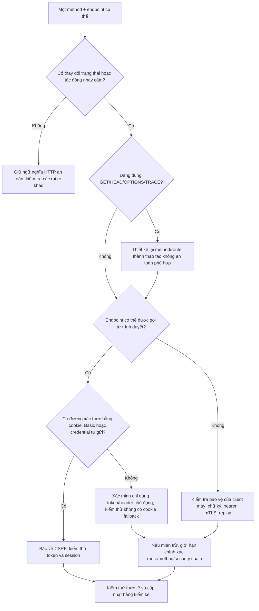

# Xác định endpoint thay đổi trạng thái và kiểu client gọi

> **Chương:** Phạm vi kiểm tra CSRF  
> **Ngữ cảnh:** Spring Security HTTP Protection — nhận diện đúng những request cần phòng vệ CSRF trước khi cấu hình, kiểm thử hoặc miễn trừ cho Servlet và Reactive.

## 1. Mục tiêu học tập

Sau bài này, người học có thể:

1. Lập danh mục endpoint có khả năng làm thay đổi trạng thái của ứng dụng, kể cả endpoint không mang tên REST quen thuộc.
2. Phân biệt **HTTP method**, **hành vi thực tế của endpoint**, **kiểu client** và **cơ chế gửi thông tin xác thực** khi đánh giá nguy cơ CSRF.
3. Quyết định endpoint nào cần kiểm tra CSRF, endpoint nào có thể được miễn trừ với điều kiện cụ thể, và những trường hợp phải thiết kế lại API.
4. Áp dụng cách phân loại đó cho Spring MVC/Servlet và Spring WebFlux/Reactive, sau đó xác nhận bằng kiểm thử có và không có CSRF token.

Điểm mấu chốt: **CSRF xảy ra khi một trang do kẻ tấn công điều khiển có thể khiến trình duyệt nạn nhân gửi request mang thông tin xác thực được trình duyệt tự động đính kèm**, qua đó thực hiện một hành động mà nạn nhân không chủ động yêu cầu. Vì vậy, nhìn riêng vào URL, HTTP method hoặc nhãn “REST API” là chưa đủ để quyết định phạm vi bảo vệ.

## 2. Xác định hành vi thực tế của endpoint

### 2.1. “Thay đổi trạng thái” bao gồm những gì?

Một request cần được rà soát nếu nó có thể tạo, sửa, xóa dữ liệu hoặc gây ra hành động có tác dụng lâu dài:

- Tạo đơn hàng, chuyển tiền, cập nhật hồ sơ, đổi mật khẩu, thay đổi quyền truy cập.
- Đăng nhập, đăng xuất, thay đổi phiên làm việc, liên kết tài khoản hoặc xác nhận giao dịch.
- Gửi email, khởi chạy tác vụ, yêu cầu xuất dữ liệu, ghi nhận chấp thuận điều khoản.
- Thực hiện **mutation** trong GraphQL, gọi RPC thay đổi dữ liệu hoặc gửi lệnh qua endpoint tổng quát như `POST /actions`.

Phân biệt **ghi dữ liệu kỹ thuật** và **hành động nhạy cảm**: việc ghi log truy cập hoặc tăng bộ đếm quan sát không tự động khiến mọi request GET phải dùng CSRF token. Tuy nhiên, nếu GET kích hoạt một tác động đáng kể tới dữ liệu, tài khoản hoặc tài nguyên của người dùng, đó là lỗi thiết kế cần sửa. Với mỗi endpoint, hãy xem code xử lý, tác vụ bất đồng bộ, sự kiện phát ra và các lệnh gọi sang hệ thống khác; tên controller có thể không phản ánh hết tác dụng phụ.

### 2.2. Quy ước HTTP method và mặc định của Spring Security

Theo ngữ nghĩa HTTP:

| Method | Ý nghĩa mong đợi | Đánh giá CSRF ban đầu |
|---|---|---|
| `GET`, `HEAD` | Đọc tài nguyên; không tạo tác động thay đổi trạng thái có chủ đích | Mặc định Spring Security không yêu cầu CSRF token |
| `OPTIONS`, `TRACE` | Phục vụ khả năng giao tiếp/chẩn đoán; không dùng để thay đổi dữ liệu | Mặc định không yêu cầu CSRF token |
| `POST` | Tạo dữ liệu, gửi lệnh, đăng nhập, mutation… | Mặc định yêu cầu CSRF token |
| `PUT`, `PATCH` | Thay thế hoặc cập nhật dữ liệu | Mặc định yêu cầu CSRF token |
| `DELETE` | Xóa tài nguyên hoặc kết thúc phiên | Mặc định yêu cầu CSRF token |

Trong cấu hình CSRF mặc định, Spring Security bảo vệ những HTTP method **khác** `GET`, `HEAD`, `TRACE` và `OPTIONS`. Đây là quy tắc theo method, **không phải** cơ chế tự phân tích tác dụng thực tế của controller.

Hai hệ quả quan trọng:

- `GET /orders/42/cancel` thực hiện hủy đơn hàng là endpoint không an toàn dù dùng GET. Không nên “sửa” bằng cách cố ép token cho GET rồi giữ nguyên thiết kế; hãy chuyển sang POST/DELETE phù hợp, kiểm tra quyền và giữ GET chỉ đọc.
- `POST /reports/search` có thể chỉ truy vấn dữ liệu, nhưng theo matcher mặc định vẫn được bảo vệ CSRF. Không nên miễn trừ hàng loạt POST chỉ vì một số endpoint chỉ đọc; hãy xác định rõ vì sao dùng POST và kiểm tra toàn bộ cơ chế xác thực.

**Không đồng nhất “idempotent” với “an toàn trước CSRF”.** PUT hoặc DELETE có thể idempotent về kết quả khi lặp lại, nhưng vẫn thay đổi trạng thái và cần bảo vệ khi trình duyệt tự gửi thông tin xác thực.

## 3. Phân loại client và thông tin xác thực

Để xác định rủi ro CSRF, câu hỏi có giá trị nhất là: **Trình duyệt có tự gửi credential hợp lệ khi một nguồn không đáng tin khiến request được tạo ra hay không?**

| Kiểu client và cách xác thực | Credential được gửi thế nào? | Quyết định thường gặp |
|---|---|---|
| Trang server-rendered, form HTML, đăng nhập bằng session | Trình duyệt tự đính kèm session cookie khi chính sách cookie cho phép | **Cần CSRF** cho thao tác thay đổi trạng thái |
| SPA gọi backend/BFF bằng session hoặc access token nằm trong cookie | Trình duyệt tự xử lý cookie | **Cần CSRF**; SPA thường truyền token bằng request header |
| Trình duyệt dùng HTTP Basic/Digest được user agent tự gửi lại | Trình duyệt có thể tự gửi thông tin xác thực | **Có nguy cơ CSRF**, không được mặc định miễn trừ |
| SPA gắn bearer token vào `Authorization` bằng mã ứng dụng | Chỉ khi mã client chủ động thêm header; attacker thông thường không đọc được token | Có thể không cần CSRF **nếu** endpoint chỉ chấp nhận kiểu xác thực đó và không có cookie/credential tự gửi khác |
| Ứng dụng mobile/native dùng bearer token | Ứng dụng tự xây dựng request/header | CSRF kiểu trình duyệt thường không áp dụng; vẫn cần authentication, authorization và bảo vệ token |
| Backend gọi backend bằng OAuth2 client credentials, mTLS hoặc khóa ký | Server chủ động thêm credential | Thường không cần CSRF; phải xác thực máy gọi và phân quyền |
| Webhook của bên thứ ba, ví dụ cổng thanh toán | Server bên ngoài gửi request đã ký | Có thể miễn trừ CSRF **đúng endpoint** sau khi có kiểm tra chữ ký/tính mới/chống replay |
| Endpoint hỗn hợp: web session cookie **và** mobile bearer trên cùng URL | Tùy request, đôi khi có credential tự gửi | **Không** miễn trừ theo nhãn “API”; phải phân tích từng đường xác thực và cách chọn security chain |

Cần phân biệt hai khái niệm:

- **Cookie chứa JWT vẫn là cookie.** Kể cả backend “stateless” theo nghĩa không lưu session, nếu trình duyệt tự gửi cookie chứa JWT và server dùng nó để xác thực, endpoint vẫn có nguy cơ CSRF.
- **Bearer token trong header không mặc nhiên an toàn về mọi mặt.** Nó có thể giảm nguy cơ CSRF theo cơ chế trên, nhưng XSS, rò rỉ token, CORS sai và phân quyền lỗi vẫn là các nguy cơ khác. Việc lưu token ở đâu cũng cần có đánh giá an toàn riêng.

Với `fetch`, cấu hình `credentials` ảnh hưởng đến việc gửi cookie trong request của **trang hợp lệ**. Tuy nhiên, không được suy ra rằng việc app dùng `credentials: "omit"` trong một chỗ gọi API sẽ ngăn trang độc hại tự tạo request khác. Phải xét cookie, origin, chính sách SameSite, cấu hình server và tất cả đường gọi thật sự.

### 3.1. Một request tấn công có thể trông như thế nào?

Giả sử người dùng đã đăng nhập `bank.example` bằng session cookie và server chấp nhận:

```http
POST /transfers HTTP/1.1
Host: bank.example
Cookie: SESSION=<cookie của nạn nhân>
Content-Type: application/x-www-form-urlencoded

to=attacker&amount=1000000
```

Một trang độc hại có thể dụ trình duyệt gửi form POST đến endpoint này. Kẻ tấn công **không cần đọc** response để gây tác động. Việc trình duyệt thực sự đính kèm cookie còn phụ thuộc SameSite, miền, ngữ cảnh điều hướng và những chính sách liên quan; các lớp bảo vệ đó rất quan trọng nhưng không thể thay cho việc nhận diện endpoint đúng cách.

Nếu backend yêu cầu token CSRF gắn với phiên/ngữ cảnh hợp lệ, trang độc hại không thể đơn giản tự tạo giá trị hợp lệ để hoàn tất request. Token phải được gửi qua cơ chế phù hợp (thường là input ẩn trong form hoặc custom header trong SPA).

## 4. Lập danh mục endpoint: URL chưa phải là đơn vị phân loại đủ chi tiết

Đơn vị cần kiểm kê là **tổ hợp method + route + tác dụng phụ + client + đường xác thực**. Một route có thể có nhiều method; cùng một endpoint có thể được gọi bằng nhiều loại client.

Bảng minh họa cho một nền tảng thương mại:

| Endpoint | Tác động | Client & xác thực | CSRF và ghi chú |
|---|---|---|---|
| `GET /products` | Tra cứu sản phẩm | Browser, mobile, public | Không yêu cầu token theo mặc định; không cho phép sửa dữ liệu |
| `POST /orders` | Tạo đơn hàng | SPA/BFF, session cookie | Cần token CSRF và kiểm tra quyền tạo đơn |
| `PATCH /account/email` | Đổi email | Browser, session cookie | Cần token; có thể phải xác thực lại người dùng |
| `POST /login` | Tạo phiên đăng nhập | Form trên browser | Cần xét **login CSRF**, dù request chưa có phiên đăng nhập trước đó |
| `POST /logout` | Kết thúc phiên | Form/browser, session cookie | Bảo vệ thao tác logout; tránh logout bằng GET |
| `POST /api/orders` | Tạo đơn hàng | Mobile, bearer header **duy nhất** | Có thể miễn trừ CSRF ở chain/API riêng nếu không nhận cookie |
| `POST /webhooks/payments` | Cập nhật trạng thái thanh toán | Server cổng thanh toán, request ký | Miễn trừ có điều kiện; bắt buộc xác minh chữ ký, timestamp/replay và tính hợp lệ nghiệp vụ |
| `POST /graphql` | Query **hoặc** mutation | Browser session cookie | Nếu cùng route chứa mutation, phải xem là có khả năng thay đổi trạng thái; matcher mặc định bảo vệ POST |
| `GET /reports/run?notify=true` | Chạy tác vụ và gửi email | Browser, session cookie | **Lỗi thiết kế:** chuyển hành động sang POST được bảo vệ; GET chỉ đọc/xem trạng thái |
| `POST /events` | Ghi sự kiện công khai | Browser không đăng nhập | Xem xét spam, quota, nguồn gọi; CSRF không thay thế kiểm soát lạm dụng |

Đối với đăng nhập, CSRF có thể khiến nạn nhân đăng nhập vào **tài khoản do kẻ tấn công kiểm soát** (login CSRF), từ đó vô tình ghi dữ liệu hoặc thực hiện giao dịch trên sai tài khoản. Vì vậy, quy tắc “chưa đăng nhập thì khỏi cần CSRF” là không chính xác.

Với callback SSO (OAuth2/OIDC/SAML), quy trình xác nhận thường dùng các bảo vệ theo giao thức như `state`, `nonce`, chữ ký và liên kết request/response. Không miễn trừ callback chỉ vì nó đến từ hệ thống định danh; cần hiểu chính xác cơ chế bảo vệ của từng protocol flow.

### 4.1. Mẫu biểu kiểm kê có thể dùng trong code review

| Trường | Câu hỏi cần trả lời |
|---|---|
| Method + route | Kết hợp nào thực sự được mở ra từ app, gateway, router? |
| Tác dụng thực tế | Có tạo/sửa/xóa/chạy tác vụ/phát sinh side effect không? |
| Client | HTML form, SPA, ứng dụng native, CLI, webhook hay backend? |
| Xác thực | Session cookie, cookie JWT, Basic, Bearer header, mTLS, chữ ký? |
| Tự động đính kèm | Trình duyệt có thể tự gửi credential khi request được khởi tạo từ trang khác không? |
| Phòng vệ đang có | CSRF token, cookie SameSite, kiểm tra Origin/Referer, xác minh chữ ký, OAuth state…? |
| Quyết định | Giữ bảo vệ mặc định, đổi HTTP method, tách security chain hay miễn trừ có điều kiện? |
| Bằng chứng kiểm thử | Không token: kết quả gì? Token hợp lệ: kết quả gì? Client hợp lệ có còn dùng được không? |

Nguồn cần rà soát gồm Spring MVC `@RequestMapping`/`@PostMapping`/`@PutMapping`/`@PatchMapping`/`@DeleteMapping`, WebFlux annotated controller và functional router, form HTML, mã gọi `fetch`/Axios, Swagger/OpenAPI, các route qua reverse proxy/API gateway và những tác vụ được kích hoạt gián tiếp. Đối chiếu việc khai báo với luồng thực tế; đặc biệt chú ý endpoint “ẩn” như đổi mật khẩu, thiết lập MFA, thay đổi email, thao tác quản trị và logout.

## 5. Luồng quyết định đánh giá CSRF



Nếu một route vừa nhận session cookie vừa nhận bearer token, cách xử lý phải nhất quán với **toàn bộ** các request đi vào đó. Một đường đi bằng bearer an toàn hơn trước CSRF không làm biến mất đường đi bằng cookie trên cùng route. Nên tách rõ endpoint hoặc security chain theo mô hình xác thực; nếu áp dụng matcher CSRF tùy biến, cần kiểm chứng rất kỹ rằng không có nhánh xác thực bằng cookie bị bỏ sót.

## 6. Liên hệ với cấu hình Spring Security

### 6.1. Servlet: `CsrfFilter` và `SecurityFilterChain`

Ở Servlet stack, Spring Security dùng `CsrfFilter` trong security filter chain. Khi CSRF được bật (mặc định trong các cấu hình web thông dụng), token được yêu cầu cho các method không an toàn. Token thường gắn với session qua `HttpSessionCsrfTokenRepository`; ứng dụng SPA có thể chọn `CookieCsrfTokenRepository` hoặc cách phân phối token khác phù hợp kiến trúc.

**Giữ mặc định trước, chỉ miễn trừ endpoint có bằng chứng cụ thể.** Ví dụ dưới đây minh họa một webhook POST do máy gọi, không dùng cookie trình duyệt và đã được hệ thống kiểm tra chữ ký hợp lệ:

```java
import org.springframework.context.annotation.Bean;
import org.springframework.security.web.SecurityFilterChain;
import org.springframework.security.web.util.matcher.RequestMatcher;
import org.springframework.security.config.annotation.web.builders.HttpSecurity;

@Bean
SecurityFilterChain securityFilterChain(HttpSecurity http) throws Exception {
    RequestMatcher paymentWebhook = request ->
        "POST".equals(request.getMethod())
            && "/webhooks/payments".equals(request.getServletPath());

    http.csrf(csrf -> csrf
        .ignoringRequestMatchers(paymentWebhook)
    );

    // Các rule xác thực/phân quyền và bước xác minh chữ ký
    // webhook vẫn phải được triển khai riêng.
    return http.build();
}
```

Ý nghĩa của snippet: chỉ POST tới đường dẫn webhook được bỏ qua CSRF; **không** vì thế mà request tự động được phép truy cập hoặc được xem là đã xác thực. Việc so khớp `getServletPath()` giả định URL servlet nhận được đúng như ví dụ; với context path, servlet mapping hoặc reverse proxy đặc biệt, cần kiểm tra route thực tế. Tùy tổ chức cấu hình nhiều `SecurityFilterChain` và phiên bản Spring Security, chọn matcher tương ứng rồi kiểm thử thứ tự chain.

Với trang server-rendered, tích hợp view/form để gửi token cùng POST. Với SPA dùng cookie session, backend cần có cơ chế cấp/đọc CSRF token và client gửi lại qua header. Khi dùng `CookieCsrfTokenRepository`, phải chọn cách xử lý token tương thích với request handler và cơ chế chống BREACH trong phiên bản Spring Security đang chạy; không nên giả định cứ chép cookie sang một header là đúng cho mọi cấu hình.

**Không dùng** `csrf.disable()` toàn cục chỉ vì ứng dụng có đường dẫn `/api/**`. API được gọi từ browser và xác thực bằng cookie vẫn có thể bị CSRF.

### 6.2. Reactive: `CsrfWebFilter` và `SecurityWebFilterChain`

Với WebFlux, vai trò tương ứng là `CsrfWebFilter` trong `SecurityWebFilterChain`, sử dụng cơ chế CSRF token bất đồng bộ. Repository mặc định thường dựa trên `WebSessionServerCsrfTokenRepository`. Các nguyên tắc nhận diện endpoint **không thay đổi**:

- `RouterFunction`, annotated WebFlux controller và các route WebSocket/streaming phải được kiểm kê theo hành vi thật.
- Request POST/PUT/PATCH/DELETE dùng web session cookie cần được bảo vệ và được cấp token phù hợp.
- Đường gọi máy–máy có thể được miễn trừ với matcher riêng nếu xác thực độc lập, không mang session cookie.
- Việc bỏ qua CSRF trong một `SecurityWebFilterChain` phải được đánh giá theo `securityMatcher`/phạm vi filter chain, không theo tên “Reactive API”.

Với WebSocket, handshake GET có đặc tính riêng: matcher CSRF HTTP mặc định không đủ bảo vệ thao tác sau khi kết nối. Cần kiểm tra Origin, xác thực kết nối và áp dụng cơ chế bảo vệ theo công nghệ truyền thông đang dùng (chẳng hạn bảo vệ kết nối STOMP/SockJS có cookie session). Đây là mục cần đánh dấu riêng trong bản kiểm kê, thay vì gộp với các GET chỉ đọc.

## 7. Kiểm thử phạm vi đã xác định

Đối với một endpoint thay đổi trạng thái dùng session cookie, cần chạy ít nhất ba tình huống: request đã xác thực **không** có token, request có token **không hợp lệ**, và request có token **hợp lệ**. Kết quả mong đợi thông thường là **403 Forbidden** cho hai tình huống đầu và xử lý theo nghiệp vụ ở tình huống cuối; ứng dụng có thể có các filter hoặc yêu cầu xác thực khác ảnh hưởng kết quả cuối cùng. Chủ động cung cấp user/session trong kiểm thử để tránh việc nhận 401/redirect login rồi nhầm là CSRF đã hoạt động.

### 7.1. Servlet với MockMvc

Ví dụ với `spring-security-test` và endpoint tạo đơn hàng trả về 2xx khi dữ liệu hợp lệ:

```java
import static org.springframework.security.test.web.servlet.request.SecurityMockMvcRequestPostProcessors.csrf;
import static org.springframework.security.test.web.servlet.request.SecurityMockMvcRequestPostProcessors.user;
import static org.springframework.test.web.servlet.request.MockMvcRequestBuilders.post;
import static org.springframework.test.web.servlet.result.MockMvcResultMatchers.status;

@Test
void rejectsOrderCreationWithoutCsrfToken() throws Exception {
    mockMvc.perform(post("/orders")
            .with(user("alice")))
        .andExpect(status().isForbidden());
}

@Test
void acceptsValidCsrfTokenForOrderCreation() throws Exception {
    mockMvc.perform(post("/orders")
            .with(user("alice"))
            .with(csrf()))
        .andExpect(status().is2xxSuccessful());
}

@Test
void rejectsInvalidCsrfToken() throws Exception {
    mockMvc.perform(post("/orders")
            .with(user("alice"))
            .with(csrf().useInvalidToken()))
        .andExpect(status().isForbidden());
}
```

Tùy hệ thống, cần truyền thêm dữ liệu body, quyền của user và ràng buộc nghiệp vụ để phép thử 2xx có ý nghĩa. Ngoài ra, kiểm tra rằng GET đọc dữ liệu bình thường khi không có CSRF token, còn endpoint thực hiện side effect qua GET đã được sửa về đúng method.

### 7.2. Reactive với WebTestClient

Với test fixture tích hợp Spring Security cho WebFlux, có thể kiểm tra cùng ý nghĩa:

```java
import static org.springframework.security.test.web.reactive.server.SecurityMockServerConfigurers.csrf;
import static org.springframework.security.test.web.reactive.server.SecurityMockServerConfigurers.mockUser;

@Test
void reactivePostRequiresCsrfToken() {
    webTestClient.mutateWith(mockUser("alice"))
        .post().uri("/orders")
        .exchange()
        .expectStatus().isForbidden();
}

@Test
void reactivePostAcceptsCsrfToken() {
    webTestClient.mutateWith(mockUser("alice"))
        .mutateWith(csrf())
        .post().uri("/orders")
        .exchange()
        .expectStatus().is2xxSuccessful();
}
```

Kiểm thử cho cả hai stack phải đi qua đúng security filter chain, không chỉ gọi trực tiếp controller/service. Nếu test cấu hình bỏ qua filter, kết quả không chứng minh được CSRF đã được thực thi.

### 7.3. Ma trận kiểm thử để tránh miễn trừ nhầm

| Tình huống | Kết quả cần xác minh |
|---|---|
| Browser session, POST thay đổi trạng thái, không token | Bị chặn bởi CSRF |
| Browser session, POST, token sai hoặc không thuộc ngữ cảnh hợp lệ | Bị chặn |
| Browser session, POST, token hợp lệ | Đi tiếp đến authentication, authorization và nghiệp vụ |
| Browser session, GET chỉ đọc, không token | Không bị từ chối chỉ vì thiếu token |
| Mobile/backend bearer-only, POST vào API riêng | Hoạt động theo cơ chế bearer; không phụ thuộc CSRF token **nếu đã được miễn trừ có chủ đích** |
| Webhook ký hợp lệ, POST endpoint riêng | Không bị chặn bởi CSRF; phải vượt qua xác minh chữ ký và chống replay |
| Webhook chữ ký sai hoặc request bị phát lại | Bị từ chối bởi cơ chế bảo vệ webhook |
| Request browser có cookie vào endpoint được cho là bearer-only | Cookie không được chấp nhận làm credential; không tạo đường tắt CSRF |
| Route hỗn hợp hoặc khác method cùng URL | Matcher bao phủ đúng method và không bỏ sót đường xác thực tự động |

Đặc biệt, khi kiểm thử trường hợp “API không dùng cookie”, hãy thử cố tình gửi cookie session hợp lệ cùng request. Nếu backend vẫn xác thực qua cookie, điều kiện miễn trừ chưa thỏa mãn.

## 8. Các nhầm lẫn phổ biến và cách chẩn đoán

**“API trả JSON nên không có CSRF.”** Định dạng response không quyết định rủi ro. SPA gọi JSON API bằng session cookie là ví dụ điển hình cần bảo vệ.

**“CORS đã chặn web lạ nên không cần token.”** CORS chủ yếu kiểm soát khả năng script từ origin khác đọc response và một số tình huống gửi request có preflight. Form HTML cross-site hoặc request đủ đơn giản có thể được gửi mà không cần đọc response. CORS không thay thế CSRF.

**“Có SameSite=Lax/Strict là xong.”** SameSite giúp giảm việc cookie đi theo request cross-site, nhưng ranh giới “site” khác với “origin”, còn các luồng điều hướng, subdomain, khả năng tương thích và thiết kế ứng dụng cần được xét. Xem SameSite là lớp phòng vệ bổ sung.

**“POST đã đăng nhập và kiểm tra quyền nên ổn.”** Chính credential của nạn nhân có thể khiến request tấn công vượt qua authentication và authorization. CSRF xác nhận thêm rằng request xuất phát từ luồng ứng dụng hợp lệ.

**“Gắn @CrossOrigin hoặc bật credentials là đủ.”** Cấu hình CORS rộng có thể làm vấn đề nghiêm trọng hơn, nhưng cấu hình CORS chặt vẫn không thay được việc đánh giá CSRF.

**“Tất cả endpoint /api/** đều stateless.”** Stateful hay stateless không phải tiêu chí đủ. Hãy xác minh thực tế backend có chấp nhận session cookie hoặc JWT cookie hay không và trình duyệt có tự gửi nó hay không.

**“Bị 403 chắc chắn là CSRF.”** 403 còn có thể đến từ phân quyền, firewall, chính sách khác hoặc filter tùy chỉnh. Cần kiểm tra log Spring Security, thứ tự filter/chain, method/route, token repository, header name, session và cơ chế request handler. Trong môi trường kiểm thử, so sánh cùng user/quyền với token thiếu, sai và đúng để khoanh vùng.

## 9. Bài tập tình huống

Một hệ thống có bốn luồng:

1. Giao diện web ở `shop.example` gửi `POST /api/orders` bằng cookie `SESSION`.
2. Ứng dụng Android gửi `POST /api/orders` bằng bearer token trong header `Authorization`.
3. Cổng thanh toán gửi `POST /integrations/payment-callback` kèm chữ ký request.
4. Trang quản trị đang dùng `GET /admin/users/42/deactivate` để vô hiệu hóa tài khoản.

**Câu hỏi:** Có thể đặt `csrf.disable()` cho mọi endpoint bắt đầu bằng `/api` không? Mỗi luồng nên xử lý thế nào?

**Phân tích đáp án:**

- **Luồng 1:** Không thể miễn trừ chỉ theo `/api`; cookie session được trình duyệt tự gửi nên POST tạo đơn hàng cần CSRF token.
- **Luồng 2:** Có thể dùng một API/chain bearer-only riêng và miễn trừ CSRF nếu thực sự không có xác thực dựa trên cookie, đồng thời vẫn xác thực và phân quyền bearer token.
- **Luồng 3:** Chỉ miễn trừ callback phù hợp và xác minh chữ ký, tính mới của request, mã giao dịch cùng quy tắc chống xử lý trùng.
- **Luồng 4:** Đổi sang POST/PATCH theo ngữ nghĩa phù hợp, yêu cầu token CSRF nếu quản trị viên đăng nhập bằng cookie, đồng thời kiểm tra quyền quản trị. Không duy trì hành động thay đổi trạng thái trên GET.

Thảo luận thêm: Nếu server của luồng 2 có một filter tự động chuyển sang session cookie khi không có bearer, đường miễn trừ trở nên không an toàn. Phải loại bỏ fallback đó hoặc thay đổi thiết kế chain trước khi kết luận endpoint không cần CSRF.

## 10. Checklist hoàn tất bước xác định phạm vi

- [ ] Mỗi endpoint có bản ghi **method + route + hành vi**; cả form, GraphQL, RPC, callback và endpoint ngầm đã được xét.
- [ ] Những thao tác thay đổi trạng thái qua GET/HEAD/OPTIONS/TRACE đã được thiết kế lại.
- [ ] Mỗi client được mô tả theo cách **thực sự gửi credential**; đã kiểm tra cookie session, JWT cookie, Basic và bearer header.
- [ ] Mọi endpoint có thể bị trình duyệt gửi credential tự động đều có phương án CSRF token hoặc cơ chế bảo vệ tương đương được đánh giá rõ ràng.
- [ ] Mọi miễn trừ được giới hạn theo endpoint/chain phù hợp và có cơ chế xác thực, phân quyền thay thế.
- [ ] Có kiểm thử request không token, token sai, token hợp lệ và test chống cookie fallback trên đường bearer-only.
- [ ] Servlet `CsrfFilter` hoặc Reactive `CsrfWebFilter` thực sự nằm trong chain mà các request đi qua.

**Ghi nhớ:** Hãy quyết định phạm vi CSRF dựa trên **tác dụng của request và cách credential được đính kèm**, rồi mới chọn matcher, token repository và cách kiểm thử. Việc “bật hay tắt CSRF” chỉ là bước triển khai sau khi đã có bản đồ endpoint và client chính xác.
