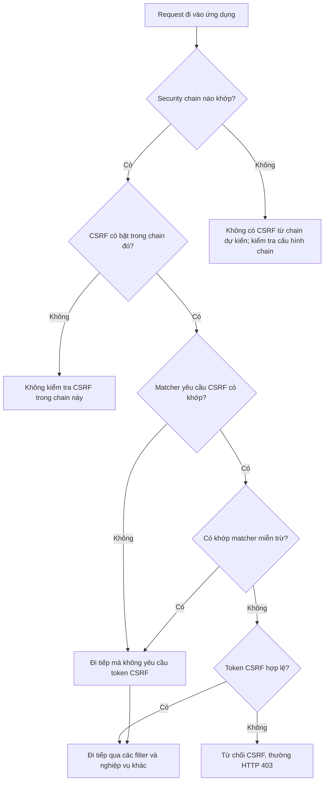

# Matcher yêu cầu CSRF và matcher miễn trừ

> **Chương:** Phạm vi kiểm tra CSRF  
> **Module:** `SPRING_SECURITY_HTTP_PROTECTION` — các lớp phòng vệ HTTP và trình duyệt trong Spring Security.  
> **Trọng tâm:** Xác định khi nào Spring Security phải kiểm tra CSRF token, khi nào được bỏ qua, và cách cấu hình an toàn cho cả Servlet (`HttpSecurity`) lẫn Reactive (`ServerHttpSecurity`).

## 1. Kết quả cần đạt

Sau bài học, người học có thể:

1. Giải thích quy tắc CSRF mặc định theo HTTP method và vai trò của request matcher.
2. Phân biệt matcher **quyết định request phải có CSRF token** với matcher **loại trừ có chủ đích** một request khỏi kiểm tra.
3. Cấu hình ngoại lệ hẹp cho webhook/API xác thực độc lập mà không vô tình tắt CSRF của form, SPA hoặc session-based API.
4. Tạo matcher tùy chỉnh cho Spring MVC/Servlet và Spring WebFlux/Reactive, hiểu các điểm khác nhau của hai API.
5. Kiểm thử ma trận method × path × credential, chẩn đoán request 403 và kiểm tra tương tác với security filter chain, CORS, HTTP firewall và session.

Đây là bài học về **phạm vi áp dụng CSRF**. Việc cung cấp CSRF token, chọn `CsrfTokenRepository`, xử lý token cho SPA và hiển thị trong form là bước có liên quan nhưng không thay đổi bản chất quyết định matcher.

## 2. Vì sao cần request matcher?

Spring Security không thể biết toàn bộ ý nghĩa nghiệp vụ của từng endpoint. Bộ lọc CSRF cần một quy tắc xác định xem **request cụ thể** có phải trình token hay không. Trong Spring Security, quy tắc đó được biểu diễn bằng request matcher.

Ví dụ:

| Request | Ý nghĩa | Mặc định kiểm tra CSRF? |
|---|---|---|
| `GET /products/10` | Đọc chi tiết sản phẩm | Không |
| `HEAD /products/10` | Đọc metadata | Không |
| `OPTIONS /orders` | Thăm dò phương thức/CORS preflight | Không |
| `POST /orders` | Tạo đơn hàng | Có |
| `PATCH /account/email` | Sửa địa chỉ email | Có |
| `DELETE /orders/10` | Xóa/hủy đơn hàng | Có |
| `POST /webhooks/payment` | Bên thứ ba gửi callback ký số | Có, trừ khi được miễn trừ |
| `POST /api/mobile/orders` | Native app gửi bearer token | Có, trừ khi cấu hình khác |
| `GET /orders/10/cancel` | Hủy đơn dù mang tên GET | Không — **lỗi thiết kế HTTP cần sửa** |

Quy tắc mặc định bảo vệ các HTTP method **không thuộc** tập `GET`, `HEAD`, `TRACE`, `OPTIONS`.

```text
unsafeMethod(request) =
    method(request) ∉ { GET, HEAD, TRACE, OPTIONS }
```

Không được hiểu “method an toàn” là không có rủi ro bảo mật. HTTP GET phải được thiết kế là chỉ đọc; nếu GET xóa tài khoản hay thay đổi mật khẩu, cách xử lý tốt nhất là sửa API sang method thay đổi trạng thái phù hợp, rồi áp dụng CSRF. `PUT` và `DELETE` dù có tính idempotent theo HTTP vẫn là thao tác thay đổi trạng thái và cần bảo vệ trong các luồng dùng credential trình duyệt tự gửi.

### 2.1. Matcher quan sát gì?

Matcher có thể dựa trên:

- HTTP method: POST, PUT, PATCH, DELETE…
- Đường dẫn theo servlet mapping/đường dẫn của ứng dụng.
- Cấu hình vùng bảo mật (`SecurityFilterChain` hoặc `SecurityWebFilterChain`).
- Thuộc tính đã được xác thực hoặc chuẩn hóa của request trong trường hợp thật sự cần thiết.

Matcher **không nên** đoán độ an toàn từ tên thư mục `/api`, response JSON, tính “stateless” được quảng bá, hoặc sự có mặt của một header bất kỳ do client tự khai báo. Quan trọng hơn là server có chấp nhận cookie session, JWT trong cookie, HTTP Basic được trình duyệt tự gửi, hay chỉ chấp nhận credential mà client chủ động gắn vào header.

### 2.2. Mô hình quyết định

Với security chain đã được chọn, phép quyết định về mặt ý tưởng là:

```text
requireCsrf(request) =
    requestThuocPhamViMatcherBatBuoc(request)
    AND NOT requestThuocMatcherMienTru(request)
```

Nếu giữ matcher mặc định, ta có thể diễn giải:

```text
requireCsrf(request) =
    unsafeMethod(request)
    AND NOT explicitExemption(request)
```

**Lưu ý:** biểu thức chỉ nói về **kiểm tra token CSRF**, không quyết định request có được xác thực, phân quyền hoặc được phép thực hiện nghiệp vụ hay không. Request được miễn trừ CSRF vẫn phải qua các lớp bảo vệ còn lại.

## 3. Hai kiểu matcher cần phân biệt

### 3.1. Matcher yêu cầu CSRF (`requireCsrfProtectionMatcher`)

Đây là quy tắc chính trả lời: “Request này có phải có CSRF token hợp lệ không?”.

- Với **Servlet**, API cấu hình là `csrf(csrf -> csrf.requireCsrfProtectionMatcher(...))`, đầu vào là `RequestMatcher`.
- Với **Reactive**, API cấu hình là `csrf(csrf -> csrf.requireCsrfProtectionMatcher(...))`, đầu vào là `ServerWebExchangeMatcher`.

**Khi truyền matcher riêng, bạn thay thế quy tắc yêu cầu mặc định.** Nếu matcher mới chỉ bắt `/admin/**`, các POST ở `/orders` có thể không còn bị kiểm tra. Nếu matcher mới chỉ kiểm tra URL mà quên method, nó có thể đòi token cả khi GET, gây lỗi cho truy vấn an toàn.

Chỉ chọn tùy chỉnh matcher bắt buộc khi có yêu cầu rõ ràng và bạn đã kiểm kê đầy đủ các request. Với đa số ứng dụng web, giữ quy tắc mặc định và thêm ngoại lệ cụ thể dễ kiểm soát hơn.

### 3.2. Matcher miễn trừ (`ignoringRequestMatchers`)

Với **Servlet**, `ignoringRequestMatchers(...)` chỉ định request được **bỏ qua bước xác thực CSRF token** dù matcher yêu cầu ban đầu có thể chọn nó:

```java
http.csrf(csrf -> csrf
    .ignoringRequestMatchers(paymentWebhookMatcher)
);
```

Phép miễn trừ phải có lý do kỹ thuật: chẳng hạn webhook chỉ được xác thực bằng chữ ký và không sử dụng cookie/session của người dùng. Tránh miễn trừ toàn bộ `/api/**` nếu có giao diện browser gọi API này bằng session cookie.

Với **Reactive**, cấu hình thông dụng dùng `requireCsrfProtectionMatcher(ServerWebExchangeMatcher)` để diễn đạt điều kiện “method không an toàn VÀ không thuộc ngoại lệ”. Không được sao chép nguyên API `ignoringRequestMatchers` của Servlet rồi mặc định WebFlux cũng có phương thức đó; hai DSL khác kiểu matcher và tập phương thức.

### 3.3. So sánh cách dùng

| Cách cấu hình | Hệ quả | Khi nào phù hợp |
|---|---|---|
| Không thay đổi CSRF mặc định | Kiểm tra method không an toàn trong chain được chọn | Form, MVC, SPA/BFF dùng session cookie |
| Servlet `ignoringRequestMatchers(specificMatcher)` | Loại một tập request đã biết khỏi kiểm tra CSRF | Webhook ký số, endpoint chỉ chấp nhận bearer, phạm vi nhỏ |
| `requireCsrfProtectionMatcher(customMatcher)` | **Thay thế** quy tắc bắt buộc theo logic tự định nghĩa | Nhu cầu đặc biệt, có ma trận test đầy đủ |
| `csrf.disable()` | Bỏ hẳn cơ chế CSRF của security chain đó | Chỉ phù hợp với chain độc lập đã chứng minh không có cơ chế credential browser tự gửi |
| `securityMatcher(...)` / `securityMatcher` ở cấp chain | Xác định **chain nào** xử lý request | Tách web-session và machine-to-machine API theo kiến trúc xác thực |

Sai lầm phổ biến là nhầm matcher của **security chain** với matcher của **CSRF**. Một request không đi vào chain mong đợi sẽ không được bảo vệ bởi bộ lọc CSRF của chain đó, dù matcher bên trong chain viết đúng.

## 4. Thiết kế ngoại lệ trước khi viết code

Giả sử hệ thống bán hàng có các endpoint:

| Endpoint | Client và credential | Chiến lược |
|---|---|---|
| `POST /orders` | Browser + session cookie | Yêu cầu token CSRF |
| `PATCH /profile` | SPA + JWT trong cookie | Yêu cầu token CSRF |
| `POST /login` | Browser + form login | Giữ bảo vệ CSRF, xem xét login CSRF |
| `POST /logout` | Browser + session cookie | Giữ bảo vệ CSRF |
| `POST /webhooks/payment` | Payment provider + request ký số, không dùng session | Có thể miễn trừ **POST đúng route** |
| `POST /api/mobile/orders` | Mobile + bearer header **duy nhất** | Có thể đặt trong chain bearer-only riêng |
| `GET /orders` | Browser + session cookie | Không yêu cầu CSRF theo mặc định |
| `OPTIONS /orders` | Browser gửi CORS preflight | Không yêu cầu CSRF theo mặc định |

Trước khi miễn trừ một endpoint, cần xác nhận:

1. Server có thể xác thực request này bằng **cookie hoặc HTTP authentication tự gửi** hay không? Nếu có, nên giữ CSRF hoặc tách đường xác thực.
2. Đường miễn trừ có bị dùng chung bởi browser và machine client hay không? Nếu có, tránh miễn trừ chung.
3. Có thể hạn chế theo **method và route chính xác** hay không? Ví dụ `POST /webhooks/payment`, không phải `/webhooks/**`.
4. Có một cơ chế phòng vệ thay thế hợp lý không? Với webhook: chữ ký, khóa bí mật, timestamp, chống replay, giới hạn sự kiện và idempotency.
5. Đã kiểm thử cả request đúng và sai credential, và mọi security chain liên quan chưa?

Một ngoại lệ tốt có phạm vi **nhỏ, giải thích được và kiểm thử được**.

## 5. Servlet: cấu hình matcher miễn trừ

Trong Spring MVC/Servlet, Spring Security dùng `CsrfFilter` để thực thi việc đối chiếu request matcher và CSRF token.

### 5.1. Giữ mặc định và miễn trừ một POST webhook

Ví dụ dưới đây giả định ứng dụng dùng `DispatcherServlet` mapping tại `/` và không có quy tắc path đặc biệt. Webhook được gọi bởi đối tác thanh toán, server xác minh chữ ký ở một lớp độc lập.

```java
import org.springframework.context.annotation.Bean;
import org.springframework.security.config.annotation.web.builders.HttpSecurity;
import org.springframework.security.web.SecurityFilterChain;
import org.springframework.security.web.util.matcher.RequestMatcher;

@Bean
SecurityFilterChain securityFilterChain(HttpSecurity http) throws Exception {
    RequestMatcher paymentWebhook = request ->
        "POST".equals(request.getMethod())
            && "/webhooks/payment".equals(request.getServletPath());

    http.csrf(csrf -> csrf
        .ignoringRequestMatchers(paymentWebhook)
    );

    // Xác thực, phân quyền và xác minh chữ ký webhook
    // được cấu hình riêng theo kiến trúc ứng dụng.
    return http.build();
}
```

Kết quả:

| Request | Bị yêu cầu CSRF token? |
|---|---|
| `POST /webhooks/payment` | Không, vì trùng ngoại lệ |
| `PUT /webhooks/payment` | Có, do method khác POST |
| `POST /webhooks/payment/123` | Có, do path khác |
| `POST /orders` | Có, do không thuộc ngoại lệ |
| `GET /orders` | Không, theo mặc định |
| `POST /admin/users` | Có, nếu request thuộc cùng chain |

Ví dụ trên làm đúng **một việc**: nới bước kiểm tra CSRF trên POST webhook. Nó **không** làm webhook thành công nếu thiếu chữ ký, sai phân quyền hoặc bị từ chối ở bộ lọc khác. Trường hợp webhook không dùng login/session thường còn cần rule tiếp nhận request tương ứng, rồi xác minh chữ ký trước khi xử lý nghiệp vụ.

Khi ứng dụng có context path, nhiều servlet mapping, URL rewriting hoặc reverse proxy, `getServletPath()` không luôn khớp cách đặt URL công khai. Hãy kiểm tra giá trị path thực tế hoặc dùng matcher phù hợp với stack và phiên bản Spring Security; không sao chép đoạn so sánh path này vào mọi cấu trúc triển khai.

### 5.2. Tùy chỉnh matcher yêu cầu CSRF có chủ đích

Nếu bắt buộc thay thế matcher mặc định, phải **giữ toàn bộ tập method không an toàn** rồi mới loại ngoại lệ. Ví dụ:

```java
import java.util.Set;
import org.springframework.security.web.util.matcher.RequestMatcher;

private static final Set<String> SAFE_METHODS =
    Set.of("GET", "HEAD", "TRACE", "OPTIONS");

@Bean
SecurityFilterChain customCsrfChain(HttpSecurity http) throws Exception {
    RequestMatcher paymentWebhook = request ->
        "POST".equals(request.getMethod())
            && "/webhooks/payment".equals(request.getServletPath());

    RequestMatcher requireCsrf = request ->
        !SAFE_METHODS.contains(request.getMethod())
            && !paymentWebhook.matches(request);

    http.csrf(csrf -> csrf
        .requireCsrfProtectionMatcher(requireCsrf)
    );

    return http.build();
}
```

Đây là **phương án thay thế** cho cấu hình `ignoringRequestMatchers` ở mục trước, không phải một bean chain thứ hai để đăng ký đồng thời cùng phạm vi. Trong ứng dụng thông thường, đoạn 5.1 ngắn hơn và giảm nguy cơ tái hiện sai quy tắc mặc định.

**Phản ví dụ dễ mắc:**

```java
// Sai ý đồ trong ứng dụng có session cookie ở các route khác:
http.csrf(csrf -> csrf.requireCsrfProtectionMatcher(
    request -> request.getServletPath().startsWith("/admin/")
));
```

Matcher này vừa có thể bắt **GET /admin/...** dù GET an toàn, vừa bỏ qua **POST /orders** hoặc **PATCH /profile**. Khi tùy chỉnh, luôn làm rõ boolean condition cho **cả method lẫn path**.

### 5.3. Vì sao không miễn trừ `/api/**` bằng một matcher rộng?

Ví dụ cần tránh:

```java
// Nguy hiểm nếu /api/** còn dùng session cookie hoặc cookie JWT:
http.csrf(csrf -> csrf.ignoringRequestMatchers("/api/**"));
```

Nếu `POST /api/account/password` hoặc `DELETE /api/orders/10` được browser gọi kèm cookie, ngoại lệ trên tạo lỗ hổng. Cấu hình CORS có hạn chế origin, dùng JSON và lưu JWT trong cookie đều không đủ để chứng minh miễn trừ an toàn.

Trong ứng dụng nhiều chain, đôi khi tách riêng một `/api/mobile/**` dùng **chỉ** `Authorization: Bearer ...`, không bật form login/session authentication, rồi cấu hình CSRF theo chain này. Phải kiểm tra thứ tự chain và bảo đảm request browser kèm cookie không được xác thực thành user trong chain bearer-only.

## 6. Reactive: biểu diễn yêu cầu và ngoại lệ bằng `ServerWebExchangeMatcher`

Spring WebFlux thực thi CSRF bằng `CsrfWebFilter` trong `SecurityWebFilterChain`. Quy tắc method và nguyên tắc an toàn giống Servlet, nhưng kiểu API khác.

Ví dụ sử dụng một matcher trả về kết quả bất đồng bộ: yêu cầu CSRF đối với method không an toàn, trừ POST webhook:

```java
import org.springframework.context.annotation.Bean;
import org.springframework.http.HttpMethod;
import org.springframework.security.config.web.server.ServerHttpSecurity;
import org.springframework.security.web.server.SecurityWebFilterChain;
import org.springframework.security.web.server.util.matcher.ServerWebExchangeMatcher;

@Bean
SecurityWebFilterChain webFluxSecurity(ServerHttpSecurity http) {
    ServerWebExchangeMatcher requireCsrf = exchange -> {
        HttpMethod method = exchange.getRequest().getMethod();
        String path = exchange.getRequest()
            .getPath().pathWithinApplication().value();

        boolean safeMethod =
            method == HttpMethod.GET
                || method == HttpMethod.HEAD
                || method == HttpMethod.TRACE
                || method == HttpMethod.OPTIONS;

        boolean paymentWebhook =
            method == HttpMethod.POST
                && "/webhooks/payment".equals(path);

        return !safeMethod && !paymentWebhook
            ? ServerWebExchangeMatcher.MatchResult.match()
            : ServerWebExchangeMatcher.MatchResult.notMatch();
    };

    http.csrf(csrf -> csrf
        .requireCsrfProtectionMatcher(requireCsrf)
    );

    return http.build();
}
```

`ServerWebExchangeMatcher.MatchResult.match()` và `notMatch()` trả về kết quả reactive theo hợp đồng của matcher. Ở đây, so khớp `pathWithinApplication()` giúp làm rõ rằng ta đang xét đường dẫn trong ứng dụng, không phải chuỗi URL thô bao gồm query string.

Cũng như Servlet, nếu thay `requireCsrfProtectionMatcher` bằng điều kiện chỉ so khớp một route, những POST khác có thể vô tình mất CSRF. Nếu cần nhiều ngoại lệ, có thể gom chúng thành predicate rõ ràng hoặc kết hợp những matcher có sẵn của WebFlux, nhưng không được đánh mất nhánh kiểm tra method mặc định.

Trong WebFlux, nhiều `SecurityWebFilterChain` có thể được chọn theo phạm vi và thứ tự. Một matcher chính xác bên trong **sai chain** không bảo vệ endpoint như dự định. Cần kiểm tra route thực sự được định tuyến qua chain nào.

## 7. Phân tích thứ tự áp dụng các matcher

Để hiểu vì sao một request được bảo vệ hoặc không, có thể xem luồng quyết định ở mức khái niệm:



Sơ đồ mô tả ý nghĩa logic, không nhất thiết là lời gọi riêng của từng filter trong mọi phiên bản. Với WebFlux, “matcher miễn trừ” thường được gộp ngay vào điều kiện của matcher yêu cầu CSRF.

Ngoài matcher CSRF, các thành phần sau có thể quyết định kết quả:

- **HTTP firewall:** `StrictHttpFirewall` có thể chặn request bất thường trước khi xử lý CSRF, chẳng hạn path không hợp lệ theo chính sách firewall.
- **CORS:** CORS preflight thường là OPTIONS và không mang thông tin xác thực ứng dụng; phải xử lý CORS đúng trước security logic cần credential. CORS không thay thế CSRF.
- **Authentication/authorization:** Token CSRF hợp lệ không có nghĩa là user đã đăng nhập hoặc đủ quyền.
- **Session/token lifecycle:** CSRF token có thể phụ thuộc vào session và thay đổi theo các thao tác đăng nhập/đăng xuất hoặc chính sách repository.
- **Reverse proxy/servlet mapping:** Đường dẫn mà matcher quan sát có thể khác path người dùng thấy tại gateway.

Ví dụ: một request POST bị 403 có thể do thiếu CSRF token, thiếu vai trò, signature webhook sai hoặc cơ chế bảo vệ khác. Muốn chẩn đoán đúng, cần phân biệt request đã đi vào chain nào, matcher CSRF quyết định gì và filter nào thực sự trả lỗi.

## 8. Đọc ma trận matcher trước khi triển khai

Xét các giả định:

- Ứng dụng có form/SPA với session cookie.
- Mọi method không an toàn đều cần CSRF trừ `POST /webhooks/payment`.
- Webhook chỉ được xác thực bằng chữ ký và không sử dụng session browser.
- `POST /api/mobile/orders` vẫn đang thuộc cùng chain và chưa được xác nhận là bearer-only độc lập.

| Request | Unsafe method? | Trùng ngoại lệ? | Kết quả CSRF |
|---|---:|---:|---|
| `GET /orders` | Không | Không | Không yêu cầu |
| `HEAD /orders` | Không | Không | Không yêu cầu |
| `OPTIONS /orders` | Không | Không | Không yêu cầu |
| `POST /orders` | Có | Không | Bắt buộc |
| `PATCH /profile` | Có | Không | Bắt buộc |
| `DELETE /orders/10` | Có | Không | Bắt buộc |
| `POST /webhooks/payment` | Có | Có | Miễn trừ |
| `PUT /webhooks/payment` | Có | Không | Bắt buộc |
| `POST /webhooks/payment/test` | Có | Không | Bắt buộc |
| `POST /api/mobile/orders` | Có | Không | Bắt buộc cho đến khi chain được tách/đánh giá |
| `GET /orders/10/cancel` | Không | Không | Không yêu cầu, nhưng endpoint sai ngữ nghĩa cần sửa |

Điểm cần nhớ khi đọc bảng: **matcher không tự phân tích request body** để biết nghiệp vụ. Đặc biệt với `POST /graphql`, cả query và mutation có thể cùng nằm trên một route. Miễn trừ toàn bộ POST GraphQL vì một số operation chỉ đọc có thể làm mutation mất bảo vệ. Nếu frontend sử dụng method override như `_method=DELETE`, cần kiểm tra method mà filter thực sự quan sát trong cấu hình ứng dụng; đừng viết ngoại lệ dựa trên suy đoán.

## 9. Kiểm thử matcher ở cấp HTTP

Bộ test nên đảm bảo **cả trường hợp bị yêu cầu token và trường hợp được miễn trừ**. Có hai kiểu test bổ sung nhau:

1. Test logic matcher (method + path) để xác minh predicate.
2. Test request đi qua Spring Security filter chain thực tế, nhằm tránh cấu hình đúng trên giấy nhưng chạy vào sai chain.

### 9.1. Servlet với MockMvc

Ví dụ dưới đây giả định test đã tích hợp Spring Security, `POST /orders` có handler trả 204 khi yêu cầu hợp lệ và test user có đủ quyền nghiệp vụ.

```java
import static org.springframework.security.test.web.servlet.request.SecurityMockMvcRequestPostProcessors.csrf;
import static org.springframework.security.test.web.servlet.request.SecurityMockMvcRequestPostProcessors.user;
import static org.springframework.test.web.servlet.request.MockMvcRequestBuilders.post;
import static org.springframework.test.web.servlet.result.MockMvcResultMatchers.status;

@Test
void orderPostWithoutCsrfIsRejected() throws Exception {
    mockMvc.perform(post("/orders")
            .with(user("alice")))
        .andExpect(status().isForbidden());
}

@Test
void orderPostWithInvalidCsrfIsRejected() throws Exception {
    mockMvc.perform(post("/orders")
            .with(user("alice"))
            .with(csrf().useInvalidToken()))
        .andExpect(status().isForbidden());
}

@Test
void orderPostWithValidCsrfPasses() throws Exception {
    mockMvc.perform(post("/orders")
            .with(user("alice"))
            .with(csrf()))
        .andExpect(status().isNoContent());
}
```

Nếu handler có body validation, header hoặc quy tắc nghiệp vụ riêng, hãy cung cấp dữ liệu test phù hợp. Chỉ một test 403 không chứng minh nguyên nhân là CSRF; cần có test token hợp lệ với cùng user và quyền để so sánh.

Với ngoại lệ webhook:

- Gửi POST **không có** CSRF token nhưng có chữ ký hợp lệ và xác minh request đi đến nghiệp vụ webhook.
- Gửi POST không token, chữ ký không hợp lệ và xác minh bị từ chối bởi **cơ chế chữ ký**.
- Gửi PUT cùng path mà không có token và xác minh vẫn bị chặn bởi CSRF.
- Gửi POST tới path con ngoài ngoại lệ và xác minh vẫn bị chặn bởi CSRF.

**Không** coi “webhook bị 403 dù đã miễn trừ CSRF” là lỗi matcher nếu filter xác thực chữ ký hoặc authorization đang từ chối đúng. Cần xem nguyên nhân cụ thể của response.

### 9.2. Reactive với WebTestClient

Ví dụ kiểm tra một endpoint thay đổi trạng thái qua `SecurityWebFilterChain` bằng test hỗ trợ của `spring-security-test`:

```java
import static org.springframework.security.test.web.reactive.server.SecurityMockServerConfigurers.csrf;
import static org.springframework.security.test.web.reactive.server.SecurityMockServerConfigurers.mockUser;

@Test
void webFluxOrderPostWithoutCsrfIsRejected() {
    webTestClient.mutateWith(mockUser("alice"))
        .post().uri("/orders")
        .exchange()
        .expectStatus().isForbidden();
}

@Test
void webFluxOrderPostWithCsrfPasses() {
    webTestClient.mutateWith(mockUser("alice"))
        .mutateWith(csrf())
        .post().uri("/orders")
        .exchange()
        .expectStatus().isNoContent();
}
```

Điều kiện test tương tự Servlet: có handler trả 204 trong fixture, user được phép tạo đơn và test thực sự đi qua security filter. Để kiểm tra ngoại lệ WebFlux, gửi webhook có chữ ký hợp lệ theo contract, và thêm các test POST khác hoặc PUT cùng đường dẫn để phát hiện matcher quá rộng.

### 9.3. Bộ test phủ biên bắt buộc

| Nhóm test | Cần xác minh |
|---|---|
| Safe methods | GET/HEAD/OPTIONS không bị CSRF từ chối do thiếu token |
| Unsafe methods | POST/PUT/PATCH/DELETE nằm trong phạm vi được bảo vệ |
| Ngoại lệ chính xác | Chỉ method + route hợp lệ được miễn trừ |
| Path gần giống | `/webhooks/payment/extra` hoặc `/webhooks/payment-test` không lọt ngoại lệ |
| Browser cookie | POST có session vẫn cần CSRF ở web chain |
| Bearer-only | Không có xác thực dự phòng bằng cookie trên route đã miễn trừ |
| Nhiều chain | Đúng chain được chọn ở các route chồng lấn |
| Chữ ký webhook | Chữ ký sai hoặc request replay bị từ chối dù CSRF được miễn |
| Proxy/context path | Matcher nhận đúng đường dẫn khi triển khai |
| Tiền xử lý path | Request bất thường hoặc encoding không mở rộng vùng miễn trừ |

Nếu các test cho thấy POST bình thường vẫn đi qua khi không có token, kiểm tra xem `requireCsrfProtectionMatcher` có bị ghi đè, `ignoringRequestMatchers` có quá rộng, CSRF có bị `disable()` hoặc request có đi vào chain khác hay không.

## 10. Tình huống thực hành: sửa cấu hình nguy hiểm

Nhóm phát triển có đoạn sau:

```java
http.csrf(csrf -> csrf
    .ignoringRequestMatchers("/api/**", "/callbacks/**")
);
```

Ứng dụng có các request:

- `POST /api/account/email`: browser dùng session cookie.
- `POST /api/mobile/notify`: mobile app chỉ gửi bearer token.
- `POST /callbacks/payments`: cổng thanh toán gửi chữ ký.
- `POST /callbacks/identity`: callback đăng nhập từ identity provider.

**Yêu cầu:** Xác định phần nào có nguy cơ và đề xuất phương án an toàn.

**Phân tích:**

1. `/api/**` quá rộng vì bao gồm endpoint sửa email được xác thực bằng session cookie. Endpoint này phải có CSRF token và phân quyền phù hợp.
2. `/api/mobile/notify` chỉ có thể được miễn trừ khi server thật sự **chỉ** nhận bearer header, không có cookie/session fallback. Nếu đủ điều kiện, tách chain bearer-only hoặc viết ngoại lệ theo method/route rất hẹp và kiểm thử độc lập.
3. `/callbacks/payments` có thể miễn trừ một method/route chính xác sau khi xác thực chữ ký, timestamp, chống replay và idempotency.
4. `/callbacks/identity` phải được phân tích **theo giao thức SSO cụ thể**. OAuth2/OIDC thường dựa vào `state` (và `nonce` khi phù hợp), SAML dựa vào kiểm tra các thành phần giao thức và chữ ký. Không suy luận rằng mọi callback đều an toàn chỉ vì nằm dưới `/callbacks/**`.
5. Bổ sung test để đảm bảo POST sửa email bị chặn khi thiếu token và POST webhook hợp lệ hoạt động bình thường.

Có thể thay matcher rộng thành ngoại lệ thật hẹp cho webhook thanh toán, rồi giải quyết đường bearer-only và identity callback bằng thiết kế riêng của từng cơ chế xác thực. Không nên vội thêm tất cả callback vào một nhóm exempt chung.

## 11. Các lỗi triển khai và cách xử lý

**Lỗi 1 — Matcher chỉ xét path:** `request.getServletPath().startsWith("/admin/")` được dùng trực tiếp làm `requireCsrfProtectionMatcher`. Kết quả: GET có thể bị yêu cầu token, trong khi POST ngoài `/admin/**` lại không cần. **Sửa:** bao gồm điều kiện unsafe method hoặc giữ matcher mặc định.

**Lỗi 2 — Miễn trừ theo tên API:** `/api/**` bị exempt vì “REST API stateless”. **Sửa:** rà soát credential thật, đặc biệt session và JWT lưu trong cookie; tách chain hoặc miễn trừ chính xác từng endpoint đã kiểm chứng.

**Lỗi 3 — Nhầm quyền truy cập với CSRF:** Request không token bị 403 nhưng do authorization; nhóm kết luận matcher đúng. **Sửa:** dùng cùng user/quyền, so sánh token thiếu/sai/đúng và theo dõi filter tạo response.

**Lỗi 4 — Thứ tự security chain không đúng:** Chain bearer-only rộng `/api/**` bắt luôn route browser-session; chain web định nghĩa sau không bao giờ được chọn. **Sửa:** rà soát `securityMatcher` và ưu tiên chain, test đường đi thực sự.

**Lỗi 5 — Matcher không khớp path sau proxy/context mapping:** Miễn trừ webhook dựa trên raw URL hoặc so sánh sai servlet path. **Sửa:** dùng path đã được framework chuẩn hóa và matcher tương ứng với servlet mapping; kiểm thử trên triển khai gần production.

**Lỗi 6 — Tin CORS đã thay CSRF:** CORS có thể kiểm soát việc script cross-origin đọc response và gửi một số request preflight, nhưng form cross-site vẫn có thể kích hoạt request không cần đọc phản hồi. **Sửa:** không dùng CORS làm lý do tắt CSRF trên browser-session endpoint.

**Lỗi 7 — Tắt CSRF để “chữa” lỗi POST của SPA:** SPA bị 403 vì chưa gửi đúng token/header hoặc cấu hình token repository/request handler không khớp. **Sửa:** xác minh token được cấp, được gửi và gắn với session đúng; không mở rộng ngoại lệ để che lỗi tích hợp.

**Lỗi 8 — Bỏ qua login/logout:** Login CSRF và thao tác logout qua GET có thể ảnh hưởng tài khoản/phiên của nạn nhân. **Sửa:** dùng POST và giữ phòng vệ phù hợp, kiểm tra lại cả filter mặc định lẫn endpoint tự viết.

**Lỗi 9 — Gộp tất cả request lạ với CSRF:** HTTP firewall hoặc CORS có thể chặn request trước khi đến CSRF. **Sửa:** kiểm tra logs tại `FilterChainProxy`, `CsrfFilter` hoặc `CsrfWebFilter`, firewall, chain selector và security exceptions. Chỉ kết luận khi xác định được thành phần từ chối.

## 12. Checklist áp dụng trong code review

- [ ] Đã mô tả đúng endpoint thực hiện thay đổi trạng thái và kiểu credential của từng client.
- [ ] Giữ mặc định bảo vệ method không an toàn trừ khi có yêu cầu điều chỉnh rõ ràng.
- [ ] Matcher tùy chỉnh xét cả method và path; không vô tình bỏ sót POST/PUT/PATCH/DELETE khác.
- [ ] Ngoại lệ có phạm vi chính xác, mục đích bảo mật rõ ràng và cơ chế xác thực thay thế.
- [ ] Webhook được kiểm tra chữ ký và chống replay; không coi miễn trừ CSRF là `permitAll` theo nghĩa nghiệp vụ.
- [ ] Đã kiểm tra browser cookie/Basic authentication trên các endpoint dự kiến chỉ dùng bearer.
- [ ] Servlet và WebFlux dùng đúng loại matcher/API của mỗi stack.
- [ ] Các security chain không chồng lấn gây sai lựa chọn; path qua proxy/servlet mapping được kiểm tra.
- [ ] Có test token thiếu, token sai, token hợp lệ và test ngoại lệ hẹp.
- [ ] 403 được chẩn đoán từ filter thực tế, có xét CORS, HTTP firewall, session và authorization.

**Ghi nhớ:** Request matcher là “ranh giới” quyết định thao tác HTTP nào phải chứng minh được CSRF token hợp lệ. **Miễn trừ càng hẹp càng dễ chứng minh an toàn**. Bắt đầu bằng matcher mặc định, chỉ bỏ qua request đã hiểu rõ mô hình client, credential và bảo vệ thay thế; áp dụng cùng một nguyên tắc cho Servlet và Reactive.
