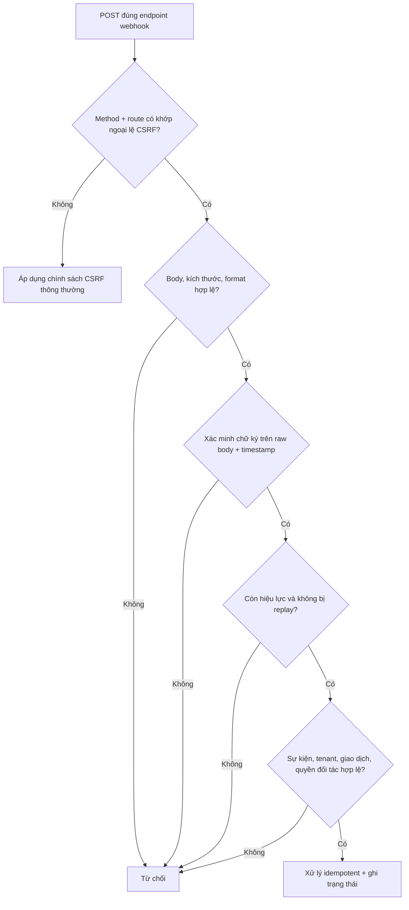

# Giới hạn miễn trừ theo đường dẫn, phương thức và hợp đồng xác thực

> **Chương:** Phạm vi kiểm tra CSRF  
> **Module:** `SPRING_SECURITY_HTTP_PROTECTION` — bảo vệ HTTP và trình duyệt bằng Spring Security trên cả Servlet và Reactive.  
> **Vấn đề cần giải quyết:** Khi một request thực sự không cần CSRF token, làm thế nào giới hạn ngoại lệ đủ hẹp để các request khác vẫn được bảo vệ và chứng minh được giả định an toàn đó bằng kiểm thử?

## 1. Mục tiêu học tập

Sau bài này, người học có thể:

1. Định nghĩa **hợp đồng miễn trừ CSRF** bằng các điều kiện cụ thể: **HTTP method, route, client, cơ chế xác thực, nơi truyền credential và biện pháp bảo vệ thay thế**.
2. Phân biệt “request được phép bỏ qua CSRF” với “request được phép truy cập”.
3. Viết ngoại lệ giới hạn theo **đúng phương thức và đường dẫn** trong Spring Security Servlet; áp dụng nguyên tắc tương đương với `ServerWebExchangeMatcher` ở WebFlux.
4. Nhận diện các ngoại lệ không an toàn: `/api/**` dùng session cookie, wildcard callback quá rộng, token trong cookie dù gọi là stateless, backend chấp nhận fallback sang session.
5. Kiểm thử cả chiều **được miễn trừ đúng** và chiều **không được miễn trừ sai**, gồm route gần giống, method khác, cookie fallback, proxy/servlet mapping, các security chain chồng lấn.
6. Phối hợp CSRF với kiểm tra chữ ký webhook, bearer authentication, HTTP firewall, CORS, security headers và session mà không nhầm vai trò của từng lớp.

Bài này tập trung vào **giới hạn một ngoại lệ đã được xác định là cần thiết**. Chính sách mặc định của Spring Security vẫn là yêu cầu CSRF token cho các HTTP method không an toàn trên các request đi qua security chain có bật CSRF.

## 2. Vì sao ngoại lệ rộng có thể tạo lỗ hổng?

Giả sử ứng dụng có hai endpoint:

- `POST /api/account/change-email` do browser gọi kèm session cookie.
- `POST /api/mobile/submit` do mobile app gọi với bearer token trong header `Authorization`.

Để mobile app không phải mang CSRF token, một lập trình viên viết:

```java
http.csrf(csrf -> csrf
    .ignoringRequestMatchers("/api/**")
);
```

Cấu hình trên miễn trừ luôn thao tác đổi email, dù trình duyệt có thể tự đính kèm session cookie của người dùng. Một website độc hại có thể khiến browser nạn nhân gửi POST tới endpoint này; **không cần đọc response** để gây ra tác động. CORS, định dạng JSON hoặc tên thư mục `/api` không chứng minh rằng endpoint miễn nhiễm với CSRF.

Trọng tâm của việc sửa là **không mở rộng phạm vi của một ngoại lệ có lý do chính đáng sang các request không đáp ứng lý do đó**. Cần mô tả hợp đồng cụ thể mà request ngoại lệ phải tuân theo.

### 2.1. Hợp đồng miễn trừ nghĩa là gì?

Một “hợp đồng xác thực” ở đây là các điều kiện có thể kiểm chứng mà server và client phải thỏa mãn trước khi xử lý thao tác. Ví dụ:

> Chỉ chấp nhận **POST /integrations/payment-events** từ hệ thống thanh toán; request mang chữ ký HMAC trên body gốc, timestamp hợp lệ, có kiểm tra chống phát lại; server **không dùng session cookie** để xác thực callback; sai chữ ký phải bị từ chối trước mọi thay đổi nghiệp vụ.

Với hợp đồng này, miễn trừ CSRF có thể hợp lý vì request được tạo bởi server đối tác, không dựa vào credential mà browser của người dùng tự gửi. Nếu sau này endpoint cũng được dùng cho dashboard quản trị bằng cookie session, hợp đồng đã thay đổi: cần thiết kế lại route/chain và phạm vi miễn trừ.

**Quan trọng:** Được miễn trừ kiểm tra CSRF **không đồng nghĩa** request đã được xác thực, được phân quyền hoặc chắc chắn được xử lý thành công.

## 3. Ba điều kiện tối thiểu: method, path và credential

### 3.1. Giới hạn theo HTTP method

Giả sử callback thanh toán chỉ nhận POST:

| Request | Có khớp ngoại lệ POST chính xác? | Ý nghĩa |
|---|---:|---|
| `POST /integrations/payment-events` | Có | Được bỏ qua bước kiểm tra CSRF theo hợp đồng callback |
| `PUT /integrations/payment-events` | Không | Vẫn theo kiểm tra CSRF mặc định nếu method không an toàn |
| `DELETE /integrations/payment-events` | Không | Vẫn theo kiểm tra CSRF mặc định |
| `GET /integrations/payment-events` | Không | Thường đã được loại khỏi CSRF bởi quy tắc method an toàn |
| `POST /integrations/payment-events/42` | Không | Không phải đúng route callback |

Việc GET không đòi token CSRF theo mặc định **không có nghĩa GET là ngoại lệ webhook**. Đó là hai lý do khác nhau. Hệ thống vẫn cần thiết kế GET không thay đổi trạng thái và có quyền truy cập thích hợp.

Không dùng một matcher path-only khi chỉ có POST được phép. Nếu tương lai ai đó bổ sung PATCH dưới cùng đường dẫn và xác thực bằng cookie, matcher path-only có thể vô tình miễn trừ PATCH.

### 3.2. Giới hạn theo đường dẫn

Một ngoại lệ hẹp thường là **route chính xác**, ví dụ `/integrations/payment-events`. Hãy phân biệt:

| Biểu thức/kiểu so khớp | Phạm vi điển hình | Rủi ro |
|---|---|---|
| Đúng path `/integrations/payment-events` | Một endpoint | Dễ review và kiểm thử |
| Tiền tố `/integrations/**` | Nhiều endpoint hiện tại và tương lai | Dễ miễn trừ nhầm callback, lệnh quản trị, route mới |
| Toàn bộ `/api/**` | Rất nhiều nghiệp vụ | Có thể bỏ bảo vệ browser-session API |
| So khớp chuỗi tự chế `startsWith("/integrations/pay")` | Có thể khớp route không liên quan | Dễ vướng đường dẫn gần giống hoặc thay đổi routing |

Cần xác định **đường dẫn mà matcher thật sự nhìn thấy**. Trong Servlet, `request.getServletPath()` có thể khác URL công khai khi ứng dụng có servlet mapping, context path hoặc reverse proxy. Trong WebFlux, `exchange.getRequest().getPath().pathWithinApplication()` phản ánh đường dẫn trong ứng dụng. Matcher còn chịu ảnh hưởng từ bước chuẩn hóa đường dẫn và HTTP firewall.

Một số ca biên cần thử trên cấu hình gần production:

- `/integrations/payment-events/` (dấu gạch chéo cuối).
- `/integrations/payment-events/extra` (path con).
- `/integrations/payment-events-test` (tên gần giống).
- Đường dẫn có encoding đặc biệt, ký tự `;`, dấu phân cách trùng lặp hoặc nhiều dạng biểu diễn.
- Context path như `/shop`, servlet mapping khác `/`, gateway rewrite hoặc trusted forwarded headers.
- Method override qua filter hoặc cơ chế `_method=DELETE` nếu ứng dụng cho phép.

Không tự xây bộ giải mã/chuẩn hóa URL riêng trong matcher. Ưu tiên matcher tương thích stack và routing, giữ HTTP firewall ở chế độ bảo vệ phù hợp; test hành vi cuối cùng của ứng dụng sau proxy. Không tin giá trị `X-Forwarded-*` do client bất kỳ tự khai báo khi không có proxy tin cậy đứng trước.

### 3.3. Giới hạn theo hợp đồng credential

Ngay cả khi method và path đã khớp, ngoại lệ vẫn không an toàn nếu backend có đường xác thực dựa trên credential được trình duyệt tự động gửi.

| Credential/hành vi server | Khả năng miễn trừ CSRF |
|---|---|
| Session cookie cho web form, SPA hoặc BFF | **Giữ CSRF** cho thao tác thay đổi trạng thái |
| JWT lưu trong cookie và server dùng cookie để xác thực | **Giữ CSRF**, dù ứng dụng không lưu session server-side |
| HTTP Basic/Digest do browser tự gửi | Phải đánh giá như credential trình duyệt có thể tự gửi |
| Bearer token do native app tự gắn trong `Authorization`, server không nhận cookie fallback | Có thể miễn trừ sau khi tách đúng route/chain và kiểm thử |
| mTLS giữa server với server | Có thể miễn trừ CSRF; vẫn cần xác thực và phân quyền certificate |
| Webhook có chữ ký body/timestamp, không dùng session người dùng | Có thể miễn trừ route cụ thể; chữ ký/replay là phòng vệ chính |
| Một route nhận cả bearer header và session cookie | **Không được miễn trừ toàn bộ** chỉ vì có bearer client |

**Điểm cần kiểm chứng:** “Không dùng cookie” là tính chất của **cơ chế xác thực mà server thực sự chấp nhận**, không chỉ là lời hứa từ client rằng nó sẽ không gửi cookie. Hãy kiểm thử thử trường hợp gửi cookie hợp lệ và không có bearer token tới endpoint dự kiến bearer-only.

## 4. Đặc tả một ngoại lệ trước khi cấu hình

Một phiếu đánh giá ngoại lệ nên có ít nhất các trường sau:

| Trường trong hợp đồng | Ví dụ webhook thanh toán |
|---|---|
| Mục đích và chủ sở hữu | Nhận trạng thái giao dịch từ nhà cung cấp thanh toán |
| Method duy nhất | `POST` |
| Route được phép | `/integrations/payment-events`, không khớp path con |
| Client gọi | Backend của nhà cung cấp thanh toán |
| Cơ chế xác thực | Chữ ký trên body gốc với bí mật/khóa đã đăng ký |
| Credential **không được** dùng | Cookie session của browser, fallback sang HTTP Basic hoặc bearer không liên quan |
| Xử lý trước tác động nghiệp vụ | Xác minh chữ ký, timestamp, nhận diện sự kiện, tenant và chống replay |
| Bảo vệ lạm dụng | Giới hạn kích thước body, rate limit, kiểm tra schema, idempotency |
| Điều kiện từ chối | Chữ ký sai, quá hạn, sự kiện trùng không hợp lệ, sai tenant |
| Kiểm thử âm | PUT cùng path, POST path gần giống, POST cookie-only, chữ ký sai |
| Kiểm thử dương | POST đúng route/method với chữ ký hợp lệ và dữ liệu hợp lệ |
| Bằng chứng vận hành | Log từ chối có kiểm soát, metric chữ ký sai, owner của secret và quy trình xoay khóa |

Đối với bearer-only API, thay trường xác thực bằng `Authorization: Bearer ...`; thêm yêu cầu JWT có issuer, audience, expiry, scope phù hợp và **không có session fallback**. CSRF exemption không thay cho kiểm tra token hoặc quyền.

### 4.1. Biểu diễn nguyên tắc bằng logic

Nếu ký hiệu `unsafeMethod` là method không thuộc `GET`, `HEAD`, `TRACE`, `OPTIONS` và `exemptExact` là ngoại lệ đã xác thực phạm vi:

```text
requireCsrf(request) =
    unsafeMethod(request) && !exemptExact(request)

exemptExact(request) =
    method == POST &&
    path == "/integrations/payment-events" &&
    securityContract == "signed webhook, no browser-session auth"
```

Đây là **biểu thức thiết kế**. Dòng `securityContract` không nhất thiết là một điều kiện mà request matcher tự đo được; hợp đồng này phải được thực thi bằng cấu hình authentication, security chain, filter xác minh chữ ký và kiểm thử. **Không** dùng một header tự khai báo như `X-Client-Type: webhook` làm bằng chứng duy nhất để miễn trừ CSRF, vì trang tấn công cũng có thể tạo request với thuộc tính do nó kiểm soát khi điều kiện trình duyệt cho phép.

## 5. Servlet: miễn trừ đúng method và path

Trong Spring MVC/Servlet, cấu hình CSRF thuộc `HttpSecurity` và được thực thi bởi `CsrfFilter`.

### 5.1. Giữ mặc định, thêm một ngoại lệ chính xác

Đoạn code dưới đây dành cho ứng dụng dùng `DispatcherServlet` tại `/`, nơi `getServletPath()` trả về path như ví dụ. Matcher chỉ miễn trừ POST tới đúng endpoint. Việc kiểm tra chữ ký nằm ở filter/service riêng và phải diễn ra trước khi cập nhật dữ liệu.

```java
import org.springframework.context.annotation.Bean;
import org.springframework.security.config.annotation.web.builders.HttpSecurity;
import org.springframework.security.web.SecurityFilterChain;
import org.springframework.security.web.util.matcher.RequestMatcher;

@Bean
SecurityFilterChain securityFilterChain(HttpSecurity http) throws Exception {
    RequestMatcher signedPaymentWebhook = request ->
        "POST".equals(request.getMethod())
            && "/integrations/payment-events"
                .equals(request.getServletPath());

    http.csrf(csrf -> csrf
        .ignoringRequestMatchers(signedPaymentWebhook)
    );

    // Cần thêm cấu hình authentication/authorization phù hợp;
    // xác minh chữ ký/timestamp/replay của webhook vẫn bắt buộc.
    return http.build();
}
```

Cấu hình này **không tắt** CSRF cho `POST /orders`, `PATCH /account` hoặc `PUT /integrations/payment-events`. Trong ứng dụng có servlet mapping hoặc route mapping khác, cần thay bằng matcher tương thích với môi trường đó và kiểm thử các biến thể path thực tế.

**Không sử dụng** một trong các lối tắt sau khi có browser dùng cookie:

```java
// Rộng hơn hợp đồng: miễn trừ tất cả method và callback tương lai.
http.csrf(csrf -> csrf.ignoringRequestMatchers("/integrations/**"));

// Rộng hơn hợp đồng: tất cả API, kể cả route dùng session/JWT cookie.
http.csrf(csrf -> csrf.ignoringRequestMatchers("/api/**"));

// Tắt CSRF trên cả chain có browser, không phân biệt method/route.
http.csrf(csrf -> csrf.disable());
```

Các đoạn trên là **phản ví dụ**, không phải những cấu hình cần chạy.

### 5.2. Tại sao matcher CSRF không nên cố kiểm tra chữ ký?

Một ý tưởng dễ mắc là chỉ miễn trừ CSRF khi request **có** header `X-Signature`:

```java
// Không phải bằng chứng chữ ký hợp lệ:
RequestMatcher unsafeExemption = request ->
    "POST".equals(request.getMethod())
        && "/integrations/payment-events".equals(request.getServletPath())
        && request.getHeader("X-Signature") != null;
```

Header có mặt không đồng nghĩa chữ ký hợp lệ. Quan trọng hơn, trộn xác minh chữ ký vào request matcher của CSRF khiến thứ tự xử lý và lý do 403 khó kiểm soát. Hợp đồng đúng nên tách hai quyết định:

1. CSRF matcher nhận ra **request tới đúng webhook method và route** để miễn trừ token của browser.
2. Cơ chế xác minh webhook kiểm tra chữ ký trên **body gốc**, timestamp, chống replay và quyền của đối tác **trước khi** thực thi tác động nghiệp vụ.

Một request webhook không có token CSRF vẫn phải **bị từ chối** khi sai chữ ký. Tùy cách thiết kế hệ thống, response có thể là 400/401/403; bài học cần chứng minh rằng lỗi đến từ bước xác minh chữ ký, không từ CSRF.

### 5.3. Khi nào nên tách security chain?

Nếu ứng dụng có nhóm endpoint được truy cập **chỉ** bằng bearer token do client chủ động gắn header, có thể tạo một chain riêng. Ví dụ chỉ route POST chuyên dụng được xử lý bởi bearer-only chain, trong khi browser chain vẫn giữ CSRF mặc định.

```java
import org.springframework.context.annotation.Bean;
import org.springframework.core.annotation.Order;
import org.springframework.security.config.Customizer;
import org.springframework.security.config.annotation.web.builders.HttpSecurity;
import org.springframework.security.config.http.SessionCreationPolicy;
import org.springframework.security.web.SecurityFilterChain;
import org.springframework.security.web.util.matcher.RequestMatcher;

@Bean
@Order(1)
SecurityFilterChain mobilePostChain(HttpSecurity http) throws Exception {
    RequestMatcher mobilePost = request ->
        "POST".equals(request.getMethod())
            && "/api/mobile/orders".equals(request.getServletPath());

    http.securityMatcher(mobilePost)
        .sessionManagement(session -> session
            .sessionCreationPolicy(SessionCreationPolicy.STATELESS))
        .csrf(csrf -> csrf.disable())
        .oauth2ResourceServer(oauth2 -> oauth2
            .jwt(Customizer.withDefaults()))
        .authorizeHttpRequests(auth -> auth
            .anyRequest().authenticated());

    return http.build();
}

@Bean
@Order(2)
SecurityFilterChain browserChain(HttpSecurity http) throws Exception {
    http
        .authorizeHttpRequests(auth -> auth
            .anyRequest().authenticated())
        .formLogin(Customizer.withDefaults());
    // CSRF không bị disable ở browserChain.
    return http.build();
}
```

Đây là **một thiết kế thay thế** cho trường hợp bearer-only đã được kiểm chứng, không phải đoạn cấu hình cần dán chồng lên ví dụ webhook mà không điều chỉnh rules. Trước khi áp dụng, cần xác nhận:

- `POST /api/mobile/orders` thật sự chỉ xác thực bằng bearer; không có custom authentication filter dùng cookie/session fallback.
- Chain có thứ tự ưu tiên đúng, không bị chain rộng khác bắt trước.
- Các request không khớp method/path, như `PUT /api/mobile/orders`, đi vào chain khác và phải xử lý theo chính sách mong đợi.
- Có cấu hình JWT decoder/trust và kiểm tra quyền phù hợp, đặc biệt issuer, audience và scope.
- `SessionCreationPolicy.STATELESS` giúp giới hạn việc tạo/dùng HTTP session cho security context nhưng **một mình nó không chứng minh toàn bộ ứng dụng không thể xác thực bằng cookie**.

Nếu muốn dùng một chain cho toàn bộ API bearer-only, chỉ mở rộng matcher sau khi đã kiểm kê mọi route và chứng minh cùng hợp đồng xác thực. Tên `/api/mobile/**` không tự bảo đảm an toàn.

## 6. Reactive: ngoại lệ hẹp với `ServerWebExchangeMatcher`

Spring WebFlux sử dụng `ServerHttpSecurity`, `SecurityWebFilterChain`, `CsrfWebFilter` và `ServerWebExchangeMatcher`. Nguyên tắc method + route + hợp đồng xác thực giữ nguyên, nhưng không dùng nguyên kiểu `RequestMatcher` của Servlet.

Ví dụ đặt điều kiện **yêu cầu CSRF** cho tất cả method không an toàn, **trừ** POST đúng đường dẫn callback thanh toán:

```java
import org.springframework.context.annotation.Bean;
import org.springframework.http.HttpMethod;
import org.springframework.security.config.web.server.ServerHttpSecurity;
import org.springframework.security.web.server.SecurityWebFilterChain;
import org.springframework.security.web.server.util.matcher.ServerWebExchangeMatcher;

@Bean
SecurityWebFilterChain reactiveSecurity(ServerHttpSecurity http) {
    ServerWebExchangeMatcher requireCsrf = exchange -> {
        HttpMethod method = exchange.getRequest().getMethod();
        String path = exchange.getRequest()
            .getPath().pathWithinApplication().value();

        boolean safeMethod =
            method == HttpMethod.GET
                || method == HttpMethod.HEAD
                || method == HttpMethod.TRACE
                || method == HttpMethod.OPTIONS;

        boolean signedPaymentWebhook =
            method == HttpMethod.POST
                && "/integrations/payment-events".equals(path);

        return !safeMethod && !signedPaymentWebhook
            ? ServerWebExchangeMatcher.MatchResult.match()
            : ServerWebExchangeMatcher.MatchResult.notMatch();
    };

    http.csrf(csrf -> csrf
        .requireCsrfProtectionMatcher(requireCsrf));

    // Authorization và xác minh chữ ký webhook được cấu hình riêng.
    return http.build();
}
```

Ở đây `requireCsrfProtectionMatcher` **thay thế** matcher yêu cầu CSRF mặc định. Ta chủ động mô phỏng quy tắc method an toàn và loại ngoại lệ hẹp, để những POST/PUT/PATCH/DELETE khác tiếp tục yêu cầu token. Đừng chuyển sang matcher chỉ xét path mà quên method.

Có thể sử dụng các matcher dựng sẵn và tổ hợp bằng các toán tử matcher nếu phù hợp phiên bản Spring Security; điều thiết yếu là logic vẫn tương đương `unsafeMethod AND NOT exactException`. Trong môi trường nhiều `SecurityWebFilterChain`, các matcher ngoài cùng chọn chain; cần kiểm thử chain thực tế, không chỉ riêng biểu thức trên.

### 6.1. Nếu endpoint dùng web session cookie

WebFlux không làm ứng dụng miễn nhiễm với CSRF. Nếu SPA gọi route bằng `WebSession`/cookie, browser vẫn có thể tự gửi cookie. Request thay đổi trạng thái phải được bảo vệ tương ứng. Một callback từ server đối tác có thể không cần token, còn API cùng module do browser gọi bằng cookie vẫn cần.

## 7. Webhook: hợp đồng thay thế phải đủ mạnh

Khi bỏ CSRF cho webhook, hệ thống cần bảo đảm request đến từ chủ thể được cho phép và không bị phát lại. Một luồng điển hình:



Các điểm triển khai quan trọng:

- Dùng thuật toán/định dạng chữ ký theo hợp đồng của nhà cung cấp; với HMAC, so sánh giá trị chữ ký theo cách chống timing leak và quản lý/luân chuyển secret an toàn.
- Tính chữ ký trên **đúng dữ liệu nhà cung cấp đã ký** (thường là raw request body cùng timestamp), tránh parse rồi serialize lại khiến byte thay đổi.
- Giới hạn thời gian chấp nhận timestamp; dùng event ID/nonce hoặc cơ chế phù hợp để phát hiện replay. Timestamp một mình không bảo đảm chống phát lại trong cửa sổ thời gian.
- Kiểm tra event ID, loại sự kiện, tenant, invoice/order ID và quyền nguồn gửi; idempotency bảo đảm sự kiện hợp lệ gửi lặp không gây tác động nghiệp vụ hai lần.
- Không tin địa chỉ IP hoặc hostname tự khai báo làm chứng cứ duy nhất; allowlist IP có thể là lớp bổ sung nếu bên cung cấp hỗ trợ dải địa chỉ tin cậy.
- Không log secret, raw token hay dữ liệu nhạy cảm; log mã sự kiện và lý do từ chối phù hợp để chẩn đoán.

Việc cho phép endpoint webhook nhận request chưa có Spring Security principal có thể đòi một rule authorization phù hợp, nhưng `permitAll` cho route đó **không thay thế** bước xác minh chữ ký của nghiệp vụ. Bước này phải xảy ra trước mọi thay đổi trạng thái.

## 8. Bearer-only API: xác thực đúng loại client

Tình huống thực tế: ứng dụng mobile gọi API bằng access token. Thiết kế miễn trừ chỉ hợp lý nếu **mọi đường xác thực mà endpoint chấp nhận** đều độc lập với credential browser tự gửi.

| Tình huống gọi | Kỳ vọng |
|---|---|
| `POST /api/mobile/orders`, bearer hợp lệ, không CSRF token | Được xác thực và xử lý theo quyền/nghiệp vụ |
| Cùng route, bearer sai/hết hạn | Bị từ chối theo authentication, dù không cần CSRF |
| Cùng route, chỉ có session cookie của browser | **Không** được xác thực nhờ cookie fallback |
| Cùng route, có cả cookie và bearer sai | Không được “rơi xuống” session cookie để vượt qua bearer authentication |
| `POST /orders`, browser có session cookie nhưng không CSRF token | Bị chặn CSRF trong browser chain |
| `PUT /api/mobile/orders`, không thuộc ngoại lệ POST chuyên dụng | Theo chính sách chain còn lại; không tự động được miễn trừ |

**Cảnh báo về cookie JWT:** Nếu backend đọc JWT từ cookie và browser tự đính kèm cookie, endpoint có nguy cơ CSRF bất kể server có lưu session hay không. `SessionCreationPolicy.STATELESS` không biến một cookie tự gửi thành bearer header do ứng dụng chủ động thêm.

**Không lấy sự hiện diện của header `Authorization` làm điều kiện duy nhất để bỏ CSRF trên một route hỗn hợp.** Header có thể không hợp lệ; nếu logic xác thực fallback sang cookie session, trình duyệt vẫn có thể thực hiện request không mong muốn. Cần tách chain hoặc vô hiệu hóa fallback theo một hợp đồng rõ ràng, rồi kiểm thử.

## 9. Callback SSO, GraphQL và các endpoint dùng chung

Ngoại lệ theo đường dẫn thường dễ bị áp dụng quá rộng ở những khu vực sau.

### 9.1. Callback của identity provider

Một số callback OAuth2/OIDC/SAML có cơ chế bảo vệ giao thức riêng, ví dụ `state`, `nonce` hoặc chữ ký và liên kết response với phiên/luồng đăng nhập. Không thể áp dụng nguyên mẫu webhook HMAC cho mọi callback SSO. Nếu endpoint callback cần miễn trừ CSRF theo flow cụ thể, xác định chính xác method, route, protocol binding và cơ chế kiểm tra tính hợp lệ; không miễn trừ toàn bộ `/login/**` hoặc `/callbacks/**` chỉ dựa vào tên thư mục.

### 9.2. GraphQL

`POST /graphql` thường được dùng cho cả query và mutation. Matcher chỉ theo method/path **không biết** operation trong body có thay đổi trạng thái hay không. Nếu endpoint chấp nhận cookie session, miễn trừ POST trên toàn bộ route sẽ khiến mutation mất kiểm tra CSRF. Giữ bảo vệ mặc định, hoặc thiết kế lại route/credential tách biệt với bằng chứng đủ mạnh.

### 9.3. RPC hoặc các route “action” tổng quát

`POST /actions`, `POST /rpc` và các proxy endpoint có thể xử lý nhiều lệnh theo payload. Một ngoại lệ cho toàn route áp dụng lên mọi action, kể cả những action được bổ sung sau này. Nếu máy gọi chỉ cần một loại hành động, tách route dành riêng hoặc kiểm soát hợp đồng ở tầng auth và router thích hợp.

### 9.4. Method override và redirect

Nếu filter hỗ trợ `X-HTTP-Method-Override` hoặc tham số `_method`, kiểm tra method **sau các lớp xử lý thực tế**; cấu hình sai thứ tự filter có thể làm hành vi đánh giá khác dự kiến. Redirect 307/308 có thể giữ nguyên method/body; xét cả luồng điều hướng nếu client có thể được chuyển sang URL khác. Không dùng GET để thực hiện thay đổi trạng thái chỉ để tránh CSRF.

## 10. Ma trận kiểm thử: chứng minh ngoại lệ hẹp

Giả định chính sách:

- Web browser xác thực bằng session cookie và mọi method không an toàn đều yêu cầu CSRF.
- Chỉ `POST /integrations/payment-events` được miễn CSRF theo hợp đồng chữ ký.
- `POST /api/mobile/orders` được xử lý bởi bearer-only chain có kiểm chứng, không dùng session fallback.
- Các route khác vẫn đi qua browser chain với CSRF mặc định.

| Test case | Kỳ vọng bảo vệ |
|---|---|
| Browser `POST /orders`, session hợp lệ, thiếu token | Bị từ chối bởi CSRF |
| Browser `POST /orders`, token sai | Bị từ chối bởi CSRF |
| Browser `POST /orders`, token hợp lệ và đủ quyền | Đi tiếp tới nghiệp vụ |
| `POST /integrations/payment-events`, chữ ký hợp lệ, không CSRF token | Được đi qua CSRF và xử lý theo hợp đồng webhook |
| Cùng webhook, chữ ký sai | Bị chặn bởi bước xác minh chữ ký |
| Cùng webhook, request replay | Bị chặn hoặc xử lý trùng theo hợp đồng, không gây tác động hai lần |
| `PUT /integrations/payment-events`, không token | Không thuộc ngoại lệ; chịu chính sách CSRF mặc định |
| `POST /integrations/payment-events/42`, không token | Không thuộc ngoại lệ |
| `POST /integrations/payment-events-test`, không token | Không thuộc ngoại lệ |
| `POST /api/mobile/orders`, bearer hợp lệ, không token CSRF | Đi tiếp theo bearer-only chain |
| `POST /api/mobile/orders`, chỉ có session cookie hợp lệ | Không được xác thực bằng cookie |
| `POST /api/mobile/orders`, bearer sai kèm cookie hợp lệ | Không fallback sang session |
| `GET /orders`, không token CSRF | Không bị chặn chỉ vì thiếu CSRF token |
| Path có context prefix/encoding hoặc đi qua proxy rewrite | Matcher hoạt động theo đường dẫn ứng dụng thực tế, không tạo vùng miễn trừ mới |

Các test negative quan trọng ngang test positive. Chỉ chứng minh webhook đúng hoạt động khi thiếu CSRF token là **chưa đủ**; còn phải chứng minh một request gần giống webhook **không** nhận được ngoại lệ.

### 10.1. Servlet: kiểm thử ranh giới method và path với MockMvc

Giả định test đã bật Spring Security filter và mock user có quyền nghiệp vụ. Đây là phần kiểm thử **biên ngoại lệ**; test chữ ký webhook phải dùng fixture hợp lệ theo nhà cung cấp cụ thể.

```java
import static org.springframework.security.test.web.servlet.request.SecurityMockMvcRequestPostProcessors.user;
import static org.springframework.test.web.servlet.request.MockMvcRequestBuilders.post;
import static org.springframework.test.web.servlet.request.MockMvcRequestBuilders.put;
import static org.springframework.test.web.servlet.result.MockMvcResultMatchers.status;

@Test
void postOutsideWebhookStillRequiresCsrf() throws Exception {
    mockMvc.perform(post("/orders")
            .with(user("alice")))
        .andExpect(status().isForbidden());
}

@Test
void nearbyWebhookPathIsNotExempt() throws Exception {
    mockMvc.perform(post("/integrations/payment-events-test")
            .with(user("alice")))
        .andExpect(status().isForbidden());
}

@Test
void differentMethodOnWebhookPathIsNotExempt() throws Exception {
    mockMvc.perform(put("/integrations/payment-events")
            .with(user("alice")))
        .andExpect(status().isForbidden());
}
```

Các test trên chỉ chứng minh trường hợp thiếu token bị CSRF từ chối nếu request không bị một filter khác chặn trước. Bổ sung test với `csrf()` hợp lệ, cùng user và quyền, để xác nhận nguyên nhân. Với webhook đúng method/path, gửi request **không** có CSRF token nhưng có chữ ký hợp lệ để xác minh nó đến được handler; gửi chữ ký sai để xác minh bước xác thực webhook hoạt động.

Nếu controller trả `404 Not Found` do path gần giống không tồn tại, phép thử sẽ không chứng minh CSRF đang bảo vệ: tùy thứ tự filter, CSRF thường chặn unsafe request trước khi routing, nhưng không nên coi mọi 403/404 là bằng chứng riêng rẽ. Nên kiểm tra bằng Spring Security test instrumentation/log hoặc fixture có route đích được kiểm soát.

### 10.2. Reactive: kiểm thử ranh giới với WebTestClient

Giả định `WebTestClient` được cấu hình đi qua `SecurityWebFilterChain`:

```java
import static org.springframework.security.test.web.reactive.server.SecurityMockServerConfigurers.mockUser;

@Test
void reactivePostOutsideWebhookNeedsCsrf() {
    webTestClient.mutateWith(mockUser("alice"))
        .post().uri("/orders")
        .exchange()
        .expectStatus().isForbidden();
}

@Test
void reactiveDifferentMethodIsNotExempt() {
    webTestClient.mutateWith(mockUser("alice"))
        .put().uri("/integrations/payment-events")
        .exchange()
        .expectStatus().isForbidden();
}
```

Để kiểm tra trường hợp positive, thêm `mutateWith(csrf())` cho route browser được bảo vệ và đưa đủ body/quyền để request đi tiếp; với webhook đúng route thì gửi chữ ký hợp lệ, không gửi CSRF token. Cần xác minh **chỉ** route webhook được bỏ CSRF khi trình tự matcher được thực thi.

### 10.3. Kiểm thử browser thực tế

Ngoài integration test, có thể thiết lập tình huống kiểm tra an toàn trên môi trường thử nghiệm:

1. Đăng nhập ứng dụng như một user thử nghiệm bằng browser với session cookie.
2. Gửi POST thay đổi trạng thái từ luồng hợp lệ với token; xác nhận thành công và quyền nghiệp vụ.
3. Tạo form cross-site thử nghiệm gửi cùng POST nhưng thiếu token; xác nhận thao tác bị chặn, không có thay đổi dữ liệu.
4. Thử gửi POST đến endpoint webhook đúng path nhưng không có chữ ký; xác nhận hệ thống **không** thực thi nghiệp vụ dù CSRF được miễn.
5. Thử cookie-only và bearer sai vào endpoint mobile để bảo đảm không tồn tại session fallback.

Cấu hình `SameSite` và CORS có thể khiến một số request thử nghiệm không mang cookie hoặc không đi tiếp; ghi nhận điều đó như **một lớp phòng vệ bổ sung**, nhưng vẫn xác minh riêng CSRF matcher trong test có session/credential phù hợp. CSP, HSTS và security headers bảo vệ các khía cạnh khác của trình duyệt/đường truyền; chúng không thay thế hợp đồng miễn trừ CSRF.

## 11. Chẩn đoán khi request bị 403 hoặc ngoại lệ hoạt động sai

### 11.1. “Webhook đúng route vẫn nhận 403”

Đừng mặc định là CSRF matcher sai. Kiểm tra lần lượt:

1. Request đã vào security chain nào? Có chain khác khớp trước không?
2. Method và đường dẫn mà matcher quan sát có đúng như hợp đồng không?
3. 403 do `CsrfFilter`/`CsrfWebFilter`, do authorization, HTTP firewall, hay do logic kiểm tra chữ ký?
4. Chữ ký được tính trên raw body đúng chuẩn hay body đã bị middleware biến đổi?
5. Timestamp, clock skew, replay cache, tenant và event scope có hợp lệ không?

Chẩn đoán bằng log có kiểm soát, không in token hoặc khóa ký vào log.

### 11.2. “POST browser không token vẫn thành công”

Cần xem đây là dấu hiệu nguy hiểm nếu route dùng cookie:

1. Có `csrf.disable()` trong chain đang xử lý không?
2. `ignoringRequestMatchers` có wildcard quá rộng không?
3. `requireCsrfProtectionMatcher` có bị thay thế bằng matcher chỉ xét vài route/method không?
4. Request có được xử lý bởi bearer-only chain trước browser chain không?
5. Test có thật sự tích hợp filter chain hay đang gọi controller trực tiếp?

### 11.3. “PUT cùng path webhook cũng được bỏ qua CSRF”

Nguyên nhân thường là matcher chỉ xét path. Sửa ngoại lệ thành điều kiện **POST && exact path** và thêm regression test. Nếu API còn nhận PUT từ client máy hợp lệ, hãy viết một hợp đồng riêng, có cùng độ chặt về authentication, thay vì nới wildcard mà không đánh giá.

### 11.4. “Exemption bị sai khi triển khai sau reverse proxy”

Kiểm tra context path, servlet mapping, cấu hình forwarded headers và route rewrite. Dùng matcher theo path mà ứng dụng nhận sau proxy; kiểm thử URL công khai và đường dẫn nội bộ tương ứng. HTTP firewall có thể từ chối path encoded bất thường trước CSRF; giữ phòng vệ này và chỉ nới chính sách khi có lý do, kiểm thử rõ ràng.

## 12. Tình huống thực hành: thu hẹp một ngoại lệ rộng

Đội phát triển có cấu hình:

```java
http.csrf(csrf -> csrf
    .ignoringRequestMatchers("/api/**", "/hooks/**")
);
```

Hệ thống có năm luồng:

| Luồng | Request | Xác thực |
|---|---|---|
| A | `POST /api/profile/email` | SPA sử dụng session cookie |
| B | `POST /api/mobile/orders` | Mobile dùng bearer header duy nhất |
| C | `POST /hooks/payments` | Payment provider ký HMAC |
| D | `POST /hooks/admin/rebuild` | Dashboard quản trị dùng session cookie |
| E | `GET /hooks/payments` | Endpoint health chỉ đọc |

**Bài tập:** Viết quyết định CSRF cho từng luồng; đề xuất ngoại lệ hẹp và những kiểm thử phải có.

**Gợi ý giải:**

- **A:** Giữ CSRF vì browser tự đính kèm cookie khi gửi POST.
- **B:** Có thể tách chain bearer-only hoặc miễn trừ đúng route/method nếu đã chứng minh server không có session fallback. Vẫn cần kiểm tra JWT và quyền.
- **C:** Chỉ miễn trừ `POST /hooks/payments`; bảo vệ bằng chữ ký, timestamp, anti-replay, idempotency và phân quyền nguồn sự kiện.
- **D:** Giữ CSRF và kiểm tra quyền admin; wildcard `/hooks/**` hiện tại vô tình loại bỏ CSRF cho hành động quản trị.
- **E:** Không yêu cầu token CSRF vì GET là method an toàn theo mặc định; vẫn cần đảm bảo health endpoint chỉ đọc và áp dụng authorization phù hợp nếu có dữ liệu nhạy cảm.

Cấu hình khởi đầu an toàn cho phần webhook của hệ thống Servlet:

```java
RequestMatcher paymentsPost = request ->
    "POST".equals(request.getMethod())
        && "/hooks/payments".equals(request.getServletPath());

http.csrf(csrf -> csrf.ignoringRequestMatchers(paymentsPost));
```

Phần bearer-only được thiết kế riêng sau khi xác minh hợp đồng xác thực; không thêm vội `/api/mobile/**` vào ngoại lệ nếu chưa kiểm tra toàn bộ client và security chain. Ma trận test phải chứng minh A và D bị chặn khi thiếu token, C chỉ qua khi chữ ký hợp lệ, B không nhận cookie fallback và PUT tới C không được exempt.

## 13. Checklist review một ngoại lệ CSRF

- [ ] Có hợp đồng diễn đạt **vì sao** endpoint không cần CSRF dựa trên cách credential thực sự được gửi và được server chấp nhận.
- [ ] Method được ràng buộc chính xác; ngoại lệ không tự mở rộng sang PUT/PATCH/DELETE mới.
- [ ] Path chính xác và tương thích với router/servlet mapping; path con và path gần giống không khớp.
- [ ] Endpoint được miễn trừ không chấp nhận session cookie, cookie JWT hoặc Basic browser credential làm đường xác thực không được kiểm soát.
- [ ] Cơ chế thay thế được thực thi trước nghiệp vụ: chữ ký webhook, bearer-only authentication, mTLS hoặc bảo vệ giao thức SSO phù hợp.
- [ ] Có kiểm tra replay/timestamp/idempotency cho callback có nguy cơ phát lại.
- [ ] Đã xác minh security chain được chọn và thứ tự chain; CSRF vẫn bật trên browser-session chain.
- [ ] Có test positive và negative cho method, path, cookie fallback, chữ ký sai, token thiếu/sai/đúng.
- [ ] Có test dưới context path/proxy hoặc môi trường gần production khi routing phức tạp.
- [ ] Các lớp CORS, HTTP firewall, CSP, HSTS, headers, session và authorization được giữ đúng vai trò.
- [ ] Có chủ sở hữu ngoại lệ và nguyên tắc đánh giá lại nếu client, credential hoặc endpoint thay đổi.

**Ghi nhớ:** Một ngoại lệ CSRF an toàn là lời khẳng định có thể kiểm chứng: **đúng method, đúng route, đúng cơ chế xác thực, không có đường credential tự gửi bị bỏ sót**. Chỉ mở phạm vi khi hợp đồng thật sự thay đổi và đã có kiểm thử chứng minh ranh giới mới.
