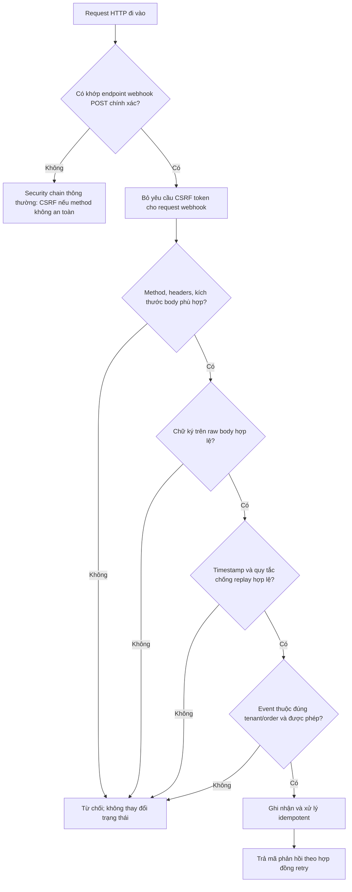

# Webhook có cơ chế xác minh riêng và ranh giới với trình duyệt

> **Chương:** Phạm vi kiểm tra CSRF  
> **Module:** `SPRING_SECURITY_HTTP_PROTECTION` — áp dụng các lớp phòng vệ HTTP và trình duyệt trong Spring Security, từ CSRF, CORS, security headers, CSP, HSTS đến HTTP firewall và session trên cả Servlet và Reactive.  
> **Chủ đề:** Tại sao webhook có thể được miễn CSRF token, điều kiện để miễn trừ có cơ sở, và cách giữ ranh giới an toàn với các request phát sinh từ trình duyệt.

## 1. Mục tiêu bài học

Kết thúc bài này, người học có thể:

1. Giải thích khác biệt giữa **CSRF trên trình duyệt** và **request webhook do máy chủ đối tác gửi**.
2. Định nghĩa hợp đồng webhook gồm method, route, cơ chế xác minh nguồn gửi, dữ liệu được ký, timestamp, chống phát lại và xử lý trùng.
3. Cấu hình ngoại lệ CSRF **đúng POST và đúng đường dẫn** trong Spring Security Servlet và WebFlux, đồng thời giữ bảo vệ cho các API sử dụng cookie của browser.
4. Xác minh HMAC trên **raw request body** trong ví dụ Servlet, hiểu cách xử lý body một lần trong luồng Reactive.
5. Nhận diện sai lầm về CORS, SameSite, Origin, IP allowlist, `permitAll`, session cookie fallback và các security chain.
6. Thiết kế kiểm thử chứng minh webhook hợp lệ được tiếp nhận, webhook giả mạo bị từ chối và form/browser API vẫn chịu kiểm tra CSRF.

## 2. Hai mô hình đe dọa cần tách biệt

**CSRF (Cross-Site Request Forgery)** xảy ra khi một trang do kẻ tấn công kiểm soát khiến **trình duyệt của người dùng** gửi một request đến ứng dụng mà trình duyệt tự gắn cookie session hoặc loại credential khác. Nếu request làm thay đổi trạng thái mà không kiểm tra ý định của người dùng, ứng dụng có thể thực thi thao tác trái phép.

Trong khi đó, **webhook** là một endpoint HTTP được thiết kế để **máy chủ bên ngoài** gửi sự kiện đến máy chủ ứng dụng, chẳng hạn thông báo thanh toán thành công, trạng thái đơn hàng hoặc kết quả xử lý của dịch vụ SaaS. Một webhook chuẩn thường không có phiên đăng nhập của người dùng và không lấy cookie của browser làm chứng cứ xác thực. Nó phải có **cơ chế xác minh riêng**, ví dụ chữ ký HMAC, chữ ký bất đối xứng, mTLS hoặc một cơ chế có xác thực nguồn tương đương theo hợp đồng của nhà cung cấp.

| Tiêu chí | Endpoint web dùng session cookie | Webhook server-to-server |
|---|---|---|
| Ai phát sinh request? | Trình duyệt của người dùng | Máy chủ nhà cung cấp sự kiện |
| Credential chủ yếu | Cookie session, cookie JWT hoặc Basic tự gửi | Chữ ký payload, mTLS hoặc credential máy–máy |
| Nguy cơ cần đối phó | Kẻ tấn công lợi dụng cookie do trình duyệt tự gắn | Giả mạo nguồn, sửa payload, phát lại hoặc gửi trùng sự kiện |
| Lớp phòng vệ chính cho thao tác POST | CSRF token, xác thực và phân quyền | Xác minh request, chống replay, ràng buộc nguồn và nghiệp vụ |
| Có thể miễn CSRF token? | Thường **không** nếu browser tự đính kèm credential | **Có thể**, khi hợp đồng máy–máy được triển khai và kiểm chứng |
| Vai trò của CORS | Giới hạn một số khả năng đọc/gửi request của script cross-origin | Không xác thực được máy chủ gửi webhook |
| Vai trò của cookie SameSite | Giảm một số đường đưa cookie vào request cross-site | Không phải cơ chế xác minh webhook |

Việc miễn CSRF cho webhook **không** có nghĩa webhook là endpoint “không cần bảo mật”. Chữ ký, tính mới, chống phát lại, phân quyền sự kiện và giới hạn tác động nghiệp vụ chính là hàng rào phải thực thi thay cho yêu cầu token CSRF của trình duyệt.

### 2.1. Vì sao một trang độc hại vẫn có thể gọi URL webhook?

Giả sử website của kẻ tấn công tự động gửi form:

```html
<form method="POST" action="https://shop.example/integrations/payment-events">
  <input name="orderId" value="42">
  <input name="status" value="PAID">
</form>
<script>document.forms[0].submit();</script>
```

Trình duyệt có thể gửi request HTTP, tùy chính sách browser và đích nhận. CORS không phải bộ lọc tổng quát cấm mọi form POST cross-site. Tuy nhiên, nếu server **xác minh chữ ký hợp lệ trên body thực tế** trước khi cập nhật đơn hàng, form giả mạo sẽ bị từ chối. Người tấn công không thể tự tạo chữ ký hợp lệ nếu không biết khóa hoặc không có khả năng ký của nhà cung cấp.

Một endpoint webhook được miễn CSRF nhưng chỉ kiểm tra `orderId` và `status` từ request sẽ có lỗ hổng giả mạo nghiêm trọng. **Miễn trừ CSRF chỉ an toàn khi xác minh webhook thực sự hoạt động và không có đường tắt.**

### 2.2. Đường biên sai: dùng chung webhook và API của trình duyệt

Ví dụ không nên có:

- `POST /api/payments/update` vừa nhận form từ dashboard quản trị xác thực bằng session cookie, vừa nhận sự kiện thanh toán từ bên ngoài;
- cấu hình `csrf.ignoringRequestMatchers("/api/payments/**")` để “cho webhook hoạt động”;
- controller chấp nhận **hoặc** chữ ký webhook hợp lệ **hoặc** user session đăng nhập.

Như vậy, cùng một ngoại lệ CSRF có thể bao phủ **nhánh xác thực bằng cookie**, tạo nguy cơ CSRF. Thiết kế rõ ràng hơn:

- `POST /integrations/payment-events`: webhook chỉ dựa vào chữ ký/credential của nhà cung cấp;
- `POST /admin/payments/{id}/adjust`: thao tác quản trị dùng session cookie, **bắt buộc có CSRF token** và quyền quản trị;
- hai endpoint có service nghiệp vụ chung nếu cần, nhưng cách xác thực ở biên HTTP phải tách biệt.

## 3. Hợp đồng xác minh webhook: những điều cần chốt trước khi cấu hình

Trước khi viết `ignoringRequestMatchers`, ghi lại hợp đồng đối tác:

| Thành phần | Câu hỏi cần có câu trả lời |
|---|---|
| Method và path | Chính xác `POST /integrations/payment-events` hay còn method/route khác? |
| Nguồn sự kiện | Nhà cung cấp/tenant nào được gửi? Làm sao nhận diện họ? |
| Phương pháp xác thực | HMAC theo secret chia sẻ, khóa công khai, mTLS hay giao thức ký khác? |
| Thứ được ký | Raw body, timestamp, HTTP method, path, event ID hay chuỗi chuẩn hóa theo tài liệu bên gửi? |
| Header | Tên header chữ ký, timestamp, key ID, event ID; encoding Base64 hay hex? |
| Tính mới | Cửa sổ timestamp cho phép; xử lý chênh lệch đồng hồ ra sao? |
| Chống phát lại | Event ID/nonce, bảng lưu bền và ràng buộc duy nhất, thời hạn lưu? |
| Xử lý trùng | Sự kiện được gửi lại phải được xử lý idempotent như thế nào? |
| Phân quyền nghiệp vụ | Event có thuộc đúng tenant, order, merchant và trạng thái hợp lệ không? |
| Xác thực không được chấp nhận | Cookie session của browser, cookie JWT hoặc fallback Basic? |
| Trả lời nhà cung cấp | Khi nào 2xx, khi nào 4xx/5xx, quy tắc retry của bên gửi? |
| Vận hành | Xoay khóa, metric lỗi chữ ký/replay, audit log không lộ secret, kiểm thử khi nâng cấp? |

**Không có một chuẩn HMAC duy nhất cho mọi webhook.** Một số dịch vụ ký raw body, một số ký timestamp và body, một số sử dụng khóa bất đối xứng hoặc định dạng header phức tạp. Trong ví dụ dưới đây, ta **tự định nghĩa hợp đồng minh họa** để giải thích kỹ thuật; khi tích hợp thật, phải làm đúng giao thức của nhà cung cấp.

### 3.1. Hợp đồng minh họa cho bài học

Giả sử nhà cung cấp gửi:

```http
POST /integrations/payment-events HTTP/1.1
Host: shop.example
Content-Type: application/json
X-Hook-Timestamp: 1795665600
X-Hook-Event-Id: evt_9c1
X-Hook-Signature: <Base64 HMAC-SHA256>

{"id":"evt_9c1","type":"payment.completed","orderId":"ord_42"}
```

Quy ước của ví dụ:

```text
signedBytes = ASCII(X-Hook-Timestamp) || ASCII(".") || rawRequestBody
signature   = Base64(HMAC-SHA256(secret, signedBytes))
```

Server cần:

1. Kiểm tra method, path, giới hạn kích thước request và schema header.
2. Kiểm tra timestamp đủ mới theo thời gian server, chẳng hạn không quá 5 phút trong quá khứ và không quá 1 phút trong tương lai (các ngưỡng là ví dụ, phụ thuộc bên gửi).
3. Tính lại HMAC trên **đúng bytes body đã nhận**, không parse JSON rồi serialize lại.
4. So sánh byte chữ ký theo cách giảm rò rỉ thời gian, dùng khóa được cấp cho đúng nhà cung cấp/tenant.
5. Chỉ khi chữ ký hợp lệ mới parse sự kiện, kiểm tra event ID, tenant, order, trạng thái và chống phát lại.
6. Xử lý idempotent, ghi nhận kết quả bền vững trước khi phản hồi thành công.

Chữ ký hợp lệ chứng minh request do bên nắm secret/khóa tương ứng tạo ra và nội dung được ký không thay đổi. Nó **không tự chứng minh** giao dịch kinh doanh hợp lệ, không tự chặn replay và không thể cứu hệ thống khi secret bị lộ.

## 4. Đường đi xử lý yêu cầu: CSRF exemption trước, xác minh riêng sau



Sơ đồ thể hiện **quy tắc xử lý logic**, không ngụ ý mọi framework gọi kiểm tra đúng theo thứ tự trên: một số bước như header validation, authentication, authorization hoặc HTTP firewall có thể chạy sớm hơn tùy security chain. Điều kiện an toàn bắt buộc là **không thực hiện tác động nghiệp vụ trước khi request được xác minh đầy đủ**.

### 4.1. CSRF exemption không phải `permitAll`

Hai quyết định khác nhau:

- **CSRF:** Có yêu cầu chứng minh token CSRF của session/browser không?
- **Authorization:** Security chain có cho request đi tiếp để chính ứng dụng kiểm tra chữ ký hay không?

Nếu webhook không có Spring Security principal và được xác thực bằng chữ ký ở controller/service, thường phải cho phép request tới điểm kiểm tra, ví dụ một rule `permitAll` **đúng endpoint POST**. Sau đó, controller/service **bắt buộc** xác minh chữ ký và từ chối trước side effect nếu thất bại. `permitAll` không tự làm webhook an toàn.

Nếu chữ ký được xác minh trong custom authentication filter và tạo principal có quyền phù hợp, authorization có thể yêu cầu principal đó; dù lựa chọn nào, không được thiết kế đường “không có chữ ký nhưng có session cookie vẫn được xử lý”.

## 5. Spring Security Servlet: miễn đúng endpoint, giữ CSRF cho browser

Với Spring MVC/Servlet, `CsrfFilter` đánh giá rule trong `HttpSecurity`. Ví dụ sau giả định ứng dụng dùng `DispatcherServlet` với mapping `/` để `getServletPath()` trả về route nội bộ đúng như mô tả.

```java
import org.springframework.context.annotation.Bean;
import org.springframework.context.annotation.Configuration;
import org.springframework.security.config.annotation.web.builders.HttpSecurity;
import org.springframework.security.web.SecurityFilterChain;
import org.springframework.security.web.util.matcher.RequestMatcher;

@Configuration
class SecurityConfig {

    @Bean
    SecurityFilterChain applicationSecurity(HttpSecurity http) throws Exception {
        RequestMatcher paymentWebhookPost = request ->
            "POST".equals(request.getMethod())
                && "/integrations/payment-events".equals(
                    request.getServletPath());

        http
            .csrf(csrf -> csrf
                .ignoringRequestMatchers(paymentWebhookPost))
            .authorizeHttpRequests(auth -> auth
                .requestMatchers(paymentWebhookPost).permitAll()
                .anyRequest().authenticated());

        return http.build();
    }
}
```

Điều kiện `method == POST AND path == /integrations/payment-events` có ý nghĩa:

| Request | CSRF token có bắt buộc theo mặc định? | Lý do |
|---|---|---|
| `POST /integrations/payment-events` | Không | Khớp ngoại lệ webhook |
| `PUT /integrations/payment-events` | Có | Method khác POST |
| `POST /integrations/payment-events/test` | Có | Path khác |
| `POST /integrations/payment-events-extra` | Có | Path khác |
| `POST /orders` | Có | Endpoint web thông thường |
| `PATCH /account/email` | Có | Không liên quan webhook |
| `GET /integrations/payment-events` | Không | GET an toàn theo quy tắc method, **không phải** do ngoại lệ webhook |

`permitAll` cho POST callback chỉ mở đường để ứng dụng nhận và kiểm tra chữ ký. Các request sai chữ ký **phải bị từ chối** bởi trình xác minh webhook.

Tránh các cấu hình sau nếu trong ứng dụng có request browser xác thực bằng cookie:

```java
// Rộng hơn hợp đồng của nhà cung cấp:
http.csrf(csrf -> csrf.ignoringRequestMatchers("/integrations/**"));

// Có thể làm API dùng cookie mất bảo vệ:
http.csrf(csrf -> csrf.ignoringRequestMatchers("/api/**"));

// Tắt kiểm tra CSRF của cả chain:
http.csrf(csrf -> csrf.disable());
```

Các ví dụ này minh họa cấu hình **không nên dùng** trên chain hỗn hợp. Khi có context path, servlet mapping tùy chỉnh hoặc proxy rewrite, matcher phải theo **đường dẫn mà ứng dụng thực sự nhận được**, và kiểm thử lại trên môi trường triển khai tương ứng.

### 5.1. Xác minh HMAC trên raw body bằng Java

Dưới đây là một bộ xác minh dùng cho **hợp đồng minh họa ở mục 3.1**. Nó nhận khóa dưới dạng byte từ cấu hình an toàn, dùng `Clock` để kiểm thử được, kiểm tra timestamp rồi đối chiếu chữ ký trên body gốc.

```java
import java.nio.charset.StandardCharsets;
import java.security.GeneralSecurityException;
import java.security.MessageDigest;
import java.time.Clock;
import java.util.Base64;
import javax.crypto.Mac;
import javax.crypto.spec.SecretKeySpec;

public final class PaymentWebhookVerifier {
    private static final long MAX_PAST_SECONDS = 300L;
    private static final long MAX_FUTURE_SECONDS = 60L;

    private final SecretKeySpec secretKey;
    private final Clock clock;

    public PaymentWebhookVerifier(byte[] secret, Clock clock) {
        this.secretKey = new SecretKeySpec(
            secret.clone(), "HmacSHA256");
        this.clock = clock;
    }

    public boolean verify(
            byte[] rawBody,
            String timestampHeader,
            String signatureHeader) {

        if (rawBody == null
                || timestampHeader == null
                || signatureHeader == null) {
            return false;
        }

        final long issuedAt;
        final byte[] suppliedSignature;
        try {
            issuedAt = Long.parseLong(timestampHeader);
            suppliedSignature =
                Base64.getDecoder().decode(signatureHeader);
        } catch (IllegalArgumentException ex) {
            return false;
        }

        long now = clock.instant().getEpochSecond();
        if (issuedAt < now - MAX_PAST_SECONDS
                || issuedAt > now + MAX_FUTURE_SECONDS) {
            return false;
        }

        try {
            Mac mac = Mac.getInstance("HmacSHA256");
            mac.init(secretKey);
            mac.update(
                timestampHeader.getBytes(StandardCharsets.US_ASCII));
            mac.update((byte) '.');
            byte[] expectedSignature = mac.doFinal(rawBody);

            return MessageDigest.isEqual(
                expectedSignature, suppliedSignature);
        } catch (GeneralSecurityException ex) {
            throw new IllegalStateException(
                "Unable to verify payment webhook", ex);
        }
    }
}
```

Các điểm không được bỏ qua:

- **Chữ ký được tính từ raw bytes**. Nếu JSON được parse rồi serialize lại, thứ tự field, khoảng trắng hoặc encoding có thể đổi và khiến phép xác minh sai.
- **Không hard-code secret** vào source code. Lấy từ secret manager/config an toàn, quản lý quyền và quy trình xoay khóa.
- `MessageDigest.isEqual` dùng để đối chiếu byte mà không dựa vào so sánh chuỗi thông thường. Giá trị Base64 phải được decode đúng định dạng theo hợp đồng.
- **Timestamp không đủ để chặn replay**: cùng request hợp lệ vẫn có thể được gửi lại trong cửa sổ thời gian. Cần một tầng chống phát lại và idempotency ở nghiệp vụ.
- Ví dụ dùng một secret. Nếu tích hợp nhiều nhà cung cấp, phải chọn đúng secret theo **cấu hình nguồn đáng tin và key ID đã kiểm chứng**, không tự tin vào mọi tên tenant do request tự khai.
- Luồng thật cần giới hạn request body và headers, kiểm tra độ dài/format timestamp, loại bỏ request quá lớn trước khi cấp phát bộ nhớ không kiểm soát.
- Một số nhà cung cấp yêu cầu ký thêm method, path hoặc ID; khi đó phải thay đổi bytes được ký theo **đặc tả chính thức của họ**.

### 5.2. Controller kiểm tra chữ ký trước khi xử lý

Ví dụ minh họa luồng gọi. `PaymentEventService` phải kiểm tra event ID, tenant và trạng thái đơn hàng, thực thi chống replay/idempotency trước khi thay đổi dữ liệu.

```java
import org.springframework.http.HttpStatus;
import org.springframework.http.ResponseEntity;
import org.springframework.web.bind.annotation.*;
import org.springframework.web.server.ResponseStatusException;

@RestController
class PaymentWebhookController {

    private final PaymentWebhookVerifier verifier;
    private final PaymentEventService eventService;

    PaymentWebhookController(
            PaymentWebhookVerifier verifier,
            PaymentEventService eventService) {
        this.verifier = verifier;
        this.eventService = eventService;
    }

    @PostMapping("/integrations/payment-events")
    ResponseEntity<Void> receive(
            @RequestBody byte[] rawBody,
            @RequestHeader("X-Hook-Timestamp") String timestamp,
            @RequestHeader("X-Hook-Signature") String signature) {

        if (!verifier.verify(rawBody, timestamp, signature)) {
            throw new ResponseStatusException(
                HttpStatus.UNAUTHORIZED, "Invalid webhook signature");
        }

        // Chỉ parse và cập nhật khi đã xác minh chữ ký.
        eventService.acceptVerifiedEvent(rawBody);

        return ResponseEntity.noContent().build();
    }
}
```

Ở ví dụ trên, controller không được xử lý nội dung sự kiện chỉ vì client có session cookie hoặc đã đi qua `permitAll`. Nếu nhận request qua proxy, cần kiểm tra proxy có giữ nguyên body bytes mà hợp đồng ký áp dụng hay không. Không log secret, raw bearer token hoặc toàn bộ body nhạy cảm để điều tra lỗi.

## 6. Reactive WebFlux: ranh giới tương đương, API khác Servlet

WebFlux dùng `CsrfWebFilter` và `SecurityWebFilterChain`. `ServerWebExchangeMatcher` quyết định yêu cầu CSRF cho từng request. Một cách diễn đạt ngoại lệ hẹp là giữ toàn bộ unsafe methods và loại đúng POST webhook:

```java
import org.springframework.context.annotation.Bean;
import org.springframework.http.HttpMethod;
import org.springframework.security.config.web.server.ServerHttpSecurity;
import org.springframework.security.web.server.SecurityWebFilterChain;
import org.springframework.security.web.server.util.matcher.ServerWebExchangeMatcher;

@Bean
SecurityWebFilterChain webFluxSecurity(ServerHttpSecurity http) {
    ServerWebExchangeMatcher requireCsrf = exchange -> {
        HttpMethod method = exchange.getRequest().getMethod();
        String path = exchange.getRequest()
            .getPath().pathWithinApplication().value();

        boolean safeMethod =
            method == HttpMethod.GET
                || method == HttpMethod.HEAD
                || method == HttpMethod.OPTIONS
                || method == HttpMethod.TRACE;

        boolean paymentWebhookPost =
            method == HttpMethod.POST
                && "/integrations/payment-events".equals(path);

        return !safeMethod && !paymentWebhookPost
            ? ServerWebExchangeMatcher.MatchResult.match()
            : ServerWebExchangeMatcher.MatchResult.notMatch();
    };

    http
        .csrf(csrf -> csrf
            .requireCsrfProtectionMatcher(requireCsrf))
        .authorizeExchange(auth -> auth
            .pathMatchers(
                HttpMethod.POST, "/integrations/payment-events")
                .permitAll()
            .anyExchange().authenticated());

    return http.build();
}
```

**Điểm khác với Servlet:** cấu hình WebFlux trong ví dụ thay matcher yêu cầu CSRF bằng biểu thức `unsafeMethod AND NOT exactWebhook`. Không copy `RequestMatcher` hoặc `ignoringRequestMatchers` của Servlet sang `ServerHttpSecurity` rồi kỳ vọng hai API giống nhau.

Ở handler WebFlux, body là stream chỉ được tiêu thụ đúng cách một lần. Có thể lấy body thành `Mono<byte[]>` trong controller, xác minh chữ ký trước khi parse JSON và gọi service reactive:

```java
import org.springframework.http.HttpStatus;
import org.springframework.http.ResponseEntity;
import org.springframework.web.bind.annotation.*;
import org.springframework.web.server.ResponseStatusException;
import reactor.core.publisher.Mono;

@RestController
class ReactivePaymentWebhookController {

    private final PaymentWebhookVerifier verifier;
    private final ReactivePaymentEventService eventService;

    ReactivePaymentWebhookController(
            PaymentWebhookVerifier verifier,
            ReactivePaymentEventService eventService) {
        this.verifier = verifier;
        this.eventService = eventService;
    }

    @PostMapping("/integrations/payment-events")
    Mono<ResponseEntity<Void>> receive(
            @RequestBody Mono<byte[]> body,
            @RequestHeader("X-Hook-Timestamp") String timestamp,
            @RequestHeader("X-Hook-Signature") String signature) {

        return body.flatMap(rawBody -> {
            if (!verifier.verify(rawBody, timestamp, signature)) {
                return Mono.error(new ResponseStatusException(
                    HttpStatus.UNAUTHORIZED, "Invalid signature"));
            }

            // Xác minh xong mới parse và xử lý sự kiện.
            return eventService.acceptVerifiedEvent(rawBody)
                .thenReturn(ResponseEntity.noContent().build());
        });
    }
}
```

`ReactivePaymentEventService.acceptVerifiedEvent` ở đây được giả định trả `Mono<Void>`. Ví dụ chỉ mô tả pipeline; dự án thực tế cần bean verifier/service và giới hạn dung lượng body. Khi nội dung webhook lớn hoặc có xử lý crypto CPU-intensive đáng kể, đánh giá giới hạn tài nguyên và scheduler phù hợp; không tự ý đọc body trước ở một WebFilter rồi mong controller đọc lại được nếu chưa có cơ chế cache an toàn.

Với Servlet hay Reactive, nếu endpoint webhook thuộc nhiều security chain, phải kiểm tra **chain nào thực sự nhận request** và matcher ở chain đó. Một chain dành cho browser dùng cookie vẫn phải giữ CSRF; chain webhook có thể xử lý riêng nhưng phải có xác minh nguồn gửi.

## 7. Chống phát lại và xử lý trùng khác gì CSRF?

Webhook đáng tin **có thể được gửi lại** khi nhà cung cấp không nhận được phản hồi 2xx, ứng dụng timeout hoặc mạng gián đoạn. Kẻ tấn công cũng có thể phát lại một request đã ghi được nếu hệ thống chỉ xác minh chữ ký.

Ba vấn đề cần phân biệt:

| Vấn đề | Biện pháp |
|---|---|
| Kẻ tấn công sửa body hoặc tự tạo sự kiện | Chữ ký HMAC/PKI trên nội dung theo hợp đồng |
| Kẻ tấn công gửi lại request đã ký còn hiệu lực | Timestamp + event ID/nonce + lưu chống replay |
| Nhà cung cấp gửi lại sự kiện hợp lệ nhiều lần | Xử lý idempotent, trạng thái giao dịch và phản hồi retry phù hợp |

### 7.1. Vì sao chỉ kiểm tra timestamp là chưa đủ?

Giả sử cửa sổ hợp lệ 5 phút. Một request có chữ ký đúng và timestamp 30 giây trước vẫn hợp lệ khi gửi lần thứ hai hoặc thứ mười. Nếu mỗi lần nhận `payment.completed` đều cộng tiền vào ví hoặc tăng số lượng hàng, hệ thống sẽ sai dù HMAC và timestamp đều hợp lệ.

Giải pháp thường dùng: nhà cung cấp gán **event ID duy nhất**. Server kiểm tra chữ ký trước, sau đó lưu `(provider, eventId)` với unique constraint. Xử lý sự kiện và cập nhật trạng thái cần liên kết bằng giao dịch/thiết kế inbox đáng tin cậy để tránh hai worker xử lý đồng thời.

```sql
CREATE TABLE received_webhook_events (
    provider      VARCHAR(80) NOT NULL,
    event_id      VARCHAR(160) NOT NULL,
    received_at   TIMESTAMP NOT NULL,
    PRIMARY KEY (provider, event_id)
);
```

Bảng trên chỉ minh họa ràng buộc duy nhất. Cách đảm bảo **atomicity** phụ thuộc kiến trúc:

- Nếu xử lý đồng bộ, chèn event ID và cập nhật trạng thái trong một transaction khi có thể.
- Nếu đẩy vào queue, lưu payload đã xác minh và event ID bền vững trước khi ack; worker xử lý theo trạng thái/idempotency riêng.
- Không đơn thuần dùng `if (!exists) insert` ngoài transaction vì hai request đồng thời có thể vượt qua kiểm tra rồi cùng xử lý.
- Sự kiện trùng đã xử lý thường có thể trả phản hồi thành công theo hợp đồng nhà cung cấp, nhưng **không lặp side effect**.
- Retention của event ID phải bao phủ nguy cơ replay/retry thực tế; xóa quá sớm làm mở lại cửa sổ xử lý trùng.

### 7.2. Bảo vệ nghiệp vụ sau khi xác minh chữ ký

Một request được ký đúng vẫn có thể chứa:

- Event thuộc merchant/tenant khác.
- Order ID không tồn tại hoặc không thuộc nhà cung cấp đã xác minh.
- Chuyển trạng thái ngược từ `PAID` về `PENDING` do sự kiện đến lệch thứ tự.
- Số tiền/đơn vị tiền tệ không khớp order.
- Loại event không thuộc tập được phép.
- Dữ liệu không hợp lệ hoặc quá lớn gây tốn tài nguyên.

Do đó, **xác minh nguồn gửi** và **quyền tác động lên tài nguyên** là hai kiểm tra riêng. Với thanh toán, đối chiếu mã giao dịch, merchant, amount/currency và state machine của đơn hàng; có thể cần đối chiếu server-to-server với nhà cung cấp trong trường hợp nhạy cảm.

## 8. CORS, SameSite, Origin và security headers nằm ở đâu?

Các cơ chế phòng vệ trình duyệt vẫn quan trọng với phần web của hệ thống, nhưng chúng **không thay thế xác minh webhook**:

- **CORS:** điều chỉnh khả năng script cross-origin đọc response hoặc gửi một số request có preflight. Máy chủ đối tác không bị cơ chế CORS của trình duyệt ràng buộc. Không cần bật `Access-Control-Allow-Origin: *` cho webhook chỉ để server-to-server gọi được.
- **SameSite cookie:** giảm một số trường hợp gửi cookie cross-site, nhưng webhook chuẩn không dựa trên browser cookie; vẫn cần CSRF cho những route browser thay đổi trạng thái.
- **Origin/Referer:** hữu ích như tín hiệu phòng vệ cho request browser trong một số kiến trúc, nhưng có thể thiếu ở server-to-server request và không phải chữ ký xác thực nguồn webhook.
- **CSP:** giảm một số rủi ro tải/chạy nội dung trên trang web; không xác thực webhook.
- **HSTS và HTTPS/TLS:** bảo vệ vận chuyển và giảm nguy cơ can thiệp trên đường truyền; không bảo đảm một POST đến URL webhook là sự kiện thật từ nhà cung cấp.
- **HTTP firewall:** giảm request path bất thường/không chuẩn; không xác minh chữ ký hay ngăn replay hợp lệ về mặt cấu trúc.
- **Authentication/authorization và session:** phải xác định đường nào cho phép cookie/browser principal. Không tạo fallback từ xác minh chữ ký thất bại sang session cookie.

Với browser endpoint, các lớp trên phối hợp để bảo vệ người dùng. Với webhook, mấu chốt là **chủ thể máy–máy được xác minh độc lập** và request không thừa hưởng quyền của phiên trình duyệt.

## 9. Kiểm thử ranh giới webhook–trình duyệt

Một bộ kiểm thử có giá trị phải trả lời cả ba câu hỏi:

1. Webhook hợp lệ **có thể gọi** mà không có CSRF token không?
2. Webhook giả mạo hoặc phát lại **bị chặn trước side effect** không?
3. Endpoint browser dùng session vẫn **bắt buộc CSRF token** không?

### 9.1. Ma trận kiểm thử bắt buộc

| Request | Điều cần xác minh |
|---|---|
| `POST /integrations/payment-events`, chữ ký hợp lệ, không CSRF token | Được kiểm tra chữ ký và xử lý sự kiện một lần |
| Cùng POST, thiếu chữ ký | Bị từ chối; không thay đổi đơn hàng |
| Cùng POST, chữ ký sai | Bị từ chối |
| Cùng POST, body bị sửa sau khi ký | Bị từ chối |
| Cùng POST, timestamp quá hạn/tương lai bất thường | Bị từ chối |
| Cùng POST, event ID đã xử lý | Không lặp side effect; phản hồi theo hợp đồng retry |
| Cùng POST, chữ ký đúng nhưng sai tenant/order | Bị từ chối ở kiểm tra nghiệp vụ |
| `PUT /integrations/payment-events`, không CSRF token | Không thuộc ngoại lệ POST; vẫn theo CSRF mặc định |
| `POST /integrations/payment-events/test`, không token | Không thuộc ngoại lệ path chính xác |
| `POST /account/email`, session hợp lệ, không CSRF token | Bị chặn CSRF |
| `POST /account/email`, session hợp lệ, token sai | Bị chặn CSRF |
| `POST /account/email`, session hợp lệ, token đúng | Đi tiếp tới authentication/authorization/nghiệp vụ |
| POST webhook chỉ có session cookie, không chữ ký | **Bị từ chối**, không dùng cookie để bỏ kiểm tra chữ ký |
| Webhook có chữ ký sai nhưng kèm cookie hợp lệ | **Bị từ chối**, không fallback sang session |
| Webhook qua proxy/context path khác | Đường dẫn nội bộ vẫn khớp đúng ngoại lệ đã định |

Cần kiểm tra *kết quả cuối cùng và nguồn từ chối*. Một response 403 có thể đến từ CSRF, authorization hoặc logic chữ ký; không suy diễn nguyên nhân chỉ từ HTTP status.

### 9.2. Ví dụ kiểm thử với MockMvc

Các test bên dưới giả định cấu hình `SecurityFilterChain` đã được gắn vào MockMvc và controller có kiểm tra chữ ký như mục 5.2. Trường hợp browser dùng test user để bảo đảm request không bị từ chối bởi thiếu authentication trước khi xét CSRF.

```java
import static java.nio.charset.StandardCharsets.UTF_8;
import static org.springframework.security.test.web.servlet.request.SecurityMockMvcRequestPostProcessors.user;
import static org.springframework.test.web.servlet.request.MockMvcRequestBuilders.post;
import static org.springframework.test.web.servlet.request.MockMvcRequestBuilders.put;
import static org.springframework.test.web.servlet.result.MockMvcResultMatchers.status;

@Test
void browserPostWithoutCsrfIsRejected() throws Exception {
    mockMvc.perform(post("/account/email")
            .with(user("alice"))
            .contentType("application/json")
            .content("{\"email\":\"new@example.test\"}"))
        .andExpect(status().isForbidden());
}

@Test
void forgedWebhookCannotChangeState() throws Exception {
    mockMvc.perform(post("/integrations/payment-events")
            .contentType("application/json")
            .content("{}".getBytes(UTF_8))
            .header("X-Hook-Timestamp", "1795665600")
            .header("X-Hook-Signature", "bad-signature"))
        .andExpect(status().isUnauthorized());
}

@Test
void differentMethodIsNotExempt() throws Exception {
    mockMvc.perform(put("/integrations/payment-events")
            .with(user("alice")))
        .andExpect(status().isForbidden());
}
```

Ví dụ giả định endpoint web và quyền test user phù hợp. Bộ test thực tế còn cần tạo một webhook có **chữ ký hợp lệ bằng test secret**, timestamp phù hợp với `Clock` giả lập, sự kiện mới, rồi kiểm tra response và đúng **một** lần thay đổi trạng thái. Với test body bị sửa, ký body A rồi gửi body B để chứng minh chữ ký thật sự ràng buộc nội dung.

Nếu dùng timestamp cố định như minh họa ở test chữ ký sai, kết quả 401 có thể do timestamp quá hạn; để chứng minh **đúng nhánh chữ ký sai**, dùng `Clock` giả lập hoặc sinh timestamp hiện tại trong fixture. Tách unit test cho mỗi nguyên nhân giúp phân biệt lỗi.

### 9.3. Ví dụ kiểm thử WebFlux với WebTestClient

```java
import static org.springframework.security.test.web.reactive.server.SecurityMockServerConfigurers.mockUser;

@Test
void reactiveBrowserPostStillRequiresCsrf() {
    webTestClient.mutateWith(mockUser("alice"))
        .post().uri("/account/email")
        .bodyValue("{\"email\":\"new@example.test\"}")
        .exchange()
        .expectStatus().isForbidden();
}

@Test
void reactiveWebhookWithoutValidSignatureIsRejected() {
    webTestClient.post()
        .uri("/integrations/payment-events")
        .header("X-Hook-Timestamp", "1795665600")
        .header("X-Hook-Signature", "bad-signature")
        .bodyValue("{}")
        .exchange()
        .expectStatus().isUnauthorized();
}
```

Kiểm thử positive tương tự: cấp body và chữ ký đúng từ test fixture, không CSRF token, bảo đảm request đi đến service chỉ một lần. Thêm test đường dẫn gần giống hoặc method PUT để xác nhận `ServerWebExchangeMatcher` không miễn trừ rộng.

**Cách đọc kết quả:** một webhook thiếu token nhưng có chữ ký sai bị 401 là tín hiệu tốt **chỉ khi** chính xác nhánh xác minh chữ ký đã chạy. Nếu bị 403 do CSRF, ngoại lệ có thể không khớp; nếu 2xx dù chữ ký sai, đây là lỗi nghiêm trọng. Quan sát log/tracing có kiểm soát và trạng thái dữ liệu để xác nhận.

## 10. Các lỗi thường gặp trong triển khai

### Lỗi 1 — Xem webhook là public endpoint không cần xác minh

`permitAll` và bỏ CSRF khiến POST nào cũng được controller nhận. Nếu controller cập nhật đơn hàng từ JSON chưa ký, kẻ tấn công có thể giả sự kiện.

**Khắc phục:** áp dụng verifier trước mọi side effect, kiểm tra quyền tài nguyên và test chữ ký sai.

### Lỗi 2 — Ký JSON đã parse rồi serialize lại

Khoảng trắng, thứ tự key, escape Unicode hoặc line ending có thể thay đổi bytes. Việc tính HMAC trên biểu diễn tự tạo có thể khiến webhook thật bị từ chối hoặc sai hợp đồng ký.

**Khắc phục:** dùng raw body đúng theo hợp đồng; không tự nghĩ ra canonicalization.

### Lỗi 3 — Chỉ kiểm tra header tồn tại

`X-Hook-Signature` có mặt không có nghĩa chữ ký đúng. Đầu vào vẫn do client cung cấp.

**Khắc phục:** decode chữ ký, tính lại MAC theo khóa đã quản lý và so sánh an toàn.

### Lỗi 4 — Chỉ chống replay bằng timestamp

Trong cửa sổ vài phút, một request đã ký vẫn có thể được gửi nhiều lần.

**Khắc phục:** event ID/nonce, lưu bền và ràng buộc unique; xử lý idempotent theo trạng thái nghiệp vụ.

### Lỗi 5 — Miễn trừ toàn bộ `/api/**` hoặc `/hooks/**`

Phạm vi wildcard vô tình bao gồm endpoint do browser gọi bằng cookie, endpoint quản trị hoặc route mới.

**Khắc phục:** khớp **đúng method + route**; tách route/chain theo client và cơ chế xác thực.

### Lỗi 6 — Cho phép session cookie làm đường xác thực dự phòng

Webhook chữ ký sai nhưng user đã đăng nhập vẫn được xử lý theo quyền session; đây là lỗ hổng nguy hiểm khi CSRF đã bị miễn.

**Khắc phục:** webhook chỉ nhận đúng cơ chế xác minh đối tác; tách route và không rẽ nhánh sang cookie.

### Lỗi 7 — Nhầm CORS, IP allowlist hoặc SameSite với xác thực webhook

CORS là chính sách của trình duyệt, IP có thể đi qua proxy/NAT hoặc thay đổi, SameSite áp dụng cho cookie browser.

**Khắc phục:** xác minh chữ ký/mTLS theo hợp đồng; những lớp còn lại chỉ bổ sung khi thích hợp.

### Lỗi 8 — Không kiểm tra thứ tự filter và security chain

Một chain rộng bắt request trước khiến webhook đi vào chain khác; 403 có thể đến từ CSRF, HTTP firewall hoặc authorization.

**Khắc phục:** kiểm tra `securityMatcher`/`SecurityWebFilterChain`, route sau proxy, log filter và integration test đi qua toàn bộ security stack.

### Lỗi 9 — Chấp nhận request sau khi phát lỗi ghi nhận sự kiện

Service xử lý thành công nhưng gửi lại 5xx khiến đối tác retry; hoặc ack 2xx quá sớm trong khi hệ thống chưa lưu sự kiện, dẫn đến mất dữ liệu.

**Khắc phục:** thiết kế transaction/inbox, idempotency và ack theo cơ chế retry đã thống nhất; ghi nhận trạng thái bền trước khi phản hồi thành công phù hợp.

### Lỗi 10 — Lộ khóa hoặc thông tin ký trong log

Log raw body, secret, chữ ký, bearer token hoặc thông tin người dùng có thể tăng rủi ro rò rỉ và làm khả thi tấn công replay.

**Khắc phục:** chỉ log metadata tối thiểu cần vận hành, che thông tin nhạy cảm, thiết lập rotation và quyền đọc khóa tối thiểu.

## 11. Bài tập tình huống

Một hệ thống có:

- `POST /api/orders/pay`: browser gửi session cookie để bắt đầu thanh toán.
- `POST /api/payments/confirm`: vừa được dashboard quản trị gọi bằng cookie, vừa nhận callback từ cổng thanh toán.
- `POST /webhooks/payments`: cổng thanh toán cũng có thể gửi sự kiện đã ký HMAC.
- `GET /admin/orders/reconcile`: một đường dẫn GET đang **thực sự** kích hoạt đồng bộ trạng thái với nhà cung cấp.

Đội phát triển dự định bỏ CSRF cho `/api/payments/**` và `/webhooks/**` để hết lỗi 403.

**Yêu cầu:** Xác định rủi ro và thiết kế cách tiếp nhận sự kiện an toàn.

**Phân tích đáp án:**

1. `POST /api/orders/pay` do browser gửi cookie **cần CSRF token**, cùng authentication/authorization và kiểm tra quyền trên đơn hàng.
2. `POST /api/payments/confirm` **không nên dùng chung** đường cookie-session và callback máy–máy rồi miễn CSRF toàn bộ. Tách hành động admin sang route riêng dùng CSRF; webhook chuyển về endpoint riêng có chữ ký.
3. Chỉ miễn trừ **POST /webhooks/payments` nếu hợp đồng HMAC được xác minh trước nghiệp vụ. Không miễn trừ tất cả `/webhooks/**` chỉ vì thư mục đó thường chứa webhook.
4. `GET /admin/orders/reconcile` sai ngữ nghĩa HTTP vì thay đổi trạng thái; chuyển sang POST được bảo vệ CSRF và phân quyền quản trị.
5. Tạo test chứng minh: browser POST thiếu token bị chặn; webhook thiếu chữ ký bị từ chối; HMAC hợp lệ được xử lý một lần; replay không lặp side effect; đường dẫn gần giống không lọt ngoại lệ.
6. Khi triển khai sau proxy, kiểm tra lại path mà matcher thực sự so khớp và thứ tự security chain.

## 12. Checklist review webhook có miễn CSRF

- [ ] Đã phân biệt webhook server-to-server với endpoint do trình duyệt dùng session/cookie gọi.
- [ ] Ngoại lệ CSRF chỉ áp dụng đúng **method + path**; không dùng wildcard rộng nếu chưa có hợp đồng tương ứng.
- [ ] Không có nhánh xác thực fallback bằng cookie, cookie JWT hoặc HTTP Basic của browser trên webhook.
- [ ] Có cơ chế xác thực nguồn theo nhà cung cấp: HMAC/PKI/mTLS hoặc hợp đồng tương đương.
- [ ] Chữ ký được kiểm tra trên **đúng bytes/dữ liệu** mà nhà cung cấp ký; không parse rồi ký lại sai hợp đồng.
- [ ] Có kiểm tra timestamp và xử lý chênh lệch đồng hồ theo đặc tả.
- [ ] Có chống replay bằng event ID/nonce hoặc cơ chế phù hợp; xử lý trùng idempotent.
- [ ] Có kiểm tra tenant, order, amount/currency, loại event và state transition trước khi ghi dữ liệu.
- [ ] Đã giới hạn kích thước body, schema, timeout và tài nguyên xử lý.
- [ ] Secret được quản lý/rotate an toàn, không ghi vào mã nguồn hoặc log.
- [ ] Đã kiểm thử webhook hợp lệ, thiếu chữ ký, chữ ký sai, body bị sửa, timestamp sai và replay.
- [ ] Đã kiểm thử browser POST thiếu/sai/đúng CSRF token cùng cookie session.
- [ ] Đã kiểm thử method/path khác và URL dưới reverse proxy/servlet mapping khi có.
- [ ] Đã xác minh filter chain đúng ở cả Servlet và WebFlux; nhận diện nguồn 401/403 cụ thể.
- [ ] Đã hiểu vai trò độc lập của CORS, SameSite, CSP, HSTS, HTTP firewall và authorization.

**Ghi nhớ:** Webhook có thể được miễn CSRF **vì nó được xác thực như một request máy–máy bằng cơ chế độc lập, chứ không phải vì nó mang tên “webhook”**. Ranh giới an toàn gồm **đúng method, đúng path, không sử dụng phiên trình duyệt, kiểm tra chữ ký và ngăn replay trước khi thay đổi trạng thái**. Giữ CSRF cho mọi hành động browser dùng credential tự động gửi và kiểm thử cả hai bên của ranh giới đó.
