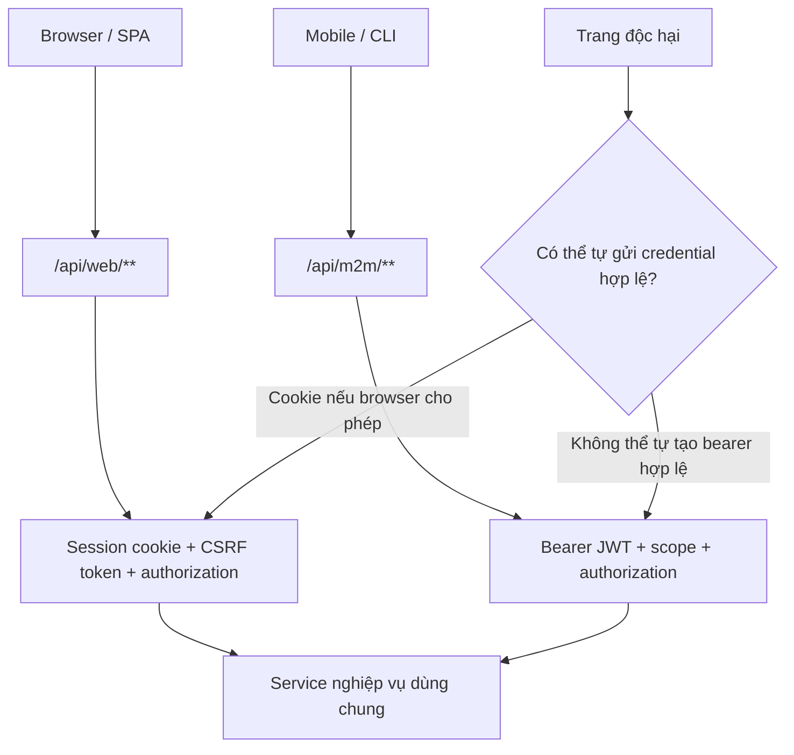

# API dùng bearer token cùng khu vực dùng cookie phiên

> **Chương:** Phạm vi kiểm tra CSRF  
> **Module:** `SPRING_SECURITY_HTTP_PROTECTION` — phòng vệ HTTP và trình duyệt trong Spring Security trên Servlet lẫn Reactive.  
> **Trọng tâm:** Ranh giới CSRF khi một ứng dụng đồng thời phục vụ API dùng bearer token trong header và giao diện web dùng session cookie, đặc biệt khi cả hai cùng nằm trong vùng `/api/**`.

## 1. Mục tiêu học tập

Sau bài học, người học có thể:

1. Phân biệt credential **do trình duyệt tự động gửi** với credential **do client chủ động đặt vào request** và liên hệ trực tiếp với nguy cơ CSRF.
2. Giải thích vì sao bearer token trong `Authorization` có thể không cần CSRF token ở một API bearer-only, còn JWT nằm trong cookie vẫn có nguy cơ CSRF.
3. Nhận diện API dùng chung session và bearer, đường fallback xác thực, các matcher quá rộng hoặc security chain sai thứ tự.
4. Cấu hình tách `SecurityFilterChain` trên Spring MVC/Servlet và `SecurityWebFilterChain` trên Spring WebFlux/Reactive.
5. Xác minh đúng ranh giới bằng kiểm thử có session cookie hợp lệ nhưng không có bearer, bearer sai nhưng có cookie, và các request browser thiếu/sai/đúng CSRF token.
6. Chẩn đoán 401/403/302 khi CSRF, CORS, session, scope, security headers và HTTP firewall cùng ảnh hưởng request.

Bài này tập trung vào **đường xác thực và phạm vi bảo vệ CSRF**. Quy tắc mặc định của Spring Security khi bật CSRF là yêu cầu token cho các HTTP method khác `GET`, `HEAD`, `OPTIONS` và `TRACE`. Đó là quy tắc theo HTTP method; nó không tự nhận ra JWT nằm ở cookie hay header.

## 2. Mô hình đe dọa: bearer header và cookie khác nhau ở đâu?

**CSRF (Cross-Site Request Forgery)** xảy ra khi một website do kẻ tấn công kiểm soát có thể khiến browser nạn nhân gửi request mang credential mà browser tự động đính kèm tới ứng dụng, qua đó gây ra hành động người dùng không chủ động yêu cầu.

Một request có `JSESSIONID` hoặc cookie mang JWT có thể được browser tự gắn theo các quy tắc cookie hiện hành. Kẻ tấn công không cần biết giá trị cookie và thường cũng không cần đọc response. Vì vậy, endpoint thay đổi trạng thái **chấp nhận cookie làm authentication** phải có phòng vệ CSRF phù hợp.

Với bearer-only API, access token thường được mobile/CLI hoặc mã JavaScript của ứng dụng hợp lệ **chủ động thêm** vào header `Authorization: Bearer ...`. Một form HTML cross-site thông thường không thể tự tạo access token hợp lệ của người dùng trong header đó. Do đó API có thể không cần CSRF token **khi server chỉ chấp nhận bearer header và không có nhánh xác thực ambient khác**.

| Mô hình | Credential thực tế | Ai gắn credential? | CSRF với request thay đổi trạng thái |
|---|---|---|---|
| HTML form + Spring session | `JSESSIONID` hoặc cookie session tương đương | Browser tự gửi | **Cần CSRF** |
| SPA/BFF với session cookie | `SESSION`/`JSESSIONID` | Browser tự gửi | **Cần CSRF** |
| API không lưu session nhưng JWT nằm trong cookie | Cookie chứa JWT | Browser tự gửi | **Vẫn có nguy cơ CSRF** |
| SPA có JS chủ động gắn access token trong header | `Authorization: Bearer` | JS ứng dụng chủ động đặt header | Có thể không cần CSRF nếu endpoint bearer-only thật sự |
| Native mobile hoặc CLI | `Authorization: Bearer` | Client chủ động đặt header | CSRF kiểu browser thường không áp dụng |
| HTTP Basic được browser nhớ và gửi lại | `Authorization: Basic` | Browser có thể tự gửi | Có nguy cơ CSRF |
| Webhook server–server | Chữ ký body, mTLS hoặc credential máy–máy | Server đối tác | Có thể miễn theo hợp đồng xác thực riêng |

Cần tránh hai suy luận sai:

- **JWT không đồng nghĩa miễn CSRF.** Vị trí lưu và cách gửi JWT mới là yếu tố liên quan. `HttpOnly` bảo vệ cookie khỏi bị JS đọc trực tiếp, nhưng không ngăn browser tự đính kèm cookie.
- **Không có CSRF không đồng nghĩa an toàn mọi mặt.** Bearer token có thể bị đánh cắp qua XSS, lưu trữ sai, log, lỗi CORS hoặc cấu hình issuer/audience/scope thiếu chặt chẽ. Những vấn đề đó cần giải quyết riêng.

### 2.1. Hai request cùng tạo đơn nhưng khác hợp đồng

Browser đăng nhập bằng session:

```http
POST /api/web/orders HTTP/1.1
Host: shop.example
Cookie: JSESSIONID=<session-value>
Content-Type: application/json
X-CSRF-TOKEN: <csrf-value>

{"productId":42,"quantity":1}
```

Ứng dụng mobile gọi bằng bearer:

```http
POST /api/m2m/orders HTTP/1.1
Host: shop.example
Authorization: Bearer <access-token>
Content-Type: application/json

{"productId":42,"quantity":1}
```

Cả hai có thể gọi chung một `OrderService` phía sau controller. Nhưng đường HTTP thứ nhất cần CSRF token vì cookie được browser tự gửi; đường thứ hai cần JWT hợp lệ và scope chính xác, không có cookie fallback.

## 3. Nguy cơ khi cùng vùng URL có hai kiểu xác thực

Giả sử một ứng dụng có:

| Method và route | Client | Xác thực server chấp nhận |
|---|---|---|
| `POST /api/orders` | Browser SPA | Session cookie |
| `PATCH /api/account/email` | Browser SPA | JWT trong cookie |
| `POST /api/mobile/orders` | Android/iOS | Bearer header |
| `GET /api/catalog` | Mọi client | Public/read-only |
| `POST /api/token/refresh` | Browser | Refresh token trong cookie |

Vì native mobile không biết CSRF token, một lập trình viên có thể viết:

```java
// Nguy hiểm: /api/** còn chứa endpoint dùng cookie của browser.
http.csrf(csrf -> csrf
    .ignoringRequestMatchers("/api/**"));
```

Khi đó cả `POST /api/orders` và `PATCH /api/account/email` đều mất CSRF, dù browser vẫn tự gắn cookie. Việc cùng có tiền tố `/api`, trả JSON hoặc dùng HTTPS không đủ để miễn bảo vệ.

Một cách khác cũng không phù hợp là tắt CSRF của toàn chain hỗn hợp:

```java
// Không dùng cho chain còn xác thực bằng cookie/browser session.
http.csrf(csrf -> csrf.disable());
```

**Kết luận thực hành:** Đơn vị kiểm kê phải là **method + route + tác động nghiệp vụ + client + mọi cách server có thể xác thực request**, không phải tên folder.

### 3.1. Cùng một endpoint nhận cả bearer và session

Trường hợp khó hơn là `POST /api/orders` chấp nhận:

- session cookie của browser; hoặc
- bearer token trong header của mobile.

Miễn CSRF cho toàn `POST /api/orders` để hỗ trợ mobile sẽ miễn luôn đường cookie. Điều kiện `Authorization` header “có mặt” cũng không đủ:

```java
// PHẢN VÍ DỤ: header có mặt không chứng minh JWT hợp lệ
// hoặc loại trừ đường xác thực bằng session cookie.
RequestMatcher hasAuthorization = request ->
    request.getHeader("Authorization") != null;

http.csrf(csrf -> csrf
    .ignoringRequestMatchers(hasAuthorization));
```

Client có thể tự gửi một header bất kỳ. Nếu auth filter tùy chỉnh thử bearer thất bại rồi fallback sang cookie, request mang header sai vẫn được xử lý nhờ session mà **không qua CSRF**. Hãy tách endpoint/chain theo hợp đồng xác thực hoặc thiết kế kiểm tra chặt chẽ hơn với negative test đầy đủ.

## 4. Chọn kiến trúc: tách đường bearer-only và browser-session

Một kiến trúc có ranh giới rõ:

| Nhánh | Route ví dụ | Phương pháp bảo vệ |
|---|---|---|
| Web dùng session | `/api/web/**` | Cookie session, CSRF cho thao tác thay đổi trạng thái |
| Native/máy–máy dùng bearer | `/api/m2m/**` | Bearer token trong header, resource server, scope/quyền, không cookie fallback |
| Callback máy–máy | `POST /integrations/payments` | Chữ ký/mTLS hợp lệ, chống replay, miễn CSRF rất hẹp |
| Public/read-only | `GET /api/public/**` | Chỉ đọc; giới hạn truy cập khi có dữ liệu nhạy cảm |



Sơ đồ minh họa: cookie browser có thể được gửi tự động theo chính sách cookie, còn bearer header của client hợp lệ cần token mà kẻ tấn công không mặc nhiên sở hữu. Các điều kiện về SameSite và CORS có ảnh hưởng nhưng không thay đổi yêu cầu phải đánh giá CSRF ở nhánh browser.

Tách URL giúp chọn đúng chain và review dễ hơn. Có thể tách thêm host/domain theo nhu cầu, nhưng **khác hostname không tự bảo đảm bearer-only** nếu backend vẫn chấp nhận cookie hoặc token từ cookie.

### 4.1. Quy tắc thiết kế bearer-only

Trước khi miễn trừ CSRF, phải xác minh các điều kiện:

1. Route/chain này **chỉ** xác thực bằng bearer header hoặc credential máy–máy độc lập.
2. Không bật đường form login, session, remember-me, Basic browser credential hoặc resolver đọc JWT từ cookie trong chain này.
3. Bearer thiếu hoặc sai **bị từ chối ngay cả khi browser cookie hợp lệ**.
4. JWT được kiểm tra chữ ký, issuer, audience, thời hạn và scope/authority theo yêu cầu ứng dụng.
5. Authentication/authorization độc lập với CSRF; CSRF tắt không có nghĩa endpoint `permitAll`.
6. Chính sách route/chain được kiểm thử bằng request tới URL gần giống, HTTP method khác và URL sau proxy/context path.

### 4.2. Nếu không thể tách URL

Nếu giữ một route nhận cả cookie session và bearer, lựa chọn có rủi ro thấp hơn là **giữ CSRF cho mọi request thay đổi trạng thái trên route đó**, rồi điều chỉnh hợp đồng client hoặc thiết kế lại API. Trong kiến trúc có yêu cầu đặc biệt, có thể xây cơ chế miễn trừ có điều kiện khi **đã xác thực theo bearer-only** và bảo đảm không có cookie fallback; phải hiểu thứ tự filter/matcher và kiểm thử rất chặt.

Không nên quyết định miễn CSRF dựa trên:

- Sự xuất hiện của chuỗi `Bearer` trong header chưa xác minh.
- Header `X-Client-Type: mobile` do client tự khai.
- Tên `/api`, `/rest`, `/v1`.
- `SessionCreationPolicy.STATELESS` **một mình**.
- Việc server trả JSON hoặc bật CORS.

## 5. Servlet: hai `SecurityFilterChain` có phạm vi riêng

Trong Spring MVC/Servlet, `SecurityFilterChain` được chọn theo `securityMatcher` và thứ tự chain. `requestMatchers` trong `authorizeHttpRequests` chỉ xác định **quyền** trong chain đã chọn.

Ví dụ dưới đây theo DSL Spring Security 6.x, dùng hai chain:

- Chain ưu tiên `/api/m2m/**`: JWT bearer, security context stateless và CSRF tắt **chỉ trên chain đó**.
- Chain còn lại: form login/session, **giữ CSRF mặc định**.

### 5.1. Cấu hình Servlet mẫu

```java
import org.springframework.context.annotation.Bean;
import org.springframework.context.annotation.Configuration;
import org.springframework.core.annotation.Order;
import org.springframework.http.HttpMethod;
import org.springframework.security.config.Customizer;
import org.springframework.security.config.annotation.web.builders.HttpSecurity;
import org.springframework.security.config.annotation.web.configurers.AbstractHttpConfigurer;
import org.springframework.security.config.http.SessionCreationPolicy;
import org.springframework.security.web.SecurityFilterChain;

@Configuration
class SecurityConfig {

    @Bean
    @Order(1)
    SecurityFilterChain bearerApi(HttpSecurity http) throws Exception {
        http
            .securityMatcher("/api/m2m/**")
            .sessionManagement(session -> session
                .sessionCreationPolicy(SessionCreationPolicy.STATELESS))
            .csrf(AbstractHttpConfigurer::disable)
            .oauth2ResourceServer(oauth2 -> oauth2
                .jwt(Customizer.withDefaults()))
            .authorizeHttpRequests(auth -> auth
                .requestMatchers(
                    HttpMethod.POST, "/api/m2m/orders")
                    .hasAuthority("SCOPE_orders.write")
                .anyRequest().denyAll());

        return http.build();
    }

    @Bean
    @Order(2)
    SecurityFilterChain browser(HttpSecurity http) throws Exception {
        http
            .authorizeHttpRequests(auth -> auth
                .requestMatchers("/login", "/assets/**").permitAll()
                .anyRequest().authenticated())
            .formLogin(Customizer.withDefaults());

        // Không disable CSRF: browser chain giữ mặc định.
        return http.build();
    }
}
```

**Cách đọc cấu hình:**

- `securityMatcher("/api/m2m/**")` chọn chain dành cho mobile/máy–máy, trước khi chain browser rộng hơn được xét.
- `SessionCreationPolicy.STATELESS` ngăn Spring Security tạo/dùng session để lấy `SecurityContext` trong chain đó; nó **không bảo đảm** custom filter khác không đọc cookie. Phải rà soát toàn bộ đường xác thực.
- `oauth2ResourceServer(...jwt...)` yêu cầu JWT decoder/trust configuration thật, như issuer/JWK phù hợp.
- `hasAuthority("SCOPE_orders.write")` minh họa cách phân quyền dựa vào scope đã được ánh xạ từ JWT; ứng dụng phải kiểm tra scope/issuer/audience phù hợp.
- `anyRequest().denyAll()` tránh vô tình mở rộng sang method/route mới trong nhánh m2m.
- `csrf(AbstractHttpConfigurer::disable)` **chỉ** nằm ở bearer chain.
- Form login/browser chain vẫn kiểm tra CSRF token cho POST/PATCH/PUT/DELETE theo quy tắc mặc định, kể cả `/api/web/orders`.
- Ví dụ chưa bao gồm tất cả quy tắc nghiệp vụ và cấu hình quản lý cookie cần thiết trong production.

### 5.2. Request đi vào chain nào?

| Request | Chain được chọn | CSRF | Authentication và authorization |
|---|---|---|---|
| `POST /api/m2m/orders`, bearer đúng scope | Bearer | Không yêu cầu token | JWT hợp lệ + scope, đi tiếp |
| Cùng route, không bearer nhưng cookie session hợp lệ | Bearer | Không yêu cầu token | **Phải bị từ chối** vì chain chỉ nhận bearer |
| Cùng route, bearer sai + cookie session hợp lệ | Bearer | Không yêu cầu token | **Phải bị từ chối**, không fallback |
| `POST /api/web/orders`, session hợp lệ, thiếu CSRF token | Browser | **Bị chặn** | Không được thực hiện nghiệp vụ |
| Cùng route, session hợp lệ và CSRF token đúng | Browser | Qua kiểm tra CSRF | Tiếp tục phân quyền và nghiệp vụ |
| `GET /api/web/orders` | Browser | Không bắt buộc theo method | Vẫn xác thực nếu tài nguyên cần |
| `PUT /api/m2m/orders` | Bearer | Không yêu cầu token | `denyAll` theo ví dụ |
| `POST /api/m2m-orders` | Browser | Yêu cầu CSRF | Không khớp path bearer chain |

Mặc dù `PUT /api/m2m/orders` không cần token CSRF trong chain bearer-only, request vẫn có thể nhận 403 do `denyAll`. **Bỏ CSRF không đồng nghĩa cấp quyền truy cập.**

### 5.3. Điểm kiểm tra khi dùng nhiều chain

Nếu API bearer nhận redirect tới trang login hoặc CSRF 403, cần kiểm tra chain thực tế. Một chain bắt tất cả request có `@Order` ưu tiên hơn có thể khiến chain bearer không bao giờ được chọn. Nếu API browser lại bị xử lý như bearer-only, matcher quá rộng hoặc gateway rewrite có thể là nguyên nhân.

Cũng phải kiểm tra các custom `OncePerRequestFilter`, `AuthenticationProvider`, `rememberMe`, các bộ lọc lấy JWT từ cookie và bộ lọc gateway truyền identity. Có bearer token không đồng nghĩa các filter khác dừng sử dụng cookie.

## 6. Reactive: hai `SecurityWebFilterChain` trên WebFlux

WebFlux dùng `ServerHttpSecurity`, `SecurityWebFilterChain`, `CsrfWebFilter` và `ServerWebExchangeMatcher`. Nguyên tắc ranh giới giống Servlet, nhưng DSL và cơ chế lưu security context là kiểu Reactive.

### 6.1. Cấu hình WebFlux mẫu

```java
import org.springframework.context.annotation.Bean;
import org.springframework.context.annotation.Configuration;
import org.springframework.core.annotation.Order;
import org.springframework.http.HttpMethod;
import org.springframework.security.config.Customizer;
import org.springframework.security.config.web.server.ServerHttpSecurity;
import org.springframework.security.web.server.SecurityWebFilterChain;
import org.springframework.security.web.server.context.NoOpServerSecurityContextRepository;
import org.springframework.security.web.server.util.matcher.PathPatternParserServerWebExchangeMatcher;

@Configuration
class ReactiveSecurityConfig {

    @Bean
    @Order(1)
    SecurityWebFilterChain bearerApi(ServerHttpSecurity http) {
        return http
            .securityMatcher(new PathPatternParserServerWebExchangeMatcher(
                "/api/m2m/**"))
            .securityContextRepository(
                NoOpServerSecurityContextRepository.getInstance())
            .csrf(ServerHttpSecurity.CsrfSpec::disable)
            .oauth2ResourceServer(oauth2 -> oauth2
                .jwt(Customizer.withDefaults()))
            .authorizeExchange(auth -> auth
                .pathMatchers(HttpMethod.POST, "/api/m2m/orders")
                    .hasAuthority("SCOPE_orders.write")
                .anyExchange().denyAll())
            .build();
    }

    @Bean
    @Order(2)
    SecurityWebFilterChain browser(ServerHttpSecurity http) {
        return http
            .authorizeExchange(auth -> auth
                .pathMatchers("/login", "/assets/**").permitAll()
                .anyExchange().authenticated())
            .formLogin(Customizer.withDefaults())
            .build();
        // Browser chain vẫn giữ CSRF mặc định.
    }
}
```

`NoOpServerSecurityContextRepository` không đọc/lưu authentication từ web session cho bearer chain. Nhưng nếu một custom WebFilter hoặc reverse proxy tin cookie/header ngoài hợp đồng, nguy cơ fallback vẫn tồn tại. Phải kiểm tra request thực tế đi qua đúng chain, đúng matcher và đúng authentication mechanism.

Ở browser chain WebFlux, SPA dùng `WebSession` cookie vẫn cần CSRF token cho thao tác thay đổi trạng thái. Việc cấp token và gửi qua header phụ thuộc cấu hình `ServerCsrfTokenRepository` và cách ứng dụng render/token endpoint. Không tắt `CsrfWebFilter` của browser chain chỉ vì SPA gửi thiếu token.

## 7. Hợp đồng API và ranh giới xác thực

Hợp đồng bearer-only cần được ghi rõ trong tài liệu endpoint, không chỉ trong mã cấu hình:

| Điều kiện | Ví dụ hợp đồng `POST /api/m2m/orders` |
|---|---|
| Client | Mobile/CLI hoặc máy–máy được phép |
| Credential | `Authorization: Bearer <access-token>` |
| Không chấp nhận | Cookie session/JWT cookie làm authentication, remember-me, Basic fallback |
| Token validation | Chữ ký, issuer, audience, expiry, scope |
| Quyền | `orders.write` và quyền tài nguyên phù hợp |
| CSRF | Không yêu cầu vì không có credential browser tự gửi |
| Khi bearer thiếu | Từ chối authentication dù có cookie |
| Khi bearer sai | Từ chối; không fallback sang cookie |
| Method và route | POST đúng route, các method khác có authorization riêng |
| Audit | Log định danh client/subject và kết quả mà không ghi token thô |

Hợp đồng browser-session `POST /api/web/orders` phải nêu session cookie, CSRF token, phân quyền thao tác và timeout/cookie policy. Hai hợp đồng có thể gọi một service nhưng không nên chia sẻ một quyết định “miễn CSRF theo tiền tố /api”.

**Không suy ra đã stateless chỉ từ tên `Resource Server` hoặc cấu hình `SessionCreationPolicy.STATELESS`.** Trong ứng dụng có custom filter, servlet container session, OAuth2 Login hoặc BFF, điều kiện cần được xác minh trong request tích hợp.

## 8. CORS, SameSite, CSP và các lớp bảo vệ liên quan

Các lớp phòng vệ trong `SPRING_SECURITY_HTTP_PROTECTION` có vai trò bổ sung, không thay cho việc phân biệt cookie và bearer.

| Cơ chế | Bảo vệ chủ yếu | Giới hạn cần nhớ |
|---|---|---|
| CSRF token | Chống request thay đổi trạng thái lợi dụng credential browser tự gửi | Không thay authentication hoặc authorization |
| CORS | Kiểm soát khả năng script cross-origin đọc response và gửi các request cần preflight | Không cấm mọi form cross-site, không xác thực bearer token |
| Cookie `SameSite` | Giảm việc cookie đi theo một số request cross-site | Không bao phủ mọi tình huống, đặc biệt same-site khác origin |
| Cookie `HttpOnly` | Ngăn JavaScript đọc trực tiếp cookie | Browser vẫn có thể tự gửi cookie |
| Cookie `Secure` và HSTS | Ưu tiên bảo vệ đường truyền HTTPS | Không chứng minh ý định thao tác hoặc vai trò user |
| CSP | Giới hạn nguồn script/nội dung, giảm một số nguy cơ XSS | Không thay CSRF token |
| HTTP firewall | Từ chối URL/method/encoding bất thường | Không xác định credential có ambient hay không |
| JWT validation | Xác minh chữ ký, expiry, issuer, audience và claim | Không làm JWT trong cookie miễn nhiễm CSRF |
| Authorization | Kiểm tra quyền làm thao tác trên tài nguyên | Không chặn CSRF khi browser tự gửi session credential |

### 8.1. Form cross-site và CORS

Một trang độc hại có thể chứa:

```html
<form action="https://shop.example/api/web/orders" method="POST">
  <input name="productId" value="42">
  <input name="quantity" value="999">
</form>
<script>document.forms[0].submit();</script>
```

Browser có thể gửi request; cookie có được đính kèm hay không phụ thuộc SameSite, domain và ngữ cảnh. CORS không phải bộ lọc tổng quát chặn mọi HTML form. Nếu backend chấp nhận session cookie và hành động POST, CSRF token giúp bảo vệ ứng dụng khỏi request không có bằng chứng thuộc luồng hợp lệ.

Form trên không thể tự tạo access token hợp lệ trong `Authorization: Bearer ...` của nạn nhân. Vì vậy, bearer-only API phải từ chối nó do **thiếu bearer**, kể cả nếu request mang cookie. Nếu request vẫn được xử lý nhờ cookie, API không còn bearer-only.

### 8.2. Preflight cho SPA

Một SPA gọi API khác origin với header `Authorization` hoặc `X-CSRF-TOKEN` thường cần browser gửi CORS preflight `OPTIONS`. Theo mặc định `OPTIONS` không cần CSRF token. Server cần cấu hình CORS theo origin, method, header và credential thật sự cần thiết; không mở wildcard và cho phép credential bừa bãi để chữa lỗi.

Nếu browser SPA dùng cookie phiên và `fetch`, thuộc tính `credentials` cùng chính sách cookie quyết định việc gửi cookie từ **mã ứng dụng hợp lệ**. Chúng không chứng minh các request khác do trang độc hại phát sinh sẽ luôn không có cookie. CSRF phải được đánh giá từ phía server.

### 8.3. Refresh token trong cookie

Một kiến trúc lai có thể giữ access token trong bộ nhớ JavaScript và refresh token trong cookie `HttpOnly`. API nghiệp vụ chỉ nhận access token trong header có thể là bearer-only, nhưng `POST /auth/refresh`, `POST /logout` hoặc endpoint thay đổi phiên vẫn **dựa trên cookie**.

Cần phân tích CSRF riêng cho các endpoint này, gồm SameSite, Origin/Referer hoặc Fetch Metadata khi thích hợp, CSRF token và tính chất response. Không miễn toàn bộ `/auth/**` vì các API dữ liệu sử dụng bearer header.

## 9. Ma trận kiểm thử ranh giới cookie–bearer

Chỉ test bearer hợp lệ gọi API thành công là **chưa chứng minh** API không có session fallback. Cần kiểm tra các tình huống trái với hợp đồng.

| Kịch bản | Kết quả mong đợi |
|---|---|
| Browser `POST /api/web/orders`, **session hợp lệ**, không CSRF token | Bị CSRF từ chối, thường 403 |
| Cùng request, token CSRF sai | Bị CSRF từ chối |
| Cùng request, token CSRF hợp lệ và đủ quyền | Đi tiếp tới nghiệp vụ |
| Bearer `POST /api/m2m/orders`, JWT hợp lệ, scope đúng, không CSRF token | Đi tiếp tới nghiệp vụ |
| Bearer JWT hết hạn, sai chữ ký hoặc sai issuer/audience | Bị xác thực từ chối, thường 401 |
| Bearer JWT hợp lệ nhưng thiếu scope | Bị phân quyền từ chối, thường 403 |
| API m2m, **chỉ cookie session hợp lệ**, không bearer | Bị từ chối; không session fallback |
| API m2m, bearer sai **và** cookie session hợp lệ | Bị từ chối; không fallback |
| Browser API, session hợp lệ và header Authorization giả, không CSRF token | Vẫn bị chặn nếu endpoint chấp nhận session |
| `PUT /api/m2m/orders`, bearer hợp lệ | Bị `denyAll` theo cấu hình ví dụ |
| `POST /api/m2m-orders`, session hợp lệ, thiếu CSRF token | Không vào bearer chain; chịu CSRF ở browser chain |
| GET dữ liệu bằng browser session, không CSRF token | Không bị từ chối chỉ vì thiếu CSRF token |
| CORS preflight OPTIONS | Được xử lý theo CORS, không bị nhầm thành POST cần CSRF |
| URL đi qua gateway/context path/servlet mapping | Chọn đúng security chain và route sau biến đổi |

**Bắt buộc sử dụng cookie của một phiên browser đã đăng nhập thật** trong negative test cookie fallback. Một cookie giả ngẫu nhiên sẽ bị từ chối ở cả cấu hình có và không có fallback, vì vậy không chứng minh được điều cần kiểm tra.

### 9.1. MockMvc: kiểm tra browser vẫn cần CSRF

Ví dụ sử dụng `spring-security-test` với Servlet, giả sử controller `POST /api/web/orders` nhận JSON và user `alice` có quyền tạo đơn.

```java
import static org.springframework.security.test.web.servlet.request.SecurityMockMvcRequestPostProcessors.csrf;
import static org.springframework.security.test.web.servlet.request.SecurityMockMvcRequestPostProcessors.user;
import static org.springframework.test.web.servlet.request.MockMvcRequestBuilders.post;
import static org.springframework.test.web.servlet.result.MockMvcResultMatchers.status;

@Test
void browserPostWithoutCsrfIsForbidden() throws Exception {
    mockMvc.perform(post("/api/web/orders")
            .with(user("alice"))
            .contentType("application/json")
            .content("{\"productId\":42,\"quantity\":1}"))
        .andExpect(status().isForbidden());
}

@Test
void browserPostWithCsrfCanProceed() throws Exception {
    mockMvc.perform(post("/api/web/orders")
            .with(user("alice"))
            .with(csrf())
            .contentType("application/json")
            .content("{\"productId\":42,\"quantity\":1}"))
        .andExpect(status().isCreated());
}

@Test
void browserPostWithInvalidCsrfIsForbidden() throws Exception {
    mockMvc.perform(post("/api/web/orders")
            .with(user("alice"))
            .with(csrf().useInvalidToken())
            .contentType("application/json")
            .content("{\"productId\":42,\"quantity\":1}"))
        .andExpect(status().isForbidden());
}
```

HTTP 201 ở test dương là **giả định fixture**; nếu handler thật trả 200/204, sửa kỳ vọng tương ứng. Chỉ kiểm tra 403 không chứng minh nguyên nhân là CSRF, vì thiếu quyền cũng có thể trả 403. Hãy so sánh cùng user/quyền với token thiếu, sai và đúng.

### 9.2. MockMvc: xác minh bearer-only không cần CSRF

Có thể dùng mock JWT để kiểm tra đường CSRF và authorization:

```java
import org.springframework.security.core.authority.SimpleGrantedAuthority;
import static org.springframework.security.test.web.servlet.request.SecurityMockMvcRequestPostProcessors.jwt;

@Test
void m2mPostWithMockJwtDoesNotNeedCsrf() throws Exception {
    mockMvc.perform(post("/api/m2m/orders")
            .with(jwt().authorities(
                new SimpleGrantedAuthority("SCOPE_orders.write")))
            .contentType("application/json")
            .content("{\"productId\":42,\"quantity\":1}"))
        .andExpect(status().isCreated());
}
```

`jwt()` trong `spring-security-test` **giả lập authentication**, không kiểm chứng bộ giải mã chữ ký JWT, issuer, audience hoặc expiry. Cần thêm integration test với JWT thực sự được ký bởi test issuer hoặc test decoder có độ tin cậy kiểm soát được.

Để chứng minh không có cookie fallback:

1. Tạo phiên browser đăng nhập hợp lệ qua test login hoặc `MockHttpSession` có security context hợp lệ.
2. Xác nhận cùng phiên đó truy cập được một endpoint browser cần đăng nhập.
3. Dùng chính phiên/cookie đó gửi `POST /api/m2m/orders` **không bearer**; phải bị từ chối.
4. Lặp lại với bearer sai và cookie session hợp lệ; vẫn bị từ chối.
5. Với bearer token hợp lệ và scope đúng, request được xử lý; token sai hoặc thiếu scope bị từ chối vì nguyên nhân thích hợp.

**Không dùng `with(user("alice"))` để mô phỏng cookie fallback**: post-processor này gắn authentication cho test và có thể bỏ qua cơ chế xác thực cần đánh giá. Cookie/session phải đi qua security chain thực tế.

### 9.3. WebTestClient: kiểm thử Reactive

Ví dụ áp dụng cùng nguyên tắc với WebFlux, giả định test đã tích hợp `SecurityWebFilterChain` và handler tạo đơn trả 201:

```java
import org.springframework.security.core.authority.SimpleGrantedAuthority;
import org.springframework.http.MediaType;
import static org.springframework.security.test.web.reactive.server.SecurityMockServerConfigurers.mockJwt;
import static org.springframework.security.test.web.reactive.server.SecurityMockServerConfigurers.mockUser;

@Test
void reactiveBrowserPostWithoutCsrfIsForbidden() {
    webTestClient.mutateWith(mockUser("alice"))
        .post().uri("/api/web/orders")
        .contentType(MediaType.APPLICATION_JSON)
        .bodyValue("{\"productId\":42,\"quantity\":1}")
        .exchange()
        .expectStatus().isForbidden();
}

@Test
void reactiveBearerPostWithMockJwtDoesNotNeedCsrf() {
    webTestClient.mutateWith(
            mockJwt().authorities(
                new SimpleGrantedAuthority("SCOPE_orders.write")))
        .post().uri("/api/m2m/orders")
        .contentType(MediaType.APPLICATION_JSON)
        .bodyValue("{\"productId\":42,\"quantity\":1}")
        .exchange()
        .expectStatus().isCreated();
}
```

Trong WebFlux, cần có test thực tế dùng `WebSession` hợp lệ và không bearer vào m2m route để xác nhận `NoOpServerSecurityContextRepository` và các custom filters không tạo cookie fallback. Đồng thời thử access token đã ký thật để xác nhận cấu hình decoder, issuer, audience và scope.

## 10. Chẩn đoán xung đột khi triển khai

### 10.1. Mobile POST nhận lỗi 403 “Invalid CSRF token”

Khả năng cao request không vào bearer-only chain, hoặc đang đi qua chain hỗn hợp còn yêu cầu CSRF. Kiểm tra:

- `securityMatcher`, `@Order` và route thực tế (có context path hoặc gateway rewrite không?).
- API có nằm ngoài `/api/m2m/**`, ví dụ do thiếu dấu `/` hoặc URL internal khác không?
- Có chain rộng nào ưu tiên hơn bắt request trước không?
- Bị 403 từ `CsrfFilter`/`CsrfWebFilter` hay do authorization thiếu scope?

Sau khi xác nhận endpoint thật sự bearer-only, sửa matcher hoặc thứ tự chain tương ứng. Không tắt CSRF trên browser chain để chữa lỗi mobile.

### 10.2. SPA POST thiếu CSRF token bị 403

Nếu SPA dùng session cookie, đây là hành vi phòng vệ bình thường. Cần kiểm tra token được cấp từ đâu, SPA có gửi đúng header/input name không, token có gắn với session hiện tại không. Với một số phiên bản Spring Security, xử lý token SPA và cơ chế masked token/BREACH phụ thuộc cấu hình `CsrfTokenRepository` và request handler.

Không miễn toàn bộ `/api/**` để che lỗi tích hợp.

### 10.3. Mobile bị chuyển hướng tới trang login (302)

Bearer API thường trả 401 nếu token thiếu hoặc không hợp lệ. Redirect tới form login có thể cho thấy request vào browser chain hoặc authentication entry point được chọn sai. Kiểm tra chain selection, path sau proxy và cấu hình OAuth2 Resource Server.

### 10.4. Bearer sai nhưng request thành công khi có cookie

Đây là dấu hiệu nguy hiểm: custom authentication filter có fallback sang session, resolver đọc JWT trong cookie, gateway tự gán danh tính hoặc chain chọn nhầm. Với bearer-only endpoint, bearer sai phải thất bại dù cookie thuộc một browser session hợp lệ.

### 10.5. CORS preflight thất bại

`OPTIONS` thông thường không mang bearer hoặc session credential và mặc định không cần CSRF token. CORS cần được xử lý phù hợp trước những lớp authentication đòi credential, với origin, method và header đã cho phép. Đừng nhầm 403 của preflight với CSRF của POST chính.

### 10.6. 403 đến từ HTTP firewall hoặc phân quyền

`StrictHttpFirewall` có thể chặn request có đường dẫn/encoding không hợp lệ trước khi bộ lọc CSRF hoạt động. Scope thiếu cũng có thể trả 403 ngay cả với bearer đúng chữ ký. Dùng log và test đối chứng để xác định filter tạo phản hồi, không kết luận chỉ từ status.

### 10.7. OAuth2 Login và Resource Server cùng ứng dụng

OAuth2 Login thường phục vụ luồng browser và sử dụng session; OAuth2 Resource Server xác thực access token trên API. Sử dụng cùng chữ “OAuth2” không đồng nghĩa hai đường bảo mật giống nhau. Cần phân biệt callback login, refresh/logout và API Bearer, giữ CSRF cho thao tác browser dùng cookie.

## 11. Bài tập tình huống: hệ thống web, mobile và legacy API

Một ứng dụng thương mại có những endpoint sau:

| Endpoint | Client | Xác thực |
|---|---|---|
| `POST /api/v1/orders` | Browser SPA | Session cookie |
| `PATCH /api/v1/profile` | Browser SPA | JWT trong HttpOnly cookie |
| `POST /api/v1/mobile/orders` | Native app | Bearer header |
| `POST /api/v1/token/refresh` | Browser | Refresh token trong cookie |
| `POST /api/v1/legacy/orders` | Browser và native app | Session cookie **hoặc** bearer |
| `POST /integrations/payment-events` | Payment provider | HMAC trên raw body |

Đội phát triển đề xuất:

```java
http.csrf(csrf -> csrf
    .ignoringRequestMatchers("/api/v1/**"));
```

**Nhiệm vụ:** Xác định endpoint nào có thể được miễn CSRF và các kiểm thử bắt buộc.

**Phân tích đáp án:**

1. `POST /api/v1/orders` cần CSRF token vì browser tự đính kèm session cookie; vẫn cần kiểm tra quyền tạo đơn.
2. `PATCH /api/v1/profile` cần CSRF token vì JWT nằm trong cookie. `HttpOnly` không thay đổi tính chất cookie tự gửi.
3. `POST /api/v1/mobile/orders` có thể đặt trong bearer-only chain riêng và miễn CSRF nếu chắc chắn không có cookie fallback; bảo vệ bằng JWT validation, scope và phân quyền.
4. `POST /api/v1/token/refresh` phải được đánh giá như một endpoint nhạy cảm dùng credential ambient, bảo vệ CSRF hoặc cơ chế phù hợp với thiết kế token/Origin/SameSite. Không miễn chung theo tên `/api`.
5. `POST /api/v1/legacy/orders` có cả nhánh cookie và bearer, vì vậy không được miễn toàn bộ. Nên tách route browser/mobile hoặc giữ CSRF cho request có đường xác thực bằng cookie cho tới khi hợp đồng mới được chứng minh.
6. `POST /integrations/payment-events` có thể được miễn đúng method/path, nhưng phải xác minh HMAC, timestamp, chống replay và idempotency; không nhận cookie session làm auth fallback.

Thiết kế gợi ý là `/api/web/**` cho browser, `/api/m2m/**` cho bearer-only, `/integrations/**` cho callback xác thực độc lập. Chạy ma trận test ở mục 9, đặc biệt request bearer sai + session cookie hợp lệ và endpoint browser thiếu token.

## 12. Checklist code review

- [ ] Đã ghi rõ method, route, hành vi thay đổi trạng thái và **toàn bộ** cơ chế xác thực của từng client.
- [ ] Không dùng tên `/api/**` hoặc định dạng JSON làm lý do bỏ CSRF.
- [ ] Đã phân biệt bearer token chủ động gắn header với JWT/session/refresh token trong cookie.
- [ ] Browser-session endpoints vẫn có CSRF token cho POST/PUT/PATCH/DELETE phù hợp.
- [ ] Bearer-only endpoints không có cookie/session/Basic/remember-me authentication fallback.
- [ ] JWT validation xác minh chữ ký, issuer, audience, expiry, scope và quyền tài nguyên.
- [ ] Mọi `SecurityFilterChain` hoặc `SecurityWebFilterChain` có matcher và thứ tự ưu tiên đã được kiểm thử.
- [ ] Servlet dùng `SessionCreationPolicy.STATELESS` phù hợp, Reactive dùng security context repository phù hợp, đồng thời rà soát custom filters.
- [ ] Không dùng sự hiện diện của `Authorization` header làm bằng chứng duy nhất để miễn CSRF.
- [ ] Đã đánh giá riêng login, logout, refresh và callback vốn có thể dùng cookie.
- [ ] Đã kiểm thử cookie-only với **session hợp lệ** vào bearer-only route, bearer sai + cookie hợp lệ và token scope thiếu.
- [ ] Đã kiểm thử browser POST thiếu/sai/đúng CSRF token trong security chain thật.
- [ ] Đã kiểm tra CORS preflight, SameSite, CSP, HSTS, HTTP firewall, gateway rewrite và context path khi phù hợp.
- [ ] Có log/tracing đủ phân biệt 401 authentication, 403 CSRF/authorization và 302 redirect login, không lộ token.
- [ ] Khi client hoặc cách lưu credential thay đổi, phạm vi miễn CSRF được đánh giá lại.

**Ghi nhớ:** Một API có bearer token trong header **chỉ có cơ sở miễn CSRF khi server thực sự coi đó là đường xác thực độc lập và không chấp nhận credential do browser tự gửi**. Nếu cùng ứng dụng vẫn có session cookie hoặc JWT cookie, hãy giữ CSRF cho nhánh đó; tách security chain và kiểm thử cookie fallback giúp bảo vệ chính xác cả Servlet lẫn Reactive.
