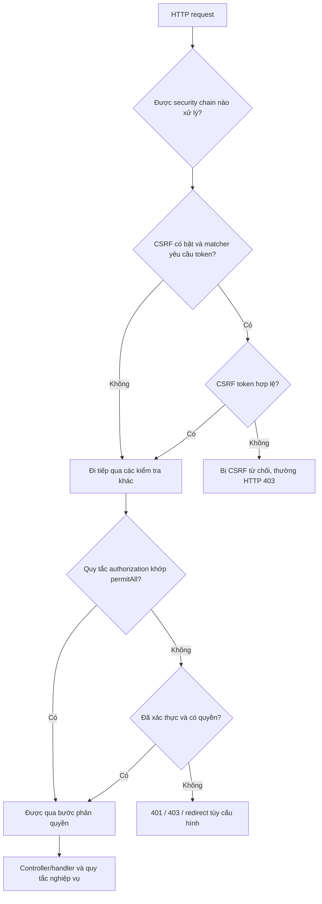

# Phân biệt `permitAll` với việc bỏ kiểm tra CSRF

> **Chương:** Phạm vi kiểm tra CSRF  
> **Module:** `SPRING_SECURITY_HTTP_PROTECTION` — phòng vệ HTTP và trình duyệt bằng Spring Security trên Servlet và Reactive, cùng các lớp CSRF, CORS, security headers, CSP, HSTS, HTTP firewall và session.  
> **Ý chính:** `permitAll` là quyết định **phân quyền**. Kiểm tra CSRF là quyết định **phòng vệ request**. Hai quyết định này độc lập, nên request công khai vẫn có thể phải gửi CSRF token.

## 1. Mục tiêu học tập

Hoàn thành bài này, người học có thể:

1. Phân biệt rõ `authorizeHttpRequests(...permitAll())` hoặc `authorizeExchange(...permitAll())` với `csrf(...ignoringRequestMatchers(...))`, `requireCsrfProtectionMatcher(...)` và `csrf.disable()`.
2. Giải thích vì sao POST vào endpoint cho phép người chưa đăng nhập truy cập vẫn có thể trả `403 Forbidden` do CSRF.
3. Thiết kế form đăng ký, form đăng nhập, thao tác công khai và webhook mà không vô tình bỏ lớp CSRF của browser.
4. Cấu hình và kiểm thử đúng sự tách biệt giữa authorization và CSRF trên cả Spring MVC/Servlet lẫn Spring WebFlux/Reactive.
5. Chẩn đoán các tình huống 401, 403, chuyển hướng đăng nhập hoặc CORS preflight lỗi theo nguồn từ chối thực tế.
6. Tránh dùng `web.ignoring()`, `/public/**` hoặc `csrf.disable()` như cách chữa lỗi tạm thời khi client chưa gửi token.

## 2. Vì sao `permitAll` không có nghĩa “bỏ qua bảo mật”?

Spring Security xử lý request qua một **security filter chain**. Trong chain, các filter có nhiệm vụ riêng, chẳng hạn CSRF, authentication, authorization, security headers và quản lý security context.

Với Servlet, `AuthorizationFilter` thực thi quy tắc cho phép truy cập đã khai báo qua `authorizeHttpRequests`. Với WebFlux, các thành phần tương ứng làm việc trong `SecurityWebFilterChain`. Cấu hình `permitAll` cho biết request được phép đi qua **bước phân quyền** mà không cần có quyền đăng nhập tương ứng; nó không yêu cầu các bộ lọc khác ngừng hoạt động.

Ví dụ:

```java
http.authorizeHttpRequests(auth -> auth
    .requestMatchers(HttpMethod.POST, "/register").permitAll()
    .anyRequest().authenticated()
);
```

`POST /register` là thao tác **công khai về quyền truy cập**: khách chưa có tài khoản phải gửi được yêu cầu đăng ký. Tuy nhiên, nếu CSRF đang bật và request dùng POST, `CsrfFilter` vẫn có thể từ chối vì thiếu hoặc sai CSRF token. Đây là hành vi đúng, không phải mâu thuẫn.

Đặt hai câu hỏi độc lập:

- **Authorization:** Chủ thể hiện tại có được phép gọi endpoint không? `permitAll` trả lời “có” ở bước phân quyền, kể cả khi không đăng nhập.
- **CSRF:** Với request này, Spring Security có yêu cầu token chứng minh request thuộc luồng hợp lệ không? Nếu có, token thiếu/sai vẫn khiến request bị từ chối.

### 2.1. Sơ đồ luồng xử lý



Sơ đồ là mô hình khái niệm của các quyết định. Thứ tự và phản hồi cụ thể phụ thuộc các filter và entry point được cấu hình; ví dụ CORS hoặc HTTP firewall có thể chặn request trước các bước trên. Trong chuỗi filter Servlet thông dụng, `CsrfFilter` có thể chặn request trước khi `AuthorizationFilter` áp dụng `permitAll`.

**Không được suy luận rằng request đã khớp `permitAll` thì sẽ không đi qua `CsrfFilter` hoặc `CsrfWebFilter`.**

## 3. Bốn thao tác dễ bị nhầm với nhau

| Cấu hình | Tác động lên authorization | Tác động lên CSRF | Khi nào dùng |
|---|---|---|---|
| `permitAll()` | Cho phép request qua bước phân quyền | **Không đổi** matcher, token repository hoặc CSRF filter | Trang đăng ký, đăng nhập, tài nguyên công khai, điểm nhận webhook |
| Servlet `csrf.ignoringRequestMatchers(exactMatcher)` | **Không đổi** quyền truy cập | Loại request khớp matcher khỏi kiểm tra token | Webhook có chữ ký hoặc API bearer-only đã chứng minh hợp đồng xác thực |
| `csrf.requireCsrfProtectionMatcher(custom)` | **Không đổi** quyền truy cập | **Thay thế** quy tắc quyết định request phải có token | Yêu cầu phạm vi đặc biệt, có kiểm thử đầy đủ |
| `csrf.disable()` | **Không tự cấp** quyền | Tắt cơ chế CSRF của **chain đó** | Chain thực sự chỉ nhận credential máy–máy/bearer, không nhận cookie của browser |

Hai thao tác khác cũng cần hiểu đúng:

- `authenticated()`, `hasRole(...)` hay `hasAuthority(...)` **không thay thế CSRF**. Trình duyệt nạn nhân có thể tự gửi cookie xác thực; request CSRF vẫn có thể đạt authentication/authorization.
- `web.ignoring()` hoặc cách cấu hình bỏ qua **toàn bộ Spring Security filter chain** khác `permitAll`. Khi bỏ qua chain, các filter Spring Security như CSRF và bổ sung security headers của chain không được áp dụng ở đường đó. Với nội dung công khai vẫn cần các lớp bảo vệ, nên ưu tiên cấp quyền bằng `permitAll` trong chain.

### 3.1. Phân biệt tính “công khai” và tính “an toàn trước CSRF”

Một endpoint công khai có thể thay đổi trạng thái:

- `POST /register` tạo tài khoản.
- `POST /login` tạo hoặc thay đổi phiên đăng nhập.
- `POST /newsletter/subscribe` ghi nhận đăng ký nhận thư.
- `POST /contact/send` gửi email hoặc tạo ticket.
- `POST /password/reset/request` phát sinh email đặt lại mật khẩu.
- `POST /integrations/payment-events` nhận sự kiện từ đối tác.

Việc không bắt người dùng đăng nhập **không tự trả lời** endpoint có nên kiểm tra CSRF hay không. Với form trình duyệt, thường giữ CSRF; với webhook server-to-server có chữ ký và không dùng credential browser, có thể miễn CSRF đúng method/route rồi bắt buộc xác minh chữ ký.

CSRF không phải cơ chế chống spam, bot, tài khoản tự động hoặc lạm dụng API nói chung. Form công khai thường còn cần rate limit, CAPTCHA khi phù hợp, xác minh email và kiểm soát nghiệp vụ. Các lớp này bổ sung nhau.

## 4. Quy tắc CSRF mặc định và phạm vi của matcher

Trong cấu hình web thông dụng khi CSRF bật, Spring Security mặc định **không yêu cầu** CSRF token với `GET`, `HEAD`, `TRACE`, `OPTIONS`; các method còn lại như `POST`, `PUT`, `PATCH`, `DELETE` phải có token hợp lệ nếu không được miễn trừ.

| Request | Authorization có thể là | CSRF theo matcher mặc định |
|---|---|---|
| `GET /register` | `permitAll` | Không cần token |
| `POST /register` | `permitAll` | **Cần token** |
| `GET /login` | `permitAll` | Không cần token |
| `POST /login` | `permitAll` | **Cần token** |
| `GET /public/articles` | `permitAll` | Không cần token |
| `POST /public/feedback` | `permitAll` | **Cần token** |
| `POST /api/orders` | `authenticated` | **Cần token** nếu không miễn trừ |
| `POST /integrations/payment-events` | `permitAll` ở bước authorization | **Cần token** nếu không khai báo ngoại lệ |
| `OPTIONS /api/orders` | Có thể cần xử lý CORS | Không cần CSRF theo method mặc định |

Lưu ý: **GET phải được thiết kế là thao tác an toàn**, không làm thay đổi trạng thái nghiệp vụ. Nếu `GET /users/42/deactivate` lại vô hiệu hóa tài khoản, đó là lỗi thiết kế cần sửa sang method thích hợp. Đừng coi việc GET không cần CSRF token là lý do cho phép action nhạy cảm trên GET.

## 5. Ví dụ Servlet: form đăng ký công khai vẫn cần CSRF

Giả sử ứng dụng Spring MVC có:

- `GET /register`: hiển thị form, cho phép người chưa đăng nhập truy cập.
- `POST /register`: tiếp nhận đăng ký, cho phép người chưa đăng nhập nhưng cần CSRF token.
- `POST /account/email`: sửa email bằng session đã đăng nhập, cần cả quyền và CSRF.
- `GET /public/articles`: đọc nội dung công khai.

Cấu hình:

```java
import org.springframework.context.annotation.Bean;
import org.springframework.context.annotation.Configuration;
import org.springframework.http.HttpMethod;
import org.springframework.security.config.Customizer;
import org.springframework.security.config.annotation.web.builders.HttpSecurity;
import org.springframework.security.web.SecurityFilterChain;

@Configuration
class SecurityConfig {

    @Bean
    SecurityFilterChain browserChain(HttpSecurity http) throws Exception {
        http
            .authorizeHttpRequests(auth -> auth
                .requestMatchers(HttpMethod.GET, "/register").permitAll()
                .requestMatchers(HttpMethod.POST, "/register").permitAll()
                .requestMatchers(HttpMethod.GET, "/public/articles").permitAll()
                .anyRequest().authenticated())
            .formLogin(Customizer.withDefaults());

        // Không tắt CSRF và không miễn trừ /register.
        return http.build();
    }
}
```

**Kết quả:** `POST /register` không cần principal đã đăng nhập để được phân quyền, nhưng phải gửi CSRF token hợp lệ. `POST /account/email` cần session hợp lệ, quyền nghiệp vụ thích hợp và CSRF token. Ví dụ giả định chưa cấu hình phân quyền cụ thể theo vai trò; `authenticated()` chỉ bảo đảm đã đăng nhập.

### 5.1. Cấp CSRF token cho form công khai

Một form chưa đăng nhập vẫn có thể lấy CSRF token. Trong ứng dụng Spring MVC server-rendered, Spring Security có thể cung cấp `CsrfToken` để view tạo hidden field; với template Thymeleaf dùng tích hợp phù hợp, form POST thường được chèn input token tự động. Có thể minh họa tương đương:

```html
<form method="post" action="/register">
  <input type="hidden"
         name="_csrf"
         value="GIÁ_TRỊ_TOKEN_ĐƯỢC_SERVER_RENDER">
  <input type="email" name="email" required>
  <button type="submit">Đăng ký</button>
</form>
```

Giá trị trong ví dụ là **placeholder**, phải được server render từ token hợp lệ gắn với ngữ cảnh request/session. Không hard-code một CSRF token chung cho mọi khách.

Nếu client là SPA gửi JSON, cần một cơ chế cấp token và cho client gửi qua custom header tương ứng với `CsrfTokenRepository` và cách xử lý token hiện hành. Với các phiên bản Spring Security có cơ chế deferred token và bảo vệ BREACH, không giả định cứ sao chép giá trị cookie sang header là tương thích với mọi cấu hình; kiểm thử luồng nhận và gửi token thực tế.

### 5.2. Vì sao POST login cũng cần cân nhắc CSRF?

`POST /login` thường cho phép người chưa đăng nhập nhưng có thể **tạo phiên đăng nhập**. Login CSRF có thể khiến nạn nhân được đăng nhập vào tài khoản do kẻ tấn công kiểm soát, sau đó vô tình lưu dữ liệu hoặc thực hiện tác vụ dưới sai tài khoản.

Khi bật CSRF, form login chuẩn của Spring Security tuân theo cơ chế token phù hợp. Đừng tắt CSRF cho `/login` chỉ vì authorization khai báo `permitAll` hoặc vì request bắt đầu trong trạng thái anonymous.

Tương tự, logout nên dùng method thay đổi trạng thái thích hợp, thường là POST với CSRF token. Không dùng logout bằng GET như cách vượt kiểm tra CSRF.

## 6. Ví dụ Servlet: webhook cần cả `permitAll` và CSRF exemption

Giả sử nhà cung cấp thanh toán gửi `POST /integrations/payment-events` với chữ ký HMAC. Request không có user session, không có CSRF token và cần đến logic xác minh chữ ký của ứng dụng.

Nếu chỉ viết:

```java
http.authorizeHttpRequests(auth -> auth
    .requestMatchers(HttpMethod.POST, "/integrations/payment-events")
        .permitAll()
    .anyRequest().authenticated()
);
```

thì CSRF mặc định **vẫn yêu cầu token cho POST** và có thể trả 403 trước khi controller kịp xác minh chữ ký. Để chấp nhận webhook từ máy chủ đối tác, cần quyết định **hai việc riêng biệt**:

1. Cho phép POST đúng route đi đến điểm kiểm tra chữ ký về mặt authorization.
2. Miễn CSRF token **chỉ cho POST đúng route** vì request được xác thực bằng chữ ký riêng, không dựa trên session cookie.

Ví dụ cấu hình Servlet:

```java
import org.springframework.context.annotation.Bean;
import org.springframework.http.HttpMethod;
import org.springframework.security.config.annotation.web.builders.HttpSecurity;
import org.springframework.security.web.SecurityFilterChain;
import org.springframework.security.web.util.matcher.RequestMatcher;

@Bean
SecurityFilterChain webhookAndBrowserChain(HttpSecurity http)
        throws Exception {

    RequestMatcher paymentWebhookPost = request ->
        "POST".equals(request.getMethod())
            && "/integrations/payment-events"
                .equals(request.getServletPath());

    http
        .csrf(csrf -> csrf
            .ignoringRequestMatchers(paymentWebhookPost))
        .authorizeHttpRequests(auth -> auth
            .requestMatchers(paymentWebhookPost).permitAll()
            .requestMatchers(HttpMethod.GET, "/register").permitAll()
            .requestMatchers(HttpMethod.POST, "/register").permitAll()
            .anyRequest().authenticated());

    return http.build();
}
```

Mặc dù matcher `paymentWebhookPost` được dùng ở **cả hai nơi**, mỗi nơi có tác dụng riêng: một nơi loại yêu cầu CSRF, một nơi cho phép tiếp cận handler để xác minh chữ ký. Với ứng dụng dùng context path/servlet mapping khác, cần chọn matcher tương thích và kiểm thử giá trị `getServletPath()` thực tế.

**Bắt buộc:** handler webhook phải kiểm tra chữ ký trên nội dung đúng hợp đồng, timestamp, chống replay, tenant và idempotency **trước khi ghi dữ liệu**. `permitAll` cộng với CSRF exemption không phải một cơ chế xác thực webhook.

Không dùng:

```java
// Sai nếu có API web dùng session dưới /api hoặc form công khai:
http.csrf(csrf -> csrf.ignoringRequestMatchers("/**"));

// Cũng sai trong chain có session browser:
http.csrf(csrf -> csrf.disable());
```

### 6.1. Ma trận hành vi của ví dụ

| Request | Authorization | CSRF | Điều còn phải kiểm tra |
|---|---|---|---|
| `GET /register`, anonymous | `permitAll` | Không yêu cầu | Render trang |
| `POST /register`, anonymous, thiếu token | `permitAll` | **Bị chặn** | Không tạo tài khoản |
| `POST /register`, anonymous, token hợp lệ | `permitAll` | Qua CSRF | Validate dữ liệu, chống lạm dụng |
| `POST /integrations/payment-events`, thiếu token | `permitAll` | **Được miễn** | Xác minh chữ ký, replay, quyền nghiệp vụ |
| Cùng webhook, chữ ký sai | `permitAll` | Được miễn | **Bị verifier từ chối** |
| `PUT /integrations/payment-events`, thiếu token | Không khớp rule permitAll POST | **Không được miễn** | Vẫn theo chính sách CSRF/authorization |
| `POST /integrations/payment-events/test`, thiếu token | Không khớp rule permitAll POST | **Không được miễn** | Route khác |
| `POST /account/email`, session hợp lệ, thiếu token | `authenticated` | **Bị chặn** | Không đổi email |

Điểm cốt lõi là cùng một request có thể **qua bước phân quyền mà không qua CSRF**, hoặc **được miễn CSRF mà vẫn bị từ chối authentication/authorization hoặc xác minh nghiệp vụ**.

## 7. Reactive WebFlux: `permitAll` và `CsrfWebFilter` cũng độc lập

Với Spring WebFlux, `authorizeExchange(...permitAll())` cho phép truy cập ở bước authorization nhưng không tắt `CsrfWebFilter`. Kể cả khi `POST /register` là công khai, matcher CSRF mặc định vẫn yêu cầu token.

### 7.1. WebFlux: công khai quyền truy cập, giữ CSRF

```java
import org.springframework.context.annotation.Bean;
import org.springframework.http.HttpMethod;
import org.springframework.security.config.web.server.ServerHttpSecurity;
import org.springframework.security.web.server.SecurityWebFilterChain;

@Bean
SecurityWebFilterChain browserWebFlux(ServerHttpSecurity http) {
    return http
        .authorizeExchange(auth -> auth
            .pathMatchers(HttpMethod.GET, "/register").permitAll()
            .pathMatchers(HttpMethod.POST, "/register").permitAll()
            .anyExchange().authenticated())
        // Không disable CSRF; dùng mặc định của WebFlux.
        .build();
}
```

Kết quả: anonymous GET /register có thể hiển thị form; anonymous POST /register thiếu token thường nhận 403 do CSRF. Trong WebFlux, token có thể được cung cấp qua `Mono<CsrfToken>` trên exchange/Model tùy cách xây view và repository; phải bảo đảm form hoặc SPA thực sự lấy và gửi token hợp lệ.

### 7.2. WebFlux: webhook miễn CSRF đúng route

Trong Reactive, dùng `ServerWebExchangeMatcher` để thay quy tắc yêu cầu CSRF bằng biểu thức “method không an toàn **và không phải POST webhook**”.

```java
import org.springframework.context.annotation.Bean;
import org.springframework.http.HttpMethod;
import org.springframework.security.config.web.server.ServerHttpSecurity;
import org.springframework.security.web.server.SecurityWebFilterChain;
import org.springframework.security.web.server.util.matcher.ServerWebExchangeMatcher;

@Bean
SecurityWebFilterChain mixedWebFlux(ServerHttpSecurity http) {

    ServerWebExchangeMatcher requireCsrf = exchange -> {
        HttpMethod method = exchange.getRequest().getMethod();
        String path = exchange.getRequest()
            .getPath().pathWithinApplication().value();

        boolean safeMethod =
            method == HttpMethod.GET
                || method == HttpMethod.HEAD
                || method == HttpMethod.TRACE
                || method == HttpMethod.OPTIONS;

        boolean paymentWebhookPost =
            method == HttpMethod.POST
                && "/integrations/payment-events".equals(path);

        return !safeMethod && !paymentWebhookPost
            ? ServerWebExchangeMatcher.MatchResult.match()
            : ServerWebExchangeMatcher.MatchResult.notMatch();
    };

    return http
        .csrf(csrf -> csrf
            .requireCsrfProtectionMatcher(requireCsrf))
        .authorizeExchange(auth -> auth
            .pathMatchers(HttpMethod.GET, "/register").permitAll()
            .pathMatchers(HttpMethod.POST, "/register").permitAll()
            .pathMatchers(
                HttpMethod.POST, "/integrations/payment-events").permitAll()
            .anyExchange().authenticated())
        .build();
}
```

Trong ví dụ này:

- `POST /register` vẫn cần CSRF token dù `permitAll`.
- `POST /integrations/payment-events` được miễn token, nhưng phải xác minh chữ ký và chống replay trong logic webhook.
- `PUT /integrations/payment-events` vẫn cần CSRF token, vì không khớp ngoại lệ.
- Các endpoint khác dùng session/WebSession vẫn được CSRF bảo vệ.

Không sao chép API `ignoringRequestMatchers` của Servlet sang WebFlux rồi cho rằng cả hai DSL giống nhau. `requireCsrfProtectionMatcher` ở WebFlux **thay thế quy tắc yêu cầu CSRF mặc định**, nên code đã giữ đúng tập method an toàn; nếu quên phần này, các POST khác có thể bị miễn ngoài ý muốn.

## 8. `permitAll`, `authenticated` và `web.ignoring()`: lựa chọn nào cho tài nguyên công khai?

### 8.1. `permitAll` phù hợp với đường công khai vẫn qua security chain

Có thể dùng cho `GET /register`, `GET /assets/site.css` hoặc GET tài liệu công khai. Trong khi không yêu cầu đăng nhập để đọc, những response này vẫn có thể hưởng lợi từ chính sách security headers của Spring Security.

Ví dụ Servlet:

```java
http.authorizeHttpRequests(auth -> auth
    .requestMatchers(
        HttpMethod.GET, "/assets/**", "/register").permitAll()
    .anyRequest().authenticated());
```

Không dùng `web.ignoring()` như một cách tổng quát cho mọi URL công khai, vì nó loại cả các filter khác của Spring Security. Với static resources, quyết định bỏ qua cả chain chỉ nên đưa ra sau khi hiểu hệ quả với security headers, CORS và chính sách triển khai.

### 8.2. `authenticated` không phải CSRF protection

Đổi `permitAll` thành `authenticated` trên một endpoint dùng session **không bảo vệ CSRF**. Website độc hại có thể khiến browser của user đã đăng nhập gửi request có cookie hợp lệ. Authorization “đã đăng nhập” vẫn có thể qua, nhưng nếu thiếu CSRF token cần được `CsrfFilter` chặn.

Ví dụ `POST /account/email` phải cần **cả** authentication, quyền sửa tài khoản và CSRF token. Với chức năng quan trọng còn có thể yêu cầu xác thực lại hoặc MFA.

### 8.3. `permitAll` không xác minh chữ ký webhook

Cho phép `POST /integrations/payment-events` qua authorization chỉ để handler có cơ hội xác minh chữ ký. Nếu handler nhận JSON rồi cập nhật thanh toán mà không xác minh nguồn gửi, cấu hình là **không an toàn** dù CSRF bật hay tắt.

Một webhook đúng thiết kế gồm đúng route/method, kiểm tra chữ ký trên raw body theo hợp đồng đối tác, timestamp, chống replay, idempotency và kiểm tra merchant/tenant/order.

### 8.4. `csrf.disable()` chỉ có thể hợp lý ở chain độc lập

Một chain dành riêng `/api/m2m/**` **chỉ** nhận bearer header hoặc mTLS và không nhận session/cookie fallback có thể không cần CSRF. Khi đó tắt CSRF chỉ cho chain đó là một quyết định có cơ sở. Browser chain vẫn giữ CSRF.

Không suy ra “stateless” là “không có CSRF”: một JWT được truyền qua cookie và server dùng để xác thực vẫn là credential browser tự gửi, dù không sử dụng HttpSession.

## 9. Vì sao endpoint `permitAll` vẫn báo 403?

Khi một POST công khai trả 403, nên hỏi **thành phần nào tạo ra response**, thay vì chỉ đọc dòng `permitAll` và kết luận cấu hình hỏng.

| Triệu chứng | Nguyên nhân có thể | Cách xác minh |
|---|---|---|
| Anonymous `POST /register` trả 403, GET /register hoạt động | Thiếu hoặc sai CSRF token | So sánh POST không token / token sai / token đúng |
| `POST /register` có token đúng vẫn 403 | Authorization rule khác, handler/service, filter tùy chỉnh | Xác minh request match và nguồn 403 |
| `POST /integrations/payment-events` trả 403 | Chưa miễn CSRF hoặc verifier/authorization từ chối | Kiểm tra matcher method/path và log filter |
| API mobile dùng bearer trả lỗi CSRF | Request vào browser chain hoặc không được miễn | Kiểm tra `securityMatcher`, thứ tự chain và đường dẫn sau proxy |
| Request redirect 302 tới login | Đi vào form-login chain hoặc thiếu authentication | Kiểm tra chain, entry point, path |
| Preflight OPTIONS bị từ chối | CORS hoặc authentication được cấu hình sai | Kiểm tra origin, method, headers và CORS xử lý trước auth |
| POST path đặc biệt bị chặn | HTTP firewall hoặc URL normalization | Kiểm tra `StrictHttpFirewall` và đường dẫn thực tế |
| 403 dù đã gửi CSRF token | Token khác session, token stale, header sai, phân quyền | So sánh token repository, session, request handler và authorization |

Một status `403` **không đủ** để khẳng định lỗi CSRF. Spring Security có thể từ chối vì thiếu quyền, firewall hoặc một filter khác.

### 9.1. CORS và CSRF là hai cơ chế khác nhau

CORS quyết định script ở origin khác có thể đọc response hoặc gửi một số request cần preflight. Một HTML form cross-site có thể gửi request mà không cần đọc response, nên CORS không thay thế CSRF.

Preflight thường là `OPTIONS`, không mang credential người dùng, và mặc định không yêu cầu CSRF. Cho phép OPTIONS bằng `permitAll` không tự tạo ra CORS headers đúng. Cần cấu hình CORS theo origin, method, header và credential thực tế, thường xử lý CORS trước lớp security đòi authentication.

### 9.2. Cookie, SameSite và các security headers

Cookie `SameSite=Lax` hoặc `Strict` có thể giảm một số request cross-site mang cookie, nhưng “same-site” không đồng nghĩa “same-origin”; subdomain, ngữ cảnh điều hướng và thiết kế ứng dụng vẫn phải được xét.

`HttpOnly` làm JS không đọc cookie trực tiếp, nhưng browser vẫn có thể tự gửi cookie. `Secure` và HSTS giúp bảo vệ việc dùng HTTPS; CSP giảm một số nguy cơ tải/chạy script ngoài ý muốn; HTTP firewall chặn URL bất thường. Không cơ chế nào trong số đó biến `permitAll` thành CSRF exemption hoặc thay thế CSRF token cho mọi endpoint dùng session.

## 10. Kiểm thử Servlet: public POST và CSRF là hai quyết định độc lập

Giả sử bộ test đã tích hợp Spring Security vào `MockMvc`, có `GET /register` trả 200 và `POST /register` trả 201 khi dữ liệu hợp lệ. Test `spring-security-test` cho phép sử dụng `csrf()`.

### 10.1. Anonymous POST vẫn bị chặn khi thiếu CSRF

```java
import static org.springframework.security.test.web.servlet.request.SecurityMockMvcRequestPostProcessors.csrf;
import static org.springframework.test.web.servlet.request.MockMvcRequestBuilders.get;
import static org.springframework.test.web.servlet.request.MockMvcRequestBuilders.post;
import static org.springframework.test.web.servlet.result.MockMvcResultMatchers.status;

@Test
void anonymousCanOpenRegistrationForm() throws Exception {
    mockMvc.perform(get("/register"))
        .andExpect(status().isOk());
}

@Test
void anonymousCannotPostRegistrationWithoutCsrf() throws Exception {
    mockMvc.perform(post("/register")
            .param("email", "alice@example.test"))
        .andExpect(status().isForbidden());
}

@Test
void anonymousCanPostRegistrationWithCsrf() throws Exception {
    mockMvc.perform(post("/register")
            .with(csrf())
            .param("email", "alice@example.test"))
        .andExpect(status().isCreated());
}

@Test
void anonymousCannotPostRegistrationWithInvalidCsrf() throws Exception {
    mockMvc.perform(post("/register")
            .with(csrf().useInvalidToken())
            .param("email", "alice@example.test"))
        .andExpect(status().isForbidden());
}
```

Các test này giả định controller chấp nhận dữ liệu và trả 201. Nếu ứng dụng còn các trường bắt buộc hoặc trả 200/204, phải xây test fixture đúng nghiệp vụ. Đảm bảo test thật sự đi qua security filter chain; gọi controller trực tiếp không chứng minh được CSRF.

**Ý nghĩa:** `permitAll` cho người chưa đăng nhập đi qua bước authorization; chỉ request có token hợp lệ mới đi đến nghiệp vụ tạo tài khoản. Một thử nghiệm chỉ kiểm tra 403 mà không có test dương với token đúng vẫn chưa đủ để loại trừ lỗi handler/authorization.

### 10.2. Kiểm thử exemption webhook theo hai chiều

Với `POST /integrations/payment-events`:

1. Gửi request **không có CSRF token** nhưng có chữ ký webhook hợp lệ, timestamp còn hiệu lực và event mới; phải đến được logic xử lý.
2. Gửi chữ ký sai hoặc body đã bị thay đổi sau ký; phải bị verifier từ chối, không thay đổi trạng thái.
3. Gửi `PUT` cùng path hoặc `POST` đến path gần giống; không thuộc CSRF exemption.
4. Gửi `POST /register` không token; phải vẫn bị CSRF chặn. Điều này bắt lỗi miễn trừ quá rộng.

Để test webhook có ý nghĩa, đừng chỉ kiểm tra response 2xx/4xx. Quan sát rõ chữ ký đã được xác minh và service nghiệp vụ chỉ chạy khi hợp lệ.

## 11. Kiểm thử Reactive với `WebTestClient`

Giả định WebTestClient đã gắn các filter Spring Security và handler `POST /register` trả 201 khi hợp lệ.

```java
import static org.springframework.security.test.web.reactive.server.SecurityMockServerConfigurers.csrf;
import org.springframework.http.MediaType;

@Test
void reactiveAnonymousPostWithoutCsrfIsRejected() {
    webTestClient.post().uri("/register")
        .contentType(MediaType.APPLICATION_FORM_URLENCODED)
        .bodyValue("email=alice%40example.test")
        .exchange()
        .expectStatus().isForbidden();
}

@Test
void reactiveAnonymousPostWithCsrfCanProceed() {
    webTestClient.mutateWith(csrf())
        .post().uri("/register")
        .contentType(MediaType.APPLICATION_FORM_URLENCODED)
        .bodyValue("email=alice%40example.test")
        .exchange()
        .expectStatus().isCreated();
}
```

Trong ứng dụng thật, cần đặt `Content-Type` và body đúng dạng handler sử dụng; ví dụ chỉ minh họa việc thêm/bớt CSRF token. WebTestClient test bảo vệ thực tế phải gắn đúng `SecurityWebFilterChain`; nếu không, kết quả không chứng minh cách `permitAll` và `CsrfWebFilter` phối hợp.

Test webhook WebFlux cần bao phủ cùng tập trường hợp: POST đúng route không token nhưng chữ ký hợp lệ đi tiếp, chữ ký sai bị từ chối, PUT hoặc POST path gần giống không được miễn và POST /register vẫn cần CSRF.

## 12. Các hiểu lầm phổ biến

**“`permitAll` nghĩa là endpoint không được bảo vệ.”** Sai. Nó chỉ cho phép qua bước phân quyền; CSRF, security headers, CORS và các filter khác trong chain vẫn có hiệu lực.

**“Cứ POST mà chưa đăng nhập thì khỏi CSRF.”** Sai. Form đăng ký và form login là các ví dụ về thao tác công khai vẫn có thể cần CSRF. Việc có cần token và cấp token ra sao phải xuất phát từ mô hình client và credential.

**“Webhook bị 403, chỉ cần `permitAll`.”** Chưa đủ. POST webhook vẫn bị matcher CSRF mặc định yêu cầu token. Nếu webhook dùng xác minh riêng độc lập với browser, cần ngoại lệ CSRF hẹp cùng verifier chữ ký.

**“CSRF exemption tức là webhook an toàn.”** Sai. Bỏ token CSRF mà không kiểm tra chữ ký, thời gian, replay và quyền của event làm endpoint dễ bị giả mạo.

**“`authenticated` đã chống CSRF.”** Sai. Trình duyệt nạn nhân có thể tự gửi session cookie vào request từ trang độc hại; CSRF token kiểm tra thêm nguồn gốc luồng hợp lệ.

**“Tắt CSRF vì form AJAX bị 403.”** Không đúng hướng nếu AJAX dùng cookie session. Cần sửa cơ chế cấp/gửi token hoặc matcher, không bỏ bảo vệ.

**“`web.ignoring` giống `permitAll`.”** Sai. `web.ignoring` loại request khỏi Spring Security filter chain; `permitAll` vẫn để request đi qua chain.

**“OPTIONS phải được miễn CSRF để CORS chạy.”** OPTIONS nằm trong nhóm method mặc định không cần token. CORS phải được cấu hình riêng; `permitAll` một mình không tạo đủ CORS response.

## 13. Bài tập tình huống tổng hợp

Một ứng dụng bán hàng có:

- `GET /register`: hiển thị form chưa đăng nhập.
- `POST /register`: tạo tài khoản.
- `POST /login`: đăng nhập bằng session cookie.
- `POST /api/web/orders`: browser session tạo đơn.
- `POST /integrations/payment-events`: server thanh toán gửi webhook ký HMAC.
- `POST /api/m2m/orders`: mobile gửi bearer token trong `Authorization`.

Đội phát triển viết:

```java
http
    .csrf(csrf -> csrf.disable())
    .authorizeHttpRequests(auth -> auth
        .requestMatchers("/register", "/login", "/integrations/**")
            .permitAll()
        .anyRequest().authenticated());
```

**Câu hỏi:** Cấu hình trên có rủi ro gì và nên sửa thế nào?

**Phân tích:**

1. `permitAll` cho phép truy cập trang/form, nhưng không yêu cầu tắt CSRF. `POST /register` và `POST /login` nên được bảo vệ CSRF theo luồng trình duyệt.
2. `POST /api/web/orders` dùng session cookie và thay đổi trạng thái, vì vậy tắt CSRF toàn chain là nguy hiểm.
3. `POST /integrations/payment-events` có thể vừa `permitAll` về authorization để đến verifier, vừa được miễn CSRF **đúng method/path**. Verifier HMAC, timestamp, chống replay và idempotency phải từ chối sự kiện giả.
4. `POST /api/m2m/orders` chỉ có thể miễn CSRF nếu server xác thực duy nhất bằng bearer header, không chấp nhận cookie/session fallback. Có thể tách một security chain bearer-only riêng.
5. Bổ sung test public POST token thiếu/sai/đúng, browser order có/không token, webhook có chữ ký đúng/sai và mobile cookie-only bị từ chối.

Một bản sửa phù hợp có **browser chain giữ CSRF**, chỉ thêm ngoại lệ hẹp cho webhook đã được xác minh. Nhánh m2m bearer-only nên có chain và hợp đồng xác thực riêng nếu cần miễn CSRF. Mọi request vẫn cần authentication/authorization tương ứng với nghiệp vụ.

## 14. Checklist review

- [ ] Đã phân biệt rõ **authorization** và **CSRF protection** trong thiết kế endpoint.
- [ ] Không suy diễn `permitAll` đồng nghĩa bỏ qua `CsrfFilter`/`CsrfWebFilter`.
- [ ] Các POST công khai từ browser (đăng ký, login, form) được xem xét CSRF đúng mô hình.
- [ ] CSRF mặc định vẫn bảo vệ POST/PUT/PATCH/DELETE trong browser-session chain.
- [ ] Nếu có webhook, `permitAll` chỉ mở đường đến verifier; CSRF exemption hẹp và xác minh chữ ký bắt buộc.
- [ ] Nếu có API bearer-only, đã chứng minh không nhận cookie fallback trước khi tắt CSRF trên chain chuyên dụng.
- [ ] Không dùng `/public/**` hoặc `/api/**` làm ngoại lệ mặc định thiếu kiểm kê.
- [ ] Không dùng `web.ignoring()` thay cho `permitAll` nếu cần giữ các Spring Security filters và headers.
- [ ] Các matcher của security chain và matcher CSRF được đánh giá độc lập, đúng method và route.
- [ ] Servlet dùng đúng API `HttpSecurity`/`RequestMatcher`; Reactive dùng `ServerHttpSecurity`/`ServerWebExchangeMatcher`.
- [ ] Có test anonymous POST thiếu/sai/đúng CSRF token, cùng test webhook có/không chữ ký.
- [ ] Có test chứng minh các route khác ngoài ngoại lệ vẫn chịu CSRF.
- [ ] Đã phân biệt 401, 403, login redirect và CORS preflight bằng log/filter trace.
- [ ] Đã rà soát CORS, SameSite, CSP, HSTS, HTTP firewall và session theo vai trò riêng.

**Ghi nhớ:** **`permitAll` chỉ có nghĩa “được phép truy cập ở bước phân quyền”.** Nó không có nghĩa “request được bỏ kiểm tra CSRF”. Với browser form hãy giữ token; với webhook đã có xác minh riêng hãy kết hợp authorization phù hợp và ngoại lệ CSRF chính xác; với bearer-only API hãy tách ranh giới xác thực và kiểm thử. Đây là nguyên tắc nhất quán trên cả Servlet và Reactive.
