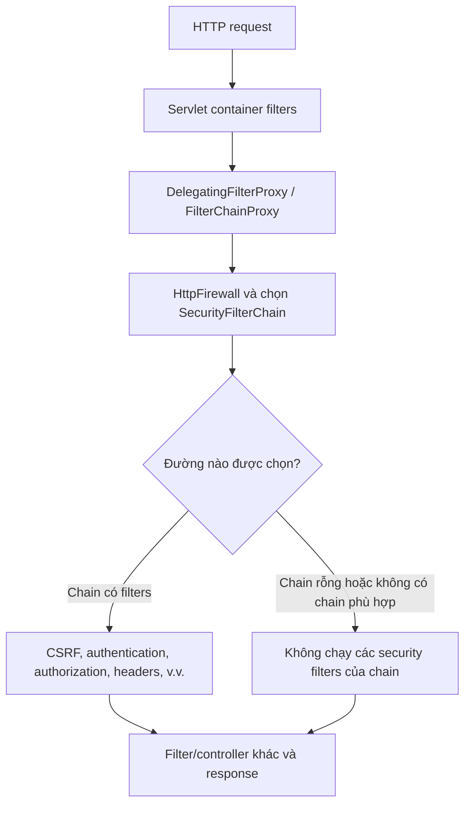
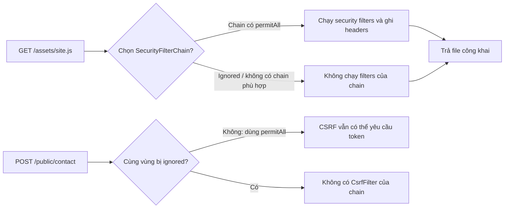

# Ảnh hưởng của bỏ qua toàn bộ security chain

> **Chương:** Phạm vi kiểm tra CSRF  
> **Module:** `SPRING_SECURITY_HTTP_PROTECTION` — phòng vệ HTTP và trình duyệt trong Spring Security, bao gồm CSRF, CORS, security headers, CSP, HSTS, HTTP firewall và session cho cả Servlet lẫn Reactive.  
> **Trọng tâm:** Hiểu hệ quả của việc để một request **không đi qua các security filters cần thiết**, và phân biệt lựa chọn đó với `permitAll` hoặc miễn trừ CSRF riêng lẻ.

## 1. Kết quả học tập

Sau bài này, người học có thể:

1. Trình bày sự khác nhau giữa **bỏ qua Spring Security filter chain**, **cho phép truy cập bằng `permitAll`**, **miễn một request khỏi kiểm tra CSRF** và **tắt CSRF trong một chain**.
2. Phân tích tác động của việc bỏ qua chain tới `CsrfFilter`, authentication, authorization, session/security context, logout, exception handling, CORS tích hợp với Spring Security và các security headers.
3. Hiểu ranh giới `DelegatingFilterProxy` → `FilterChainProxy` → `SecurityFilterChain` trên Servlet và cơ chế chọn `SecurityWebFilterChain` trên WebFlux.
4. Xác định điều gì **vẫn** có thể chạy ngoài Spring Security chain, đặc biệt servlet/container filters, CORS của MVC, proxy headers, application code và firewall được áp dụng trước khi chọn chain.
5. Cấu hình endpoint công khai an toàn bằng `permitAll`, bảo vệ form POST bằng CSRF và chỉ miễn trừ hẹp khi có hợp đồng xác thực khác.
6. Tạo integration test chứng minh request vẫn đi qua security chain và phát hiện endpoint vô tình bị bỏ trống bảo vệ.
7. Chẩn đoán tình huống endpoint không có CSP/HSTS/security headers, POST không cần token hoặc không thấy security context như mong đợi.

## 2. Một request đi qua Spring Security như thế nào?

Trong ứng dụng Servlet sử dụng Spring Security, servlet container gọi các filters được đăng ký. `DelegatingFilterProxy` thường chuyển tiếp vào bean `springSecurityFilterChain`, được triển khai bởi `FilterChainProxy`. `FilterChainProxy` chọn **một** `SecurityFilterChain` phù hợp với request, rồi chạy danh sách security filters của chain đó trước khi chuyển tiếp đến phần còn lại của ứng dụng.



Điều cần lưu ý:

- Mỗi request thường được xử lý bởi **security filter chain đầu tiên khớp**, không chạy nối tiếp tất cả chain được khai báo.
- `securityMatcher` là điều kiện chọn một chain. Quy tắc `requestMatchers` trong `authorizeHttpRequests` là điều kiện kiểm tra **quyền** sau khi đã chọn chain.
- Nếu một cấu hình `web.ignoring()` tạo ra đường đi với **danh sách security filters rỗng**, các bộ lọc Spring Security phục vụ CSRF, authorization, authentication và headers không chạy cho request đó.
- Nếu không có `SecurityFilterChain` nào khớp, request có thể tiếp tục đến ứng dụng mà **không có các security filters theo chain đó**, dù không viết `web.ignoring()`.
- “Bỏ qua Spring Security chain” **không có nghĩa bỏ qua toàn bộ HTTP stack**. Những filter độc lập của container, reverse proxy, framework routing hoặc logic tại controller vẫn có thể hoạt động.

### 2.1. Điểm tinh tế về HTTP firewall

Không nên khẳng định rằng `web.ignoring()` luôn vô hiệu hóa hoàn toàn `StrictHttpFirewall`. Trên Servlet, `HttpFirewall` được `FilterChainProxy` sử dụng để kiểm tra/bọc request **trước bước chọn security filter chain**; một request được khai báo ignored vẫn có thể đi qua bước kiểm tra firewall này trong cách triển khai thông dụng.

Điều bị bỏ qua chắc chắn là **các security filters bên trong chain rỗng**. Khi chẩn đoán path encoding, method hoặc URL bị chặn, cần xác minh firewall được đăng ký ở đâu và log của thành phần nào phát sinh lỗi. Ngược lại, security headers được phát ra bởi `HeaderWriterFilter` sẽ không tự được thêm nếu filter đó không chạy.

## 3. Bốn lựa chọn khác nhau và tác dụng thực tế

| Lựa chọn | Request có đi qua security filters? | CSRF | Authorization | Headers từ Spring Security |
|---|---|---|---|---|
| `permitAll()` trong chain bình thường | **Có** | Vẫn theo CSRF matcher | Cho phép tại bước phân quyền | Vẫn có thể được ghi |
| `csrf.ignoringRequestMatchers(exactMatcher)` trên Servlet | **Có** | Chỉ miễn kiểm tra token đối với request khớp ngoại lệ | Vẫn thực thi theo rule | Vẫn có thể được ghi |
| `csrf.disable()` trong một chain | **Có**, trừ bộ lọc CSRF bị tắt | Không còn CSRF của chain đó | Vẫn theo rule | Vẫn có thể được ghi |
| `web.ignoring()` trên Servlet hoặc route không có chain bảo vệ | **Không có security filters áp dụng cho request đó** | Không chạy CSRF filter | Không chạy authorization filter của chain | Không có headers do filter Spring Security ghi |

Bảng nói về những lớp **do Spring Security filter chain cung cấp**. Nếu máy chủ web, gateway hoặc một filter độc lập tự thêm header/CORS, những hành vi đó có thể vẫn còn.

### 3.1. `permitAll`: công khai quyền truy cập, giữ các bộ lọc

Ví dụ:

```java
http.authorizeHttpRequests(auth -> auth
    .requestMatchers("/assets/**", "/health").permitAll()
    .anyRequest().authenticated()
);
```

Request `GET /assets/app.js` vẫn đi qua Spring Security filter chain. Authorization cho phép nó đi tiếp mà không cần người dùng đăng nhập. Security headers đã được cấu hình vẫn có cơ hội được ghi, và CSRF vẫn có thể được kiểm tra với method không an toàn thuộc chain đó.

**`permitAll` là lựa chọn thông thường cho endpoint public cần giữ các lớp bảo vệ còn lại.**

### 3.2. Miễn trừ CSRF: chỉ loại một phép kiểm tra

Ví dụ một webhook nhận `POST /integrations/payments` với chữ ký độc lập:

```java
RequestMatcher signedWebhookPost = request ->
    "POST".equals(request.getMethod())
        && "/integrations/payments".equals(request.getServletPath());

http.csrf(csrf -> csrf
    .ignoringRequestMatchers(signedWebhookPost)
);
```

Request vẫn đi qua filter chain, vẫn áp dụng những bước xác thực/phân quyền tương ứng; chỉ có bước yêu cầu CSRF token được bỏ qua cho **method + path** cụ thể. Handler/filter webhook vẫn phải xác minh chữ ký, tính mới, chống replay, idempotency và quyền thực thi nghiệp vụ.

### 3.3. Tắt CSRF trên một chain không đồng nghĩa bỏ chain

Ví dụ resource server chỉ nhận bearer token trong header ở `/api/m2m/**` có thể tắt CSRF trên **chain riêng** khi đã chứng minh không có cookie/session fallback. Security filters còn lại như xác thực JWT, kiểm tra scope và ghi header vẫn chạy.

Ngược lại, tắt CSRF trên **browser-session chain** vì SPA gửi POST bị 403 sẽ gỡ lớp chống CSRF khỏi các endpoint dùng credential do trình duyệt tự gửi.

### 3.4. `web.ignoring()`: loại các security filters của đường khớp

Trong Servlet, bean `WebSecurityCustomizer` có thể cấu hình ignored requests:

```java
import org.springframework.context.annotation.Bean;
import org.springframework.security.config.annotation.web.configuration.WebSecurityCustomizer;

@Bean
WebSecurityCustomizer webSecurityCustomizer() {
    return web -> web.ignoring()
        .requestMatchers("/assets/**");
}
```

Đây là **minh họa kỹ thuật**, không phải cấu hình mặc định được khuyến nghị. Với các request khớp `/assets/**`, Spring Security không chạy các bộ lọc bảo vệ thông thường. Nếu một route mới `POST /assets/admin/rebuild` vô tình xuất hiện dưới tiền tố đó, nó cũng có thể bị bỏ qua các bộ lọc xác thực, phân quyền và CSRF.

**Lưu ý:** Cấu hình ignored requests thường có ưu tiên để tạo chain không filters tương ứng. Phải kiểm tra hành vi của phiên bản Spring Security và cấu hình thực tế khi có nhiều security chains; đừng coi một rule authorization ở chain khác sẽ “cứu” được request đã khớp ignored chain.

## 4. Ảnh hưởng cụ thể của việc bỏ qua các security filters

### 4.1. Không có `CsrfFilter` / `CsrfWebFilter` cho request đó

Một `POST` thay đổi trạng thái sẽ không bị Spring Security kiểm tra CSRF token nếu request không đi qua bộ lọc CSRF. Ví dụ browser đang có session cookie và gửi `POST /public/profile/update`: nếu toàn bộ `/public/**` bị ignored, endpoint có thể nhận request không token.

Điểm nguy hiểm là **browser vẫn có thể tự đính kèm cookie**, còn Spring Security không còn xác thực ý định request qua CSRF filter. Nếu controller dùng một cơ chế session riêng hoặc logic nghiệp vụ tin cookie, nguy cơ CSRF vẫn tồn tại.

Đối với GET/HEAD/OPTIONS/TRACE, matcher CSRF mặc định vốn không yêu cầu token; không nên kết luận rằng GET đã an toàn chỉ vì không có lỗi 403. Nếu GET làm thay đổi trạng thái, phải sửa API sang method phù hợp.

### 4.2. Không có web authorization của chain

Các rule `authenticated()`, `hasAuthority(...)`, `hasRole(...)`, `denyAll()` trong security chain **không còn là hàng rào** cho request ignored. Một controller không tự kiểm tra quyền có thể bị truy cập trái phép.

Điều này **khác** với `permitAll`: `permitAll` vẫn chạy trong một chain và chỉ cho phép tại quyết định authorization tương ứng.

**Không được suy luận rằng controller có `@PreAuthorize` sẽ tự động bảo đảm mọi request ignored an toàn.** Method security là cơ chế riêng và có thể vẫn áp dụng khi được bật, nhưng nó cần authentication context đúng và không thay thế toàn bộ các phòng vệ HTTP bị bỏ qua. Với nhiều thiết lập, request ignored còn không có principal Spring Security như mong đợi.

### 4.3. Không có bước web authentication và security context của chain

Các filter xử lý form login, HTTP Basic, bearer token, security context persistence, remember-me, session authentication hoặc xử lý lỗi xác thực trong chain sẽ không được áp dụng trên request ignored.

Hệ quả có thể thấy:

- `SecurityContextHolder` hoặc `ReactiveSecurityContextHolder` không chứa authentication mà ứng dụng dự kiến.
- Request không được chuyển hướng tới login/không nhận 401 theo entry point của Spring Security vì entry point đó không chạy.
- Controller tự viết có thể nhận request anonymous ngoài ý định, hoặc báo lỗi vì thiếu principal.
- Endpoint login/logout do **chính Spring Security filters** xử lý có thể không hoạt động nếu bị bỏ qua; không phải mọi route login/logout đều có controller thay thế.
- Các cơ chế xoay session ID, session concurrency control hoặc cleanup security context do security filters đảm nhiệm có thể không xảy ra trên request đó.

**Điều này không có nghĩa servlet container sẽ không tạo HTTP session.** Controller, MVC framework hoặc các thành phần ngoài Spring Security vẫn có thể sử dụng session độc lập.

### 4.4. Không có security headers do Spring Security ghi

Spring Security có thể ghi một số header mặc định hoặc header đã cấu hình riêng nhờ `HeaderWriterFilter` (Servlet), hay cơ chế headers tương ứng trên WebFlux.

Ví dụ gồm:

- `X-Content-Type-Options: nosniff` giảm MIME sniffing.
- `X-Frame-Options` khi cấu hình, hỗ trợ bảo vệ clickjacking.
- Các cache control headers được Spring Security cấu hình cho response phù hợp.
- `Strict-Transport-Security` (HSTS) đối với HTTPS khi chính sách tương ứng được áp dụng.
- `Content-Security-Policy` (CSP) **khi ứng dụng chủ động cấu hình**; CSP không phải lúc nào cũng được bật mặc định.

Nếu route bị ignored, đừng dựa vào Spring Security header writer để bảo vệ response đó. Một file HTML hoặc script tải từ `/assets/**` có thể nhận chính sách header khác với trang còn lại. CSP, HSTS và các header từ **gateway/proxy** vẫn có thể xuất hiện nếu được cấu hình ngoài Spring Security.

### 4.5. Khác biệt với CORS và HTTP firewall

- **CORS:** Nếu CORS được xử lý trong Spring Security chain, đường ignored có thể không đi qua cấu hình đó. Nếu ứng dụng sử dụng `CorsFilter` độc lập, MVC CORS mapping hoặc proxy CORS, các cơ chế bên ngoài chain vẫn có thể hoạt động. Hành vi thực tế phải được kiểm thử bằng preflight và request cross-origin.
- **HTTP firewall:** `FilterChainProxy` có thể áp dụng `StrictHttpFirewall` trước khi chọn chain, kể cả chain rỗng. Vì vậy, không được nói `web.ignoring()` nhất thiết vô hiệu hóa firewall. Kiểm tra code cấu hình, vị trí đăng ký firewall và response để chẩn đoán.
- **HSTS/CSP và security headers:** Những header do Spring Security filter cung cấp không được bảo đảm nếu filter bị bỏ qua. Header do proxy/container cấp có thể vẫn tồn tại.
- **Session:** Session của container và session management của Spring Security là hai phạm vi khác nhau. Bỏ security filters không tự xóa session cookie đang có trên trình duyệt.

### 4.6. Khó quan sát sự cố và thay đổi hành vi lâu dài

Khi một request bị ignored, log/tracing từ các security filters không được gọi. Nhóm vận hành có thể thấy một endpoint:

- Không có 401/403/302 như expected.
- Không có header bảo mật mặc định.
- Không có CSRF token enforcement.
- Không xuất hiện trong log kiểm tra quyền hoặc authentication.

Một pattern rộng như `/assets/**`, `/public/**` hoặc `/**` còn có thể bao phủ **endpoint được thêm vào sau này**. Việc tạo route mới dưới tiền tố đó có thể thay đổi mức độ bảo vệ mà người viết controller không biết.

## 5. Ví dụ sai: bỏ qua cả nhóm “public” để sửa lỗi CSRF

Ứng dụng có:

- `GET /public/news`: đọc tin, không cần đăng nhập.
- `GET /register`: hiển thị form.
- `POST /register`: tạo tài khoản mới.
- `POST /public/contact`: gửi email liên hệ.
- `POST /orders`: người dùng đã đăng nhập tạo đơn.

Cấu hình bị đề xuất:

```java
// PHẢN VÍ DỤ: bỏ qua cả nhóm route có thể có POST thay đổi trạng thái.
@Bean
WebSecurityCustomizer insecureCustomizer() {
    return web -> web.ignoring()
        .requestMatchers("/public/**", "/register");
}
```

Kết quả tiềm ẩn:

| Request | Khi bị ignored | Nguy cơ |
|---|---|---|
| `GET /public/news` | Không qua Spring Security filters | Mất headers do Spring Security cấp, mất kiểm soát quyền nếu route thay đổi |
| `GET /register` | Không qua Spring Security filters | Mất cơ chế security headers/security context như dự kiến |
| `POST /register` | Không qua CSRF và auth filters | Bỏ kiểm tra CSRF cho form đăng ký |
| `POST /public/contact` | Không qua CSRF và auth filters | Có thể bị gửi hàng loạt/cross-site; không tự có rate limit |
| `POST /orders` | Vẫn qua chain khác nếu có | Có thể vẫn được bảo vệ, nhưng không “bù” cho các route bị ignored |

CSRF không phải lớp ngăn spam/bot duy nhất, nhưng mất CSRF filter là một thay đổi nguy hiểm nếu endpoint cho phép thao tác dưới session/cookie. Đối với form công khai, người chưa đăng nhập vẫn có thể nhận CSRF token từ server và gửi lại qua hidden field hoặc header phù hợp.

## 6. Servlet: cấp quyền công khai bằng `permitAll`

Với ứng dụng Spring MVC/Servlet, giữ Spring Security chain xử lý các endpoint public rồi dùng rule authorization để cho phép truy cập.

```java
import org.springframework.context.annotation.Bean;
import org.springframework.context.annotation.Configuration;
import org.springframework.http.HttpMethod;
import org.springframework.security.config.Customizer;
import org.springframework.security.config.annotation.web.builders.HttpSecurity;
import org.springframework.security.web.SecurityFilterChain;

@Configuration
class SecurityConfig {

    @Bean
    SecurityFilterChain webChain(HttpSecurity http) throws Exception {
        http
            .authorizeHttpRequests(auth -> auth
                .requestMatchers(HttpMethod.GET, "/public/news").permitAll()
                .requestMatchers(HttpMethod.GET, "/assets/**").permitAll()
                .requestMatchers(HttpMethod.GET, "/register").permitAll()
                .requestMatchers(HttpMethod.POST, "/register").permitAll()
                .requestMatchers(HttpMethod.POST, "/public/contact").permitAll()
                .anyRequest().authenticated())
            .formLogin(Customizer.withDefaults());

        // Không đặt web.ignoring() và không tắt CSRF.
        return http.build();
    }
}
```

Phân tích:

1. Anonymous GET `/public/news` và GET `/register` được phép qua bước authorization; Spring Security filters vẫn hoạt động.
2. Anonymous POST `/register` và POST `/public/contact` cũng được phép về **quyền**, nhưng theo matcher mặc định vẫn phải có CSRF token.
3. POST `/orders` yêu cầu authentication và CSRF token; cần kiểm tra thêm quyền nghiệp vụ.
4. Các security headers từ Spring Security vẫn có cơ hội được ghi ở endpoint công khai.
5. Các tài nguyên static `/assets/**` vẫn qua chain; các HTTP method ngoài GET sẽ tuân theo rule authorization đã đặt thay vì mặc nhiên được phép.

Với view HTML, Spring MVC có thể cung cấp `CsrfToken` cho form và tích hợp template engine để phát hidden field. Với SPA, cần phân phối token và gửi qua header tương thích `CsrfTokenRepository`/request handler. Không nên tắt CSRF chỉ vì ứng dụng chưa triển khai cơ chế nhận token.

### 6.1. Nếu bắt buộc dùng `web.ignoring()` thì sao?

Một số hệ thống rất đặc biệt có thể cân nhắc bỏ một nhóm **tài nguyên tĩnh hoàn toàn, đã được cô lập và không có cơ chế authentication/session**. Cần hiểu rằng request bị ignored sẽ mất các security filters của Spring Security.

Nếu thực hiện, nên có phạm vi path hẹp, chỉ nơi server thực sự phục vụ static content, không cùng không gian định tuyến nghiệp vụ, có chính sách header tại gateway/container nếu cần và có test chống route thay đổi trạng thái lọt vào vùng đó. Trong nhiều ứng dụng hiện đại, dùng `permitAll` cho tài nguyên tĩnh thuận tiện hơn vì giữ được các lớp bảo vệ và dễ kiểm chứng hơn.

## 7. WebFlux: không có cùng DSL `WebSecurityCustomizer` của Servlet

Spring WebFlux dùng `SecurityWebFilterChain` cùng `ServerHttpSecurity`. Đừng sao chép `WebSecurityCustomizer` hoặc `web.ignoring()` từ Servlet rồi cho rằng WebFlux có API giống hệt.

Một request Reactive được đánh giá theo các matcher của `SecurityWebFilterChain`. Nếu không có chain nào khớp request (tùy cấu hình chain thực tế và auto-configuration), những Spring Security WebFilters tương ứng sẽ không xử lý request. Vì vậy, **thiếu fallback chain** cũng có thể tạo vùng không được bảo vệ.

### 7.1. Cấu hình Reactive an toàn cho public endpoints

```java
import org.springframework.context.annotation.Bean;
import org.springframework.http.HttpMethod;
import org.springframework.security.config.web.server.ServerHttpSecurity;
import org.springframework.security.web.server.SecurityWebFilterChain;

@Bean
SecurityWebFilterChain reactiveWebChain(ServerHttpSecurity http) {
    return http
        .authorizeExchange(auth -> auth
            .pathMatchers(HttpMethod.GET, "/assets/**").permitAll()
            .pathMatchers(HttpMethod.GET, "/public/news").permitAll()
            .pathMatchers(HttpMethod.GET, "/register").permitAll()
            .pathMatchers(HttpMethod.POST, "/register").permitAll()
            .anyExchange().authenticated())
        // Giữ CSRF mặc định trong chain này.
        .build();
}
```

Kết quả: request công khai vẫn có thể qua `CsrfWebFilter`, security context/authorization và HTTP headers WebFlux tương ứng. Anonymous POST `/register` sẽ cần CSRF token nếu không được miễn.

### 7.2. Sai lầm: chỉ định một chain quá hẹp mà thiếu catch-all

Ví dụ minh họa rủi ro:

```java
// PHẢN VÍ DỤ: chỉ bảo vệ /admin/**, không có chain khác
// áp dụng cho /api/** hoặc /public/** trong cấu hình thực tế.
@Bean
SecurityWebFilterChain adminOnly(ServerHttpSecurity http) {
    return http
        .securityMatcher(
            new PathPatternParserServerWebExchangeMatcher("/admin/**"))
        .authorizeExchange(auth -> auth
            .anyExchange().authenticated())
        .build();
}
```

Nếu hệ thống không có chain mặc định nào khác, request `POST /api/orders` sẽ không được xử lý bởi chain `adminOnly`. Không có `CsrfWebFilter` hay authorization rule từ chain này bảo vệ request đó.

Khi cần nhiều chain, cấu hình matcher, `@Order` và một **fallback chain** áp dụng cho phạm vi còn lại, hoặc một chain chung với các rule `permitAll` và `authenticated`. Không mặc định Spring Boot sẽ tự thêm fallback nếu ứng dụng đã định nghĩa security chains tùy chỉnh; cần kiểm chứng trong môi trường thực tế.

### 7.3. Ví dụ fallback chain trong WebFlux

```java
import org.springframework.context.annotation.Bean;
import org.springframework.core.annotation.Order;
import org.springframework.security.config.web.server.ServerHttpSecurity;
import org.springframework.security.web.server.SecurityWebFilterChain;

@Bean
@Order(100)
SecurityWebFilterChain fallback(ServerHttpSecurity http) {
    return http
        .authorizeExchange(auth -> auth
            .pathMatchers("/assets/**", "/public/**", "/register")
                .permitAll()
            .anyExchange().authenticated())
        .build();
}
```

Đây là ví dụ fallback **thay thế/hoàn thiện** cách cấu hình nhiều chains trong mục trước, không phải lời khuyên thêm tùy tiện một chain trùng phạm vi vào ứng dụng. Khi nhiều bean `ServerHttpSecurity` được tạo, phải kiểm tra tương tác cấu hình thực tế; thử tất cả route cần bảo vệ bằng integration test.

## 8. Phân biệt đường không có chain với chain có `permitAll`



Dù response HTTP cuối cùng có thể cùng là 200 cho tài nguyên tĩnh, **đường bảo vệ trước response khác nhau**. Chỉ kiểm tra status code 200 không đủ để kết luận cấu hình an toàn; cần đối chiếu headers và dấu vết của các security filters.

### 8.1. Security headers: tránh kết luận sai về mặc định

Spring Security có cơ chế mặc định cho một số header như `X-Content-Type-Options` và cache control, tùy phiên bản/cấu hình. Một số chính sách khác như CSP cần được cấu hình chủ động; HSTS thường chỉ được ghi trên phản hồi HTTPS. Vì vậy, khi kiểm thử, hãy xác nhận **các header bạn thực sự cấu hình** thay vì mặc định mọi response phải có cùng một tập header.

Nếu proxy đã thêm `X-Content-Type-Options`, request ignored vẫn có thể có header đó. Sự hiện diện của một header không chứng minh Spring Security chain đã chạy. Dùng thêm test xác thực/CSRF/authorization để xác định ranh giới.

## 9. Kiểm thử Servlet bằng MockMvc

Giả định test có `spring-security-test`, Spring Security filters được tích hợp vào `MockMvc` và controller `POST /register` trả 201 khi dữ liệu hợp lệ. Các test dưới đây áp dụng cho **cấu hình `permitAll` trong mục 6**.

### 9.1. Public GET có thể truy cập và nhận header từ Spring Security

```java
import static org.springframework.test.web.servlet.request.MockMvcRequestBuilders.get;
import static org.springframework.test.web.servlet.result.MockMvcResultMatchers.header;
import static org.springframework.test.web.servlet.result.MockMvcResultMatchers.status;

@Test
void publicPageIsAllowedAndStillGetsSecurityHeader() throws Exception {
    mockMvc.perform(get("/register"))
        .andExpect(status().isOk())
        .andExpect(header().string("X-Content-Type-Options", "nosniff"));
}
```

Kỳ vọng `nosniff` phù hợp nếu ứng dụng giữ header writer/cấu hình phát header này. Nếu header được cấu hình khác đi, điều chỉnh kỳ vọng theo chính sách thực tế; test vẫn cần xác minh một dấu hiệu có ý nghĩa về việc security filters được áp dụng.

### 9.2. `permitAll` không bỏ CSRF của public POST

```java
import static org.springframework.security.test.web.servlet.request.SecurityMockMvcRequestPostProcessors.csrf;
import static org.springframework.test.web.servlet.request.MockMvcRequestBuilders.post;
import static org.springframework.test.web.servlet.result.MockMvcResultMatchers.status;

@Test
void anonymousRegistrationPostWithoutCsrfIsRejected() throws Exception {
    mockMvc.perform(post("/register")
            .param("email", "student@example.test"))
        .andExpect(status().isForbidden());
}

@Test
void anonymousRegistrationPostWithValidCsrfCanProceed() throws Exception {
    mockMvc.perform(post("/register")
            .with(csrf())
            .param("email", "student@example.test"))
        .andExpect(status().isCreated());
}

@Test
void anonymousRegistrationPostWithInvalidCsrfIsRejected() throws Exception {
    mockMvc.perform(post("/register")
            .with(csrf().useInvalidToken())
            .param("email", "student@example.test"))
        .andExpect(status().isForbidden());
}
```

Cùng request anonymous nhưng chỉ khi token hợp lệ mới được xử lý. Nếu form còn validation hoặc captcha, dữ liệu test phải đáp ứng yêu cầu để 201 thực sự chứng minh request đã vượt qua CSRF.

### 9.3. Phát hiện endpoint bị ignored bất ngờ

Có thể thiết kế một **test phản hồi bảo mật** cho một endpoint public mà ứng dụng kỳ vọng nằm trong Spring Security chain:

- Kiểm tra response có security header đã cấu hình, ví dụ `X-Content-Type-Options: nosniff`.
- Kiểm tra một POST public thuộc route đó không token vẫn bị từ chối bởi CSRF, dù authorization là `permitAll`.
- So sánh request với token hợp lệ để phân biệt 403 do CSRF với 403 do authorization/controller.
- Thêm negative test cho URL gần giống tiền tố static, ví dụ `POST /assets/admin/rebuild` **nếu tồn tại route trong test fixture**; endpoint này không được thoát các lớp bảo vệ chỉ vì tên path.

Nếu test của route ignored nhận response thiếu header, hãy kiểm tra có proxy/controller nào tự thêm header trước khi kết luận; tương tự, response 403 có thể do một lớp khác chứ không chứng minh Spring Security CSRF đang chạy.

## 10. Kiểm thử WebFlux với WebTestClient

Giả định test đã gắn `SecurityWebFilterChain` vào `WebTestClient` và handler của `POST /register` trả 201 khi dữ liệu hợp lệ.

```java
import org.springframework.http.MediaType;
import static org.springframework.security.test.web.reactive.server.SecurityMockServerConfigurers.csrf;

@Test
void reactivePublicPostWithoutCsrfIsRejected() {
    webTestClient.post().uri("/register")
        .contentType(MediaType.APPLICATION_FORM_URLENCODED)
        .bodyValue("email=student%40example.test")
        .exchange()
        .expectStatus().isForbidden();
}

@Test
void reactivePublicPostWithCsrfCanProceed() {
    webTestClient.mutateWith(csrf())
        .post().uri("/register")
        .contentType(MediaType.APPLICATION_FORM_URLENCODED)
        .bodyValue("email=student%40example.test")
        .exchange()
        .expectStatus().isCreated();
}
```

Bổ sung một test GET public kiểm tra security header đang cấu hình. Với nhiều `SecurityWebFilterChain`, gửi các request tới từng vùng `/admin/**`, `/api/**` và `/public/**`, xác minh không tồn tại route nhạy cảm bị bỏ lọt khi thiếu fallback chain.

### 10.1. Những gì test không thể tự chứng minh

- Một test status 200 của static file **không chứng minh** security filters đã chạy.
- Một test 403 khi thiếu token **không chứng minh** CSRF gây ra 403; authorization hoặc controller cũng có thể từ chối.
- Nếu test gọi controller trực tiếp thay vì qua filter chain, nó **không đánh giá** chính sách Spring Security.
- Một test header có mặt không khẳng định header đến từ Spring Security khi gateway có thể thêm header.

Vì vậy cần kết hợp test CSRF token thiếu/sai/đúng, header, authentication/authorization, cấu hình matcher và log/tracing.

## 11. Chẩn đoán sự cố triển khai

### 11.1. “GET public hoạt động, nhưng thiếu security headers”

Kiểm tra route có nằm trong `web.ignoring()`, vùng không có chain phù hợp hay không; `HeaderWriterFilter`/header configuration có chạy không; header có bị proxy thay đổi không. Với CSP, kiểm tra xem CSP đã được bật rõ ràng chưa, vì CSP không tự xuất hiện chỉ do `permitAll`.

### 11.2. “POST public không token vẫn thay đổi dữ liệu”

Đây là tín hiệu cần điều tra ngay khi request có thể dùng cookie/session:

1. Route có bị ignored hoặc không khớp bất cứ security chain nào không?
2. CSRF có bị `disable()` trên chain đã chọn không?
3. CSRF matcher có miễn trừ quá rộng (ví dụ `/public/**`) không?
4. Endpoint có phương thức thay đổi trạng thái qua GET không?
5. Controller có dùng một đường xác thực cookie/custom session ngoài Spring Security không?

Nếu endpoint là webhook hoặc bearer-only API độc lập, có thể có lý do không cần CSRF token, nhưng phải có hợp đồng xác thực phù hợp; `permitAll` hoặc ignore không thay được chữ ký/token.

### 11.3. “Endpoint không đòi login dù đã khai `authenticated()`”

Kiểm tra route có khớp ignored matcher, có rơi ngoài phạm vi các chains, hoặc có rule `permitAll` rộng hơn đứng trước hay không. Đọc log chain selection và test bằng request anonymous thật, tránh dùng test helper tự gắn principal làm che lỗi.

### 11.4. “CORS preflight thành công ở route này nhưng lỗi ở route kia”

OPTIONS thông thường không cần CSRF token; lỗi preflight có thể do CORS được cấu hình bên trong Spring Security chain, trong khi route ignored không đi qua CORS integration đó. Kiểm tra `CorsFilter` độc lập, cấu hình MVC/WebFlux, origin/method/header và proxy.

### 11.5. “URL bất thường bị firewall từ chối dù đã `web.ignoring()`”

Đây có thể là hành vi đúng: `HttpFirewall` được áp dụng ở `FilterChainProxy` trước khi chọn chain. Không mở rộng firewall hay nới matcher để “sửa” 400/403 khi chưa xác định request nào bị chặn và vì sao.

### 11.6. “Một endpoint mới xuất hiện dưới đường /assets/**”

Nếu pattern ignored là `/assets/**`, endpoint mới có thể không có authentication/authorization và CSRF filters. Cần đưa endpoint nghiệp vụ ra khỏi vùng ignored, dùng `permitAll` cho static resources hoặc siết matcher chính xác hơn; bổ sung regression test phòng route nhạy cảm lọt phạm vi.

## 12. Bài tập tình huống

Một ứng dụng sử dụng Spring MVC và Spring Security khai báo:

```java
@Bean
WebSecurityCustomizer ignorePublic() {
    return web -> web.ignoring()
        .requestMatchers("/public/**", "/assets/**");
}
```

Hệ thống có:

| Endpoint | Hành vi | Credential |
|---|---|---|
| `GET /public/guide` | Đọc nội dung công khai | Không cần |
| `POST /public/contact` | Gửi email và lưu ticket | Người dùng có thể có session cookie |
| `POST /public/subscribe` | Đăng ký nhận thông báo | Có thể có cookie |
| `GET /assets/logo.svg` | Phục vụ ảnh tĩnh | Không cần |
| `POST /assets/rebuild` | Tác vụ quản trị mới thêm | Session cookie của admin |
| `POST /orders` | Tạo đơn hàng | Session cookie |

**Câu hỏi:** Những endpoint nào bị ảnh hưởng? Hãy đề xuất sửa cấu hình và cách xác minh.

**Phân tích đáp án:**

1. `GET /public/guide` và `GET /assets/logo.svg` vẫn trả nội dung nhưng không được bảo đảm có các security headers từ Spring Security. Dùng `permitAll` để giữ chain là lựa chọn thích hợp.
2. `POST /public/contact`, `POST /public/subscribe` bị bỏ CSRF filter nếu matching ignored; dù public về authorization, vẫn có thể cần CSRF theo mô hình form/browser. Chuyển sang `permitAll` trong chain và giữ CSRF; bổ sung rate limit/chống lạm dụng riêng.
3. `POST /assets/rebuild` là trường hợp nguy hiểm: thao tác quản trị lọt vào vùng bị ignored, có thể không qua CSRF và authorization. Chuyển route khỏi `/assets/**`, yêu cầu quyền quản trị và CSRF, thêm test request anonymous/cookie thiếu token.
4. `POST /orders` có thể vẫn được bảo vệ bởi chain khác, nhưng không thể dùng sự an toàn của nó để suy rằng các route ignored cũng an toàn.
5. Rà soát HTTP firewall, CORS và headers tại proxy; không mặc định các lớp bên ngoài Spring Security bị vô hiệu hóa chỉ do ignored matcher.
6. Test GET public có header đã cấu hình, POST form token thiếu/sai/đúng, POST admin thiếu quyền hoặc thiếu CSRF, cùng việc chain selection khớp theo URL thực tế.

**Đề xuất sửa:** Loại bỏ ignored matcher rộng, dùng `authorizeHttpRequests` với `permitAll` cho GET public/static và POST form công khai, giữ `authenticated()/hasRole` cho thao tác quản trị và giữ CSRF mặc định. Nếu có một đường webhook đặc thù, chỉ miễn kiểm tra CSRF của đúng method/path sau khi đã có chữ ký và chống replay.

## 13. Checklist code review

- [ ] Xác định rõ đường request đi qua `FilterChainProxy`/`SecurityWebFilterChain` nào.
- [ ] Phân biệt `permitAll`, miễn trừ CSRF, `csrf.disable()` và ignored/không có chain phù hợp.
- [ ] Không dùng `web.ignoring()` chỉ để cho người chưa đăng nhập truy cập nội dung công khai.
- [ ] Không dùng wildcard ignored rộng như `/public/**` khi nhóm đó có thể chứa POST/PATCH/DELETE.
- [ ] Kiểm tra bảo vệ CSRF cho browser forms, login, logout và các API dùng session/cookie.
- [ ] Security headers từ Spring Security vẫn được áp dụng ở nơi đã thiết kế; CSP chỉ được kỳ vọng khi đã cấu hình.
- [ ] Rà soát tác động tới authentication, authorization, security context, session/logout và exception handling.
- [ ] Không kết luận rằng HTTP firewall hoặc filter/proxy bên ngoài Spring Security đều bị bỏ qua.
- [ ] Kiểm tra CORS trên cả route có chain và route ignored, đặc biệt OPTIONS preflight.
- [ ] Với WebFlux, kiểm tra phạm vi `securityMatcher`, `@Order` và fallback chain khi có nhiều chains.
- [ ] Tạo integration test qua security filter chain thật, bao gồm token thiếu/sai/đúng và authentication/authorization.
- [ ] Có test bảo đảm URL mới hoặc route gần giống không bị lọt vào vùng ignored.
- [ ] Chẩn đoán 401/403/302, header thiếu và firewall errors từ filter thực tế thay vì suy đoán theo status.
- [ ] Tài liệu hóa mọi ngoại lệ kèm lý do, người chịu trách nhiệm và điều kiện đánh giá lại khi route thay đổi.

**Ghi nhớ:** **`permitAll` cho phép truy cập nhưng vẫn giữ Spring Security filters; bỏ qua toàn bộ chain làm mất các phòng vệ mà chính các filters đó cung cấp.** Khi cần cho phép public endpoint, hãy ưu tiên `permitAll`. Khi cần bỏ CSRF cho một webhook hoặc một API bearer-only, chỉ điều chỉnh phạm vi CSRF/chain theo hợp đồng xác thực đã kiểm chứng; không mở một vùng ignored rộng cho các request có thể thay đổi trạng thái.
