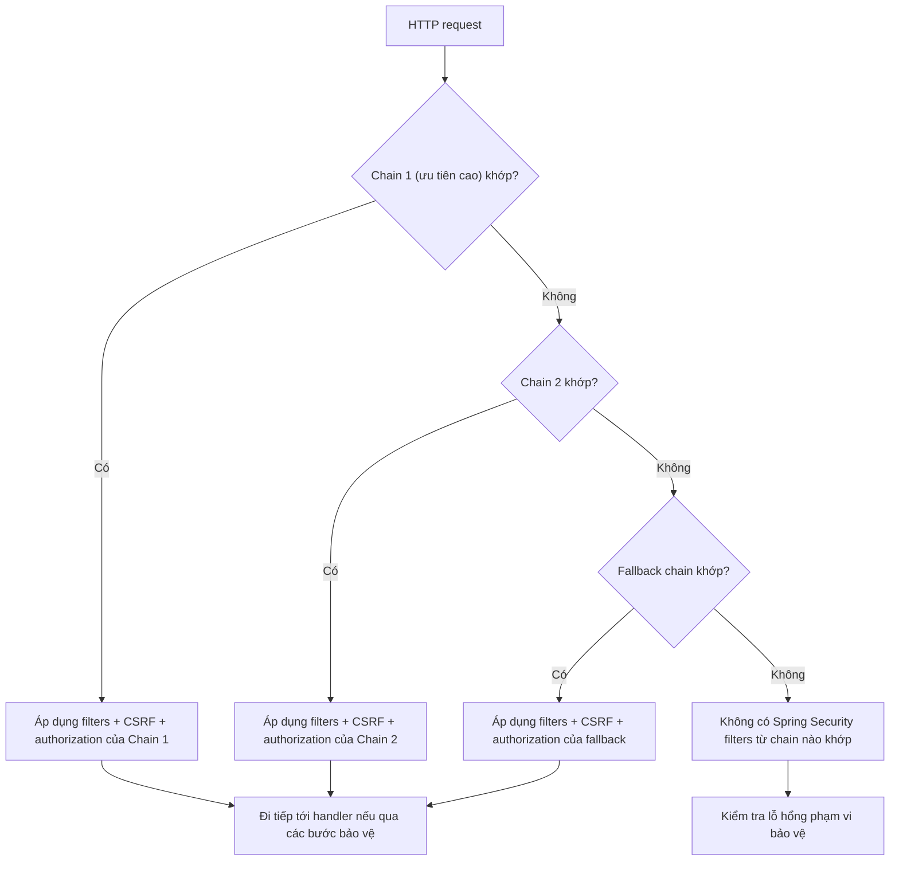

# Xử lý nhiều chain với chính sách CSRF khác nhau

> **Chương:** Phạm vi kiểm tra CSRF  
> **Module:** `SPRING_SECURITY_HTTP_PROTECTION` — triển khai phòng vệ HTTP và trình duyệt trong Spring Security, gồm CSRF, CORS, security headers, CSP, HSTS, HTTP firewall và session trên cả Servlet lẫn Reactive.  
> **Tình huống trung tâm:** Một hệ thống phục vụ đồng thời giao diện web xác thực bằng cookie, REST API chỉ nhận bearer token và webhook xác thực bằng chữ ký. Mỗi nhóm có mô hình đe dọa khác nhau, vì vậy cần chọn đúng **security chain** trước khi áp dụng chính sách CSRF.

## 1. Mục tiêu học tập

Sau bài này, người học có thể:

1. Giải thích cơ chế **chọn security chain đầu tiên khớp** và phân biệt matcher chọn chain với matcher yêu cầu CSRF hoặc miễn trừ CSRF.
2. Xây dựng mô hình ba khu vực: **web session cần CSRF**, **bearer-only API có thể không cần CSRF**, **webhook có cơ chế xác minh riêng**.
3. Cấu hình nhiều `SecurityFilterChain` cho Spring MVC/Servlet và nhiều `SecurityWebFilterChain` cho Spring WebFlux/Reactive.
4. Kiểm tra thứ tự `@Order`, matcher chồng lấn, chain dự phòng (fallback) và hậu quả nếu request không khớp bất cứ chain nào.
5. Chẩn đoán việc request bị 403 CSRF trong chain không mong đợi, hoặc ngược lại bị miễn CSRF vì lọt vào chain sai.
6. Viết ma trận kiểm thử chứng minh browser không thể đi vòng CSRF qua API bearer/webhook và bảo đảm CORS, security headers, session vẫn hoạt động theo đúng phạm vi.

**Nguyên tắc:** Chính sách CSRF không được suy ra chỉ từ tên URL như `/api/**`. Trước hết phải xác định **client và credential mà server thực sự chấp nhận**, rồi tổ chức route và security chain theo hợp đồng đó.

## 2. Vì sao một ứng dụng cần nhiều security chain?

Một dịch vụ bán hàng có thể phục vụ ba loại request:

| Nhóm | Ví dụ | Credential được server chấp nhận | Chính sách CSRF hợp lý |
|---|---|---|---|
| Web browser | `POST /web/orders`, `POST /logout` | Session cookie hoặc JWT trong cookie | **Bắt buộc CSRF token** cho method không an toàn |
| Mobile/CLI/máy–máy | `POST /api/m2m/orders` | `Authorization: Bearer ...` do client chủ động gắn | Có thể tắt CSRF ở **chain bearer-only đã kiểm chứng** |
| Webhook đối tác | `POST /integrations/payment-events` | Chữ ký HMAC/mTLS, không dùng cookie session | Có thể miễn CSRF **đúng method/route**, vẫn phải xác minh nguồn và chống replay |

Nếu tất cả đi qua một chain rồi viết `csrf.disable()` để mobile/webhook hoạt động, các thao tác web dùng session cookie cũng mất phòng vệ. Nếu giữ CSRF bắt buộc trên toàn bộ chain, client máy–máy vốn không có browser session/CSRF token lại có thể bị 403.

Nhiều chain cho phép tách ranh giới xác thực. Tuy nhiên, **mỗi chain chỉ hữu ích khi request đi vào đúng chain** và không có đường xác thực phụ như fallback từ bearer sai sang session cookie.

### 2.1. Ba loại matcher hoàn toàn khác nhau

| Matcher / rule | Câu hỏi trả lời | Ảnh hưởng |
|---|---|---|
| Servlet `http.securityMatcher(...)` | Request này có thuộc `SecurityFilterChain` đang khai báo không? | **Chọn chain** |
| WebFlux `http.securityMatcher(...)` | `ServerWebExchange` có thuộc chain reactive này không? | **Chọn chain** |
| `authorizeHttpRequests().requestMatchers(...)` hoặc `authorizeExchange().pathMatchers(...)` | Principal có được phép truy cập **sau khi chain đã chọn** không? | Phân quyền |
| `csrf().requireCsrfProtectionMatcher(...)` | Request trong chain có phải có CSRF token không? | Quy tắc bắt buộc CSRF |
| Servlet `csrf().ignoringRequestMatchers(...)` | Request nào trong chain được miễn token CSRF? | Ngoại lệ CSRF, **không đổi quyền** |

**Không được nhầm** `securityMatcher` với `requestMatchers` nằm bên trong authorization DSL. Một rule `permitAll` cho webhook trong chain thứ ba sẽ **không được xét** nếu chain thứ nhất đã khớp và xử lý webhook đó.

### 2.2. Cách Spring Security chọn chain

Ở Servlet, `FilterChainProxy` xem danh sách `SecurityFilterChain` theo thứ tự và chọn **chain đầu tiên** có request matcher khớp. Ở WebFlux, `WebFilterChainProxy` chọn `SecurityWebFilterChain` phù hợp theo thứ tự. Request không lần lượt “đi qua tất cả các chain”.



Bài học từ sơ đồ:

- `@Order(1)` được xét trước `@Order(2)`; thứ tự khai báo trong file Java không thay thế `@Order`.
- Chain có matcher rất rộng, ví dụ `/**`, đặt trước các chain chuyên biệt có thể “nuốt” mọi request.
- Nếu không có fallback chain, một request không khớp chain nào có thể đi đến ứng dụng **mà không chịu các Spring Security filters tương ứng**.
- Không nên cấu hình cho hai chain cùng khớp một request rồi hy vọng Spring Security sẽ “ghép” CSRF của chain A với authorization của chain B.

## 3. Thiết kế ranh giới trước khi viết code

Đề xuất phân chia route:

| Phạm vi | Method/route | CSRF | Bảo vệ khác |
|---|---|---|---|
| Browser | `POST /web/orders` | Bật, yêu cầu token | Session login, quyền tạo đơn |
| Browser | `POST /logout` | Bật, yêu cầu token | Quản lý phiên/logout |
| Browser | `GET /register` | Không yêu cầu theo method | `permitAll`, security headers |
| Browser | `POST /register` | Bật, yêu cầu token | `permitAll` về quyền, chống lạm dụng |
| Bearer API | `POST /api/m2m/orders` | Tắt trong bearer-only chain | JWT validation, `SCOPE_orders.write` |
| Bearer API | `GET /api/m2m/orders` | Tắt trong bearer-only chain | Scope/read permission riêng |
| Webhook | `POST /integrations/payment-events` | Tắt hoặc miễn đúng endpoint | HMAC/PKI, timestamp, replay, idempotency |
| Các route khác | Không khớp route chuyên biệt | Chính sách của fallback web chain | Mặc định yêu cầu authentication |

Với các endpoint web, CSRF phù hợp vì browser tự đính kèm session cookie hoặc cookie JWT. Với bearer-only API, token được client chủ động gắn vào header và **không có cookie/session fallback**. Với webhook, chữ ký xác thực request máy–máy và kiểm soát phát lại.

**Một điểm quan trọng:** Tắt CSRF trong một chain không tự chứng minh request đã xác thực hoặc có quyền. API bearer vẫn phải kiểm tra JWT và scope. Webhook vẫn phải xác minh chữ ký **trước khi** cập nhật dữ liệu.

### 3.1. Một request phải có một hợp đồng xác thực nhất quán

Bảng này giúp phát hiện vùng mơ hồ:

| Request | Có thể nhận session cookie? | Có thể nhận bearer header? | Thiết kế |
|---|---|---|---|
| `POST /web/orders` | Có | Không, theo hợp đồng | Browser chain bật CSRF |
| `POST /api/m2m/orders` | **Không** | Có | Bearer-only chain tắt CSRF |
| `POST /integrations/payment-events` | **Không** | Không, dùng chữ ký riêng | Webhook chain xác minh chữ ký |
| `POST /api/legacy/orders` | Có | Có | **Không** miễn toàn route; nên tách hai đường vào |

Một API “stateless” không có nghĩa là CSRF không còn nếu backend vẫn đọc JWT từ cookie. Ngược lại, tách chain bearer-only không có tác dụng nếu custom authentication filter toàn cục vẫn dùng session cookie để xác thực request của chain đó.

## 4. Servlet: ba `SecurityFilterChain` với ba chính sách

Ví dụ dưới đây dùng Spring Security 6.x và giả định `DispatcherServlet` được mapping tại `/`. Các route minh họa:

- `POST /integrations/payment-events`: webhook ký số, không dùng phiên người dùng.
- `/api/m2m/**`: JWT bearer-only, không có session fallback.
- Các request khác: web dùng form login/session, CSRF bật.

### 4.1. Chain 1: webhook chính xác theo method và path

```java
import org.springframework.context.annotation.Bean;
import org.springframework.core.annotation.Order;
import org.springframework.security.config.annotation.web.builders.HttpSecurity;
import org.springframework.security.config.annotation.web.configurers.AbstractHttpConfigurer;
import org.springframework.security.config.http.SessionCreationPolicy;
import org.springframework.security.web.SecurityFilterChain;
import org.springframework.security.web.util.matcher.RequestMatcher;

@Bean
@Order(1)
SecurityFilterChain signedWebhook(HttpSecurity http) throws Exception {
    RequestMatcher paymentPost = request ->
        "POST".equals(request.getMethod())
            && "/integrations/payment-events".equals(
                request.getServletPath());

    http
        .securityMatcher(paymentPost)
        .sessionManagement(session -> session
            .sessionCreationPolicy(SessionCreationPolicy.STATELESS))
        .csrf(AbstractHttpConfigurer::disable)
        .authorizeHttpRequests(auth -> auth
            .anyRequest().permitAll());

    // Handler/filter riêng PHẢI xác minh chữ ký trước khi thay đổi dữ liệu.
    return http.build();
}
```

Giải thích:

- Chain này chỉ được chọn khi **POST và path chính xác** cùng khớp.
- `csrf.disable()` chỉ tắt CSRF **trong chain webhook**.
- `permitAll` chỉ cho phép request đi tới trình xác minh chữ ký; nó **không xác thực** webhook.
- Request thiếu/sai chữ ký, quá hạn hoặc bị replay phải bị từ chối trong filter/controller/service xác minh webhook.
- `getServletPath()` phụ thuộc servlet mapping. Với context path hoặc reverse proxy, kiểm thử path thực mà matcher nhìn thấy; có thể thay bằng matcher đường dẫn tương thích với stack.

Nếu không muốn tạo chain riêng, có thể giữ một web chain và dùng `csrf.ignoringRequestMatchers(exactWebhookMatcher)`. Hai cách cần được lựa chọn nhất quán, không tạo đồng thời nhiều ngoại lệ rộng.

### 4.2. Chain 2: bearer-only API

```java
import org.springframework.context.annotation.Bean;
import org.springframework.core.annotation.Order;
import org.springframework.http.HttpMethod;
import org.springframework.security.config.Customizer;
import org.springframework.security.config.annotation.web.builders.HttpSecurity;
import org.springframework.security.config.annotation.web.configurers.AbstractHttpConfigurer;
import org.springframework.security.config.http.SessionCreationPolicy;
import org.springframework.security.web.SecurityFilterChain;

@Bean
@Order(2)
SecurityFilterChain bearerOnlyApi(HttpSecurity http) throws Exception {
    http
        .securityMatcher("/api/m2m/**")
        .sessionManagement(session -> session
            .sessionCreationPolicy(SessionCreationPolicy.STATELESS))
        .csrf(AbstractHttpConfigurer::disable)
        .oauth2ResourceServer(oauth2 -> oauth2
            .jwt(Customizer.withDefaults()))
        .authorizeHttpRequests(auth -> auth
            .requestMatchers(
                HttpMethod.POST, "/api/m2m/orders")
                .hasAuthority("SCOPE_orders.write")
            .requestMatchers(
                HttpMethod.GET, "/api/m2m/orders")
                .hasAuthority("SCOPE_orders.read")
            .anyRequest().denyAll());

    return http.build();
}
```

Ở đây:

1. Chain 2 chỉ xét request chưa khớp chain 1 và thuộc `/api/m2m/**`.
2. Access token phải được gửi bằng bearer header và được xác minh qua JWT decoder/trust configuration (issuer/JWK, audience/expiry/scope phù hợp).
3. `SessionCreationPolicy.STATELESS` không tự kiểm tra hoặc loại mọi custom filter đọc cookie. **Phải chứng minh cookie session hợp lệ không xác thực được ở bearer chain**.
4. Những method/route chưa khai báo nhận `denyAll`; tắt CSRF không đồng nghĩa mở quyền.
5. `Authorization: Bearer` bị thiếu hoặc không hợp lệ phải bị từ chối, kể cả request đồng thời mang session cookie hợp lệ.

### 4.3. Chain 3: fallback cho browser/session

```java
import org.springframework.context.annotation.Bean;
import org.springframework.core.annotation.Order;
import org.springframework.http.HttpMethod;
import org.springframework.security.config.Customizer;
import org.springframework.security.config.annotation.web.builders.HttpSecurity;
import org.springframework.security.web.SecurityFilterChain;

@Bean
@Order(3)
SecurityFilterChain browserFallback(HttpSecurity http) throws Exception {
    http
        .authorizeHttpRequests(auth -> auth
            .requestMatchers(HttpMethod.GET, "/register").permitAll()
            .requestMatchers(HttpMethod.POST, "/register").permitAll()
            .requestMatchers(HttpMethod.GET, "/assets/**").permitAll()
            .anyRequest().authenticated())
        .formLogin(Customizer.withDefaults())
        .csrf(Customizer.withDefaults());

    return http.build();
}
```

**Không gọi `securityMatcher(...)`** ở đây để chain có phạm vi mặc định rộng và làm fallback cho những request chưa được các chain trước chọn. CSRF bật; POST `/register` dù `permitAll` về quyền vẫn cần CSRF token, giống các form login và thao tác khác từ browser.

Ba snippet là **ba bean chain đồng thời** trong một cấu hình ứng dụng, mỗi bean chỉ tạo một filter chain. Các import có thể gộp vào một lớp khi sử dụng. Ứng dụng thực tế cần bổ sung bean JWT decoder, user authentication và handler webhook theo hạ tầng riêng.

### 4.4. Ma trận chọn chain Servlet

| Request | Chain đầu tiên khớp | CSRF theo chain | Kiểm tra bắt buộc khác |
|---|---|---|---|
| `POST /integrations/payment-events`, chữ ký hợp lệ | 1: webhook | Không cần token | Chữ ký, timestamp, replay, nghiệp vụ |
| Cùng route, chữ ký sai hoặc không có | 1: webhook | Không cần token | **Từ chối bởi verifier** |
| `PUT /integrations/payment-events` | 3: fallback | Bắt buộc vì PUT | Authentication/authorization |
| `POST /integrations/payment-events/extra` | 3: fallback | Bắt buộc | Authentication/authorization |
| `POST /api/m2m/orders`, JWT đúng scope | 2: bearer | Không cần token | JWT + scope |
| Cùng route, chỉ có session cookie hợp lệ | 2: bearer | Không cần token | **Từ chối vì thiếu bearer** |
| Cùng route, bearer sai + cookie hợp lệ | 2: bearer | Không cần token | **Từ chối, không fallback** |
| `PATCH /api/m2m/orders` | 2: bearer | Không cần token | `denyAll` theo ví dụ |
| `POST /web/orders`, session hợp lệ, thiếu token | 3: fallback | **Bị CSRF chặn** | Không thực thi nghiệp vụ |
| `POST /web/orders`, session hợp lệ, token đúng | 3: fallback | Qua CSRF | Quyền và nghiệp vụ |
| `POST /register`, anonymous, không token | 3: fallback | **Bị CSRF chặn** | `permitAll` không thay CSRF |
| `GET /register`, anonymous | 3: fallback | Không cần theo method | `permitAll` |
| `OPTIONS /api/m2m/orders` | 2: bearer | Không cần token | CORS/preflight cần xử lý riêng |

Điểm cuối của bảng cần lưu ý: CORS preflight có thể đi vào chain có matcher `/api/m2m/**`, nhưng preflight `OPTIONS` thường không có bearer credential. Cấu hình CORS nên xử lý preflight trước authentication/authorization, với origin/method/header theo nhu cầu. `permitAll` cho OPTIONS một mình không tự tạo CORS response đầy đủ.

## 5. Reactive: nhiều `SecurityWebFilterChain` với CSRF khác nhau

Trong WebFlux, bộ lọc tương ứng là `CsrfWebFilter` nằm trong `SecurityWebFilterChain`, còn matcher chọn chain nhận `ServerWebExchange`. Không copy trực tiếp kiểu `RequestMatcher` và API của Servlet sang Reactive.

### 5.1. Chain 1 WebFlux: webhook method + path chính xác

```java
import org.springframework.context.annotation.Bean;
import org.springframework.core.annotation.Order;
import org.springframework.http.HttpMethod;
import org.springframework.security.config.web.server.ServerHttpSecurity;
import org.springframework.security.web.server.SecurityWebFilterChain;
import org.springframework.security.web.server.util.matcher.ServerWebExchangeMatcher;

@Bean
@Order(1)
SecurityWebFilterChain reactiveWebhook(ServerHttpSecurity http) {
    ServerWebExchangeMatcher paymentPost = exchange -> {
        boolean matches =
            exchange.getRequest().getMethod() == HttpMethod.POST
                && "/integrations/payment-events".equals(
                    exchange.getRequest()
                        .getPath().pathWithinApplication().value());

        return matches
            ? ServerWebExchangeMatcher.MatchResult.match()
            : ServerWebExchangeMatcher.MatchResult.notMatch();
    };

    return http
        .securityMatcher(paymentPost)
        .csrf(ServerHttpSecurity.CsrfSpec::disable)
        .authorizeExchange(auth -> auth
            .anyExchange().permitAll())
        .build();
}
```

Chain chỉ nhận POST webhook. Handler/`WebFilter` riêng phải xác minh chữ ký trên nội dung gốc, timestamp và chống replay **trước khi cập nhật dữ liệu**. Một request webhook không token CSRF nhưng chữ ký sai vẫn phải bị từ chối.

### 5.2. Chain 2 WebFlux: bearer-only

```java
import org.springframework.context.annotation.Bean;
import org.springframework.core.annotation.Order;
import org.springframework.http.HttpMethod;
import org.springframework.security.config.Customizer;
import org.springframework.security.config.web.server.ServerHttpSecurity;
import org.springframework.security.web.server.SecurityWebFilterChain;
import org.springframework.security.web.server.context.NoOpServerSecurityContextRepository;
import org.springframework.security.web.server.util.matcher.PathPatternParserServerWebExchangeMatcher;

@Bean
@Order(2)
SecurityWebFilterChain reactiveBearerApi(ServerHttpSecurity http) {
    return http
        .securityMatcher(
            new PathPatternParserServerWebExchangeMatcher("/api/m2m/**"))
        .securityContextRepository(
            NoOpServerSecurityContextRepository.getInstance())
        .csrf(ServerHttpSecurity.CsrfSpec::disable)
        .oauth2ResourceServer(oauth2 -> oauth2
            .jwt(Customizer.withDefaults()))
        .authorizeExchange(auth -> auth
            .pathMatchers(HttpMethod.POST, "/api/m2m/orders")
                .hasAuthority("SCOPE_orders.write")
            .pathMatchers(HttpMethod.GET, "/api/m2m/orders")
                .hasAuthority("SCOPE_orders.read")
            .anyExchange().denyAll())
        .build();
}
```

`NoOpServerSecurityContextRepository` không tải/lưu security context từ `WebSession` cho chain bearer. Tuy nhiên, điều này **không loại trừ** custom WebFilter hoặc gateway có thể gán authentication từ cookie/header không đúng hợp đồng. Vẫn cần test khi request chỉ mang web session hợp lệ hoặc bearer sai kèm cookie.

### 5.3. Chain 3 WebFlux: fallback browser

```java
import org.springframework.context.annotation.Bean;
import org.springframework.core.annotation.Order;
import org.springframework.http.HttpMethod;
import org.springframework.security.config.Customizer;
import org.springframework.security.config.web.server.ServerHttpSecurity;
import org.springframework.security.web.server.SecurityWebFilterChain;

@Bean
@Order(3)
SecurityWebFilterChain reactiveBrowserFallback(ServerHttpSecurity http) {
    return http
        .authorizeExchange(auth -> auth
            .pathMatchers(HttpMethod.GET, "/register").permitAll()
            .pathMatchers(HttpMethod.POST, "/register").permitAll()
            .pathMatchers(HttpMethod.GET, "/assets/**").permitAll()
            .anyExchange().authenticated())
        .formLogin(Customizer.withDefaults())
        .csrf(Customizer.withDefaults())
        .build();
}
```

Khi dùng nhiều chain WebFlux, `@Order` ưu tiên chain đặc thù; chain cuối không giới hạn `securityMatcher` để nhận các request còn lại. SPA dùng `WebSession` và cookie vẫn cần nhận/gửi CSRF token cho POST/PATCH/DELETE.

### 5.4. Lưu ý riêng về Reactive và streaming

WebFlux không làm biến mất nguy cơ CSRF: browser vẫn có thể gửi cookie session. Với WebSocket/SockJS, CSRF HTTP matcher mặc định theo method không bao phủ toàn bộ hành động phát sinh **sau handshake GET**; cần xác thực phiên/kết nối và áp dụng kiểm tra Origin, token hoặc cơ chế bảo vệ phù hợp giao thức, đặc biệt nếu có cookie session. Đánh dấu các endpoint streaming/WebSocket thành nhóm riêng khi kiểm kê; không đưa chúng mặc nhiên vào chain bearer-only chỉ vì là API Reactive.

## 6. Các lỗi thường gặp với thứ tự và phạm vi matcher

### 6.1. Chain rộng đứng trước chain chuyên biệt

```java
// PHẢN VÍ DỤ: chain này khớp tất cả request trước bearer API.
@Bean
@Order(1)
SecurityFilterChain broadWebChain(HttpSecurity http) throws Exception {
    http.authorizeHttpRequests(auth -> auth
        .anyRequest().authenticated());
    return http.build();
}

@Bean
@Order(2)
SecurityFilterChain intendedBearerChain(HttpSecurity http)
        throws Exception {
    http.securityMatcher("/api/m2m/**");
    // ...
    return http.build();
}
```

Trong tình huống này, request `POST /api/m2m/orders` vào chain đầu tiên và có thể bị yêu cầu CSRF token hoặc bị redirect đến form login. Chain 2 sẽ không được chọn. Phải đặt chain chuyên biệt **trước** chain rộng/fallback.

### 6.2. Hai chain cùng match một route, tưởng sẽ cộng dồn bảo vệ

Nếu cả chain A và B đều khớp `/api/**`, chỉ một chain được chọn theo thứ tự. Không có chuyện CSRF của A cộng với JWT scope của B. Cần chỉnh matcher để mỗi đường có hợp đồng rõ, hoặc gộp rule vào một chain khi thực sự cùng mô hình xác thực.

### 6.3. Thiếu fallback chain

Nếu chỉ định nghĩa `securityMatcher("/api/m2m/**")` và `securityMatcher("/admin/**")`, nhưng không có chain nào khớp `/web/orders`, request web có thể không được bảo vệ bởi Spring Security. Không suy luận rằng framework luôn tự sinh fallback sau khi đã tự định nghĩa security chains. Cần một chain rộng cuối cùng hoặc một chính sách rõ ràng cho mọi request.

### 6.4. Dùng `requestMatchers` phân quyền thay cho `securityMatcher`

```java
// Cấu hình này KHÔNG giới hạn chain chỉ ở /api/m2m/**.
http.authorizeHttpRequests(auth -> auth
    .requestMatchers("/api/m2m/**").authenticated()
    .anyRequest().permitAll());
```

Nếu ở cùng chain đã `csrf.disable()`, việc chỉ giới hạn authorization rule theo URL không giúp bật CSRF cho `/web/**`. `securityMatcher` mới là điều kiện chọn chain; `requestMatchers` chỉ kiểm soát quyền bên trong chain đó.

### 6.5. Dùng header client tự khai để quyết định chain

Một `securityMatcher` kiểm tra `Authorization` có mặt hoặc `X-Client-Type: mobile` là tín hiệu dễ bị giả. Nếu bearer token sai mà server có fallback session, một request có header giả có thể vào chain CSRF-off rồi được xác thực qua cookie. Tránh điều này bằng đường dẫn bearer-only và cơ chế xác thực fail-closed, không fallback.

### 6.6. Wildcard ngoại lệ vượt khỏi hợp đồng

`csrf.ignoringRequestMatchers("/api/**")` trong chain browser có thể miễn mọi POST web dùng session. Tương tự, việc miễn cả `/integrations/**` có thể bao trùm route quản trị được thêm sau. Ngoại lệ phải có phạm vi method + path hoặc chain riêng thật sự độc lập.

### 6.7. `permitAll` không loại bỏ CSRF

Một `POST /register` công khai vẫn cần token trong browser chain. Một webhook có `permitAll` nhưng không được miễn CSRF vẫn có thể bị `CsrfFilter` chặn trước khi verifier kiểm tra chữ ký. Authorization và CSRF là hai quyết định độc lập.

## 7. CORS, security headers, HTTP firewall và session trong nhiều chain

Nhiều chain cho phép thay đổi chính sách CSRF nhưng cần kiểm tra cả các lớp phòng vệ còn lại.

| Lớp bảo vệ | Tác động khi có nhiều chain |
|---|---|
| CSRF | Mỗi chain có matcher, repository và bật/tắt riêng; request chỉ nhận chính sách của chain được chọn |
| Authentication | Chain bearer xử lý JWT, chain browser xử lý session/login; không tự ghép principal giữa các chain |
| Authorization | Quy tắc nằm trong từng chain; `permitAll` của chain không được chọn không có hiệu lực |
| Security headers | Mỗi chain có cấu hình headers của nó; tắt CSRF không đồng nghĩa tắt headers |
| CSP | Cần bật chủ động ở chain/đường trả HTML phù hợp; không được mặc định CSP có sẵn |
| HSTS | Có thể được Spring Security ghi trên HTTPS theo cấu hình; proxy cũng có thể ghi riêng |
| CORS | Preflight OPTIONS cần được CORS xử lý trước những bước đòi authentication; CORS không thay CSRF |
| HTTP firewall | Servlet `FilterChainProxy` áp dụng firewall/chuẩn hóa request trước khi chọn filters; cần kiểm tra path thực tế |
| Session | `STATELESS`/NoOp repository hỗ trợ bearer-only nhưng custom filter vẫn có thể đọc cookie; browser chain cần session/CSRF token phù hợp |

**Không nên dùng `web.ignoring()` để “miễn CSRF” cho một nhánh:** việc bỏ cả chain còn có thể bỏ authentication, authorization và security headers của Spring Security. Dùng chain đúng phạm vi với `csrf.disable()` chỉ khi hợp đồng thực sự cho phép.

### 7.1. CORS preflight có thể rơi vào bearer chain

`OPTIONS /api/m2m/orders` khớp `/api/m2m/**`, nhưng preflight thường không có `Authorization`. Nếu bearer chain yêu cầu xác thực cho mọi request và CORS chưa được cấu hình, browser có thể thấy preflight lỗi trước POST thật.

Ví dụ Servlet có thể bật tích hợp CORS trong chain API:

```java
http
    .cors(Customizer.withDefaults())
    .securityMatcher("/api/m2m/**");
```

Điều này chỉ hữu ích khi đã cung cấp `CorsConfigurationSource` hoặc cấu hình CORS được Spring Security nhận diện và chính sách origin/method/header phù hợp. Không bật `*` cùng credential bừa bãi. Với WebFlux, cần cấu hình CORS tương ứng (`CorsWebFilter`/tích hợp Spring Security) cho các route cross-origin. Việc `OPTIONS` không cần CSRF token không có nghĩa mọi preflight sẽ được thông qua khi chưa có CORS policy hợp lệ.

### 7.2. CSRF token giữa các chain

Browser chain dùng `HttpSessionCsrfTokenRepository` (Servlet) hoặc `WebSessionServerCsrfTokenRepository` (Reactive) theo cấu hình thông dụng. Token có thể được cấp khi render form hoặc qua cơ chế SPA, gắn với phiên/ngữ cảnh bảo vệ.

Không mong bearer-only hoặc webhook chain cấp/đòi CSRF token nếu đã tắt CSRF ở chúng. Một browser chuyển từ thao tác GET web sang POST web phải gửi token hợp lệ của browser chain; POST với token của một phiên khác không đủ. Khi thay đổi login/logout/session, xem xét vòng đời token, deferred token và request handler phù hợp phiên bản.

### 7.3. Reverse proxy, context path và HTTP firewall

Nếu gateway chuyển `/payments/events` công khai thành `/integrations/payment-events` nội bộ, matcher Spring Security thường đánh giá đường dẫn mà ứng dụng nhận **sau** routing/rewrite. Một matcher lấy `getServletPath()` có thể khác path external do context path hoặc servlet mapping. WebFlux dùng `pathWithinApplication()` tương ứng.

Kiểm thử dưới cùng cấu hình proxy/header forwarding gần production. Không dùng giá trị `X-Forwarded-*` do client tùy ý gửi để quyết định security chain nếu proxy chưa làm sạch và thiết lập nguồn tin cậy. `StrictHttpFirewall` có thể từ chối path/method/encoding bất thường trước khi các matcher CSRF hoạt động.

## 8. Kiểm thử: phải chứng minh cả chain selection lẫn CSRF

Một test 403 không chứng minh CSRF đã hoạt động, vì authorization thiếu scope cũng trả 403. Một test JWT mock thành công không chứng minh decoder đã xác minh chữ ký thật. Kế hoạch kiểm thử cần tách ba vấn đề:

1. **Chain nào được chọn** theo method + path?
2. **CSRF có được thực thi** theo chính sách của chain đó?
3. **Credential/authorization** và nghiệp vụ có được kiểm tra đúng không?

### 8.1. Ma trận kiểm thử trọng yếu

| Tình huống | Chain mong đợi | Kết quả |
|---|---|---|
| `POST /web/orders`, session hợp lệ, không CSRF token | Browser fallback | CSRF từ chối |
| Cùng request, token sai | Browser fallback | CSRF từ chối |
| Cùng request, token đúng | Browser fallback | Đi tiếp tới quyền/nghiệp vụ |
| `POST /register`, anonymous, không token | Browser fallback | CSRF từ chối dù `permitAll` |
| `POST /register`, anonymous, token hợp lệ | Browser fallback | Đi tiếp tới đăng ký |
| `POST /api/m2m/orders`, JWT hợp lệ + scope, không CSRF | Bearer-only | Được xử lý theo nghiệp vụ |
| Cùng route, JWT thiếu | Bearer-only | Từ chối authentication |
| Cùng route, JWT sai, nhưng kèm **session cookie hợp lệ** | Bearer-only | **Không fallback** sang session |
| Cùng route, chỉ có cookie/session hợp lệ | Bearer-only | **Không xác thực** bằng cookie |
| Cùng route, JWT đúng nhưng thiếu scope | Bearer-only | Bị phân quyền từ chối |
| `PATCH /api/m2m/orders`, JWT hợp lệ | Bearer-only | `denyAll` theo ví dụ |
| `POST /integrations/payment-events`, chữ ký hợp lệ | Webhook | Không đòi CSRF, verifier cho qua |
| Cùng route, chữ ký sai/thiếu | Webhook | Verifier từ chối trước nghiệp vụ |
| `PUT /integrations/payment-events`, thiếu CSRF | Browser fallback | CSRF từ chối |
| `POST /integrations/payment-events/other`, thiếu token | Browser fallback | CSRF từ chối |
| `GET /register` anonymous | Browser fallback | Được `permitAll` |
| `OPTIONS /api/m2m/orders` CORS preflight | Bearer-only/CORS | Theo CORS policy, không lỗi CSRF |
| Route khác không nằm trong hai chain chuyên dụng | Fallback | Không bị bỏ khỏi bảo vệ Spring Security |

**Đặc biệt:** test cookie-only phải sử dụng một session web **thực sự hợp lệ**. Cookie giả luôn bị từ chối và không chứng minh rằng hệ thống không có đường fallback.

### 8.2. Servlet với MockMvc: xác minh CSRF của browser chain

Giả định test đã tích hợp Spring Security filters, `POST /web/orders` có handler tạo đơn trả 201 khi body hợp lệ và user `alice` có đủ quyền.

```java
import static org.springframework.security.test.web.servlet.request.SecurityMockMvcRequestPostProcessors.csrf;
import static org.springframework.security.test.web.servlet.request.SecurityMockMvcRequestPostProcessors.user;
import static org.springframework.test.web.servlet.request.MockMvcRequestBuilders.post;
import static org.springframework.test.web.servlet.result.MockMvcResultMatchers.status;

@Test
void webOrderWithoutCsrfIsRejected() throws Exception {
    mockMvc.perform(post("/web/orders")
            .with(user("alice"))
            .contentType("application/json")
            .content("{\"productId\":42,\"quantity\":1}"))
        .andExpect(status().isForbidden());
}

@Test
void webOrderWithCsrfCanProceed() throws Exception {
    mockMvc.perform(post("/web/orders")
            .with(user("alice"))
            .with(csrf())
            .contentType("application/json")
            .content("{\"productId\":42,\"quantity\":1}"))
        .andExpect(status().isCreated());
}

@Test
void webOrderWithInvalidCsrfIsRejected() throws Exception {
    mockMvc.perform(post("/web/orders")
            .with(user("alice"))
            .with(csrf().useInvalidToken())
            .contentType("application/json")
            .content("{\"productId\":42,\"quantity\":1}"))
        .andExpect(status().isForbidden());
}
```

Kỳ vọng 201 chỉ đúng nếu handler/test fixture trả 201. `with(user(...))` phù hợp để kiểm tra CSRF/authorization của web chain, nhưng **không phù hợp để chứng minh cookie fallback** vì nó gắn authentication giả lập vào security context test.

### 8.3. Servlet: test bearer chain và webhook

```java
import org.springframework.security.core.authority.SimpleGrantedAuthority;
import static org.springframework.security.test.web.servlet.request.SecurityMockMvcRequestPostProcessors.jwt;

@Test
void bearerPostWithMockJwtDoesNotNeedCsrf() throws Exception {
    mockMvc.perform(post("/api/m2m/orders")
            .with(jwt().authorities(
                new SimpleGrantedAuthority("SCOPE_orders.write")))
            .contentType("application/json")
            .content("{\"productId\":42,\"quantity\":1}"))
        .andExpect(status().isCreated());
}
```

`jwt()` chỉ là test helper giả lập authentication; test integration với signed JWT, issuer/audience/scope thực mới đánh giá đầy đủ JWT decoder. Với webhook, cần tạo body và chữ ký hợp lệ theo hợp đồng nhà cung cấp, gọi `POST /integrations/payment-events` không CSRF token và kiểm tra xử lý một lần. Gọi cùng route với chữ ký sai hoặc sự kiện replay phải bị từ chối/bỏ qua side effect.

Thêm test `PUT /integrations/payment-events` thiếu token và `POST /integrations/payment-events/other` thiếu token để chứng minh những request **không** lọt vào webhook chain.

**Test không fallback:** Tạo session bằng luồng đăng nhập test thực, chứng minh session đó được web chain nhận, rồi dùng chính session ấy để gọi bearer endpoint **không** có bearer và với bearer sai. Request phải bị từ chối; không dùng `with(user())` hoặc `with(jwt())` cho negative test này.

### 8.4. Reactive với WebTestClient

Giả định `WebTestClient` đi qua đúng `SecurityWebFilterChain`, handler trả 201 khi payload hợp lệ:

```java
import org.springframework.http.MediaType;
import org.springframework.security.core.authority.SimpleGrantedAuthority;
import static org.springframework.security.test.web.reactive.server.SecurityMockServerConfigurers.csrf;
import static org.springframework.security.test.web.reactive.server.SecurityMockServerConfigurers.mockUser;
import static org.springframework.security.test.web.reactive.server.SecurityMockServerConfigurers.mockJwt;

@Test
void reactiveWebPostWithoutCsrfIsForbidden() {
    webTestClient.mutateWith(mockUser("alice"))
        .post().uri("/web/orders")
        .contentType(MediaType.APPLICATION_JSON)
        .bodyValue("{\"productId\":42,\"quantity\":1}")
        .exchange()
        .expectStatus().isForbidden();
}

@Test
void reactiveWebPostWithCsrfCanProceed() {
    webTestClient.mutateWith(mockUser("alice"))
        .mutateWith(csrf())
        .post().uri("/web/orders")
        .contentType(MediaType.APPLICATION_JSON)
        .bodyValue("{\"productId\":42,\"quantity\":1}")
        .exchange()
        .expectStatus().isCreated();
}

@Test
void reactiveBearerPostDoesNotNeedCsrf() {
    webTestClient.mutateWith(mockJwt().authorities(
            new SimpleGrantedAuthority("SCOPE_orders.write")))
        .post().uri("/api/m2m/orders")
        .contentType(MediaType.APPLICATION_JSON)
        .bodyValue("{\"productId\":42,\"quantity\":1}")
        .exchange()
        .expectStatus().isCreated();
}
```

Thêm test bằng **WebSession đã xác thực thật** vào bearer chain mà không bearer; phải thất bại. Đối với webhook WebFlux, test chữ ký đúng/sai, request replay và path/method gần giống để bảo đảm chain matcher đúng.

### 8.5. Cách xác nhận chain nào thực sự chạy

- Bật log chẩn đoán phù hợp cho Spring Security trong môi trường test, theo dõi matcher và bộ lọc từ chối.
- Gửi cùng endpoint với token CSRF thiếu/sai/đúng để phân biệt lỗi CSRF với lỗi quyền.
- Với JWT chain, kiểm tra 401 khi bearer thiếu/sai, 403 khi thiếu scope và success khi token/scope đúng.
- Với webhook, xác minh side effect chỉ xảy ra khi chữ ký và event hợp lệ, không chỉ dựa trên status 2xx.
- Kiểm tra các security headers dự kiến của từng chain; header do proxy thêm có thể khiến test header đơn lẻ không đủ chứng minh chain.
- Không kết luận từ 403/302 đơn lẻ; đối chiếu authentication entry point, `CsrfFilter`/`CsrfWebFilter`, authorization và application exceptions.

## 9. Chẩn đoán các lỗi triển khai thường thấy

### 9.1. Mobile nhận 403 do CSRF

Khả năng lớn request mobile đi vào browser chain hoặc bearer chain chưa thực sự tắt CSRF. Kiểm tra `@Order`, `securityMatcher`, path sau reverse proxy, method thực tế và chain khác có match sớm hơn không.

### 9.2. Browser POST không token vẫn thành công

Có thể browser route bị match bởi chain CSRF-off có matcher rộng, hoặc fallback chain bị tắt CSRF; cũng có thể `web.ignoring()` bỏ cả filter chain. Kiểm tra đường xác thực cookie, chain selection và các ngoại lệ đang có. Đây là dấu hiệu cần sửa trước khi triển khai.

### 9.3. Request bearer thiếu token bị redirect 302 tới trang login

Thông thường bearer API phải trả 401 qua resource-server entry point khi thiếu bearer. Redirect login có thể cho thấy request rơi vào browser chain hoặc entry point chưa đúng. Kiểm tra `@Order` và matcher, không vội thêm `permitAll` để tránh redirect.

### 9.4. Webhook đã miễn CSRF nhưng vẫn nhận 403

Kiểm tra hai khả năng riêng: (1) webhook vào sai chain/CSRF matcher không khớp, (2) authorization hoặc verifier chữ ký từ chối đúng. Request webhook hợp lệ phải có test có chữ ký hợp lệ; request chữ ký sai phải bị từ chối dù không cần CSRF token.

### 9.5. CORS preflight thất bại dù POST bearer API hoạt động bằng curl

curl không chịu CORS của browser. OPTIONS preflight thường thiếu bearer và không yêu cầu CSRF, nhưng chain bearer có thể từ chối nếu không có CORS xử lý đúng. Cấu hình CORS theo origin/method/header cần thiết và kiểm thử từ browser. Không bật wildcard origin với credentials tùy tiện.

### 9.6. Route mới không được bất kỳ chain nào bảo vệ

Nếu các chain đều giới hạn matcher, một route mới `POST /reports/export` có thể lọt ra ngoài Spring Security filters. Kiểm thử fallback hoặc cấu hình một chain cuối bắt những request còn lại và thực thi chính sách bảo mật mặc định.

### 9.7. Cookie session xác thực được API bearer

Nếu request có cookie session hợp lệ nhưng không bearer vẫn gọi thành công bearer API, một authentication filter/custom resolver đã phá hợp đồng bearer-only, hoặc request đang đi qua chain khác. Phải loại bỏ fallback trước khi dựa vào việc tắt CSRF.

### 9.8. Security headers khác nhau khó hiểu

Mỗi chain có cấu hình header writer riêng; một chain có thể đặt CSP, chain khác không. Kiểm tra chính sách muốn áp dụng cho response HTML và HTTPS. HSTS thường gắn với HTTPS; CSP cần cấu hình chủ động. Việc tắt CSRF ở một chain **không tự động** tắt toàn bộ headers của chain đó.

## 10. Bài tập tình huống

Một dự án có các bean sau (mã rút gọn):

```java
@Bean
@Order(1)
SecurityFilterChain first(HttpSecurity http) throws Exception {
    http.authorizeHttpRequests(auth -> auth
        .anyRequest().authenticated())
        .formLogin(Customizer.withDefaults());
    return http.build();
}

@Bean
@Order(2)
SecurityFilterChain mobile(HttpSecurity http) throws Exception {
    http.securityMatcher("/api/m2m/**")
        .csrf(csrf -> csrf.disable())
        .oauth2ResourceServer(oauth2 -> oauth2.jwt());
    return http.build();
}
```

Cả web và mobile dùng ứng dụng này. Mobile gửi `POST /api/m2m/orders` với bearer JWT hợp lệ nhưng nhận 403 thiếu CSRF. Nhóm phát triển định thêm `csrf.disable()` vào bean `first`.

**Câu hỏi:**

1. Vì sao request mobile không vào bean `mobile`?
2. Nếu tắt CSRF ở `first`, các form web dùng session cookie chịu hậu quả gì?
3. Sửa cấu hình nào để mobile đi đúng chain, web vẫn có CSRF?
4. Làm thế nào xác minh không có bearer→cookie fallback?
5. Nếu thêm webhook riêng, nên đặt chain và matcher thế nào?

**Phân tích đáp án:**

1. `first` không có `securityMatcher` nên match mọi request và có `@Order(1)`. Nó bắt request mobile trước khi chain `mobile` có cơ hội xử lý.
2. Tắt CSRF ở `first` làm browser-session POST/PUT/PATCH/DELETE mất bảo vệ, dẫn tới nguy cơ CSRF.
3. Đặt bearer chain có matcher `/api/m2m/**` và `@Order(1)`, browser fallback `@Order(2)` không giới hạn matcher và bật CSRF. Bổ sung authorization scope phù hợp cho API bearer.
4. Tạo session browser hợp lệ, dùng nó gọi bearer API khi không có bearer hoặc có bearer sai. Cả hai phải bị từ chối. Không mô phỏng bằng security test post-processor gắn authentication trực tiếp.
5. Thêm chain webhook có ưu tiên cao, matcher **POST + path chính xác**, tắt CSRF **chỉ ở chain đó** và xác minh chữ ký/replay trước nghiệp vụ; hoặc dùng ngoại lệ CSRF hẹp trong một chain phù hợp.

Không tắt CSRF của chain web để “sửa” một vấn đề **chọn chain sai**.

## 11. Checklist thiết kế và review

- [ ] Đã kiểm kê endpoint theo method, path, client, credential và hành vi thay đổi trạng thái.
- [ ] Các chain có `securityMatcher` rõ ràng, chain đặc thù được ưu tiên trước fallback.
- [ ] Có fallback chain hoặc chính sách bao phủ các request không khớp chain chuyên dụng.
- [ ] Không nhầm `securityMatcher` với authorization `requestMatchers`/`pathMatchers`.
- [ ] Browser/session chain bật CSRF và có cơ chế phân phối token cho form/SPA.
- [ ] Bearer-only chain chỉ nhận bearer header, JWT được xác minh và không có cookie/Basic/session fallback.
- [ ] Webhook chain chỉ khớp đúng method/path, bắt buộc xác minh chữ ký và chống replay.
- [ ] Không suy `permitAll` đồng nghĩa miễn CSRF hoặc bỏ cả security chain.
- [ ] Không dùng `web.ignoring()` hay ngoại lệ `/api/**` rộng để né kiểm tra CSRF.
- [ ] Có test path chồng lấn, method khác, URL gần giống và path sau proxy/context path.
- [ ] Có test browser POST token thiếu/sai/đúng; bearer API thiếu/sai JWT và thiếu scope.
- [ ] Có test bearer API chỉ mang **session cookie hợp lệ** và bearer sai + cookie hợp lệ.
- [ ] Có test webhook chữ ký đúng/sai, timestamp/replay và không lặp side effect.
- [ ] OPTIONS preflight được CORS xử lý, không nhầm lỗi CORS với lỗi CSRF.
- [ ] Security headers, CSP, HSTS, HTTP firewall và session được đánh giá theo từng chain.
- [ ] Log/tracing đủ xác định chain, filter và nguyên nhân 401/403/302 mà không lộ token.

**Ghi nhớ:** Với nhiều Spring Security chain, **request được chọn vào một chain trước khi chính sách CSRF của chain đó có hiệu lực**. Hãy thiết kế matcher và thứ tự chain theo hợp đồng credential rõ ràng: web session cần CSRF, bearer-only có thể tắt CSRF sau khi loại bỏ cookie fallback, webhook có chữ ký riêng được miễn hẹp. Một fallback chain được kiểm thử giúp tránh các request vô tình đi ngoài hệ thống bảo vệ trên cả Servlet và Reactive.
