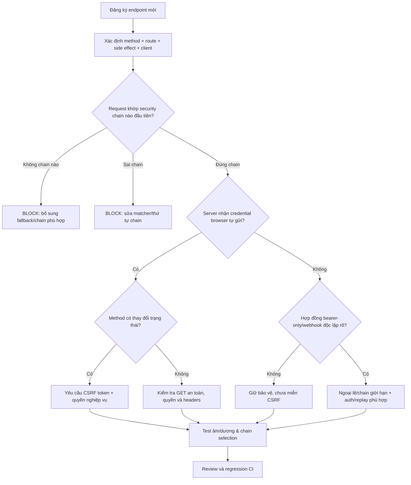

# Kiểm tra các endpoint mới có rơi ngoài phạm vi bảo vệ

> **Chương:** Phạm vi kiểm tra CSRF  
> **Module:** `SPRING_SECURITY_HTTP_PROTECTION` — áp dụng các lớp phòng vệ HTTP và trình duyệt trong Spring Security, gồm CSRF, CORS, security headers, CSP, HSTS, HTTP firewall và session trên Servlet lẫn Reactive.  
> **Vấn đề:** Một endpoint mới có thể hoạt động đúng về nghiệp vụ nhưng vô tình đi vào **sai security chain**, khớp **ngoại lệ CSRF quá rộng**, hoặc **không đi qua Spring Security filter chain**. Cần kiểm tra thế nào trước khi merge và triển khai?

## 1. Mục tiêu học tập

Sau bài học này, người học có thể:

1. Lập bản đồ endpoint mới theo **HTTP method, đường dẫn, tác động trạng thái, loại client, credential và hợp đồng xác thực**.
2. Phân biệt request **không yêu cầu CSRF theo quy tắc method an toàn**, request **được miễn CSRF có chủ đích**, request **vô tình đi ngoài vùng CSRF**, và request **không vào security chain nào**.
3. Đánh giá tác động khi thêm endpoint vào các vùng `/api/**`, `/public/**`, `/hooks/**`, `/assets/**` hoặc khi tạo chain mới có matcher chồng lấn.
4. Viết chính sách Servlet và Reactive có fallback rõ ràng, chỉ miễn trừ CSRF trong phạm vi đã kiểm chứng.
5. Thiết kế kiểm thử **âm/dương** phát hiện endpoint mới mất CSRF, bị chọn sai chain, nhận cookie fallback hoặc bị cấp quyền rộng hơn dự định.
6. Chẩn đoán 401/403/404/405, CORS, HTTP firewall và đường dẫn sau reverse proxy mà không nhầm nguyên nhân.
7. Đưa kiểm tra phạm vi bảo vệ vào review và quy trình CI, kể cả khi route, method hoặc cách lưu credential thay đổi.

**Nguyên tắc xuyên suốt:** Mỗi route mới phải có **chủ sở hữu bảo mật** và một kết luận rõ: “Nó thuộc chain nào? Có cần CSRF không? Ai được xác thực, bằng cách nào? Nếu không cần CSRF, bằng chứng nào chứng minh điều đó?”.

## 2. Endpoint mới có thể rơi ngoài bảo vệ theo những cách nào?

Mở rộng tính năng không chỉ là tạo thêm controller. Một dòng `@PostMapping` có thể thay đổi tập bề mặt tấn công và tương tác với các matcher đã tồn tại.

| Tình huống | Ví dụ | Rủi ro |
|---|---|---|
| Ngoại lệ CSRF dùng wildcard | Thêm `POST /api/account/change-password` vào `/api/**` vốn đang bị miễn CSRF | Browser dùng cookie có thể POST mà không token |
| Matcher yêu cầu CSRF quá hẹp | Chỉ bảo vệ `/orders/**`, thêm `POST /profile` | POST mới không được yêu cầu token |
| Chain bearer-only match quá rộng | `securityMatcher("/api/**")` nhưng `/api/web/**` dùng session cookie | Request web rơi vào chain tắt CSRF |
| Chain quá hẹp, thiếu fallback | Chỉ bảo vệ `/admin/**` và `/api/m2m/**`, thêm `POST /reports` | Request có thể không chạy Spring Security filters |
| `web.ignoring()` vùng rộng | Thêm `POST /public/admin/rebuild` dưới `/public/**` | Bỏ qua CSRF, authentication, authorization và header writers của chain |
| Authorization `permitAll` quá rộng | Thêm `DELETE /public/files/42` sau rule `/public/**.permitAll` | Cho phép truy cập ngoài dự định; CSRF có thể vẫn chạy |
| GET làm thay đổi trạng thái | `GET /orders/42/cancel` | Mặc định GET không cần CSRF; lỗi ngữ nghĩa HTTP |
| Hợp đồng credential thay đổi | Endpoint trước chỉ bearer, nay đọc JWT từ cookie | Giả định miễn CSRF không còn đúng |
| Route mới đi qua gateway | `/external/reports` được rewrite thành `/reports` | Matcher trong ứng dụng thấy path khác dự kiến |
| Controller được công bố qua cơ chế khác | GraphQL mutation, RPC, actuator, functional route | Bản đồ dựa riêng vào `@PostMapping` có thể bỏ sót |

Một endpoint **không cần CSRF token** không nhất thiết là lỗ hổng: GET chỉ đọc, bearer-only API và webhook được xác minh riêng có thể không cần CSRF. Vấn đề là **thiếu lý do bảo mật hoặc đánh giá nhầm đường đi thực tế của request**.

### 2.1. Ba câu hỏi độc lập cho từng endpoint

**1. Có thuộc Spring Security chain phù hợp không?**  
Matcher ở cấp chain quyết định các filters của chain đó có được chạy hay không. Nếu request không khớp bất kỳ chain nào, các Spring Security filters của những chain đó không bảo vệ request. Nếu chain khác khớp trước, chain dự định sẽ không được chọn.

**2. Khi vào chain, CSRF matcher quyết định gì?**  
Quy tắc mặc định khi bật CSRF thường không yêu cầu token với `GET`, `HEAD`, `OPTIONS`, `TRACE`; các method còn lại yêu cầu token trừ khi được miễn trừ. `csrf.disable()` trên một chain hoặc `requireCsrfProtectionMatcher(...)` tùy chỉnh có thể thay đổi kết quả.

**3. Sau CSRF, authentication và authorization có phù hợp không?**  
`permitAll` không tắt CSRF. `authenticated`/`hasAuthority` không thay CSRF. Endpoint được miễn CSRF vẫn phải có xác thực và phân quyền riêng phù hợp với client (ví dụ JWT bearer, chữ ký webhook).

Một request có thể vượt qua CSRF nhưng bị từ chối phân quyền, hoặc có quyền nhưng thiếu token CSRF và bị chặn. Không dùng một status HTTP để suy ra cả ba kết luận.

## 3. Bước đầu: kiểm kê endpoint mới và hợp đồng bảo mật

Trước khi chạm vào `SecurityFilterChain`, ghi ít nhất:

| Trường cần ghi | Câu hỏi |
|---|---|
| Method + route | Có những method nào? Có route alias, trailing slash, path biến đổi, method override? |
| Mục đích | Đọc dữ liệu hay tạo/sửa/xóa trạng thái, gửi email, kích hoạt tác vụ? |
| Client | Browser form, SPA/BFF, mobile, CLI, máy–máy, webhook, gateway? |
| Credential server **thực sự chấp nhận** | Session cookie, JWT trong cookie, bearer header, Basic, chữ ký, mTLS, anonymous? |
| Security chain được chọn | Matcher nào khớp đầu tiên, thứ tự `@Order` ra sao? |
| Quy tắc CSRF | Mặc định, matcher tùy chỉnh, miễn trừ chính xác hay tắt ở chain? |
| Quyền | Anonymous/role/scope/ownership/tenant nào được thực hiện? |
| Bảo vệ thay thế nếu miễn CSRF | JWT verifier, HMAC, mTLS, replay protection, idempotency… |
| Biên định tuyến | Servlet mapping, context path, WebFlux base path, ingress, reverse proxy? |
| Kiểm thử | Những test nào chứng minh request được chặn và được cho qua đúng điều kiện? |
| Chủ sở hữu | Ai phê duyệt ngoại lệ và theo dõi khi hợp đồng thay đổi? |

Một số ví dụ:

| Endpoint mới | Client và credential | Kết luận CSRF ban đầu |
|---|---|---|
| `POST /web/reports/export` | Browser + session cookie | **Yêu cầu token**; tạo export job dù response là file |
| `PATCH /web/profile/avatar` | SPA + JWT trong cookie | **Yêu cầu token** |
| `POST /api/m2m/batch` | CLI + bearer header duy nhất | Có thể không cần CSRF trong chain bearer-only |
| `POST /integrations/orders` | Đối tác gửi webhook ký số | Chỉ miễn đúng method/route khi verifier hoạt động |
| `GET /web/orders` | Browser đọc dữ liệu | Mặc định không yêu cầu; GET phải thực sự chỉ đọc |
| `POST /graphql` | SPA + session cookie; body có mutation | **Yêu cầu token** cho POST, không miễn toàn route |
| `POST /auth/refresh` | Browser + refresh token trong cookie | Đánh giá như endpoint dùng ambient credential; không tự miễn |
| `PUT /api/mobile/orders/42` | Native app + bearer header duy nhất | Đánh giá phạm vi chain, quyền và hợp đồng bearer-only |

**Điểm cần nhớ:** CSRF dựa vào **cách server nhận credential**, không dựa vào tên “API”, JSON, JWT hay việc controller được ghi chú là “stateless”. JWT trong cookie vẫn là credential mà browser có thể tự gửi.

## 4. Luồng đánh giá một endpoint mới



Luồng này là quy trình review, không phải thứ tự thực thi của tất cả Spring Security filters. Một số yêu cầu có thể bị HTTP firewall hoặc CORS chặn trước; vì vậy vẫn phải kiểm tra log/filter tạo response.

### 4.1. Bất biến nên duy trì khi thêm route

Để review và test, có thể viết bất biến thành lời:

- Mọi **unsafe method** trên browser-session route đều bị từ chối khi thiếu/sai CSRF token.
- Mọi endpoint có hành vi thay đổi trạng thái phải dùng HTTP method thích hợp; **GET không có side effect nghiệp vụ**.
- Mọi route mới thuộc **một chain bảo vệ có chủ đích**; nếu có nhiều chain khớp, phải biết chain nào thắng.
- Không có route mới ngoài dự định lọt vào `web.ignoring()` hoặc exemption wildcard.
- Bearer-only route không chấp nhận cookie/session/Basic fallback.
- Webhook chỉ được xử lý khi chữ ký và tính mới hợp lệ; miễn CSRF **không** đồng nghĩa `permitAll` về nghiệp vụ.
- Authorization phải gắn với quyền và tài nguyên cụ thể, không dựa duy nhất vào việc có authentication.

Một “kiểm thử phủ endpoint” tốt là tập hợp các bất biến **cho từng method–route**, thay vì một test chung rằng homepage trả 200.

## 5. Chọn đúng security chain khi xuất hiện route mới

### 5.1. Servlet: chain đầu tiên khớp

Trong Servlet, `FilterChainProxy` chọn `SecurityFilterChain` đầu tiên phù hợp với request. `securityMatcher(...)` chọn chain; `requestMatchers(...)` trong `authorizeHttpRequests` chỉ kiểm tra quyền **sau khi chain đã được chọn**.

Giả sử có:

- Chain 1: `/api/m2m/**`, bearer JWT, CSRF tắt, không cookie fallback.
- Chain 2: web fallback, session cookie, CSRF bật.
- Webhook `POST /integrations/payment-events`: nằm trong web fallback nhưng được miễn CSRF **chính xác** và xác minh chữ ký riêng.

Ví dụ Servlet DSL:

```java
import org.springframework.context.annotation.Bean;
import org.springframework.core.annotation.Order;
import org.springframework.http.HttpMethod;
import org.springframework.security.config.Customizer;
import org.springframework.security.config.annotation.web.builders.HttpSecurity;
import org.springframework.security.config.annotation.web.configurers.AbstractHttpConfigurer;
import org.springframework.security.config.http.SessionCreationPolicy;
import org.springframework.security.web.SecurityFilterChain;
import org.springframework.security.web.util.matcher.RequestMatcher;

@Bean
@Order(1)
SecurityFilterChain machineApi(HttpSecurity http) throws Exception {
    http
        .securityMatcher("/api/m2m/**")
        .sessionManagement(session -> session
            .sessionCreationPolicy(SessionCreationPolicy.STATELESS))
        .csrf(AbstractHttpConfigurer::disable)
        .oauth2ResourceServer(resource -> resource
            .jwt(Customizer.withDefaults()))
        .authorizeHttpRequests(auth -> auth
            .requestMatchers(HttpMethod.POST, "/api/m2m/orders")
                .hasAuthority("SCOPE_orders.write")
            .anyRequest().denyAll());
    return http.build();
}

@Bean
@Order(2)
SecurityFilterChain webFallback(HttpSecurity http) throws Exception {
    RequestMatcher paymentWebhookPost = request ->
        "POST".equals(request.getMethod())
            && "/integrations/payment-events".equals(
                request.getServletPath());

    http
        .csrf(csrf -> csrf
            .ignoringRequestMatchers(paymentWebhookPost))
        .authorizeHttpRequests(auth -> auth
            .requestMatchers(paymentWebhookPost).permitAll()
            .requestMatchers(HttpMethod.GET, "/register").permitAll()
            .requestMatchers(HttpMethod.POST, "/register").permitAll()
            .requestMatchers(HttpMethod.POST, "/web/orders")
                .hasAuthority("ROLE_USER")
            .requestMatchers(HttpMethod.POST, "/web/reports/export")
                .hasAuthority("ROLE_USER")
            .anyRequest().denyAll())
        .formLogin(Customizer.withDefaults());

    return http.build();
}
```

**Đọc cấu hình đúng:**

1. `@Order(1)` được xét trước. Tắt CSRF **chỉ** ở chain `/api/m2m/**`.
2. Bearer chain có `denyAll` cho các route/method chưa được cho phép; một API mới trong `/api/m2m/**` sẽ bị từ chối cho đến khi có rule quyền rõ ràng.
3. Web fallback **không khai báo `securityMatcher`**, do đó nhận các request không khớp chain máy–máy.
4. CSRF trong fallback giữ quy tắc mặc định và **chỉ miễn POST webhook chính xác**; `POST /web/reports/export` vẫn cần CSRF.
5. `POST /register` có `permitAll` về quyền nhưng vẫn cần CSRF token theo mặc định.
6. `anyRequest().denyAll()` là một chính sách fail-closed cho quyền: endpoint web mới phải được chủ động cấp phép. Điều này **không đồng nghĩa** endpoint đã đạt CSRF; phải kiểm thử cả hai.
7. Đường webhook phải được xác minh chữ ký/timestamp/replay trong handler/filter trước mọi side effect; `permitAll` chỉ cho request đến vị trí xác minh.

Các đoạn này mô tả cấu hình minh họa, không phải ứng dụng chạy hoàn chỉnh: cần JWT decoder, authentication provider, controller, CSRF token flow và authorization nghiệp vụ phù hợp. Nếu dùng servlet mapping khác `/`, `getServletPath()` có thể không bằng URL công khai; phải kiểm thử đường dẫn thực tế hoặc dùng matcher tương thích với ứng dụng.

### 5.2. WebFlux: chain matcher và fallback tương đương

WebFlux dùng `ServerHttpSecurity` và `SecurityWebFilterChain`; kiểu matcher tương ứng là `ServerWebExchangeMatcher`. Một mẫu tương đương có hai chain, trong đó web fallback dùng matcher CSRF riêng để miễn đúng webhook.

```java
import org.springframework.context.annotation.Bean;
import org.springframework.core.annotation.Order;
import org.springframework.http.HttpMethod;
import org.springframework.security.config.Customizer;
import org.springframework.security.config.web.server.ServerHttpSecurity;
import org.springframework.security.web.server.SecurityWebFilterChain;
import org.springframework.security.web.server.context.NoOpServerSecurityContextRepository;
import org.springframework.security.web.server.util.matcher.PathPatternParserServerWebExchangeMatcher;
import org.springframework.security.web.server.util.matcher.ServerWebExchangeMatcher;

@Bean
@Order(1)
SecurityWebFilterChain machineApi(ServerHttpSecurity http) {
    return http
        .securityMatcher(
            new PathPatternParserServerWebExchangeMatcher("/api/m2m/**"))
        .securityContextRepository(
            NoOpServerSecurityContextRepository.getInstance())
        .csrf(ServerHttpSecurity.CsrfSpec::disable)
        .oauth2ResourceServer(resource -> resource
            .jwt(Customizer.withDefaults()))
        .authorizeExchange(auth -> auth
            .pathMatchers(HttpMethod.POST, "/api/m2m/orders")
                .hasAuthority("SCOPE_orders.write")
            .anyExchange().denyAll())
        .build();
}

@Bean
@Order(2)
SecurityWebFilterChain webFallback(ServerHttpSecurity http) {
    ServerWebExchangeMatcher requireCsrf = exchange -> {
        HttpMethod method = exchange.getRequest().getMethod();
        String path = exchange.getRequest()
            .getPath().pathWithinApplication().value();

        boolean safeMethod =
            method == HttpMethod.GET
                || method == HttpMethod.HEAD
                || method == HttpMethod.OPTIONS
                || method == HttpMethod.TRACE;
        boolean paymentWebhookPost =
            method == HttpMethod.POST
                && "/integrations/payment-events".equals(path);

        return !safeMethod && !paymentWebhookPost
            ? ServerWebExchangeMatcher.MatchResult.match()
            : ServerWebExchangeMatcher.MatchResult.notMatch();
    };

    return http
        .csrf(csrf -> csrf
            .requireCsrfProtectionMatcher(requireCsrf))
        .authorizeExchange(auth -> auth
            .pathMatchers(HttpMethod.POST, "/integrations/payment-events")
                .permitAll()
            .pathMatchers(HttpMethod.GET, "/register").permitAll()
            .pathMatchers(HttpMethod.POST, "/register").permitAll()
            .pathMatchers(HttpMethod.POST, "/web/reports/export")
                .hasAuthority("ROLE_USER")
            .anyExchange().denyAll())
        .formLogin(Customizer.withDefaults())
        .build();
}
```

**Điểm quan trọng của WebFlux:** `requireCsrfProtectionMatcher(...)` **thay thế** quy tắc yêu cầu token, nên ví dụ chủ động giữ logic “unsafe method VÀ không phải POST webhook”. Không bê nguyên `ignoringRequestMatchers` của Servlet sang WebFlux vì hai DSL dùng API khác nhau.

Khi thêm `POST /web/reports/export`, chain fallback phải yêu cầu CSRF. Nếu thêm `POST /web/new-action` mà quên authorization, `denyAll` vẫn từ chối vì quyền, nhưng review phải bổ sung rule và test CSRF trước khi cho phép route hoạt động.

### 5.3. Nếu không có fallback

Một ứng dụng chỉ có các chain giới hạn `/api/m2m/**` và `/admin/**` có thể không có chain nào khớp `POST /web/new-action`. Khi đó request có thể tới ứng dụng mà không chạy security filters dự kiến.

Không giả định Spring Boot tự thêm fallback khi dự án đã tự cấu hình các chain. Cần **kiểm chứng** có chain bao phủ phần còn lại, với chính sách phù hợp. Một chain catch-all `anyRequest().denyAll()` giúp fail-closed về quyền, nhưng không thay thế việc xác định CSRF của những endpoint được cho phép.

## 6. Soi các ngoại lệ và matcher đã tồn tại

Route mới có thể hợp lệ nhưng “vô tình khớp” một ngoại lệ cũ. Hãy tìm trong phần cấu hình được phép review tại dự án các loại pattern sau (đây là **phương pháp**, bài hiện tại không sửa các file đó):

| Cấu hình cần review | Khi thêm endpoint mới phải hỏi |
|---|---|
| Servlet `csrf.ignoringRequestMatchers("/api/**")` | Endpoint mới có dùng session cookie/JWT cookie không? |
| `csrf.requireCsrfProtectionMatcher(custom)` | Custom matcher có bảo vệ method và path mới không? |
| `csrf.disable()` của chain rộng | Route web mới có lọt vào chain không? |
| `http.securityMatcher("/api/**")` | Có nuốt cả browser API và bearer API không? |
| `web.ignoring().requestMatchers("/public/**")` | Route mới có bị bỏ qua mọi security filters không? |
| `authorizeHttpRequests(...permitAll())` | Route có được phép quá rộng dù CSRF vẫn hoạt động không? |
| `requestMatchers(...).authenticated()` | Authentication có đủ hay cần scope/role/ownership? |
| Không có fallback chain | Route mới không khớp chain nào sẽ ra sao? |

**Tránh xác nhận phạm vi chỉ bằng đường dẫn string.** Ứng dụng có thể dùng `contextPath`, servlet mapping, WebFlux base path, reverse proxy rewrite hoặc nhiều cổng quản trị. Hãy kiểm tra giá trị path sau routing thật, và test URL được sử dụng từ bên ngoài.

### 6.1. Trường hợp `web.ignoring()`

`web.ignoring()` trên Servlet có thể khiến đường khớp không chạy **các Spring Security filters của chain**, không chỉ CSRF mà cả authentication, authorization và header writers. Nếu `POST /public/admin/rebuild` được tạo dưới một ignored pattern `/public/**`, nguy cơ không còn giới hạn ở CSRF.

Cần phân biệt với `permitAll`: endpoint công khai có `permitAll` **vẫn đi qua chain**, vì vậy CSRF có thể tiếp tục bắt buộc token cho POST. Với nội dung công khai và static resources, dùng `permitAll` thường giúp duy trì các phòng vệ HTTP.

HTTP firewall ở Servlet có thể được áp dụng bởi `FilterChainProxy` **trước khi chọn chain**, nên không được kết luận một request ignored nhất thiết đã bỏ qua mọi kiểm tra firewall. Những filter độc lập của container hoặc proxy cũng có thể vẫn chạy; xác định theo đường đi thực tế.

### 6.2. Endpoint mới dưới phạm vi bearer-only

Nếu thêm `POST /api/m2m/reports` vào chain đã `csrf.disable()`, miễn trừ CSRF có thể hợp lý **chỉ khi** endpoint mới giữ nguyên hợp đồng: server chỉ nhận bearer header, không nhận session cookie/Basic/cookie JWT fallback; JWT được kiểm tra issuer, audience, expiry, scope và quyền tài nguyên.

Đặc biệt phải có test với **session cookie hợp lệ** từ browser gửi đến m2m endpoint nhưng không có bearer. Request đó phải bị từ chối. Nếu không, việc tắt CSRF trong chain m2m không còn có cơ sở.

### 6.3. Endpoint mới dưới phạm vi webhook

Nếu có ngoại lệ `/integrations/**`, thêm `POST /integrations/admin/retry` rất nguy hiểm nếu route mới dùng session cookie mà lại bị miễn CSRF. Nên giới hạn ngoại lệ thành **POST chính xác** cho từng webhook có chữ ký và có kiểm tra replay/idempotency.

Một endpoint callback SSO không tự giống webhook HMAC. Phải kiểm tra cơ chế `state`, `nonce`, chữ ký hoặc binding của giao thức đăng nhập cụ thể. Không miễn toàn bộ `/callbacks/**` vì một callback khác cần ngoại lệ.

## 7. Trường hợp chỉ liệt kê controller chưa đủ

### 7.1. GraphQL và RPC

Một `POST /graphql` có thể chứa query lẫn mutation; các operation có tác dụng khác nhau nhưng **cùng HTTP route**. Nếu browser dùng session cookie, miễn CSRF toàn bộ `POST /graphql` vì “query chỉ đọc” sẽ làm mutation mất bảo vệ.

Tương tự `POST /rpc`, `POST /actions` hoặc một endpoint JSON tổng quát có thể thực thi nhiều hành động theo request body. Khi bổ sung action mới, cần review hợp đồng CSRF của **cả route dùng chung**, không chỉ một operation.

### 7.2. Functional routes, actuator và management port

Spring MVC/WebFlux có thể công bố handler theo functional routing hoặc qua thư viện; một bản liệt kê chỉ tìm `@RequestMapping`/`@PostMapping` sẽ bỏ sót. Management endpoints hoặc actuator có thể có **context path/port/security chain khác**, cần review riêng theo cách chúng được expose thực tế.

Không mặc định rằng mọi endpoint Spring Boot có cùng một `SecurityFilterChain` hoặc CSRF matcher. Kiểm tra theo environment, profiles và cổng triển khai.

### 7.3. Multipart, method override và redirect

Một route upload `POST /files` có thể thay đổi trạng thái và sử dụng form/multipart từ browser, nên vẫn cần CSRF. Nếu ứng dụng có `HiddenHttpMethodFilter` hoặc method override, cần xác minh HTTP method mà security filter thật sự nhìn thấy và vị trí filter tương đối.

Các redirect 307/308 có thể giữ method/body; review luồng HTTP đầy đủ khi client bị chuyển giữa các URL. Không chuyển hành động thay đổi trạng thái sang GET chỉ để né token.

### 7.4. WebSocket hoặc streaming

WebSocket handshake thường dùng GET nên CSRF matcher theo HTTP method không tự bao phủ toàn bộ hành động sau khi kết nối được thiết lập. Nếu handshake dùng cookie session, cần kiểm tra Origin và cơ chế xác thực/authorization theo giao thức. Với STOMP/SockJS hoặc broker messaging, có thể cần phòng vệ cho kết nối/message riêng. Không kết luận “đã bảo vệ mọi hành động” chỉ vì handshake GET được một chain xác thực.

## 8. Kiểm thử bảo vệ endpoint mới theo ma trận

Giả sử nhóm vừa thêm `POST /web/reports/export` với browser session và có handler trả 202 Accepted khi tạo export job hợp lệ.

| Test | Chain dự kiến | Kết quả cần thấy |
|---|---|---|
| POST export, session user hợp lệ, **thiếu CSRF** | Web fallback | CSRF chặn, không tạo job |
| POST export, session user hợp lệ, **token sai** | Web fallback | CSRF chặn |
| POST export, session user hợp lệ, **token đúng** | Web fallback | Qua CSRF, quyền và validation phù hợp |
| POST export, anonymous nhưng token đúng | Web fallback | Không đủ authentication/authorization |
| GET export (nếu không có handler GET) | Web fallback | Không được tạo job; có thể 404/405 hoặc policy khác |
| POST `/web/reports/export-extra`, thiếu token | Web fallback | Không được hưởng ngoại lệ khác; test cần route/fixture phù hợp |
| POST m2m, JWT hợp lệ và scope đúng, không CSRF | Bearer chain | Đi tiếp |
| POST m2m, **chỉ cookie session hợp lệ** | Bearer chain | Không được xác thực bằng cookie |
| POST m2m, bearer sai + cookie session hợp lệ | Bearer chain | Không fallback |
| POST webhook hợp lệ, không CSRF, chữ ký đúng | Web fallback + exemption | Verifier cho phép xử lý |
| POST webhook, không CSRF, chữ ký sai | Web fallback + exemption | Verifier từ chối, không side effect |
| PUT cùng path webhook không CSRF | Web fallback | Không được exempt, bị CSRF chặn |
| OPTIONS preflight | Chain theo path + CORS | CORS hợp lệ, không nhầm CSRF |
| Route mới qua reverse proxy | Chain sau rewrite | Kết quả giống thiết kế ở URL công khai |

**Một test 403 chưa đủ để kết luận CSRF hoạt động.** 403 có thể do `denyAll` hoặc thiếu quyền, trong khi một route không tồn tại vẫn có thể bị CSRF filter chặn trước khi framework trả 404. Test cần kết hợp request có token hợp lệ, dữ liệu hợp lệ, handler đã thực sự đăng ký và quan sát side effect.

### 8.1. Servlet: test endpoint POST mới bằng MockMvc

Ví dụ sau giả định Spring Security filter chain đã được gắn vào `MockMvc`, handler `POST /web/reports/export` tồn tại, user `alice` có `ROLE_USER` và controller trả 202 khi dữ liệu hợp lệ.

```java
import static org.springframework.security.test.web.servlet.request.SecurityMockMvcRequestPostProcessors.csrf;
import static org.springframework.security.test.web.servlet.request.SecurityMockMvcRequestPostProcessors.user;
import static org.springframework.test.web.servlet.request.MockMvcRequestBuilders.post;
import static org.springframework.test.web.servlet.result.MockMvcResultMatchers.status;

@Test
void newExportEndpointWithoutCsrfIsRejected() throws Exception {
    mockMvc.perform(post("/web/reports/export")
            .with(user("alice").roles("USER"))
            .contentType("application/json")
            .content("{\"format\":\"csv\"}"))
        .andExpect(status().isForbidden());
}

@Test
void newExportEndpointWithInvalidCsrfIsRejected() throws Exception {
    mockMvc.perform(post("/web/reports/export")
            .with(user("alice").roles("USER"))
            .with(csrf().useInvalidToken())
            .contentType("application/json")
            .content("{\"format\":\"csv\"}"))
        .andExpect(status().isForbidden());
}

@Test
void newExportEndpointWithValidCsrfCanProceed() throws Exception {
    mockMvc.perform(post("/web/reports/export")
            .with(user("alice").roles("USER"))
            .with(csrf())
            .contentType("application/json")
            .content("{\"format\":\"csv\"}"))
        .andExpect(status().isAccepted());
}
```

Điều kiện test dương rất quan trọng: nếu thêm `anyRequest().denyAll()` mà **quên rule authorization cho route mới**, test token hợp lệ sẽ vẫn 403. Khi đó chưa chứng minh endpoint vận hành an toàn, mà chỉ chứng minh chưa cấp quyền. Trước khi chấp nhận endpoint, cần đăng ký cả rule quyền và test thành công.

**Không dùng `with(user())` để kiểm tra cookie fallback của bearer-only chain.** Post-processor này gắn authentication giả lập vào test, có thể che mất hành vi load session. Với test cookie-only, phải tạo phiên browser đăng nhập hợp lệ, xác nhận phiên được web chain nhận, rồi gửi chính cookie/session ấy tới m2m route mà không có bearer; request phải bị từ chối.

### 8.2. Reactive: cùng bất biến với WebTestClient

```java
import org.springframework.http.MediaType;
import static org.springframework.security.test.web.reactive.server.SecurityMockServerConfigurers.csrf;
import static org.springframework.security.test.web.reactive.server.SecurityMockServerConfigurers.mockUser;

@Test
void newReactiveExportWithoutCsrfIsRejected() {
    webTestClient.mutateWith(mockUser("alice").roles("USER"))
        .post().uri("/web/reports/export")
        .contentType(MediaType.APPLICATION_JSON)
        .bodyValue("{\"format\":\"csv\"}")
        .exchange()
        .expectStatus().isForbidden();
}

@Test
void newReactiveExportWithCsrfCanProceed() {
    webTestClient.mutateWith(mockUser("alice").roles("USER"))
        .mutateWith(csrf())
        .post().uri("/web/reports/export")
        .contentType(MediaType.APPLICATION_JSON)
        .bodyValue("{\"format\":\"csv\"}")
        .exchange()
        .expectStatus().isAccepted();
}
```

Tương tự Servlet, cần handler thật trong fixture, đúng quyền và response giả định 202. Bổ sung negative test có `WebSession` hợp lệ nhưng không bearer vào m2m route để kiểm tra liệu `NoOpServerSecurityContextRepository` và các custom WebFilters có thực sự chặn cookie fallback hay không.

### 8.3. Kiểm thử “không rơi ngoài chain”

Khi có nhiều security chains, test nên bao phủ:

- Route web mới được chọn vào web fallback và có CSRF matcher hoạt động.
- Route m2m mới thuộc bearer chain, **bị denyAll cho tới khi có rule scope được duyệt**.
- Route webhook không chính xác về method/path phải đi vào fallback, không vô tình hưởng ngoại lệ.
- Route quản trị, diagnostics, Actuator và functional routes có authentication/authorization phù hợp.
- Không có endpoint dùng cookie lại đi qua chain CSRF-off.
- Các route mới không trùng pattern `web.ignoring`.
- Các response đáng lẽ đi qua Spring Security có security headers đã cấu hình, nhưng không dùng một header đơn lẻ như bằng chứng duy nhất.

Nếu muốn có bảo đảm mạnh hơn, tạo **danh sách endpoint chuẩn hóa** từ application mappings của Spring MVC/WebFlux và đối chiếu với một bản kê chính sách được review trong PR. Việc phát hiện endpoint có thể làm ở kiểm thử/CI, nhưng không dựa riêng vào annotation vì functional routes và management endpoints có thể xuất hiện ngoài danh sách annotation.

## 9. Chẩn đoán lỗi trước khi kết luận endpoint lọt bảo vệ

### 9.1. Endpoint mới trả 403 khi không gửi CSRF token

Có thể là hành vi **đúng** nếu route web dùng cookie và method không an toàn. Nhưng cũng có thể là 403 do authorization. Gửi request cùng user và body với token hợp lệ: nếu đi tiếp đến handler, khả năng lỗi ban đầu là CSRF; nếu vẫn 403, xác minh source của exception qua log/tracing.

### 9.2. Endpoint mới không trả 403 khi thiếu token

Cần xem:

1. Method có phải GET/HEAD/OPTIONS/TRACE không? Có side effect sai ngữ nghĩa không?
2. Request vào chain nào? Có chain `csrf.disable()` hoặc không có chain phù hợp không?
3. `requireCsrfProtectionMatcher(...)` có bỏ sót route/method?
4. `ignoringRequestMatchers(...)` hay `web.ignoring()` có khớp wildcard quá rộng?
5. Endpoint có được gọi bằng bearer-only thật, hay server vẫn nhận session/JWT cookie?
6. Test có vô tình không gắn Spring Security filter chain không?

Nếu endpoint sử dụng browser cookie và có side effect, không nên merge khi chưa chứng minh token CSRF được bắt buộc.

### 9.3. Request 404/405 không chứng minh route an toàn

Một test POST tới path **không có handler thật** có thể cho 404 hoặc 405, và điều đó không chứng minh CSRF đang bảo vệ endpoint dự kiến. Ngược lại, filter CSRF có thể chặn unsafe request trước khi framework quyết định 404/405.

Hãy xác nhận route được đăng ký, body hợp lệ và test dương với token đúng thực sự tới handler. Đối với path gần giống, cần thiết kế fixture phù hợp để kiểm tra ranh giới matcher thay vì chỉ dựa vào response không tồn tại.

### 9.4. Bearer client nhận CSRF 403 hoặc redirect login

Một request machine client có thể đi vào browser chain do matcher path sai, thứ tự `@Order` chưa đúng hoặc reverse proxy rewrite không khớp. Đọc log chain selection, xác thực JWT decoder và entry point; sửa scope chain thay vì tắt CSRF ở browser fallback.

### 9.5. Browser POST thành công không token sau khi thêm API m2m

Có khả năng matcher chain bearer rộng hơn dự kiến, ví dụ `/api/**` chứa cả browser API. Nếu bearer chain có cookie fallback, trình duyệt có thể được xác thực mà không qua CSRF. Tách route và loại bỏ fallback; thêm test cookie-only và bearer sai + cookie hợp lệ.

### 9.6. CORS preflight lỗi nhưng curl POST hoạt động

CORS là cơ chế browser; curl không chịu hạn chế CORS. OPTIONS preflight thường không có bearer/session và không yêu cầu CSRF theo mặc định, nhưng authentication hoặc CORS handler có thể từ chối. Cấu hình đúng origin, methods, allowed headers và credentials ở tầng phù hợp; không mở wildcard tùy tiện.

### 9.7. Đường dẫn lạ bị từ chối trước security matcher

`StrictHttpFirewall` ở Servlet có thể từ chối path encoding/method bất thường trước khi CSRF matcher chạy. Header `X-Forwarded-*` hoặc servlet mapping có thể đổi hình thức path. Xác định chính xác thành phần từ chối và path server nhận; không vội nới firewall để request “lọt” matcher.

## 10. Biến kiểm tra này thành thói quen PR và CI

Một quy trình hữu ích khi thêm hoặc sửa endpoint:

### Bước 1 — Đánh dấu thay đổi bề mặt HTTP

Trong PR, ghi rõ route mới, thay đổi HTTP method, đổi credential, bật cookie trên API trước chỉ dùng bearer, thêm wildcard hoặc thêm security chain. Nếu route nằm dưới một tiền tố exempt/ignored cũ, yêu cầu review bảo mật.

### Bước 2 — Cập nhật bản đồ policy

Đối với từng method–path, ghi chain được chọn, authentication mechanism, authorization/scope và yêu cầu CSRF. Ghi lý do cụ thể cho mọi miễn trừ, không dùng nhãn “REST/stateless” làm bằng chứng.

### Bước 3 — Cập nhật test âm/dương

Tối thiểu cho browser POST: thiếu token, token sai, token đúng với principal đủ quyền; kèm side effect được kiểm tra. Cho bearer-only: JWT đúng/sai/thiếu scope, cookie-only hợp lệ và bearer sai + cookie. Cho webhook: signature hợp lệ/sai, replay và path/method gần giống.

### Bước 4 — Kiểm tra route ngoài annotation

Tập hợp route từ MVC/WebFlux mappings, functional route definitions, GraphQL operations và management exposure theo khả năng của test infrastructure. Đánh dấu route không có policy đã review, không tự cho phép chỉ vì tên path bắt đầu bằng `/public`.

### Bước 5 — Chạy smoke test qua proxy/config gần production

Kiểm tra context path, servlet mapping, reverse proxy rewrite, forwarded headers và security chain selection. Xem security headers/CORS trên những route thực sự cần chúng. Không coi test controller trực tiếp là bằng chứng filter chain chạy.

### Bước 6 — Fail closed khi chưa có kết luận

Nếu một endpoint chưa được cấp rule quyền và chưa được đánh giá CSRF, để `denyAll` hoặc giữ ngoài luồng production cho tới khi có chứng cứ. Không giải quyết lỗi 403 bằng `csrf.disable()` toàn cục hay exemption `/api/**`.

**Gợi ý tiêu chí CI:** Một route mới có hành vi thay đổi trạng thái không được merge nếu thiếu bản ghi policy và test cho điều kiện thiếu/sai/đúng CSRF hoặc một hợp đồng xác thực độc lập đã được kiểm chứng.

## 11. Bài tập tình huống

Ứng dụng đang dùng:

```java
@Bean
@Order(1)
SecurityFilterChain api(HttpSecurity http) throws Exception {
    http.securityMatcher("/api/**")
        .csrf(csrf -> csrf.disable())
        .oauth2ResourceServer(oauth2 -> oauth2.jwt());
    return http.build();
}

@Bean
@Order(2)
SecurityFilterChain web(HttpSecurity http) throws Exception {
    http.authorizeHttpRequests(auth -> auth
        .anyRequest().authenticated());
    return http.build();
}
```

Nhóm bổ sung:

- `POST /api/web/profile`: SPA dùng cookie session; do một filter khác trong hệ thống hỗ trợ session cho API.
- `POST /api/mobile/orders`: mobile dùng bearer JWT.
- `POST /web/reports/export`: người dùng đăng nhập qua form và tạo export job.
- `GET /web/jobs/42/stop`: GET thực tế dừng job.
- `POST /integrations/payment-events`: bên thanh toán gửi webhook ký số.

**Câu hỏi:** Endpoint nào có rủi ro, và nên bổ sung những test gì?

**Phân tích đáp án:**

1. `POST /api/web/profile` khớp chain `/api/**` với CSRF tắt. Nếu server nhận cookie session làm authentication ở đường này, đây là lỗ hổng tiềm ẩn. Tách `/api/web/**` vào browser chain có CSRF hoặc thay kiến trúc auth; không miễn `/api/**` chung.
2. `POST /api/mobile/orders` có thể ở bearer-only chain, nhưng phải có JWT scope/quyền rõ ràng và test thiếu bearer/cookie fallback.
3. `POST /web/reports/export` vào web fallback, mặc định cần CSRF token; bổ sung test token thiếu/sai/đúng và role tạo export.
4. `GET /web/jobs/42/stop` sai ngữ nghĩa vì gây side effect; chuyển sang POST/DELETE thích hợp rồi yêu cầu CSRF nếu dùng session.
5. `POST /integrations/payment-events` cần exemption chính xác **nếu** được xác minh bằng chữ ký/timestamp/replay, đồng thời rule authorization cho phép tới verifier. Không thêm ngoại lệ `/integrations/**` rộng.
6. Thêm test xác nhận chain selection, route gần giống, method khác và gateway path nếu có.

**Điểm review quan trọng:** Một controller mới chạy được không có nghĩa nó được bảo vệ đúng. Cần chứng minh **đúng chain + đúng CSRF + đúng authentication/authorization + đúng nghiệp vụ**.

## 12. Checklist kết thúc bài

- [ ] Mỗi endpoint mới có method, route, side effect, client và credential được kiểm kê.
- [ ] Đã xác nhận chain **đầu tiên** khớp request, bao gồm thứ tự `@Order` và fallback.
- [ ] Không có route mới nằm ngoài mọi `SecurityFilterChain`/`SecurityWebFilterChain`.
- [ ] Không có endpoint dùng cookie bị match bởi chain CSRF-off hoặc ignored pattern.
- [ ] Matcher CSRF bắt buộc bao phủ unsafe methods của browser-session route.
- [ ] Mọi CSRF exemption theo method + path và có hợp đồng xác thực độc lập được kiểm chứng.
- [ ] `permitAll` không bị hiểu là miễn CSRF; `web.ignoring()` không dùng để chữa lỗi POST.
- [ ] GET/HEAD chỉ thực hiện hành vi an toàn về ngữ nghĩa HTTP.
- [ ] Bearer-only API không có session/cookie/Basic authentication fallback; token và scope được xác minh.
- [ ] Webhook có signature, timestamp, anti-replay, idempotency và kiểm tra quyền theo sự kiện.
- [ ] Có test browser POST token thiếu/sai/đúng với handler và principal phù hợp.
- [ ] Có test negative cho method/path gần giống, nhiều security chain và policy fallback.
- [ ] Có test cho GraphQL/RPC, functional routes, actuator và WebSocket khi dự án sử dụng.
- [ ] Test chạy qua Spring Security filters, không chỉ gọi controller trực tiếp.
- [ ] Đã xác minh path sau proxy/context path và kiểm tra CORS, headers, firewall khi phù hợp.
- [ ] 401/403/404/405/302 được chẩn đoán theo filter/handler thật, không suy từ status đơn lẻ.
- [ ] CI/PR yêu cầu policy và regression test khi thêm route hoặc thay đổi credential.
- [ ] Ngoại lệ có owner và phải được review lại khi mở rộng endpoint hoặc client.

**Ghi nhớ:** **Endpoint mới là một thay đổi của phạm vi bảo vệ, không chỉ là một URL mới.** Hãy kiểm chứng nó đi vào đúng security chain, áp dụng đúng CSRF matcher, không vô tình hưởng ngoại lệ cũ và được xác thực/phân quyền theo hợp đồng thực tế. Trên cả Servlet và Reactive, kiểm thử âm/dương cùng fallback fail-closed là cách phát hiện các endpoint lọt khỏi phòng vệ trước khi chúng trở thành lỗ hổng triển khai.
