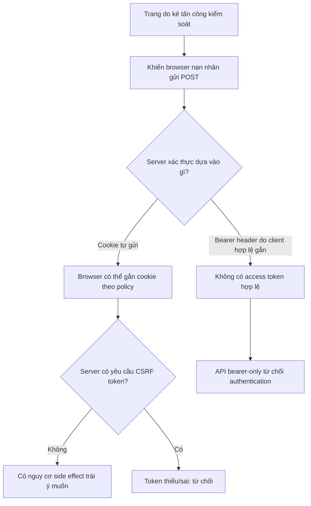

# Đánh giá thay đổi khi chuyển cách lưu token hoặc thêm trình duyệt client

> **Chương:** Phạm vi kiểm tra CSRF  
> **Module:** `SPRING_SECURITY_HTTP_PROTECTION` — áp dụng các lớp phòng vệ HTTP và trình duyệt của Spring Security, gồm CSRF, CORS, security headers, CSP, HSTS, HTTP firewall và session trong cả Servlet và Reactive.  
> **Câu hỏi trung tâm:** Một API trước đây dùng bearer token có thể được miễn CSRF; điều gì thay đổi khi chuyển token sang cookie, triển khai SPA, thêm BFF hoặc cho phép trình duyệt gọi API đó?

## 1. Mục tiêu học tập

Sau bài này, người học có thể:

1. Phân biệt **nơi lưu credential**, **cách credential được gắn vào request** và **các cơ chế xác thực mà server thật sự chấp nhận**.
2. Đánh giá thay đổi rủi ro CSRF khi chuyển access token từ header sang cookie, JWT từ memory sang localStorage, refresh token sang cookie, hoặc chuyển sang session/BFF.
3. Giải thích vì sao `HttpOnly`, `Secure`, `SameSite`, CORS và việc “API trả JSON” **không tự thay thế** CSRF token.
4. Thiết kế ranh giới giữa bearer-only API và browser-session API trên Spring Security Servlet và WebFlux; tránh việc request browser đi vào chain tắt CSRF.
5. Lập kế hoạch chuyển đổi **giai đoạn hai cách xác thực cùng tồn tại** mà không tạo nhánh fallback cookie nguy hiểm.
6. Viết kiểm thử hồi quy cho browser cookie, CSRF token, bearer header, login/refresh/logout, preflight và các security chain.
7. Vận hành quá trình chuyển đổi có kiểm soát: cookie flags, CORS, security headers, CSP, session lifecycle, proxy và quy trình rollback.

Bài học đặt trong chương **“Phạm vi kiểm tra CSRF”**: mục tiêu không phải chọn một nơi lưu token “tốt nhất” cho mọi ứng dụng, mà là **đánh giá lại chính sách bảo vệ khi luồng gửi credential thay đổi**.

## 2. Cách lưu token không đồng nghĩa cách gửi token

Khi thảo luận CSRF, ba câu hỏi thường bị trộn làm một:

- **Lưu ở đâu?** JavaScript memory, `sessionStorage`, `localStorage`, cookie, phiên server, native secure storage hoặc BFF.
- **Gửi như thế nào?** Header `Authorization: Bearer` do client chủ động gắn, cookie do trình duyệt tự gửi theo chính sách cookie, hoặc một cơ chế khác như HTTP Basic/client certificate.
- **Server tin cái gì?** Chỉ bearer header; chỉ session cookie; JWT từ cookie; hoặc **cả hai**, kể cả khi một loại credential thất bại.

CSRF chủ yếu xuất hiện khi request thay đổi trạng thái được server xác thực bằng **credential ambient** — loại credential trình duyệt có thể tự đưa vào request đến đúng đích mà không đòi code từ trang hợp lệ chủ động gắn token.

### 2.1. Bảng đối chiếu storage, transport và rủi ro

| Phương án | Nơi lưu | Cách gửi HTTP | Nguy cơ CSRF theo mô hình thông dụng | Điểm cần bảo vệ thêm |
|---|---|---|---|---|
| Native mobile app | Secure storage của thiết bị | Tự gắn bearer header | CSRF kiểu browser thường không áp dụng | Token leakage, expiry, audience, scope |
| SPA giữ access token trong memory | Bộ nhớ JS runtime | JS chủ động gắn bearer header | Thường không có CSRF dựa vào cookie nếu API **chỉ** nhận bearer | XSS, token exposure, CORS, refresh |
| SPA lưu access token trong `sessionStorage` | Storage của origin/tab | JS chủ động gắn bearer header | Về CSRF thường tương tự memory | XSS có thể đọc token |
| SPA lưu access token trong `localStorage` | Storage bền theo origin | JS chủ động gắn bearer header | Không trở thành cookie CSRF chỉ vì lưu bền | XSS đọc được token, tồn tại lâu hơn |
| JWT trong cookie `HttpOnly` | Cookie browser | Browser có thể tự gửi cookie | **Có nguy cơ CSRF** nếu backend xác thực bằng cookie | CSRF token, SameSite, XSS, session lifecycle |
| Session ID trong cookie | Cookie browser | Browser tự gửi cookie | **Có nguy cơ CSRF** | CSRF token, session fixation, cookie flags |
| Refresh token trong cookie, access token trong header | Hai nơi khác nhau | Refresh endpoint nhận cookie; API khác nhận bearer header | **Phải đánh giá riêng từng endpoint** | Refresh CSRF, token rotation, replay |
| BFF giữ access token phía server | BFF session/server storage | Browser → BFF bằng cookie; BFF → API bằng bearer | **Browser → BFF cần CSRF**; API nội bộ có thể bearer-only | XSS, BFF authz, CSRF ở ranh giới ngoài |
| Browser sử dụng Basic đã lưu hoặc client certificate tự gửi | Trình duyệt/OS | Có thể được gửi tự động | Cần đánh giá như ambient credential | CSRF + các kiểm soát khác |

**Mấu chốt:** Chuyển từ `localStorage` sang **cookie xác thực** là thay đổi cách credential đi vào HTTP request, không chỉ là refactor lớp lưu trữ. Ngược lại, chuyển access token từ memory sang `localStorage` mà **vẫn chỉ gắn vào bearer header** thường không làm thay đổi phạm vi CSRF; tuy nhiên, nó thay đổi mức độ phơi lộ trước XSS và cần review riêng.

### 2.2. JWT không phải “vé miễn CSRF”

JWT là **định dạng token**, không phải chính sách trình duyệt:

- JWT đặt trong `Authorization: Bearer` do ứng dụng chủ động gửi có mô hình khác.
- Cùng JWT đó đặt trong cookie rồi được server đọc để xác thực có thể bị trình duyệt tự gửi từ ngữ cảnh cross-site hoặc same-site không đáng tin.
- `HttpOnly` khiến JS không đọc trực tiếp cookie, nhưng không ngăn browser đính kèm cookie.
- `SessionCreationPolicy.STATELESS` không xóa nguy cơ CSRF nếu server vẫn chấp nhận JWT cookie.

Vì vậy không dùng kết luận “API dùng JWT” hoặc “không lưu HttpSession” để quyết định `csrf.disable()`.

## 3. Thay đổi nhỏ có thể mở đường tấn công mới

Giả sử lúc đầu API chỉ phục vụ native mobile:

```http
POST /api/orders HTTP/1.1
Host: api.example.test
Authorization: Bearer <access-token>
Content-Type: application/json

{"sku":"A42","quantity":1}
```

Server chỉ kiểm tra bearer header và không nhận cookie/session. Một website độc hại không thể tự tạo access token của nạn nhân trong header đó. Tắt CSRF ở **chain bearer-only** có thể có cơ sở.

Sản phẩm sau đó ra SPA và nhóm phát triển chuyển token sang cookie:

```http
POST /api/orders HTTP/1.1
Host: api.example.test
Cookie: ACCESS_TOKEN=<jwt-value>
Content-Type: application/json

{"sku":"A42","quantity":1}
```

Nếu backend được đổi sang lấy JWT từ cookie, browser có thể tự đính kèm credential vào request phù hợp chính sách cookie. Một trang độc hại không nhất thiết cần đọc response để gây side effect. **Giả định bearer-only ban đầu đã bị phá vỡ.** Nếu chain vẫn `csrf.disable()`, endpoint có thể mất phòng vệ quan trọng.

### 3.1. Hai luồng tấn công và một hiểu lầm về CORS



CORS không phải bộ lọc ngăn mọi request cross-site. Một HTML form có thể gây ra một số loại POST cross-site mà JavaScript không cần đọc response. CORS ngăn hoặc hạn chế một số khả năng của script cross-origin, đặc biệt request không đơn giản cần preflight và việc đọc response. Vì thế, **cấu hình CORS không thay thế CSRF token** khi server xác thực bằng cookie.

Hơn nữa, các cơ chế gửi form/text content type, route nhận nhiều media type hoặc request cùng site từ subdomain khác đều cần đánh giá. Không khẳng định endpoint “chỉ nhận JSON” là an toàn trước CSRF mà không kiểm tra toàn bộ điều kiện và ranh giới credential.

## 4. Ma trận đánh giá theo từng kiểu thay đổi

| Thay đổi | CSRF cần được đánh giá lại như thế nào? | Kiểm tra bắt buộc |
|---|---|---|
| Memory bearer → localStorage bearer, API vẫn chỉ nhận header | Phạm vi CSRF có thể không đổi | Không có cookie fallback; review XSS và thời gian tồn tại token |
| localStorage bearer → cookie JWT được backend đọc | **Bật/giữ CSRF cho request thay đổi trạng thái dùng cookie** | Cookie flags, token repository, CORS, test cross-site và cookie-only |
| Server session → cookie JWT “stateless” | **Vẫn cần CSRF** nếu browser tự gửi cookie | Không coi STATELESS là miễn CSRF; kiểm tra refresh/logout |
| Native bearer API → SPA bearer header | CSRF có thể giữ chính sách bearer-only khi không có ambient auth | CORS, XSS/CSP, token lifecycle, same-origin/cross-origin |
| Native bearer API → SPA dùng session cookie | **Đổi mô hình CSRF** ở đường browser | Phân tách chain, cấp/gửi token, session cookie policy |
| Thêm BFF với browser session | CSRF ở browser → BFF, dù BFF → API là bearer | BFF routes, authz, SameSite, logout, gateway |
| Access header + refresh cookie | Chỉ API bearer có thể miễn; **refresh endpoint không tự miễn** | Refresh CSRF, rotation, login/logout, token binding |
| Một route trước bearer-only nay chấp nhận thêm cookie | **Không được giữ exemption cũ cho toàn route** | Tách path/chain hoặc bảo vệ nhánh cookie trước khi mở client mới |
| Chuyển SPA sang subdomain khác | Xem lại SameSite, CORS, cookie scope, token distribution | Origin allowlist, preflight, credentials, proxy |
| Thêm iframe/embedded app | Xem lại third-party cookie restrictions và chống clickjacking | SameSite/partitioning theo browser, CSP frame-ancestors, CSRF |
| Đổi browser client sang mobile/native | Có thể tách chain bearer-only nếu không còn cookie | Chứng minh auth server đã bỏ cookie fallback |

Một thay đổi có thể không làm CSRF tăng nhưng làm **XSS** tăng. Ví dụ giữ token trong `localStorage` thay vì memory khiến script độc hại chạy cùng origin có thêm cơ hội đọc token bền vững; CSRF và XSS là hai mô hình đe dọa khác nhau và cần được review riêng.

## 5. Quy trình review một cuộc chuyển đổi

### Bước 1 — Chụp trạng thái “trước và sau” ở ranh giới HTTP

Đối với từng endpoint, ghi rõ:

| Thuộc tính | Trước | Sau |
|---|---|---|
| Caller | Mobile native | SPA/browser hoặc BFF |
| Token storage | Secure storage của app | Memory JS, cookie hoặc session server |
| Credential transport | Bearer header | Header hoặc Cookie |
| Backend xác thực được bằng | Bearer header duy nhất | Cookie, bearer, hoặc cả hai? |
| Cookie nào có thể đính kèm tự động | Không dùng để auth | Session/access/refresh cookies? |
| Method có side effect | POST/PUT/PATCH/DELETE | Có thay đổi không? |
| Security chain | Bearer-only | Có chuyển sang browser chain? |
| Chính sách CSRF | Tắt trong bearer chain | Bật, miễn trừ hẹp, hay vẫn tắt? |
| Quyền | Scope từ JWT | Role/session/principal/tenant |
| Origin | App native | Same-origin, cross-origin, iframe |
| Mục tiêu test | Token đúng/sai | Cookie-only, CSRF thiếu/sai/đúng, CORS |

Tránh chỉ review thay đổi frontend. Một patch đổi cookie ở gateway hoặc JWT resolver phía server có thể đổi mô hình CSRF mà controller không thay một dòng nào.

### Bước 2 — Kiểm tra credential ambient thực tế

Hãy trả lời bằng kiểm thử, không chỉ bằng lời hứa của client:

1. Khi không có `Authorization` nhưng có **session cookie hợp lệ**, endpoint có xử lý request không?
2. Khi bearer sai nhưng có cookie session hợp lệ, server có fallback sang session không?
3. Khi JWT nằm trong cookie mà `Authorization` vắng mặt, authentication có thành công không?
4. Browser có thể gửi cookie khi đi từ origin hoặc subdomain khác theo SameSite/Domain/Path không?
5. Refresh/login/logout có đọc cookie riêng không?
6. Có HTTP Basic, remember-me, custom filter hoặc proxy cấp identity khiến credential được gửi tự động không?

Nếu **bất kỳ đường thay đổi trạng thái nào chấp nhận ambient credential**, chính sách CSRF phải bảo vệ đường đó, kể cả khi một client khác cùng endpoint chỉ dùng bearer header.

### Bước 3 — Xác định chain và matcher

Tìm chain đầu tiên khớp route mới:

- Servlet: `SecurityFilterChain` với `securityMatcher`, thứ tự `@Order`.
- Reactive: `SecurityWebFilterChain` với `ServerWebExchangeMatcher`, thứ tự chain.
- Bên trong chain: CSRF mặc định hay `requireCsrfProtectionMatcher` tùy chỉnh? Có `ignoringRequestMatchers` (Servlet) hoặc `csrf.disable()` không?
- Có `web.ignoring()`, chain rộng phía trước hoặc không có fallback không?

Một chain `/api/**` đã tắt CSRF cho bearer-only **không còn an toàn để tiếp nhận** `/api/web/**` dùng cookie. `permitAll`/`authenticated` không tự giải quyết nguy cơ này: authentication, authorization và CSRF là các quyết định khác nhau.

### Bước 4 — Chốt chính sách mới trước khi bật tính năng

Chọn một trong các hướng có hợp đồng rõ:

- **Giữ bearer-only:** Browser client dùng access token chủ động trong header; backend không bao giờ dùng cookie để xác thực endpoint đó. Review XSS/CORS và refresh riêng.
- **Chuyển browser sang cookie/session:** Tách browser route/chain có CSRF token, xác thực phiên và phân quyền. Bỏ CSRF exemption cũ trên nhánh đó.
- **Dùng BFF:** Browser gọi BFF bằng session cookie có CSRF; BFF gọi API nội bộ bằng bearer header/mTLS. Giữ hai trust boundary riêng.
- **Giai đoạn hỗn hợp:** Tạm thời chạy route/chain riêng cho client mới và cũ thay vì để một route chấp nhận “bearer **hoặc** cookie” mà vẫn giữ CSRF disabled.

Nếu yêu cầu buộc phải có một route hỗn hợp, hãy giữ CSRF cho các unsafe methods hoặc chứng minh nghiêm ngặt cơ chế chỉ miễn khi request đã được xác thực bearer-only và không thể fallback. Đừng miễn dựa vào sự hiện diện của header do client tự khai.

### Bước 5 — Viết regression tests và đường rollback

Bổ sung test trước rollout. Đường rollback không được là “bật lại `csrf.disable()` cho mọi API để tránh 403”. Nếu phải rollback frontend, server phải vẫn có chính sách không chấp nhận cookie fallback ngoài ý định và không mở rộng ngoại lệ CSRF.

## 6. Các endpoint hay bị bỏ sót khi đổi token storage

Một dự án có thể chuyển access token sang bearer header nhưng vẫn có cookie ở các đường khác. CSRF phải được đánh giá **theo endpoint**, không theo ứng dụng.

| Endpoint | Credential đáng chú ý | Rủi ro và yêu cầu |
|---|---|---|
| `POST /auth/login` | Có thể tạo session/cookie | Bảo vệ login CSRF và các luồng chuyển phiên khi dùng browser |
| `POST /auth/logout` | Session cookie/refresh cookie | Cần chống CSRF cho thay đổi trạng thái xác thực phù hợp |
| `POST /auth/refresh` | Refresh token trong HttpOnly cookie | Có nguy cơ CSRF/abuse dù access token trong header |
| `POST /api/web/orders` | Session/access JWT trong cookie | CSRF token + quyền tài nguyên |
| `PATCH /api/web/profile` | Cookie phiên | CSRF token + ownership/tenant |
| `POST /api/m2m/orders` | Bearer header duy nhất | Có thể không cần CSRF; JWT và scope bắt buộc |
| `POST /integrations/payment-events` | Chữ ký webhook | Ngoại lệ chính xác, HMAC/signature + replay/idempotency |
| `POST /graphql` | Cookie browser và nhiều operations | Giữ CSRF cho POST chứa mutation |
| `GET /auth/callback` | OAuth2/OIDC callback | Bảo vệ flow theo giao thức như state/nonce; không mặc định giống webhook |
| `GET /orders/42/cancel` | Cookie browser | **Sai ngữ nghĩa**: GET làm thay đổi trạng thái, cần thiết kế lại method |
| `POST /upload` | Browser form/multipart | Vẫn cần CSRF nếu dùng cookie |
| WebSocket handshake/message | Browser cookie hoặc token | HTTP CSRF mặc định không thay kiểm tra Origin/authz/message security |

**Refresh token cookie là điểm ranh giới quan trọng.** Khi access token chỉ được gửi trong header, các API nghiệp vụ có thể bearer-only, nhưng endpoint dùng refresh cookie lại dựa vào credential ambient. Cần chính sách CSRF hoặc các cơ chế phòng vệ bổ sung được đánh giá theo hợp đồng, cùng token rotation và chống replay phù hợp.

## 7. Cookie flags và CSRF token: hai lớp khác nhau

Khi chuyển sang cookie, thiết kế cookie một cách có chủ đích:

| Thuộc tính | Mục đích | Điều không bảo đảm |
|---|---|---|
| `HttpOnly` | Giảm nguy cơ JavaScript đọc cookie trực tiếp | **Không ngăn browser gửi cookie**, không thay CSRF |
| `Secure` | Cookie chỉ gửi qua kết nối an toàn theo chính sách browser | Không chứng minh ý định thao tác |
| `SameSite=Strict` | Hạn chế cookie trong nhiều ngữ cảnh cross-site | Không giải quyết mọi tình huống cùng site khác origin |
| `SameSite=Lax` | Hạn chế nhiều request cross-site, có ngoại lệ/ngữ cảnh điều hướng | Không thay CSRF, đặc biệt với tình huống cùng site |
| `SameSite=None; Secure` | Cho phép những ngữ cảnh cross-site cần thiết nếu browser chấp nhận | Tăng tầm quan trọng của CSRF và CORS; có giới hạn third-party cookie |
| `Domain` | Mở rộng host có thể nhận cookie | Mở rộng phạm vi subdomain nếu đặt quá rộng |
| `Path` | Hạn chế path browser gửi cookie | **Không phải ranh giới authorization** |
| `Max-Age`/`Expires` | Vòng đời cookie | Không tự thu hồi JWT đã phát hành nếu server không kiểm soát |
| Prefix `__Host-` | Với browser hỗ trợ, yêu cầu `Secure`, `Path=/`, không có `Domain` | Không ngăn CSRF; không phù hợp nếu cần cookie chỉ trên path hẹp |

Cần xem cả **same-site** và **same-origin**. Ví dụ `app.example.test` và `api.example.test` có thể khác origin nhưng cùng site; một subdomain bị kiểm soát có thể tạo request mà chỉ dựa vào SameSite chưa đủ để kết luận an toàn.

**CSRF token là thứ khác access token.** Trong mẫu double-submit cookie hoặc cookie CSRF repository, một cookie CSRF có thể được JavaScript đọc để đưa vào header; điều đó không có nghĩa nên đặt access/refresh token vào cookie JS-readable. CSRF token phải được sinh, kiểm tra và ràng buộc theo cơ chế repository/request handler phù hợp.

### 7.1. Khi cấp CSRF token cho SPA

SPA dùng session cookie thường cần quy trình:

1. Trình duyệt nhận phiên/cookie xác thực theo login flow.
2. Client nhận CSRF token từ response phù hợp hoặc cookie CSRF được cấp bởi ứng dụng.
3. Client chủ động gắn token vào header do server chấp nhận, ví dụ `X-CSRF-TOKEN` hoặc tên khác theo repository.
4. Server kiểm tra CSRF token tương ứng với ngữ cảnh xác thực trước khi xử lý method không an toàn.
5. Sau login/logout hoặc thay đổi phiên, client phải bảo đảm không dùng token đã hết hiệu lực; có thể cần lấy token mới.

Đừng mặc định token cũ vẫn hợp lệ sau login/logout. Spring Security có thể xóa/làm mới CSRF token trong những luồng xác thực hoặc logout; ứng dụng cần test thực tế.

### 7.2. Cẩn trọng với CSRF token kiểu cookie của Spring Security 6.x

Servlet có thể dùng `CookieCsrfTokenRepository.withHttpOnlyFalse()` để SPA có thể đọc **cookie chứa CSRF token** và chuyển nó vào header. Tuy nhiên, các phiên bản Spring Security có xử lý token dạng masked/XOR để bảo vệ trước BREACH và cơ chế deferred token. Việc chỉ cấu hình cookie repository **không luôn đủ** để một SPA gửi token raw từ cookie tương thích; có thể cần `CsrfTokenRequestHandler` thích hợp và cơ chế kích hoạt token khi cần.

Vì vậy, hãy xác minh phiên bản và contract token repository/handler của dự án. Đừng khuyên mọi SPA chỉ cần `withHttpOnlyFalse()` rồi bỏ qua kiểm thử token raw/masked hoặc vòng đời token.

## 8. Servlet: tách browser chain và bearer-only chain

Giả sử một API ban đầu chỉ phục vụ mobile dưới `/api/m2m/**`. Khi thêm trình duyệt dùng session, ứng dụng tạo route `/api/web/**` riêng, **không** mở rộng bearer-only chain thành `/api/**`.

### 8.1. Cấu hình minh họa Spring Security Servlet

```java
import org.springframework.context.annotation.Bean;
import org.springframework.core.annotation.Order;
import org.springframework.http.HttpMethod;
import org.springframework.security.config.Customizer;
import org.springframework.security.config.annotation.web.builders.HttpSecurity;
import org.springframework.security.config.annotation.web.configurers.AbstractHttpConfigurer;
import org.springframework.security.config.http.SessionCreationPolicy;
import org.springframework.security.web.SecurityFilterChain;

@Bean
@Order(1)
SecurityFilterChain machineApi(HttpSecurity http) throws Exception {
    http
        .securityMatcher("/api/m2m/**")
        .sessionManagement(session -> session
            .sessionCreationPolicy(SessionCreationPolicy.STATELESS))
        .csrf(AbstractHttpConfigurer::disable)
        .oauth2ResourceServer(resource -> resource
            .jwt(Customizer.withDefaults()))
        .authorizeHttpRequests(auth -> auth
            .requestMatchers(HttpMethod.POST, "/api/m2m/orders")
                .hasAuthority("SCOPE_orders.write")
            .anyRequest().denyAll());

    return http.build();
}

@Bean
@Order(2)
SecurityFilterChain browser(HttpSecurity http) throws Exception {
    http
        .authorizeHttpRequests(auth -> auth
            .requestMatchers(HttpMethod.GET, "/login", "/register").permitAll()
            .requestMatchers(HttpMethod.POST, "/register").permitAll()
            .requestMatchers(HttpMethod.POST, "/api/web/orders")
                .hasAuthority("ROLE_USER")
            .anyRequest().authenticated())
        .formLogin(Customizer.withDefaults())
        .csrf(Customizer.withDefaults());

    // CSRF vẫn bật mặc định trong chain browser.
    return http.build();
}
```

**Diễn giải:**

- `@Order(1)` và `securityMatcher("/api/m2m/**")` bảo đảm chỉ khu vực máy–máy được vào chain CSRF-off.
- `STATELESS` hạn chế sử dụng HTTP session cho Spring Security context trên bearer chain, nhưng **không tự ngăn custom authentication filter đọc cookie**. Cần test cookie-only thực tế.
- Bearer thiếu/sai hoặc thiếu scope phải bị từ chối, kể cả browser có session cookie hợp lệ.
- Browser chain là fallback cho request khác, có CSRF mặc định; POST `/api/web/orders` với session cookie phải có token hợp lệ.
- `permitAll` của `POST /register` cho phép anonymous về quyền, **không bỏ CSRF**.
- Ví dụ là cấu hình nguyên tắc: production cần JWT decoder, session cookie policy, auth provider, exception handling, CSRF token delivery và authorization phù hợp.

**Nếu đổi sang JWT trong cookie:** Không chỉ thêm một cookie resolver vào `machineApi` rồi giữ `csrf.disable()`. Hãy đưa những request sử dụng JWT cookie sang chain/browser policy yêu cầu CSRF; đánh giá riêng các filter xác thực JWT cookie, quyền, session và CSRF token repository. Resource server với bearer header không tự đọc JWT từ cookie trừ khi ứng dụng đã bổ sung cơ chế riêng.

### 8.2. Form public vẫn cần token

Khi một trang đăng ký được mở bởi browser:

```html
<form method="post" action="/register">
  <input type="hidden" name="_csrf"
         value="TOKEN_DO_SERVER_RENDER_CHO_REQUEST">
  <input name="email" type="email" required>
  <button type="submit">Tạo tài khoản</button>
</form>
```

Đây là biểu diễn luồng; giá trị phải lấy từ CSRF token do server tạo cho request/session. Không hard-code token chung và không coi `permitAll` là lý do để POST thiếu token. Với template engine hoặc SPA, cách render/đọc/gửi token phải phù hợp repository và cấu hình handler.

### 8.3. Khi cần giữ bearer API nhưng thêm BFF

Một mô hình khác:

```text
Browser (cookie session + CSRF token)
             |
             v
BFF /api/web/** (validate session, CSRF, user/tenant permission)
             |
             v
Downstream /api/m2m/** (service-to-service bearer/mTLS)
```

Downstream API có thể không cần CSRF vì request đến từ BFF theo credential chủ động gửi. **Lớp BFF tiếp xúc với browser vẫn cần CSRF** cho method thay đổi trạng thái; không được dựa vào việc downstream API stateless để tắt CSRF ở lớp BFF. BFF cũng phải thực hiện authorization theo user/tenant, bảo vệ token phía server, chống SSRF/credential forwarding sai phạm vi và thực thi timeout/retry phù hợp.

## 9. Reactive WebFlux: cùng nguyên tắc, API khác Servlet

WebFlux dùng `ServerHttpSecurity`, `SecurityWebFilterChain` và `CsrfWebFilter`. Với browser dùng `WebSession` cookie, CSRF cần được duy trì; với bearer-only API, có thể tắt CSRF ở chain chuyên dụng khi không có cookie fallback.

### 9.1. Cấu hình hai chain WebFlux

```java
import org.springframework.context.annotation.Bean;
import org.springframework.core.annotation.Order;
import org.springframework.http.HttpMethod;
import org.springframework.security.config.Customizer;
import org.springframework.security.config.web.server.ServerHttpSecurity;
import org.springframework.security.web.server.SecurityWebFilterChain;
import org.springframework.security.web.server.context.NoOpServerSecurityContextRepository;
import org.springframework.security.web.server.util.matcher.PathPatternParserServerWebExchangeMatcher;

@Bean
@Order(1)
SecurityWebFilterChain machineApi(ServerHttpSecurity http) {
    return http
        .securityMatcher(
            new PathPatternParserServerWebExchangeMatcher("/api/m2m/**"))
        .securityContextRepository(
            NoOpServerSecurityContextRepository.getInstance())
        .csrf(ServerHttpSecurity.CsrfSpec::disable)
        .oauth2ResourceServer(resource -> resource
            .jwt(Customizer.withDefaults()))
        .authorizeExchange(auth -> auth
            .pathMatchers(HttpMethod.POST, "/api/m2m/orders")
                .hasAuthority("SCOPE_orders.write")
            .anyExchange().denyAll())
        .build();
}

@Bean
@Order(2)
SecurityWebFilterChain browser(ServerHttpSecurity http) {
    return http
        .authorizeExchange(auth -> auth
            .pathMatchers(HttpMethod.GET, "/login", "/register").permitAll()
            .pathMatchers(HttpMethod.POST, "/register").permitAll()
            .pathMatchers(HttpMethod.POST, "/api/web/orders")
                .hasAuthority("ROLE_USER")
            .anyExchange().authenticated())
        .formLogin(Customizer.withDefaults())
        .csrf(Customizer.withDefaults())
        .build();
}
```

Ở đây:

- `NoOpServerSecurityContextRepository` không lưu/đọc security context từ WebSession trong machine chain. Vẫn phải xem có custom WebFilter hoặc gateway nào xác thực bằng cookie không.
- Browser chain không có `securityMatcher` giới hạn để làm fallback và CSRF được bật.
- Nếu thêm SPA session cookie sử dụng `/api/web/**`, request POST phải nhận/gửi CSRF token theo `ServerCsrfTokenRepository`/handler đã chọn.
- Nếu thêm endpoint nhưng quên rule quyền, authorization vẫn cần được kiểm tra. `csrf.disable()` trên bearer chain không làm các route mới tự có quyền.

WebFlux cũng không tự miễn nhiễm với CSRF vì dùng Reactive. Browser vẫn có thể gửi cookie. Với WebSocket/SockJS, các message sau handshake GET cần mô hình bảo vệ riêng, không coi CSRF HTTP matcher mặc định đã bao phủ toàn bộ.

## 10. Khi thêm browser cross-origin: CORS và cookie không thể tách rời

Giả sử SPA chạy ở `https://app.example.test` và API ở `https://api.example.test`. Hai địa chỉ **khác origin** dù có thể cùng site. Nếu SPA dùng cookie xác thực để gọi API, cần đánh giá:

1. Cookie có `Domain`/`Path`/`SameSite`/`Secure` đúng để browser gửi cho API không?
2. Frontend có chủ động bật chế độ gửi credentials khi gọi cross-origin bằng `fetch`/HTTP client không?
3. Backend có `Access-Control-Allow-Origin` giới hạn vào origin thật sự đáng tin, không mở bừa bãi?
4. `Access-Control-Allow-Credentials` có được bật chỉ khi cần nhận credentials browser không?
5. `OPTIONS` preflight có được xử lý trước các lớp đòi authentication, với method/header hợp lệ không?
6. CSRF token có được cấp và gửi trong header phù hợp không?
7. Các subdomain thuộc cùng site nhưng không hoàn toàn đáng tin có thể phát request không mong muốn không?

### 10.1. Ví dụ request từ SPA

```javascript
// Minh họa SPA sử dụng session cookie và CSRF token.
// getCsrfToken() phải lấy token do server cấp theo hợp đồng thực tế.
const token = await getCsrfToken();

await fetch("https://api.example.test/api/web/orders", {
  method: "POST",
  credentials: "include",
  headers: {
    "Content-Type": "application/json",
    "X-CSRF-TOKEN": token
  },
  body: JSON.stringify({ sku: "A42", quantity: 1 })
});
```

Đoạn trên chỉ minh họa cách **gửi** token, không phải cách lấy token an toàn hay cấu hình CORS hoàn chỉnh. `credentials: "include"` làm trình duyệt gửi cookie phù hợp chính sách khi gọi cross-origin; nó không tự cung cấp CSRF token. Nếu server mong tên header khác, phải dùng tên từ CSRF repository/handler thực tế.

### 10.2. Bearer header với browser cũng có CORS, nhưng khác CSRF

Nếu SPA tiếp tục gửi bearer header, ví dụ:

```javascript
await fetch("https://api.example.test/api/m2m/orders", {
  method: "POST",
  headers: {
    "Authorization": "Bearer " + accessToken,
    "Content-Type": "application/json"
  },
  body: JSON.stringify({ sku: "A42", quantity: 1 })
});
```

Backend chỉ nhận bearer header và không dùng cookie fallback thì CSRF kiểu ambient-cookie không xuất hiện chỉ vì gọi từ browser. Nhưng preflight CORS cho `Authorization`/`Content-Type` có thể cần cấu hình, và access token được JavaScript dùng phải được bảo vệ trước XSS/leak.

**Không cho phép `Authorization` header của request tự động trở thành bằng chứng để bỏ CSRF trên một endpoint vốn còn xác thực bằng cookie.** Header có thể sai, và custom filter có thể fallback sang session.

### 10.3. HSTS, CSP, HTTP firewall và session

Trong một đợt mở client web, ngoài CSRF cần đánh giá:

- **HTTPS + HSTS:** bảo vệ vận chuyển và giảm downgrade; không xác minh ý định của người dùng.
- **CSP:** giảm một số đường khai thác XSS, rất quan trọng khi JS giữ access token; cần cấu hình chủ động và đánh giá `script-src`/`connect-src` phù hợp.
- **Security headers:** chống MIME sniffing, clickjacking và các rủi ro khác theo chính sách; một chain khác có thể ghi bộ headers khác.
- **HTTP firewall:** chặn request path/method/encoding bất thường; cần test context path, reverse proxy rewrite và forwarded headers đúng trust boundary.
- **Session:** quản lý session fixation, timeout, logout, CSRF token lifecycle, cookie flags và phiên đăng nhập của BFF/browser.
- **XSS:** CSRF token không ngăn script độc hại thực thi trên cùng origin; script đó có thể gọi API trong ngữ cảnh người dùng. Cần đầu tư xử lý input/output, CSP và hạn chế token exposure.

Các lớp này **bổ sung** nhau chứ không thay một chính sách CSRF đúng phạm vi.

## 11. Giai đoạn migration hỗn hợp: rủi ro khó thấy nhất

Một giai đoạn chuyển đổi thường diễn ra như sau:

1. Backend ban đầu chỉ nhận `Authorization: Bearer`.
2. Frontend web mới bắt đầu ghi cookie `ACCESS_TOKEN`.
3. Để giữ tương thích mobile, backend thay auth resolver thành **bearer header nếu có, nếu không thì cookie**.
4. Nhưng security chain vẫn tắt CSRF vì “trước đây API stateless”.

Khi đó, một request browser mang cookie nhưng không có bearer có thể được xác thực; CSRF vẫn tắt. Nếu endpoint thay đổi trạng thái, đường tấn công đã hình thành.

### 11.1. Phản ví dụ về fallback

```text
POST /api/orders
  |
  +-- Authorization Bearer hợp lệ --> Authenticated
  |
  +-- Header thiếu hoặc sai --> Thử ACCESS_TOKEN cookie
                                  |
                                  +-- Cookie hợp lệ --> Authenticated
                                                        (CSRF đang disabled!)
```

Một điều kiện như `getHeader("Authorization") != null` trong CSRF matcher **không chứng minh** bearer token hợp lệ. Thậm chí nếu header sai, server có thể fallback sang cookie khi xử lý authentication. Không dựa vào kiểu header/client tự khai để miễn CSRF.

### 11.2. Thứ tự triển khai an toàn hơn

Ưu tiên một **migration kiểu strangler** với route tách biệt:

| Giai đoạn | API máy–máy | API browser | Chính sách cần giữ |
|---|---|---|---|
| Trước migration | `/api/m2m/**` bearer-only | Chưa có | CSRF-off chỉ trong machine chain |
| Chuẩn bị | Không đổi | Tạo `/api/web/**` session/cookie | Browser chain bật CSRF, cấp token và authz |
| Pilot | Không đổi | Một nhóm browser nhỏ | Regression tests và telemetry cho CSRF/CORS |
| Chuyển traffic | Vẫn bearer-only | Mở dần web client | Không chấp nhận cookie fallback ở machine chain |
| Hoàn tất | Bearer-only hoặc deprecate có kế hoạch | Browser routes chính thức | Thu hẹp/remove ngoại lệ không còn phù hợp |
| Rollback | Giữ hợp đồng bearer-only | Dừng/đổi UI theo kế hoạch | **Không mở rộng `csrf.disable()`** |

Với endpoint legacy buộc hỗ trợ cả hai credential, cần thiết kế rõ từng nhánh và giữ CSRF trên đường cookie. Tách URL/chain là lựa chọn dễ kiểm soát hơn, vì kiểm chứng auth đã diễn ra trước khi quyết định exemption theo token hợp lệ rất phức tạp và phụ thuộc thứ tự filter.

### 11.3. Rollback không được làm giảm mức bảo vệ

Nếu browser mới bị lỗi 403 do chưa tích hợp CSRF token, đừng giải quyết bằng `csrf.disable()` cho toàn `/api/**`. Phải kiểm tra repository/header/session, CORS, frontend request và selected chain. Một giải pháp tạm làm browser POST thành công nhưng bỏ CSRF là một regression bảo mật.

## 12. Ma trận kiểm thử thay đổi storage/client

Giả sử hệ thống có:

- `POST /api/web/orders`: browser dùng session/cookie, CSRF bật.
- `POST /api/m2m/orders`: mobile hoặc SPA bearer-only, CSRF-off đúng chain.
- `POST /auth/refresh`: browser gửi refresh cookie.
- `POST /integrations/payment-events`: webhook ký HMAC.

| Test | Đầu vào | Kết quả mong đợi |
|---|---|---|
| Browser POST web thiếu token | Session cookie **hợp lệ**, không CSRF | CSRF từ chối, thường 403 |
| Browser POST web token sai | Session hợp lệ + token sai | CSRF từ chối |
| Browser POST web token đúng | Session hợp lệ + token đúng + đủ quyền | Đến nghiệp vụ |
| Web POST có bearer header giả | Session hợp lệ, header giả, thiếu CSRF | Vẫn từ chối theo CSRF nếu route chấp nhận session |
| M2M POST bearer hợp lệ | JWT đúng scope, không CSRF | Được xử lý theo quyền |
| M2M POST không bearer | Chỉ có session cookie web **hợp lệ** | **Từ chối**, không dùng cookie fallback |
| M2M POST bearer sai + cookie đúng | Bearer sai, session hợp lệ | **Từ chối**, không fallback |
| M2M POST thiếu scope | JWT hợp lệ nhưng scope thiếu | Authorization từ chối |
| Refresh POST thiếu CSRF | Refresh cookie hợp lệ | Bị từ chối nếu chính sách refresh dùng CSRF; không phát token mới |
| Refresh POST token đúng | Refresh cookie hợp lệ và CSRF hợp lệ | Đi tiếp tới rotation/authz |
| Login/logout bằng browser | Cookie/session theo flow | CSRF và vòng đời phiên/token được kiểm chứng |
| Webhook POST chữ ký sai | Không token CSRF, body/signature sai | Verifier từ chối, không side effect |
| PUT tới webhook POST-only | Không token CSRF | Không được hưởng ngoại lệ POST |
| Web mới chạy cross-origin | Origin hợp lệ, credentials/header cần thiết | Preflight + POST theo CORS/CSRF policy |
| Origin ngoài allowlist | Preflight hoặc response CORS | Không được cấp CORS permission sai |
| Path qua proxy/context path | URL công khai và URL ứng dụng tương ứng | Chọn đúng chain |
| JWT từ cookie nhưng chain vẫn CSRF-off | Cookie hợp lệ, POST không token | **Test phải phát hiện và chặn rollout** |

Không suy ra “CSRF hoạt động” chỉ từ 403: thiếu quyền cũng có thể trả 403. Cần test dương với CSRF token đúng, principal có quyền và body hợp lệ để request đi tiếp, cộng với kiểm tra side effect.

### 12.1. MockMvc: bảo đảm browser chain thực thi CSRF

Các ví dụ dùng `spring-security-test`, giả định bộ lọc Spring Security được tích hợp vào `MockMvc`, user `alice` có vai trò `USER` và `POST /api/web/orders` trả 201 khi dữ liệu hợp lệ.

```java
import static org.springframework.security.test.web.servlet.request.SecurityMockMvcRequestPostProcessors.csrf;
import static org.springframework.security.test.web.servlet.request.SecurityMockMvcRequestPostProcessors.user;
import static org.springframework.test.web.servlet.request.MockMvcRequestBuilders.post;
import static org.springframework.test.web.servlet.result.MockMvcResultMatchers.status;

@Test
void browserPostWithoutCsrfIsForbidden() throws Exception {
    mockMvc.perform(post("/api/web/orders")
            .with(user("alice").roles("USER"))
            .contentType("application/json")
            .content("{\"sku\":\"A42\",\"quantity\":1}"))
        .andExpect(status().isForbidden());
}

@Test
void browserPostWithInvalidCsrfIsForbidden() throws Exception {
    mockMvc.perform(post("/api/web/orders")
            .with(user("alice").roles("USER"))
            .with(csrf().useInvalidToken())
            .contentType("application/json")
            .content("{\"sku\":\"A42\",\"quantity\":1}"))
        .andExpect(status().isForbidden());
}

@Test
void browserPostWithValidCsrfCanProceed() throws Exception {
    mockMvc.perform(post("/api/web/orders")
            .with(user("alice").roles("USER"))
            .with(csrf())
            .contentType("application/json")
            .content("{\"sku\":\"A42\",\"quantity\":1}"))
        .andExpect(status().isCreated());
}
```

Ở đây `with(user())` có ích để cô lập CSRF và quyền trên browser chain. **Không dùng `with(user())` để chứng minh cookie fallback**, bởi nó gắn authentication giả lập thay vì kiểm thử server đọc cookie thật.

### 12.2. MockMvc: kiểm thử bearer-only không dựa vào CSRF token

```java
import org.springframework.security.core.authority.SimpleGrantedAuthority;
import static org.springframework.security.test.web.servlet.request.SecurityMockMvcRequestPostProcessors.jwt;

@Test
void bearerPostWithMockJwtDoesNotNeedCsrf() throws Exception {
    mockMvc.perform(post("/api/m2m/orders")
            .with(jwt().authorities(
                new SimpleGrantedAuthority("SCOPE_orders.write")))
            .contentType("application/json")
            .content("{\"sku\":\"A42\",\"quantity\":1}"))
        .andExpect(status().isCreated());
}
```

`jwt()` là post-processor **giả lập authentication**; test này đánh giá route/authorization/CSRF nhưng **không chứng minh** decoder xác minh chữ ký, issuer, audience và expiry. Cần test tích hợp riêng với JWT ký thật hoặc một test issuer đã cấu hình có kiểm soát.

Để test **không cookie fallback**, thực hiện:

1. Đăng nhập browser qua luồng session thực trong test.
2. Xác nhận session đó truy cập được một endpoint browser cần authentication.
3. Gửi POST tới `/api/m2m/orders` **chỉ với cookie/session hợp lệ ấy**, không bearer.
4. Gửi lại với bearer sai cùng session hợp lệ.
5. Cả hai phải bị từ chối theo authentication; không được xử lý đơn hàng.

Một cookie giả ngẫu nhiên không chứng minh điều cần kiểm tra vì bản thân nó không thể xác thực ở bất cứ chain nào.

### 12.3. WebTestClient: kiểm chứng trên Reactive

```java
import org.springframework.http.MediaType;
import org.springframework.security.core.authority.SimpleGrantedAuthority;
import static org.springframework.security.test.web.reactive.server.SecurityMockServerConfigurers.csrf;
import static org.springframework.security.test.web.reactive.server.SecurityMockServerConfigurers.mockUser;
import static org.springframework.security.test.web.reactive.server.SecurityMockServerConfigurers.mockJwt;

@Test
void reactiveBrowserPostWithoutCsrfIsForbidden() {
    webTestClient.mutateWith(mockUser("alice").roles("USER"))
        .post().uri("/api/web/orders")
        .contentType(MediaType.APPLICATION_JSON)
        .bodyValue("{\"sku\":\"A42\",\"quantity\":1}")
        .exchange()
        .expectStatus().isForbidden();
}

@Test
void reactiveBrowserPostWithCsrfCanProceed() {
    webTestClient.mutateWith(mockUser("alice").roles("USER"))
        .mutateWith(csrf())
        .post().uri("/api/web/orders")
        .contentType(MediaType.APPLICATION_JSON)
        .bodyValue("{\"sku\":\"A42\",\"quantity\":1}")
        .exchange()
        .expectStatus().isCreated();
}

@Test
void reactiveBearerPostDoesNotNeedCsrf() {
    webTestClient.mutateWith(mockJwt().authorities(
            new SimpleGrantedAuthority("SCOPE_orders.write")))
        .post().uri("/api/m2m/orders")
        .contentType(MediaType.APPLICATION_JSON)
        .bodyValue("{\"sku\":\"A42\",\"quantity\":1}")
        .exchange()
        .expectStatus().isCreated();
}
```

Bổ sung test `WebSession` browser hợp lệ vào bearer-only route **không có bearer** để kiểm chứng `NoOpServerSecurityContextRepository` và custom WebFilters không nhận cookie fallback. Test với token CSRF sai/đúng ở browser route, và test login/logout/refresh bằng fixture thực.

### 12.4. Kiểm thử trình duyệt và CORS

Integration test server cần được bổ sung bằng kiểm thử browser khi ứng dụng thay đổi origin hoặc cookie policy:

- SPA từ origin được phép có thể tải token CSRF và POST với token đúng.
- POST thiếu token dù có cookie phiên hợp lệ bị từ chối, không tạo side effect.
- CORS preflight từ origin được phép hoạt động đúng method/header.
- Origin không thuộc allowlist không được cấp chính sách CORS cho đọc/gửi request bị ràng buộc.
- Thử request từ một origin/subdomain khác với các chế độ cookie phù hợp; không dựa riêng vào việc cookie lần này tình cờ không được browser gửi.
- Kiểm tra login/logout và refresh token rotation dưới điều kiện cookie hết hạn/đổi phiên.

Các test này phải được chạy trong môi trường thử nghiệm có tài khoản/dữ liệu test và phù hợp chính sách browser. Không cần thử tấn công trên hệ thống bên ngoài quyền quản lý.

## 13. Chẩn đoán khi thêm browser hoặc đổi storage

### 13.1. SPA mới POST nhận 403 “Invalid CSRF token”

Nếu API bây giờ nhận session/access cookie, 403 có thể là hành vi phòng vệ đúng khi SPA chưa gửi token. Kiểm tra:

1. Request có vào **browser chain** hay nhầm bearer chain?
2. Cookie/session xác thực có hiện diện hợp lệ trong request không?
3. CSRF token được cấp từ đâu và có cần đọc/khởi tạo theo deferred token repository không?
4. Frontend có gửi đúng tên header, đúng giá trị raw/masked theo `CsrfTokenRequestHandler` không?
5. Token có bị xóa hoặc luân chuyển sau login/logout không?
6. CORS preflight có cho phép header CSRF không?

Không chữa bằng `csrf.disable()` trên toàn `/api/**`.

### 13.2. Mobile trước chạy tốt, sau migration lại bị 403 CSRF

Có thể route mobile bị bắt bởi browser fallback trước chain bearer hoặc matcher đã thay đổi khi thêm SPA. Kiểm tra `@Order` và `securityMatcher`, URL sau gateway rewrite, servlet mapping, WebFlux base path. Sửa chain selection; đừng tắt CSRF của browser.

### 13.3. SPA có bearer nhưng bị redirect 302 tới form login

Request có thể vào form-login chain thay vì resource server; hoặc bearer decoder/entry point được cấu hình sai. Kiểm tra token, route, security chain và authentication entry point. Không cấp `permitAll` chỉ để xóa redirect.

### 13.4. Cookie-only vào API bearer lại thành công

Đây là dấu hiệu nguy hiểm: JWT resolver đang đọc cookie, session fallback hoạt động hoặc gateway cung cấp identity theo cookie. Khi chain bearer vẫn CSRF-off, request browser có thể được xác thực mà không có token CSRF. Tách route và loại fallback, thêm test chống tái phát trước rollout.

### 13.5. Login hoặc refresh báo lỗi CSRF dù form public

`permitAll` không tắt CSRF. Nếu endpoint browser thay đổi trạng thái, cần cung cấp token CSRF phù hợp thay vì miễn rộng. Với refresh cookie, kiểm tra riêng cơ chế CSRF của refresh endpoint và token rotation.

### 13.6. CORS lỗi nhưng curl vẫn gọi thành công

curl không bị ràng buộc bởi CORS của browser. OPTIONS preflight và các quy tắc browser khác có thể gây lỗi trước POST thật. Kiểm tra `Access-Control-Allow-Origin`, allowed methods, allowed headers, credential policy và vị trí cấu hình CORS. Không coi lỗi CORS là lý do tắt CSRF.

### 13.7. Cookie không được gửi sau khi đổi domain

Kiểm tra `SameSite`, `Secure`, `Domain`, `Path`, scheme và chế độ credentials, cùng các giới hạn third-party cookie của browser. Đảm bảo thay đổi cookie scope không vô tình mở rộng quyền truy cập của subdomain khác. Dù browser không gửi cookie trong một test, vẫn phải bảo đảm API server bảo vệ đúng các trường hợp cookie **có thể** được gửi.

### 13.8. CSP, HSTS, headers hoặc HTTP firewall bị nhầm với CSRF

CSP và các security headers có mục tiêu riêng; HSTS liên quan HTTPS, HTTP firewall có thể chặn URL encoding bất thường trước khi CSRF matcher chạy. Một response 403 hoặc 400 không tự chứng minh lỗi CSRF. Xác minh filter/chain, log, URL sau proxy và test đối chứng có token đúng.

## 14. Bài tập tình huống: cùng API, thêm browser và BFF

Một nền tảng ban đầu có native app gọi:

```text
POST /api/orders
Authorization: Bearer <access-token>
CSRF: disabled trong chain /api/**
```

Sắp tới nhóm phát triển muốn:

- SPA dùng `localStorage` lưu access token và gắn bearer header.
- Ứng dụng web quản trị dùng `HttpOnly` session cookie.
- Một số route API cũ chuyển sang đọc JWT từ cookie cho tiện tích hợp.
- BFF giữ access token phía server, browser gọi BFF bằng cookie.
- Refresh token được đặt trong `HttpOnly` cookie.

**Câu hỏi:** Trường hợp nào thay đổi nhu cầu CSRF? Cần thiết kế route và test gì?

**Phân tích đáp án:**

1. SPA giữ access token ở `localStorage` nhưng **vẫn gắn bearer header** vào API chỉ nhận bearer có thể không cần CSRF cho API đó. Tuy nhiên, cần review XSS/CSP và khả năng token bị đọc khi có script độc hại.
2. Web quản trị dùng session cookie **phải có CSRF** cho POST/PATCH/DELETE và cần authorization quản trị phù hợp.
3. JWT chuyển vào cookie và được backend đọc để xác thực làm endpoint có ambient credential; **không được giữ CSRF disabled** chỉ vì JWT vẫn là JWT.
4. BFF tiếp xúc với browser bằng cookie cần CSRF và quản lý phiên. API phía sau BFF dùng bearer/mTLS nội bộ có thể không cần CSRF nếu thật sự không nhận cookie.
5. `POST /auth/refresh` dùng refresh cookie cần đánh giá CSRF và token rotation riêng; việc API nghiệp vụ có bearer header không miễn cho refresh route.
6. Không để `/api/**` vừa chứa web-cookie route vừa bị `csrf.disable()`. Tách `/api/m2m/**` bearer-only và `/api/web/**` browser, thêm fallback chain có CSRF; với webhook có matcher method/path chính xác.
7. Kiểm thử cookie-only hợp lệ vào bearer API phải bị từ chối; web POST thiếu/sai/đúng CSRF; JWT trong cookie không token CSRF bị chặn; cross-origin CORS/preflight và refresh/logout được xác minh.

**Kết luận bài tập:** Bất kỳ thay đổi nào làm server nhận **credential được browser tự gửi** đều phải kích hoạt review CSRF, kể cả khi cùng route, cùng JWT hoặc cùng service nghiệp vụ.

## 15. Checklist đánh giá thay đổi trước khi merge

- [ ] Đã ghi rõ token nằm ở đâu, cách gửi vào HTTP request và các đường authentication server chấp nhận.
- [ ] Đã phân biệt access token, refresh token, session cookie và CSRF token; không dùng lẫn tên gọi.
- [ ] Chuyển bearer header → cookie (session hoặc JWT) đã có chính sách CSRF cho unsafe methods.
- [ ] JWT trong cookie không bị coi là bearer-only chỉ vì backend stateless.
- [ ] SPA dùng memory/localStorage/header bearer được đánh giá về XSS/CSP, CORS và token lifecycle riêng.
- [ ] Refresh/login/logout dùng cookie được review độc lập, kể cả khi API nghiệp vụ bearer-only.
- [ ] BFF có CSRF ở browser-facing routes, không chỉ dựa vào downstream bearer token.
- [ ] Security chain đầu tiên khớp request đã được xác minh, có fallback phù hợp.
- [ ] Không có endpoint dùng cookie lọt vào chain `csrf.disable()` hoặc ignored matcher.
- [ ] Không có cookie/session/Basic fallback trong bearer-only chain; có negative tests với phiên hợp lệ.
- [ ] Chính sách `SameSite`/`Secure`/`HttpOnly`/`Domain`/`Path` và thời hạn cookie được xác định theo nhu cầu.
- [ ] CSRF repository và request handler khớp frontend, nhất là raw/masked token và lifecycle sau login/logout.
- [ ] CORS origin allowlist, methods, headers, preflight và credentials được kiểm tra trong browser thật.
- [ ] CSP, HSTS, security headers, HTTP firewall, session và reverse proxy được đánh giá đúng vai trò.
- [ ] Có test browser POST thiếu/sai/đúng CSRF token với session/cookie **hợp lệ**.
- [ ] Có test bearer-only JWT đúng/sai/thiếu scope và cookie-only/bearer sai kèm cookie.
- [ ] Có test CSRF cho refresh, login/logout, GraphQL/mutation và multipart nếu áp dụng.
- [ ] Có test chain/path gần giống, path sau proxy và request OPTIONS preflight.
- [ ] Không lấy một mã 403 làm bằng chứng duy nhất; có test dương và kiểm tra side effect.
- [ ] Kế hoạch migration/rollback không dựa vào tắt CSRF toàn bộ API để hết lỗi tích hợp.
- [ ] Mỗi ngoại lệ CSRF có owner, lý do có thể kiểm chứng và điều kiện đánh giá lại khi client/token storage đổi.

**Ghi nhớ:** **Rủi ro CSRF thay đổi khi credential từ thứ client chủ động gắn trở thành thứ trình duyệt có thể tự gửi và backend chấp nhận.** Việc chuyển token sang cookie, thêm SPA/BFF hoặc trộn cookie với bearer phải kéo theo đánh giá lại **method + route + security chain + token repository + cơ chế xác thực thực tế**. Giữ ranh giới bearer-only độc lập, áp dụng CSRF cho browser-cookie routes và kiểm thử toàn bộ giai đoạn chuyển đổi trên cả Servlet lẫn Reactive.
