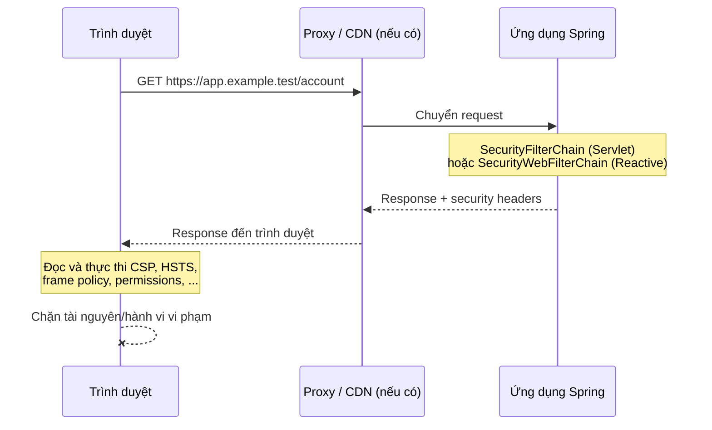

# Header bảo mật được máy chủ gửi và trình duyệt thực thi

## 1. Vị trí của HTTP security header trong kiến trúc phòng vệ

Trong phạm vi **Spring Security HTTP Protection** (`SPRING_SECURITY_HTTP_PROTECTION`), ứng dụng cần phối hợp nhiều lớp bảo vệ: CSRF, CORS, HTTP security headers, Content Security Policy (CSP), HTTP Strict Transport Security (HSTS), HTTP firewall và bảo vệ phiên đăng nhập. **HTTP security header** là một lớp quan trọng vì máy chủ **công bố chính sách qua HTTP response**, còn trình duyệt **diễn giải và thực thi chính sách ấy** khi tải trang, nhúng tài nguyên, điều hướng hoặc dùng API trình duyệt.

Ví dụ, máy chủ trả về `Content-Security-Policy: script-src 'self'`: chính trình duyệt sẽ từ chối thực thi script đến từ nguồn không được phép. Máy chủ không cần nhận thêm một request để ra quyết định đó. Ngược lại, một HTTP client chỉ tải dữ liệu như `curl` có thể hiển thị header nhưng không mô phỏng đầy đủ các hành vi chặn của trình duyệt.

**Sau bài này, bạn cần làm được:**

- Phân biệt ai **phát hành** header, ai **thực thi** header và giới hạn của từng bên.
- Hiểu mục tiêu và tác dụng phụ của `nosniff`, chống nhúng trang, CSP, HSTS, chính sách referrer, quyền API trình duyệt và cache.
- Nhận diện các header Spring Security cung cấp mặc định so với các chính sách phải tự cấu hình.
- Cấu hình và kiểm tra header trên **Servlet** (`HttpSecurity`) và **Reactive/WebFlux** (`ServerHttpSecurity`).
- Chẩn đoán sự cố do trình duyệt, proxy/CDN, nhiều security filter chain hoặc các chính sách xung đột.

### Dòng chảy của một response



Trong thực tế, reverse proxy hoặc CDN có thể thêm, sửa hoặc xóa header trước khi trình duyệt nhận được. Vì vậy cần kiểm tra **response cuối cùng từ tên miền public**, không chỉ kiểm tra cấu hình Java. Với Servlet, Spring Security áp dụng các header qua cơ chế `HeaderWriter` trong chuỗi filter; với WebFlux, header được áp dụng qua chuỗi web filter tương ứng. Chính sách có hiệu lực hay không còn phụ thuộc loại tài nguyên, hỗ trợ của trình duyệt và ngữ cảnh HTTPS.

### Một response minh họa

```http
HTTP/2 200 OK
Content-Type: text/html; charset=UTF-8
X-Content-Type-Options: nosniff
X-Frame-Options: DENY
Strict-Transport-Security: max-age=31536000; includeSubDomains
Content-Security-Policy: default-src 'self'; script-src 'self'; object-src 'none'; base-uri 'self'; frame-ancestors 'none'
Referrer-Policy: strict-origin-when-cross-origin
Permissions-Policy: camera=(), microphone=(), geolocation=()
Cache-Control: no-cache, no-store, max-age=0, must-revalidate

<!doctype html>
<html lang="vi">...</html>
```

Đây là **ví dụ cấu hình kết hợp**, không phải tập header mặc định đầy đủ của Spring Security. `Strict-Transport-Security` chỉ nên được trình duyệt ghi nhận từ kết nối HTTPS hợp lệ. Các header ảnh hưởng khác nhau: `frame-ancestors`/`X-Frame-Options` điều khiển việc trang *bị nhúng*; `script-src` điều khiển nguồn script *trang được tải*; `Permissions-Policy` giới hạn quyền dùng tính năng của trình duyệt.

## 2. Bản đồ các header và kiểu rủi ro

| Header / chỉ thị | Người thực thi chính | Mục tiêu | Cần nhớ |
| --- | --- | --- | --- |
| `X-Content-Type-Options: nosniff` | Trình duyệt | Hạn chế diễn giải sai MIME type khi tải một số tài nguyên, nhất là script/style | Máy chủ vẫn phải trả `Content-Type` chính xác. |
| `X-Frame-Options: DENY` hoặc `SAMEORIGIN` | Trình duyệt | Giảm rủi ro clickjacking khi trang bị nhúng trong frame | `DENY` chặn cả frame cùng origin; `SAMEORIGIN` chỉ cho phép cùng origin. |
| CSP `frame-ancestors` | Trình duyệt | Giới hạn các origin được nhúng trang | Linh hoạt hơn `X-Frame-Options`; không kế thừa từ `default-src`. |
| `Content-Security-Policy` (CSP) | Trình duyệt | Giới hạn nguồn script, style, ảnh, kết nối, form, frame… | Hỗ trợ giảm tác hại XSS, không thay thế kiểm soát đầu vào/đầu ra. |
| `Strict-Transport-Security` (HSTS) | Trình duyệt có lưu trạng thái HSTS | Yêu cầu sử dụng HTTPS cho các kết nối tương lai đến host | Header gửi qua HTTP không có tác dụng; `includeSubDomains` ảnh hưởng toàn bộ subdomain. |
| `Referrer-Policy` | Trình duyệt | Giới hạn thông tin URL gửi trong `Referer` khi điều hướng/request | Không phải kiểm soát truy cập phía server. |
| `Permissions-Policy` | Trình duyệt | Giới hạn camera, microphone, vị trí và một số tính năng web | Không thay thế cơ chế xin quyền người dùng của trình duyệt. |
| `Cache-Control`, `Pragma`, `Expires` | Trình duyệt và các cache tuân thủ HTTP | Hạn chế lưu nội dung nhạy cảm sau đăng xuất | Có thể cấu hình cache riêng cho tài nguyên tĩnh công khai. |
| `X-XSS-Protection: 0` | Trình duyệt cũ còn nhận diện header | Vô hiệu cơ chế XSS Auditor cũ có tác dụng phụ | Không xem là công cụ phòng XSS hiện đại; dùng CSP và xử lý dữ liệu an toàn. |

**Các khái niệm gần nhau nhưng khác nhiệm vụ:**

- `Access-Control-Allow-Origin` và các `Access-Control-*` khác là **response header phục vụ CORS**: trình duyệt dùng chúng để quyết định JavaScript ở origin khác có được đọc phản hồi hay không. CORS không chứng thực danh tính người dùng, không ngăn request được gửi trong mọi trường hợp và không thay thế bảo vệ CSRF.
- `Set-Cookie: ...; Secure; HttpOnly; SameSite=...` điều khiển thuộc tính cookie/phiên; nó cũng là response header, nhưng được cấu hình qua quản lý session/cookie và hạ tầng liên quan, không đồng nghĩa với việc bật CSP hay `headers(...)`.
- Các header như `Cross-Origin-Opener-Policy` (COOP), `Cross-Origin-Embedder-Policy` (COEP) và `Cross-Origin-Resource-Policy` (CORP) hỗ trợ cô lập/kiểm soát tài nguyên liên origin trong những ứng dụng cần thiết; bật sai có thể làm hỏng OAuth popup, thư viện CDN hoặc tài nguyên nhúng. Cần thiết kế riêng thay vì áp dụng cứng cho mọi trang.

## 3. Header mặc định của Spring Security: cơ sở trước khi tùy biến

Theo tài liệu Spring Security, bộ HTTP response security headers mặc định thường bao gồm:

```http
Cache-Control: no-cache, no-store, max-age=0, must-revalidate
Pragma: no-cache
Expires: 0
X-Content-Type-Options: nosniff
Strict-Transport-Security: max-age=31536000; includeSubDomains
X-Frame-Options: DENY
X-XSS-Protection: 0
```

**Đọc chính xác bộ mặc định này:**

1. Spring Security chỉ thêm **HSTS cho request HTTPS**. Nếu test bằng `http://localhost:8080`, không thấy HSTS không có nghĩa là cấu hình hỏng.
2. Spring Security **không tự thêm CSP** vì không thể đoán nguồn tài nguyên hợp lệ của ứng dụng. Ở Servlet, `Referrer-Policy` và `Permissions-Policy` cũng không được tự áp chính sách ứng dụng; phải xét nhu cầu để bổ sung. Một số mặc định và API tùy biến giữa Servlet và Reactive có khác biệt theo phiên bản: luôn kiểm tra tài liệu đúng stack/phiên bản khi khẳng định một header cụ thể.
3. Nếu ứng dụng tự đặt `Cache-Control` cho response, Spring Security có cơ chế nhường để cho phép cache những tài nguyên thích hợp; đừng suy ra mọi response đều bắt buộc `no-store`.
4. Việc header có mặt chỉ chứng minh **server gửi** chính sách. Cần thử trên trình duyệt để chứng minh **trình duyệt thực thi** chính sách.

Không nên gọi `.headers(headers -> headers.disable())` hoặc `http.headers().disable()` chỉ để giải quyết một lỗi riêng lẻ: làm vậy có thể bỏ đồng thời nhiều mặc định bảo vệ. Hãy sửa riêng chỉ thị gây xung đột sau khi xác định đúng nguyên nhân.

## 4. Cơ chế thực thi và các tình huống quan trọng

### 4.1. `nosniff`: kiểu dữ liệu phải khớp cách sử dụng

Giả sử trang HTML tải `/assets/app.js`, nhưng endpoint lại trả `Content-Type: text/plain` với nội dung giống JavaScript. Khi `X-Content-Type-Options: nosniff` được áp dụng, trình duyệt có thể từ chối thực thi tài nguyên script đó vì MIME type không phù hợp. Đây là một hành vi phòng vệ hữu ích; giải pháp đúng là trả `Content-Type: text/javascript` hoặc một MIME type JavaScript hợp lệ, không phải tắt `nosniff` để che lỗi server.

`nosniff` không làm sạch nội dung HTML, không kiểm tra quyền truy cập và không thay thế escape dữ liệu đầu ra. Nó giải quyết một nhóm hành vi đoán/diễn giải MIME type của trình duyệt.

### 4.2. `X-Frame-Options` và `frame-ancestors`: bên nào được nhúng trang?

Kẻ tấn công có thể đặt một trang thanh toán thật bên trong `<iframe>`, phủ lớp giao diện đánh lừa người dùng để họ bấm vào thành phần không mong muốn (**clickjacking**).

```http
X-Frame-Options: DENY
Content-Security-Policy: frame-ancestors 'none'
```

Hai chính sách trên đều hướng tới việc ngăn trang bị nhúng. `X-Frame-Options: SAMEORIGIN` và `frame-ancestors 'self'` cho phép một số trường hợp nhúng cùng origin; khi cần đối tác được phép nhúng, `frame-ancestors 'self' https://partner.example.test` biểu đạt chính sách chi tiết hơn. **Không dùng** `ALLOW-FROM`: chỉ thị cũ này không được các trình duyệt hiện đại hỗ trợ nhất quán. Trên trình duyệt hỗ trợ CSP hiện đại, `frame-ancestors` có vai trò quyết định; giữ `X-Frame-Options` tương thích và không mâu thuẫn là lựa chọn hợp lý khi không có nhu cầu nhúng phức tạp.

Phân biệt rõ `frame-ancestors` (ai được nhúng **trang của mình**) với `frame-src` (trang của mình được tải iframe **từ đâu**). Không thể thiết lập `frame-ancestors` hiệu quả bằng thẻ `<meta http-equiv="Content-Security-Policy">`; cần HTTP response header thực.

### 4.3. CSP: chính sách nguồn nội dung, không phải bộ lọc HTML

Xem policy cho một ứng dụng chỉ dùng tài nguyên cùng origin:

```http
Content-Security-Policy: default-src 'self'; script-src 'self'; object-src 'none'; base-uri 'self'; frame-ancestors 'none'; form-action 'self'
```

| Chỉ thị | Ý nghĩa trong ví dụ | Dấu hiệu cấu hình sai thường gặp |
| --- | --- | --- |
| `default-src 'self'` | Mặc định chỉ nhận tài nguyên cùng origin cho các loại có cơ chế fallback phù hợp | CDN ảnh/style bị chặn khi chưa khai báo riêng. |
| `script-src 'self'` | Chỉ cho script từ cùng origin; inline script thường bị chặn nếu không có nonce/hash thích hợp | SPA, template hoặc script nhúng trực tiếp dừng chạy. |
| `object-src 'none'` | Không tải nội dung plugin qua `object`/`embed` | Ứng dụng cũ phụ thuộc plugin bị ảnh hưởng. |
| `base-uri 'self'` | Hạn chế URL được phép dùng trong thẻ `<base>` | Template đặt `<base>` khác origin sẽ bị chặn. |
| `frame-ancestors 'none'` | Không cho bất kỳ trang nào nhúng response này | Các màn hình dashboard nhúng iframe hợp lệ cũng bị chặn. |
| `form-action 'self'` | Chỉ cho phép submit form về cùng origin | Form POST đến hệ thống đối tác bị chặn nếu chưa cho phép. |

Với ứng dụng cần inline script, nên dùng **nonce được tạo mới cho mỗi response** hoặc hash cho đoạn script tĩnh khi phù hợp; điều chỉnh tương ứng trong template. Thêm `'unsafe-inline'` hoặc cho phép tất cả host chỉ để tắt lỗi console thường làm suy yếu mục tiêu chống XSS. Với SPA, cần kiểm kê `connect-src` cho API/WebSocket, `img-src`, `font-src` và các nguồn thực sự dùng. CSP bảo vệ tốt nhất khi kết hợp encode/escape đầu ra, tránh DOM sink nguy hiểm, kiểm soát template và thư viện phụ thuộc.

Có thể thử nghiệm chính sách trước khi cưỡng chế bằng:

```http
Content-Security-Policy-Report-Only: default-src 'self'; script-src 'self'; object-src 'none'
```

Chế độ **Report-Only** ghi nhận vi phạm nhưng không chặn theo chính sách báo cáo đó. Muốn nhận report tập trung phải cấu hình endpoint/Reporting API tương ứng và hạn chế dữ liệu nhạy cảm trong report. Sau khi sửa các vi phạm hợp lệ, mới chuyển sang `Content-Security-Policy` cưỡng chế. Đừng nhầm thông báo CSP với lỗi CORS hoặc lỗi CSRF 403.

### 4.4. HSTS: trình duyệt nhớ yêu cầu HTTPS

```http
Strict-Transport-Security: max-age=31536000; includeSubDomains
```

Khi trình duyệt nhận header qua kết nối **HTTPS có chứng chỉ được tin cậy**, trình duyệt ghi nhớ rằng host phải được truy cập qua HTTPS trong thời hạn `max-age`. Ở những lần truy cập tương lai, kể cả người dùng gõ URL với `http://`, trình duyệt có thể tự nâng cấp sang HTTPS trước khi gửi request. HSTS không sửa lỗi certificate, không mã hóa kết nối HTTP đã diễn ra trước đó và không bảo vệ lần truy cập đầu tiên trên một host chưa có trạng thái HSTS (trừ trường hợp đã được preload).

`includeSubDomains` chỉ phù hợp khi **mọi subdomain** đều phục vụ HTTPS ổn định, kể cả miền cũ và môi trường đặc biệt; cấu hình quá sớm có thể khiến người dùng không truy cập được một hệ thống chưa hỗ trợ HTTPS. `preload` là một cam kết triển khai riêng, có điều kiện và tác động dài hạn, không nên thêm chỉ vì muốn tăng độ mạnh header.

Khi SSL/TLS chấm dứt tại load balancer, cần kiểm tra forwarding scheme (`Forwarded`/`X-Forwarded-Proto`) và cấu hình proxy được tin cậy theo kiến trúc triển khai. Nếu Spring chỉ thấy kết nối nội bộ HTTP, cách xác định HTTPS của ứng dụng và vị trí phát HSTS có thể ảnh hưởng header cuối cùng. Tránh tin header chuyển tiếp do client tùy ý giả mạo.

### 4.5. Referrer, quyền trình duyệt và bộ nhớ đệm

```http
Referrer-Policy: strict-origin-when-cross-origin
Permissions-Policy: camera=(), microphone=(), geolocation=()
Cache-Control: no-store
```

- `Referrer-Policy` kiểm soát mức URL nguồn trình duyệt truyền trong `Referer`; `strict-origin-when-cross-origin` thường chỉ gửi origin khi sang trang HTTPS khác origin và hạn chế gửi referrer khi hạ cấp bảo mật. Không đặt token bí mật trong URL chỉ vì đã có policy.
- `Permissions-Policy` ở ví dụ yêu cầu trình duyệt không cấp ba tính năng camera, microphone, geolocation cho document. Các tính năng và mức hỗ trợ phụ thuộc phiên bản trình duyệt; cần kiểm thử tính năng thực tế.
- `Cache-Control: no-store` hữu ích cho response nhạy cảm. Ngược lại, file tĩnh có fingerprint như `app.abcd1234.js` thường nên có caching dài hạn hợp lý. Thiết kế cache theo loại response để vừa bảo mật vừa giữ hiệu năng.

## 5. Cấu hình Spring Security cho Servlet

Ví dụ Java sau sử dụng **lambda DSL** của Spring Security để bổ sung CSP, `Referrer-Policy` và `Permissions-Policy`, trong khi vẫn giữ cơ chế header mặc định như `nosniff`, chống nhúng frame và HSTS khi có HTTPS.

```java
import org.springframework.context.annotation.Bean;
import org.springframework.context.annotation.Configuration;
import org.springframework.security.config.annotation.web.builders.HttpSecurity;
import org.springframework.security.config.annotation.web.configuration.EnableWebSecurity;
import org.springframework.security.web.SecurityFilterChain;
import org.springframework.security.web.header.writers.ReferrerPolicyHeaderWriter.ReferrerPolicy;

@Configuration
@EnableWebSecurity
public class ServletHeaderSecurityConfig {

    @Bean
    SecurityFilterChain securityFilterChain(HttpSecurity http) throws Exception {
        http.headers(headers -> headers
            .contentSecurityPolicy(csp -> csp.policyDirectives(
                "default-src 'self'; "
                    + "script-src 'self'; "
                    + "object-src 'none'; "
                    + "base-uri 'self'; "
                    + "frame-ancestors 'none'; "
                    + "form-action 'self'"
            ))
            .referrerPolicy(referrer -> referrer
                .policy(ReferrerPolicy.STRICT_ORIGIN_WHEN_CROSS_ORIGIN))
            .permissionsPolicy(permissions -> permissions
                .policy("camera=(), microphone=(), geolocation=()"))
        );

        // Ghép cấu hình này vào SecurityFilterChain đang quản lý
        // authentication, authorization, CSRF, CORS và session của ứng dụng.
        return http.build();
    }
}
```

Nếu ứng dụng đã có `SecurityFilterChain`, hãy **thêm khối `.headers(...)` vào chain hiện tại** thay vì tạo một chain mới cùng phạm vi khớp request. Việc xác thực, phân quyền, CSRF, session và CORS cần được cấu hình theo yêu cầu ứng dụng; phần code trên tập trung minh họa chính sách header, không mô tả toàn bộ cấu hình bảo mật production.

Muốn thử CSP mà chưa chặn tài nguyên thật, đổi phần CSP thành:

```java
.contentSecurityPolicy(csp -> csp
    .policyDirectives("default-src 'self'; script-src 'self'; object-src 'none'")
    .reportOnly())
```

Đây là một **đoạn thay thế bên trong cấu hình `.headers(...)`**, không phải một lời gọi độc lập ngoài `HttpSecurity`. Sau giai đoạn quan sát, cần quay lại policy cưỡng chế. Nếu một trang hợp lệ buộc phải được nhúng cùng origin, thay đổi **đồng bộ** cả `X-Frame-Options` và CSP `frame-ancestors` cho phù hợp; đừng chỉ sửa một header và để trình duyệt nhận hai chỉ thị trái nhau.

## 6. Cấu hình Spring Security cho Reactive/WebFlux

WebFlux sử dụng `ServerHttpSecurity` và `SecurityWebFilterChain`, không dùng `HttpSecurity`/Servlet filter. Ví dụ sau bật CSP cho response Reactive:

```java
import org.springframework.context.annotation.Bean;
import org.springframework.context.annotation.Configuration;
import org.springframework.security.config.annotation.web.reactive.EnableWebFluxSecurity;
import org.springframework.security.config.web.server.ServerHttpSecurity;
import org.springframework.security.web.server.SecurityWebFilterChain;

@Configuration
@EnableWebFluxSecurity
public class ReactiveHeaderSecurityConfig {

    @Bean
    SecurityWebFilterChain securityWebFilterChain(ServerHttpSecurity http) {
        http.headers(headers -> headers
            .contentSecurityPolicy(csp -> csp.policyDirectives(
                "default-src 'self'; "
                    + "script-src 'self'; "
                    + "object-src 'none'; "
                    + "base-uri 'self'; "
                    + "frame-ancestors 'none'"
            ))
        );

        // Giữ/ghép các quy tắc authorizeExchange, CSRF, CORS, session...
        // của SecurityWebFilterChain hiện có.
        return http.build();
    }
}
```

**Điểm giống:** cả Servlet và Reactive đều phát **HTTP response headers** để trình duyệt thực thi; CSP không tự xuất hiện nếu chưa khai báo. **Điểm khác:** DSL, loại filter chain và một số mặc định có thể khác; không sao chép trực tiếp API `HttpSecurity` sang `ServerHttpSecurity`. Nếu chạy đồng thời các chain hoặc có gateway, cần xác định chain nào thật sự xử lý URL đang kiểm thử.

## 7. Kiểm chứng: header có mặt và chính sách có hiệu lực

### 7.1. Kiểm tra response từ bên ngoài

```bash
# Xem header trên tên miền HTTPS (thay bằng host thật của bạn)
curl -I https://app.example.test/account

# So sánh với môi trường HTTP nội bộ
curl -I http://localhost:8080/account
```

Kiểm tra có `X-Content-Type-Options`, `X-Frame-Options`, CSP và `Referrer-Policy` đúng chủ đích. Với HSTS, dùng HTTPS và chứng chỉ hợp lệ để đánh giá hành vi trình duyệt; `curl -k` có thể **quan sát header** từ môi trường tự ký nhưng không chứng minh trình duyệt sẽ tin và lưu chính sách HSTS. `curl -I` gửi request `HEAD`; nếu ứng dụng xử lý `HEAD` khác `GET`, hãy dùng `curl -i` với `GET` hoặc Network panel để so sánh.

### 7.2. Kiểm tra tự động trên Servlet bằng MockMvc

Ví dụ sau giả định `/login` được phục vụ bởi security chain đang kiểm tra; đổi đường dẫn thành một endpoint chắc chắn thuộc chain trong ứng dụng của bạn. Cần `spring-security-test` nếu sử dụng các tiện ích test bảo mật nâng cao; ví dụ dưới dùng các matcher cơ bản của MockMvc.

```java
import org.junit.jupiter.api.Test;
import org.springframework.beans.factory.annotation.Autowired;
import org.springframework.boot.test.autoconfigure.web.servlet.AutoConfigureMockMvc;
import org.springframework.boot.test.context.SpringBootTest;
import org.springframework.test.web.servlet.MockMvc;

import static org.hamcrest.Matchers.containsString;
import static org.springframework.test.web.servlet.request.MockMvcRequestBuilders.get;
import static org.springframework.test.web.servlet.result.MockMvcResultMatchers.header;

@SpringBootTest
@AutoConfigureMockMvc
class HttpSecurityHeadersTest {

    @Autowired
    MockMvc mvc;

    @Test
    void httpsResponseCarriesSecurityHeaders() throws Exception {
        mvc.perform(get("/login").secure(true))
            .andExpect(header().string("X-Content-Type-Options", "nosniff"))
            .andExpect(header().string("X-Frame-Options", "DENY"))
            .andExpect(header().string("Content-Security-Policy",
                containsString("frame-ancestors 'none'")))
            .andExpect(header().string("Strict-Transport-Security",
                containsString("max-age=")));
    }

    @Test
    void plainHttpDoesNotAdvertiseHsts() throws Exception {
        mvc.perform(get("/login").secure(false))
            .andExpect(header().doesNotExist("Strict-Transport-Security"));
    }
}
```

`secure(true)` mô phỏng request HTTPS ở tầng MockMvc, giúp thử điều kiện phát HSTS của chain. Nó **không** kiểm tra TLS thật hoặc việc proxy triển khai forwarding headers. Với WebFlux, dùng `WebTestClient` kiểm tra giá trị header của một endpoint đi qua `SecurityWebFilterChain`; kiểm tra bằng trình duyệt vẫn cần thiết cho CSP/frame/HSTS.

### 7.3. Kiểm tra hành vi trong trình duyệt

1. Mở **DevTools → Network**, tải lại trang, chọn request document và đọc **Response Headers**. So sánh response thật với policy dự kiến, kể cả response redirect và trang lỗi.
2. Mở **Console**: khi script, stylesheet hoặc kết nối bị CSP chặn, trình duyệt thường báo directive, URI và nguyên nhân. Thử trang có script ngoài allowlist để quan sát việc chặn; sau đó sửa policy hoặc nguồn tài nguyên hợp lệ.
3. Tạo một trang thử nghiệm ở origin khác nhúng trang ứng dụng bằng `<iframe src="https://app.example.test/account">`. Với `frame-ancestors 'none'`/`DENY`, frame phải bị từ chối. Thử cùng origin nếu có yêu cầu `SAMEORIGIN`.
4. Với HSTS, truy cập HTTPS hợp lệ trước, sau đó thử nhập HTTP cho host đó và quan sát việc nâng cấp. Không dùng thử nghiệm này để đánh giá subdomain production khi chưa kiểm soát rollout.
5. Kiểm tra truy cập không đăng nhập và lỗi `403`/`404`/`500` (trong môi trường kiểm thử): header phải đến những response thuộc phạm vi bảo vệ, tránh lộ trang lỗi thiếu chính sách vì đi qua chain khác.

## 8. Chẩn đoán xung đột khi triển khai

| Triệu chứng | Nguyên nhân đáng kiểm tra | Hướng xử lý |
| --- | --- | --- |
| Console báo *Refused to execute inline script* | `script-src` không cho inline script; template hoặc thư viện tạo inline script | Dùng nonce/hash và cập nhật template; hạn chế cấp `'unsafe-inline'`. |
| Trang hợp lệ không hiển thị trong iframe | `X-Frame-Options: DENY` hoặc `frame-ancestors 'none'` | Xác định origin cần nhúng; cấu hình hai chính sách nhất quán. |
| HSTS không xuất hiện với `localhost` | Request đang dùng HTTP; Spring chỉ phát HSTS cho HTTPS | Kiểm tra request HTTPS, reverse proxy và forwarding scheme. |
| HSTS làm subdomain cũ không truy cập được | Bật `includeSubDomains` khi một số subdomain chưa có TLS hợp lệ | Kiểm kê subdomain trước rollout; chuẩn bị HTTPS cho toàn miền trước khi mở rộng. |
| Script/font/CDN bị chặn sau khi bật CSP | Allowlist chưa chứa nguồn thật sự dùng; sai `script-src`, `style-src`, `font-src`, `connect-src` | Đọc directive trong console, kiểm kê nguồn, thử Report-Only rồi siết policy. |
| Endpoint A có header, endpoint B không | Nhiều `SecurityFilterChain`, đường dẫn bị bỏ qua, gateway hoặc proxy thay header | Quan sát chain khớp request và response cuối cùng tại proxy/CDN. |
| Header CSP xuất hiện nhiều lần | Cả ứng dụng và CDN cùng đặt policy | Kiểm tra tất cả policy; trình duyệt thực thi tổng hợp các hạn chế, không mặc định chọn policy dễ nhất. |
| Gặp lỗi CORS ở trình duyệt dù đã bật CSP | CORS thiếu origin/method/header hợp lệ hoặc preflight không đi đúng chain | Kiểm tra `OPTIONS`, cấu hình CORS, credential và `Access-Control-*`; CSP không thay thế CORS. |
| POST trả `403 Forbidden` dù security headers đúng | Token CSRF thiếu/sai hoặc không đủ quyền | Kiểm tra CSRF, cookie, session và authorization riêng; header CSP không cấp quyền POST. |
| Back button hiển thị thông tin nhạy cảm hoặc asset load chậm | Cache policy không hợp loại response, hoặc cache phía proxy khác browser | Dùng `no-store` cho nội dung nhạy cảm, cache dài hạn có fingerprint cho asset công khai. |

**Thứ tự điều tra hữu ích:** bắt đầu từ request URL, scheme (HTTP/HTTPS) và status → đọc response header trên đường public → xác định filter chain/gateway nào viết header → xem console/report trình duyệt → mới sửa directive cụ thể. Luôn thử lại trên trình duyệt mục tiêu vì cách hỗ trợ header có thể khác nhau.

## 9. Bài thực hành tự kiểm tra

**Tình huống A — CDN script.** Trang `https://app.example.test` có CSP `script-src 'self'` và tải `https://cdn.example.test/app.js`. Dự đoán: script bị chặn vì CDN là origin khác. Nếu thực sự tin cậy và cần CDN, bổ sung đúng nguồn hoặc thiết kế phân phối cùng origin; kiểm tra integrity và chuỗi cung ứng của script.

**Tình huống B — iframe nội bộ.** Dashboard cùng origin nhúng `/report` nhưng server đặt `X-Frame-Options: DENY` và `frame-ancestors 'none'`. Dự đoán: iframe vẫn bị chặn. Nếu yêu cầu nhúng là chính đáng, xem xét `SAMEORIGIN` và `frame-ancestors 'self'`, rồi kiểm thử trong trình duyệt.

**Tình huống C — chuyển từ HTTP sang HTTPS.** Người dùng chưa từng ghé một host và gõ `http://app.example.test`. Server chỉ chuyển hướng sang HTTPS và phát HSTS tại HTTPS. Dự đoán: lần tiếp xúc HTTP đầu tiên chưa được HSTS bảo vệ nếu host chưa preload; sau khi nhận header HTTPS hợp lệ, các lần sau được nâng cấp trong khoảng `max-age`.

**Tình huống D — API bị 403.** Frontend gửi POST có cookie phiên nhưng thiếu CSRF token. Server có CSP, HSTS và `nosniff` đầy đủ. Dự đoán: request vẫn có thể bị CSRF protection từ chối; response headers không làm mất nghĩa vụ kiểm tra token.

**Tình huống E — rollout CSP.** Bật CSP cưỡng chế ngay làm SPA không gọi được API ngoài origin. Thực hành: bật `Content-Security-Policy-Report-Only` trước; kiểm kê nguồn và `connect-src`, sửa sai lệch, triển khai dần chính sách cưỡng chế rồi theo dõi lỗi.

## 10. Các nguyên tắc mang sang môi trường production

1. Xác định rõ **trang và tài nguyên nào** cần từng chính sách; header bảo mật phải phản ánh kiến trúc ứng dụng thực tế.
2. Giữ mặc định an toàn của Spring Security; tùy biến từng header cần thiết và kiểm tra tác động của mỗi thay đổi.
3. Dùng CSP để giảm rủi ro thực thi nội dung không tin cậy, kết hợp với escape dữ liệu, kiểm soát session, phân quyền, CSRF và cấu hình CORS đúng.
4. Triển khai HSTS có kiểm soát từ HTTPS và theo kế hoạch TLS của toàn bộ host/subdomain; xem xét proxy/CDN cùng luồng phát header.
5. Đánh giá **hai lớp riêng**: kiểm tra HTTP để biết header được gửi và kiểm tra trình duyệt để biết hành vi thực sự bị giới hạn.

### Tài liệu tham khảo

- [Spring Security — HTTP Response Headers: tổng quan và mặc định](https://docs.spring.io/spring-security/reference/features/exploits/headers.html)
- [Spring Security — Servlet Security HTTP Response Headers](https://docs.spring.io/spring-security/reference/servlet/exploits/headers.html)
- [Spring Security — Reactive Security HTTP Response Headers](https://docs.spring.io/spring-security/reference/reactive/exploits/headers.html)
- [MDN — Content Security Policy](https://developer.mozilla.org/en-US/docs/Web/HTTP/Guides/CSP)
- [MDN — CSP `frame-ancestors`](https://developer.mozilla.org/en-US/docs/Web/HTTP/Reference/Headers/Content-Security-Policy/frame-ancestors)
- [MDN — `X-Frame-Options`](https://developer.mozilla.org/en-US/docs/Web/HTTP/Reference/Headers/X-Frame-Options)
