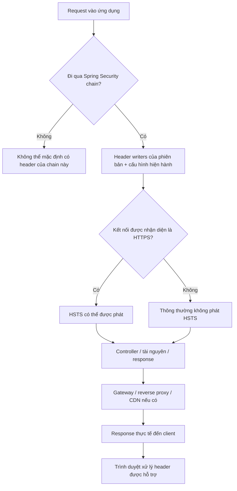
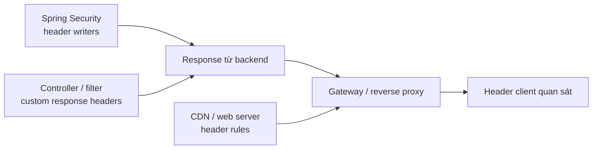

# Tập header mặc định trên phiên bản sử dụng

## 1. Câu hỏi cần trả lời trước khi cấu hình thêm header

Trong **Kiến trúc HTTP header** của module `SPRING_SECURITY_HTTP_PROTECTION`, Spring Security có thể tự thêm một số **HTTP response security headers** khi request đi qua chuỗi bảo mật. Những header này bảo vệ trình duyệt trước các tình huống như MIME sniffing, nhúng trang trái phép, sử dụng kết nối không mã hóa hoặc lưu cache nội dung nhạy cảm. Chúng bổ sung cho CSRF, CORS, CSP, HSTS, HTTP firewall và bảo vệ session, nhưng không thay thế các lớp kiểm soát đó.

Đề bài **“Tập header mặc định trên phiên bản sử dụng”** đòi hỏi trả lời chính xác bốn câu hỏi:

1. Ứng dụng đang **nạp phiên bản Spring Security nào** khi chạy?
2. Stack nào xử lý request: **Servlet** (`SecurityFilterChain`) hay **Reactive/WebFlux** (`SecurityWebFilterChain`)?
3. Response được quan sát có thực sự đi qua security chain và qua **HTTP hay HTTPS**?
4. Tập header nhận được là **mặc định của phiên bản**, do ứng dụng tùy biến, hay do reverse proxy/CDN thêm vào?

`SERVICE_NAME_DESCRIBE` của module bao gồm cả Servlet và Reactive, cũng như kiểm thử tình huống tấn công và chẩn đoán xung đột khi triển khai. Vì vậy bài học dùng **một quy trình kiểm tra áp dụng được cho cả hai stack**, kèm bảng tham chiếu những header thường gặp trong Spring Security 6.x. **Phiên bản thực tế của dự án chưa được cung cấp trong đề bài**; không được coi bảng tham chiếu là bằng chứng rằng chính phiên bản đang dùng chắc chắn phát mọi header đó.

### Mục tiêu học tập

- Truy vết phiên bản Spring Security từ dependency được resolve, phân biệt với phiên bản Spring Boot.
- Liệt kê được header thường bật mặc định, điều kiện xuất hiện và nhóm header thường phải tự khai báo.
- Dùng HTTP client, trình duyệt, MockMvc và WebTestClient để kiểm chứng response của Servlet/WebFlux.
- Xác định nguyên nhân khi header thiếu, khác giá trị hoặc xuất hiện hai lần do cấu hình và hạ tầng.
- Ghi lại một **baseline có phiên bản, môi trường và bằng chứng** trước khi tùy biến chính sách.

## 2. “Mặc định” nghĩa là gì?

Tập header mặc định là các header do **cấu hình Spring Security áp dụng khi request đi qua security filter chain tương ứng mà ứng dụng chưa thay đổi chính sách đó**. Đây không phải danh sách bất biến theo tên framework. Kết quả phụ thuộc phiên bản thư viện, loại ứng dụng và đường đi thực tế của response.



Các điểm dễ nhầm:

- **Mặc định của thư viện** khác với **mặc định khi chạy Spring Boot**: Spring Boot có thể tạo security chain tự động nếu người lập trình chưa khai báo chain riêng; khi đã khai báo chain, hành vi phụ thuộc cấu hình đó.
- **Có dependency Spring Security** không bảo đảm mọi request đều chạy qua security chain. Đường dẫn được `WebSecurityCustomizer` bỏ qua, route do gateway/ứng dụng khác phục vụ hoặc một chain khác có thể cho kết quả khác.
- **Header được server gửi** khác với **chính sách được browser thực thi**. `curl` xác minh giá trị response; DevTools và thử nghiệm hành vi mới xác minh browser áp dụng CSP, HSTS, frame policy…
- **Header có mặt trong response public** không nhất thiết do Spring Security sinh ra. Web server, CDN hoặc reverse proxy có thể tự đặt hoặc thay thế header.
- **Một header không có trong response** chưa chứng minh Spring Security đã tắt nó. Ví dụ HSTS thường chỉ xuất hiện với request được nhận diện là HTTPS; cache headers có thể được ứng dụng đặt tường minh.

## 3. Xác định phiên bản Spring Security thực sự được dùng

Nên ghi nhận phiên bản của các artifact liên quan, đặc biệt `spring-security-web` và `spring-security-config`. Nếu dùng Spring Boot, số phiên bản Spring Boot **không phải** số phiên bản Spring Security. Dependency management của Boot thường chọn phiên bản tương thích; override hoặc dependency transitively resolved có thể khiến phiên bản khác dự kiến.

### 3.1. Dự án Maven

```bash
# Liệt kê phiên bản dependency Spring Security được chọn
mvn dependency:tree -Dincludes=org.springframework.security
```

Trong một số shell, cách chuyển tham số `-Dincludes` có thể cần điều chỉnh quoting. Nếu muốn biết dependency management đến từ đâu, xem `mvn help:effective-pom` trong môi trường dự án. Đối chiếu các artifact `spring-security-core`, `spring-security-web`, `spring-security-config` và `spring-security-test` (nếu có): tránh để module runtime trộn các bản không tương thích.

### 3.2. Dự án Gradle

```bash
./gradlew dependencyInsight --dependency spring-security-web --configuration runtimeClasspath
./gradlew dependencyInsight --dependency spring-security-config --configuration runtimeClasspath
```

Trên Windows, chạy `gradlew.bat` hoặc `./gradlew.bat` tùy terminal thay cho script Unix. `dependencyInsight` thể hiện phiên bản được **resolve**, các phiên bản từng được yêu cầu và lý do chọn dependency. Nếu dự án nhiều module, hãy chạy lệnh đối với **module ứng dụng** đang khởi động, ví dụ thông qua cú pháp `:app:dependencyInsight` khi phù hợp.

### 3.3. Kiểm tra tại runtime nếu cần

Một cách bổ trợ là in phiên bản `spring-security-core`:

```java
import org.springframework.security.core.SpringSecurityCoreVersion;

System.out.println("Spring Security Core: "
    + SpringSecurityCoreVersion.getVersion());
```

Giá trị này hữu ích để đối chiếu, nhưng **không thay thế** việc xem artifact `spring-security-web` thực sự có trong runtime classpath. Với ứng dụng đóng gói container, cần chắc chắn bản image đang deploy là bản mới được build; báo cáo từ máy lập trình chưa chắc phản ánh container production.

**Cách lưu bằng chứng phù hợp:** ghi `Spring Boot version` (nếu dùng), `spring-security-web/config` version, Servlet hay WebFlux, môi trường, đường dẫn cần kiểm chứng, host public, HTTPS termination và thời điểm quan sát. Từ đó chọn **documentation theo đúng version** ở trang Spring Security, thay vì mặc định tài liệu “current” luôn khớp thư viện đang chạy.

## 4. Tập header thường có trong cấu hình mặc định Spring Security 6.x

Bảng sau là **baseline tham khảo cho các bản Spring Security 6.x phổ biến** khi HTTP security headers vẫn được bật. Tập chính xác phải được đối chiếu với tài liệu của phiên bản đã xác định ở mục 3 và với response thực tế.

| HTTP response header | Giá trị thường gặp | Mục đích | Điều kiện/cách hiểu |
| --- | --- | --- | --- |
| `Cache-Control` | `no-cache, no-store, max-age=0, must-revalidate` | Hạn chế cache nội dung phản hồi | Có thể khác nếu ứng dụng tự cấu hình cache cho response. |
| `Pragma` | `no-cache` | Tương thích với các cache/client cũ | Không thay thế `Cache-Control` hiện đại. |
| `Expires` | `0` | Hạn chế dùng cache qua thời điểm hết hạn | Là phần bổ trợ trong nhóm cache headers. |
| `X-Content-Type-Options` | `nosniff` | Giảm MIME sniffing, đặc biệt khi tải script/style | Không sửa được `Content-Type` bị server khai báo sai. |
| `X-Frame-Options` | `DENY` | Ngăn trang được nhúng trong iframe/frame | Có thể xung đột với nhu cầu nhúng dashboard nội bộ. |
| `Strict-Transport-Security` | `max-age=31536000; includeSubDomains` | Yêu cầu trình duyệt dùng HTTPS trong tương lai | **Chỉ gửi khi Spring Security nhận diện request là HTTPS** theo cấu hình mặc định. |
| `X-XSS-Protection` | `0` ở các bản hiện đại có mặc định này | Tắt bộ lọc XSS Auditor cũ trên trình duyệt còn hỗ trợ | Có thay đổi qua lịch sử phiên bản; không thay CSP hay output encoding. |

Ví dụ một response được bảo vệ (thứ tự header trên mạng có thể thay đổi):

```http
HTTP/1.1 200 OK
Content-Type: text/html;charset=UTF-8
Cache-Control: no-cache, no-store, max-age=0, must-revalidate
Pragma: no-cache
Expires: 0
X-Content-Type-Options: nosniff
X-Frame-Options: DENY
X-XSS-Protection: 0
Strict-Transport-Security: max-age=31536000; includeSubDomains

<html lang="vi">...</html>
```

Đây là **minh họa**, không phải ảnh chụp từ một phiên bản hoặc ứng dụng cụ thể. `X-XSS-Protection` từng có các giá trị và cách cấu hình khác nhau giữa các đời Spring Security, nên nếu đang bảo trì ứng dụng cũ hãy tra cứu đúng tài liệu version. Việc `X-XSS-Protection: 0` xuất hiện không có nghĩa là hệ thống đã mất khả năng phòng XSS: những phòng vệ hiện đại quan trọng là encode/escape đầu ra, tránh DOM sink không an toàn và cấu hình CSP thích hợp.

### 4.1. Tại sao `Cache-Control` xuất hiện mặc định?

Nội dung tài khoản, thông tin đơn hàng, trang sau đăng nhập hay response mang dữ liệu cá nhân cần tránh bị lưu vào những cache không mong muốn. `no-store` là chỉ thị quan trọng trong trường hợp này. Tuy nhiên JS/CSS/ảnh tĩnh có tên file theo hash thường cần cache dài hạn để tăng hiệu năng. Ứng dụng có thể tự đặt chính sách cache riêng cho tài nguyên công khai; không nên ép mọi asset thành `no-store` chỉ vì thấy đó là giá trị mặc định trong response động.

### 4.2. Tại sao HSTS vắng mặt trên HTTP?

HSTS buộc trình duyệt ghi nhớ yêu cầu kết nối HTTPS trong một khoảng thời gian; trình duyệt chỉ tin chính sách nhận qua HTTPS hợp lệ. Spring Security mặc định chỉ tạo HSTS cho **secure request**. Vì thế khi xem `http://localhost:8080`, việc thiếu `Strict-Transport-Security` là kết quả thường gặp, không tự động là lỗi cấu hình. Ngược lại, nếu HTTPS được terminate tại proxy nhưng backend nhận HTTP, cần xác minh cách ứng dụng xác định scheme qua cấu hình forwarding headers đáng tin cậy.

### 4.3. Tại sao `X-Frame-Options: DENY` làm hỏng một số giao diện?

`DENY` ngăn trang bị nhúng trong iframe bất kể cùng hay khác origin, giúp giảm rủi ro **clickjacking**. Nếu một portal phải nhúng report từ cùng origin, có thể cần `SAMEORIGIN` hoặc CSP `frame-ancestors` tùy yêu cầu. Thay đổi phải có lý do rõ ràng và được kiểm thử trên trình duyệt; không vô hiệu toàn bộ header mặc định chỉ để cho một iframe chạy được.

## 5. Những header quan trọng **không nên tự giả định là mặc định**

Spring Security không thể đoán policy ứng dụng, danh sách CDN, nơi gửi form, quyền camera hay domain API được phép truy cập. Các nhóm dưới đây thường cần quyết định và cấu hình riêng:

| Nhóm | Ví dụ | Lý do không nên tự giả định |
| --- | --- | --- |
| Content Security Policy | `Content-Security-Policy: default-src 'self'; script-src 'self'` | Mỗi ứng dụng dùng nguồn script/style/API khác nhau; policy quá chặt có thể làm trang lỗi. |
| CSP dạng quan sát | `Content-Security-Policy-Report-Only` | Chỉ dùng khi muốn thu thập vi phạm trước khi thực thi policy. |
| Referrer | `Referrer-Policy: strict-origin-when-cross-origin` | Cần chọn mức chia sẻ URL hợp yêu cầu riêng tư và tích hợp. |
| Quyền trình duyệt | `Permissions-Policy: camera=(), microphone=()` | Cần xét tính năng nào ứng dụng thật sự dùng. |
| Cô lập cross-origin | `Cross-Origin-Opener-Policy`, `Cross-Origin-Embedder-Policy`, `Cross-Origin-Resource-Policy` | Có thể ảnh hưởng popup đăng nhập, tài nguyên ngoài origin, CDN. |
| Xóa dữ liệu duyệt web theo sự kiện | `Clear-Site-Data` | Thường dùng cho luồng logout/xóa dữ liệu có chủ đích, không nên áp trên mọi response. |
| CORS | `Access-Control-Allow-Origin`, `Access-Control-Allow-Methods`, `Access-Control-Allow-Credentials` | Phụ thuộc origin, method, credential và preflight; cần cấu hình CORS riêng. |
| Cookie/session | `Set-Cookie` với `Secure`, `HttpOnly`, `SameSite` | Do cơ chế session/cookie và hạ tầng phát cookie quyết định, không phải hệ quả tất yếu của danh sách header security mặc định. |

**Lưu ý phân biệt:** CSP không thay thế CORS; CORS không phải cơ chế chứng thực hoặc chống CSRF; CSRF token không phải HTTP security header mặc định. HSTS không có khả năng cấp chứng chỉ TLS. `X-Frame-Options` và CSP `frame-ancestors` chỉ hướng tới kiểm soát **trang bị nhúng**, còn CSP `frame-src` xác định **nguồn iframe mà trang có thể nhúng**.

## 6. Cách quan sát header chính xác ở Servlet và Reactive

### 6.1. Kiểm tra từ HTTP client

Ưu tiên yêu cầu `GET` thực tế đến một URL chắc chắn thuộc security chain. Dùng `-D -` để in header, `-o` để bỏ body. Trên macOS/Linux:

```bash
curl -sS -D - -o /dev/null https://app.example.test/account
curl -sS -D - -o /dev/null http://localhost:8080/account
```

Trên Windows PowerShell, gọi `curl.exe` để tránh alias cũ và dùng `NUL` làm đích bỏ body:

```powershell
curl.exe -sS -D - -o NUL https://app.example.test/account
curl.exe -sS -D - -o NUL http://localhost:8080/account
```

Thay tên host và đường dẫn bằng hệ thống thử nghiệm thực. Không dùng `-k` để suy ra HSTS được trình duyệt tin: bỏ kiểm chứng chứng chỉ chỉ giúp HTTP client đọc được header từ môi trường test, không chứng minh trình duyệt chấp nhận chính sách HSTS đó.

**Nên ghi lại cho mỗi request:** URL, scheme, status (`200`, `302`, `401`, `403`...), header xuất hiện và giá trị chính xác. So sánh kết quả **trực tiếp vào backend** với **qua proxy/CDN** nếu hai điểm truy cập đều được phép. Header trên `200 OK` không đủ để suy ra header cũng có trên redirect, trang lỗi hoặc tài nguyên tĩnh.

### 6.2. Tạo ma trận kiểm chứng để tránh kết luận từ một endpoint

| Tình huống | Điều cần kiểm tra | Cách diễn giải |
| --- | --- | --- |
| `GET` trang công khai qua HTTPS | `nosniff`, frame, cache, HSTS và giá trị do chain quyết định | Baseline cho request secure đã đi qua Spring Security. |
| `GET` trang công khai qua HTTP | Các header còn lại; HSTS thường vắng mặt | Khác biệt HSTS có thể đúng theo thiết kế. |
| Endpoint yêu cầu đăng nhập | Response `302`/`401` có được thêm header? | Header writer thường nằm trong chain, không chỉ ở controller `200`. |
| Request không có quyền/CSRF không hợp lệ | Response `403` và header thực nhận | Điều tra thứ tự xử lý và handler nếu header bị thiếu. |
| Static asset công khai | Có/không có cache header tùy chỉnh; chain có chạy không? | `permitAll` vẫn qua chain, `web.ignoring` bỏ qua chain. |
| Đường dẫn qua gateway/CDN | Header bị thêm, bỏ, thay hoặc lặp không? | Tập header mà browser thấy có thể khác tập Spring phát. |

Với HSTS, cần nhớ URL **HTTPS có chứng chỉ hợp lệ** và host đúng mục tiêu. Nếu server chỉ redirect HTTP → HTTPS, hãy kiểm tra **cả** response redirect HTTP và response HTTPS sau chuyển hướng. Không suy ra có HSTS chỉ vì URL cuối là HTTPS.

### 6.3. Xác minh trên trình duyệt

Mở **Developer Tools → Network**, bật Preserve log nếu cần xem redirect, tải lại trang và chọn từng request. Đọc **Response Headers** ở response cuối cùng. Khi thấy CSP/frame policy, thử một tình huống có hoặc không có quyền nhúng để kiểm tra browser áp dụng chính sách; khi muốn kiểm chứng HSTS, lưu ý trạng thái HSTS có thể đã được trình duyệt ghi nhớ từ những lần truy cập trước. Các trình duyệt và client khác nhau có thể hỗ trợ security headers không giống nhau.

> Quy tắc chứng cứ: Network panel chứng minh **header đã đến browser**; Console và hành vi thực tế chứng minh **browser đã áp dụng chỉ thị được hỗ trợ**. Một bài kiểm tra `curl` thành công không tự động chứng minh khả năng chống clickjacking hoặc XSS.

## 7. Kiểm thử với Servlet: xác minh header mặc định trên chain đang chạy

Giả sử ứng dụng Spring Boot 3.x Servlet có endpoint `/public/ping` trả `200` và được xử lý bởi Spring Security. Nếu đang sử dụng cấu hình `SecurityFilterChain` hiện có, **không tạo một chain `permitAll` mới chỉ để chạy kiểm thử**: nhiều chain cùng matcher dễ khiến kết quả không đại diện production.

Ví dụ kiểm tra bằng MockMvc (phù hợp khi bản Spring Boot đang dùng còn cung cấp các package test sau):

```java
import org.junit.jupiter.api.Test;
import org.springframework.beans.factory.annotation.Autowired;
import org.springframework.boot.test.autoconfigure.web.servlet.AutoConfigureMockMvc;
import org.springframework.boot.test.context.SpringBootTest;
import org.springframework.test.web.servlet.MockMvc;

import static org.hamcrest.Matchers.containsString;
import static org.springframework.test.web.servlet.request.MockMvcRequestBuilders.get;
import static org.springframework.test.web.servlet.result.MockMvcResultMatchers.header;

@SpringBootTest
@AutoConfigureMockMvc
class DefaultSecurityHeadersServletTest {

    @Autowired MockMvc mvc;

    @Test
    void secureRequestHasExpectedBaselineHeaders() throws Exception {
        mvc.perform(get("/public/ping").secure(true))
            .andExpect(header().string("X-Content-Type-Options", "nosniff"))
            .andExpect(header().string("X-Frame-Options", "DENY"))
            .andExpect(header().string("Cache-Control", containsString("no-store")))
            .andExpect(header().string("Strict-Transport-Security",
                containsString("max-age=")));
    }

    @Test
    void plainHttpDoesNotHaveHstsByDefault() throws Exception {
        mvc.perform(get("/public/ping").secure(false))
            .andExpect(header().doesNotExist("Strict-Transport-Security"));
    }
}
```

**Điều kiện áp dụng:** những kỳ vọng trên mô tả baseline tham khảo, chỉ nên giữ nguyên khi đã xác minh phiên bản và chain của ứng dụng **không** tùy chỉnh frame/caching/HSTS. Nếu application có policy riêng, sửa expected headers theo **hợp đồng bảo mật đã chọn**, chứ không thay code production để chiều theo test. `secure(true)` mô phỏng HTTPS ở tầng request của MockMvc; nó không kiểm chứng chứng chỉ, TLS hoặc proxy forwarding thật. Nếu endpoint khác được auth bảo vệ, có thể dùng một endpoint test đi qua chain đúng hoặc bổ sung identity/matcher phù hợp để phản ánh hành vi mong muốn.

### Khi thay đổi một mặc định trên Servlet

Ví dụ ứng dụng cần một trang báo cáo được **nhúng cùng origin**, nhưng mặc định `X-Frame-Options: DENY` chặn iframe. Trong **chain đã tồn tại**, có thể sửa riêng frame policy:

```java
// Đặt bên trong cấu hình HttpSecurity đang có:
http.headers(headers -> headers
    .frameOptions(frame -> frame.sameOrigin())
);
```

Sau thay đổi, expected header là `X-Frame-Options: SAMEORIGIN` cho các response thuộc chain đó. Nếu ứng dụng cũng phát CSP `frame-ancestors`, policy này cần được phối hợp nhất quán. Đừng tắt toàn bộ HTTP headers chỉ để giải quyết xung đột iframe.

## 8. Kiểm thử với Reactive/WebFlux

Trong WebFlux, security chain là `SecurityWebFilterChain` từ `ServerHttpSecurity`; logic thêm security headers thuộc tầng WebFilter thay vì Servlet filter. Tuy nhiên **đầu ra HTTP cuối cùng** vẫn có thể được kiểm tra bằng HTTP client và `WebTestClient`.

Giả sử test setup đã cấu hình `WebTestClient` đi qua WebFlux application và một route `/public/ping` qua security chain. Đoạn kiểm tra sau có thể đặt trong một test class đang có `@Autowired WebTestClient webTestClient`:

```java
@Test
void reactiveChainAddsBaselineHeaders() {
    webTestClient.get()
        .uri("/public/ping")
        .exchange()
        .expectHeader().valueEquals("X-Content-Type-Options", "nosniff")
        .expectHeader().valueEquals("X-Frame-Options", "DENY");
}
```

Nếu ứng dụng có custom frame policy, hãy cập nhật expected `DENY` cho đúng. Với HSTS, `WebTestClient` gắn vào mock server có thể xử lý request theo scheme khác so với deployment HTTPS public. Cần kiểm chứng riêng bằng HTTPS thực hoặc setup request secure phù hợp với phiên bản test đang dùng; đừng cho rằng không thấy HSTS trong test HTTP nghĩa là WebFlux không hỗ trợ HSTS.

Một config minh họa **giữ cơ chế header hiện hành** của WebFlux, trong khi bổ sung security rules của ứng dụng, có dạng:

```java
import org.springframework.context.annotation.Bean;
import org.springframework.security.config.web.server.ServerHttpSecurity;
import org.springframework.security.web.server.SecurityWebFilterChain;

@Bean
SecurityWebFilterChain securityWebFilterChain(ServerHttpSecurity http) {
    return http
        .authorizeExchange(exchanges -> exchanges
            .pathMatchers("/public/ping").permitAll()
            .anyExchange().authenticated())
        .build();
}
```

Ví dụ này giúp test được endpoint public trên WebFlux; chỉ dùng trong bối cảnh phù hợp với authorization hiện có. Không thay thế chain production nếu hệ thống đang có xác thực, route matcher và cơ chế CSRF/session đặc thù. **Trước khi thêm API tùy chỉnh header** vào `ServerHttpSecurity`, tra tài liệu Reactive của đúng Spring Security version vì tên và cách cấu hình DSL giữa các đời framework có thể thay đổi.

## 9. Phân biệt mặc định với cấu hình ứng dụng và hạ tầng

Một ứng dụng có thể đồng thời có các nguồn phát header:



Ví dụ backend tạo `X-Frame-Options: DENY` nhưng proxy cấu hình `SAMEORIGIN`. Kết quả có thể là một giá trị bị ghi đè hoặc có nhiều dòng header, tùy công nghệ và cấu hình. Cần xác định **đúng thành phần đang phát** header thay vì giả định cứ thấy giá trị trong DevTools thì đó là mặc định Spring Security. Nhiều CSP policy có thể cùng có hiệu lực; trình duyệt thường áp dụng các hạn chế kết hợp, không tự chọn policy thuận tiện nhất.

| Hiện tượng | Kiểm tra trước | Hướng xử lý |
| --- | --- | --- |
| Thiếu `X-Frame-Options` ở một route | Route khớp chain nào? Có `headers(...disable())`, filter bỏ qua hoặc proxy? | Đưa route qua chain mong muốn; bật/tùy chỉnh riêng policy phù hợp. |
| Có frame header nhưng nội dung vẫn không được nhúng | Xem thêm CSP `frame-ancestors` trên response | Đồng bộ chính sách nhúng và kiểm tra trong browser. |
| Thiếu HSTS trên localhost hoặc sau proxy | Request được nhận diện là HTTPS? Proxy có chuyển scheme đáng tin cậy? | Kiểm thử HTTPS thực, cấu hình forwarding an toàn và nơi phát HSTS. |
| Browser báo CSP vi phạm trong khi nghĩ chỉ dùng mặc định | CSP có thể do chain tùy chỉnh hoặc CDN thêm vào | Truy nguồn cấu hình, đối chiếu response public, Console, report-only. |
| `Cache-Control` khác bảng tham chiếu | Controller hoặc tài nguyên static đã tự đặt caching? | Phân loại response nhạy cảm và tài nguyên công khai, chọn policy cụ thể. |
| Header khác nhau giữa `401`, `403` và `200` | Xử lý lỗi ở filter/exception handler nào? Request có bị firewall chặn rất sớm? | Đọc response cho từng tình huống và xem chain thực sự chạy đến đâu. |
| Phát hai giá trị HSTS/CSP ở backend và proxy | Cả hai lớp cùng cấu hình header | Chọn chủ sở hữu cấu hình rõ ràng; kiểm tra lại response sau proxy. |
| Test chạy nhưng production thiếu header | Artifact được deploy khác phiên bản; route/proxy/TLS khác | So runtime dependency, deployment và URL public trước khi sửa test. |

### Chẩn đoán bằng cấu hình security chain

**Servlet:** kiểm tra có nhiều bean `SecurityFilterChain` hay không, matcher và `@Order` nào chọn chain. `requestMatchers(...).permitAll()` cho phép truy cập **nhưng vẫn đi qua filter chain**; cơ chế bỏ qua chain qua `WebSecurityCustomizer` có thể làm mất security headers trên URL đó. Đặc biệt xem security header đã bị `.headers(headers -> headers.disable())` hoặc thay riêng writer hay chưa.

**Reactive:** kiểm tra các `SecurityWebFilterChain` và `securityMatcher`/thứ tự chain, cùng cấu hình `ServerHttpSecurity.headers`. Việc một `WebFilter`/gateway tùy biến response có thể làm giá trị khác dự kiến. Đừng sao chép API `HttpSecurity` của Servlet sang WebFlux vì cấu trúc filter/DSL không giống nhau.

**HTTP firewall:** có request bị từ chối rất sớm do request URL/encoding bất thường trước khi được xử lý theo luồng response thông thường. Không dùng một response bị firewall chặn để kết luận “tất cả endpoint đều không có security headers”. Hãy thử thêm một request hợp lệ cùng route và xác định lớp nào tạo response lỗi.

## 10. Lập bảng baseline cho chính phiên bản của dự án

Sau khi xác định runtime và thực hiện GET trên một số URL đại diện, lập bảng sau trong tài liệu nội bộ hoặc test report. **Điền giá trị đo được, không điền theo trí nhớ**.

| Trường cần ghi | Ví dụ minh họa (phải thay theo dự án) |
| --- | --- |
| Build/runtime version | `spring-security-web 6.x.y`, `spring-security-config 6.x.y` |
| Stack / chain | `Servlet – SecurityFilterChain web` hoặc `WebFlux – SecurityWebFilterChain` |
| Môi trường và đường dẫn | `staging`, `GET https://app.example.test/account` |
| Proxy/TLS | `HTTPS tại gateway → HTTP nội bộ`, có chính sách forwarding rõ ràng |
| `Cache-Control` | Giá trị thực tế / thiếu / do controller đặt riêng |
| `X-Content-Type-Options` | Giá trị thực tế / thiếu |
| `X-Frame-Options` | Giá trị thực tế / thiếu |
| `Strict-Transport-Security` | Giá trị thực tế trên HTTPS; so với HTTP |
| `X-XSS-Protection` | Giá trị thực tế / thiếu; so với tài liệu version |
| CSP/Referrer/Permissions | Giá trị thực tế; ghi rõ do app/proxy tự cấu hình nếu có |
| Nguồn bằng chứng | Dependency tree, response headers, test và phiên bản browser |

Sau đó chốt hợp đồng bảo mật theo nhu cầu thực: ví dụ một ứng dụng có thể yêu cầu `X-Content-Type-Options: nosniff`, `X-Frame-Options: DENY`, HTTPS có HSTS, cache nhạy cảm không lưu, đồng thời tự thêm CSP và `Referrer-Policy`. **Test nên bám yêu cầu bảo mật đã được quyết định**, có ghi version, thay vì bắt mọi hệ thống phát đúng một bản sao bảng tham chiếu.

## 11. Bài tập tình huống

**Bài 1 — Hai môi trường khác HSTS.** `curl` trên `http://localhost:8080` không có HSTS, trong khi HTTPS staging có `max-age=31536000; includeSubDomains`. Hãy trả lời: đây có nhất thiết là lỗi không? **Gợi ý:** không; phải kiểm tra secure request, certificate, reverse proxy và cơ chế xác định scheme trước khi kết luận.

**Bài 2 — Security dependency đã nâng cấp.** Pull request nâng Spring Boot nhưng không sửa `headers(...)`. Một snapshot test header thay đổi. Hãy xác định: cần đọc dependency tree runtime và tài liệu Spring Security version mới, kiểm tra request mẫu và phân biệt thay đổi mặc định với proxy/config nội bộ; không sửa expected test tùy tiện.

**Bài 3 — Public asset thiếu `nosniff`.** `/public/ping` có `nosniff`, `/assets/app.js` không có. Kiểm tra route asset đi qua Spring Security hay bị bỏ qua bằng `web.ignoring`; đối chiếu MIME `Content-Type`. Nếu cần security headers cho asset, hãy xem xét để asset qua chain với `permitAll` hoặc cấu hình ở lớp HTTP chịu trách nhiệm phát asset.

**Bài 4 — CORS bị từ chối dù mọi header mặc định đều hiện diện.** Frontend khác origin gửi credential và nhận lỗi CORS. Hãy giải thích vì sao: `nosniff`, X-Frame-Options, HSTS và cache headers không tạo CORS allowlist; cần kiểm tra cấu hình CORS và preflight, sau đó xem lại CSRF/authentication riêng.

**Bài 5 — iframe nội bộ cần hoạt động.** Mặc định `X-Frame-Options: DENY`, nhưng trang reporting cùng origin phải được nhúng. Hãy xây dựng thay đổi nhỏ nhất: dùng `SAMEORIGIN` hoặc `frame-ancestors 'self'` phù hợp kiến trúc, xử lý các policy đồng thời, rồi kiểm tra iframe thật từ origin được phép và không được phép.

**Bài 6 — Kết quả test và browser khác nhau.** MockMvc thấy `X-Frame-Options: DENY`, nhưng browser thấy `SAMEORIGIN` và thêm CSP. Hãy kiểm tra các lớp phát header giữa backend và browser (proxy/CDN), chứng minh điểm thay đổi bằng response từ hai phía và xác định nguồn cấu hình duy nhất trước khi điều chỉnh.

## 12. Những nguyên tắc cần ghi nhớ

1. **Xác định phiên bản đang chạy trước khi liệt kê mặc định.** Bảng tham chiếu Spring Security 6.x chỉ là điểm bắt đầu.
2. **Kiểm tra trên request đi qua đúng chain.** `permitAll` khác với bỏ qua filter; HTTP khác HTTPS; Servlet khác WebFlux.
3. **Phân biệt “thường mặc định” với “phải tự khai báo”.** CSP, Referrer-Policy, Permissions-Policy và CORS cần quyết định riêng theo ứng dụng.
4. **Đo response đến client, kể cả proxy/CDN.** Header bị ghi đè hoặc thiếu ở redirect/error path có thể làm môi trường production khác test.
5. **Bảo tồn các mặc định hữu ích và thay đổi có chủ đích.** Khi cần điều chỉnh một header, sửa riêng header đó rồi kiểm thử lại; không tắt mọi header chỉ để xử lý một sự cố.

### Tài liệu tham khảo theo phiên bản

- [Spring Security Reference — HTTP Response Headers (tổng quan)](https://docs.spring.io/spring-security/reference/features/exploits/headers.html)
- [Spring Security Reference — Servlet: Security HTTP Response Headers](https://docs.spring.io/spring-security/reference/servlet/exploits/headers.html)
- [Spring Security Reference — Reactive: Security HTTP Response Headers](https://docs.spring.io/spring-security/reference/reactive/exploits/headers.html)
- [Spring Security — tài liệu phiên bản đã phát hành](https://docs.spring.io/spring-security/reference/index.html) — chọn đúng phiên bản tương ứng runtime đang dùng.
- [MDN — HTTP response headers](https://developer.mozilla.org/en-US/docs/Glossary/Response_header)
- [MDN — Strict-Transport-Security](https://developer.mozilla.org/en-US/docs/Web/HTTP/Reference/Headers/Strict-Transport-Security)
