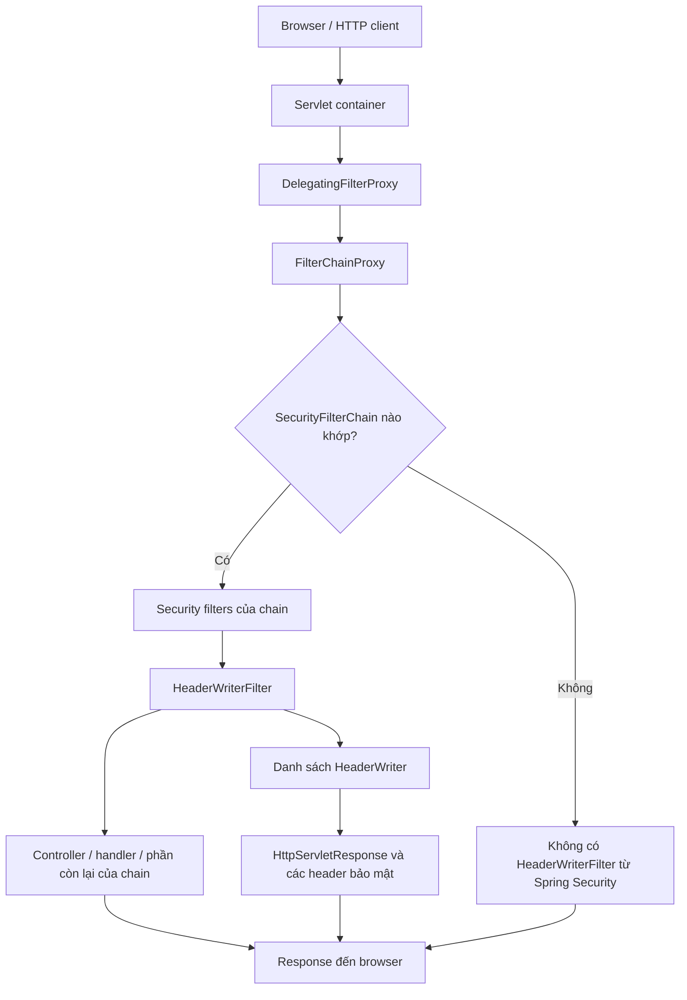
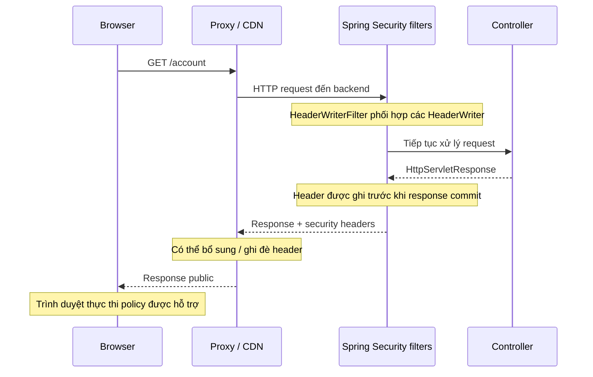

# HeaderWriterFilter và HeaderWriter trên Servlet

## 1. Vì sao Spring Security có một filter chuyên ghi HTTP header?

Trong kiến trúc **Spring Security HTTP Protection** (`SPRING_SECURITY_HTTP_PROTECTION`), những lớp bảo vệ như CSRF, CORS, security headers, CSP, HSTS, HTTP firewall và session phối hợp để bảo vệ request và trình duyệt. Riêng **security response headers** có đặc điểm: máy chủ cần phát chính sách trên HTTP response, còn trình duyệt sẽ thực thi những chính sách được hỗ trợ khi render trang, tải tài nguyên hoặc điều hướng.

Trên **Servlet stack**, Spring Security dùng `HeaderWriterFilter` làm điểm tích hợp vào Servlet filter chain. Filter này gọi những đối tượng triển khai giao diện `HeaderWriter` để bổ sung header vào response. Cơ chế tách riêng **khi nào áp header** và **áp header nào** giúp framework cung cấp mặc định an toàn, đồng thời cho phép ứng dụng tùy biến từng header.

Ví dụ:

```http
HTTP/1.1 200 OK
X-Content-Type-Options: nosniff
X-Frame-Options: DENY
Cache-Control: no-cache, no-store, max-age=0, must-revalidate
Content-Security-Policy: default-src 'self'; object-src 'none'; frame-ancestors 'none'
```

`HeaderWriterFilter` có trách nhiệm **ghi các giá trị đã được cấu hình**. Browser chịu trách nhiệm thực thi `nosniff`, frame policy, CSP… theo khả năng hỗ trợ; không phải Java filter chủ động chặn một `<script>` sau khi response đã gửi. Còn xác thực, phân quyền, CSRF và kiểm tra firewall được xử lý bởi những thành phần phù hợp khác trong chuỗi bảo mật.

Sau bài học, bạn có thể:

1. Giải thích quan hệ `FilterChainProxy` → `SecurityFilterChain` → `HeaderWriterFilter` → `HeaderWriter` trên Servlet.
2. Phân biệt writer dựng sẵn với writer tùy biến và nhận biết những rủi ro khi ghi đè/lặp header.
3. Thêm chính sách bằng `HttpSecurity.headers(...)`, hoặc giới hạn phạm vi bằng `RequestMatcher`.
4. Kiểm thử header ở từng loại response và chẩn đoán sự khác biệt khi chạy qua proxy, HTTPS hoặc nhiều security chain.
5. Biết phần nào thuộc Servlet và phần nào phải cấu hình riêng nếu ứng dụng dùng Reactive/WebFlux.

## 2. Kiến trúc: `HeaderWriterFilter` nằm ở đâu?

Trong ứng dụng Spring MVC/Servlet, Servlet container nhận request và đưa qua filter chain. Spring Security tích hợp bằng `DelegatingFilterProxy`, ủy quyền cho bean `FilterChainProxy`. `FilterChainProxy` chọn **một `SecurityFilterChain` phù hợp** theo request và thực thi các security filters của chain đó. Một trong những filter liên quan đến HTTP response là `HeaderWriterFilter`.



Sơ đồ mô tả **quan hệ trách nhiệm**, không phải thứ tự thời gian tuyệt đối: `HeaderWriterFilter` có thể đợi đến giai đoạn response được commit hoặc cuối xử lý để ghi header, và thứ tự chính xác với các security filter khác phụ thuộc phiên bản/cấu hình. Điều quan trọng là request phải đi qua chain chứa filter này.

Các thành phần có nhiệm vụ khác nhau:

| Thành phần | Vai trò | Không đảm nhiệm |
| --- | --- | --- |
| `FilterChainProxy` | Chọn security chain và điều phối các security filter theo cấu hình | Không tự định nghĩa danh sách CSP/HSTS cho ứng dụng. |
| `SecurityFilterChain` | Tập các filter áp dụng cho một nhóm request Servlet | Không phải HTTP response header hay Servlet filter đơn lẻ. |
| `HeaderWriterFilter` | Điều phối việc viết các header thông qua danh sách `HeaderWriter` | Không xác thực người dùng, cấp quyền hay lọc JavaScript trong HTML. |
| `HeaderWriter` | Quyết định header/value nào được ghi lên response theo request cụ thể | Không tự xuất hiện trên mọi URL nếu không được gắn vào filter/chain. |
| `HttpServletResponse` | Đối tượng nhận thao tác `setHeader`/`addHeader` trước khi commit | Không chứng minh browser sẽ hỗ trợ/thực thi mọi header. |

### Cùng một endpoint, nhiều tầng có thể sửa response



Nếu một reverse proxy kết thúc TLS, request HTTPS của browser có thể trở thành HTTP tới backend. Khi đó giá trị `request.isSecure()` và cấu hình forwarding an toàn có thể ảnh hưởng writer HSTS. Vì thế kết quả `curl` trực tiếp đến backend và response HTTPS public có thể khác nhau dù dùng cùng code.

## 3. Hợp đồng của giao diện `HeaderWriter`

API cốt lõi trên Servlet là:

```java
package org.springframework.security.web.header;

public interface HeaderWriter {
    void writeHeaders(
        jakarta.servlet.http.HttpServletRequest request,
        jakarta.servlet.http.HttpServletResponse response
    );
}
```

Đây là chữ ký minh họa cho **Spring Security 6.x dùng Jakarta Servlet**. Dự án Spring Security 5.x thường sử dụng namespace `javax.servlet.*`; hãy kiểm tra đúng phiên bản dependency trước khi sao chép import.

Một writer nhận request và response để quyết định có ghi header hay không. Với implementation đơn giản, cách làm thường là:

```java
import jakarta.servlet.http.HttpServletRequest;
import jakarta.servlet.http.HttpServletResponse;
import org.springframework.security.web.header.HeaderWriter;

public final class TrainingHeaderWriter implements HeaderWriter {
    @Override
    public void writeHeaders(HttpServletRequest request, HttpServletResponse response) {
        response.setHeader("X-Header-Lab", "servlet");
    }
}
```

`X-Header-Lab` chỉ là **header minh họa quan sát luồng filter**; nó không mang ý nghĩa bảo mật tiêu chuẩn. Từ ví dụ này, có ba điểm kỹ thuật cần nhớ:

- `setHeader(name, value)` thay giá trị header cùng tên ở response theo ngữ nghĩa Servlet API; `addHeader(name, value)` có thể tạo thêm giá trị. Trình duyệt có thể diễn giải nhiều policy cùng tên theo quy tắc riêng, nên không tự ý thêm nhiều header bảo mật giống nhau.
- Writer nên tạo kết quả **ổn định, rõ ràng và độc lập trạng thái dùng chung**. Tránh lưu trạng thái request vào field mutable của singleton writer.
- Chỉ ghi header khi response còn có thể thay đổi. Sau khi HTTP response đã commit, việc thay đổi header có thể không còn hiệu lực. `HeaderWriterFilter` cung cấp cơ chế xử lý thời điểm ghi; nếu tự viết Servlet filter khác, phải đặc biệt cẩn thận với thời điểm commit.

Với policy chuẩn như CSP, frame options, HSTS, referrer policy…, nên dùng DSL/header writer có sẵn của Spring Security. Writer tùy biến thích hợp khi cần một header chưa được DSL hỗ trợ hoặc cần quy tắc riêng thực sự có lý do.

## 4. `HeaderWriterFilter` thực hiện công việc ra sao?

`org.springframework.security.web.header.HeaderWriterFilter` là Servlet filter do Spring Security sử dụng để gọi một **danh sách `HeaderWriter`**. Về mặt khái niệm, cơ chế có thể hiểu như sau:

```java
// Mã giả để giải thích trách nhiệm, KHÔNG phải source code của Spring Security.
final class ConceptualHeaderWriterFilter {
    private final List<HeaderWriter> writers;

    void writeConfiguredHeaders(HttpServletRequest request,
                                HttpServletResponse response) {
        for (HeaderWriter writer : writers) {
            writer.writeHeaders(request, response);
        }
    }
}
```

Implementation thực tế còn xử lý Servlet filter chain, response wrapping và việc ghi header ở thời điểm phù hợp. Trong các phiên bản hiện đại, `HeaderWriterFilter` thường cho các writer chạy **khi response sắp commit hoặc vào giai đoạn hoàn tất xử lý filter**, nhằm giảm nguy cơ ghi header quá sớm rồi bị code khác thay đổi. API có lựa chọn `setShouldWriteHeadersEagerly(boolean)` để yêu cầu ghi sớm hơn trong những tình huống đặc biệt; **không bật eager một cách mặc định** chỉ vì một endpoint thiếu header, vì nguyên nhân thường nằm ở matcher, chain hoặc response do tầng khác tạo.

### 4.1. Vì sao thời điểm commit quan trọng?

Một controller, authentication entry point hoặc exception handler có thể gọi `sendRedirect`, `sendError`, ghi body lớn hoặc flush output stream. Những hành động này có thể kích hoạt việc commit response. Spring Security phải phối hợp với vòng đời Servlet response để header có mặt trước khi client nhận response. Tuy nhiên, không có một lời hứa chung rằng **mọi phản hồi lỗi do bất kỳ tầng nào tạo ra** đều đi qua `HeaderWriterFilter`: ví dụ HTTP firewall hoặc container có thể từ chối request rất sớm, trước khi request đi đến security chain dự kiến.

### 4.2. Điều gì xảy ra khi chain chọn khác nhau?

Giả sử có hai chain:

```text
/api/**  → SecurityFilterChain API  → HeaderWriterFilter API
/**      → SecurityFilterChain Web  → HeaderWriterFilter Web
```

Theo quy tắc chọn chain, `FilterChainProxy` chọn **chain khớp đầu tiên** dựa trên thứ tự. Nếu chain API được cấu hình headers khác chain Web, `/api/orders` và `/home` hoàn toàn có thể có header khác nhau. Việc một route là `permitAll` **vẫn giữ route trong security chain**; ngược lại cơ chế bỏ qua chain thông qua `WebSecurityCustomizer.ignoring()` có thể khiến Spring Security không phát những header mặc định cho route đó.

## 5. Những `HeaderWriter` dựng sẵn và chính sách phổ biến

Spring Security có nhiều implementation trong gói `org.springframework.security.web.header.writers`. Tên và khả năng tùy chỉnh nên đối chiếu với tài liệu phiên bản dự án đang dùng.

| HeaderWriter / nhóm writer | Header chủ yếu | Ý nghĩa khi vận hành |
| --- | --- | --- |
| `ContentTypeOptionsHeaderWriter` | `X-Content-Type-Options: nosniff` | Giảm tình huống trình duyệt đoán MIME type khi tải tài nguyên. |
| `FrameOptionsHeaderWriter` | `X-Frame-Options` | Chống nhúng trang trái phép/clickjacking; giá trị thường mặc định là `DENY`. |
| `HstsHeaderWriter` | `Strict-Transport-Security` | Phát HSTS với secure request; phụ thuộc scheme được nhận diện và cấu hình HSTS. |
| `CacheControlHeadersWriter` | `Cache-Control`, `Pragma`, `Expires` | Hạn chế caching response nhạy cảm; lưu ý response có caching do ứng dụng tự đặt. |
| `XXssProtectionHeaderWriter` | `X-XSS-Protection` | Liên quan cơ chế XSS filter cũ; giá trị/mặc định đã thay đổi qua các đời. |
| `ContentSecurityPolicyHeaderWriter` | `Content-Security-Policy` hoặc `Content-Security-Policy-Report-Only` | Cần policy theo nguồn tài nguyên của từng ứng dụng, không tự đoán cấu hình chung. |
| `ReferrerPolicyHeaderWriter` | `Referrer-Policy` | Kiểm soát dữ liệu URL nguồn gửi trong referrer. |
| `StaticHeadersWriter` | Header tĩnh tùy chọn | Hữu ích khi cần một header với giá trị cố định. |
| `DelegatingRequestMatcherHeaderWriter` | Header do writer được ủy quyền tạo | Chỉ kích hoạt writer khi request khớp một `RequestMatcher`. |

Trong nhiều bản Spring Security 6.x, tập security response headers mặc định thường có `Cache-Control`, `Pragma`, `Expires`, `X-Content-Type-Options`, `X-Frame-Options`, `X-XSS-Protection: 0` và HSTS **trên HTTPS**. Những giá trị này là baseline tham khảo, **không phải khẳng định cho mọi phiên bản hoặc mọi chain**. Spring Security không tự bật CSP với allowlist phù hợp cho mọi ứng dụng; CSP và các chính sách như `Referrer-Policy`/`Permissions-Policy` thường cần cấu hình chủ động.

Ví dụ về HSTS:

```http
Strict-Transport-Security: max-age=31536000; includeSubDomains
```

HSTS chỉ có ý nghĩa được browser ghi nhớ từ **kết nối HTTPS hợp lệ**. Nếu tất cả subdomain chưa sẵn sàng dùng TLS, `includeSubDomains` cần được đánh giá trước khi triển khai. Đừng coi HSTS là thay thế cấu hình HTTPS hoặc certificate.

## 6. Cấu hình bằng `HttpSecurity.headers(...)` trên Servlet

Trong ứng dụng hiện có, hãy **mở rộng `SecurityFilterChain` đang quản lý URL** thay vì tạo một chain chồng lấn chỉ để thử header. Đoạn dưới minh họa cấu hình Spring Security 6.x theo lambda DSL, với endpoint công khai `/health` và các đường dẫn khác cần xác thực:

```java
import org.springframework.context.annotation.Bean;
import org.springframework.context.annotation.Configuration;
import org.springframework.security.config.annotation.web.builders.HttpSecurity;
import org.springframework.security.config.annotation.web.configuration.EnableWebSecurity;
import org.springframework.security.web.SecurityFilterChain;
import org.springframework.security.web.header.writers.StaticHeadersWriter;
import org.springframework.security.web.header.writers.ReferrerPolicyHeaderWriter.ReferrerPolicy;

@Configuration
@EnableWebSecurity
public class WebSecurityConfig {

    @Bean
    SecurityFilterChain webChain(HttpSecurity http) throws Exception {
        http.authorizeHttpRequests(auth -> auth
            .requestMatchers("/health").permitAll()
            .anyRequest().authenticated()
        );

        http.headers(headers -> headers
            .contentSecurityPolicy(csp -> csp.policyDirectives(
                "default-src 'self'; "
                    + "object-src 'none'; "
                    + "base-uri 'self'; "
                    + "frame-ancestors 'none'"
            ))
            .referrerPolicy(referrer -> referrer
                .policy(ReferrerPolicy.STRICT_ORIGIN_WHEN_CROSS_ORIGIN))
            .addHeaderWriter(new StaticHeadersWriter(
                "X-Header-Lab", "servlet"))
        );

        return http.build();
    }
}
```

Đoạn trên minh họa cấu hình header; **authentication, CSRF, CORS và session cần được giữ theo yêu cầu của hệ thống thực**. Không dùng cấu hình mẫu để ghi đè các chain production vốn có matcher, đăng nhập và phân quyền riêng. CSP ở ví dụ cố tình tối giản; nếu frontend cần script, ảnh, font hoặc API khác origin, hãy kiểm kê và khai báo directive phù hợp trước khi cưỡng chế.

Ở đây:

- `.contentSecurityPolicy(...)` đăng ký writer phát CSP theo policy đã khai báo.
- `.referrerPolicy(...)` cấu hình `Referrer-Policy` thông qua writer mà Spring Security cung cấp.
- `.addHeaderWriter(...)` thêm một writer vào danh sách để `HeaderWriterFilter` thực thi.
- Những header mặc định chưa bị tắt vẫn được cơ chế headers của Spring Security quản lý. Việc thêm một writer **không đồng nghĩa** với tắt hoặc thay thế tất cả writer mặc định.

`X-Header-Lab` dùng để kiểm tra luồng và có thể bỏ sau bài thực hành; nó không phải khuyến nghị đưa header mới không có chức năng vào production.

### 6.1. Thay đổi một header dựng sẵn theo mục đích rõ ràng

Nếu trang báo cáo cần được nhúng **cùng origin**, mặc định `X-Frame-Options: DENY` có thể không phù hợp. Hãy sửa đúng chính sách cần sửa:

```java
// Đặt trong HttpSecurity của SecurityFilterChain đang sử dụng.
http.headers(headers -> headers
    .frameOptions(frame -> frame.sameOrigin())
);
```

Kết quả mong đợi ở chain đó là `X-Frame-Options: SAMEORIGIN`. Nếu đồng thời phát CSP `frame-ancestors 'none'`, trình duyệt vẫn có thể từ chối nhúng vì CSP này nghiêm ngặt hơn. Muốn nhúng cùng origin, cần thiết kế hai chính sách nhất quán, ví dụ `frame-ancestors 'self'` nếu phù hợp; không tùy tiện xóa bảo vệ clickjacking.

### 6.2. `setHeader` khác `addHeader`, và nguy cơ hai writer cùng tên

Ví dụ cấu hình **không nên làm**:

```java
http.headers(headers -> headers
    .addHeaderWriter(new StaticHeadersWriter("X-Frame-Options", "SAMEORIGIN"))
);
```

Việc thêm một writer cùng tên với built-in `FrameOptionsHeaderWriter` có thể tạo kết quả phụ thuộc thứ tự ghi hoặc ghi đè, gây khó dự đoán khi nâng cấp framework/proxy. Để thay đổi `X-Frame-Options`, dùng API `.frameOptions(...)` được thiết kế cho header đó. Tương tự, tránh cùng lúc phát hai CSP policy mà không hiểu rằng nhiều chính sách có thể cùng giới hạn một tài nguyên.

Không dùng `http.headers(headers -> headers.disable())` để xử lý một lỗi nhỏ. Việc tắt nguyên nhóm headers sẽ bỏ đi cả các mặc định bảo vệ khác như `nosniff`, frame policy hoặc cache headers.

## 7. Tự viết `HeaderWriter` có điều kiện theo request

Writer tùy biến hữu ích khi ứng dụng có yêu cầu không nằm trong DSL. Ví dụ, chỉ muốn áp `Cross-Origin-Resource-Policy: same-origin` cho các tài nguyên report tại `/reports/**`, trong khi các tài nguyên công khai khác có thể được nhúng/tải liên origin theo thiết kế.

Spring Security có `DelegatingRequestMatcherHeaderWriter`, giúp tách kiểm tra request khỏi logic ghi header:

```java
import org.springframework.security.web.header.HeaderWriter;
import org.springframework.security.web.header.writers.StaticHeadersWriter;
import org.springframework.security.web.header.writers.DelegatingRequestMatcherHeaderWriter;
import org.springframework.security.web.util.matcher.AntPathRequestMatcher;

HeaderWriter reportResourcePolicy = new StaticHeadersWriter(
    "Cross-Origin-Resource-Policy", "same-origin");

http.headers(headers -> headers.addHeaderWriter(
    new DelegatingRequestMatcherHeaderWriter(
        new AntPathRequestMatcher("/reports/**"),
        reportResourcePolicy
    )
));
```

Đây là **đoạn chèn bên trong phương thức cấu hình `HttpSecurity`**, không phải một class có thể biên dịch độc lập. Trong các dự án mới dùng request matcher riêng theo MVC hoặc nâng cấp framework, cần đối chiếu API matcher phù hợp phiên bản. Quy tắc `/reports/**` chỉ có ý nghĩa nếu URL đó thật sự khớp đường dẫn được xử lý bởi security chain chứa writer này.

`Cross-Origin-Resource-Policy: same-origin` hạn chế cách một origin khác nhúng/tải tài nguyên trong những ngữ cảnh trình duyệt hỗ trợ. Không bật tùy tiện cho tất cả ảnh, font, file hoặc endpoint có tích hợp bên ngoài, vì có thể gây lỗi hợp lệ. Header này cũng **không thay CORS hay authentication**; cần kiểm tra hành vi trình duyệt cụ thể.

Nếu viết class tự kiểm tra điều kiện request, có thể dùng `RequestMatcher` thay vì `startsWith` thủ công để tránh các sai sót về context path và mẫu URL:

```java
import jakarta.servlet.http.HttpServletRequest;
import jakarta.servlet.http.HttpServletResponse;
import org.springframework.security.web.header.HeaderWriter;
import org.springframework.security.web.util.matcher.RequestMatcher;

public final class ConditionalHeaderWriter implements HeaderWriter {
    private final RequestMatcher matcher;
    private final HeaderWriter delegate;

    public ConditionalHeaderWriter(RequestMatcher matcher, HeaderWriter delegate) {
        this.matcher = matcher;
        this.delegate = delegate;
    }

    @Override
    public void writeHeaders(HttpServletRequest request, HttpServletResponse response) {
        if (matcher.matches(request)) {
            delegate.writeHeaders(request, response);
        }
    }
}
```

Class này trình bày cơ chế delegation để người học hiểu giao diện `HeaderWriter`. Trong ứng dụng thực, ưu tiên `DelegatingRequestMatcherHeaderWriter` có sẵn; không cần viết lại class minh họa ở trên.

## 8. Kiểm thử writer đơn lẻ và toàn bộ Servlet filter chain

Một kiểm thử tốt chia thành hai lớp:

**Lớp A — writer:** xác minh một `HeaderWriter` có ghi đúng giá trị với request/response giả lập hay không. **Lớp B — chain:** xác minh `HeaderWriterFilter` thực sự được tích hợp vào route ứng dụng, không bị chain khác hoặc hạ tầng che mất kết quả.

### 8.1. Unit test `HeaderWriter` với mock servlet objects

```java
import org.junit.jupiter.api.Test;
import org.springframework.mock.web.MockHttpServletRequest;
import org.springframework.mock.web.MockHttpServletResponse;
import org.springframework.security.web.header.HeaderWriter;
import org.springframework.security.web.header.writers.StaticHeadersWriter;

import static org.junit.jupiter.api.Assertions.assertEquals;

class HeaderWriterUnitTest {

    @Test
    void staticWriterAddsConfiguredHeader() {
        HeaderWriter writer = new StaticHeadersWriter("X-Header-Lab", "servlet");
        MockHttpServletRequest request = new MockHttpServletRequest();
        MockHttpServletResponse response = new MockHttpServletResponse();

        writer.writeHeaders(request, response);

        assertEquals("servlet", response.getHeader("X-Header-Lab"));
    }
}
```

`MockHttpServletRequest`/`MockHttpServletResponse` đến từ `spring-test`. Bài test này **không chứng minh filter chain đã gọi writer**; nó chỉ kiểm tra hợp đồng của writer.

### 8.2. Integration test Spring Boot Servlet với MockMvc

Giả sử bạn đã thêm `X-Header-Lab` theo cấu hình mục 6 và có controller trả `200` ở `/health`:

```java
import org.springframework.web.bind.annotation.GetMapping;
import org.springframework.web.bind.annotation.RestController;

@RestController
class HealthController {
    @GetMapping("/health")
    String health() {
        return "ok";
    }
}
```

Kiểm thử request đi qua security chain:

```java
import org.junit.jupiter.api.Test;
import org.springframework.beans.factory.annotation.Autowired;
import org.springframework.boot.test.autoconfigure.web.servlet.AutoConfigureMockMvc;
import org.springframework.boot.test.context.SpringBootTest;
import org.springframework.test.web.servlet.MockMvc;

import static org.hamcrest.Matchers.containsString;
import static org.springframework.test.web.servlet.request.MockMvcRequestBuilders.get;
import static org.springframework.test.web.servlet.result.MockMvcResultMatchers.header;
import static org.springframework.test.web.servlet.result.MockMvcResultMatchers.status;

@SpringBootTest
@AutoConfigureMockMvc
class SecurityHeadersIntegrationTest {

    @Autowired
    MockMvc mvc;

    @Test
    void httpsResponseContainsHeadersFromFilterChain() throws Exception {
        mvc.perform(get("/health").secure(true))
            .andExpect(status().isOk())
            .andExpect(header().string("X-Header-Lab", "servlet"))
            .andExpect(header().string("X-Content-Type-Options", "nosniff"))
            .andExpect(header().string("Content-Security-Policy",
                containsString("frame-ancestors 'none'")))
            .andExpect(header().string("Strict-Transport-Security",
                containsString("max-age=")));
    }

    @Test
    void httpResponseDoesNotGetHstsByDefault() throws Exception {
        mvc.perform(get("/health").secure(false))
            .andExpect(status().isOk())
            .andExpect(header().doesNotExist("Strict-Transport-Security"))
            .andExpect(header().string("X-Header-Lab", "servlet"));
    }
}
```

Ví dụ dùng API của **Spring Boot 3.x / Spring Security 6.x**; các package kiểm thử có thể thay đổi ở phiên bản mới. Hai test giả định chain chưa tắt HSTS/mặc định `nosniff` và các header được cấu hình như mục 6. Nếu hệ thống có nhiều chain hoặc chính sách riêng, điều chỉnh đường dẫn/expected values cho đúng. `.secure(true)` chỉ mô phỏng request secure trong MockMvc, **không kiểm tra TLS/certificate/proxy thực**.

Để thử CSRF và authorization, bổ sung những test phù hợp với các filter tương ứng, ví dụ POST thiếu CSRF token dẫn đến `403` nếu CSRF đang bật. Đừng coi việc có security headers là bằng chứng rằng CSRF/session đã an toàn.

### 8.3. Kiểm thử response thực từ trình duyệt và `curl`

```bash
curl -sS -D - -o /dev/null https://app.example.test/health
curl -sS -D - -o /dev/null http://localhost:8080/health
```

Trong Windows PowerShell có thể dùng `curl.exe` và `-o NUL`. So sánh status, `X-Header-Lab`, `X-Content-Type-Options`, CSP và HSTS giữa backend nội bộ với URL public. Mở **DevTools → Network → Response Headers** để xem browser nhận gì. Nếu policy CSP ngăn một script hay iframe, đọc thông báo ở **Console** để chứng minh hành vi chặn, vì `curl` chỉ đọc header.

Khi test API, đừng dùng một `HEAD` response (`curl -I`) để kết luận về mọi `GET` nếu ứng dụng xử lý hai method khác nhau. Khi test redirect/login, có thể cần quan sát **từng** response trung gian thay vì chỉ response cuối cùng.

## 9. Chẩn đoán thiếu header và các xung đột thường gặp

| Triệu chứng | Nguyên nhân có thể xảy ra | Cách xác minh và xử lý |
| --- | --- | --- |
| `/health` có header, `/static/app.js` không có | Static resource bị bỏ qua khỏi Spring Security hoặc do server khác phục vụ | So matcher chain; nếu cần header, cho phép truy cập qua `permitAll` trong chain hoặc cấu hình ở server phục vụ file. |
| Header biến mất sau khi thêm security chain mới | Chain khớp đầu tiên khác chain đã cấu hình writer | Kiểm tra `@Order`, `securityMatcher` và tập URL của từng `SecurityFilterChain`. |
| `X-Frame-Options` xuất hiện nhiều lần hoặc giá trị trái nhau | Built-in writer và `StaticHeadersWriter`/proxy cùng ghi | Dùng `.frameOptions(...)` để thay đổi mặc định; tìm thêm cấu hình proxy/CDN. |
| Header được `curl` thấy nhưng policy không chặn trong browser | Header không áp dụng cho loại request, browser không hỗ trợ hoặc chính sách không như mong đợi | Thử tình huống cụ thể, đọc Console và tài liệu browser; lưu ý CSP report-only không chặn. |
| CSP chặn JS, font, API ngoài origin sau khi thêm writer | `script-src`, `font-src`, `connect-src` chưa khớp nguồn tài nguyên thật | Kiểm kê nguồn và thử `Content-Security-Policy-Report-Only` trước khi cưỡng chế. |
| Không có HSTS khi đi qua backend HTTP | Writer HSTS kiểm tra secure request; TLS kết thúc tại proxy | Kiểm tra HTTPS public, forwarding scheme và cấu hình proxy được tin cậy. |
| `403` do CSRF nhưng có đủ security headers | `HeaderWriterFilter` và `CsrfFilter` xử lý trách nhiệm khác nhau | Kiểm tra token, cookie, session và request method; không sửa header để né CSRF. |
| Response firewall bị chặn không có header | Request có thể bị từ chối trước khi `HeaderWriterFilter` chạy | Thử request hợp lệ cùng route và xem tầng nào tạo response lỗi. |
| `Cache-Control` không theo giá trị mặc định | Controller/static resource đã phát chính sách cache riêng | Quyết định theo loại response: `no-store` cho nhạy cảm, caching thích hợp cho asset công khai. |
| Header đúng ở MockMvc nhưng khác trên production | Proxy, CDN, web server, TLS termination hoặc image phiên bản khác | So response trực tiếp backend/public và kiểm tra dependency runtime của deployment. |

**Quy trình điều tra:**

1. Xác định URL, method, scheme, status và môi trường của request gặp lỗi.
2. Kiểm tra URL thuộc `SecurityFilterChain` nào; kiểm tra xem `HeaderWriterFilter` còn bật và writer có được đăng ký hay không.
3. Quan sát response ở backend và response cuối cùng qua gateway/CDN, đặc biệt khi có HTTPS termination.
4. Đối chiếu header thực nhận với **policy có chủ đích**, xem Console/Network để biết browser diễn giải ra sao.
5. Sửa riêng matcher, writer, scheme hoặc policy gây vấn đề; kiểm thử lại trên các endpoint và status liên quan.

### Vì sao không tự thêm filter viết header bên ngoài Spring Security?

Một Servlet `Filter` do ứng dụng tự đăng ký có thể chạy **trước hoặc sau** `springSecurityFilterChain`, thậm chí chạy với dispatcher type khác. Nếu nó ghi cùng header, kết quả phụ thuộc thứ tự và thời điểm commit. Khi nhu cầu là HTTP security response header, dùng `HttpSecurity.headers(...)` và `HeaderWriter` giúp tập trung chính sách vào đúng security chain. Chỉ dùng filter riêng nếu có yêu cầu tích hợp đặc biệt và đã kiểm chứng vòng đời response của Servlet container.

## 10. Ranh giới với Reactive/WebFlux

Đừng chuyển nguyên lớp Servlet sang một ứng dụng WebFlux. Các class và API trong bài thuộc Servlet:

| Servlet | Reactive/WebFlux |
| --- | --- |
| `HttpSecurity` | `ServerHttpSecurity` |
| `SecurityFilterChain` | `SecurityWebFilterChain` |
| `HttpServletRequest` / `HttpServletResponse` | `ServerWebExchange`, `ServerHttpRequest` / `ServerHttpResponse` |
| `HeaderWriterFilter` và `HeaderWriter` (Servlet API) | Cơ chế ghi security headers qua Reactive web filter và API `ServerHttpSecurity.headers(...)` |
| `MockMvc` | `WebTestClient` |

Hai stack đều có thể phát CSP, HSTS, `nosniff`, frame policy và header liên quan để browser thực thi, nhưng **giao diện `HeaderWriter` nhận `HttpServletRequest`/`HttpServletResponse` của Servlet không dùng trực tiếp trong WebFlux**. Với ứng dụng Reactive, tham khảo đúng API security header của `ServerHttpSecurity` và kiểm thử trên `WebTestClient` cùng HTTPS public.

## 11. Bài thực hành tổng hợp

**Tình huống A — chứng minh writer nằm trong chain.** Thêm `StaticHeadersWriter("X-Header-Lab", "servlet")` vào chain hiện có; gọi `/health` qua MockMvc và qua URL thực. Khi mọi điểm đều thấy giá trị `servlet`, bạn đã kiểm chứng writer được chạy trên các đường đi đó. Sau bài thực hành, loại bỏ header đánh dấu không phục vụ production.

**Tình huống B — route bị bỏ qua.** `/assets/logo.svg` được phát qua một path mà `web.ignoring()` bỏ qua, trong khi `/health` là `permitAll`. Dự đoán: `/health` vẫn qua Spring Security filter chain, nhưng asset bị bỏ qua không nhận header từ `HeaderWriterFilter` của chain. Cần quyết định cho asset đi qua chain hay đặt header tại tầng server phát asset.

**Tình huống C — yêu cầu nhúng portal.** `X-Frame-Options: DENY` và `Content-Security-Policy: frame-ancestors 'none'` làm portal nội bộ không nhúng được report. Đề xuất thay đổi phù hợp nếu **chỉ cùng origin** được nhúng: `SAMEORIGIN` và `frame-ancestors 'self'`; kiểm thử từ cùng origin và origin khác.

**Tình huống D — HSTS không có sau load balancer.** Browser dùng HTTPS nhưng backend nhận HTTP và nhận diện request là insecure. Hãy tìm nguồn phát HSTS, xác minh trusted forwarded headers và response public. Không bật `includeSubDomains` hay `preload` khi chưa đánh giá phạm vi TLS.

**Tình huống E — khác biệt giữa các chain.** `/api/orders` và `/web/home` trả CSP khác nhau vì dùng hai security chain. Hãy xác định matching/order, liệt kê writer của từng chain và kiểm tra cả hai route; đừng giả định Spring Security tự gộp writer từ nhiều chain.

**Tình huống F — thử nghiệm CSP.** Trước khi áp `script-src 'self'` trong hệ thống có CDN và inline script, hãy bắt đầu bằng report-only, kiểm kê nguồn hợp lệ, triển khai policy đúng và kiểm tra browser Console. Đừng giải quyết lỗi bằng cách cho phép toàn bộ nguồn vô hạn hoặc tắt filter bảo mật.

## 12. Những điều cần ghi nhớ

- `HeaderWriterFilter` là **điểm điều phối** security response headers trong Servlet security chain; `HeaderWriter` là **hợp đồng tạo header**.
- `HeaderWriter` tự viết vào `HttpServletResponse`, nhưng **giá trị cuối cùng** còn phụ thuộc Servlet response lifecycle, chain nào khớp và proxy/CDN phía trước.
- Cấu hình bằng `.headers(...)` giúp giữ những writer mặc định và thay đổi có chủ đích; tránh đăng ký writer cùng tên với writer dựng sẵn hoặc tắt toàn bộ headers.
- `DelegatingRequestMatcherHeaderWriter` hữu ích khi chỉ một nhóm URL cần header đặc thù. Luôn kiểm tra matcher và ảnh hưởng đến tài nguyên/ứng dụng tích hợp.
- Kiểm thử **writer đơn lẻ**, **security chain** và **response thật trong trình duyệt** để tách lỗi cấu hình Java khỏi lỗi HTTP/HTTPS và browser.
- Cơ chế Servlet này không thể áp dụng nguyên xi sang Reactive; WebFlux dùng `ServerHttpSecurity` và những thành phần xử lý response khác.

### Tài liệu tham khảo

- [Spring Security Reference — Servlet Security HTTP Response Headers](https://docs.spring.io/spring-security/reference/servlet/exploits/headers.html)
- [Spring Security Reference — Servlet Security Architecture](https://docs.spring.io/spring-security/reference/servlet/architecture.html)
- [Spring Security API — `HeaderWriterFilter`](https://docs.spring.io/spring-security/site/docs/current/api/org/springframework/security/web/header/HeaderWriterFilter.html)
- [Spring Security API — `HeaderWriter`](https://docs.spring.io/spring-security/site/docs/current/api/org/springframework/security/web/header/HeaderWriter.html)
- [Spring Security API — `DelegatingRequestMatcherHeaderWriter`](https://docs.spring.io/spring-security/site/docs/current/api/org/springframework/security/web/header/writers/DelegatingRequestMatcherHeaderWriter.html)
- [Spring Security Reference — Reactive HTTP Response Headers](https://docs.spring.io/spring-security/reference/reactive/exploits/headers.html)
