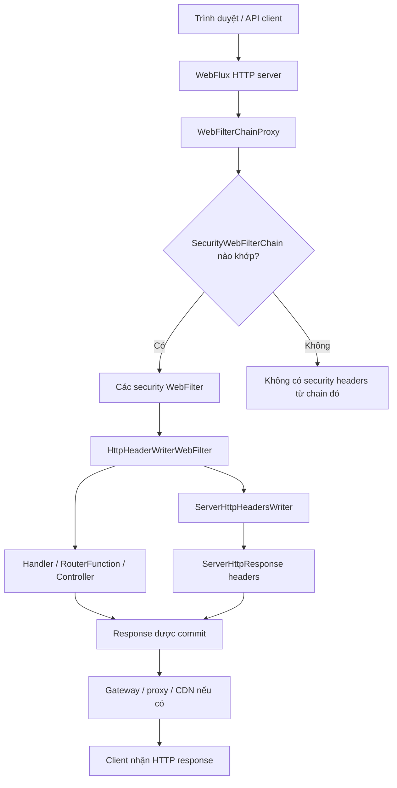
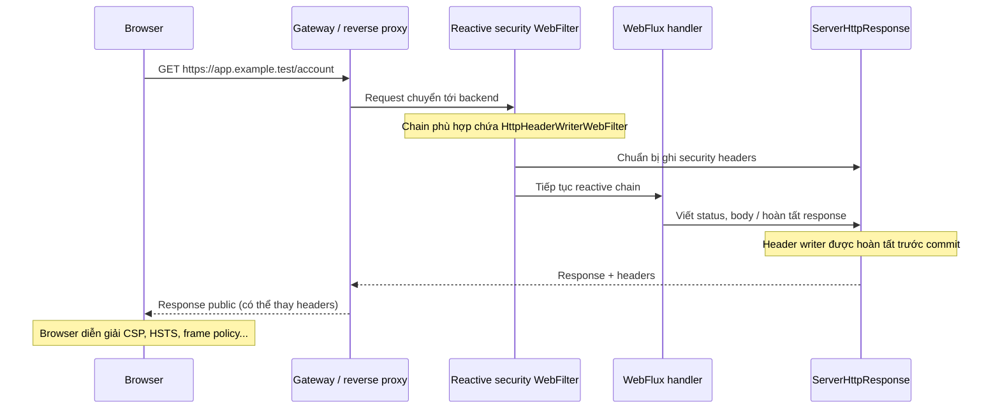

# ServerHttpHeadersWriter và cơ chế ghi header trên Reactive

## 1. Vì sao WebFlux cần cơ chế ghi HTTP security header riêng?

Trong chương **Kiến trúc HTTP header** thuộc module `SPRING_SECURITY_HTTP_PROTECTION`, HTTP response header là một lớp phòng vệ giữa máy chủ và trình duyệt. Máy chủ phát các chính sách như `X-Content-Type-Options`, `Content-Security-Policy` (CSP), `Strict-Transport-Security` (HSTS) và `X-Frame-Options`; trình duyệt đọc chúng để giới hạn cách trang được hiển thị, tải tài nguyên, nhúng iframe hoặc sử dụng HTTPS. Các header này phối hợp với CSRF, CORS, HTTP firewall và bảo vệ session, nhưng mỗi thành phần giải quyết một nhóm rủi ro khác nhau.

Với **Servlet**, Spring Security dùng `HeaderWriterFilter` và giao diện `HeaderWriter` nhận `HttpServletRequest`/`HttpServletResponse`. Với **Reactive/WebFlux**, Spring Security sử dụng `ServerHttpSecurity`, `SecurityWebFilterChain`, `HttpHeaderWriterWebFilter` và hợp đồng **`ServerHttpHeadersWriter`** trên `ServerWebExchange`. Writer Reactive trả về `Mono<Void>`, phản ánh mô hình thực thi bất đồng bộ và vòng đời commit response của WebFlux.

Ví dụ, một WebFlux API trả về:

```http
HTTP/1.1 200 OK
Content-Type: application/json
X-Content-Type-Options: nosniff
X-Frame-Options: DENY
Content-Security-Policy: default-src 'self'; object-src 'none'; frame-ancestors 'none'

{"status":"ok"}
```

Response trên có thể được Spring Security bổ sung header trước khi gửi cho client. **Việc ghi header thành công không đồng nghĩa mọi chính sách đều có ý nghĩa như nhau với JSON**: chẳng hạn CSP về script/iframe thường liên quan trực tiếp hơn đến tài liệu HTML; `nosniff` và HSTS có phạm vi tác dụng khác. Chính sách cần được chọn theo loại response và nhu cầu trình duyệt.

Sau bài học, người học cần có thể:

1. Mô tả đường đi request qua `WebFilterChainProxy`, `SecurityWebFilterChain` và `HttpHeaderWriterWebFilter`.
2. Giải thích giao diện `ServerHttpHeadersWriter` và ý nghĩa của `Mono<Void>` trong quá trình ghi header.
3. Phân biệt **đăng ký việc ghi trước khi commit**, **thực thi writer** và **trình duyệt thực thi chính sách**.
4. Tùy biến `ServerHttpSecurity.headers(...)`, thêm writer riêng, giới hạn writer bằng matcher và xử lý lỗi ghi đè header.
5. Kiểm thử bằng WebTestClient, HTTP client và trình duyệt; chẩn đoán khác biệt giữa WebFlux, HTTPS, gateway và browser.

## 2. Kiến trúc ghi header trong Spring Security WebFlux

### 2.1. Từ WebFilter đến response header

WebFlux dùng mô hình `WebFilter` thay cho `jakarta.servlet.Filter`. Spring Security tích hợp vào luồng này bằng `WebFilterChainProxy`, chọn một `SecurityWebFilterChain` phù hợp với request và áp các web filter trong chain. Thành phần chuyên ghi HTTP response headers là **`HttpHeaderWriterWebFilter`**, phối hợp các implementation của `ServerHttpHeadersWriter` được cấu hình.



Sơ đồ thể hiện **mối quan hệ trách nhiệm**, không nhằm xác định thứ tự tuyệt đối từng thao tác khi chương trình chạy. Reactive pipeline được dựng trước khi được subscribe; thao tác ghi header có thể được bố trí để hoàn thành trước thời điểm commit response. Không nên suy luận rằng mọi writer chạy ngay khi code cấu hình được gọi.

| Thành phần | API/ngữ cảnh | Nhiệm vụ |
| --- | --- | --- |
| `ServerHttpSecurity` | Reactive security DSL | Xây dựng cấu hình các web filter và header policy. |
| `SecurityWebFilterChain` | Reactive | Nhóm security web filter áp cho request khớp chain. |
| `WebFilterChainProxy` | Reactive | Chọn và điều phối chain phù hợp. |
| `HttpHeaderWriterWebFilter` | Reactive | Điều phối việc thêm security response headers. |
| `ServerHttpHeadersWriter` | Reactive | Hợp đồng thực hiện thao tác ghi header trên `ServerWebExchange`. |
| `ServerWebExchange` | Spring WebFlux | Cung cấp request, response và các thuộc tính cho một lần trao đổi HTTP. |
| `ServerHttpResponse` | Spring WebFlux | Chứa `HttpHeaders` và trạng thái commit của response. |

Spring Security Reactive không sử dụng giao diện Servlet `HeaderWriter` để ghi header. Trên WebFlux không có `HttpServletResponse` trong luồng xử lý chuẩn. Việc dùng nhầm API Servlet và Reactive dẫn đến code không biên dịch hoặc cấu hình không tác dụng.

### 2.2. Một response đi qua nhiều lớp



Gateway có thể terminate TLS và chuyển tiếp HTTP đến backend. Nếu backend không nhận diện request là HTTPS, điều kiện HSTS có thể khác kỳ vọng. Cần kiểm tra cấu hình proxy/trusted forwarded headers và response thực tế tới browser; đừng chỉ đọc code Java để kết luận header đã tới người dùng.

## 3. Giao diện `ServerHttpHeadersWriter`

Hợp đồng trung tâm trong Spring Security Reactive là `org.springframework.security.web.server.header.ServerHttpHeadersWriter`. Chữ ký chính thường có dạng:

```java
package org.springframework.security.web.server.header;

import org.springframework.web.server.ServerWebExchange;
import reactor.core.publisher.Mono;

public interface ServerHttpHeadersWriter {
    Mono<Void> writeHttpHeaders(ServerWebExchange exchange);
}
```

Đoạn trên biểu diễn **API cốt lõi** để minh họa; khi sử dụng thực tế, import interface từ dependency Spring Security đang chạy thay vì tạo lại interface này trong project.

Đầu vào `ServerWebExchange` chứa cả request và response:

```java
var request = exchange.getRequest();
var response = exchange.getResponse();
var headers = response.getHeaders();
```

Writer có thể đọc URI, method, secure scheme hoặc thuộc tính request để quyết định header phù hợp. `response.getHeaders()` trả về đối tượng `HttpHeaders`; trước khi response commit, có thể đặt `headers.set("Tên-Header", "giá trị")`.

### 3.1. Viết writer đơn giản

```java
import org.springframework.security.web.server.header.ServerHttpHeadersWriter;
import org.springframework.web.server.ServerWebExchange;
import reactor.core.publisher.Mono;

public final class LabServerHttpHeadersWriter implements ServerHttpHeadersWriter {

    @Override
    public Mono<Void> writeHttpHeaders(ServerWebExchange exchange) {
        exchange.getResponse().getHeaders().set("X-Header-Lab", "reactive");
        return Mono.empty();
    }
}
```

`X-Header-Lab` là **header đánh dấu phục vụ học tập**, không phải một header bảo mật tiêu chuẩn. Writer này thực hiện thao tác đồng bộ lên `HttpHeaders` rồi trả về `Mono.empty()` thông báo hoàn tất. Với writer có thao tác phụ thuộc reactive pipeline, có thể trả một `Mono<Void>` đại diện cho công việc cần được thực thi theo luồng.

### 3.2. Tại sao phải trả `Mono<Void>`?

`Mono<Void>` biểu diễn một tác vụ bất đồng bộ có thể **hoàn thành**, **thất bại** hoặc được **hủy**, không mang giá trị dữ liệu đầu ra. Spring Security có thể kết hợp tác vụ của các writer với các tác vụ khác trong response lifecycle.

Ví dụ viết theo kiểu trì hoãn thao tác đến lúc được subscribe:

```java
import org.springframework.security.web.server.header.ServerHttpHeadersWriter;
import org.springframework.web.server.ServerWebExchange;
import reactor.core.publisher.Mono;

public final class DeferredHeaderWriter implements ServerHttpHeadersWriter {

    @Override
    public Mono<Void> writeHttpHeaders(ServerWebExchange exchange) {
        return Mono.fromRunnable(() ->
            exchange.getResponse().getHeaders().set("X-Header-Lab", "deferred"));
    }
}
```

Đây là ví dụ để thấy `Mono` đại diện cho công việc được chạy khi có subscriber. **Không tự gọi `.subscribe()`** bên trong writer: như vậy công việc tách khỏi pipeline, khó bảo đảm nó hoàn tất trước commit và khó truyền lỗi đúng luồng. **Không gọi `.block()`** trong luồng xử lý WebFlux: chặn thread event loop có thể làm giảm throughput hoặc gây lỗi.

Một writer chỉ sửa `HttpHeaders` trên bộ nhớ không cần thực hiện công việc bất đồng bộ phức tạp. Đừng đưa HTTP call hoặc thao tác blocking vào header writer cho mỗi response nếu không có nhu cầu thực sự.

### 3.3. Header phải được ghi trước khi response commit

`ServerHttpResponse` cung cấp cơ chế `beforeCommit(...)` để đăng ký hành động được thực hiện trước commit. Khi viết một `WebFilter` riêng, ta có thể thấy nguyên lý này:

```java
import org.springframework.security.web.server.header.ServerHttpHeadersWriter;
import org.springframework.web.server.ServerWebExchange;
import org.springframework.web.server.WebFilter;
import org.springframework.web.server.WebFilterChain;
import reactor.core.publisher.Mono;

public final class ConceptualHeaderWebFilter implements WebFilter {
    private final ServerHttpHeadersWriter writer;

    public ConceptualHeaderWebFilter(ServerHttpHeadersWriter writer) {
        this.writer = writer;
    }

    @Override
    public Mono<Void> filter(ServerWebExchange exchange, WebFilterChain chain) {
        exchange.getResponse().beforeCommit(() -> writer.writeHttpHeaders(exchange));
        return chain.filter(exchange);
    }
}
```

Đây là **WebFilter minh họa nguyên lý `beforeCommit`**, không phải mã nguồn của `HttpHeaderWriterWebFilter` Spring Security. Trong ứng dụng dùng Spring Security, hãy cấu hình qua `ServerHttpSecurity.headers(...)` để framework tự tích hợp vào chain, tránh đăng ký trùng filter. Việc thêm header khi response đã commit không còn đảm bảo làm thay đổi header mà client nhận.

Nếu một handler trả `Mono<Void>` sau khi gửi dữ liệu streaming/SSE, phải càng thận trọng với thời điểm commit. Header bảo mật cần được chuẩn bị **trước khung dữ liệu đầu tiên**, không thể chờ nhiều giây rồi mới thêm header khi body đã bắt đầu gửi.

## 4. Các writer dựng sẵn và tập header tham khảo

Spring Security có các implementation `ServerHttpHeadersWriter` để tạo header chuẩn, giúp tránh tự viết thủ công những chính sách phức tạp.

| Writer Reactive thường gặp | Header | Lưu ý khi dùng |
| --- | --- | --- |
| `CacheControlServerHttpHeadersWriter` | `Cache-Control`, `Pragma`, `Expires` | Liên quan caching; response đặt cache riêng có thể cho kết quả khác. |
| `ContentTypeOptionsServerHttpHeadersWriter` | `X-Content-Type-Options: nosniff` | Tránh MIME sniffing; vẫn phải cấu hình `Content-Type` đúng. |
| `FrameOptionsServerHttpHeadersWriter` | `X-Frame-Options` | Chống clickjacking, mặc định tham khảo thường là `DENY`. |
| `HstsServerHttpHeadersWriter` | `Strict-Transport-Security` | Phụ thuộc HTTPS/secure request; ảnh hưởng subdomain nếu dùng `includeSubDomains`. |
| `XXssProtectionServerHttpHeadersWriter` | `X-XSS-Protection` | Header lịch sử; mặc định khác nhau giữa các đời Spring Security. |
| `ContentSecurityPolicyServerHttpHeadersWriter` | `Content-Security-Policy` | Cần chính sách nguồn tài nguyên do ứng dụng lựa chọn. |
| `ReferrerPolicyServerHttpHeadersWriter` | `Referrer-Policy` | Kiểm soát mức dữ liệu URL nguồn được gửi sang trang khác. |
| `StaticServerHttpHeadersWriter` | Một hoặc nhiều header với giá trị tĩnh | Phù hợp cho header đặc thù chưa có cấu hình chuyên biệt. |
| `CompositeServerHttpHeadersWriter` | Tổng hợp từ nhiều writer | Gom các thao tác ghi header theo cấu hình. |

Tên class và các builder có thể thay đổi theo phiên bản: đối chiếu API của dependency đang dùng. Bảng dưới là **ví dụ baseline thường gặp trong các bản Spring Security 6.x**, không phải hợp đồng bất biến cho mọi phiên bản:

```http
Cache-Control: no-cache, no-store, max-age=0, must-revalidate
Pragma: no-cache
Expires: 0
X-Content-Type-Options: nosniff
X-Frame-Options: DENY
X-XSS-Protection: 0
Strict-Transport-Security: max-age=31536000; includeSubDomains
```

**HSTS** thường chỉ được ghi khi request được Spring Security nhận diện là secure (HTTPS). Bởi vậy không thấy HSTS trên HTTP localhost chưa phải là lỗi. `X-XSS-Protection` trong các phiên bản cũ có thể khác; trong trình duyệt hiện đại, CSP và mã hóa/escape đầu ra mới là những công cụ chống XSS chủ lực.

Spring Security không thể tự suy ra mọi nguồn script, API, CDN và form hợp lệ nên **không nên mặc định xem CSP đã được bật**. `Referrer-Policy`, `Permissions-Policy` và nhiều header kiểm soát isolation cũng cần được cấu hình theo ứng dụng và phiên bản.

### 4.1. `set` và `add` có tác động khác nhau

```java
var headers = exchange.getResponse().getHeaders();
headers.set("X-Header-Lab", "one");
headers.add("X-Header-Lab", "two");
```

`set` thay danh sách giá trị cho tên header; `add` thêm giá trị. Hai writer hoặc proxy cùng phát CSP, HSTS hoặc `X-Frame-Options` có thể dẫn đến kết quả khó diễn giải và khó chẩn đoán. Với header đã có DSL riêng, hãy sửa bằng DSL tương ứng thay vì thêm một `StaticServerHttpHeadersWriter` trùng tên.

## 5. Cấu hình header trong `ServerHttpSecurity`

Trong WebFlux, ta cấu hình một `SecurityWebFilterChain` bằng `ServerHttpSecurity`. Đoạn code minh họa dưới đây dành cho **Spring Security Reactive dùng lambda DSL**; ví dụ ứng dụng có một route `/health` được truy cập không cần đăng nhập:

```java
import org.springframework.context.annotation.Bean;
import org.springframework.context.annotation.Configuration;
import org.springframework.security.config.annotation.web.reactive.EnableWebFluxSecurity;
import org.springframework.security.config.web.server.ServerHttpSecurity;
import org.springframework.security.web.server.SecurityWebFilterChain;
import org.springframework.security.web.server.header.StaticServerHttpHeadersWriter;

@Configuration
@EnableWebFluxSecurity
public class ReactiveHeaderSecurityConfig {

    @Bean
    SecurityWebFilterChain webFluxSecurityChain(ServerHttpSecurity http) {
        http.authorizeExchange(exchanges -> exchanges
            .pathMatchers("/health").permitAll()
            .anyExchange().authenticated()
        );

        http.headers(headers -> headers
            .contentSecurityPolicy(csp -> csp.policyDirectives(
                "default-src 'self'; "
                    + "script-src 'self'; "
                    + "object-src 'none'; "
                    + "base-uri 'self'; "
                    + "frame-ancestors 'none'"
            ))
            .addHeaderWriter(new StaticServerHttpHeadersWriter(
                "X-Header-Lab", "reactive"))
        );

        return http.build();
    }
}
```

Các điểm quan trọng:

- `.headers(...)` cấu hình các writer trong security chain đang tạo; không phải thêm header vào `ServerHttpResponse` ngay lúc khởi động ứng dụng.
- `.contentSecurityPolicy(...)` bổ sung writer để phát CSP. Policy ở ví dụ hạn chế script và frame, có thể chặn frontend dùng inline script/CDN; cần kiểm kê tài nguyên thực trước khi áp vào production.
- `.addHeaderWriter(...)` đăng ký thêm một writer tĩnh. Header `X-Header-Lab` chỉ dùng để quan sát và nên bỏ sau bài học.
- `.pathMatchers("/health").permitAll()` **vẫn để request đi qua security chain**; nhờ vậy request công khai vẫn có thể nhận security headers.
- Phần authorization chỉ là ví dụ để minh họa. Cần tích hợp với các cấu hình xác thực, CORS, CSRF, session/token và các matcher hiện có thay vì tạo một chain mới chồng lấn các route production.

Không dùng `.headers(headers -> headers.disable())` chỉ để giải quyết một lỗi về iframe hoặc CSP: hành động này có thể bỏ luôn nhiều security headers hữu ích. Hãy sửa đúng policy gây xung đột.

### 5.1. Thay riêng frame policy

Ứng dụng có dashboard cần nhúng **cùng origin**; `X-Frame-Options: DENY` có thể cản nhu cầu này. Trong `SecurityWebFilterChain` đang quản lý URL, sửa thành:

```java
http.headers(headers -> headers
    .frameOptions(frame -> frame.mode(
        org.springframework.security.web.server.header.XFrameOptionsServerHttpHeadersWriter.Mode.SAMEORIGIN))
);
```

Đoạn trên minh họa kiểu cấu hình **mode** của frame options trong một số phiên bản Spring Security Reactive. Nếu API chính xác của phiên bản bạn dùng khác, hãy đối chiếu tài liệu `ServerHttpSecurity.HeaderSpec.FrameOptionsSpec` trước khi sao chép. Đặc biệt, nếu response đồng thời có `Content-Security-Policy: frame-ancestors 'none'`, trình duyệt vẫn có thể chặn iframe. Khi quyết định cho nhúng cùng origin, phải thiết kế **nhất quán** cả hai policy, ví dụ CSP `frame-ancestors 'self'` khi phù hợp.

### 5.2. Dùng CSP Report-Only trước khi cưỡng chế

Nếu hệ thống hiện tại có nhiều script và kết nối API, cấu hình CSP cưỡng chế ngay có thể làm SPA ngừng hoạt động. Khi phiên bản DSL hỗ trợ, dùng:

```java
http.headers(headers -> headers
    .contentSecurityPolicy(csp -> csp
        .policyDirectives("default-src 'self'; script-src 'self'; object-src 'none'")
        .reportOnly())
);
```

Header phát ra là `Content-Security-Policy-Report-Only`, giúp quan sát vi phạm mà **không chặn** theo policy báo cáo đó. Phải kiểm tra nguồn script, style, font, ảnh, `connect-src` và URL báo cáo; khi hợp lệ mới chuyển sang CSP cưỡng chế. Tránh giải quyết lỗi bằng cách cho phép `'unsafe-inline'` hoặc mọi nguồn không giới hạn mà không đánh giá rủi ro.

## 6. Viết một `ServerHttpHeadersWriter` có điều kiện

Không phải mọi URL cần chung một chính sách. Ví dụ ứng dụng muốn một header tùy biến ở endpoint report nhưng không muốn áp lên tài nguyên public tích hợp với bên ngoài. Reactive có giao diện **`ServerWebExchangeMatcher`** để xác định một exchange có khớp quy tắc hay không; kết quả khớp được biểu diễn bằng `Mono<MatchResult>`.

Ví dụ tự viết writer theo matcher:

```java
import org.springframework.security.web.server.header.ServerHttpHeadersWriter;
import org.springframework.security.web.server.util.matcher.ServerWebExchangeMatcher;
import org.springframework.web.server.ServerWebExchange;
import reactor.core.publisher.Mono;

public final class ConditionalHeadersWriter implements ServerHttpHeadersWriter {
    private final ServerWebExchangeMatcher matcher;
    private final ServerHttpHeadersWriter delegate;

    public ConditionalHeadersWriter(
            ServerWebExchangeMatcher matcher,
            ServerHttpHeadersWriter delegate) {
        this.matcher = matcher;
        this.delegate = delegate;
    }

    @Override
    public Mono<Void> writeHttpHeaders(ServerWebExchange exchange) {
        return matcher.matches(exchange)
            .flatMap(result -> result.isMatch()
                ? delegate.writeHttpHeaders(exchange)
                : Mono.empty());
    }
}
```

Code trên có chủ ý **không subscribe thủ công** vào `matcher.matches(exchange)`: điều kiện và thao tác ghi sẽ nằm trong cùng pipeline. Các API matcher cụ thể có thể khác giữa phiên bản; điều quan trọng là writer chỉ thực hiện delegate khi điều kiện khớp.

Sử dụng writer trong cấu hình `ServerHttpSecurity`:

```java
import org.springframework.security.web.server.header.ServerHttpHeadersWriter;
import org.springframework.security.web.server.header.StaticServerHttpHeadersWriter;
import org.springframework.security.web.server.util.matcher.PathPatternParserServerWebExchangeMatcher;

ServerHttpHeadersWriter reportOnlyWriter = new ConditionalHeadersWriter(
    new PathPatternParserServerWebExchangeMatcher("/reports/**"),
    new StaticServerHttpHeadersWriter(
        "Cross-Origin-Resource-Policy", "same-origin")
);

http.headers(headers -> headers.addHeaderWriter(reportOnlyWriter));
```

Đây là **đoạn chèn vào phương thức cấu hình**, không phải file Java biên dịch độc lập. `Cross-Origin-Resource-Policy: same-origin` có thể hạn chế tài nguyên được nhúng/tải từ origin khác trong những bối cảnh browser hỗ trợ; chỉ chọn nếu dữ liệu report thực sự yêu cầu và kiểm thử luồng tích hợp. Nó **không** thay thế CORS, authentication hay authorization.

Trong thực tế, hãy ưu tiên writer/matcher có sẵn của phiên bản Spring Security đang dùng khi chúng đáp ứng yêu cầu. Ví dụ tự viết nhằm minh họa cách kết hợp `Mono`, `ServerWebExchangeMatcher` và `ServerHttpHeadersWriter` mà không kéo logic request matcher vào các hàm sửa header phức tạp.

### 6.1. Tại sao không dùng `String.startsWith("/reports")`?

So khớp đường dẫn bằng chuỗi thô có thể mắc lỗi với `/reports-v2`, path đã encode, context path và route của gateway. `PathPatternParserServerWebExchangeMatcher` biểu đạt pattern rõ hơn, nhưng vẫn phải kiểm thử URL thực tế sau khi gateway rewrite path. Nếu security chain chứa writer **không khớp request**, matcher của writer không có cơ hội được gọi.

## 7. Tương tác với CORS, CSRF, session và HTTP firewall

Việc module bao gồm CSRF, CORS, security headers, CSP, HSTS, HTTP firewall và bảo vệ session không có nghĩa những cơ chế này đều được triển khai bằng `ServerHttpHeadersWriter`.

| Cơ chế | Ai chịu trách nhiệm chủ yếu? | Điểm cần phân biệt |
| --- | --- | --- |
| HTTP security response headers | `HttpHeaderWriterWebFilter` + `ServerHttpHeadersWriter` | Viết chính sách browser lên response. |
| CORS | Cấu hình CORS và thành phần xử lý request/preflight | `Access-Control-Allow-*` phụ thuộc origin/method/credentials; không phải thay bằng CSP. |
| CSRF | `CsrfWebFilter` và cơ chế token tương ứng | Xác minh token cho request thay đổi trạng thái; có header không làm token hợp lệ. |
| Session | Session/cookie handling và security context | Cookie flags (`Secure`, `HttpOnly`, `SameSite`) không tự được quyết định từ CSP/HSTS. |
| HTTP firewall / request rejection | Cơ chế kiểm tra request trước hoặc trong security chain | Request bị từ chối quá sớm có thể không đi qua mọi web filter phát header. |
| Authentication / Authorization | Các security web filter và access rules | HTTP security header không chứng thực người dùng hay cấp quyền API. |

Ví dụ, trang React trên `https://frontend.example.test` gọi `https://api.example.test` nhưng bị trình duyệt báo **CORS error**. Việc response API có `X-Content-Type-Options: nosniff` và CSP **không giải quyết** thiếu `Access-Control-Allow-Origin` hoặc preflight `OPTIONS` thất bại. Tương tự, POST thiếu CSRF token có thể trả `403` dù response đầy đủ headers. Phải chẩn đoán cơ chế theo đúng trách nhiệm.

### 7.1. HSTS và HTTPS tại reverse proxy

Giả sử browser truy cập HTTPS, nhưng gateway gọi backend WebFlux qua HTTP:

```text
Browser --HTTPS--> Gateway --HTTP nội bộ--> WebFlux backend
```

Nếu policy HSTS do backend phát dựa trên scheme request mà backend nhận diện, header có thể không xuất hiện khi request bị xem là không secure. Cần thiết kế **một nguồn phát HSTS phù hợp** (gateway hoặc ứng dụng), kiểm tra forwarding scheme từ proxy được tin cậy và chứng chỉ HTTPS thực. Tránh tin `X-Forwarded-Proto` do client gửi trực tiếp nếu chưa kiểm soát biên trust proxy.

`max-age=31536000; includeSubDomains` áp thời hạn và phạm vi rộng: trước khi chọn `includeSubDomains` hay `preload`, bảo đảm toàn bộ subdomain liên quan dùng HTTPS hợp lệ. HSTS không thay thế redirect HTTP → HTTPS và không cứu lần kết nối HTTP đầu tiên khi host chưa có trạng thái HSTS (trừ preload).

## 8. Kiểm thử `ServerHttpHeadersWriter` đơn lẻ

Khi cần cô lập logic ghi header khỏi Spring Security chain, dùng `MockServerWebExchange` và `MockServerHttpRequest` từ `spring-test`. Với writer tĩnh, test kiểm tra rằng `Mono` hoàn tất và header được đặt:

```java
import org.junit.jupiter.api.Test;
import org.springframework.mock.http.server.reactive.MockServerHttpRequest;
import org.springframework.mock.web.server.MockServerWebExchange;
import org.springframework.security.web.server.header.ServerHttpHeadersWriter;
import org.springframework.security.web.server.header.StaticServerHttpHeadersWriter;
import reactor.test.StepVerifier;

import static org.junit.jupiter.api.Assertions.assertEquals;

class ReactiveHeaderWriterUnitTest {

    @Test
    void writerAddsHeaderOnSubscription() {
        var exchange = MockServerWebExchange.from(
            MockServerHttpRequest.get("/health").build());

        ServerHttpHeadersWriter writer = new StaticServerHttpHeadersWriter(
            "X-Header-Lab", "reactive");

        StepVerifier.create(writer.writeHttpHeaders(exchange))
            .verifyComplete();

        assertEquals("reactive", exchange.getResponse().getHeaders()
            .getFirst("X-Header-Lab"));
    }
}
```

`StepVerifier` thuộc `reactor-test`, thường có qua test dependencies của dự án WebFlux. Nếu dự án chưa có, khai báo test dependency phù hợp phiên bản Reactor. Test này chứng minh **writer hoạt động với exchange giả lập**, chưa chứng minh `HttpHeaderWriterWebFilter` của Spring Security đã gọi writer trên đường đi HTTP thật.

### 8.1. Test matcher không khớp

Đối với writer điều kiện mục 6, test nên có ít nhất hai request:

```java
var matching = MockServerWebExchange.from(
    MockServerHttpRequest.get("/reports/2026").build());
var other = MockServerWebExchange.from(
    MockServerHttpRequest.get("/public/logo.svg").build());

StepVerifier.create(reportOnlyWriter.writeHttpHeaders(matching)).verifyComplete();
StepVerifier.create(reportOnlyWriter.writeHttpHeaders(other)).verifyComplete();

assertEquals("same-origin", matching.getResponse().getHeaders()
    .getFirst("Cross-Origin-Resource-Policy"));
assertEquals(null, other.getResponse().getHeaders()
    .getFirst("Cross-Origin-Resource-Policy"));
```

Đoạn trên là **phần tiếp theo của unit test**, giả định `reportOnlyWriter` đã được tạo theo mục 6 và đã import `StepVerifier`, `assertEquals`, mock request/exchange. Nó không tự chạy độc lập nếu chưa đặt trong test class. Test này quan trọng hơn chỉ kiểm tra nhánh khớp: nó giúp tránh vô tình phát header hạn chế cross-origin trên những URL cần truy cập công khai.

## 9. Kiểm thử toàn bộ WebFlux security chain

Sau unit test, cần integration test để xác minh writer được thêm vào chain mà request thật đi qua. Với Spring Boot WebFlux có route `/health`, ví dụ controller:

```java
import org.springframework.web.bind.annotation.GetMapping;
import org.springframework.web.bind.annotation.RestController;
import reactor.core.publisher.Mono;

@RestController
class HealthEndpoint {
    @GetMapping("/health")
    Mono<String> health() {
        return Mono.just("ok");
    }
}
```

Nếu dùng cấu hình `ReactiveHeaderSecurityConfig` mục 5, kiểm tra bằng `WebTestClient`:

```java
import org.junit.jupiter.api.Test;
import org.springframework.beans.factory.annotation.Autowired;
import org.springframework.boot.test.autoconfigure.web.reactive.AutoConfigureWebTestClient;
import org.springframework.boot.test.context.SpringBootTest;
import org.springframework.test.web.reactive.server.WebTestClient;

@SpringBootTest
@AutoConfigureWebTestClient
class ReactiveSecurityHeadersIntegrationTest {

    @Autowired
    WebTestClient webTestClient;

    @Test
    void healthReceivesConfiguredHeaders() {
        webTestClient.get()
            .uri("/health")
            .exchange()
            .expectStatus().isOk()
            .expectHeader().valueEquals("X-Header-Lab", "reactive")
            .expectHeader().valueEquals("X-Content-Type-Options", "nosniff")
            .expectHeader().valueMatches(
                "Content-Security-Policy", ".*frame-ancestors 'none'.*");
    }
}
```

Đây là ví dụ theo cách tổ chức test phổ biến của **Spring Boot 3.x**; package/auto-configuration trong một số bản Boot sau này có thể thay đổi. Test chỉ thành công nếu route và chain thực sự tồn tại, có cấu hình giống mục 5 và chưa bị tùy biến header khác. Nếu ứng dụng đã có nhiều security chain hoặc auth riêng, tích hợp vào cấu hình đang dùng và cập nhật expected headers theo chính sách đã quyết định.

### 9.1. Đánh giá HSTS bằng HTTPS thật

Một `WebTestClient` gắn với mock server thường không mô phỏng đầy đủ TLS, reverse proxy hoặc browser HSTS storage. Vì vậy **đừng kết luận WebFlux không phát HSTS chỉ vì unit/integration test giả lập HTTP không thấy header**. Để xác minh deployment, dùng HTTPS với chứng chỉ hợp lệ:

```bash
curl -sS -D - -o /dev/null https://app.example.test/health
curl -sS -D - -o /dev/null http://localhost:8080/health
```

Trên Windows PowerShell, có thể dùng `curl.exe` và `-o NUL` thay cho `/dev/null`. Lệnh trên kiểm tra **response HTTP** chứ chưa xác minh browser có lưu HSTS hay không. Dùng DevTools để xem Network/Response Headers, kiểm tra response HTTPS public và trạng thái TLS/host. `curl -k` chỉ bỏ qua xác minh chứng chỉ cho mục đích chẩn đoán, không chứng minh trình duyệt sẽ tin header HSTS.

### 9.2. Đừng chỉ kiểm tra một response `200`

| Tình huống | Điều cần quan sát | Nguyên nhân tiềm ẩn khi thiếu header |
| --- | --- | --- |
| `GET /health` trả `200` | Header cấu hình và các mặc định | WebFilter chain không khớp hoặc writer chưa đăng ký. |
| `GET /account` chưa đăng nhập | `401`/`302`/error response có headers không? | Auth entry point, chain, hoặc redirect khác. |
| POST thay đổi trạng thái thiếu CSRF token | `403` và response headers | CSRF policy hoặc error handling; không suy ra lỗi writer từ status. |
| URL có static asset | Cache, nosniff, CSP nếu áp | Asset do server khác phát hoặc matcher khác. |
| Truy cập HTTP và HTTPS | HSTS khác nhau không? | Secure scheme/TLS termination. |
| Request streaming/SSE | Headers đến trước sự kiện đầu tiên? | Response đã commit trước thao tác ghi custom header. |
| URL qua CDN | Có header bị thêm/ghi đè/trùng? | Cấu hình gateway/proxy. |

## 10. Chẩn đoán các lỗi Reactive header thường gặp

| Triệu chứng | Nguyên nhân cần kiểm tra | Cách xử lý |
| --- | --- | --- |
| Writer được tạo nhưng header không xuất hiện | Writer chưa thêm vào `ServerHttpSecurity.headers(...)`, hoặc chain không khớp | Kiểm tra DSL, matcher, thứ tự `SecurityWebFilterChain` và request URL. |
| Dùng `.subscribe()` trong writer rồi thiếu header ngẫu nhiên | Side effect chạy ngoài pipeline trước commit | Trả `Mono<Void>` chứa thao tác; để framework quản lý subscription. |
| `IllegalStateException` hoặc header không cập nhật | Response đã commit hoặc writer chạy quá muộn | Đăng ký công việc trước commit; tránh ghi trong callback sau streaming. |
| Header bị lặp hoặc có giá trị không mong muốn | Static writer trùng built-in writer, hoặc proxy/CDN cùng ghi | Dùng DSL riêng của header; xác định nguồn phát tại backend và proxy. |
| Có header trong `WebTestClient`, thiếu ngoài production | Deployment/image, gateway, chain hoặc routing khác | Đọc dependency runtime, so URL nội bộ và HTTPS public. |
| HSTS không xuất hiện trên backend HTTP | Secure request chưa được nhận diện, TLS terminate ở gateway | Kiểm tra HTTPS thật và forwarding scheme đáng tin cậy. |
| CSP chặn CDN/inline script/iframe | Directive quá chặt hoặc `frame-ancestors` trái yêu cầu | Dùng Report-Only, kiểm kê nguồn và chỉnh directive; tránh tắt CSP toàn bộ. |
| `403` POST dù có mọi header bảo mật | CSRF token thiếu hoặc authorization không hợp lệ | Kiểm tra filter CSRF/auth riêng, cookie và session. |
| Browser báo lỗi CORS dù response có CSP | Preflight hoặc CORS allowlist không đúng | Kiểm tra `OPTIONS` và `Access-Control-*`; CSP không thay CORS. |
| API SSE/WebSocket có behavior khác HTTP thông thường | Protocol upgrade hoặc response streaming có lifecycle riêng | Kiểm tra handshake và response trước commit; thiết kế header đúng loại kết nối. |
| Header của `401`/`500` khác `200` | Exception handler/gateway tạo response ngoài luồng dự kiến | Xác định chain và thành phần tạo lỗi; test từng status. |

**Quy trình chẩn đoán nên đi từ thực tế đến code:**

1. Ghi URL, method, status, scheme, server và môi trường của request gặp lỗi.
2. Quan sát response header ở điểm client nhận bằng `curl -D -` hoặc DevTools Network.
3. Tìm `SecurityWebFilterChain` khớp request, cấu hình `ServerHttpSecurity.headers(...)` và các writer đang được thêm vào chain.
4. Nếu writer có điều kiện, xác minh `ServerWebExchangeMatcher` sau mọi path rewrite; nếu HSTS thiếu, xác minh HTTPS và trusted proxy.
5. Nếu response khác qua gateway, xác định tầng nào thêm/ghi đè header. Nếu CSP bị chặn, đọc Console và policy cụ thể.
6. Chỉnh đúng matcher/writer/chỉ thị rồi kiểm thử lại response `200`, lỗi, redirect và những browser mục tiêu.

### 10.1. Vì sao `permitAll` không tương đương bỏ qua security chain?

Ví dụ:

```java
http.authorizeExchange(exchanges -> exchanges
    .pathMatchers("/health", "/assets/**").permitAll()
    .anyExchange().authenticated());
```

Những URL được `permitAll` vẫn đi qua security chain đang match, nên có thể nhận `HttpHeaderWriterWebFilter` cùng các header writer của chain. Nếu request không khớp **bất kỳ** `SecurityWebFilterChain` nào, hoặc gateway phục vụ tài nguyên trực tiếp, header không tự xuất hiện từ chain đó. Phân biệt rõ hai trường hợp trước khi sửa cấu hình header.

### 10.2. Nhiều chain và thứ tự khớp URL

Một ứng dụng có thể có chain cho `/api/**` và chain khác cho giao diện web. `WebFilterChainProxy` chọn chain phù hợp theo thứ tự cấu hình; không tự tổng hợp toàn bộ writer từ mọi chain để phát cho mọi URL. Vì vậy có thể chủ đích chỉ áp CSP cho HTML, trong khi API có cache/security header riêng. Cần kiểm thử cả URL và status đại diện cho từng chain. Khi chain mới được thêm vào, hãy xác nhận thứ tự `@Order` và `securityMatcher` thay vì mặc định rằng chain cũ vẫn nhận mọi request.

## 11. So sánh với Servlet để tránh dùng sai API

| Nội dung | Servlet | Reactive/WebFlux |
| --- | --- | --- |
| Cấu hình DSL | `HttpSecurity` | `ServerHttpSecurity` |
| Security chain | `SecurityFilterChain` | `SecurityWebFilterChain` |
| Bộ điều phối header | `HeaderWriterFilter` | `HttpHeaderWriterWebFilter` |
| Hợp đồng writer | `HeaderWriter` | `ServerHttpHeadersWriter` |
| Phương thức writer | `void writeHeaders(HttpServletRequest, HttpServletResponse)` | `Mono<Void> writeHttpHeaders(ServerWebExchange)` |
| HTTP exchange | `HttpServletRequest`/`HttpServletResponse` | `ServerWebExchange`/`ServerHttpResponse` |
| Matcher dùng cho writer | `RequestMatcher` | `ServerWebExchangeMatcher` |
| Kiểm thử HTTP | `MockMvc` | `WebTestClient` |
| Lưu ý quan trọng | Response commit trong Servlet lifecycle | Reactive publisher, subscription và `beforeCommit` |

Hai stack cùng phát HTTP response headers để trình duyệt thực thi, nhưng **không thể ép `HeaderWriter` Servlet làm `ServerHttpHeadersWriter` Reactive bằng cách ép kiểu**. Khi ứng dụng Spring Boot có đồng thời cả `spring-webmvc` và `spring-webflux` dependency, cần xác định stack thực sự được khởi tạo, không kết luận từ sự hiện diện của một dependency.

## 12. Thực hành và câu hỏi tự kiểm tra

**Bài 1 — Header biến mất sau khi refactor.** Bạn tạo `new StaticServerHttpHeadersWriter("X-Header-Lab", "reactive")` nhưng không thêm nó vào `.headers(...)`. Dự đoán: không có writer nào gọi instance này, nên không có header mới. Bổ sung writer vào chain thực sự khớp URL và kiểm tra lại với `WebTestClient`.

**Bài 2 — Hai đường dẫn, một writer có điều kiện.** Dùng `ConditionalHeadersWriter` cho `/reports/**` với `Cross-Origin-Resource-Policy: same-origin`. Kiểm thử `/reports/2026` và `/assets/logo.svg`; chỉ request thứ nhất nên có header theo writer này. Nếu cả hai có header, kiểm tra matcher hoặc một writer/proxy khác đang phát cùng header.

**Bài 3 — CSP và SPA.** SPA tải JavaScript từ CDN và API khác origin nhưng bạn chỉ đặt `script-src 'self'` và `default-src 'self'`. Dự đoán: trình duyệt có thể chặn script và kết nối. Chuyển sang Report-Only để nhận diện nguồn, sau đó thiết kế `script-src` và `connect-src` phù hợp, không bỏ CSP tùy tiện.

**Bài 4 — Writer với `.subscribe()`.** Một developer gọi một `Mono` không đồng bộ trong writer rồi `.subscribe()`; header thỉnh thoảng biến mất khi response nhanh. Giải thích: tác vụ đã tách khỏi chuỗi chờ hoàn tất trước commit. Thay bằng `return` publisher thích hợp hoặc ghi header trực tiếp khi an toàn.

**Bài 5 — HSTS qua proxy.** URL public HTTPS có HSTS từ gateway, nhưng backend HTTP không có. Điều này có thể vẫn đáp ứng mục tiêu không? Có, nếu browser luôn nhận HSTS chính xác trên HTTPS public và chính sách proxy phù hợp; cần xác định nguồn phát và kiểm tra endpoint ngoài thực tế.

**Bài 6 — POST bị từ chối.** Browser gọi POST với session cookie nhưng thiếu CSRF token; response `403` có HSTS, CSP và `nosniff`. Đó có phải lỗi của `ServerHttpHeadersWriter` không? Không; cần kiểm tra `CsrfWebFilter`, authorization và ngữ cảnh session.

**Bài 7 — Stream có header muộn.** Handler gửi SSE event đầu tiên rồi mới cố thêm CSP. Dự đoán: headers có thể đã commit. Dùng cơ chế cấu hình trong security chain hoặc `beforeCommit` phù hợp để chuẩn bị header trước khi gửi dữ liệu.

**Bài 8 — Dùng class Servlet trong WebFlux.** Người học cố gọi `HeaderWriter.writeHeaders(HttpServletRequest, HttpServletResponse)` trong `ServerHttpSecurity`. Hãy giải thích vì sao không dùng được, và thay bằng `ServerHttpHeadersWriter.writeHttpHeaders(ServerWebExchange)` trả `Mono<Void>`.

## 13. Checklist triển khai production

1. **Xác định đúng stack và phiên bản:** WebFlux Reactive dùng `ServerHttpSecurity`, không dùng API `HttpSecurity`/Servlet. Đối chiếu writer và header DSL với version thực tế.
2. **Giữ writer trong security chain phù hợp:** request hợp lệ và những URL `permitAll` cũng cần nhận chính sách nếu đó là yêu cầu ứng dụng.
3. **Tôn trọng Reactive lifecycle:** trả `Mono<Void>`, không `.subscribe()` hoặc `.block()` trong request pipeline, bảo đảm header được ghi trước khi response commit.
4. **Tùy chỉnh có chủ đích:** CSP theo nguồn thực tế; HSTS theo HTTPS/TLS; frame policy theo nhu cầu nhúng; caching theo loại response; không vô hiệu toàn bộ mặc định vì một lỗi cục bộ.
5. **Tránh ghi đè và lặp:** xác định thành phần tạo header trong Spring Security, ứng dụng và proxy/CDN.
6. **Kiểm chứng nhiều tầng:** unit test writer, integration test chain bằng `WebTestClient`, kiểm tra HTTPS public và browser Console/Network; thử cả response lỗi và streaming khi có dùng.
7. **Phân biệt trách nhiệm:** CORS, CSRF, cookie/session và authorization cần cấu hình và kiểm thử riêng. HTTP security headers chỉ là một lớp trong chiến lược phòng vệ.

### Tài liệu tham khảo

- [Spring Security Reference — Reactive Security HTTP Response Headers](https://docs.spring.io/spring-security/reference/reactive/exploits/headers.html)
- [Spring Security Reference — Reactive WebFlux Security](https://docs.spring.io/spring-security/reference/reactive/configuration/webflux.html)
- [Spring Security API — ServerHttpHeadersWriter](https://docs.spring.io/spring-security/site/docs/current/api/org/springframework/security/web/server/header/ServerHttpHeadersWriter.html)
- [Spring Security API — HttpHeaderWriterWebFilter](https://docs.spring.io/spring-security/site/docs/current/api/org/springframework/security/web/server/header/HttpHeaderWriterWebFilter.html)
- [Spring Framework Reference — WebFlux HTTP handling](https://docs.spring.io/spring-framework/reference/web/webflux.html)
- [Spring Framework API — ServerHttpResponse](https://docs.spring.io/spring-framework/docs/current/javadoc-api/org/springframework/http/server/reactive/ServerHttpResponse.html)
- [Project Reactor Reference — Mono and reactive streams](https://projectreactor.io/docs/core/release/reference/)
