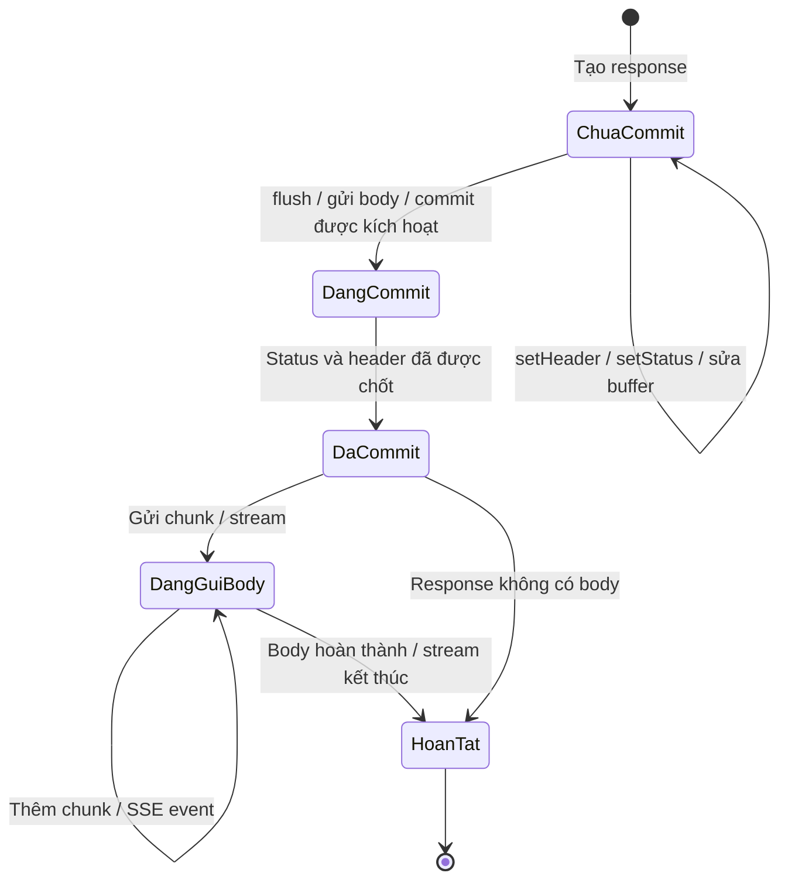
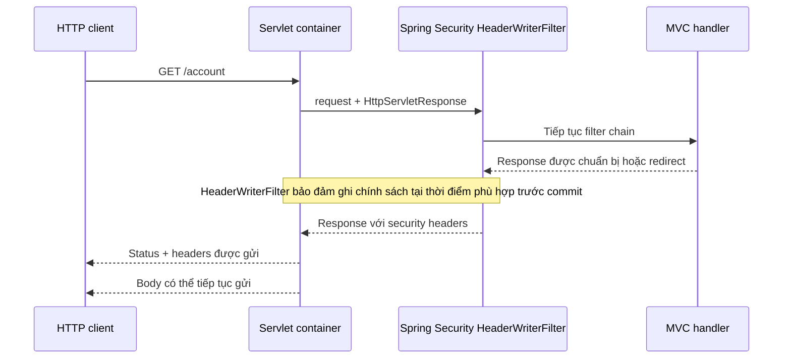
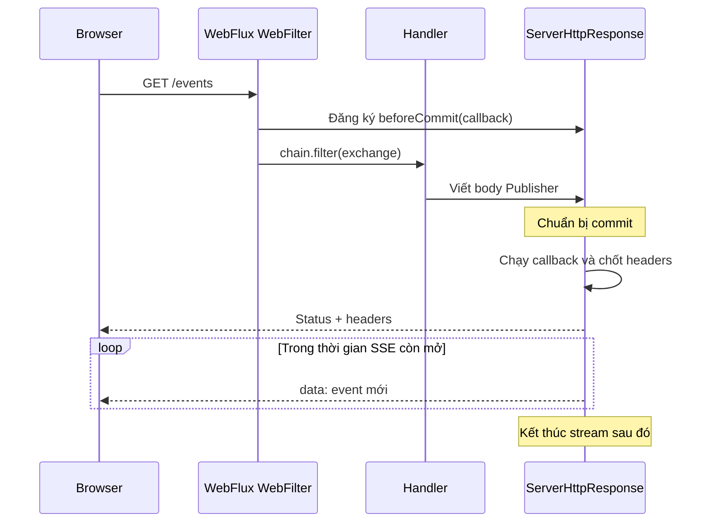
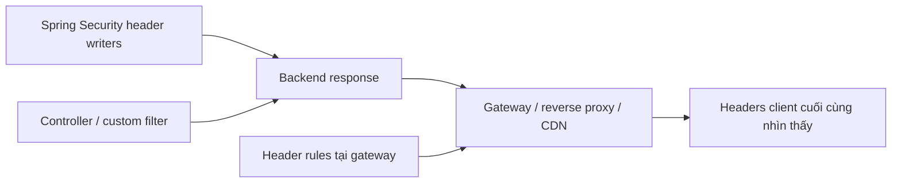

# Thời điểm ghi header và phản hồi đã được gửi hoàn tất

## 1. Đặt vấn đề: header phải được ghi lúc nào?

Trong chương **Kiến trúc HTTP header** của module `SPRING_SECURITY_HTTP_PROTECTION`, các cơ chế CSRF, CORS, security headers, CSP, HSTS, HTTP firewall và bảo vệ session cùng tạo thành nhiều lớp phòng vệ. Security header là lớp đặc biệt: **Spring Security hoặc hạ tầng máy chủ ghi chính sách lên HTTP response; trình duyệt đọc và áp dụng chính sách đó khi nhận được response**.

Nhưng có một giới hạn thời gian quan trọng: **HTTP response header chỉ có thể được sửa một cách đáng tin cậy trước khi response được commit**. Một khi server đã gửi status line và khối header xuống đường truyền, việc thêm `Content-Security-Policy`, `Strict-Transport-Security` hoặc `X-Frame-Options` vào đối tượng response ở phía ứng dụng sẽ không làm các byte đã gửi quay lại trình duyệt.

Bài học tập trung vào câu hỏi **“Thời điểm ghi header và phản hồi đã được gửi hoàn tất”**: khi nào hệ thống chuẩn bị header, khi nào header trở nên cố định, khi nào body thực sự gửi xong, và cách Spring Security xử lý điều này trên **Servlet** lẫn **Reactive/WebFlux**.

### Mục tiêu sau bài học

- Phân biệt các trạng thái **chưa commit**, **đang commit**, **đã commit** và **đã hoàn tất gửi body**.
- Giải thích vai trò `HeaderWriterFilter` trên Servlet và `HttpHeaderWriterWebFilter` trên WebFlux.
- Hiểu tác dụng của `HttpServletResponse.isCommitted()`, `flushBuffer()`, `ServerHttpResponse.beforeCommit(...)` và `isCommitted()`.
- Phát hiện các cách viết header quá muộn trong Servlet filter, Reactive callback và luồng streaming/SSE.
- Kiểm thử header trên phản hồi `200`, redirect, `401`/`403`, lỗi, HTTPS và request streaming; chẩn đoán xung đột do proxy, security chain, CSP, HSTS, CSRF/CORS.

## 2. Bốn mốc thời gian thường bị nhầm lẫn

Một response có thể tồn tại ở nhiều giai đoạn. Không phải lúc handler trả về `Mono<Void>`, controller hoàn tất hay filter kết thúc là các byte đã được truyền hết.

| Giai đoạn | Điều đang diễn ra | Khả năng sửa header | Điều dễ hiểu sai |
| --- | --- | --- | --- |
| **Chuẩn bị response** | Handler hoặc filter đặt status, header và dữ liệu vào buffer/response object. | Thường còn sửa được. | “Đã gọi `setHeader`” không có nghĩa client đã nhận header. |
| **Commit response** | Server chốt status và header, bắt đầu gửi response trên wire theo giao thức. | Từ thời điểm commit, không thể kỳ vọng sửa status/header sẽ ảnh hưởng client. | “Commit” **khác** “gửi xong toàn bộ body”. |
| **Gửi body** | Server truyền các byte body, có thể theo nhiều chunk hoặc luồng kéo dài. | Header của response ban đầu đã được chốt. | Chunk/SSE gửi sau không cho phép bổ sung security header mới vào phần header ban đầu. |
| **Hoàn tất/đóng luồng** | Body kết thúc, stream complete, kết nối đóng hoặc chuyển sang xử lý tiếp theo. | Không còn cơ hội sửa header cho response đó. | Trong HTTP keep-alive, response hoàn tất **không nhất thiết** nghĩa là TCP connection bị đóng. |

Ví dụ một trang có response:

```http
HTTP/1.1 200 OK
Content-Type: text/html; charset=UTF-8
X-Content-Type-Options: nosniff
Content-Security-Policy: script-src 'self'
Transfer-Encoding: chunked

...các chunk HTML được gửi dần...
```

Khi server bắt đầu gửi header và body, trình duyệt đã có thông tin để áp CSP. Phần HTML có thể tiếp tục truyền nhiều giây; một filter chạy quá muộn và cố gọi `setHeader("Content-Security-Policy", "...")` sẽ không thể đổi chính sách đã gửi.

### Mô hình trạng thái



Đây là sơ đồ **khái niệm**. Tùy Servlet container hoặc Reactive server, một số trạng thái có thể chuyển gần như ngay lập tức. Với `HEAD` hoặc `204 No Content`, response có thể hoàn tất mà không phát body. Với Server-Sent Events (SSE), mốc hoàn tất body có thể cách mốc commit rất xa.

### Ba câu hỏi chẩn đoán

1. **Header đã được ghi vào response object chưa?** Kiểm tra filter/writer, policy và header map ở server.
2. **Response đã commit trước thao tác ghi chưa?** Kiểm tra thời điểm flush/sendRedirect/sendError, `isCommitted()` và callback.
3. **Client nhận header nào cuối cùng?** Kiểm tra Network hoặc `curl` ở URL public, vì gateway và CDN có thể thay đổi header sau backend.

## 3. Spring Security Servlet: `HeaderWriterFilter` và thời điểm commit

Trên Servlet, `FilterChainProxy` chọn một `SecurityFilterChain` phù hợp với request. Trong chain, `HeaderWriterFilter` điều phối các writer có giao diện `HeaderWriter`:

```java
package org.springframework.security.web.header;

public interface HeaderWriter {
    void writeHeaders(
        jakarta.servlet.http.HttpServletRequest request,
        jakarta.servlet.http.HttpServletResponse response
    );
}
```

Chữ ký trên minh họa Spring Security 6.x dùng Jakarta Servlet. Các dự án đời cũ có thể sử dụng `javax.servlet.*`. Khi được gọi, writer thường đặt header bằng Servlet response API; chẳng hạn `ContentTypeOptionsHeaderWriter` tạo `X-Content-Type-Options: nosniff`, `HstsHeaderWriter` áp chính sách HSTS theo điều kiện secure request.

### 3.1. Vì sao không đơn giản ghi tất cả header khi filter vừa chạy?

Handler, authentication entry point, exception handler hoặc filter khác có thể thay đổi response sau đó. Servlet container cũng có thể commit response sớm khi gửi redirect, flush buffer hoặc ghi đủ dữ liệu. Do đó Spring Security phải phối hợp với **vòng đời response**, thay vì mặc định một thao tác `response.setHeader(...)` tại thời điểm tùy ý luôn đủ.

Trong các phiên bản Spring Security hiện đại, `HeaderWriterFilter` có cơ chế hỗ trợ ghi header khi response tiến đến commit, đồng thời bảo đảm writer được thực thi ở đường đi phù hợp. API của filter có tùy chọn `setShouldWriteHeadersEagerly(boolean)` để yêu cầu ghi sớm trong những tình huống đặc biệt. Thông thường, người viết ứng dụng **không cần trực tiếp tạo hay điều khiển filter này**; cấu hình qua `HttpSecurity.headers(...)` là cách thông dụng.

Lưu ý: chi tiết wrapping response, mặc định eager/deferred và thứ tự filter có thể phụ thuộc phiên bản. Không nên suy từ một bản mã nguồn sang toàn bộ Spring Security; hãy đối chiếu tài liệu/API của phiên bản thực tế.



Sơ đồ chỉ mô tả trách nhiệm. Trong các tình huống commit sớm, việc ghi có thể diễn ra khi response được chuẩn bị commit, **không bắt buộc đợi handler hoàn tất rồi mới gọi writer**.

### 3.2. Những thao tác Servlet có thể làm response commit

| Servlet API / sự kiện | Tác động cần quan tâm |
| --- | --- |
| `response.setHeader(...)`, `addHeader(...)` | Chuẩn bị header khi response còn chưa commit. |
| `response.setStatus(...)` | Đặt status trước khi commit; không tự gửi response. |
| `response.flushBuffer()` | Yêu cầu flush buffer và commit response. |
| `ServletOutputStream.flush()` / `PrintWriter.flush()` | Có thể buộc dữ liệu buffered được gửi và response commit. |
| `response.sendRedirect(...)` | Tạo redirect và commit/hoàn tất response theo hợp đồng Servlet; không kỳ vọng thêm header sau lời gọi. |
| `response.sendError(...)` | Kích hoạt xử lý lỗi/commit theo Servlet container; response có thể được xử lý qua error dispatch. |
| Ghi body vượt buffer | Container có thể commit để truyền dữ liệu khi buffer đầy. |
| `startAsync()` / xử lý async | Response có thể tiếp tục sau khi filter method trở về; phải tính đến vòng đời async/commit. |
| `response.isCommitted()` | Cho biết response được container xem là đã commit hay chưa tại thời điểm kiểm tra. |

Một mẫu sai thường gặp:

```java
// Ví dụ ANTI-PATTERN: cố ghi security header trong finally sau handler.
@Override
public void doFilter(
        ServletRequest request,
        ServletResponse response,
        FilterChain chain) throws IOException, ServletException {
    chain.doFilter(request, response);

    // Handler có thể đã flush, redirect hoặc gửi stream.
    ((HttpServletResponse) response)
        .setHeader("Content-Security-Policy", "default-src 'self'");
}
```

Với handler trả body nhỏ còn buffered, đoạn trên **có thể tình cờ hoạt động**. Với streaming, flush, redirect hay response commit sớm, nó không đáng tin cậy. Đó là lý do nên đặt security headers vào cấu hình header writer của Spring Security.

### 3.3. Ví dụ phân biệt chưa commit và đã commit bằng Servlet mock

```java
import org.junit.jupiter.api.Test;
import org.springframework.mock.web.MockHttpServletResponse;

import java.io.IOException;

import static org.junit.jupiter.api.Assertions.*;

class ServletCommitTimingTest {

    @Test
    void flushBufferTransitionsToCommitted() throws IOException {
        MockHttpServletResponse response = new MockHttpServletResponse();

        assertFalse(response.isCommitted());

        response.setStatus(200);
        response.setHeader("X-Header-Lab", "before-flush");

        response.flushBuffer();

        assertTrue(response.isCommitted());
        assertEquals("before-flush",
            response.getHeader("X-Header-Lab"));
    }
}
```

Test dùng `spring-test` và minh họa mốc commit của mock. **Không suy rộng** rằng mock mô phỏng đầy đủ socket, proxy, trình duyệt hoặc phản ứng với mọi thao tác ghi header sau commit của từng Servlet container. Để chứng minh client thật nhận gì, cần integration test và kiểm tra HTTP thực tế.

## 4. Servlet: cấu hình writer ở đúng vị trí

Spring Security cho phép khai báo headers trong `SecurityFilterChain` đang quản lý endpoint. Ví dụ:

```java
import org.springframework.context.annotation.Bean;
import org.springframework.context.annotation.Configuration;
import org.springframework.security.config.annotation.web.builders.HttpSecurity;
import org.springframework.security.web.SecurityFilterChain;

@Configuration
class ServletHeadersConfig {

    @Bean
    SecurityFilterChain webChain(HttpSecurity http) throws Exception {
        http
            .authorizeHttpRequests(authorize -> authorize
                .requestMatchers("/health", "/jump").permitAll()
                .anyRequest().authenticated())
            .headers(headers -> headers
                .contentSecurityPolicy(csp -> csp.policyDirectives(
                    "default-src 'self'; object-src 'none'; " +
                    "base-uri 'self'; frame-ancestors 'none'")));

        return http.build();
    }
}
```

Ví dụ sử dụng lambda DSL của Spring Security 6.x; các chi tiết có thể khác giữa phiên bản. Nếu ứng dụng đã có nhiều chain, hãy **thêm cấu hình vào đúng chain hiện hữu** theo URL cần bảo vệ. `permitAll()` không bỏ qua chain: một request không cần đăng nhập vẫn có thể nhận header từ `HeaderWriterFilter`.

**Những điểm quan trọng:**

- Chính sách CSP được cấu hình từ lúc khởi động; việc ghi lên response xảy ra khi **có request** đi qua chain.
- CSP không được tự động suy ra từ HTML/JS của trang. Ứng dụng cần kiểm kê script, font, ảnh, kết nối API và thiết kế policy riêng.
- HSTS thường chỉ xuất hiện với request mà Spring Security nhận diện là HTTPS; không thấy HSTS trên `http://localhost` chưa chứng minh filter chạy sai.
- `headers(headers -> headers.disable())` có thể tắt cả nhóm phòng vệ. Khi một frame hoặc script bị chặn, nên sửa riêng directive liên quan.

### 4.1. Redirect và lỗi có nhận header không?

Một redirect `302` bản thân cũng là một **response** với status và headers. Nếu request đi qua security chain có header writer, nó có thể nhận các security headers trước commit. Tương tự, `401`/`403` do cơ chế authentication/authorization/CSRF tạo cũng có thể được bảo vệ.

Tuy nhiên, **không có bảo đảm rằng mọi lỗi ở mọi tầng đều đi qua cùng chain**. Ví dụ:

- HTTP firewall có thể từ chối request trước khi chuỗi filter thông thường thực thi.
- Servlet container có thể phát trang lỗi của riêng nó hoặc xử lý thông qua error dispatch.
- Reverse proxy có thể tạo `502`/`503` thay vì gửi lỗi từ Spring.
- Một route có thể được bỏ qua thông qua cấu hình không đi qua security filter chain.

Bởi vậy hãy kiểm chứng riêng response `200`, `302`, `401`/`403`, `404`/`500` theo đường đi cụ thể và không kết luận chỉ từ một endpoint.

### 4.2. Header do controller đặt có thể tương tác với header của Spring

```java
// Controller minh họa response cho tài nguyên công khai.
@GetMapping("/assets/example.txt")
ResponseEntity<String> asset() {
    return ResponseEntity.ok()
        .cacheControl(CacheControl.maxAge(365, TimeUnit.DAYS).cachePublic())
        .body("public content");
}
```

Đoạn trên giả định có các import từ Spring MVC/Java và được đặt trong `@RestController`. Controller có thể chủ động đặt chính sách cache phù hợp cho tài nguyên công khai, trong khi các response nhạy cảm cần `no-store`. Do đó một giá trị `Cache-Control` khác baseline Spring Security không nhất thiết là lỗi; cần tìm xem controller, Spring Security hay proxy quyết định header cuối cùng.

Tránh ghi cùng một header bảo mật với hai giá trị không nhất quán từ controller và writer. Với `X-Frame-Options` và CSP, xung đột có thể khiến iframe hợp lệ bị chặn. Nếu muốn thay policy có writer dựng sẵn, ưu tiên DSL dành cho header đó.

## 5. Reactive/WebFlux: `ServerHttpResponse.beforeCommit` và publisher

Trên Reactive, Spring Security dùng `ServerHttpSecurity`, `SecurityWebFilterChain`, `HttpHeaderWriterWebFilter` và giao diện `ServerHttpHeadersWriter`. Chữ ký writer cốt lõi:

```java
package org.springframework.security.web.server.header;

import org.springframework.web.server.ServerWebExchange;
import reactor.core.publisher.Mono;

public interface ServerHttpHeadersWriter {
    Mono<Void> writeHttpHeaders(ServerWebExchange exchange);
}
```

Mã trên biểu diễn hợp đồng giao diện để học, không phải một file cần tạo trong dự án. `Mono<Void>` cho phép Spring Security tích hợp công việc ghi header vào luồng xử lý reactive. Không gọi `subscribe()` thủ công hoặc `block()` trong writer: hai cách này có thể gây race condition với commit hoặc chặn event loop.

### 5.1. `beforeCommit` hoạt động như thế nào?

`ServerHttpResponse.beforeCommit(Supplier<? extends Mono<Void>> action)` đăng ký một thao tác sẽ chạy **ngay trước khi commit response**. Ở thời điểm đăng ký, callback **chưa nhất thiết được thực thi**; khi server chuẩn bị commit, hành động được kích hoạt theo lifecycle của response.

```java
import org.springframework.web.server.ServerWebExchange;
import org.springframework.web.server.WebFilter;
import org.springframework.web.server.WebFilterChain;
import reactor.core.publisher.Mono;

public final class TimingExampleWebFilter implements WebFilter {

    @Override
    public Mono<Void> filter(ServerWebExchange exchange, WebFilterChain chain) {
        exchange.getResponse().beforeCommit(() ->
            Mono.fromRunnable(() -> exchange.getResponse().getHeaders()
                .set("X-Header-Lab", "before-commit")).then()
        );
        return chain.filter(exchange);
    }
}
```

Đây là **filter minh họa cơ chế đăng ký trước commit**, không phải mã nguồn nội bộ của `HttpHeaderWriterWebFilter`. Muốn filter này có hiệu lực phải đăng ký nó vào WebFlux application; không cần thêm nó nếu chỉ muốn các header tiêu chuẩn đã được Spring Security quản lý. Header `X-Header-Lab` chỉ để quan sát và nên bỏ sau khi thực hành.

Quan trọng: `beforeCommit` cần được **đăng ký khi response còn khả năng commit**, và callback phải trả về một publisher liên kết với pipeline. Nếu gọi `beforeCommit` sau khi response đã commit, đừng mong framework sẽ quay lại sửa response.

### 5.2. Phân biệt các thời điểm Reactive



Một `Mono<Void>` trả từ handler/filter có thể chỉ hoàn tất khi quá trình xử lý response tương ứng hoàn tất; **nó không phải chỗ an toàn mặc định để chèn header**. Các operator chạy sau handler như `then(...)` hoặc `doFinally(...)` có thể được gọi khi response đã commit từ lâu.

Đoạn code không đáng tin cậy:

```java
// ANTI-PATTERN: ghi header sau khi chain hoàn tất.
@Override
public Mono<Void> filter(ServerWebExchange exchange, WebFilterChain chain) {
    return chain.filter(exchange)
        .doFinally(signal -> exchange.getResponse().getHeaders()
            .set("Content-Security-Policy", "default-src 'self'"));
}
```

`doFinally` chạy khi chuỗi kết thúc, lỗi hoặc bị hủy. Nếu response đã commit trước đó, header mới sẽ không đến client. Ngoài ra, `doFinally` không phải nơi phù hợp để đặt một side effect liên quan tính toàn vẹn của response security policy.

### 5.3. Ghi header bằng writer Reactive đúng mục đích

```java
import org.springframework.security.web.server.header.ServerHttpHeadersWriter;
import org.springframework.web.server.ServerWebExchange;
import reactor.core.publisher.Mono;

public final class LabReactiveWriter implements ServerHttpHeadersWriter {
    @Override
    public Mono<Void> writeHttpHeaders(ServerWebExchange exchange) {
        return Mono.fromRunnable(() -> exchange.getResponse().getHeaders()
            .set("X-Header-Lab", "reactive-writer"));
    }
}
```

Khi được đăng ký thông qua `ServerHttpSecurity.headers(...)`, Spring Security điều phối writer trong security web filter chain. Không tự gắn thêm filter khác để gọi lại cùng writer.

```java
import org.springframework.context.annotation.Bean;
import org.springframework.security.config.web.server.ServerHttpSecurity;
import org.springframework.security.web.server.SecurityWebFilterChain;

// Ghép với security rules đã chọn cho ứng dụng.
@Bean
SecurityWebFilterChain reactiveChain(ServerHttpSecurity http) {
    return http
        .authorizeExchange(exchanges -> exchanges
            .pathMatchers("/health").permitAll()
            .anyExchange().authenticated())
        .headers(headers -> headers
            .contentSecurityPolicy(csp -> csp.policyDirectives(
                "default-src 'self'; object-src 'none'; frame-ancestors 'none'"))
            .addHeaderWriter(new LabReactiveWriter()))
        .build();
}
```

Cấu hình này minh họa API Reactive Spring Security 6.x với một route `/health` công khai. Trong production, bảo toàn các quy tắc auth, session, CORS/CSRF và chain matcher hiện có; không tạo một chain mới chồng lấn để chỉ sửa header. Việc dùng `Mono.fromRunnable` ở ví dụ writer là cách liên kết thao tác ghi với subscription, nhưng viết vào `HttpHeaders` cũng có thể thực hiện trực tiếp khi framework gọi writer tại thời điểm phù hợp.

### 5.4. Kiểm tra mốc commit trong WebFlux test

```java
import org.junit.jupiter.api.Test;
import org.springframework.mock.http.server.reactive.MockServerHttpResponse;
import reactor.core.publisher.Mono;
import reactor.test.StepVerifier;

import static org.junit.jupiter.api.Assertions.*;

class ReactiveCommitTimingTest {

    @Test
    void beforeCommitRunsBeforeResponseCompletes() {
        MockServerHttpResponse response = new MockServerHttpResponse();

        response.beforeCommit(() -> Mono.fromRunnable(() ->
            response.getHeaders().set("X-Header-Lab", "before-commit")));

        assertFalse(response.isCommitted());

        StepVerifier.create(response.setComplete()).verifyComplete();

        assertTrue(response.isCommitted());
        assertEquals("before-commit",
            response.getHeaders().getFirst("X-Header-Lab"));
    }
}
```

`MockServerHttpResponse` thuộc `spring-test` và `StepVerifier` thuộc `reactor-test`. Test kiểm tra vòng đời mock response; nó **không chứng minh** cấu hình security chain hay TLS/gateway trên production. Khi đánh giá các HTTP headers thật, cần thêm integration test với `WebTestClient` và kiểm tra HTTPS public.

## 6. Streaming, SSE và trả dữ liệu chậm: commit không đợi body kết thúc

Các endpoint tải file lớn, Server-Sent Events, stream JSON và các phản hồi gửi chunk là môi trường dễ làm lộ vấn đề ghi header muộn.

Ví dụ SSE với WebFlux:

```java
import java.time.Duration;
import org.springframework.http.MediaType;
import org.springframework.http.codec.ServerSentEvent;
import org.springframework.web.bind.annotation.GetMapping;
import org.springframework.web.bind.annotation.RestController;
import reactor.core.publisher.Flux;

@RestController
class EventsController {

    @GetMapping(path = "/events", produces = MediaType.TEXT_EVENT_STREAM_VALUE)
    Flux<ServerSentEvent<String>> events() {
        return Flux.interval(Duration.ofSeconds(1))
            .map(i -> ServerSentEvent.<String>builder()
                .data("tick-" + i)
                .build());
    }
}
```

Ở đây stream có thể chạy liên tục. Browser cần nhận header khi HTTP response bắt đầu, trước event đầu tiên. Không thể đợi `Flux` hoàn tất rồi mới bổ sung CSP hoặc HSTS vì stream có thể không bao giờ kết thúc trong thời gian kết nối còn mở.

**Những thao tác cần thực hiện trước commit:**

- Đặt `Content-Type: text/event-stream` do WebFlux handler xử lý hoặc khai báo `produces` phù hợp.
- Đăng ký security headers trong `ServerHttpSecurity.headers(...)` hoặc cơ chế `beforeCommit` được thiết kế cẩn thận.
- Đặt caching, cookie và các response headers đặc thù trước khi bắt đầu ghi body.
- Thiết kế hành vi đóng stream, timeout và lỗi ở lớp response phù hợp; đừng giả định có thể đổi status thành `500` sau khi đã gửi `200` và event đầu tiên.

Với **WebSocket**, HTTP handshake có giai đoạn response ban đầu rồi chuyển giao thức. Không áp dụng máy móc quy tắc CSP cho nội dung message WebSocket; xác thực, Origin/CSRF theo từng trường hợp và bảo vệ session cần được đánh giá riêng cho handshake và kênh sau khi nâng cấp.

## 7. Security headers và những response không đi theo luồng bình thường

### 7.1. Redirect đăng nhập

`302 Found`/`303 See Other` là response thật, có thể chứa header bảo mật. Khi server trả header `Location` và commit redirect, browser nhận response đó và có thể tiếp tục một request khác. Không nên coi các response redirect là nơi không cần bảo vệ mặc định.

```http
HTTP/1.1 302 Found
Location: /login
X-Content-Type-Options: nosniff
Cache-Control: no-cache, no-store, max-age=0, must-revalidate
```

Một security chain chỉ chứa writer cho `/account` nhưng redirect chuyển sang một hệ thống login khác không tự bảo đảm hệ thống login ấy phát cùng header. Cần xem **từng response trong chuỗi redirect**.

### 7.2. Xử lý lỗi, `403` do CSRF và `500`

Một POST bị CSRF filter từ chối có thể tạo `403 Forbidden`. Nếu response đi qua chain chứa header writer, vẫn có thể có các header bảo vệ trình duyệt. Nhưng `403` là kết quả **kiểm tra token/quyền**, không phải CSP tự chặn POST.

Nếu exception phát sinh sau khi response đã commit, server có thể chỉ đóng kết nối hoặc gặp lỗi stream; không thể luôn thay status đã gửi thành `500`. Tương tự, lỗi từ reverse proxy hoặc container không đi qua security chain của ứng dụng nên có thể có bộ header khác.

| Nguồn response | Có chắc đi qua security header writer của ứng dụng? | Cách kiểm chứng |
| --- | --- | --- |
| Controller bình thường trên path thuộc chain | Thường có nếu headers đang bật. | Test `200` và đọc HTTP response cuối. |
| Authentication redirect hoặc `401` từ security chain | Có thể, tùy thứ tự và cách tạo response. | Test endpoint chưa đăng nhập. |
| `403` do CSRF/authorization | Có thể, nếu request đi qua chain phù hợp. | Gửi request có chủ đích thiếu token/quyền trong test. |
| Trang lỗi `404`/`500` của ứng dụng | Tùy filter chain, dispatcher và xử lý exception. | Kiểm tra từng trường hợp. |
| Từ chối sớm do HTTP firewall | Có thể trước header writer thông thường. | So với request hợp lệ cùng route. |
| Lỗi `502`/`503` từ gateway | Không đi qua Spring Security backend. | Kiểm tra cấu hình bảo mật ở gateway. |
| Static asset do CDN phục vụ | Không đi qua backend nếu CDN trả trực tiếp. | Đọc response thực tế từ CDN. |

### 7.3. `204 No Content` và `HEAD`

Response không có body vẫn có thể có security headers. Với `HEAD`, server trả header tương ứng cho tài nguyên (tùy cách implement), không gửi body; mốc commit vẫn tồn tại. Không được giả định rằng **header chỉ quan trọng khi có HTML body**. Tuy nhiên cũng không nên suy kết quả `HEAD` đại diện tuyệt đối cho `GET` khi controller, proxy hoặc CDN xử lý hai method khác nhau.

## 8. Xung đột do nhiều writer, nhiều chain và proxy

Sự đúng đắn về **thời điểm** là điều kiện cần, chưa đủ. Nhiều thành phần có thể viết cùng một header:



**Ví dụ:** Servlet chain phát `X-Frame-Options: DENY`, controller đặt `SAMEORIGIN`, gateway lại có rule thêm `DENY`. Kết quả có thể là ghi đè hoặc nhiều giá trị tùy cách sử dụng `setHeader`/`addHeader` và hạ tầng; trình duyệt có thể áp dụng theo quy tắc riêng của header. Giải pháp đúng là thống nhất ai chịu trách nhiệm với policy đó.

**Ví dụ khác:** ứng dụng phát hai CSP policy. Browser thường áp dụng **đồng thời** các chính sách cưỡng chế, khiến trang bị hạn chế hơn; không có chuyện browser tự chọn policy “dễ chịu nhất”. Vì vậy việc thay CSP ở proxy bằng cách *thêm* một CSP khác có thể không gỡ được các hạn chế của policy cũ.

Với HSTS, gateway terminate TLS nhưng backend nhận HTTP có thể không phát `Strict-Transport-Security`. Nếu gateway tự phát HSTS trên HTTPS public, phải kiểm tra response client nhận và phạm vi host/subdomain trước khi quyết định viết ở cả hai nơi. Tránh tin `X-Forwarded-Proto` không đáng tin cậy do client tự gửi.

## 9. Kiểm thử thời điểm ghi header: từ unit đến integration

### 9.1. Kiểm tra Servlet chain với MockMvc

Giả sử ứng dụng Servlet có route `/jump` trả redirect đến `/login`:

```java
import java.net.URI;
import org.springframework.http.HttpStatus;
import org.springframework.http.ResponseEntity;
import org.springframework.web.bind.annotation.GetMapping;
import org.springframework.web.bind.annotation.RestController;

@RestController
class RedirectController {

    @GetMapping("/jump")
    ResponseEntity<Void> jump() {
        return ResponseEntity.status(HttpStatus.FOUND)
            .location(URI.create("/login"))
            .build();
    }
}
```

Nếu `/jump` thuộc security chain có header writer, có thể kiểm tra redirect vẫn mang header:

```java
import org.junit.jupiter.api.Test;
import org.springframework.beans.factory.annotation.Autowired;
import org.springframework.boot.test.autoconfigure.web.servlet.AutoConfigureMockMvc;
import org.springframework.boot.test.context.SpringBootTest;
import org.springframework.test.web.servlet.MockMvc;

import static org.springframework.test.web.servlet.request.MockMvcRequestBuilders.get;
import static org.springframework.test.web.servlet.result.MockMvcResultMatchers.header;
import static org.springframework.test.web.servlet.result.MockMvcResultMatchers.status;

@SpringBootTest
@AutoConfigureMockMvc
class RedirectHeadersServletTest {

    @Autowired MockMvc mvc;

    @Test
    void redirectStillCarriesSecurityHeader() throws Exception {
        mvc.perform(get("/jump"))
            .andExpect(status().isFound())
            .andExpect(header().string(
                "X-Content-Type-Options", "nosniff"));
    }
}
```

Ví dụ dùng package test phổ biến trong Spring Boot 3.x; với các phiên bản khác hãy đối chiếu package tương ứng. Test chỉ có ý nghĩa khi route `/jump` thực sự đi qua chain và không bị security rule khác chặn trước handler. Nếu kỳ vọng HSTS, tạo request được mô phỏng secure bằng `get("/jump").secure(true)`; nhưng MockMvc **không** kiểm chứng TLS thật.

### 9.2. Kiểm tra WebFlux chain với WebTestClient

Giả sử ứng dụng WebFlux có route `/health` công khai và security header mặc định hoặc được cấu hình:

```java
import org.junit.jupiter.api.Test;
import org.springframework.beans.factory.annotation.Autowired;
import org.springframework.boot.test.autoconfigure.web.reactive.AutoConfigureWebTestClient;
import org.springframework.boot.test.context.SpringBootTest;
import org.springframework.test.web.reactive.server.WebTestClient;

@SpringBootTest
@AutoConfigureWebTestClient
class WebFluxHeadersTest {

    @Autowired WebTestClient client;

    @Test
    void normalResponseCarriesSecurityHeader() {
        client.get().uri("/health").exchange()
            .expectStatus().isOk()
            .expectHeader().valueEquals("X-Content-Type-Options", "nosniff");
    }
}
```

Nếu handler `/health` không tồn tại hoặc không trả `200`, cần điều chỉnh route. Với integration test, thay vì kiểm tra chỉ một endpoint, nên thử redirect, yêu cầu chưa đăng nhập và phản hồi lỗi do ứng dụng thực sự phát. `WebTestClient` mock không thay thế được việc quan sát HTTPS thực tế và reverse proxy.

### 9.3. Kiểm tra trên môi trường chạy thật

```bash
# Quan sát HTTP response thực sự, bao gồm status và headers.
curl -sS -D - -o /dev/null https://app.example.test/health

# Nếu được phép truy cập backend trực tiếp, so sánh với đường public.
curl -sS -D - -o /dev/null http://localhost:8080/health
```

Trên Windows, gọi `curl.exe` và dùng `-o NUL` khi cần. Thay host bằng môi trường của bạn. Để xem redirect từng bước, có thể **không** dùng tùy chọn tự theo redirect, đọc từng phản hồi `302` và URL `Location`. Muốn xác minh HSTS, phải xem HTTPS hợp lệ; dùng `curl -k` để đọc header từ server test tự ký không chứng minh browser sẽ chấp nhận HSTS.

Trong DevTools **Network**, chọn request và đọc **Response Headers**. Với CSP, thử tải script ngoài allowlist hoặc iframe không được phép để xem thông báo trên **Console**. Network chứng minh header đã đến browser, còn hành vi/Console cho biết browser có áp dụng chính sách hay không.

### 9.4. Ma trận kiểm thử nên có

| Ca kiểm thử | Kỳ vọng cần xác minh | Dấu hiệu cần điều tra |
| --- | --- | --- |
| `200` với body nhỏ | Header được phát trước response hoàn tất. | Thiếu header dù route qua chain. |
| Redirect `302` | Header của chính response redirect vẫn theo policy. | Header chỉ xuất hiện ở URL đích. |
| `401`/`403` | Chính sách phù hợp response bảo mật/lỗi. | Error handler tạo response ngoài chain. |
| `404`/`500` | Có baseline header theo kiến trúc ứng dụng. | Container/proxy tạo response khác. |
| `204` hoặc `HEAD` | Header được quan sát dù không có body. | Handler đặc biệt không áp policy. |
| Streaming/SSE | Header có trước chunk/event đầu tiên. | Cố đặt header sau khi stream bắt đầu. |
| HTTP so với HTTPS | HSTS đúng ở HTTPS; vắng mặt trên HTTP có thể đúng. | Backend không nhận diện secure request. |
| Backend so với CDN | Giá trị policy cuối cùng nhất quán. | Header lặp/ghi đè ở gateway. |
| Nhiều security chain | Mỗi URL nhận policy đúng chain. | Thứ tự matcher hoặc chain mới thay đổi. |

## 10. Chẩn đoán “header đã đặt nhưng client không thấy”

| Triệu chứng | Nguyên nhân có thể có | Hướng xử lý |
| --- | --- | --- |
| `setHeader` chạy trong `finally` nhưng browser thiếu | Handler đã flush hoặc commit response trước `finally`. | Chuyển về `HttpSecurity.headers(...)`/writer đúng chain. |
| Header xuất hiện với JSON nhỏ nhưng thiếu trên stream | Response stream commit sớm. | Chuẩn bị header trước khi phát chunk đầu tiên. |
| WebFlux callback `doFinally` ghi header nhưng không có tác dụng | Callback diễn ra khi response đã hoàn tất/bị hủy. | Đăng ký `beforeCommit` sớm hoặc cấu hình trong `ServerHttpSecurity`. |
| `beforeCommit` không chạy như mong đợi | Đăng ký quá muộn hoặc response không theo lifecycle dự kiến. | Đăng ký khi filter còn kiểm soát exchange; test response thật. |
| Request từ chối bởi firewall thiếu headers | Từ chối xảy ra trước filter ghi header. | Xác định thành phần từ chối, kiểm tra request hợp lệ đối chứng. |
| Redirect có header khác trang đích | Mỗi response/host đi qua chain/hạ tầng khác. | Kiểm tra từng response, từng origin. |
| HSTS thiếu trên backend HTTP | Chỉ request secure mới thường được writer HSTS áp. | Kiểm tra HTTPS public, forwarding headers tin cậy và gateway. |
| CSP có trên response nhưng script vẫn chạy | CSP chỉ là Report-Only, hoặc directive không chặn nguồn đó. | Xem tên header, policy và Console; thử nguồn bị cấm đúng nghĩa. |
| CORS báo lỗi dù headers bảo mật đầy đủ | CORS preflight/origin/method/credential sai. | Kiểm tra `OPTIONS` và `Access-Control-*`; CSP không thay CORS. |
| POST `403` và tưởng do CSP | CSRF token thiếu hoặc không đủ quyền. | Kiểm tra `CsrfFilter`/`CsrfWebFilter`, session và auth. |
| Duplicate `Content-Security-Policy` hoặc `X-Frame-Options` | Hai writer, controller và proxy cùng ghi. | Quy định nguồn sở hữu policy; kiểm tra response qua từng lớp. |
| Header khác sau khi nâng Spring Security | API/defaults/chain thay đổi theo phiên bản hoặc config mới. | Xác định dependency runtime và đối chiếu tài liệu đúng phiên bản. |

Quy trình điều tra tốt thường bắt đầu từ **URL + method + status + scheme + thời điểm commit**, rồi truy ngược về filter/writer. Không nên chỉ xem một log “đã gọi `setHeader`” mà coi đó là bằng chứng client đã nhận được header.

## 11. Thực hành tư duy theo tình huống

**Tình huống A — một Servlet filter ghi sau controller.** Bộ lọc đặt `Content-Security-Policy` sau `chain.doFilter(...)`. Trên trang 2 KB, CSP xuất hiện; trên trang xuất file 500 MB thì mất. Giải thích: trang nhỏ có thể còn trong buffer, còn file lớn đã commit; nên đưa CSP vào Spring Security header writer.

**Tình huống B — chuyển hướng đăng nhập.** Người dùng truy cập `/account` và nhận `302` đến `/login`. Kiểm thử: đọc header của cả `302` và response `200` tại login. Hai response có thể do các chain hoặc host khác nhau tạo, nên cần kiểm chứng từng response.

**Tình huống C — SSE trong WebFlux.** Handler trả `Flux<ServerSentEvent<?>>` không kết thúc. Một developer chờ `doFinally` để thêm `X-Frame-Options`. Dự đoán: khi callback xảy ra thì header của stream đã gửi từ lâu; nên cấu hình writer trong security chain hoặc đăng ký `beforeCommit` trước khi stream bắt đầu.

**Tình huống D — CSRF và security headers.** POST thiếu CSRF token trả `403`, browser vẫn nhận `nosniff`, HSTS và CSP. Giải thích: header được ghi vào response, nhưng việc chặn POST là trách nhiệm CSRF; đó là hai lớp bảo vệ độc lập.

**Tình huống E — gateway phát `503`.** Backend Spring Security không nhận request vì service unavailable; gateway trả `503` không có CSP/HSTS. Cần kiểm tra chính sách header tại gateway cho trang lỗi và trạng thái TLS, thay vì chỉ sửa `HeaderWriterFilter` backend.

**Tình huống F — preload HSTS.** Một nhóm muốn tăng HSTS bằng `includeSubDomains; preload`. Trước khi triển khai, phải xác minh HTTPS của mọi subdomain liên quan và hiểu tác động dài hạn; vấn đề không chỉ là viết header đúng trước commit.

**Tình huống G — callback beforeCommit đăng ký trễ.** Handler WebFlux đã gửi chunk đầu tiên rồi mới gọi `beforeCommit(...)`. Dự đoán: callback có thể không còn cơ hội chạy cho response đó; cần đăng ký sớm trong filter/handler trước khi tạo body.

**Tình huống H — nhiều CSP policy.** Backend phát `script-src 'self'`, proxy thêm một CSP khác để cho CDN. Script CDN vẫn bị chặn. Giải thích: nhiều CSP policy có thể được browser áp dụng đồng thời; phải sửa nguồn phát policy hạn chế và thiết kế thống nhất.

## 12. Nguyên tắc triển khai production

1. **Đặt policy tại lớp quản lý response thích hợp.** Servlet dùng `HttpSecurity.headers(...)`/`HeaderWriterFilter`; Reactive dùng `ServerHttpSecurity.headers(...)`/`ServerHttpHeadersWriter`.
2. **Chuẩn bị header trước commit.** Dùng writer hoặc cơ chế `beforeCommit` khi có nhu cầu đặc biệt; không dựa vào callback sau khi handler đã flush hay stream kết thúc.
3. **Phân biệt commit và hoàn tất body.** Streaming, SSE, tải file và các response không có body cho thấy hai mốc có thể rất khác nhau.
4. **Hiểu các luồng response đặc biệt.** Redirect, authentication error, CSRF `403`, container error, firewall rejection và gateway error có thể có đường đi khác.
5. **Không tự tin vào một vị trí ghi header duy nhất.** Kiểm tra cả controller, framework và proxy/CDN; tránh lặp hay ghi đè các security headers.
6. **Kiểm thử từ thấp đến cao.** Unit test commit/writer, integration test chain bằng MockMvc/WebTestClient, rồi quan sát HTTPS public với trình duyệt.
7. **Giữ các lớp bảo vệ trong đúng trách nhiệm.** CSP không thay CORS; HSTS không thay TLS; security headers không thay CSRF, phân quyền, session hoặc HTTP firewall.

### Tài liệu tham khảo

- [Spring Security Reference — Servlet HTTP Response Headers](https://docs.spring.io/spring-security/reference/servlet/exploits/headers.html)
- [Spring Security Reference — Reactive HTTP Response Headers](https://docs.spring.io/spring-security/reference/reactive/exploits/headers.html)
- [Spring Security API — HeaderWriterFilter](https://docs.spring.io/spring-security/site/docs/current/api/org/springframework/security/web/header/HeaderWriterFilter.html)
- [Spring Security API — ServerHttpHeadersWriter](https://docs.spring.io/spring-security/site/docs/current/api/org/springframework/security/web/server/header/ServerHttpHeadersWriter.html)
- [Spring Security API — HttpHeaderWriterWebFilter](https://docs.spring.io/spring-security/site/docs/current/api/org/springframework/security/web/server/header/HttpHeaderWriterWebFilter.html)
- [Spring Framework API — ServerHttpResponse](https://docs.spring.io/spring-framework/docs/current/javadoc-api/org/springframework/http/server/reactive/ServerHttpResponse.html)
- [Jakarta Servlet API — HttpServletResponse](https://jakarta.ee/specifications/servlet/)
- [MDN — HTTP messages and response structure](https://developer.mozilla.org/en-US/docs/Web/HTTP/Guides/Messages)

