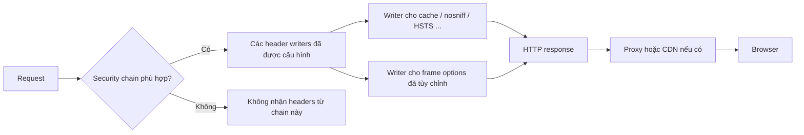

# Tùy chỉnh một header trong khi giữ các mặc định khác

## 1. Bài toán: cần đổi một chính sách nhưng vẫn bảo vệ các phần còn lại

Trong chương **Kiến trúc HTTP header** của module `SPRING_SECURITY_HTTP_PROTECTION`, Spring Security hỗ trợ nhiều lớp phòng vệ HTTP và trình duyệt: CSRF, CORS, security headers, Content Security Policy (CSP), HTTP Strict Transport Security (HSTS), HTTP firewall và bảo vệ session. Mỗi lớp có trách nhiệm riêng. Khi ứng dụng cần điều chỉnh một HTTP security header, thay đổi đó phải có phạm vi rõ ràng để các lớp bảo vệ khác tiếp tục hoạt động theo chính sách đã chọn.

Giả sử ứng dụng có trang `/reports/summary` và một dashboard **cùng origin** cần nhúng trang này trong `<iframe>`. Spring Security thường phát:

```http
X-Frame-Options: DENY
```

Giá trị này giúp chống clickjacking, nhưng đồng thời chặn việc nhúng trang từ chính origin của ứng dụng. Yêu cầu kinh doanh mới là chỉ cho phép nhúng **cùng origin**. Cấu hình mong muốn:

```http
X-Frame-Options: SAMEORIGIN
```

Nếu chỉ vì trường hợp này mà tắt toàn bộ HTTP security headers, ứng dụng có thể mất thêm `X-Content-Type-Options`, các header chống cache và HSTS trên HTTPS. Cách giải quyết là **tùy chỉnh đúng chính sách frame**, giữ các writer mặc định còn lại.

Bài học tập trung vào ba thao tác khác nhau:

1. **Thay đổi một header có writer dựng sẵn:** ví dụ `X-Frame-Options: DENY` thành `SAMEORIGIN`.
2. **Bổ sung một header mới:** ví dụ thêm `Referrer-Policy` hoặc CSP, trong khi giữ các mặc định đã bật.
3. **Vô hiệu hóa riêng một writer:** chỉ khi có lý do thiết kế và đã đánh giá rủi ro, không nhầm với vô hiệu hóa toàn bộ nhóm headers.

Mục tiêu cuối cùng là biết cấu hình cho **Servlet và Reactive/WebFlux**, xác minh các header không bị mất sau khi thay đổi, và chẩn đoán trường hợp chính sách bị ghi đè bởi security chain, controller hoặc proxy.

## 2. Hiểu “giữ mặc định” trong Spring Security

Spring Security bổ sung các response security headers qua cơ chế writer trong security filter chain:



Trong **Servlet**, cấu hình nằm tại `HttpSecurity.headers(...)` và các writer được thực thi qua `HeaderWriterFilter`. Trong **Reactive**, cấu hình nằm tại `ServerHttpSecurity.headers(...)` và `HttpHeaderWriterWebFilter` dùng các `ServerHttpHeadersWriter`.

Khi chỉ sửa `frameOptions` trong DSL, Spring Security có thể giữ nguyên các header writers mặc định khác đang bật trong chain. Ngược lại, các thao tác tắt toàn bộ headers hoặc chỉ đăng ký một tập writer mới theo chế độ bỏ mặc định sẽ làm thay đổi đáng kể baseline.

### Bảng quyết định

| Mục đích | Hướng cấu hình | Điều cần bảo toàn |
| --- | --- | --- |
| Đổi `X-Frame-Options` từ `DENY` sang `SAMEORIGIN` | Chỉnh `frameOptions(...)` | `nosniff`, cache, HSTS trên HTTPS và các header khác của chain. |
| Bổ sung CSP cho trang HTML | Chỉnh `contentSecurityPolicy(...)` | Writer mặc định vẫn hoạt động; CSP phải tương thích với tài nguyên thực. |
| Bổ sung Referrer-Policy | Chỉnh `referrerPolicy(...)` nếu DSL phiên bản hỗ trợ | Không làm mất CSP/HSTS/frame policy hiện có. |
| Chỉ bỏ frame header | Vô hiệu hóa riêng `frameOptions(...)` khi đã có biện pháp thay thế | Không tắt tất cả headers; xem xét CSP `frame-ancestors` và browser hỗ trợ. |
| Tắt toàn bộ security headers | `headers(...disable())` | Đây là thay đổi rộng; tránh dùng chỉ để sửa một lỗi nhỏ. |
| Chỉ bật writer được chỉ định, bỏ mặc định | API có ý nghĩa tương tự `defaultsDisabled()` trên phiên bản hỗ trợ | Phải tự đánh giá và bật lại mọi chính sách cần thiết. Đây không phải cách tùy chỉnh một header thông thường. |

**Lưu ý về phiên bản:** ví dụ code bên dưới theo cấu hình lambda DSL phổ biến của Spring Security 6.x. Các API và tập mặc định có thể thay đổi theo phiên bản; hãy xác minh `spring-security-config`/`spring-security-web` thực sự được nạp lúc chạy và đối chiếu tài liệu đúng phiên bản. Riêng CSP thường **không** được Spring Security tự sinh chính sách vì nguồn script/style/API hợp lệ phụ thuộc ứng dụng.

## 3. Mô hình trước và sau khi sửa một header

Giả sử một request HTTPS đến trang dashboard đi qua chain có các writer mặc định. Bảng dưới mô tả **giá trị ví dụ** thường thấy trong Spring Security 6.x, với điều kiện ứng dụng chưa tùy chỉnh writer tương ứng.

| Header | Trước thay đổi | Sau thay đổi `frameOptions` | Giải thích |
| --- | --- | --- | --- |
| `X-Frame-Options` | `DENY` | **`SAMEORIGIN`** | Header duy nhất được yêu cầu thay đổi. |
| `X-Content-Type-Options` | `nosniff` | `nosniff` | Vẫn bảo vệ trước MIME sniffing khi tải tài nguyên thích hợp. |
| `Cache-Control` | `no-cache, no-store, max-age=0, must-revalidate` | Giữ theo response trước đó | Controller hoặc proxy có thể chọn cache chính sách riêng. |
| `Pragma` và `Expires` | `no-cache` / `0` | Giữ theo response trước đó | Các header liên quan đến cache. |
| `Strict-Transport-Security` | `max-age=31536000; includeSubDomains` | Giữ theo response trước đó | Thường được phát **chỉ khi request được nhận diện HTTPS**. |
| `X-XSS-Protection` | Tùy phiên bản, thường `0` trong nhiều bản hiện đại | Không chủ động thay đổi | Header lịch sử, không thay thế CSP/escape đầu ra. |
| `Content-Security-Policy` | Không thể mặc định suy ra | Không tự phát chỉ vì sửa frame policy | Nếu app/gateway đã đặt CSP thì vẫn phải xét tương tác của CSP. |

Điểm quan trọng: **“giữ nguyên” là kết quả cần kiểm chứng trên ứng dụng thực**, không phải lời hứa rằng mọi môi trường đều có cùng tập header. Ví dụ request HTTP nội bộ có thể không phát HSTS trong khi request HTTPS public có; endpoint tự đặt `Cache-Control` có thể không có giá trị theo bảng.

### Trường hợp không thể chỉ sửa một header

Nếu response còn phát:

```http
Content-Security-Policy: frame-ancestors 'none'
```

thì trình duyệt hiện đại vẫn có thể từ chối nhúng iframe cho dù `X-Frame-Options` đã thành `SAMEORIGIN`. Khi đó, yêu cầu nghiệp vụ “cho phép nhúng cùng origin” đòi hỏi **đồng bộ CSP** thành `frame-ancestors 'self'` hoặc một policy khác được phê duyệt. Đây là thay đổi liên quan đến **hai cơ chế độc lập**, nên không cố áp quy tắc “chỉ sửa một header” khi nó tạo ra chính sách mâu thuẫn.

Ngược lại, đừng tắt CSP hoặc thêm `'unsafe-inline'` chỉ vì thấy một iframe hay script bị chặn mà chưa xác định directive gây lỗi.

## 4. Servlet: sửa `X-Frame-Options` và giữ các writer mặc định

Trên Servlet, `HttpSecurity` cấu hình một `SecurityFilterChain`; Spring Security thực thi các header writers qua `HeaderWriterFilter`. Ví dụ một ứng dụng Spring MVC có route `/health` public, còn lại cần đăng nhập:

```java
import org.springframework.context.annotation.Bean;
import org.springframework.context.annotation.Configuration;
import org.springframework.security.config.annotation.web.builders.HttpSecurity;
import org.springframework.security.web.SecurityFilterChain;

@Configuration
public class ServletFrameSecurityConfig {

    @Bean
    SecurityFilterChain webSecurityChain(HttpSecurity http) throws Exception {
        http
            .authorizeHttpRequests(auth -> auth
                .requestMatchers("/health").permitAll()
                .anyRequest().authenticated())
            .headers(headers -> headers
                .frameOptions(frame -> frame.sameOrigin()));

        return http.build();
    }
}
```

Trong ví dụ này, phần `headers(...)` **chỉ tùy biến frame policy**; các writer mặc định còn bật của phiên bản không bị tắt hàng loạt. `permitAll()` vẫn để `/health` đi qua chain, nên endpoint public có thể nhận security headers.

**Cách áp dụng vào dự án thực:** nếu đã có `SecurityFilterChain`, hãy thêm dòng `.headers(headers -> headers.frameOptions(frame -> frame.sameOrigin()))` vào chain hiện tại có matcher phù hợp. Không tạo một chain thứ hai cùng phạm vi chỉ để thử thay header; nếu nhiều chain cùng khớp, `FilterChainProxy` chọn chain đầu tiên theo thứ tự và có thể làm policy khác dự kiến.

Ví dụ response mong đợi với HTTPS và baseline mặc định phù hợp:

```http
HTTP/1.1 200 OK
X-Frame-Options: SAMEORIGIN
X-Content-Type-Options: nosniff
Cache-Control: no-cache, no-store, max-age=0, must-revalidate
Pragma: no-cache
Expires: 0
Strict-Transport-Security: max-age=31536000; includeSubDomains
```

Đây là ví dụ **không bao gồm CSP bổ sung**. Giá trị thực có thể khác tùy version, loại resource, HTTPS, policy ứng dụng và hạ tầng.

### 4.1. Đổi một policy khác: Referrer-Policy

Nếu nhu cầu là thêm header kiểm soát dữ liệu URL nguồn gửi đi, có thể sử dụng DSL riêng mà vẫn bảo toàn writer mặc định:

```java
import org.springframework.security.web.header.writers.ReferrerPolicyHeaderWriter.ReferrerPolicy;

// Chèn vào HttpSecurity của chain đang dùng:
http.headers(headers -> headers
    .referrerPolicy(referrer -> referrer
        .policy(ReferrerPolicy.STRICT_ORIGIN_WHEN_CROSS_ORIGIN))
);
```

Đây là **thêm chính sách**, không phải thay header mặc định `X-Frame-Options`. `Referrer-Policy` không phải cơ chế ngăn truy cập trái phép đến tài nguyên, mà hướng dẫn browser gửi lượng thông tin referrer phù hợp. Tránh đặt thông tin nhạy cảm trong URL dù có Referrer-Policy.

### 4.2. Sửa HSTS có chủ đích

Một hệ thống thử nghiệm có thể chọn thời hạn HSTS thấp trước khi triển khai mở rộng. Với Servlet DSL hỗ trợ cấu hình HSTS:

```java
// Chèn vào HttpSecurity khi đã xác định kế hoạch HTTPS phù hợp:
http.headers(headers -> headers
    .httpStrictTransportSecurity(hsts -> hsts
        .maxAgeInSeconds(86400))
);
```

Ví dụ chỉ thay giá trị `max-age` thành 86.400 giây (một ngày), còn cấu hình thuộc tính HSTS khác theo version/đặt trước cần được kiểm chứng. Thời hạn này chỉ là **giá trị minh họa cho rollout**, không phải khuyến nghị mặc định cho production. Phải xem `includeSubDomains`, mọi subdomain, TLS termination và nhu cầu preload trước khi thay đổi.

HSTS chỉ có tác dụng khi browser nhận header qua **HTTPS hợp lệ**. Việc không thấy HSTS khi thử `http://localhost:8080` có thể là đúng theo thiết kế. Không tùy tiện bật HSTS trên một môi trường chưa chuẩn bị đủ HTTPS.

## 5. Reactive/WebFlux: tùy chỉnh cùng một chính sách

WebFlux dùng `ServerHttpSecurity` và `SecurityWebFilterChain`; header writers Reactive được điều phối qua `HttpHeaderWriterWebFilter`. Cơ chế khác Servlet ở API và vòng đời response, nhưng mục tiêu cấu hình vẫn là **thay một writer, giữ các writer còn lại**.

Ví dụ WebFlux Spring Security 6.x:

```java
import org.springframework.context.annotation.Bean;
import org.springframework.context.annotation.Configuration;
import org.springframework.security.config.annotation.web.reactive.EnableWebFluxSecurity;
import org.springframework.security.config.web.server.ServerHttpSecurity;
import org.springframework.security.web.server.SecurityWebFilterChain;
import org.springframework.security.web.server.header.XFrameOptionsServerHttpHeadersWriter;

@Configuration
@EnableWebFluxSecurity
public class ReactiveFrameSecurityConfig {

    @Bean
    SecurityWebFilterChain reactiveSecurityChain(ServerHttpSecurity http) {
        return http
            .authorizeExchange(auth -> auth
                .pathMatchers("/health").permitAll()
                .anyExchange().authenticated())
            .headers(headers -> headers
                .frameOptions(frame -> frame.mode(
                    XFrameOptionsServerHttpHeadersWriter.Mode.SAMEORIGIN)))
            .build();
    }
}
```

Một số đời Spring Security Reactive có các API builder khác nhau; nếu IDE không nhận `mode(...)`, hãy xem API của `ServerHttpSecurity.HeaderSpec.FrameOptionsSpec` trong phiên bản thực đang dùng. Không chép `HttpSecurity` hoặc `HeaderWriter` Servlet sang WebFlux.

**Mục tiêu của cấu hình:** response thuộc Reactive chain có `X-Frame-Options: SAMEORIGIN`, nhưng các writer mặc định khác trong chain vẫn được sử dụng. Việc ghi header thực tế xảy ra trong luồng xử lý response; nhà phát triển không cần tự gọi `ServerHttpHeadersWriter.writeHttpHeaders(...)` từ controller.

### 5.1. Bổ sung CSP vào Reactive mà vẫn giữ mặc định

```java
// Chèn vào chain hiện có nếu đã có chính sách CSP được phê duyệt:
http.headers(headers -> headers
    .contentSecurityPolicy(csp -> csp.policyDirectives(
        "default-src 'self'; " +
        "script-src 'self'; " +
        "object-src 'none'; " +
        "base-uri 'self'; " +
        "frame-ancestors 'self'"))
);
```

Ví dụ `frame-ancestors 'self'` phù hợp khi trang **cần được nhúng cùng origin**; policy này độc lập với `frameOptions`. Nếu muốn chặn mọi iframe, thường cần `frame-ancestors 'none'` và frame options tương thích. CSP không được bật tự động theo nhu cầu của mọi ứng dụng: cần kiểm kê nguồn script, style, font, API/WebSocket, form submit và tích hợp với iframe trước khi cưỡng chế.

Nếu một trang chỉ dùng CSP report-only:

```http
Content-Security-Policy-Report-Only: script-src 'self'; object-src 'none'
```

thì browser **không chặn theo policy báo cáo đó**, dù vẫn có thể áp các CSP cưỡng chế khác. Hãy dùng report-only để khảo sát, rồi chuyển sang `Content-Security-Policy` cưỡng chế sau khi sửa vi phạm hợp lệ.

## 6. Những mẫu cấu hình làm mất mặc định hoặc tạo xung đột

### 6.1. Tắt toàn bộ headers khi chỉ cần sửa frame policy

Ví dụ **cần tránh** trên Servlet:

```java
// Không dùng để giải quyết một lỗi iframe đơn lẻ.
http.headers(headers -> headers.disable());
```

Thao tác này vô hiệu hóa cơ chế security headers của chain. Với ứng dụng chưa có tầng khác phát thay thế, các mặc định hữu ích như `nosniff`, chống cache và HSTS có thể biến mất. Cách đúng là dùng API chuyên biệt:

```java
http.headers(headers -> headers
    .frameOptions(frame -> frame.sameOrigin()));
```

Tương tự, đừng tắt mọi headers trên WebFlux chỉ để xử lý một directive CSP gây lỗi.

### 6.2. Bỏ tất cả writer mặc định để rồi chỉ thêm một writer

Một số phiên bản hỗ trợ phương thức có ý nghĩa **tắt cấu hình mặc định rồi chỉ bật writer được chỉ định** (ví dụ `defaultsDisabled()` trong Servlet DSL). Nó có thể hữu ích khi có yêu cầu kiểm soát rất đặc biệt, nhưng không giải quyết bài toán “đổi một header, giữ các mặc định khác”.

Nếu lựa chọn chiến lược này, cần liệt kê lại tất cả header bắt buộc theo chính sách bảo mật của hệ thống, kể cả cache/HSTS/`nosniff` và các header do proxy chịu trách nhiệm. Không áp dụng nó chỉ để viết ngắn code.

### 6.3. Thêm writer thủ công cho header đã có writer mặc định

Ví dụ **dễ gây xung đột**:

```java
import org.springframework.security.web.header.writers.StaticHeadersWriter;

http.headers(headers -> headers
    .addHeaderWriter(new StaticHeadersWriter(
        "X-Frame-Options", "SAMEORIGIN")));
```

Nếu chain đã có `FrameOptionsHeaderWriter` phát `DENY`, việc đăng ký `StaticHeadersWriter` thứ hai cùng tên có thể khiến giá trị cuối phụ thuộc thứ tự writer và ngữ nghĩa `setHeader`/`addHeader`. Reverse proxy có thể tạo thêm một giá trị nữa. Dùng `frameOptions(...)` là đường cấu hình dành riêng cho header này.

Tương tự trong WebFlux, không nên bổ sung `StaticServerHttpHeadersWriter` để sửa một header đã có DSL. Hãy dùng builder chuyên biệt và kiểm tra response cuối cùng.

### 6.4. Tắt đúng một writer khi thực sự cần

Ví dụ một ứng dụng muốn để CSP `frame-ancestors` quyết định việc nhúng trang và có nhu cầu tương thích đã được đánh giá. Trên Servlet có thể vô hiệu hóa **riêng** frame options:

```java
// Chỉ dùng khi đã thiết kế và kiểm thử một chính sách nhúng thay thế.
http.headers(headers -> headers
    .frameOptions(frame -> frame.disable()));
```

Những writer header khác tiếp tục hoạt động theo cấu hình chain. Tuy nhiên, bỏ `X-Frame-Options` có thể làm mất một lớp chống clickjacking trên những trình duyệt cũ không hỗ trợ CSP `frame-ancestors`; hãy xác định nhóm browser mục tiêu. Khi nhu cầu chỉ là nhúng cùng origin, `sameOrigin()` thường là cách thay đổi hẹp hơn.

### 6.5. Sửa đúng header nhưng quên các policy liên quan

| Bạn sửa | Chính sách có thể tương tác | Rủi ro nếu bỏ qua |
| --- | --- | --- |
| `X-Frame-Options` | CSP `frame-ancestors` | Iframe vẫn bị chặn hoặc chính sách chồng chéo khó hiểu. |
| HSTS | TLS certificate, redirect HTTP→HTTPS, proxy, `includeSubDomains` | Một số subdomain hoặc client không truy cập được. |
| CSP `script-src` | Template inline script, CDN, nonce/hash, `connect-src` | SPA hoặc thư viện hợp lệ bị browser chặn. |
| `Cache-Control` | Cookie/session, dữ liệu cá nhân, caching ở CDN | Dữ liệu nhạy cảm có thể bị lưu; asset công khai mất hiệu năng nếu luôn `no-store`. |
| `Referrer-Policy` | URL token, chính sách logging, redirect sang bên thứ ba | Lộ thông tin URL nguồn nếu policy quá thoáng. |
| `X-Content-Type-Options` | `Content-Type` của JS/CSS | Trình duyệt chặn tài nguyên MIME sai; nên sửa MIME thay vì tắt `nosniff`. |

## 7. Cách kiểm chứng: một header đổi, các header còn lại không mất

Không chỉ test header vừa sửa. Cần **regression test** ít nhất một vài header đại diện cho những writer khác, theo phiên bản và policy thực sự triển khai.

### 7.1. Servlet: MockMvc

Ví dụ sau giả định ứng dụng Servlet có `GET /health` trả `200 OK`, request đi qua `ServletFrameSecurityConfig` và baseline có cache, `nosniff`, HSTS trên secure request:

```java
import org.junit.jupiter.api.Test;
import org.springframework.beans.factory.annotation.Autowired;
import org.springframework.boot.test.autoconfigure.web.servlet.AutoConfigureMockMvc;
import org.springframework.boot.test.context.SpringBootTest;
import org.springframework.test.web.servlet.MockMvc;

import static org.hamcrest.Matchers.containsString;
import static org.springframework.test.web.servlet.request.MockMvcRequestBuilders.get;
import static org.springframework.test.web.servlet.result.MockMvcResultMatchers.header;
import static org.springframework.test.web.servlet.result.MockMvcResultMatchers.status;

@SpringBootTest
@AutoConfigureMockMvc
class ServletSingleHeaderChangeTest {

    @Autowired
    MockMvc mvc;

    @Test
    void framePolicyChangesButOtherHeadersRemain() throws Exception {
        mvc.perform(get("/health").secure(true))
            .andExpect(status().isOk())
            .andExpect(header().string("X-Frame-Options", "SAMEORIGIN"))
            .andExpect(header().string("X-Content-Type-Options", "nosniff"))
            .andExpect(header().string("Cache-Control",
                containsString("no-store")))
            .andExpect(header().string("Strict-Transport-Security",
                containsString("max-age=")));
    }

    @Test
    void httpRequestHasNoHstsByDefault() throws Exception {
        mvc.perform(get("/health").secure(false))
            .andExpect(status().isOk())
            .andExpect(header().string("X-Frame-Options", "SAMEORIGIN"))
            .andExpect(header().doesNotExist("Strict-Transport-Security"));
    }
}
```

Nếu dự án đã cố ý thay caching/HSTS hoặc dùng Spring Security đời khác, hãy thay expected values theo **chính sách đã được duyệt** thay vì sửa production code để chạy theo bảng ví dụ. `secure(true)` của MockMvc mô phỏng thuộc tính request secure, **không xác minh TLS/certificate thật hoặc proxy forwarding**. Package `@AutoConfigureMockMvc` có thể khác ở các phiên bản Spring Boot mới; đối chiếu dependency test.

### 7.2. Reactive: WebTestClient

Giả định `GET /health` tồn tại và nằm trong chain của `ReactiveFrameSecurityConfig`:

```java
import org.junit.jupiter.api.Test;
import org.springframework.beans.factory.annotation.Autowired;
import org.springframework.boot.test.autoconfigure.web.reactive.AutoConfigureWebTestClient;
import org.springframework.boot.test.context.SpringBootTest;
import org.springframework.test.web.reactive.server.WebTestClient;

@SpringBootTest
@AutoConfigureWebTestClient
class ReactiveSingleHeaderChangeTest {

    @Autowired
    WebTestClient client;

    @Test
    void changedFramePolicyPreservesNosniff() {
        client.get()
            .uri("/health")
            .exchange()
            .expectStatus().isOk()
            .expectHeader().valueEquals("X-Frame-Options", "SAMEORIGIN")
            .expectHeader().valueEquals(
                "X-Content-Type-Options", "nosniff");
    }
}
```

Test này xác nhận hai header từ các writer khác nhau vẫn có mặt. Nếu muốn kiểm tra HSTS trong WebFlux, cần request được nhận diện HTTPS hoặc môi trường HTTPS thật; `WebTestClient` mock HTTP có thể không phát HSTS và điều đó không đồng nghĩa writer bị tắt.

### 7.3. Kiểm chứng response public

```bash
# Quan sát response public theo HTTPS.
curl -sS -D - -o /dev/null https://app.example.test/health

# Quan sát backend trực tiếp (nếu được phép).
curl -sS -D - -o /dev/null http://localhost:8080/health
```

Trong Windows PowerShell, dùng `curl.exe` và `-o NUL` thay cho `/dev/null`. Nếu cần đọc redirect `302`, đừng chỉ xem response cuối sau khi theo redirect; hãy kiểm tra từng response cùng security chain.

So sánh **trước và sau khi deploy** theo các trường: URL, scheme, status, `X-Frame-Options`, `X-Content-Type-Options`, CSP, HSTS, Cache-Control, và nguồn phát header. Xác minh qua **DevTools → Network → Response Headers**. Nếu iframe bị chặn, đọc **Console** để xem lỗi do `X-Frame-Options` hay CSP `frame-ancestors`.

### 7.4. Ma trận kiểm thử phù hợp

| Request | Header vừa tùy chỉnh | Header mặc định khác | Tình huống cần phân biệt |
| --- | --- | --- | --- |
| `GET /health` HTTPS | `X-Frame-Options: SAMEORIGIN` | `nosniff`, cache, HSTS | URL public thuộc chain hiện tại. |
| `GET /health` HTTP | `SAMEORIGIN` | `nosniff`; HSTS thường vắng mặt | Không suy kết luận từ sự khác biệt HSTS. |
| `GET /reports/summary` HTTPS | `SAMEORIGIN` | Các header baseline | Kiểm tra iframe same-origin hoạt động nếu CSP cho phép. |
| Trang được nhúng từ origin khác | Theo policy | Baseline còn nguyên | Trình duyệt phải chặn nếu chỉ cho same-origin. |
| Trang yêu cầu đăng nhập | Header trên `302`/`401` | Baseline trên response auth | Đừng chỉ test `200`. |
| POST thiếu CSRF token | Header có thể vẫn hiện | Theo chain | `403` là từ CSRF; không do frame policy. |
| Asset tĩnh | Theo chain phục vụ asset | Cache policy có thể khác | Có thể được CDN phục vụ hoặc bỏ qua chain. |
| Route qua gateway | Header nhận ở public | Không bị lặp/ghi đè | So backend và gateway. |

## 8. Khi có nhiều security chain hoặc filter

Spring Security **không gộp các header writers từ mọi chain**. Một request chỉ đi theo chain phù hợp đã được chọn. Ví dụ:

```text
/api/**   -> SecurityFilterChain API    -> frame DENY
/**       -> SecurityFilterChain WEB    -> frame SAMEORIGIN
```

Nếu chỉ cấu hình `sameOrigin()` trong chain WEB, response `/api/orders` thuộc chain API có thể vẫn là `DENY`. Đó có thể là thiết kế đúng: API JSON không nhất thiết cần cho nhúng iframe, còn trang HTML trong WEB chain thì cần. Nhưng nếu app bất ngờ trả khác mong đợi, hãy kiểm tra:

- Thứ tự `@Order`, `securityMatcher`/`requestMatchers` và chain nào khớp URL thực.
- Trên Servlet, route đi qua chain bằng `permitAll` hay bị loại hẳn bằng `WebSecurityCustomizer.ignoring()`.
- Trên WebFlux, `SecurityWebFilterChain`/`securityMatcher` nào được chọn.
- Có reverse proxy/CDN làm path rewrite trước khi request đến Spring hay không.
- Có controller, filter khác hoặc gateway thêm/ghi đè cùng header hay không.

Một `SecurityFilterChain` mới được thêm vào có thể thay kết quả vì matcher mới được chọn trước chain cũ. Kiểm tra đường đi thực tế trước khi kết luận Spring Security “mất mặc định”.

## 9. Phân biệt header security với CSRF, CORS, cookie và session

Tùy chỉnh `X-Frame-Options` không làm thay đổi trách nhiệm của các cơ chế khác:

| Cơ chế | Tình huống thường gặp | Tại sao vẫn phải kiểm thử riêng? |
| --- | --- | --- |
| CSRF | POST sử dụng cookie session thiếu token trả `403` | `X-Frame-Options` không chứng minh CSRF token hợp lệ. |
| CORS | SPA ở origin khác bị browser từ chối đọc API | `X-Frame-Options` và CSP không thay `Access-Control-Allow-*`/preflight. |
| CSP | Script hoặc iframe bị browser chặn | Cần đọc directive cụ thể; CSP có thể chặt hơn frame header. |
| HSTS | Browser cần kết nối HTTPS trong tương lai | Phụ thuộc TLS, HTTPS secure request và phạm vi subdomain. |
| HTTP firewall | Request path/encoding nguy hiểm bị chặn sớm | Có thể không đi qua header writer thông thường. |
| Session/cookie | Cookie cần `Secure`, `HttpOnly`, `SameSite` | Cấu hình cookie/session độc lập với DSL frame policy. |
| Authentication/authorization | `401`, `403`, redirect đăng nhập | Header có mặt không đồng nghĩa người dùng đã được phép truy cập. |

Ví dụ, nếu browser báo CORS error sau khi bạn sửa frame policy, cần kiểm tra request `OPTIONS`, origin, credential, method và CORS config. Nếu POST bị `403`, kiểm tra CSRF token, cookie và quyền. Tránh thay header tùy tiện để che triệu chứng của cơ chế khác.

## 10. Chẩn đoán các xung đột bảo mật khi triển khai

| Triệu chứng | Nguyên nhân đáng kiểm tra | Cách xử lý |
| --- | --- | --- |
| Đổi `SAMEORIGIN` nhưng iframe cùng origin vẫn bị chặn | CSP `frame-ancestors 'none'` hoặc response thuộc chain khác | Đọc Network + Console, đồng bộ policy nếu nghiệp vụ cho phép nhúng. |
| Sau thay đổi, `nosniff`/cache/HSTS biến mất | Dùng `headers.disable()`, bỏ mặc định hoặc chain khớp khác | Khôi phục writer mặc định, sửa đúng header và test regression. |
| `X-Frame-Options` vừa có `DENY` vừa có `SAMEORIGIN` | Dùng thêm `StaticHeadersWriter` thay vì cấu hình built-in; proxy thêm giá trị | Dùng DSL `frameOptions` và xác định nguồn phát header duy nhất. |
| MockMvc có HSTS nhưng backend HTTP không | MockMvc dùng `secure(true)` còn backend nhìn thấy HTTP | Kiểm tra HTTPS public và forwarded scheme đáng tin cậy. |
| HSTS public không xuất hiện dù có SSL ở gateway | HSTS chỉ phát tại backend nhưng gateway terminate TLS; policy không được thêm ở public | Kiểm tra secure detection hoặc cấu hình HSTS ở tầng HTTPS thích hợp. |
| CSP chặn CDN sau khi bổ sung CSP | `script-src`/`connect-src` thiếu nguồn hoặc inline script chưa hỗ trợ nonce | Dùng Report-Only, kiểm kê nguồn, chỉnh policy có chủ đích. |
| Asset tĩnh khác cache header với trang tài khoản | Controller/proxy cố ý đặt cache riêng | Xác nhận `no-store` cho dữ liệu nhạy cảm và cache hợp lý cho asset public. |
| `403` POST dù security headers đúng | CSRF hoặc authorization | Kiểm tra token, session, quyền; không tắt CSRF do hiểu sai. |
| Browser nhận policy khác backend | Gateway/CDN, server web hoặc cấu hình header trùng | So response ở từng lớp và xác định ai sở hữu policy. |
| Test đột nhiên sai sau nâng phiên bản | Header defaults/DSL thay đổi hoặc dependency runtime khác | Xác định `spring-security-web/config` thực dùng và cập nhật test theo hợp đồng đã duyệt. |

**Quy trình chẩn đoán:** bắt đầu từ request URL, method, status và scheme → xác định security chain → đọc header ở backend → đọc header cuối qua HTTPS public → xem hành vi browser/Console → sửa một policy liên quan → chạy lại cả kiểm thử header vừa sửa lẫn header baseline.

## 11. Bài thực hành có đáp án định hướng

### Bài 1: thay một header, bảo toàn `nosniff`

Trang `/reports/summary` phải được nhúng cùng origin. Hãy điều chỉnh chain Servlet bằng `.frameOptions(frame -> frame.sameOrigin())` và viết MockMvc test kiểm tra **cả** `X-Frame-Options: SAMEORIGIN` lẫn `X-Content-Type-Options: nosniff`. Sau đó thử với HTTPS để xem HSTS có còn xuất hiện không.

**Đáp án định hướng:** chỉ dùng DSL frame options; không thêm writer tĩnh trùng tên, không tắt headers. Kết quả HTTPS phụ thuộc version, proxy và điều kiện secure request.

### Bài 2: iframe vẫn bị chặn dù có `SAMEORIGIN`

Response còn `Content-Security-Policy: frame-ancestors 'none'`. Vì sao iframe không hoạt động?

**Đáp án định hướng:** browser hỗ trợ CSP có thể áp dụng `frame-ancestors` và chặn mọi origin. Nếu chỉ cho cùng origin, policy hợp lệ cần đánh giá `frame-ancestors 'self'` cùng `X-Frame-Options: SAMEORIGIN`. Kiểm thử cả nhúng cùng origin và nhúng từ origin không được phép.

### Bài 3: thêm `Referrer-Policy`

Ứng dụng cần giới hạn dữ liệu URL nguồn khi điều hướng sang dịch vụ ngoài. Hãy thêm `Referrer-Policy: strict-origin-when-cross-origin` qua cấu hình Servlet DSL; kiểm tra `X-Frame-Options` và `nosniff` vẫn còn.

**Đáp án định hướng:** dùng `.referrerPolicy(...)`. Đây là **thêm** một policy độc lập, không yêu cầu tắt các mặc định khác. Referrer policy không thay kiểm soát auth/token trong URL.

### Bài 4: sau khi sửa `frameOptions`, API không có header mới

Ứng dụng có hai chain `/api/**` và `/**`. Chain WEB được sửa, nhưng API vẫn trả `DENY`. Tại sao?

**Đáp án định hướng:** request `/api/...` có thể thuộc chain API được chọn trước. Xác định matcher và quyết định API có cần cùng policy hay không; không mặc định gộp writer giữa hai chain.

### Bài 5: WebFlux và Servlet có cùng mục tiêu

Viết hai cấu hình đổi `X-Frame-Options` sang `SAMEORIGIN`. Tại sao không dùng cùng class writer?

**Đáp án định hướng:** Servlet có `HttpSecurity`/`HeaderWriter` và `HttpServletResponse`; WebFlux có `ServerHttpSecurity`/`ServerHttpHeadersWriter` và `ServerWebExchange`. DSL có thể tương tự về mục tiêu nhưng implementation dùng vòng đời HTTP khác nhau.

### Bài 6: header mặc định bị mất trên production

MockMvc test thành công; trên trình duyệt `nosniff` thiếu sau một lần triển khai gateway mới.

**Đáp án định hướng:** so sánh response backend và HTTPS public, kiểm tra proxy/CDN ghi đè hoặc bỏ header. Chỉ sửa Java nếu chứng cứ cho thấy header đã thiếu từ Spring Security chain.

## 12. Checklist trước khi đưa một thay đổi header vào production

1. **Xác định chính sách đang có:** version Spring Security, chain, header baseline và nguồn phát policy (ứng dụng, proxy, CDN).
2. **Nêu đúng lý do thay đổi:** header nào, giá trị trước/sau, origin/path nào, rủi ro nào được chấp nhận.
3. **Dùng API chuyên biệt:** `frameOptions`, `httpStrictTransportSecurity`, `contentSecurityPolicy`, `referrerPolicy` khi được phiên bản hỗ trợ; tránh thêm writer tĩnh trùng tên.
4. **Không tắt mặc định hàng loạt:** chỉ tắt writer riêng nếu thật sự có yêu cầu thay thế và đã đánh giá browser.
5. **Đánh giá các chính sách tương tác:** `frame-ancestors` với `X-Frame-Options`, HSTS với TLS/proxy, cache với session, CSP với nguồn frontend.
6. **Kiểm thử regression:** xác nhận header mới **và** những header bắt buộc khác, trên request HTTP/HTTPS phù hợp và nhiều status.
7. **Kiểm tra browser:** Network cho biết giá trị header cuối; Console và hành vi cho biết policy được thực thi.
8. **Phân biệt với các lớp bảo vệ khác:** CSRF, CORS, HTTP firewall, auth và session vẫn cần cấu hình, kiểm thử riêng.

### Tài liệu tham khảo

- [Spring Security Reference — Servlet HTTP Response Headers](https://docs.spring.io/spring-security/reference/servlet/exploits/headers.html)
- [Spring Security Reference — Reactive HTTP Response Headers](https://docs.spring.io/spring-security/reference/reactive/exploits/headers.html)
- [Spring Security Reference — HTTP Response Headers overview](https://docs.spring.io/spring-security/reference/features/exploits/headers.html)
- [Spring Security Reference — Servlet Security Architecture](https://docs.spring.io/spring-security/reference/servlet/architecture.html)
- [Spring Security API — HeadersConfigurer](https://docs.spring.io/spring-security/site/docs/current/api/org/springframework/security/config/annotation/web/configurers/HeadersConfigurer.html)
- [Spring Security API — ServerHttpSecurity.HeaderSpec](https://docs.spring.io/spring-security/site/docs/current/api/org/springframework/security/config/web/server/ServerHttpSecurity.HeaderSpec.html)
- [MDN — X-Frame-Options](https://developer.mozilla.org/en-US/docs/Web/HTTP/Reference/Headers/X-Frame-Options)
- [MDN — CSP frame-ancestors](https://developer.mozilla.org/en-US/docs/Web/HTTP/Reference/Headers/Content-Security-Policy/frame-ancestors)

