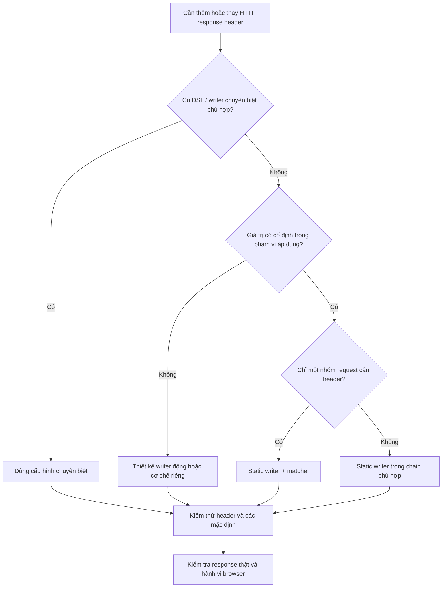
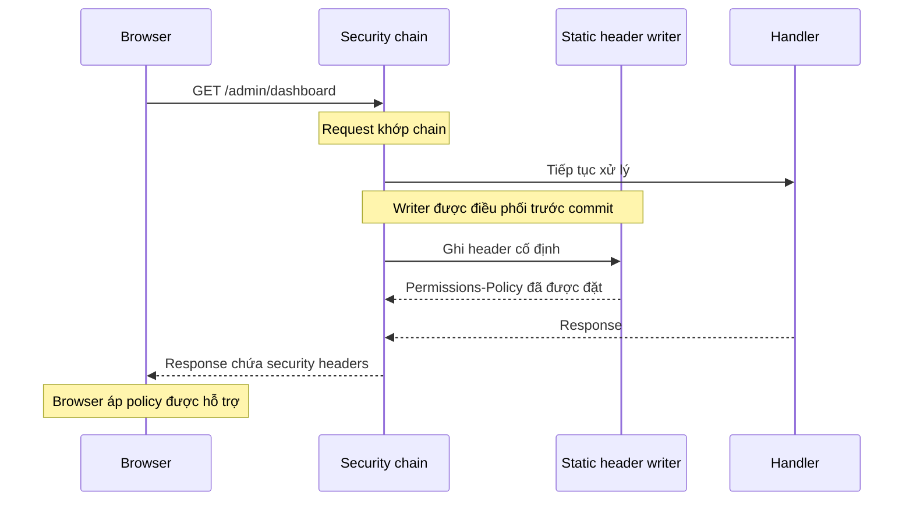
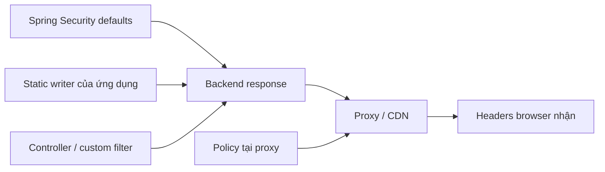

# Cấu hình header tĩnh bằng writer phù hợp

## 1. Khi nào nên dùng một header tĩnh?

Trong chương **Kiến trúc HTTP header** của module `SPRING_SECURITY_HTTP_PROTECTION`, Spring Security phối hợp các lớp bảo vệ HTTP và trình duyệt: CSRF, CORS, security headers, Content Security Policy (CSP), HTTP Strict Transport Security (HSTS), HTTP firewall và bảo vệ session. Một nhóm biện pháp hoạt động bằng cách **máy chủ gửi HTTP response header**, sau đó **trình duyệt đọc và thực thi chính sách mà nó hỗ trợ**.

Nhiều chính sách có giá trị **cố định đối với một nhóm response**. Ví dụ, một trang quản trị nội bộ hoàn toàn không dùng camera, micro hoặc định vị có thể phát:

```http
Permissions-Policy: camera=(), microphone=(), geolocation=()
```

Các dấu ngoặc `()` ở ví dụ trên biểu thị danh sách origin được phép là rỗng đối với ba tính năng. Trên trình duyệt hỗ trợ chỉ thị tương ứng, tài liệu mang policy đó không được sử dụng những tính năng ấy, kể cả khi ứng dụng có script cố gắng gọi API. Điều này không thay thế cơ chế xin quyền của trình duyệt hoặc authorization ở máy chủ.

Đây là tình huống phù hợp với **static header writer**: tên header và giá trị được xác định từ cấu hình, không cần tính lại cho từng người dùng hoặc phản hồi. Trên hai stack, Spring Security cung cấp cách tiếp cận tương ứng:

| Stack | Writer tĩnh | Nơi cấu hình | Bộ điều phối header |
| --- | --- | --- | --- |
| Servlet / Spring MVC | `StaticHeadersWriter` | `HttpSecurity.headers(...)` | `HeaderWriterFilter` |
| Reactive / Spring WebFlux | `StaticServerHttpHeadersWriter` | `ServerHttpSecurity.headers(...)` | `HttpHeaderWriterWebFilter` |

**Đầu ra mong muốn:** response HTML của `/admin/**` nhận thêm `Permissions-Policy` do ứng dụng lựa chọn; những writer đang bật khác như `X-Content-Type-Options: nosniff`, frame policy, cache headers và HSTS khi đáp ứng điều kiện HTTPS vẫn tiếp tục hoạt động.

### Mục tiêu học tập

Sau bài này, bạn có thể:

1. Phân biệt header **tĩnh**, header **theo điều kiện request** và header **cần sinh giá trị động**.
2. Chọn `StaticHeadersWriter` cho Servlet, `StaticServerHttpHeadersWriter` cho Reactive và cấu hình qua đúng security chain.
3. Biết lúc nào nên ưu tiên writer/DSL chuyên biệt thay vì writer tĩnh.
4. Giới hạn writer theo URL bằng matcher khi policy chỉ áp cho một phần ứng dụng.
5. Kiểm thử giá trị header, phạm vi áp dụng, sự hiện diện của mặc định còn lại và hành vi trên trình duyệt.
6. Chẩn đoán xung đột khi proxy, controller hoặc nhiều writer cùng phát một header.

## 2. “Tĩnh” là tính chất của giá trị, không có nghĩa an toàn cho mọi response

Header tĩnh là một cặp **tên–giá trị** được khai báo trước:

```text
Header-Name: fixed-value
```

Nó thích hợp nếu cùng một giá trị đúng cho **mọi response nằm trong phạm vi writer**. Phạm vi này có thể là toàn bộ security chain hoặc chỉ một nhóm URL khi có matcher.

Ví dụ:

```http
Permissions-Policy: camera=(), microphone=(), geolocation=()
Cross-Origin-Resource-Policy: same-origin
Referrer-Policy: strict-origin-when-cross-origin
```

Ba header có vai trò khác nhau:

- `Permissions-Policy` điều khiển việc tài liệu và những frame liên quan có thể sử dụng một số tính năng của trình duyệt.
- `Cross-Origin-Resource-Policy` có thể hạn chế việc một tài nguyên được nạp từ context cross-origin không phù hợp.
- `Referrer-Policy` hướng dẫn trình duyệt mức thông tin URL nguồn được gửi trong header `Referer`.

Có thể phát các giá trị trên bằng static writer khi chúng thực sự phù hợp phạm vi. Nhưng với những header Spring Security đã có **builder chuyên biệt** như `Referrer-Policy` hoặc CSP, nên ưu tiên DSL của framework để giảm nguy cơ xung đột và giúp thể hiện ý định rõ hơn.

### 2.1. Quy trình chọn writer



**Một quy tắc đơn giản:** việc `StaticHeadersWriter` có thể phát một chuỗi bất kỳ **không có nghĩa** nên dùng nó để thay thế toàn bộ những cơ chế có sẵn.

| Nhu cầu | Khuyến nghị | Lý do |
| --- | --- | --- |
| Header giá trị cố định chưa có DSL thuận tiện trong version đang dùng | Static writer | Cấu hình rõ tên và giá trị, dễ kiểm thử. |
| `X-Frame-Options` | `frameOptions(...)` | Tránh thêm writer tĩnh trùng với writer mặc định. |
| HSTS | Builder HSTS chuyên biệt | Điều kiện HTTPS, `max-age` và phạm vi subdomain cần được quản lý đúng. |
| CSP tĩnh của một trang | Ưu tiên `contentSecurityPolicy(...)` | Tránh trùng policy và thể hiện rõ chế độ enforce/report-only. |
| CSP với nonce khác nhau mỗi response | Cơ chế sinh nonce an toàn cho request/template | Giá trị không còn tĩnh; nonce cố định làm mất mục tiêu của nonce. |
| CORS theo Origin/credentials | Cấu hình CORS của Spring Security/Web | CORS có request/preflight và ngữ nghĩa credentials; không phát `*` bừa bãi. |
| `Set-Cookie` chứa session/token | Cơ chế cookie/session | Cookie và token cần giá trị, thuộc tính và vòng đời riêng. |
| `Cache-Control` cho HTML nhạy cảm và asset fingerprint | Cấu hình cache theo loại response | Không thể ép cùng một cache policy cho mọi nội dung. |
| `Content-Type` | Handler/content negotiation/static resource configuration | MIME type tùy nội dung, không nên đặt cứng trên mọi response. |

### 2.2. Đừng dùng static writer để giả lập sự linh hoạt

Ví dụ sai về mặt thiết kế:

```http
Access-Control-Allow-Origin: *
Access-Control-Allow-Credentials: true
```

Tổ hợp này không hợp lệ cho một response CORS có credential được browser chấp nhận. Static writer không thay thế xử lý preflight hoặc allowlist origin. Khi nhiều origin và credentials tham gia, cần dùng cơ chế CORS của framework.

Ví dụ khác: gửi một nonce CSP giống hệt nhau qua nhiều response:

```http
Content-Security-Policy: script-src 'nonce-fixed-secret'
```

Đây không phải cách triển khai nonce an toàn. **Nonce CSP nên được tạo ngẫu nhiên, đủ khó đoán và mới cho mỗi response HTML cần nó**, đồng thời gắn đúng vào các `<script>` tương ứng. Nếu trang chỉ cần một policy CSP tĩnh không dùng nonce, có thể cấu hình bằng builder CSP chuyên biệt và kiểm thử nguồn tài nguyên.

## 3. Static writer đi vào response theo đường nào?

Một static writer **không tự chạy chỉ vì được tạo bằng `new`**. Nó phải được đăng ký vào security chain quản lý request.



Sơ đồ chỉ mô tả trách nhiệm. Với Servlet, `HeaderWriterFilter` phối hợp việc gọi các `HeaderWriter`; với Reactive, `HttpHeaderWriterWebFilter` điều phối các `ServerHttpHeadersWriter` theo vòng đời response. Thời điểm chính xác writer chạy có thể phụ thuộc stack và phiên bản, nhưng **header phải được ghi trước khi response commit**.

Nếu một Servlet filter khác chỉ gọi `response.setHeader(...)` sau `chain.doFilter(...)`, handler có thể đã flush/redirect/commit từ trước. Nếu WebFlux viết header trong `doFinally(...)` sau khi stream kết thúc, cũng có thể quá muộn. Tích hợp static writer qua Spring Security giúp sử dụng cơ chế ghi header của framework.

### Điều kiện để nhìn thấy header

- Request phải được xử lý bởi **security chain** chứa writer đó.
- Writer chỉ ghi khi **matcher** tương ứng cho phép, nếu có matcher.
- Response phải còn nằm trong vòng đời ghi header do framework quản lý.
- Không có controller, proxy/CDN hay writer khác xóa/ghi đè header sau đó.
- Browser phải hỗ trợ header/chỉ thị thì chính sách mới có tác dụng tương ứng.

`permitAll()` chỉ quyết định cho phép truy cập, vẫn giữ request trong chain. Cơ chế bỏ qua security chain trên Servlet hoặc tài nguyên do CDN phục vụ trực tiếp có thể khiến header từ Spring Security không xuất hiện.

## 4. Servlet: `StaticHeadersWriter`

Giao diện Servlet cơ bản:

```java
package org.springframework.security.web.header;

public interface HeaderWriter {
    void writeHeaders(
        jakarta.servlet.http.HttpServletRequest request,
        jakarta.servlet.http.HttpServletResponse response
    );
}
```

Đây là chữ ký tham khảo cho Spring Security 6.x dùng Jakarta Servlet. Spring Security 5.x thường dùng `javax.servlet.*`. `StaticHeadersWriter` là một implementation có sẵn trong package `org.springframework.security.web.header.writers`.

### 4.1. Cấu hình header tĩnh trong chain hiện tại

Ví dụ trang quản trị luôn từ chối camera, microphone và geolocation:

```java
import org.springframework.context.annotation.Bean;
import org.springframework.context.annotation.Configuration;
import org.springframework.security.config.annotation.web.builders.HttpSecurity;
import org.springframework.security.web.SecurityFilterChain;
import org.springframework.security.web.header.writers.StaticHeadersWriter;

@Configuration
public class ServletStaticHeadersConfig {

    private static final String PERMISSIONS =
        "camera=(), microphone=(), geolocation=()";

    @Bean
    SecurityFilterChain webSecurityChain(HttpSecurity http) throws Exception {
        http.authorizeHttpRequests(auth -> auth
            .requestMatchers("/admin/**").authenticated()
            .requestMatchers("/public/**").permitAll()
            .anyRequest().authenticated()
        );

        http.headers(headers -> headers
            .addHeaderWriter(new StaticHeadersWriter(
                "Permissions-Policy", PERMISSIONS))
        );

        return http.build();
    }
}
```

**Chú ý phạm vi:** vì chưa có matcher cho writer, `Permissions-Policy` trong ví dụ trên áp cho **tất cả response đi qua chain**, kể cả `/public/**`. Dù public được `permitAll`, nó vẫn nằm trong chain. Chỉ dùng cấu hình như vậy nếu chính sách thực sự phù hợp mọi trang trong chain.

Không dùng đoạn config minh họa để thay thế một `SecurityFilterChain` production đã có authentication, CSRF, CORS, session và thứ tự matcher riêng. Hãy **bổ sung đúng phần `.headers(...)`** vào chain hiện có. Header writer chỉ quản lý header; nó không thay các filter xác thực hay CSRF.

### 4.2. Tách việc thêm header khỏi việc thay một header mặc định

Đoạn trên **bổ sung** `Permissions-Policy`. Các writer mặc định đang bật như `ContentTypeOptionsHeaderWriter` và `FrameOptionsHeaderWriter` vẫn được Spring Security quản lý; `addHeaderWriter(...)` không tự yêu cầu bỏ các writer mặc định.

Đừng nhầm với kiểu cấu hình:

```java
// KHÔNG dùng để chỉ thêm một header mới.
http.headers(headers -> headers.disable());
```

Tắt toàn bộ headers là thay đổi rộng. Nếu chỉ cần đổi `X-Frame-Options: DENY` sang `SAMEORIGIN`, hãy dùng:

```java
http.headers(headers -> headers
    .frameOptions(frame -> frame.sameOrigin()));
```

Tương tự, nếu cần HSTS thời hạn cụ thể hoặc CSP cho trang, ưu tiên DSL chuyên biệt để không có hai writer cùng phát một header.

### 4.3. Chỉ áp static header trên `/admin/**`

Nếu `Permissions-Policy` trên chỉ phù hợp với các **document HTML của khu vực admin**, một matcher sẽ giới hạn nơi writer hoạt động. Với các phiên bản Spring Security 6.x còn hỗ trợ `AntPathRequestMatcher`:

```java
import org.springframework.security.web.header.HeaderWriter;
import org.springframework.security.web.header.writers.StaticHeadersWriter;
import org.springframework.security.web.header.writers.DelegatingRequestMatcherHeaderWriter;
import org.springframework.security.web.util.matcher.AntPathRequestMatcher;

// Đoạn bên trong phương thức cấu hình HttpSecurity:
HeaderWriter restrictedPolicy = new StaticHeadersWriter(
    "Permissions-Policy",
    "camera=(), microphone=(), geolocation=()"
);

http.headers(headers -> headers
    .addHeaderWriter(new DelegatingRequestMatcherHeaderWriter(
        new AntPathRequestMatcher("/admin/**"),
        restrictedPolicy))
);
```

`DelegatingRequestMatcherHeaderWriter` chỉ gọi writer được ủy quyền nếu `RequestMatcher` khớp request. `AntPathRequestMatcher` bị deprecated ở một số bản Spring Security mới; dự án mới nên kiểm tra cách dùng `PathPatternRequestMatcher` hoặc matcher tương ứng với phiên bản đang sử dụng. Đừng sao chép import từ một phiên bản khác mà không kiểm tra dependency.

**Giới hạn quan trọng:** trình duyệt áp `Permissions-Policy` chủ yếu trong ngữ cảnh **document** nhận policy. Nếu giao diện admin được tải tại `/index.html` rồi JavaScript mới gọi `/admin/api/**`, việc chỉ phát policy ở API response không tự áp policy mong muốn cho document ở `/index.html`. Matcher phải nhắm đúng **URL của tài liệu được browser tải**, kể cả sau khi proxy rewrite URL. Đây là lý do cần kiểm thử bằng trình duyệt, không chỉ dựa vào một API endpoint.

### 4.4. Khi cần đúng một nhóm response có `Cross-Origin-Resource-Policy`

Một ví dụ khác là chỉ cho phép tài nguyên nhạy cảm ở `/reports/**` được tải trong ngữ cảnh cùng origin:

```java
HeaderWriter reportPolicy = new StaticHeadersWriter(
    "Cross-Origin-Resource-Policy", "same-origin"
);

http.headers(headers -> headers
    .addHeaderWriter(new DelegatingRequestMatcherHeaderWriter(
        new AntPathRequestMatcher("/reports/**"),
        reportPolicy))
);
```

Policy này tác động đến các tình huống nạp tài nguyên liên origin mà trình duyệt hỗ trợ CORP; nó không thay CORS hoặc authorization. Chỉ áp khi tài nguyên report thực sự không cần nhúng hoặc chia sẻ trong luồng bên thứ ba. Nếu đặt trên ảnh hoặc font dùng công khai, tích hợp CDN/cross-origin có thể hỏng.

## 5. Reactive: `StaticServerHttpHeadersWriter`

WebFlux sử dụng `ServerHttpSecurity`, `SecurityWebFilterChain`, `HttpHeaderWriterWebFilter` và hợp đồng:

```java
package org.springframework.security.web.server.header;

import org.springframework.web.server.ServerWebExchange;
import reactor.core.publisher.Mono;

public interface ServerHttpHeadersWriter {
    Mono<Void> writeHttpHeaders(ServerWebExchange exchange);
}
```

Writer nhận một `ServerWebExchange` thay vì `HttpServletRequest`/`HttpServletResponse`. `Mono<Void>` biểu diễn công việc ghi header như một publisher được framework phối hợp trong vòng đời response. Các ứng dụng Reactive không thể dùng trực tiếp `StaticHeadersWriter` Servlet vì hai giao diện có chữ ký khác nhau.

### 5.1. Thêm header tĩnh trên WebFlux

```java
import org.springframework.context.annotation.Bean;
import org.springframework.context.annotation.Configuration;
import org.springframework.security.config.annotation.web.reactive.EnableWebFluxSecurity;
import org.springframework.security.config.web.server.ServerHttpSecurity;
import org.springframework.security.web.server.SecurityWebFilterChain;
import org.springframework.security.web.server.header.StaticServerHttpHeadersWriter;

@Configuration
@EnableWebFluxSecurity
public class ReactiveStaticHeadersConfig {

    private static final String PERMISSIONS =
        "camera=(), microphone=(), geolocation=()";

    @Bean
    SecurityWebFilterChain webFluxSecurityChain(ServerHttpSecurity http) {
        http.authorizeExchange(auth -> auth
            .pathMatchers("/admin/**").authenticated()
            .pathMatchers("/public/**").permitAll()
            .anyExchange().authenticated()
        );

        http.headers(headers -> headers
            .addHeaderWriter(new StaticServerHttpHeadersWriter(
                "Permissions-Policy", PERMISSIONS))
        );

        return http.build();
    }
}
```

`StaticServerHttpHeadersWriter` đóng vai trò tương đương static writer Servlet. Nếu không có matcher riêng, writer áp cho mọi request thuộc Reactive security chain. Chính sách được ghi vào `ServerHttpResponse` khi framework xử lý request, không phải vào một response dùng chung lúc ứng dụng khởi động.

Nếu hệ thống đã có `SecurityWebFilterChain` với route, phân quyền, CSRF/CORS hoặc cơ chế đăng nhập riêng, hãy thêm writer vào **chain hiện hữu** thay vì tạo một chain cạnh tranh.

### 5.2. Chỉ áp trên path cụ thể bằng `ServerWebExchangeMatcher`

Một cách tách rõ điều kiện và thao tác ghi là viết adapter:

```java
import org.springframework.security.web.server.header.ServerHttpHeadersWriter;
import org.springframework.security.web.server.util.matcher.ServerWebExchangeMatcher;
import org.springframework.web.server.ServerWebExchange;
import reactor.core.publisher.Mono;

public final class MatchedServerHeadersWriter implements ServerHttpHeadersWriter {
    private final ServerWebExchangeMatcher matcher;
    private final ServerHttpHeadersWriter delegate;

    public MatchedServerHeadersWriter(
            ServerWebExchangeMatcher matcher,
            ServerHttpHeadersWriter delegate) {
        this.matcher = matcher;
        this.delegate = delegate;
    }

    @Override
    public Mono<Void> writeHttpHeaders(ServerWebExchange exchange) {
        return matcher.matches(exchange)
            .flatMap(result -> result.isMatch()
                ? delegate.writeHttpHeaders(exchange)
                : Mono.empty());
    }
}
```

Với một request không khớp, adapter trả `Mono.empty()` và không thêm header đó. Không tự gọi `subscribe()` trong writer: nó tách thao tác khỏi pipeline và có thể làm header được ghi quá muộn.

Đăng ký adapter trong `ServerHttpSecurity`:

```java
import org.springframework.security.web.server.header.ServerHttpHeadersWriter;
import org.springframework.security.web.server.header.StaticServerHttpHeadersWriter;
import org.springframework.security.web.server.util.matcher.PathPatternParserServerWebExchangeMatcher;

// Đoạn chèn vào phương thức đang cấu hình ServerHttpSecurity:
ServerHttpHeadersWriter policyForAdmin = new MatchedServerHeadersWriter(
    new PathPatternParserServerWebExchangeMatcher("/admin/**"),
    new StaticServerHttpHeadersWriter(
        "Permissions-Policy",
        "camera=(), microphone=(), geolocation=()")
);

http.headers(headers -> headers.addHeaderWriter(policyForAdmin));
```

Đây là **đoạn code cần đặt trong một method cấu hình**, không phải một class Java có thể biên dịch độc lập. Pattern phải khớp request mà WebFlux thực sự thấy, đặc biệt nếu gateway rewrite path. Nếu cả security chain không khớp request, writer cũng không được gọi. Khi phiên bản đã có writer/matcher chuyên biệt đáp ứng cùng nhu cầu, có thể ưu tiên API đó thay cho adapter minh họa.

### 5.3. Tại sao không đặt header trong `doFinally`?

```java
// ANTI-PATTERN: response có thể đã commit khi callback này chạy.
return chain.filter(exchange)
    .doFinally(signal -> exchange.getResponse().getHeaders()
        .set("Permissions-Policy", "camera=()"));
```

Với stream hoặc response đã được commit, thay đổi trong `doFinally` có thể không tới client. `HttpHeaderWriterWebFilter` có cơ chế ghi header theo vòng đời response để tránh lỗi thông dụng này. Nếu viết một WebFilter riêng, cần hiểu `ServerHttpResponse.beforeCommit(...)`; thông thường cấu hình bằng `ServerHttpSecurity.headers(...)` đơn giản hơn.

## 6. Cách kiểm tra writer đơn lẻ

Trước khi kiểm tra toàn bộ security chain, có thể kiểm thử static writer để xác minh tên/giá trị header.

### 6.1. Unit test Servlet với `MockHttpServletResponse`

```java
import org.junit.jupiter.api.Test;
import org.springframework.mock.web.MockHttpServletRequest;
import org.springframework.mock.web.MockHttpServletResponse;
import org.springframework.security.web.header.HeaderWriter;
import org.springframework.security.web.header.writers.StaticHeadersWriter;

import static org.junit.jupiter.api.Assertions.assertEquals;

class ServletStaticHeadersWriterTest {

    @Test
    void addsPermissionsPolicy() {
        HeaderWriter writer = new StaticHeadersWriter(
            "Permissions-Policy",
            "camera=(), microphone=(), geolocation=()");

        MockHttpServletRequest request = new MockHttpServletRequest();
        MockHttpServletResponse response = new MockHttpServletResponse();

        writer.writeHeaders(request, response);

        assertEquals("camera=(), microphone=(), geolocation=()",
            response.getHeader("Permissions-Policy"));
    }
}
```

`MockHttpServletRequest` và `MockHttpServletResponse` thuộc `spring-test`. Test này kiểm tra writer, **chưa chứng minh** security chain, matcher hoặc proxy gọi writer đúng nơi.

### 6.2. Unit test Reactive với `MockServerWebExchange`

```java
import org.junit.jupiter.api.Test;
import org.springframework.mock.http.server.reactive.MockServerHttpRequest;
import org.springframework.mock.web.server.MockServerWebExchange;
import org.springframework.security.web.server.header.ServerHttpHeadersWriter;
import org.springframework.security.web.server.header.StaticServerHttpHeadersWriter;
import reactor.test.StepVerifier;

import static org.junit.jupiter.api.Assertions.assertEquals;

class ReactiveStaticHeadersWriterTest {

    @Test
    void addsPermissionsPolicy() {
        var exchange = MockServerWebExchange.from(
            MockServerHttpRequest.get("/admin/dashboard").build());

        ServerHttpHeadersWriter writer = new StaticServerHttpHeadersWriter(
            "Permissions-Policy",
            "camera=(), microphone=(), geolocation=()");

        StepVerifier.create(writer.writeHttpHeaders(exchange))
            .verifyComplete();

        assertEquals("camera=(), microphone=(), geolocation=()",
            exchange.getResponse().getHeaders()
                .getFirst("Permissions-Policy"));
    }
}
```

`StepVerifier` thuộc `reactor-test`. Test xác minh publisher hoàn tất và response mock có header, chưa mô phỏng TLS/gateway hoặc hành vi trình duyệt.

### 6.3. Unit test cho adapter matcher Reactive

Giả định đã xây dựng `MatchedServerHeadersWriter` ở mục 5:

```java
import org.junit.jupiter.api.Test;
import org.springframework.mock.http.server.reactive.MockServerHttpRequest;
import org.springframework.mock.web.server.MockServerWebExchange;
import org.springframework.security.web.server.header.ServerHttpHeadersWriter;
import org.springframework.security.web.server.header.StaticServerHttpHeadersWriter;
import org.springframework.security.web.server.util.matcher.PathPatternParserServerWebExchangeMatcher;
import reactor.test.StepVerifier;

import static org.junit.jupiter.api.Assertions.assertEquals;
import static org.junit.jupiter.api.Assertions.assertNull;

class MatchedHeadersWriterTest {

    @Test
    void writesOnlyForAdminPath() {
        ServerHttpHeadersWriter writer = new MatchedServerHeadersWriter(
            new PathPatternParserServerWebExchangeMatcher("/admin/**"),
            new StaticServerHttpHeadersWriter(
                "Permissions-Policy", "camera=()"));

        var admin = MockServerWebExchange.from(
            MockServerHttpRequest.get("/admin/home").build());
        var publicPage = MockServerWebExchange.from(
            MockServerHttpRequest.get("/public/home").build());

        StepVerifier.create(writer.writeHttpHeaders(admin)).verifyComplete();
        StepVerifier.create(writer.writeHttpHeaders(publicPage)).verifyComplete();

        assertEquals("camera=()",
            admin.getResponse().getHeaders().getFirst("Permissions-Policy"));
        assertNull(publicPage.getResponse().getHeaders()
            .getFirst("Permissions-Policy"));
    }
}
```

Kiểm tra cả **đường dẫn được phép áp dụng** và **đường dẫn không được phép** rất quan trọng. Một cấu hình matcher sai có thể làm header thừa xuất hiện trên trang tích hợp bên thứ ba, dù test “header có mặt” vẫn thành công.

## 7. Kiểm thử trên toàn bộ Servlet/Reactive security chain

Writer đơn lẻ hoạt động chưa chứng minh nó đã được đăng ký hoặc chạy trên endpoint mong muốn. Cần integration test qua security chain.

### 7.1. Một route minh họa cho Servlet

```java
import org.springframework.web.bind.annotation.GetMapping;
import org.springframework.web.bind.annotation.RestController;

@RestController
class AdminDocumentController {

    @GetMapping("/admin/dashboard")
    String dashboard() {
        return "Trang quản trị thử nghiệm";
    }

    @GetMapping("/public/info")
    String publicInfo() {
        return "Thông tin công khai";
    }
}
```

Trong ứng dụng thực, trang HTML có thể được render bằng template; các endpoint trên giúp kiểm tra routing/filter. Nếu `Permissions-Policy` chỉ cần cho HTML document, hãy bổ sung điều kiện response/document phù hợp trong thiết kế hoặc bảo đảm matcher trúng đúng URL HTML; API trả text không tự mang ý nghĩa kiểm soát quyền của document khác.

### 7.2. MockMvc: header mới và mặc định cùng tồn tại

Ví dụ sau giả định ứng dụng Servlet sử dụng cấu hình **không có matcher riêng cho static writer** tại mục 4.1. `spring-security-test` được dùng để tạo authentication giả lập:

```java
import org.junit.jupiter.api.Test;
import org.springframework.beans.factory.annotation.Autowired;
import org.springframework.boot.test.autoconfigure.web.servlet.AutoConfigureMockMvc;
import org.springframework.boot.test.context.SpringBootTest;
import org.springframework.security.test.context.support.WithMockUser;
import org.springframework.test.web.servlet.MockMvc;

import static org.hamcrest.Matchers.containsString;
import static org.springframework.test.web.servlet.request.MockMvcRequestBuilders.get;
import static org.springframework.test.web.servlet.result.MockMvcResultMatchers.header;
import static org.springframework.test.web.servlet.result.MockMvcResultMatchers.status;

@SpringBootTest
@AutoConfigureMockMvc
class ServletStaticHeaderIntegrationTest {

    @Autowired MockMvc mvc;

    @Test
    @WithMockUser
    void adminResponseKeepsDefaultsAndAddsPolicy() throws Exception {
        mvc.perform(get("/admin/dashboard").secure(true))
            .andExpect(status().isOk())
            .andExpect(header().string("Permissions-Policy",
                "camera=(), microphone=(), geolocation=()"))
            .andExpect(header().string("X-Content-Type-Options", "nosniff"))
            .andExpect(header().string("X-Frame-Options", "DENY"))
            .andExpect(header().string("Strict-Transport-Security",
                containsString("max-age=")));
    }
}
```

Giả định các header `nosniff`, frame options và HSTS chưa bị app tùy chỉnh. Nếu security chain thực dùng khác, phải cập nhật expected values theo **hợp đồng bảo mật** đã chọn. `secure(true)` mô phỏng request HTTPS ở MockMvc, không xác minh chứng chỉ/TLS thật. Package test trong một số đời Spring Boot mới có thể khác; hãy đối chiếu phiên bản thực.

Với cấu hình matcher `/admin/**` ở mục 4.3, cần thêm test cho `/public/info`:

```java
@Test
void publicPathDoesNotReceiveAdminOnlyPolicy() throws Exception {
    mvc.perform(get("/public/info"))
        .andExpect(status().isOk())
        .andExpect(header().doesNotExist("Permissions-Policy"))
        .andExpect(header().string("X-Content-Type-Options", "nosniff"));
}
```

Đoạn này là **phần mở rộng của test class**, giả định đã cấu hình writer theo matcher và import các matcher test như ở trên. Nếu gateway thêm `Permissions-Policy` ở mọi response public, test backend có thể pass nhưng header cuối từ gateway vẫn khác; cần quan sát ở deployment.

### 7.3. WebTestClient: xác minh Reactive chain

Trong WebFlux, dùng `WebTestClient` cho endpoint đi qua `SecurityWebFilterChain`. Giả sử route `/admin/dashboard` có handler trả `200`, `spring-security-test` cung cấp `@WithMockUser` và writer đang được thêm vào chain:

```java
import org.junit.jupiter.api.Test;
import org.springframework.beans.factory.annotation.Autowired;
import org.springframework.boot.test.autoconfigure.web.reactive.AutoConfigureWebTestClient;
import org.springframework.boot.test.context.SpringBootTest;
import org.springframework.security.test.context.support.WithMockUser;
import org.springframework.test.web.reactive.server.WebTestClient;

@SpringBootTest
@AutoConfigureWebTestClient
class ReactiveStaticHeaderIntegrationTest {

    @Autowired WebTestClient client;

    @Test
    @WithMockUser
    void adminResponseContainsPolicyAndNosniff() {
        client.get().uri("/admin/dashboard").exchange()
            .expectStatus().isOk()
            .expectHeader().valueEquals(
                "Permissions-Policy",
                "camera=(), microphone=(), geolocation=()")
            .expectHeader().valueEquals(
                "X-Content-Type-Options", "nosniff");
    }
}
```

Để test matcher Reactive mục 5.2, viết thêm một test cho `/public/info` và xác nhận `Permissions-Policy` **không có** nếu policy không đến từ nguồn khác. Với HSTS cần test request được nhận diện là HTTPS hoặc deployment HTTPS thực, bởi WebTestClient mock HTTP có thể không tạo HSTS.

## 8. Kiểm chứng trên HTTP response và trình duyệt

### 8.1. Kiểm tra response bên ngoài

```bash
curl -sS -D - -o /dev/null https://app.example.test/admin/dashboard
curl -sS -D - -o /dev/null https://app.example.test/public/info
```

Với Windows PowerShell, có thể dùng `curl.exe` và `-o NUL`. Nếu endpoint cần đăng nhập, hãy kiểm tra bằng phiên thử nghiệm hợp lệ hoặc chọn một endpoint công khai cùng chính sách để quan sát. Không ghi cookie/token thật vào tài liệu hoặc command chia sẻ. Khi không đăng nhập, server có thể trả `302`/`401`; response đó vẫn hữu ích để kiểm tra writer, nhưng cần phân biệt policy trên login page với document admin thực.

Dùng `curl -i` hoặc `curl -D -` để đọc tên và giá trị header cuối cùng. Đừng dùng `curl -I`/`HEAD` để kết luận tuyệt đối về `GET` nếu proxy/controller xử lý hai method khác nhau.

### 8.2. Kiểm tra trong browser

Mở **Developer Tools → Network**, tải lại document ở `/admin/**` và chọn response HTML. Kiểm tra `Permissions-Policy` trong **Response Headers**. Tại tab **Console**, thử tính năng liên quan trong môi trường được phép; trình duyệt hỗ trợ policy có thể báo rằng camera/micro/geolocation không được phép theo document policy.

**Cần kiểm tra chính document:** nếu frontend là SPA luôn tải HTML ở `/index.html`, còn các call `/admin/**` chỉ trả JSON, thì chính sách ở các API JSON không thay chính sách của document `/index.html`. Định vị đúng response sở hữu trang để cấu hình matcher.

Đối với `Cross-Origin-Resource-Policy`, kiểm tra tài nguyên được tải bởi trang có origin khác khi thiết kế yêu cầu; nếu browser chặn một ảnh, font hoặc file hợp lệ, cần xem header của **resource response** và CORS/CORP liên quan. `curl` chỉ xác minh server gửi giá trị, không thay được thử nghiệm browser.

### 8.3. Các response phải thử

| Tình huống | Cần kiểm chứng |
| --- | --- |
| HTML document `200` | Header mới đúng tên/giá trị, mặc định khác vẫn còn. |
| `302` redirect hoặc `401` chưa đăng nhập | Header trên response redirect và response đích; chain nào tạo từng response. |
| `403` do authorization hoặc CSRF | Writer có được thực thi trên lỗi từ security chain hay không. |
| `404`/`500` | Response do app, container hay proxy tạo; có chạy đúng chain không. |
| HTTP so với HTTPS | HSTS trên HTTPS phù hợp; không nhầm thiếu HSTS trên HTTP là lỗi writer tĩnh. |
| Static asset hoặc response từ CDN | Header do ứng dụng hay CDN phát; tránh giá trị sai phạm vi. |
| Streaming/SSE | Header phải đến client trước chunk/event đầu tiên. |
| Nhiều security chain | Mỗi URL được xử lý bởi đúng chain và writer được giới hạn. |

## 9. Tránh duplicate writer và xung đột policy

Một static writer có thể rất dễ sử dụng, nhưng chính vì nó ghi chuỗi cố định nên dễ đụng với writer mặc định hoặc tầng HTTP khác.



### 9.1. Không dùng static writer để sửa một header đã có writer chuyên biệt

Ví dụ dễ gây lỗi:

```java
// ANTI-PATTERN: thêm writer cùng tên với writer mặc định.
http.headers(headers -> headers
    .addHeaderWriter(new StaticHeadersWriter(
        "X-Frame-Options", "SAMEORIGIN")));
```

Nếu framework đã có `FrameOptionsHeaderWriter` phát `DENY`, kết quả có thể phụ thuộc vào thứ tự ghi hoặc thêm nhiều giá trị. Để thay policy, sử dụng DSL:

```java
http.headers(headers -> headers
    .frameOptions(frame -> frame.sameOrigin()));
```

Nếu app cũng phát `Content-Security-Policy: frame-ancestors 'none'`, browser vẫn có thể chặn iframe dù `X-Frame-Options` đã là `SAMEORIGIN`. Cần thiết kế hai policy nhất quán. Đừng dùng static writer thứ hai để cố “ghi đè” CSP đã cưỡng chế; nhiều CSP có thể được browser áp dụng đồng thời.

### 9.2. `setHeader`, `addHeader` và giá trị trùng lặp

Trong Servlet, `setHeader(name, value)` thay các giá trị hiện có cho tên header, còn `addHeader(name, value)` thêm giá trị. Trong Reactive, `HttpHeaders.set(...)` và `add(...)` có ý nghĩa tương tự. Nhưng **không nên dựa vào thứ tự nhiều writer để đạt một policy bảo mật**: container, proxy và trình duyệt có thể xử lý header lặp khác nhau tùy ngữ nghĩa header.

Ví dụ nếu một proxy thêm `Permissions-Policy: camera=(self)` trong khi backend đã phát `camera=()`, browser có thể nhận nhiều policy với ý nghĩa không như mong muốn. Giải pháp là xác định **một lớp chịu trách nhiệm** cho policy hoặc có quy ước hợp nhất rõ ràng, rồi xác minh response public.

### 9.3. Một giá trị tĩnh không có nghĩa bất biến theo thời gian triển khai

Policy có thể tĩnh **trong một phiên bản deploy** nhưng thay đổi khi yêu cầu ứng dụng thay đổi. Ví dụ một công cụ họp nội bộ được thêm khả năng video; `Permissions-Policy: camera=()` trên document của công cụ họp sẽ chặn chức năng mới trên browser hỗ trợ. Phải cập nhật chính sách, test và tài liệu triển khai cùng với chức năng mới.

Vì vậy, hãy đặt policy ở một nơi dễ tìm, đặt tên biến có ý nghĩa và tránh nhiều chuỗi giá trị bị sao chép ở controller, security config và gateway.

## 10. Tương tác với CSRF, CORS, HSTS, session và firewall

Static header writer giải quyết việc **phát một header**. Nó không đảm nhiệm các cơ chế phòng vệ khác.

| Cơ chế | Thành phần/chính sách liên quan | Khi điều tra cần lưu ý |
| --- | --- | --- |
| CORS | Cấu hình CORS, preflight `OPTIONS` và `Access-Control-*` | Không dùng static writer `Access-Control-Allow-Origin` tùy tiện khi có credential. |
| CSRF | `CsrfFilter`/`CsrfWebFilter` và token | POST thiếu token vẫn có thể `403` dù security headers đầy đủ. |
| HSTS | Writer/DSL HSTS chuyên biệt và HTTPS | Header cần điều kiện secure, đúng `max-age` và phạm vi subdomain. |
| CSP | CSP writer/DSL, nonce/hash và nguồn tài nguyên | CSP tĩnh phù hợp một số trang; nonce của script phải đổi mỗi response. |
| Session/cookie | `Set-Cookie`, `Secure`, `HttpOnly`, `SameSite` và session management | Cookie có vòng đời riêng; không phát session token bằng static writer. |
| HTTP firewall | Request validation và đường đi filter chain | Request bị từ chối quá sớm có thể không nhận header từ writer thông thường. |
| Authentication/authorization | Các security filters và access rules | Có header không chứng minh người dùng có quyền truy cập trang. |
| Cache | `Cache-Control`, `Pragma`, `Expires` | Không áp một cache policy tĩnh cho cả dữ liệu cá nhân và asset công khai nếu mục tiêu khác nhau. |

**Ví dụ CORS:** frontend tại `https://frontend.example.test` gọi API có cookie ở `https://api.example.test`. Nếu server phát `Access-Control-Allow-Origin: *` bằng static writer và `Access-Control-Allow-Credentials: true`, browser không chấp nhận cấu hình credential CORS đó. Hãy cấu hình allowlist origin, method, header và preflight bằng cơ chế CORS chuẩn.

**Ví dụ CSRF:** form POST thiếu CSRF token trả `403`. Nếu `Permissions-Policy` vẫn có mặt trong response, static writer đang hoạt động nhưng nó không liên quan đến quyết định từ chối POST. Kiểm tra CSRF/session thay vì sửa Permissions-Policy.

## 11. Chẩn đoán lỗi khi đưa vào thực tế

| Triệu chứng | Khả năng cần kiểm tra | Cách xử lý |
| --- | --- | --- |
| Tạo `new StaticHeadersWriter(...)` nhưng response thiếu header | Chưa đăng ký bằng `addHeaderWriter(...)` hoặc chain không khớp | Đăng ký vào chain xử lý URL; thử bằng MockMvc. |
| Writer chạy trên mọi URL dù chỉ muốn `/admin/**` | Thiếu matcher hoặc phạm vi chain quá rộng | Dùng `DelegatingRequestMatcherHeaderWriter` hoặc chain/path matching phù hợp. |
| WebFlux writer không xuất hiện | Dùng nhầm class Servlet, chưa thêm vào `ServerHttpSecurity.headers(...)` | Dùng `StaticServerHttpHeadersWriter` và kiểm tra `SecurityWebFilterChain`. |
| Header có ở API nhưng document HTML không bị giới hạn tính năng | Writer áp trên API JSON thay vì response của document | Chuyển matcher đến document URL, thử trong browser. |
| `X-Frame-Options` có hai giá trị | Static writer trùng writer mặc định hoặc proxy thêm | Dùng DSL `frameOptions(...)`; truy nguồn header. |
| `Content-Security-Policy` có nhiều policy khiến script vẫn bị chặn | Backend và proxy cùng cưỡng chế CSP | Thiết kế một policy nhất quán; nhớ nhiều CSP có thể cùng hiệu lực. |
| Mặc định `nosniff`/HSTS biến mất sau khi thêm header | Vô tình tắt `headers(...)` hoặc chain thay đổi | Giữ default writers, chỉ bổ sung writer; test regression. |
| HSTS thiếu trên backend HTTP | Request không được nhận diện secure; TLS terminate ở gateway | Kiểm tra HTTPS public, trusted forwarding và nơi phát HSTS. |
| Browser báo lỗi camera dù app đã xin quyền người dùng | `Permissions-Policy: camera=()` vẫn đang chặn document | Đánh giá lại yêu cầu tính năng và scope policy. |
| Static CORP làm hỏng tài nguyên dùng bởi đối tác | `same-origin` áp quá rộng | Chỉ định matcher đúng tài nguyên thực sự cần hạn chế. |
| Response khác giữa local và production | Proxy/CDN ghi đè, deploy khác version, route khác chain | So backend và response public, tra dependency runtime. |
| Handler đã flush/stream trước khi filter tự ghi | Ghi header quá muộn | Sử dụng header writer trong security chain hoặc beforeCommit đúng thời điểm. |
| Header thiếu trên response lỗi từ gateway | Gateway tự tạo lỗi, không qua backend | Cấu hình security headers ở tầng gateway nếu được yêu cầu. |

Thứ tự điều tra hữu ích: **request URL/method/scheme → chain phù hợp → writer được đăng ký → matcher → response backend → response qua proxy/CDN → browser Network/Console**. Mỗi bước loại trừ một nhóm nguyên nhân khác nhau.

## 12. Thực hành tổng hợp

### Tình huống A: giới hạn quyền API trình duyệt cho admin document

Yêu cầu: trang HTML admin không được dùng camera, microphone, geolocation; trang họp video ở `/meeting/**` phải giữ quyền hoạt động theo thiết kế.

- Dùng static writer với giá trị `camera=(), microphone=(), geolocation=()`.
- Gắn matcher vào **document URL** thuộc admin.
- Kiểm thử document admin có header, document meeting không nhận policy này từ writer.
- Kiểm tra trong browser có hỗ trợ Permissions-Policy và không làm hỏng tính năng meeting.

**Kết quả cần hiểu:** chỉ khác nhau về response nhận writer; một API JSON trong khu vực admin không tự kiểm soát document đã tải từ URL khác.

### Tình huống B: API public cần CORS có credential

Yêu cầu: nhiều frontend hợp lệ truy cập API dùng cookie. Nhóm dự án định phát `Access-Control-Allow-Origin: *` bằng static writer.

**Phân tích:** không phù hợp. Khi dùng credential, wildcard origin không giải quyết được yêu cầu CORS và preflight; cần cấu hình CORS theo allowlist và chính sách cookie/session. Static writer không tự xác minh `Origin` được phép.

### Tình huống C: đội vận hành muốn thêm HSTS bằng static writer

Một người đề xuất:

```java
new StaticHeadersWriter(
    "Strict-Transport-Security",
    "max-age=31536000; includeSubDomains")
```

**Phân tích:** nên ưu tiên HSTS writer/DSL vì điều kiện HTTPS và phạm vi subdomain cần được quản lý rõ. Nếu phát HSTS ở gateway, phải bảo đảm HTTPS public hợp lệ và quản lý nguồn chính sách duy nhất. Đừng gửi HSTS tĩnh trên mọi HTTP response chỉ để “bộ header đầy đủ”.

### Tình huống D: policy cố định vẫn có thể sai scope

Header `Cross-Origin-Resource-Policy: same-origin` được áp cho tất cả route. Một thư viện ảnh công khai sử dụng CDN cross-origin bắt đầu bị chặn.

**Phân tích:** giá trị tĩnh không sai về cú pháp; **phạm vi áp dụng sai**. Giới hạn writer theo path tài nguyên cần bảo vệ hoặc thiết kế origin/caching riêng.

### Tình huống E: writer hoạt động nhưng mặc định biến mất

Sau khi thêm `Permissions-Policy`, `X-Content-Type-Options: nosniff` không còn.

**Phân tích:** kiểm tra chain/matcher và xem có dùng `headers.disable()` hoặc chiến lược bỏ default headers hay không. `addHeaderWriter(...)` bình thường không tự tắt toàn bộ mặc định. Viết test khẳng định cả header mới và các chính sách còn lại.

### Tình huống F: React SPA và URL document

Ứng dụng chỉ có document `/index.html`, mọi trang admin là client-side route `/admin/dashboard`. Static writer được match trên API `/api/admin/**` nhưng browser vẫn cho trang dùng geolocation.

**Phân tích:** cần phát Permissions-Policy trên HTTP response của **document tải thật**, có thể là `/index.html`. Client-side route và API URL không nhất thiết là document request. Kiểm tra DevTools Network để tìm tài liệu HTML đúng.

## 13. Checklist trước khi hoàn thành cấu hình

1. **Xác định header và mục tiêu:** muốn chặn hành vi nào, browser nào thực thi, path/document/resource nào cần policy.
2. **Chọn writer đúng stack:** `StaticHeadersWriter` cho Servlet; `StaticServerHttpHeadersWriter` cho WebFlux.
3. **Ưu tiên API chuyên biệt nếu có:** `frameOptions`, HSTS, CSP, referrer policy và CORS có ngữ nghĩa riêng.
4. **Xác nhận tính tĩnh:** giá trị không cần nonce, origin động, token/session hay thông tin theo người dùng.
5. **Giới hạn phạm vi:** nếu chỉ áp cho một phần ứng dụng, dùng matcher đúng URL mà server thấy và đúng response mà browser dùng.
6. **Giữ mặc định bảo mật:** thêm writer vào chain hiện có, không tắt cả nhóm headers; tránh duplicate writer.
7. **Kiểm thử ba tầng:** unit test writer, integration test Servlet/WebFlux chain, kiểm tra HTTPS public và trình duyệt.
8. **Kiểm thử cả không khớp:** xác minh policy không rò sang trang cần camera/iframe/CDN/cross-origin.
9. **Rà lại các lớp bảo vệ khác:** CSRF, CORS, session/cookie, firewall và authorization phải được cấu hình theo trách nhiệm riêng.

### Tài liệu tham khảo

- [Spring Security Reference — Servlet Security HTTP Response Headers](https://docs.spring.io/spring-security/reference/servlet/exploits/headers.html)
- [Spring Security Reference — Reactive Security HTTP Response Headers](https://docs.spring.io/spring-security/reference/reactive/exploits/headers.html)
- [Spring Security API — StaticHeadersWriter](https://docs.spring.io/spring-security/site/docs/current/api/org/springframework/security/web/header/writers/StaticHeadersWriter.html)
- [Spring Security API — StaticServerHttpHeadersWriter](https://docs.spring.io/spring-security/site/docs/current/api/org/springframework/security/web/server/header/StaticServerHttpHeadersWriter.html)
- [Spring Security API — DelegatingRequestMatcherHeaderWriter](https://docs.spring.io/spring-security/site/docs/current/api/org/springframework/security/web/header/writers/DelegatingRequestMatcherHeaderWriter.html)
- [Spring Framework Reference — WebFlux](https://docs.spring.io/spring-framework/reference/web/webflux.html)
- [MDN — Permissions-Policy](https://developer.mozilla.org/en-US/docs/Web/HTTP/Reference/Headers/Permissions-Policy)
- [MDN — Cross-Origin-Resource-Policy](https://developer.mozilla.org/en-US/docs/Web/HTTP/Reference/Headers/Cross-Origin-Resource-Policy)
- [MDN — Content Security Policy](https://developer.mozilla.org/en-US/docs/Web/HTTP/Guides/CSP)

