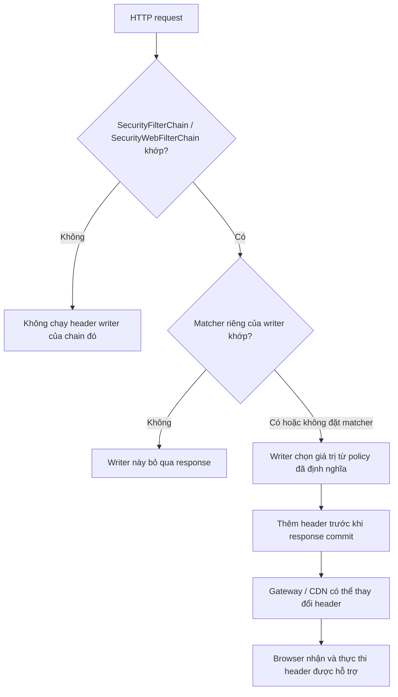

# Ghi header theo matcher hoặc theo dữ liệu của yêu cầu

## 1. Bài toán: cùng một ứng dụng, không phải response nào cũng cần cùng header

Trong chương **Kiến trúc HTTP header** thuộc module `SPRING_SECURITY_HTTP_PROTECTION`, Spring Security cung cấp các lớp phòng vệ HTTP và trình duyệt như CSRF, CORS, security headers, Content Security Policy (CSP), HTTP Strict Transport Security (HSTS), HTTP firewall và bảo vệ session. Một ứng dụng thực tế thường có nhiều loại response: trang đăng nhập, trang quản trị, API JSON, báo cáo, tài nguyên tĩnh và nội dung từ CDN. Chính sách HTTP header cần phản ánh **đúng đường đi và loại dữ liệu** của từng response.

Ví dụ, endpoint `GET /reports/annual.pdf` trả một tài nguyên nội bộ không muốn trang từ origin khác nhúng/tải trong một số ngữ cảnh browser. Ta có thể phát:

```http
Cross-Origin-Resource-Policy: same-origin
```

Nếu cùng header đó được thêm trên toàn bộ ảnh công khai phục vụ cho đối tác, có thể làm hỏng tích hợp hợp lệ. Vì vậy cần **ghi header có điều kiện**.

Một nhu cầu khác: CSP cho trang `/catalog/**` cần cho phép ảnh từ CDN đã phê duyệt, còn trang `/admin/**` chỉ dùng ảnh cùng origin. Ta cần **tạo giá trị header theo dữ liệu yêu cầu đã được phân loại đáng tin cậy**:

```http
# Trang quản trị
Content-Security-Policy: default-src 'self'; script-src 'self'; img-src 'self'; object-src 'none'; base-uri 'self'; frame-ancestors 'none'

# Trang catalog
Content-Security-Policy: default-src 'self'; script-src 'self'; img-src 'self' https://images.example.test; object-src 'none'; base-uri 'self'; frame-ancestors 'none'
```

Hai cơ chế liên quan nhưng không đồng nhất:

- **Matcher** quyết định writer **có chạy hay không** trên request; header có thể giữ nguyên giá trị tĩnh.
- **Writer dựa trên dữ liệu request** chọn hoặc xây dựng **giá trị header** theo thông tin đã kiểm tra của request/ứng dụng. Dữ liệu đó có thể được chuẩn bị bởi một filter, security context hoặc bộ phân loại route phía server.

Bài này dùng **Servlet** và **Reactive/WebFlux**, giải thích cách chọn writer có sẵn, xây dựng writer tùy biến, kiểm thử phạm vi và xử lý các xung đột bảo mật khi triển khai.

### Mục tiêu học tập

Sau khi hoàn thành, bạn có thể:

1. Phân biệt phạm vi của security chain, matcher của writer và dữ liệu đầu vào dùng để dựng header.
2. Dùng `DelegatingRequestMatcherHeaderWriter` trên Servlet và `ServerWebExchangeDelegatingServerHttpHeadersWriter` trên WebFlux.
3. Cài đặt `HeaderWriter`/`ServerHttpHeadersWriter` để chọn chính sách từ một tập giá trị đã phê duyệt.
4. Xử lý các trường hợp nâng cao như nonce CSP theo response, HTTPS/HSTS và cache khi policy thay đổi.
5. Viết kiểm thử chứng minh header chỉ xuất hiện ở URL cần thiết và các mặc định khác còn được giữ.
6. Nhận diện dữ liệu không đáng tin cậy như `Origin`, `Host`, `X-Forwarded-*`, query parameter và ngăn chúng làm yếu chính sách bảo mật.

## 2. Ba tầng quyết định: chọn chain, chọn writer, chọn giá trị

Một request có thể trải qua ba mức quyết định:



| Tầng | Servlet | Reactive/WebFlux | Ý nghĩa |
| --- | --- | --- | --- |
| Chọn security chain | `SecurityFilterChain` và `FilterChainProxy` | `SecurityWebFilterChain` và `WebFilterChainProxy` | Request có đi qua cơ chế ghi security headers của chain hay không. |
| Chọn writer theo request | `RequestMatcher` | `ServerWebExchangeMatcher` | Writer được gọi trên những request phù hợp. |
| Chọn giá trị header | `HeaderWriter.writeHeaders(...)` | `ServerHttpHeadersWriter.writeHttpHeaders(...)` trả `Mono<Void>` | Policy cụ thể được đặt vào response. |
| Ghi response | `HttpServletResponse` | `ServerHttpResponse` qua `ServerWebExchange` | Header phải được hoàn tất trước commit. |

**Một request được `permitAll` vẫn đi qua security chain** có rule đó, nên có thể nhận header. Ngược lại, tài nguyên bị bỏ qua security chain hoặc do gateway/CDN phục vụ trực tiếp sẽ không tự nhận header của chain backend.

### 2.1. Chọn matcher hay writer động?

| Nhu cầu | Cách triển khai phù hợp |
| --- | --- |
| Chỉ `GET /reports/**` cần CORP `same-origin` | Matcher + static writer. |
| Trang admin và catalog có CSP từ hai policy cố định | Writer chọn policy theo loại route đã được server phân loại; cũng có thể tách thành các matcher + writer tĩnh. |
| Trang HTML cần nonce CSP mới mỗi response | Tạo nonce ngẫu nhiên trước render; writer đọc đúng nonce của request. |
| `X-Frame-Options` đổi `DENY` thành `SAMEORIGIN` | Dùng DSL `frameOptions(...)` chuyên biệt; tránh thêm writer trùng tên. |
| HSTS tùy HTTPS | Dùng HSTS writer/DSL có sẵn, không tự phản chiếu `X-Forwarded-Proto`. |
| CORS tùy `Origin` và credentials | Dùng cơ chế CORS chuẩn; không tự thêm `Access-Control-Allow-Origin` từ dữ liệu client. |
| `Cache-Control` khác nhau giữa HTML có session và asset công khai | Cấu hình cache theo response và kiểm tra proxy; tránh để writer mặc định và controller mâu thuẫn. |

Một header có cùng tên nhưng giá trị thay đổi không nhất thiết phải tạo từ chuỗi nối trực tiếp. Khi số policy hợp lệ ít, **chọn từ một tập policy định sẵn** thường dễ kiểm soát và kiểm thử hơn.

## 3. Servlet: chỉ phát header khi `RequestMatcher` khớp

### 3.1. Dùng writer có sẵn

Spring Security Servlet cung cấp `DelegatingRequestMatcherHeaderWriter`, nhận `RequestMatcher` và một `HeaderWriter` được ủy quyền. Nếu matcher trả `true`, writer bên trong được gọi; ngược lại, writer này không sửa response.

Ví dụ giới hạn `Cross-Origin-Resource-Policy` cho các request GET dưới `/reports/**`, sử dụng API Spring Security 6.x:

```java
import org.springframework.http.HttpMethod;
import org.springframework.security.web.header.HeaderWriter;
import org.springframework.security.web.header.writers.DelegatingRequestMatcherHeaderWriter;
import org.springframework.security.web.header.writers.StaticHeadersWriter;
import org.springframework.security.web.util.matcher.AntPathRequestMatcher;
import org.springframework.security.web.util.matcher.RequestMatcher;

RequestMatcher reportsGet = new AntPathRequestMatcher(
    "/reports/**", HttpMethod.GET.name());

HeaderWriter reportsPolicy = new DelegatingRequestMatcherHeaderWriter(
    reportsGet,
    new StaticHeadersWriter("Cross-Origin-Resource-Policy", "same-origin")
);

// Đặt bên trong phương thức đang cấu hình HttpSecurity:
http.headers(headers -> headers.addHeaderWriter(reportsPolicy));
```

Đoạn trên là **phần cấu hình** trong một phương thức có biến `HttpSecurity http`, không phải class Java hoàn chỉnh. Nhiều phiên bản Spring Security mới đánh dấu `AntPathRequestMatcher` là deprecated; hãy đối chiếu `PathPatternRequestMatcher` hoặc matcher tương ứng của phiên bản thực tế. Không trộn class `javax.servlet.*` của Spring Security 5 với `jakarta.servlet.*` của Spring Security 6.

Phạm vi thực tế:

| Request | Matcher `/reports/**` và GET | Header từ writer này |
| --- | --- | --- |
| `GET /reports/annual.pdf` | Khớp | `Cross-Origin-Resource-Policy: same-origin` |
| `GET /reports/2026/chart.png` | Khớp | Có |
| `POST /reports/annual.pdf` | Không khớp method | Không |
| `GET /public/logo.svg` | Không khớp path | Không |
| `GET /reports-archive/old.pdf` | Không khớp pattern | Không |

**Lưu ý:** đây là phạm vi của **writer được giới hạn**, không phải bảo đảm rằng header đó không thể có từ controller hoặc CDN. CORP chỉ phù hợp khi tài nguyên thực sự không cần được dùng trong ngữ cảnh cross-origin mà chính sách chặn; nó không thay authorization hoặc CORS.

### 3.2. Đặt vào `SecurityFilterChain` đang có

```java
import org.springframework.context.annotation.Bean;
import org.springframework.context.annotation.Configuration;
import org.springframework.http.HttpMethod;
import org.springframework.security.config.annotation.web.builders.HttpSecurity;
import org.springframework.security.web.SecurityFilterChain;
import org.springframework.security.web.header.writers.DelegatingRequestMatcherHeaderWriter;
import org.springframework.security.web.header.writers.StaticHeadersWriter;
import org.springframework.security.web.util.matcher.AntPathRequestMatcher;

@Configuration
class ServletConditionalHeadersConfig {

    @Bean
    SecurityFilterChain webChain(HttpSecurity http) throws Exception {
        http.authorizeHttpRequests(auth -> auth
            .requestMatchers("/public/**").permitAll()
            .anyRequest().authenticated()
        );

        http.headers(headers -> headers.addHeaderWriter(
            new DelegatingRequestMatcherHeaderWriter(
                new AntPathRequestMatcher("/reports/**", HttpMethod.GET.name()),
                new StaticHeadersWriter(
                    "Cross-Origin-Resource-Policy", "same-origin")
            )
        ));

        return http.build();
    }
}
```

Trong dự án đã có chain, chỉ thêm phần header cần thiết vào **chain đang quản lý route đó**. Không tạo nhiều chain với matcher chồng lấn chỉ để thêm một response header. Đoạn code tập trung vào header; authentication, CSRF, CORS và session cần giữ theo yêu cầu ứng dụng.

### 3.3. Matcher không phải policy về quyền truy cập

`DelegatingRequestMatcherHeaderWriter` quyết định **có phát header không**. Nó không kiểm tra người dùng có quyền tải báo cáo hay không, cũng không chặn phương thức POST. Quyền truy cập thuộc về authorization; CSRF kiểm tra token trong những trường hợp phù hợp; CORS quyết định browser có được JavaScript ở origin khác đọc response hay không.

Vì thế, khi cần `GET /reports/**` chỉ cho một nhóm nhân viên truy cập, vẫn phải có rule authorization thích hợp. Việc phát CORP không thay thế rule này.

## 4. Servlet: chọn giá trị header từ dữ liệu request đáng tin cậy

Giả sử ứng dụng có hai loại tài liệu HTML:

- `strict`: trang quản trị, chỉ tải ảnh từ cùng origin.
- `catalog`: trang danh mục, được phép tải ảnh từ **CDN đã phê duyệt** `https://images.example.test`.

Thay vì nhận tên miền CDN do client tự gửi, một filter ở phía server **phân loại route** và gắn một thuộc tính vào request. Writer đọc thuộc tính này, rồi chọn **một trong hai chuỗi CSP cố định**.

### 4.1. Một writer dùng tập policy có kiểm soát

```java
import jakarta.servlet.http.HttpServletRequest;
import jakarta.servlet.http.HttpServletResponse;
import org.springframework.security.web.header.HeaderWriter;

public final class ApprovedCspProfileHeaderWriter implements HeaderWriter {

    public static final String PROFILE = "app.security.cspProfile";

    private static final String STRICT =
        "default-src 'self'; script-src 'self'; img-src 'self'; " +
        "object-src 'none'; base-uri 'self'; frame-ancestors 'none'";

    private static final String CATALOG =
        "default-src 'self'; script-src 'self'; " +
        "img-src 'self' https://images.example.test; " +
        "object-src 'none'; base-uri 'self'; frame-ancestors 'none'";

    @Override
    public void writeHeaders(HttpServletRequest request,
                             HttpServletResponse response) {
        Object profile = request.getAttribute(PROFILE);

        String policy = "catalog".equals(profile) ? CATALOG : STRICT;
        response.setHeader("Content-Security-Policy", policy);
    }
}
```

Các chuỗi `STRICT` và `CATALOG` đều đã định nghĩa ở server. Nếu thuộc tính vắng mặt hoặc không thuộc tập hợp đã duyệt, writer dùng policy `STRICT`. Không có đường nào để client tự thêm `https://untrusted.example` vào `script-src` hoặc `img-src` qua query parameter.

**Dữ liệu để writer tin cậy phải được tạo bởi code phía server.** Request attribute không tự động an toàn nếu ứng dụng đã lấy nó trực tiếp từ `X-Tenant`, cookie hay query parameter chưa xác minh rồi gán vào đó. Việc đặt tên `PROFILE` không tự tạo ra tính đáng tin cậy.

### 4.2. Chuẩn bị profile trước khi header được ghi

```java
import java.io.IOException;
import jakarta.servlet.FilterChain;
import jakarta.servlet.ServletException;
import jakarta.servlet.http.HttpServletRequest;
import jakarta.servlet.http.HttpServletResponse;
import org.springframework.security.web.util.matcher.AntPathRequestMatcher;
import org.springframework.security.web.util.matcher.RequestMatcher;
import org.springframework.web.filter.OncePerRequestFilter;

public final class TrustedCspProfileFilter extends OncePerRequestFilter {

    private final RequestMatcher catalog =
        new AntPathRequestMatcher("/catalog/**");

    @Override
    protected void doFilterInternal(HttpServletRequest request,
                                    HttpServletResponse response,
                                    FilterChain chain)
            throws ServletException, IOException {

        String profile = catalog.matches(request) ? "catalog" : "strict";
        request.setAttribute(
            ApprovedCspProfileHeaderWriter.PROFILE, profile);

        chain.doFilter(request, response);
    }
}
```

Với `HttpSecurity` đang được cấu hình:

```java
import org.springframework.security.web.header.HeaderWriterFilter;

http.addFilterBefore(new TrustedCspProfileFilter(), HeaderWriterFilter.class);
http.headers(headers -> headers
    .addHeaderWriter(new ApprovedCspProfileHeaderWriter()));
```

Đây là **hai đoạn chèn vào security chain hiện hữu**. Filter chuẩn bị dữ liệu trước khi handler chạy; `HeaderWriterFilter` sẽ gọi writer ở thời điểm thích hợp trước khi response commit. Nếu route bị bỏ qua security chain, cả hai thành phần có thể không chạy.

Ví dụ này dùng **path của request do server xử lý** để phân loại profile. Với proxy rewrite path, servlet context path hoặc nhiều servlet mappings, phải kiểm tra matcher thực sự khớp URL mà ứng dụng thấy. Với các version mới, nên chuyển sang matcher được hỗ trợ thay vì phụ thuộc mãi vào `AntPathRequestMatcher` deprecated.

### 4.3. Những trường hợp cần tránh

```java
// ANTI-PATTERN: xây CSP từ header Origin bất kỳ của client.
String origin = request.getHeader("Origin");
response.setHeader("Content-Security-Policy",
    "script-src 'self' " + origin);
```

`Origin` có thể bị giả mạo bởi HTTP client, có thể thiếu và không phải nguồn ủy quyền để quyết định script nào đáng tin cậy. Tương tự, không nối trực tiếp `request.getParameter("cdn")`, `Host` hay `Referer` vào CSP hoặc `Location`.

Nếu ứng dụng đa tenant cần chọn nguồn CDN, phải xác thực tenant ở server, ánh xạ tenant sang **cấu hình đã kiểm duyệt**, chuẩn hóa nguồn và kiểm thử chống lẫn tenant. Việc xem một chuỗi có “giống URL” không chưa đủ để cho phép nó vào một security header.

## 5. Trường hợp động đặc biệt: CSP nonce mới cho mỗi response

CSP nonce là ví dụ điển hình cho giá trị **không thể viết tĩnh** nếu ứng dụng cần cho phép một số inline script đáng tin cậy. Một policy có thể có dạng:

```http
Content-Security-Policy: default-src 'self'; script-src 'self' 'nonce-dGhpc0lzQW5FeGFtcGxlTm9uY2U='; object-src 'none'; base-uri 'self'
```

Giá trị trên chỉ **minh họa cú pháp**. Nonce thật cần được tạo mới bằng bộ sinh ngẫu nhiên mật mã, đủ khó đoán, cho **mỗi response HTML**, và giá trị trong HTTP header phải **khớp đúng** thuộc tính `nonce` của script được phép chạy:

```html
<script nonce="{{serverGeneratedNonce}}">
  // Script do server kiểm soát, được cho phép bởi nonce cùng response
</script>
```

`{{serverGeneratedNonce}}` là biến template phải được điền từ **dữ liệu server tạo**, có encode/escape thuộc tính HTML phù hợp. Không dùng nonce cố định trong config hoặc lưu toàn cục cho mọi request.

### 5.1. Sinh nonce ở Servlet trước khi render

```java
import java.security.SecureRandom;
import java.util.Base64;

public final class CspNonceGenerator {
    private static final SecureRandom RANDOM = new SecureRandom();

    private CspNonceGenerator() {}

    public static String newNonce() {
        byte[] bytes = new byte[16]; // 128 bit
        RANDOM.nextBytes(bytes);
        return Base64.getEncoder().encodeToString(bytes);
    }
}
```

Filter đặt nonce vào request attribute **trước handler/template**:

```java
// Trong doFilterInternal(...) của một OncePerRequestFilter
String nonce = CspNonceGenerator.newNonce();
request.setAttribute("app.security.cspNonce", nonce);
chain.doFilter(request, response);
```

Một CSP writer đọc cùng attribute và phát:

```java
// Trong writeHeaders(...) của HeaderWriter, trước khi response commit:
String nonce = (String) request.getAttribute("app.security.cspNonce");

String policy = nonce == null
    ? "default-src 'none'; object-src 'none'; base-uri 'none'"
    : "default-src 'self'; script-src 'self' 'nonce-" + nonce +
        "'; object-src 'none'; base-uri 'self'; frame-ancestors 'none'";

response.setHeader("Content-Security-Policy", policy);
```

Tất cả các đoạn này phải được **tích hợp nhất quán** trong ứng dụng: filter chuẩn bị nonce, template dùng đúng attribute, writer phát header và test xác minh nonce trùng nhau. Các ví dụ riêng lẻ là thành phần minh họa, không phải một giải pháp CSP hoàn chỉnh chỉ bằng sao chép vào controller.

Những điều cần đặc biệt chú ý:

- Không đặt **hai** writer CSP cưỡng chế có chính sách xung đột trên cùng response. Nếu dùng writer nonce, tránh vô tình đăng ký đồng thời CSP DSL tĩnh cho cùng đường đi.
- Không để reverse proxy cache dùng chung HTML có nonce và phát sai header cho người dùng khác; chọn `Cache-Control` phù hợp và xem xét variation theo người dùng/response.
- Không đưa nonce vào URL, log công khai, cookie chia sẻ hoặc JavaScript không đáng tin cậy.
- Nonce giúp giới hạn script được phép, nhưng vẫn cần escape dữ liệu, tránh DOM sink nguy hiểm, kiểm soát thư viện và xử lý XSS từ gốc.

## 6. Reactive/WebFlux: matcher dựa trên `ServerWebExchange`

Trên WebFlux, Spring Security sử dụng `ServerWebExchangeMatcher`; kết quả matching được biểu diễn bằng `Mono<ServerWebExchangeMatcher.MatchResult>`. Framework có **`ServerWebExchangeDelegatingServerHttpHeadersWriter`** để chỉ gọi một writer khi matcher khớp.

### 6.1. Giới hạn CORP bằng built-in delegating writer

Ví dụ tương đương Servlet, dùng API có trong Spring Security Reactive 6.5.x:

```java
import org.springframework.http.HttpMethod;
import org.springframework.security.web.server.header.ServerHttpHeadersWriter;
import org.springframework.security.web.server.header.ServerWebExchangeDelegatingServerHttpHeadersWriter;
import org.springframework.security.web.server.header.StaticServerHttpHeadersWriter;
import org.springframework.security.web.server.util.matcher.PathPatternParserServerWebExchangeMatcher;

ServerHttpHeadersWriter reportsPolicy =
    new ServerWebExchangeDelegatingServerHttpHeadersWriter(
        new PathPatternParserServerWebExchangeMatcher(
            "/reports/**", HttpMethod.GET),
        StaticServerHttpHeadersWriter.builder()
            .header("Cross-Origin-Resource-Policy", "same-origin")
            .build()
    );

// Đặt trong phương thức cấu hình ServerHttpSecurity:
http.headers(headers -> headers.addHeaderWriter(reportsPolicy));
```

**Chi tiết API:** ở nhiều phiên bản Spring Security Reactive, `StaticServerHttpHeadersWriter` nhận `HttpHeaders` trong constructor hoặc được tạo qua `builder().header(...).build()`; không nên giả định có constructor `(String, String)` giống `StaticHeadersWriter` Servlet.

Trên Reactive, có thể sử dụng `PathPatternParserServerWebExchangeMatcher` cho pattern path và HTTP method. Các API này có thể thay đổi giữa phiên bản; đối chiếu thư viện đang dùng. Matcher `/reports/**` xét đường dẫn được WebFlux nhận sau những biến đổi của gateway/context path.

### 6.2. Đăng ký trong một `SecurityWebFilterChain`

```java
import org.springframework.context.annotation.Bean;
import org.springframework.context.annotation.Configuration;
import org.springframework.http.HttpMethod;
import org.springframework.security.config.annotation.web.reactive.EnableWebFluxSecurity;
import org.springframework.security.config.web.server.ServerHttpSecurity;
import org.springframework.security.web.server.SecurityWebFilterChain;
import org.springframework.security.web.server.header.ServerWebExchangeDelegatingServerHttpHeadersWriter;
import org.springframework.security.web.server.header.StaticServerHttpHeadersWriter;
import org.springframework.security.web.server.util.matcher.PathPatternParserServerWebExchangeMatcher;

@Configuration
@EnableWebFluxSecurity
class ReactiveConditionalHeadersConfig {

    @Bean
    SecurityWebFilterChain reactiveChain(ServerHttpSecurity http) {
        http.authorizeExchange(auth -> auth
            .pathMatchers("/public/**").permitAll()
            .anyExchange().authenticated());

        http.headers(headers -> headers.addHeaderWriter(
            new ServerWebExchangeDelegatingServerHttpHeadersWriter(
                new PathPatternParserServerWebExchangeMatcher(
                    "/reports/**", HttpMethod.GET),
                StaticServerHttpHeadersWriter.builder()
                    .header("Cross-Origin-Resource-Policy", "same-origin")
                    .build()
            )));

        return http.build();
    }
}
```

Đây là ví dụ về header trong chain; không thay thế authentication, CORS, CSRF, session hoặc matcher production. Một request vào chain `permitAll` vẫn chạy security web filters; một request không khớp chain sẽ không nhận writer từ chain này.

## 7. Reactive/WebFlux: policy động từ thuộc tính exchange

Mẫu tương đương với Servlet ở mục 4 là:

1. Một `WebFilter` phía server phân loại request và gán profile vào `ServerWebExchange.getAttributes()`.
2. Một `ServerHttpHeadersWriter` đọc profile và chọn policy từ tập cấu hình cố định.
3. `HttpHeaderWriterWebFilter` điều phối writer **trước khi response commit**.

### 7.1. Writer chọn CSP theo profile

```java
import org.springframework.security.web.server.header.ServerHttpHeadersWriter;
import org.springframework.web.server.ServerWebExchange;
import reactor.core.publisher.Mono;

public final class ApprovedCspServerHttpHeadersWriter
        implements ServerHttpHeadersWriter {

    public static final String PROFILE = "app.security.cspProfile";

    private static final String STRICT =
        "default-src 'self'; script-src 'self'; img-src 'self'; " +
        "object-src 'none'; base-uri 'self'; frame-ancestors 'none'";

    private static final String CATALOG =
        "default-src 'self'; script-src 'self'; " +
        "img-src 'self' https://images.example.test; " +
        "object-src 'none'; base-uri 'self'; frame-ancestors 'none'";

    @Override
    public Mono<Void> writeHttpHeaders(ServerWebExchange exchange) {
        return Mono.fromRunnable(() -> {
            Object profile = exchange.getAttribute(PROFILE);
            String policy = "catalog".equals(profile) ? CATALOG : STRICT;
            exchange.getResponse().getHeaders()
                .set("Content-Security-Policy", policy);
        });
    }
}
```

`Mono.fromRunnable` gắn thao tác sửa header vào publisher mà Spring Security có thể quản lý. **Không tự gọi `subscribe()` hoặc `block()` trong writer.** Nếu response đã commit từ trước, việc sửa `HttpHeaders` không còn bảo đảm đến client.

### 7.2. Chuẩn bị profile trước writer bằng security WebFilter

```java
import org.springframework.security.web.server.util.matcher.PathPatternParserServerWebExchangeMatcher;
import org.springframework.security.web.server.util.matcher.ServerWebExchangeMatcher;
import org.springframework.web.server.ServerWebExchange;
import org.springframework.web.server.WebFilter;
import org.springframework.web.server.WebFilterChain;
import reactor.core.publisher.Mono;

public final class TrustedCspProfileWebFilter implements WebFilter {

    private final ServerWebExchangeMatcher catalog =
        new PathPatternParserServerWebExchangeMatcher("/catalog/**");

    @Override
    public Mono<Void> filter(ServerWebExchange exchange, WebFilterChain chain) {
        return catalog.matches(exchange).flatMap(result -> {
            String profile = result.isMatch() ? "catalog" : "strict";
            exchange.getAttributes().put(
                ApprovedCspServerHttpHeadersWriter.PROFILE, profile);
            return chain.filter(exchange);
        });
    }
}
```

Đăng ký filter **trước** web filter ghi headers và thêm writer trong security chain:

```java
import org.springframework.security.config.web.server.SecurityWebFiltersOrder;

http.addFilterBefore(
    new TrustedCspProfileWebFilter(),
    SecurityWebFiltersOrder.HTTP_HEADERS_WRITER);

http.headers(headers -> headers
    .addHeaderWriter(new ApprovedCspServerHttpHeadersWriter()));
```

`SecurityWebFiltersOrder.HTTP_HEADERS_WRITER` là tên hằng được dùng trong các bản Spring Security Reactive 6.x. Đối chiếu phiên bản dự án trước khi sao chép. Filter chuẩn bị profile trước khi pipeline có khả năng commit response; writer chọn policy khi được thực thi. **Không cần tự tạo một `HttpHeaderWriterWebFilter` bổ sung.**

### 7.3. Vì sao không nối dữ liệu request trực tiếp vào CSP?

Một đoạn dễ mắc lỗi là:

```java
// ANTI-PATTERN: tuyệt đối không dùng Origin bất kỳ làm nguồn script.
String origin = exchange.getRequest().getHeaders().getOrigin();
String policy = "script-src 'self' " + origin;
exchange.getResponse().getHeaders()
    .set("Content-Security-Policy", policy);
```

`Origin` do phía gửi request kiểm soát và không nói lên rằng nguồn script đáng tin cậy. Kể cả khi response có CSP đúng cú pháp, cho phép origin tùy ý sẽ phá vỡ mục tiêu chính sách. Với ứng dụng nhiều tenant, dùng danh tính tenant đã được xác thực tại server và ánh xạ sang allowlist policy bất biến hoặc được quản trị, không phản chiếu chuỗi từ request.

### 7.4. CSP nonce trong WebFlux

Ứng dụng WebFlux cũng có thể tạo nonce mới trong `WebFilter` trước khi handler/template dựng HTML, lưu vào `exchange.getAttributes()` rồi phát CSP từ một `ServerHttpHeadersWriter`:

```java
// Trong WebFilter đã được chạy trước handler và header writer:
byte[] random = new byte[16];
secureRandom.nextBytes(random);
String nonce = Base64.getEncoder().encodeToString(random);
exchange.getAttributes().put("app.security.cspNonce", nonce);
return chain.filter(exchange);
```

Cần khai báo và quản lý `SecureRandom`, `Base64`/imports phù hợp và đảm bảo template Reactive đọc đúng nonce **cùng request**. Đây là đoạn minh họa cơ chế; chưa phải file WebFilter hoàn chỉnh. Header writer cần ghép `'nonce-' + nonce` vào CSP bằng dữ liệu server tạo, và template dùng chính nonce đó. Không lưu nonce vào field chung của singleton writer hay khởi tạo một nonce cố định khi ứng dụng startup.

## 8. Những trường request không nên tin để chọn chính sách

| Dữ liệu | Rủi ro nếu dùng trực tiếp | Cách xử lý phù hợp |
| --- | --- | --- |
| `Origin` | Client có thể chỉ định Origin; không quyết định nguồn script đáng tin. | Dùng cấu hình CORS chuẩn; với CSP, lấy nguồn từ allowlist server. |
| `Host`, `Forwarded`, `X-Forwarded-Host` | Host-header injection, spoofing qua proxy không tin cậy. | Chỉ tin proxy được cấu hình và validate host theo allowlist. |
| `X-Forwarded-Proto` | Dễ giả mạo nếu backend nhận trực tiếp từ client. | Chỉ nhận forwarding headers từ proxy tin cậy; ưu tiên HSTS writer có điều kiện HTTPS. |
| Query parameter `?cdn=...` | Client tự chọn nguồn ngoài trong CSP. | Chỉ dùng key đã validate ánh xạ đến policy cố định. |
| Cookie `tenantId` | Có thể sửa hoặc không đại diện tenant được cấp quyền. | Kiểm tra tenant từ authentication/authorization phía server. |
| `Referer` | Có thể thiếu, bị thay đổi, không phải nguồn phân quyền. | Không cấp quyền hoặc nới CSP dựa vào Referer. |
| User-Agent | Có thể giả; hỗ trợ browser khác nhau. | Kiểm thử browser; tránh tắt bảo mật chỉ theo User-Agent. |
| Header `X-Role` | Client có thể tự khai nhận vai trò. | Dùng security context server xác thực để xác định quyền. |
| URI path | Có thể khác sau proxy rewrite, context path, encoding. | Dùng matcher phù hợp với framework và test đường đi thực tế. |
| `Accept` | Client chủ động điều khiển định dạng mong muốn. | Chỉ dùng để chọn representation hợp lệ; không cấp quyền theo Accept. |

**Chống header injection:** khi giá trị bắt buộc được tạo từ một phần dữ liệu bên ngoài, phải xác thực chặt định dạng và loại bỏ khả năng đưa ký tự xuống dòng CR/LF, dấu phân cách/chỉ thị không hợp lệ hoặc URL ngoài allowlist vào header. Mức bảo vệ của servlet container/framework không thay thế thiết kế đúng trust boundary.

### 8.1. Chính sách theo người dùng và nguy cơ cache

Giả sử CSP có giá trị khác nhau theo tenant hoặc theo người dùng đã đăng nhập. Nếu CDN/cache phục vụ chung response HTML của người dùng A cho người dùng B, policy có thể không còn tương ứng với nội dung và tenant. Hãy xem xét `Cache-Control: private, no-store` cho HTML nhạy cảm và kiểm tra toàn bộ cache pipeline.

`Vary` chỉ thích hợp khi response thực sự thay đổi theo các **request header đã định nghĩa** và cơ chế cache hiểu đúng; nó không tự xử lý sự khác nhau theo session hoặc security context. Không dùng `Vary: Cookie` như một cách thay thế mặc định cho thiết kế bảo vệ dữ liệu cá nhân ở cache.

### 8.2. Header có điều kiện không thay thế kiểm tra phân quyền

Ngay cả khi một route không phát `Cross-Origin-Resource-Policy` cho người không đăng nhập, dữ liệu vẫn phải được bảo vệ bằng authentication/authorization. Header chính sách browser không có khả năng xác định tài nguyên nào người dùng được quyền tải; CSRF, CORS, session và HTTP firewall vẫn cần cấu hình riêng.

## 9. Kiểm thử Servlet: matcher khớp, không khớp và chọn profile

### 9.1. Unit test `DelegatingRequestMatcherHeaderWriter`

```java
import org.junit.jupiter.api.Test;
import org.springframework.mock.web.MockHttpServletRequest;
import org.springframework.mock.web.MockHttpServletResponse;
import org.springframework.security.web.header.HeaderWriter;
import org.springframework.security.web.header.writers.DelegatingRequestMatcherHeaderWriter;
import org.springframework.security.web.header.writers.StaticHeadersWriter;
import org.springframework.security.web.util.matcher.AntPathRequestMatcher;

import static org.junit.jupiter.api.Assertions.assertEquals;
import static org.junit.jupiter.api.Assertions.assertNull;

class ConditionalHeaderWriterTest {

    private final HeaderWriter writer =
        new DelegatingRequestMatcherHeaderWriter(
            new AntPathRequestMatcher("/reports/**", "GET"),
            new StaticHeadersWriter("Cross-Origin-Resource-Policy", "same-origin")
        );

    @Test
    void writesOnlyOnMatchingGet() {
        var report = new MockHttpServletRequest("GET", "/reports/annual.pdf");
        report.setServletPath("/reports/annual.pdf");
        var reportResponse = new MockHttpServletResponse();

        writer.writeHeaders(report, reportResponse);
        assertEquals("same-origin", reportResponse.getHeader(
            "Cross-Origin-Resource-Policy"));

        var publicPage = new MockHttpServletRequest("GET", "/public/info");
        publicPage.setServletPath("/public/info");
        var publicResponse = new MockHttpServletResponse();

        writer.writeHeaders(publicPage, publicResponse);
        assertNull(publicResponse.getHeader("Cross-Origin-Resource-Policy"));
    }

    @Test
    void doesNotWriteForPostToSamePath() {
        var request = new MockHttpServletRequest("POST", "/reports/annual.pdf");
        request.setServletPath("/reports/annual.pdf");
        var response = new MockHttpServletResponse();

        writer.writeHeaders(request, response);
        assertNull(response.getHeader("Cross-Origin-Resource-Policy"));
    }
}
```

Test này dùng `spring-test`. Nó kiểm tra matcher và writer độc lập với filter chain; cần thêm integration test để khẳng định đúng chain của ứng dụng.

### 9.2. Unit test writer chọn CSP từ server attribute

```java
@Test
void selectsOnlyApprovedCspProfiles() {
    var request = new MockHttpServletRequest("GET", "/catalog/home");
    var response = new MockHttpServletResponse();
    var writer = new ApprovedCspProfileHeaderWriter();

    request.setAttribute(ApprovedCspProfileHeaderWriter.PROFILE, "catalog");
    writer.writeHeaders(request, response);
    assertTrue(response.getHeader("Content-Security-Policy")
        .contains("https://images.example.test"));

    request.setAttribute(ApprovedCspProfileHeaderWriter.PROFILE,
        "https://attacker.example");
    writer.writeHeaders(request, response);

    assertFalse(response.getHeader("Content-Security-Policy")
        .contains("attacker.example"));
    assertEquals(
        "default-src 'self'; script-src 'self'; img-src 'self'; " +
        "object-src 'none'; base-uri 'self'; frame-ancestors 'none'",
        response.getHeader("Content-Security-Policy"));
}
```

Đoạn trên là **một test method thêm vào class JUnit có imports phù hợp**, gồm `assertTrue`, `assertFalse` và `assertEquals`. Dù request attribute trong unit test được gán trực tiếp, ứng dụng thực phải bảo đảm chỉ logic server đáng tin cậy có quyền quyết định profile.

### 9.3. Kiểm thử integration bằng MockMvc

Giả sử ứng dụng có `GET /reports/annual.pdf` và `GET /public/info`, nằm trong cùng security chain, hai route trả status phù hợp và test có authentication hợp lệ nếu cần:

```java
import org.junit.jupiter.api.Test;
import org.springframework.beans.factory.annotation.Autowired;
import org.springframework.boot.test.autoconfigure.web.servlet.AutoConfigureMockMvc;
import org.springframework.boot.test.context.SpringBootTest;
import org.springframework.security.test.context.support.WithMockUser;
import org.springframework.test.web.servlet.MockMvc;

import static org.springframework.test.web.servlet.request.MockMvcRequestBuilders.get;
import static org.springframework.test.web.servlet.result.MockMvcResultMatchers.header;

@SpringBootTest
@AutoConfigureMockMvc
class ConditionalHeaderServletIntegrationTest {

    @Autowired MockMvc mvc;

    @Test
    @WithMockUser
    void reportHasCorpButPublicPageDoesNot() throws Exception {
        mvc.perform(get("/reports/annual.pdf"))
            .andExpect(header().string(
                "Cross-Origin-Resource-Policy", "same-origin"))
            .andExpect(header().string(
                "X-Content-Type-Options", "nosniff"));

        mvc.perform(get("/public/info"))
            .andExpect(header().doesNotExist(
                "Cross-Origin-Resource-Policy"))
            .andExpect(header().string(
                "X-Content-Type-Options", "nosniff"));
    }
}
```

Ví dụ test giả định các endpoint và policy mặc định tồn tại; trong ứng dụng thực cần bổ sung expected status/body và cấu hình test đúng dependency/phiên bản Spring Boot. Kiểm tra cả `nosniff` giúp phát hiện việc vô tình tắt các writer mặc định trong quá trình thêm conditional writer.

## 10. Kiểm thử Reactive với WebFlux

### 10.1. Unit test matcher Reactive

```java
import org.junit.jupiter.api.Test;
import org.springframework.http.HttpMethod;
import org.springframework.mock.http.server.reactive.MockServerHttpRequest;
import org.springframework.mock.web.server.MockServerWebExchange;
import org.springframework.security.web.server.header.ServerHttpHeadersWriter;
import org.springframework.security.web.server.header.ServerWebExchangeDelegatingServerHttpHeadersWriter;
import org.springframework.security.web.server.header.StaticServerHttpHeadersWriter;
import org.springframework.security.web.server.util.matcher.PathPatternParserServerWebExchangeMatcher;
import reactor.test.StepVerifier;

import static org.junit.jupiter.api.Assertions.assertEquals;
import static org.junit.jupiter.api.Assertions.assertNull;

class ReactiveConditionalHeaderWriterTest {

    private final ServerHttpHeadersWriter writer =
        new ServerWebExchangeDelegatingServerHttpHeadersWriter(
            new PathPatternParserServerWebExchangeMatcher(
                "/reports/**", HttpMethod.GET),
            StaticServerHttpHeadersWriter.builder()
                .header("Cross-Origin-Resource-Policy", "same-origin")
                .build());

    @Test
    void writesOnlyForMatchingExchange() {
        var report = MockServerWebExchange.from(
            MockServerHttpRequest.get("/reports/annual.pdf").build());
        var publicPage = MockServerWebExchange.from(
            MockServerHttpRequest.get("/public/info").build());

        StepVerifier.create(writer.writeHttpHeaders(report))
            .verifyComplete();
        StepVerifier.create(writer.writeHttpHeaders(publicPage))
            .verifyComplete();

        assertEquals("same-origin",
            report.getResponse().getHeaders()
                .getFirst("Cross-Origin-Resource-Policy"));
        assertNull(publicPage.getResponse().getHeaders()
            .getFirst("Cross-Origin-Resource-Policy"));
    }
}
```

`StepVerifier` thuộc `reactor-test`; các mock exchange thuộc `spring-test`. Nếu policy chỉ được phép với GET, nên thêm ca POST không có header để xác minh matcher kết hợp method/path đúng ý định.

### 10.2. Unit test giá trị động

```java
@Test
void reactiveWriterRejectsUnapprovedProfile() {
    var exchange = MockServerWebExchange.from(
        MockServerHttpRequest.get("/catalog/home").build());

    exchange.getAttributes().put(
        ApprovedCspServerHttpHeadersWriter.PROFILE,
        "https://attacker.example");

    var writer = new ApprovedCspServerHttpHeadersWriter();
    StepVerifier.create(writer.writeHttpHeaders(exchange)).verifyComplete();

    String csp = exchange.getResponse().getHeaders()
        .getFirst("Content-Security-Policy");

    assertNotNull(csp);
    assertFalse(csp.contains("attacker.example"));
    assertTrue(csp.contains("img-src 'self'"));
}
```

Đây là method mở rộng của test JUnit đã có các imports `assertNotNull`, `assertFalse`, `assertTrue` và mock exchange. Kết quả cho thấy giá trị không thuộc profile được phê duyệt sẽ không làm header bị mở rộng theo chuỗi do request cung cấp.

### 10.3. Integration test với WebTestClient

Giả định các route `/reports/annual.pdf` và `/public/info` thực sự được phục vụ bởi WebFlux, và `ReactiveConditionalHeadersConfig` đã được nạp:

```java
import org.junit.jupiter.api.Test;
import org.springframework.beans.factory.annotation.Autowired;
import org.springframework.boot.test.autoconfigure.web.reactive.AutoConfigureWebTestClient;
import org.springframework.boot.test.context.SpringBootTest;
import org.springframework.security.test.context.support.WithMockUser;
import org.springframework.test.web.reactive.server.WebTestClient;

@SpringBootTest
@AutoConfigureWebTestClient
class ConditionalHeaderReactiveIntegrationTest {

    @Autowired WebTestClient client;

    @Test
    @WithMockUser
    void reportAndPublicHaveDifferentHeaderSets() {
        client.get().uri("/reports/annual.pdf").exchange()
            .expectHeader().valueEquals(
                "Cross-Origin-Resource-Policy", "same-origin")
            .expectHeader().valueEquals(
                "X-Content-Type-Options", "nosniff");

        client.get().uri("/public/info").exchange()
            .expectHeader().doesNotExist("Cross-Origin-Resource-Policy")
            .expectHeader().valueEquals(
                "X-Content-Type-Options", "nosniff");
    }
}
```

Với những phiên bản Spring Boot khác nhau, package auto-configuration test có thể đổi; cần đối chiếu runtime và test dependencies đang sử dụng. Test này kiểm tra header ở chuỗi WebFlux giả lập; không tự xác minh TLS, gateway hoặc browser có áp CORP/CSP hay không.

## 11. Kiểm chứng ngoài môi trường test

### 11.1. Quan sát HTTP response cuối cùng

```bash
# Các URL và domain dưới đây là ví dụ cần thay bằng môi trường thật.
curl -sS -D - -o /dev/null https://app.example.test/reports/annual.pdf
curl -sS -D - -o /dev/null https://app.example.test/public/info

# Khi được phép, so sánh với backend trực tiếp.
curl -sS -D - -o /dev/null http://localhost:8080/reports/annual.pdf
```

Trên Windows PowerShell có thể dùng `curl.exe` và `-o NUL`. Nếu endpoint cần đăng nhập, sử dụng tài khoản thử nghiệm hoặc endpoint public tương đương; không đưa cookie/token thật vào tài liệu hoặc lệnh được chia sẻ.

**So sánh cần có:** request method, URL, scheme, status, header mới, các header mặc định như `nosniff`, CSP, Cache-Control, HSTS nếu HTTPS và policy tại proxy. Một request `GET` khác `HEAD` có thể đi qua code khác, vì vậy không nên chỉ dùng `curl -I` để suy kết quả cho mọi response.

### 11.2. Kiểm tra browser thực thi

- Trong **DevTools → Network**, chọn tài nguyên thuộc `/reports/**` và đọc `Cross-Origin-Resource-Policy` trong Response Headers.
- Nếu muốn xác minh CORP, thử nhúng/tải tài nguyên từ một origin test được kiểm soát trong bối cảnh browser áp dụng CORP. Đừng coi `curl` là phép thử hành vi chặn.
- Với CSP động, chọn response HTML thực, đọc `Content-Security-Policy` rồi kiểm tra script/ảnh được cho phép và bị chặn theo `img-src`/`script-src`. Quan sát Console để xác định directive.
- Nếu dùng nonce CSP, xác minh **header nonce khớp script nonce trong chính response HTML đó**, đồng thời nonce khác khi tải response HTML mới.
- Khi có iframe, lưu ý `X-Frame-Options` và CSP `frame-ancestors` phải nhất quán; một policy có thể chặn dù policy còn lại cho phép.

### 11.3. Kiểm tra nhiều loại response

| Tình huống | Điểm cần kiểm tra |
| --- | --- |
| `GET /reports/**` | Writer matcher phát đúng CORP. |
| `POST /reports/**` | Writer chỉ-GET không phát; CSRF/auth xử lý riêng. |
| `GET /public/**` | Không nhận CORP từ conditional writer. |
| HTML catalog/admin | CSP được chọn đúng từ profile phía server. |
| Origin/Host/query giả mạo | Header không mở rộng theo dữ liệu chưa được xác thực. |
| `302`/`401`/`403` | Response có đi qua chain/writer không; không suy chỉ từ status `200`. |
| `404`/`500` | Lỗi do ứng dụng, firewall, container hay gateway tạo? |
| HTTP so với HTTPS | HSTS phải được đánh giá trên HTTPS hợp lệ. |
| HTML được cache | CSP/nonce và nội dung có khớp cùng request và đúng user/tenant? |
| Streaming/SSE | Header được ghi trước khi response commit/đẩy chunk đầu tiên. |
| Nhiều security chain | Mỗi URL chọn chain và writer đúng chính sách. |

## 12. Chẩn đoán xung đột thực tế

| Hiện tượng | Nguyên nhân thường gặp | Hướng xử lý |
| --- | --- | --- |
| Header xuất hiện trên mọi route | Thêm static writer trực tiếp, quên delegating matcher. | Giới hạn bằng matcher hoặc chain có phạm vi phù hợp. |
| `/reports/**` không nhận CORP | Chain không khớp, method sai, path rewrite, writer chưa đăng ký. | Kiểm tra URL thực, matcher và chain order. |
| CSP theo tenant mở quá rộng | Cho phép nguồn từ `Origin`/`Host`/query chưa kiểm tra. | Ánh xạ server-side profile sang allowlist bất biến. |
| Nonce CSP thay đổi nhưng script bị chặn | Nonce trong header và template không trùng; cached HTML cũ. | Tạo một nonce mỗi response, dùng chung trong header/template và điều chỉnh cache. |
| Nonce không thay đổi giữa hai request | Lưu nonce ở singleton/static state. | Dùng `SecureRandom` tạo nonce mới cho từng response. |
| Browser chặn iframe dù đã sửa CSP | `X-Frame-Options: DENY` hoặc `frame-ancestors` khác vẫn còn. | Đồng bộ chính sách, kiểm tra response cuối. |
| Hai CSP policy cùng tồn tại | Writer tùy biến và DSL CSP/proxy đều phát. | Xác định nguồn phát, tránh vô tình nhân đôi chính sách. |
| HSTS thiếu ở backend | Backend nhận HTTP sau TLS termination. | Kiểm tra HTTPS public và proxy forwarding đáng tin cậy. |
| CORS vẫn lỗi dù CSP đúng | CORS allowlist/preflight không hợp lệ. | Cấu hình CORS riêng, kiểm tra `OPTIONS`/credentials. |
| POST trả `403` với security headers đúng | CSRF token hoặc authorization không hợp lệ. | Kiểm tra CSRF/session/auth riêng, không bỏ header. |
| Writer Reactive dùng `subscribe()` và header mất ngẫu nhiên | Công việc chạy ngoài pipeline trước commit. | Trả publisher cho framework, không subscribe thủ công. |
| Header chỉ biến mất sau deploy | Gateway/CDN, container hoặc phiên bản Spring Security khác. | So response backend/public và dependency runtime. |
| API JSON có policy nhưng HTML không | Writer gắn vào API, document được tải từ URL khác. | Cấu hình theo response HTML thực và test browser. |

### Trình tự điều tra

1. Xác định **URL, method, status, HTTPS/HTTP và response type**.
2. Xác định chain nào xử lý request; kiểm tra cả matcher của chain và matcher của writer.
3. Xác nhận dữ liệu động được tạo **trước khi writer chạy**, có nguồn tin cậy và chỉ chọn giá trị đã cho phép.
4. Kiểm tra response backend, sau đó response public qua reverse proxy/CDN.
5. Mở Network/Console để xác minh browser nhận và thực thi đúng policy.
6. Sửa matcher, profile, policy hoặc forwarding/proxy theo nguyên nhân; chạy lại test cả nhánh khớp lẫn nhánh không khớp.

## 13. Bài thực hành vận dụng

**Bài A — matcher theo cả path và method.** Chỉ `GET /reports/**` nhận CORP `same-origin`, còn `POST /reports/**` không nhận từ writer này. Dùng `DelegatingRequestMatcherHeaderWriter` (Servlet) và `ServerWebExchangeDelegatingServerHttpHeadersWriter` (Reactive), rồi test hai method.

**Bài B — tài liệu HTML thực của SPA.** Ứng dụng SPA tải `/index.html`, sau đó client router chuyển sang `/admin` và gọi API `/api/admin/**`. Nếu `Permissions-Policy` chỉ được phát tại API, nó có điều khiển camera của document SPA không? **Không thể giả định như vậy**; cần đặt policy trên response document thực và kiểm tra browser.

**Bài C — dữ liệu CDN từ tenant.** Người dùng gửi `?cdn=https://attacker.example`. Tại sao không được nối chuỗi này vào `img-src`? Vì client tự điều khiển nguồn tài nguyên được CSP cho phép. Giải pháp là xác thực tenant, chọn từ các CDN đã đăng ký ở server và có fallback an toàn.

**Bài D — policy nghiêm ngặt khi thiếu profile.** Writer nhận một profile không rõ tên hoặc không có thuộc tính. Kết quả nên là gì? Chọn policy an toàn định trước, không bật mặc định `'unsafe-inline'` hoặc cho phép mọi nguồn. Unit test cả profile hợp lệ và giả mạo.

**Bài E — nonce không khớp.** CSP trong header có nonce A nhưng HTML script có nonce B. Trình duyệt sẽ xử lý ra sao? Script có thể bị chặn vì không khớp. Cần một nonce mới cho **mỗi response**, được dùng đồng nhất giữa header và template của response ấy.

**Bài F — gateway rewrite path.** Người dùng gọi `/portal/reports/annual.pdf`; gateway chuyển đến backend thành `/reports/annual.pdf`. Matcher bên backend nên so khớp URL nào? URL mà backend/framework **thực sự nhận**, với context path và servlet mapping được tính đúng, rồi kiểm thử cả URL public.

**Bài G — hai writer tạo cùng CSP.** Backend có policy động và gateway thêm một CSP tĩnh “rộng hơn”. Có chắc browser cho phép thêm nguồn theo CSP rộng hơn không? Không. Nhiều policy cưỡng chế có thể đồng thời hạn chế nội dung; phải thống nhất nguồn phát chính sách thay vì thêm chính sách thứ hai.

**Bài H — phân biệt bảo vệ browser và quyền API.** `Cross-Origin-Resource-Policy: same-origin` có ngăn một HTTP client trực tiếp lấy báo cáo bí mật không? Không. Phải bảo vệ bằng authorization và session/token phù hợp; CORP chỉ điều khiển một số cách browser sử dụng tài nguyên liên origin.

## 14. Nguyên tắc triển khai production

1. **Sử dụng matcher để quyết định phạm vi**, writer để quyết định nội dung. Chọn đúng security chain trước khi xem xét matcher con.
2. **Ưu tiên writer có sẵn**: `DelegatingRequestMatcherHeaderWriter` cho Servlet và `ServerWebExchangeDelegatingServerHttpHeadersWriter` cho WebFlux.
3. **Tin dữ liệu đã được server xác thực và phân loại**. Không phản chiếu `Origin`, `Host`, query hoặc header client vào CSP/HSTS/CORS.
4. **Dùng các giá trị được phê duyệt**, đặc biệt khi chọn nguồn CSP theo tenant; giá trị thiếu hoặc không hợp lệ phải có fallback an toàn.
5. **Nonce CSP phải mới theo response** và được đồng bộ với template; chú ý HTML caching và streaming.
6. **Tránh header trùng lặp và policy mâu thuẫn**: dùng DSL chuyên biệt cho HSTS, CSP, frame options khi phù hợp và kiểm tra gateway.
7. **Giữ các lớp bảo vệ độc lập**: CSRF, CORS, HTTP firewall, authentication, session/cookie không được thay bằng response security header.
8. **Kiểm thử cả trường hợp có và không áp dụng** trên Servlet/Reactive, thêm kiểm tra HTTPS public và browser để chứng minh chính sách thực sự có tác dụng.

### Tài liệu tham khảo

- [Spring Security Reference — Servlet HTTP Response Headers](https://docs.spring.io/spring-security/reference/servlet/exploits/headers.html)
- [Spring Security Reference — Reactive HTTP Response Headers](https://docs.spring.io/spring-security/reference/reactive/exploits/headers.html)
- [Spring Security API — DelegatingRequestMatcherHeaderWriter (6.5)](https://docs.spring.io/spring-security/site/docs/6.5.x/api/org/springframework/security/web/header/writers/DelegatingRequestMatcherHeaderWriter.html)
- [Spring Security API — ServerWebExchangeDelegatingServerHttpHeadersWriter (6.5)](https://docs.spring.io/spring-security/site/docs/6.5.x/api/org/springframework/security/web/server/header/ServerWebExchangeDelegatingServerHttpHeadersWriter.html)
- [Spring Security API — ServerHttpHeadersWriter (6.5)](https://docs.spring.io/spring-security/site/docs/6.5.x/api/org/springframework/security/web/server/header/ServerHttpHeadersWriter.html)
- [Spring Security API — SecurityWebFiltersOrder (6.5)](https://docs.spring.io/spring-security/site/docs/6.5.x/api/org/springframework/security/config/web/server/SecurityWebFiltersOrder.html)
- [Spring Security API — PathPatternParserServerWebExchangeMatcher (6.5)](https://docs.spring.io/spring-security/reference/6.5/api/java/org/springframework/security/web/server/util/matcher/PathPatternParserServerWebExchangeMatcher.html)
- [Spring Security API — StaticServerHttpHeadersWriter (6.5)](https://docs.spring.io/spring-security/reference/6.5/api/java/org/springframework/security/web/server/header/StaticServerHttpHeadersWriter.html)
- [MDN — Content Security Policy](https://developer.mozilla.org/en-US/docs/Web/HTTP/Guides/CSP)
- [MDN — Cross-Origin-Resource-Policy](https://developer.mozilla.org/en-US/docs/Web/HTTP/Reference/Headers/Cross-Origin-Resource-Policy)

