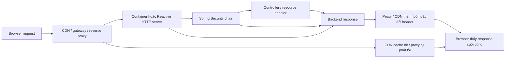
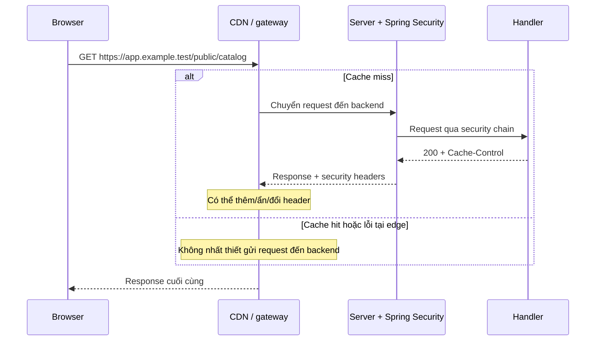

# Header có sẵn từ controller, container hoặc proxy

## 1. Vì sao nhìn thấy một header không đủ để biết ai đã gửi nó?

Trong chương **Kiến trúc HTTP header** của module `SPRING_SECURITY_HTTP_PROTECTION`, ứng dụng phối hợp nhiều lớp phòng vệ: CSRF, CORS, security headers, Content Security Policy (CSP), HTTP Strict Transport Security (HSTS), HTTP firewall và bảo vệ session. Một HTTP response gửi đến trình duyệt có thể được xử lý bởi **nhiều thành phần** trước khi người dùng nhìn thấy kết quả:

- **Controller/handler của ứng dụng:** chọn `Content-Type`, caching cho nội dung, `Content-Disposition` khi tải file, hoặc thêm header nghiệp vụ.
- **Spring Security:** bổ sung security response headers khi request đi qua security chain phù hợp.
- **Servlet container hoặc Reactive HTTP server:** xử lý status, truyền body, connection, compression, một số metadata giao thức; có thể tạo response lỗi trước khi vào ứng dụng.
- **Reverse proxy, API gateway, ingress hoặc CDN:** có thể thêm, xóa, thay thế hoặc gửi response từ cache mà **không gọi backend**.
- **Trình duyệt:** nhận và áp dụng header được hỗ trợ; nó không nhất thiết cho biết nguồn gốc từng header.

Do đó, câu hỏi **“Header có sẵn từ controller, container hoặc proxy”** không chỉ là xác định một class Java; đây là bài toán **truy nguồn và hòa giải chính sách giữa các tầng**. Nếu chỉ sửa `HttpSecurity.headers(...)` mà header thực tế do CDN phát, kết quả ở browser có thể không thay đổi. Nếu controller đã đặt một `Cache-Control` có chủ đích cho asset, không nên vô tình ép nó trở lại `no-store` chỉ vì muốn “khớp mặc định”.

Ví dụ hai response cùng đi từ backend Spring Security 6.x, nhưng có thể có caching khác nhau:

```http
HTTP/1.1 200 OK
Content-Type: text/html;charset=UTF-8
Cache-Control: no-cache, no-store, max-age=0, must-revalidate
X-Content-Type-Options: nosniff
X-Frame-Options: DENY
```

```http
HTTP/1.1 200 OK
Content-Type: text/css
Cache-Control: max-age=31536000, public
X-Content-Type-Options: nosniff
X-Frame-Options: DENY
```

Response thứ hai minh họa một **asset đã được version hóa** có thể được controller, resource handler hoặc proxy cấu hình cache riêng. Không nên kết luận `X-Content-Type-Options` và `Cache-Control` bắt buộc phải do cùng một thành phần tạo ra.

### Mục tiêu học tập

Sau bài này, bạn có thể:

1. Lập sơ đồ các nguồn phát HTTP response header trên Servlet và Reactive/WebFlux.
2. Phân biệt header **do handler đặt**, **do security writer thêm**, **do HTTP server/container sinh** và **do edge/proxy thay đổi**.
3. Hiểu rằng hành vi khi trùng tên header phụ thuộc **API `set/add`, writer, thời điểm commit và cấu hình proxy**, không có thứ tự ưu tiên toàn cục.
4. Thiết kế caching khác nhau cho response nhạy cảm và asset công khai, trong khi giữ các security header cần thiết.
5. Dùng HTTP client, MockMvc, WebTestClient, Network/Console của browser để xác định tầng làm mất hoặc làm trùng header.
6. Chẩn đoán xung đột CSP, frame policy, HSTS, CORS, cookie/session và response lỗi qua gateway.

## 2. Sơ đồ đường đi của response và các nơi có thể phát header



Sơ đồ diễn tả **những thành phần có thể ảnh hưởng đến response**. Trong thực tế, các filter/writer có thể ghi header trước khi controller gửi body, trước lúc commit hoặc ở đường xử lý lỗi. Không nên đọc sơ đồ như thứ tự chính xác của từng lời gọi Java.

### 2.1. Bảng “nguồn sở hữu” theo nhóm header

| Header hoặc nhóm | Nguồn phát thường gặp | Cần kiểm tra gì? |
| --- | --- | --- |
| `Content-Type` | MVC/WebFlux message converter, handler, static resource server | Loại nội dung thực có khớp MIME không? `nosniff` có thể khiến JS/CSS MIME sai bị chặn. |
| `Content-Length`, `Transfer-Encoding` | HTTP server/container, proxy | Có nén/chunking không? HTTP/1.1 khác HTTP/2/3; không tự đặt hai giá trị mâu thuẫn. |
| `Date`, `Server` | HTTP server, gateway hoặc CDN | Thông tin nhìn thấy ngoài có thể không phản ánh backend. Không suy version thực chỉ từ `Server`. |
| `Content-Encoding`, `Vary: Accept-Encoding` | Server/compression middleware, proxy/CDN | Nén có làm thay đổi body và bộ cache không? |
| `Cache-Control`, `Pragma`, `Expires` | Spring Security mặc định, controller/resource handler, gateway/CDN | Content nhạy cảm hay asset công khai? Có giá trị riêng được bảo toàn không? |
| `ETag`, `Last-Modified`, `Age` | Resource handler, server, CDN/cache | Revalidation/cache hit có đúng biến thể tài nguyên không? |
| `X-Content-Type-Options` | Spring Security hoặc edge policy | `nosniff` hiện diện ở những response/script/style cần thiết? |
| `X-Frame-Options` | Spring Security, custom header writer hoặc gateway | Có trùng giá trị? Có mâu thuẫn với CSP `frame-ancestors`? |
| `Content-Security-Policy` | Spring Security tùy chỉnh, ứng dụng, reverse proxy | Policy được định nghĩa ở đâu? Có nhiều policy cưỡng chế trên cùng response không? |
| `Strict-Transport-Security` | Spring Security trên HTTPS, reverse proxy TLS, CDN | Browser nhận qua HTTPS hợp lệ? Ai chịu trách nhiệm cho `max-age` và subdomain? |
| `Referrer-Policy`, `Permissions-Policy` | Security DSL, custom writer, gateway | Giá trị phù hợp nguồn tài nguyên, tính năng browser và route không? |
| `Access-Control-Allow-*` | CORS filter/framework, gateway | Có xét `Origin`, method, preflight, credentials và `Vary` chưa? |
| `Set-Cookie` | Session/auth framework, controller, gateway | `Secure`, `HttpOnly`, `SameSite`, `Domain`, `Path`; nhiều cookie có được giữ nguyên? |
| `Location` | Controller/redirect handler, auth entry point, gateway | Redirect sang host nào; có phát sinh open redirect hoặc mất scheme HTTPS? |
| `WWW-Authenticate` | Authentication entry point, gateway | `401` do tầng nào phát? Có đúng scheme và challenge không? |

**Không có “chủ sở hữu mặc định duy nhất” cho mọi header.** Cần xác định rõ policy cuối cùng của ứng dụng và tầng thực thi nó, nhất là sau khi có ingress, gateway hoặc CDN.

## 3. Spring Security thường thêm header gì, và khi nào không nên ép mặc định?

Spring Security có một tập security response header mặc định nhằm bảo vệ trình duyệt. Trong nhiều bản Spring Security 6.x, khi request đi qua security chain phù hợp, tập tham khảo thường gồm:

```http
Cache-Control: no-cache, no-store, max-age=0, must-revalidate
Pragma: no-cache
Expires: 0
X-Content-Type-Options: nosniff
X-Frame-Options: DENY
X-XSS-Protection: 0
Strict-Transport-Security: max-age=31536000; includeSubDomains
```

**Lưu ý:** HSTS mặc định được viết khi Spring Security nhận diện request là **HTTPS/secure**; `X-XSS-Protection` có lịch sử thay đổi qua các phiên bản và không thay thế output encoding hoặc CSP. Mỗi dự án phải xác định version `spring-security-web`/`spring-security-config` thực đang chạy trước khi dùng bảng trên làm baseline.

Điểm quan trọng nhất cho bài học này là **cache headers mặc định có cơ chế nhường chỗ khi ứng dụng chủ động đặt caching riêng**. Tài liệu Spring Security hướng dẫn cho phép MVC/WebFlux thiết lập `Cache-Control` phù hợp với CSS, JS và ảnh muốn cache; Spring Security không được hiểu là một bộ phận bắt buộc ghi đè mọi caching do controller cấu hình.

### 3.1. Vì sao bảo vệ thông tin cá nhân thường cần `no-store`?

Một trang `/account` chứa dữ liệu người dùng hoặc response API có thông tin nhạy cảm cần tránh bị cache trên thiết bị chia sẻ và cache trung gian ngoài dự kiến. Ví dụ:

```http
Cache-Control: no-store
```

`no-store` hướng dẫn các cache không lưu response; `private` hạn chế lưu ở shared cache nhưng **không đồng nghĩa với `no-store`**. Một số browser còn có các hành vi history/bfcache và quản lý session riêng, vì thế không xem cache header là thay thế logout/session invalidation hoặc phòng chống truy cập trái phép.

### 3.2. Vì sao asset có tên hash lại phù hợp cache dài hạn?

Nếu file có tên chứa fingerprint nội dung như `app.7f3a2b.js`, URL thay đổi khi nội dung đổi. Ta có thể cân nhắc:

```http
Cache-Control: public, max-age=31536000, immutable
```

Mức cache này **không phù hợp** với `/account`, tài nguyên chưa được version hóa hoặc nội dung trả riêng cho mỗi user. Cần bảo đảm CDN không cache response mang cookie/session hoặc dữ liệu cá nhân bằng một policy `public` vô tình.

### 3.3. Spring Security không tự đoán CSP/CORS của bạn

CSP cần biết nguồn script, style, font, API và iframe hợp lệ; CORS cần chính sách theo origin/method/credentials. Spring Security cung cấp cấu hình, nhưng không thể tự suy ra policy phù hợp từ `Content-Type` hoặc tên route.

Vì thế, khi thấy response thiếu `Content-Security-Policy`, điều đầu tiên nên kiểm tra là **ứng dụng có khai báo CSP không**, không phải mặc định kết luận filter bị lỗi. Khi thấy `Access-Control-Allow-Origin` khác nhau giữa các request, có thể đó là xử lý CORS có chủ đích, không phải lỗi thứ tự header writer.

## 4. Controller/handler có thể viết header như thế nào?

### 4.1. Servlet Spring MVC: `ResponseEntity` đặt cache riêng

Giả sử `/public/catalog` là dữ liệu công khai có thể cache năm phút. Controller:

```java
import java.time.Duration;
import org.springframework.http.CacheControl;
import org.springframework.http.ResponseEntity;
import org.springframework.web.bind.annotation.GetMapping;
import org.springframework.web.bind.annotation.RestController;

@RestController
class CatalogController {

    @GetMapping("/public/catalog")
    ResponseEntity<String> catalog() {
        return ResponseEntity.ok()
            .cacheControl(CacheControl.maxAge(Duration.ofMinutes(5))
                .cachePublic())
            .body("Danh mục công khai");
    }

    @GetMapping("/account/profile")
    String profile() {
        return "Thông tin tài khoản trong ví dụ học tập";
    }
}
```

Đây là ví dụ minh họa; **không dùng dữ liệu cá nhân thật trong response ví dụ**. Khi được Spring MVC xử lý, response `/public/catalog` có thể có:

```http
Cache-Control: max-age=300, public
X-Content-Type-Options: nosniff
X-Frame-Options: DENY
```

Còn response `/account/profile` nếu đi qua security chain mặc định và không có caching riêng thường nhận hướng dẫn không cache của Spring Security. **Tại sao `nosniff` vẫn có?** Vì caching có thể được điều chỉnh riêng; việc controller đặt `Cache-Control` không có nghĩa phải tắt toàn bộ security headers.

Trong dự án thực, authorization cho `/account/profile` vẫn phải được thiết lập bằng security rules, không suy ra từ đường dẫn `/account`. Ví dụ code không chủ ý giải quyết xác thực hoặc session.

### 4.2. Controller đặt nhiều header qua `ResponseEntity.headers(...)`

```java
import org.springframework.http.HttpHeaders;
import org.springframework.http.MediaType;
import org.springframework.http.ResponseEntity;

@GetMapping("/exports/sample.csv")
ResponseEntity<String> csv() {
    String demoCsv = "id,value\n1,demo\n";
    return ResponseEntity.ok()
        .contentType(new MediaType("text", "csv"))
        .header(HttpHeaders.CONTENT_DISPOSITION,
            "attachment; filename=\"sample.csv\"")
        .header("X-Content-Source", "application")
        .body(demoCsv);
}
```

Đoạn trên là method minh họa đặt trong một `@RestController` có import `@GetMapping`. `Content-Disposition: attachment` hướng dẫn browser xem file như nội dung tải xuống trong ngữ cảnh hỗ trợ; nó không tự kiểm soát ai có quyền lấy file. `X-Content-Source` là header quan sát minh họa, không phải security header tiêu chuẩn; nên bỏ trong production nếu không có nghiệp vụ dùng.

Controller cũng có thể trả `ResponseEntity.status(302).header(HttpHeaders.LOCATION, "/login")...` hoặc dùng redirect framework. Một redirect là **response riêng**, có header riêng và có thể đi qua security chain khác với trang đích.

### 4.3. `setHeader`, `addHeader` và Spring `HttpHeaders`

Trong Servlet:

```java
response.setHeader("X-Lab", "first");
response.setHeader("X-Lab", "second"); // thay danh sách giá trị cùng tên
response.addHeader("X-Lab", "third");  // thêm một giá trị
```

Trong Spring WebFlux:

```java
var headers = exchange.getResponse().getHeaders();
headers.set("X-Lab", "second");
headers.add("X-Lab", "third");
```

Tuy nhiên, **không nên coi thứ tự gọi `set`/`add` là một cơ chế ưu tiên bảo mật đã được quy định toàn cục**. Một writer có thể chỉ đặt header khi chưa có, controller có thể chạy ở giai đoạn khác, container có thể chỉnh header khi commit và proxy có thể thay đổi response đã nhận từ backend. Hãy kiểm tra implementation của header writer đúng version nếu cần xác định chính xác điều kiện ghi.

### 4.4. `Content-Type` không phải từ Spring Security `nosniff`

Khi controller trả JSON, HTML, CSS hay JavaScript, Spring MVC/WebFlux có thể đặt `Content-Type` thông qua content negotiation, annotation hoặc converter. Spring Security `X-Content-Type-Options: nosniff` **không** tự sửa MIME type sai. Một file JS bị trả `text/plain` có thể bị trình duyệt từ chối thực thi khi `nosniff` có hiệu lực.

Cách xử lý đúng: sửa `Content-Type`/resource handler hoặc static server gửi file, **không tắt `nosniff` chỉ để làm file MIME sai chạy được**.

## 5. Reactive/WebFlux: response headers từ handler và security web filter

Ứng dụng WebFlux dùng `ServerHttpResponse` và `ServerWebExchange` thay cho `HttpServletResponse`. Security headers được điều phối bởi `HttpHeaderWriterWebFilter` và các `ServerHttpHeadersWriter` trong `SecurityWebFilterChain`.

### 5.1. WebFlux controller cũng có thể dùng `ResponseEntity`

```java
import java.time.Duration;
import org.springframework.http.CacheControl;
import org.springframework.http.ResponseEntity;
import org.springframework.web.bind.annotation.GetMapping;
import org.springframework.web.bind.annotation.RestController;
import reactor.core.publisher.Mono;

@RestController
class ReactiveCatalogController {

    @GetMapping("/public/catalog")
    Mono<ResponseEntity<String>> catalog() {
        return Mono.just(ResponseEntity.ok()
            .cacheControl(CacheControl.maxAge(Duration.ofMinutes(5))
                .cachePublic())
            .body("Danh mục công khai"));
    }
}
```

Controller có `Mono<ResponseEntity<String>>` để minh họa cách tích hợp publisher. Caching được chọn cho response công khai; các security header khác vẫn được framework và security chain xử lý. **Đừng đồng nhất kết quả với Servlet một cách máy móc**: WebFlux có lifecycle khác và header writer Reactive trả `Mono<Void>`.

### 5.2. Đặt header trực tiếp vào `ServerHttpResponse`

```java
import org.springframework.http.HttpHeaders;
import org.springframework.web.server.ServerWebExchange;
import reactor.core.publisher.Mono;

Mono<Void> someHandler(ServerWebExchange exchange) {
    exchange.getResponse().getHeaders().set(
        HttpHeaders.CACHE_CONTROL, "no-store");
    return exchange.getResponse().setComplete();
}
```

Đây là minh họa logic của một handler nhận exchange, không phải mapping hoàn chỉnh. `setComplete()` đánh dấu response hoàn tất trong Reactive lifecycle; header cần được đặt **trước khi response commit**. Khi body streaming đã bắt đầu, việc sửa `HttpHeaders` có thể không còn đến client.

### 5.3. `beforeCommit` và writer: tránh ghi quá muộn

`ServerHttpResponse.beforeCommit(...)` cho phép đăng ký công việc chạy trước commit. Ví dụ WebFilter:

```java
import org.springframework.web.server.ServerWebExchange;
import org.springframework.web.server.WebFilter;
import org.springframework.web.server.WebFilterChain;
import reactor.core.publisher.Mono;

final class LabResponseHeaderWebFilter implements WebFilter {
    @Override
    public Mono<Void> filter(ServerWebExchange exchange, WebFilterChain chain) {
        exchange.getResponse().beforeCommit(() ->
            Mono.fromRunnable(() ->
                exchange.getResponse().getHeaders()
                    .set("X-Layer-Lab", "webflux")));
        return chain.filter(exchange);
    }
}
```

`X-Layer-Lab` chỉ để quan sát trong môi trường học tập. Nếu muốn cấu hình **security response headers chuẩn**, ưu tiên `ServerHttpSecurity.headers(...)`; không đăng ký WebFilter tùy ý ghi đè policy và không gọi `subscribe()` trong writer. Sau khi HTTP response được commit, header mới không thể được gửi ngược lại client.

## 6. Container hoặc HTTP server sinh header nào?

**Servlet container** như Tomcat/Jetty và **HTTP server Reactive** như Reactor Netty có thể quản lý một phần chi tiết giao thức mà controller không trực tiếp viết:

- Xác định thời điểm gửi status và headers trước body.
- Quản lý kết nối HTTP/1.1 keep-alive, chunking hoặc HTTP/2 stream.
- Thực hiện compression, có thể thay đổi `Content-Encoding`, `Content-Length` hoặc `Vary`.
- Tạo `Date` hoặc `Server` tùy sản phẩm, phiên bản và cấu hình.
- Tạo error response cho request không hợp lệ quá sớm, không đi qua application handler.
- Phối hợp session/cookie qua web framework hoặc container trong các trường hợp ứng dụng dùng session.

Không nên khẳng định **mọi container luôn phát cùng một tập**. Ví dụ, HTTP/2 không sử dụng `Transfer-Encoding: chunked` theo cách HTTP/1.1 sử dụng; `Content-Length` có thể không tồn tại nếu body được gửi theo stream. `Server` có thể bị gateway thay đổi hoặc cố ý tắt để giảm lộ thông tin sản phẩm.

### 6.1. Header sinh bởi server trước security chain

Một client gửi request quá lớn hoặc request-line sai có thể bị container từ chối trước khi servlet filter hoặc Reactive security web filter chạy. Lúc đó response lỗi có thể **không** có `X-Frame-Options` hay CSP từ Spring Security. Không dùng một request bị HTTP firewall/container từ chối để suy ra mọi response thường đều thiếu security header.

Tương tự, một lỗi ở HTTP parser hoặc TLS handshake còn có thể xảy ra **trước khi hình thành HTTP response hợp lệ**. Khi TLS handshake thất bại, không có HTTP response để đọc CSP/HSTS.

### 6.2. Session cookie không phải security response header writer thông thường

Một response đăng nhập có thể chứa:

```http
Set-Cookie: SESSION=opaque-example; Path=/; Secure; HttpOnly; SameSite=Lax
```

Đây là giá trị minh họa, không phải session token thật. Cookie có thể được tạo bởi Servlet session, Spring Session, authentication logic hoặc edge session service. `Secure`, `HttpOnly` và `SameSite` phải được quản lý theo hệ thống session/cookie cụ thể.

**Nhiều `Set-Cookie` phải được xử lý như các field riêng**, không gộp tùy ý thành một chuỗi phân cách bằng dấu phẩy. Ví dụ ứng dụng có cookie session và cookie CSRF thì proxy không được làm hỏng một trong hai. Frontend JS cũng không được phép đọc trực tiếp `Set-Cookie` từ `fetch` response headers vì đây là forbidden response-header name ở browser.

### 6.3. Container compression và `Vary`

Nếu backend hoặc proxy có thể trả `gzip`, `br` hoặc body không nén tùy `Accept-Encoding`, response có thể cần `Vary: Accept-Encoding` để các cache phân biệt biến thể. Một CDN cache sai biến thể có thể gây lỗi giải mã hoặc header/body không khớp.

Đừng tự ép `Content-Length` khi compression hoặc streaming do server/proxy quản lý; hãy để tầng sở hữu việc đóng gói HTTP xác định metadata tương ứng.

## 7. Reverse proxy, gateway và CDN có thể làm gì với response?

Một reverse proxy không chỉ chuyển tiếp dữ liệu. Tùy cấu hình, nó có thể:

1. **Thêm** header mới, ví dụ `Strict-Transport-Security` tại điểm terminate TLS.
2. **Ghi đè/ẩn** header upstream, ví dụ thay `X-Frame-Options` cho tất cả public routes.
3. **Giữ nguyên** một số header từ backend.
4. **Phát response từ cache** mà không gọi backend.
5. **Tự trả response lỗi** `502`, `503` hoặc redirect HTTP → HTTPS.
6. **Nén, đổi protocol, đặt cache metadata** hoặc chuẩn hóa header khi gửi tới client.



Vì vậy backend log “đã thêm header” **không chứng minh** browser đã nhận giá trị đó. Ngược lại, thấy CSP ở DevTools **không chứng minh** backend đã cấu hình CSP: gateway có thể là nơi phát.

### 7.1. NGINX: khác biệt giữa thêm header response và chuyển tiếp request header

Ví dụ cấu hình NGINX **minh họa**, chỉ áp dụng khi NGINX là tầng thực tế đang quản lý chính sách:

```nginx
# Fragment bên trong server/location đang được cấu hình hợp lệ.
location / {
    proxy_pass http://app_backend;

    # Thêm header trên response theo chính sách tại edge.
    add_header Referrer-Policy "strict-origin-when-cross-origin" always;
}
```

`add_header` liên quan **response header** gửi tới client. Trong khi đó `proxy_set_header` liên quan **request header** được gửi về upstream, nên dùng `proxy_set_header` không giải quyết yêu cầu “thêm CSP vào response”.

Với NGINX, `add_header` **không có `always`** chỉ áp cho những status code nhất định; sử dụng `always` để thêm ngay cả trên status khác như `500`/`503` nếu policy thực sự phù hợp. Quy tắc kế thừa `add_header` giữa `http`, `server` và `location` cũng phụ thuộc cách cấu hình và phiên bản NGINX; việc thêm một `add_header` tại scope con có thể làm các header ở scope cha không còn được kế thừa như dự kiến. Vì vậy **kiểm tra toàn bộ cấu hình hiệu lực**, không chỉ một dòng.

### 7.2. NGINX: chọn một nơi sở hữu một header

Nếu backend và edge cùng phát `X-Frame-Options`, có thể xuất hiện giá trị trùng hoặc mâu thuẫn. Một cách tiếp cận khi quyết định edge là **chủ sở hữu duy nhất** của `X-Frame-Options`:

```nginx
# Chỉ là ví dụ về cơ chế, không phải cấu hình production hoàn chỉnh.
location / {
    proxy_pass http://app_backend;

    proxy_hide_header X-Frame-Options;
    add_header X-Frame-Options "DENY" always;
}
```

`proxy_hide_header` ngăn chuyển một header tương ứng từ upstream về client qua proxy trong phạm vi áp dụng; `add_header` đặt policy ở edge. **Trước khi triển khai**, cần xác minh vị trí, inheritance, các route khác, error responses, CDN phía trước và nhu cầu iframe. Nếu ứng dụng có `frame-ancestors 'self'` để cho nhúng same-origin, `DENY` ở edge có thể mâu thuẫn với mục tiêu tích hợp.

Một lựa chọn khác là **để Spring Security sở hữu** `X-Frame-Options` và bảo đảm proxy không thêm header trùng. Không có lựa chọn đúng cho mọi hệ thống; điều quan trọng là ownership rõ ràng và response cuối được kiểm thử.

### 7.3. HSTS ở nơi terminate TLS

Sơ đồ phổ biến:

```text
Browser -- HTTPS --> Gateway / CDN -- HTTP nội bộ --> Spring backend
```

Nếu backend nhận diện request là HTTP, writer HSTS mặc định có thể **không** phát HSTS vì điều kiện secure request không được thỏa mãn. Có hai chiến lược thường gặp:

- **Gateway phát HSTS trên public HTTPS**: phù hợp khi gateway sở hữu toàn bộ TLS/public hostname và có quy trình quản trị policy.
- **Backend phát HSTS với forwarding headers đáng tin cậy**: cần cấu hình chính xác trust boundary giữa gateway và backend, không tin `X-Forwarded-Proto` tùy ý từ client.

Không tùy tiện bật `includeSubDomains` hoặc `preload` khi các subdomain chưa có HTTPS hợp lệ. Browser chỉ chấp nhận HSTS nhận qua HTTPS bảo đảm; gửi HSTS trên HTTP không làm browser tin host đó.

### 7.4. CDN và cache hit

Khi CDN trả response từ cache, request có thể không đi vào Spring Security. Các dấu hiệu như `Age`, `Via` hoặc header cache theo nhà cung cấp **có thể** hỗ trợ chẩn đoán, nhưng không phải mọi CDN đều phát chúng hoặc bảo đảm cách diễn giải giống nhau.

Quan trọng hơn: chính sách cache phải tách **dữ liệu công khai** khỏi **dữ liệu có người dùng/session**. Không cấu hình CDN cache công khai một `/account/profile` chỉ vì controller có một header `max-age`. Đồng thời, việc một CDN từng cache response với CSP cũ có thể khiến browser nhìn thấy policy khác phiên bản backend mới đang chạy.

## 8. Nếu trùng tên, header nào “thắng”?

Không có quy tắc chung như “controller luôn thắng Spring Security”, “Spring Security luôn thắng controller” hay “proxy luôn thắng backend” cho **mọi header và mọi cấu hình**. Kết quả phụ thuộc:

- API ghi `setHeader`/`addHeader`, thứ tự code và thời điểm response commit.
- Writer có kiểm tra header đã tồn tại hay không.
- Controller/framework có overwrite giá trị trước commit hay không.
- Container/web server có chỉnh metadata khi gửi body/compression hay không.
- Proxy dùng thêm, thay, ẩn hay hợp nhất header upstream như thế nào.
- Header cụ thể có cho phép nhiều giá trị hay không; browser hỗ trợ/chấp hành cách nào.

### 8.1. Một số header không được hợp nhất tùy ý

| Header | Trùng lặp có thể gây gì? | Hướng xử lý |
| --- | --- | --- |
| `Content-Security-Policy` | Các chính sách cưỡng chế có thể cùng hiệu lực, làm response **bị hạn chế thêm**, không phải “policy cuối thay policy đầu”. | Truy nguồn, thiết kế chính sách nhất quán, kiểm thử Console/browser. |
| `X-Frame-Options` | Hai giá trị mâu thuẫn khó dự đoán, phụ thuộc browser. | Chọn một policy và một chủ sở hữu; đồng bộ CSP `frame-ancestors`. |
| `Strict-Transport-Security` | Giá trị `max-age`/`includeSubDomains` khác nhau tạo kết quả không đáng tin cậy. | Chọn nguồn phát HSTS rõ ràng trên HTTPS public. |
| `Cache-Control` | Nhiều chỉ thị có thể mâu thuẫn, ví dụ `public` và `no-store`. | Thiết kế caching theo loại response và tầng cache. |
| `Access-Control-Allow-Origin` | Nhiều origin/giá trị wildcard không phù hợp với CORS credential browser. | Dùng CORS processor và allowlist, không chồng header tùy tiện. |
| `Set-Cookie` | Nếu proxy gộp cookie thành chuỗi comma-separated, cookie có thể bị lỗi. | Giữ riêng các field `Set-Cookie`. |
| `Vary` | Thiếu hoặc sai biến thể có thể khiến shared cache trả nhầm dữ liệu. | Hợp nhất đúng các request fields mà response thực sự phụ thuộc. |

**Không suy nghĩa bảo mật từ thứ tự header trong output `curl`.** HTTP header field names là không phân biệt hoa/thường; HTTP/2 có thể biểu diễn tên ở dạng chữ thường. Thứ tự các trường tên khác nhau không phải thứ tự quyền lực.

### 8.2. Tình huống CSP

Backend phát:

```http
Content-Security-Policy: default-src 'self'; script-src 'self'; connect-src 'none'
```

Gateway thêm:

```http
Content-Security-Policy: default-src 'self'; connect-src https://api.example.test
```

Dù policy thứ hai cho phép API, browser có thể vẫn chặn kết nối vì policy thứ nhất yêu cầu `connect-src 'none'`; nhiều CSP cưỡng chế có thể cùng áp dụng. Để cho phép API đã duyệt, phải sửa chính sách hạn chế ở nguồn phát và kiểm thử cả response cuối.

Đây là lý do không thể “nới CSP” đơn giản bằng cách **thêm một CSP thứ hai** tại gateway.

### 8.3. Tình huống frame policy

Backend:

```http
X-Frame-Options: SAMEORIGIN
Content-Security-Policy: frame-ancestors 'self'
```

Gateway:

```http
X-Frame-Options: DENY
```

Kết quả có thể gây xung đột hoặc chặn iframe hợp lệ trong browser. Cần quyết định rõ trang được nhúng từ origin nào và đặt cả `X-Frame-Options` lẫn `frame-ancestors` nhất quán. Không tắt tất cả security headers để chữa một xung đột iframe.

## 9. Kiểm thử Servlet: controller cache riêng nhưng bảo vệ mặc định còn

### 9.1. Cấu hình bảo vệ trong `SecurityFilterChain`

Một ứng dụng Servlet có thể dùng cấu hình tương tự:

```java
import org.springframework.context.annotation.Bean;
import org.springframework.context.annotation.Configuration;
import org.springframework.security.config.annotation.web.builders.HttpSecurity;
import org.springframework.security.web.SecurityFilterChain;

@Configuration
class ServletSecurityConfig {

    @Bean
    SecurityFilterChain webChain(HttpSecurity http) throws Exception {
        http.authorizeHttpRequests(auth -> auth
            .requestMatchers("/public/**").permitAll()
            .anyRequest().authenticated());
        return http.build();
    }
}
```

Đây là ví dụ Spring Security 6.x. Nếu ứng dụng đã có chain production, **không tạo một chain khác chồng lấn**; chỉ bảo đảm endpoint đang kiểm thử đi qua chain đúng. Các chính sách CSRF, CORS, session và authentication cần giữ theo yêu cầu thực tế.

### 9.2. MockMvc so sánh hai loại response

```java
import org.junit.jupiter.api.Test;
import org.springframework.beans.factory.annotation.Autowired;
import org.springframework.boot.test.autoconfigure.web.servlet.AutoConfigureMockMvc;
import org.springframework.boot.test.context.SpringBootTest;
import org.springframework.security.test.context.support.WithMockUser;
import org.springframework.test.web.servlet.MockMvc;

import static org.hamcrest.Matchers.containsString;
import static org.hamcrest.Matchers.not;
import static org.springframework.test.web.servlet.request.MockMvcRequestBuilders.get;
import static org.springframework.test.web.servlet.result.MockMvcResultMatchers.header;
import static org.springframework.test.web.servlet.result.MockMvcResultMatchers.status;

@SpringBootTest
@AutoConfigureMockMvc
class ControllerAndSecurityHeadersServletTest {

    @Autowired MockMvc mvc;

    @Test
    void publicResponseKeepsItsExplicitCacheControl() throws Exception {
        mvc.perform(get("/public/catalog"))
            .andExpect(status().isOk())
            .andExpect(header().string("Cache-Control",
                containsString("max-age=300")))
            .andExpect(header().string("Cache-Control",
                not(containsString("no-store"))))
            .andExpect(header().string("X-Content-Type-Options",
                "nosniff"));
    }

    @Test
    @WithMockUser
    void accountResponseStillHasNoStore() throws Exception {
        mvc.perform(get("/account/profile"))
            .andExpect(status().isOk())
            .andExpect(header().string("Cache-Control",
                containsString("no-store")))
            .andExpect(header().string("X-Content-Type-Options",
                "nosniff"));
    }
}
```

Test trên giả định controller ở mục 4.1 hoạt động và security chain chứa header writers mặc định. Hãy đối chiếu kỳ vọng với **Spring Security version thực dùng** và cache policy đã được duyệt. `@WithMockUser` cần `spring-security-test`. Package test auto-configuration cũng có thể thay đổi giữa các đời Spring Boot.

**Phạm vi chứng cứ:** MockMvc kiểm tra ứng dụng Servlet mô phỏng; không có CDN/NGINX/TLS thật nên không chứng minh header client public nhận sẽ giống hệt.

### 9.3. Kiểm tra một response redirect hoặc error

Nên bổ sung test cho `302` hoặc `401`/`403` của chính security chain, ví dụ `GET /account/profile` khi chưa đăng nhập. Cần dự đoán status theo authentication entry point thực dùng (redirect sang login hoặc `401` cho API), không cứng nhắc coi tất cả ứng dụng đều trả `302`.

Một response do HTTP firewall hoặc Servlet container chặn quá sớm có thể không đi qua writer thông thường; không dùng nó làm đối chứng duy nhất khi kiểm tra headers mặc định.

## 10. Kiểm thử WebFlux: response controller và security writer cùng tồn tại

### 10.1. WebFlux security chain minh họa

```java
import org.springframework.context.annotation.Bean;
import org.springframework.security.config.web.server.ServerHttpSecurity;
import org.springframework.security.web.server.SecurityWebFilterChain;

@Bean
SecurityWebFilterChain webFluxChain(ServerHttpSecurity http) {
    return http
        .authorizeExchange(auth -> auth
            .pathMatchers("/public/**").permitAll()
            .anyExchange().authenticated())
        .build();
}
```

Đoạn này nằm trong class `@Configuration` của ứng dụng WebFlux; không dùng `HttpSecurity` Servlet. Ứng dụng thực có thể có nhiều chain/matcher và cấu hình CSRF/CORS riêng. Không dùng code mẫu để ghi đè production configuration.

### 10.2. WebTestClient

```java
import org.junit.jupiter.api.Test;
import org.springframework.beans.factory.annotation.Autowired;
import org.springframework.boot.test.autoconfigure.web.reactive.AutoConfigureWebTestClient;
import org.springframework.boot.test.context.SpringBootTest;
import org.springframework.test.web.reactive.server.WebTestClient;

@SpringBootTest
@AutoConfigureWebTestClient
class ControllerAndSecurityHeadersReactiveTest {

    @Autowired WebTestClient client;

    @Test
    void publicCacheHeaderAndNosniffBothAppear() {
        client.get().uri("/public/catalog").exchange()
            .expectStatus().isOk()
            .expectHeader().valueMatches(
                "Cache-Control", ".*max-age=300.*")
            .expectHeader().valueEquals(
                "X-Content-Type-Options", "nosniff");
    }
}
```

Ví dụ giả định controller ở mục 5.1 và security chain có header writers. Nếu test còn cần xác minh `no-store` trên một endpoint private, hãy tạo handler thích hợp và identity test tương ứng. `WebTestClient` không thay thế được thử nghiệm response từ CDN hoặc TLS public.

### 10.3. Kiểm thử “không ghi đè” không có nghĩa luôn nguyên xi byte-for-byte

Response headers có thể được chuẩn hóa tên, thứ tự, hoặc diễn giải dưới protocol khác nhau. Test nên dựa trên **header semantics**:

- `Cache-Control` có đúng chỉ thị caching mong muốn không?
- Có `X-Content-Type-Options: nosniff` không?
- CSP còn những directive đã phê duyệt không, có nhiều policy không?
- HSTS có mặt trên public HTTPS khi yêu cầu, không kết luận từ localhost HTTP?
- Header có bị mất riêng trên redirect/error/static resource không?

Không khóa test quá chặt vào **thứ tự các header** trong HTTP response trừ khi kiểm tra một đặc tính giao thức thật sự yêu cầu thứ tự.

## 11. Truy nguồn bằng cách so sánh từng hop

Khi có quyền truy cập cả backend và URL public, hãy so sánh:

```bash
# URL public qua reverse proxy/CDN.
curl -sS -D - -o /dev/null https://app.example.test/public/catalog

# Backend trực tiếp (chỉ khi được phép và đúng môi trường).
curl -sS -D - -o /dev/null http://127.0.0.1:8080/public/catalog
```

Trên Windows PowerShell, dùng `curl.exe` và `-o NUL` thay cho `/dev/null`. Dùng môi trường thử nghiệm thay cho domain minh họa. Nếu backend chỉ có mạng nội bộ, không mở cổng hoặc tiết lộ endpoint bảo mật để thực hiện bài thử.

**Đừng đưa token, cookie hay header Authorization thật vào lệnh được chia sẻ.** Nếu cần kiểm tra response cần đăng nhập, dùng tài khoản test và cơ chế cung cấp credential an toàn. Tránh đưa `Cookie: SESSION=...` vào ảnh chụp/log công khai.

### 11.1. Ma trận so sánh thực tế

| Điểm quan sát | Status | `Cache-Control` | `CSP` | `HSTS` | Kết luận có thể rút ra |
| --- | --- | --- | --- | --- | --- |
| MockMvc/WebTestClient | Theo handler | Theo ứng dụng + security chain | Theo config test | Có thể thiếu nếu HTTP mock | Cấu hình app trong test. |
| Backend trực tiếp HTTP | Theo backend | Header từ backend | Theo backend | Thường không phát HSTS mặc định | Tập header trước proxy, không đại diện public HTTPS. |
| URL public HTTPS | Có thể khác backend | Có thể thêm/sửa bởi CDN | Có thể thêm/sửa bởi gateway | Do edge hoặc backend nhận diện HTTPS | Những gì browser thực sự được gửi. |
| Browser DevTools Network | Theo network/cache | Giá trị response browser thấy | Giá trị response/browser thấy | HTTPS/HSTS tùy kết nối | Quan sát response và kiểm tra hành vi. |

Với browser, xem thông tin **from disk cache/from memory cache** nếu có; một response được tái sử dụng từ cache có thể không phải response mới của backend sau deploy. Đối với policy mới, làm mới cache đúng cách trên môi trường test và kiểm tra response thật thay vì chỉ một bản cũ.

### 11.2. Từng bước phát hiện lớp làm thay đổi header

1. **Xác định chính xác request:** URL, method, status, scheme, host và thời điểm; redirect và error response phải tách riêng.
2. **Xác nhận chain:** Servlet `SecurityFilterChain` hoặc Reactive `SecurityWebFilterChain` nào khớp URL; route có được `permitAll` hay bỏ hẳn chain không.
3. **Xem handler/resource configuration:** controller có `ResponseEntity`, `CacheControl`, `Content-Type`, `Set-Cookie` hay redirect riêng không.
4. **Kiểm tra response từ backend trực tiếp:** đọc tất cả header **sau khi backend commit**, chưa qua public proxy.
5. **Kiểm tra public response:** so sánh sau ingress/gateway/CDN; xác minh cache hit/miss, status lỗi tại edge và các header được thêm/ẩn/ghi đè.
6. **Kiểm tra browser:** Network thể hiện response đã nhận; Console và hành vi iframe/script/CORS cho biết chính sách được thực thi.
7. **Quyết định owner và sửa đúng lớp**, rồi chạy lại test trên nhiều URL/status.

### 11.3. Nhiều security chain và đường dẫn bị rewrite

Ví dụ:

```text
Public URL /portal/api/orders  -> gateway rewrite -> backend /api/orders
Public URL /portal/home        -> gateway rewrite -> backend /home
```

Matcher của Spring Security thường xem URL **theo dạng backend thực nhận**, không nhất thiết trùng public URL. Một Servlet chain dành cho `/api/**` và một chain cho `/**` có thể có header khác nhau. Nếu chỉnh matcher sai, bạn có thể thấy “thiếu header” chỉ ở một route và tưởng proxy đã xóa nó.

Kiểm tra đúng thứ tự `@Order`, `securityMatcher`, application context path và gateway rewrite. Đừng tạo một static writer chung cho mọi chain chỉ để che sai lệch routing.

## 12. Những lỗi điển hình về CSP, HSTS, CORS và cookie khi có proxy

### 12.1. CSP được phát từ cả backend và edge

**Triệu chứng:** SPA sau deploy không gọi được API mặc dù gateway đã thêm CSP cho phép API đó.

**Khả năng:** backend còn CSP khác nghiêm ngặt hơn, hoặc CSP thứ hai bị thêm chứ không thay thế. Trong browser, nhiều CSP cưỡng chế có thể cùng có hiệu lực. Đọc **tất cả** `Content-Security-Policy` trên response HTML, không chỉ dòng bạn vừa thêm.

**Xử lý:** chọn nguồn quản trị policy rõ ràng, hoặc hợp nhất thành một bộ directive thống nhất. Nếu cần rollout, sử dụng `Content-Security-Policy-Report-Only` để thu thập vi phạm trước khi cưỡng chế. Không tự cho phép `'unsafe-inline'`/mọi nguồn vô hạn để khỏi lỗi.

### 12.2. HSTS không thấy ở backend HTTP

**Triệu chứng:** `curl http://127.0.0.1:8080` không có HSTS, nhưng public HTTPS có.

**Khả năng:** backend nhận HTTP nội bộ, còn gateway gửi HSTS hoặc chuyển forwarding scheme đáng tin cậy. Điều này **có thể hoàn toàn đúng** nếu browser public nhận HSTS qua HTTPS hợp lệ.

**Xử lý:** kiểm tra public host, certificate, nơi terminate TLS, `max-age`/`includeSubDomains`, forwarding headers đáng tin cậy. Không dùng `curl -k` làm bằng chứng browser sẽ tin HSTS.

### 12.3. CORS thất bại dù các security headers vẫn có

**Triệu chứng:** API `200` có `nosniff` và CSP, nhưng frontend khác origin báo CORS error.

**Khả năng:** `Access-Control-Allow-Origin` thiếu/sai; preflight `OPTIONS` bị gateway hoặc auth chặn; credentials không tương thích wildcard; thiếu `Access-Control-Allow-Headers` cho request headers.

**Xử lý:** cấu hình CORS theo origin/method/headers/credentials bằng thành phần phù hợp. Test **request preflight và actual request**. CSP không thay CORS; CORS không tự xác thực người dùng hoặc chống CSRF.

### 12.4. Cookie mất sau gateway

**Triệu chứng:** đăng nhập thành công ở backend, nhưng browser không giữ session.

**Khả năng:** `Set-Cookie` bị proxy thay đổi, thiếu `Secure` khi yêu cầu HTTPS, `SameSite` không phù hợp luồng cross-site, `Domain`/`Path` sai sau rewrite, hoặc browser chặn cookie theo chính sách.

**Xử lý:** đọc **từng `Set-Cookie`** trên response thực, trong DevTools Application/Cookies và Network. Không dùng static header writer để chèn session token hoặc gộp các cookie thành một chuỗi.

### 12.5. `X-Frame-Options` bị ghi đè

**Triệu chứng:** backend phát `SAMEORIGIN` để cho phép iframe nội bộ, nhưng browser nhìn thấy `DENY`.

**Khả năng:** proxy có policy `DENY` chung hoặc static writer khác đã thêm trùng tên.

**Xử lý:** xác định yêu cầu nhúng, quyết định nguồn sở hữu frame policy, kiểm tra CSP `frame-ancestors`, sau đó test iframe từ origin hợp lệ và origin không được phép.

## 13. Bảng chẩn đoán nhanh

| Hiện tượng | Cần kiểm tra | Hướng xử lý |
| --- | --- | --- |
| Một endpoint thiếu `nosniff` | Route có bypass chain, container phục vụ trực tiếp hay CDN cache hit? | Đưa qua chain phù hợp hoặc phát policy ở tầng sở hữu tài nguyên. |
| Controller đặt `Cache-Control` khác mặc định | Response public hay nhạy cảm? Writer cache có nhường giá trị không? | Giữ policy có chủ đích, test `no-store` cho nội dung private. |
| `Cache-Control: public` trên dữ liệu tài khoản | Controller/resource config hoặc CDN đã override? | Sửa caching theo phân loại dữ liệu, không chỉ theo route name. |
| `Server` cho thấy tên CDN | HTTP server edge có thay header backend? | Không suy version Spring hoặc container từ header ngoài. |
| `X-Frame-Options` có hai giá trị | Spring writer, controller, NGINX cùng ghi? | Chọn nguồn phát và policy duy nhất, đồng bộ CSP. |
| CSP đã “nới” nhưng script vẫn bị chặn | Nhiều policy cưỡng chế cùng có hiệu lực. | Đọc mọi CSP và Console; sửa policy hạn chế tại nguồn. |
| HSTS chỉ có trên HTTPS public | TLS kết thúc tại proxy? | Có thể đúng; xác minh public HTTPS thực. |
| HSTS không có trên response `503` | NGINX `add_header` thiếu `always`, hoặc edge error path khác. | Kiểm tra config hiệu lực và thử response lỗi. |
| Backend có header, browser không có | Proxy ẩn/ghi đè, CDN cache, redirect khác. | So hai điểm qua cùng URL/status và từng hop. |
| Header chỉ mất sau khi mở SPA | HTML document tải từ URL khác API; cached response. | Kiểm tra response HTML thật, clear cache test đúng cách. |
| CORS error dù CSP đúng | Preflight hoặc allowlist sai. | Sửa CORS/credentials và `Vary`. |
| Session cookie mất | Nhiều `Set-Cookie` bị gộp/loại, attributes sai. | Kiểm tra cookie trong Network/Application và policy edge. |
| `403` POST nhưng đầy đủ security headers | CSRF token hoặc authorization. | Chẩn đoán CSRF/auth/session, không tắt header. |
| Response lỗi parser thiếu CSP | Bị container/firewall chặn trước security chain. | Phân biệt lỗi trước HTTP handler với response ứng dụng. |
| Header khác sau nâng version | Spring Security/Boot, container hoặc ingress đổi behavior. | Ghi dependency runtime, test baseline và diff từng lớp. |

## 14. Bài tập tình huống

### Bài 1 — Cache công khai nhưng vẫn cần `nosniff`

Một endpoint `/public/catalog` trả `Cache-Control: max-age=300, public`; `/account/profile` trả `no-store`. Cả hai đều có `X-Content-Type-Options: nosniff`.

**Câu hỏi:** Có phải Spring Security đã bị tắt một phần? **Định hướng:** không nhất thiết. Controller có thể đặt cache riêng cho nội dung công khai trong khi writer security headers khác vẫn hoạt động. Cần kiểm tra đúng dữ liệu và owner từng header.

### Bài 2 — Response khác nhau ở backend và CDN

Backend trả `Content-Security-Policy: script-src 'self'`; response public có thêm CSP `script-src 'self' https://cdn.example.test`. Script CDN vẫn bị browser chặn.

**Định hướng:** nhiều CSP cưỡng chế có thể cùng áp. Cần sửa policy đang hạn chế và xác định nguồn phát, không thêm một policy “rộng hơn” để hy vọng ghi đè.

### Bài 3 — HTTPS tại edge

Browser gọi public HTTPS nhưng backend nhận HTTP. HSTS chỉ thấy trên response public, không thấy ở backend.

**Định hướng:** xác minh TLS endpoint, certificate, HSTS do edge phát và phạm vi subdomain. Điều này có thể đúng theo kiến trúc; không ép HSTS vào HTTP nội bộ chỉ để bảng header đồng nhất.

### Bài 4 — NGINX error page

Một policy `Referrer-Policy` có trên `200` nhưng không có trên `500` do NGINX tạo.

**Định hướng:** kiểm tra `add_header`, tham số `always`, phạm vi kế thừa `http/server/location` và nơi response lỗi được sinh ra. Không thể sửa chỉ bằng Spring Security nếu request chưa đến backend.

### Bài 5 — Session cookie qua proxy

Backend trả hai `Set-Cookie`, proxy gộp chúng thành một giá trị có dấu phẩy khiến browser không lưu đúng.

**Định hướng:** `Set-Cookie` là trường hợp cần giữ các field riêng; kiểm tra từng dòng raw HTTP ở backend/public và cấu hình proxy xử lý cookie.

### Bài 6 — Browser báo MIME error

`app.js` trả `Content-Type: text/plain` và `X-Content-Type-Options: nosniff`. JavaScript không chạy.

**Định hướng:** sửa MIME của static resource/server, không tắt `nosniff` để che lỗi cấu hình.

### Bài 7 — CORS preflight

API có `X-Frame-Options: DENY`, `Content-Security-Policy` và `nosniff` nhưng `OPTIONS` trả `401`.

**Định hướng:** header security không tạo CORS policy; phải kiểm tra CORS preflight, thứ tự xử lý với auth và allowlist origin. Phân biệt response preflight với actual response.

### Bài 8 — Lỗi do container

Một HTTP request malformed bị container trả `400` không có CSP; request `GET /health` hợp lệ có CSP.

**Định hướng:** request malformed có thể không đi qua security chain. Cần xác định tầng tạo response; không suy rằng `HeaderWriterFilter` hỏng trên mọi request.

### Bài 9 — Hai security chains

`/api/**` và `/web/**` thuộc hai chain khác nhau. Một header chỉ có ở web; nhóm phát triển đổ lỗi cho gateway.

**Định hướng:** xem `securityMatcher`, thứ tự chain và chính sách khác biệt có chủ đích trước khi điều tra proxy. So backend ở từng route.

### Bài 10 — Bản cache cũ sau deploy

Backend mới phát `Referrer-Policy: strict-origin-when-cross-origin`, nhưng một số client vẫn thấy policy cũ.

**Định hướng:** có thể CDN/browser cache, rolling deployment hoặc nhiều backend version. Thu thập response qua từng hop, thời điểm/hostname và cache metadata; không chỉ restart Spring Security.

## 15. Checklist thiết kế và vận hành

1. **Ghi nhận source of truth:** ai sở hữu `CSP`, `HSTS`, `X-Frame-Options`, cache, CORS và cookie ở production.
2. **Không giả định một lớp luôn thắng:** kiểm tra cách ghi header theo API, writer, commit và proxy.
3. **Tách private/public caching:** `no-store` cho response nhạy cảm, cache hợp lý cho asset công khai đã version hóa.
4. **Đối chiếu stack thực:** Servlet `HttpSecurity`/`HeaderWriterFilter` khác Reactive `ServerHttpSecurity`/`HttpHeaderWriterWebFilter`.
5. **Không phát nhiều CSP/HSTS/frame policy mâu thuẫn:** xác định owner, kiểm tra browser behavior.
6. **Cẩn trọng với NGINX `add_header`:** xem `always`, inheritance, response lỗi, và phân biệt response `add_header` với upstream request `proxy_set_header`.
7. **Giữ cookie đúng cấu trúc:** nhiều `Set-Cookie` riêng, các thuộc tính `Secure`, `HttpOnly`, `SameSite`, `Domain` và `Path` phù hợp.
8. **Kiểm thử theo từng hop:** MockMvc/WebTestClient → backend trực tiếp → public HTTPS → browser Network/Console.
9. **Thử cả response lỗi và redirect:** `200` không đại diện cho `302`, `401`/`403`, `404`/`500` và response do edge phát.
10. **Giữ trách nhiệm của các lớp khác:** CORS, CSRF, authorization, session và HTTP firewall không được thay bằng một security header.

### Tài liệu tham khảo

- [Spring Security Reference 6.5 — Servlet: Security HTTP Response Headers](https://docs.spring.io/spring-security/reference/6.5/servlet/exploits/headers.html)
- [Spring Security Reference 6.5 — Reactive: Security HTTP Response Headers](https://docs.spring.io/spring-security/reference/6.5/reactive/exploits/headers.html)
- [Spring Security Reference — HTTP Response Headers tổng quan](https://docs.spring.io/spring-security/reference/features/exploits/headers.html)
- [Spring Framework Reference — Web MVC HTTP Caching](https://docs.spring.io/spring-framework/reference/web/webmvc/mvc-caching.html)
- [Spring Framework Reference — WebFlux](https://docs.spring.io/spring-framework/reference/web/webflux.html)
- [NGINX — ngx_http_headers_module: add_header / always / inheritance](https://nginx.org/en/docs/http/ngx_http_headers_module.html)
- [NGINX — ngx_http_proxy_module: proxy_hide_header / proxy_set_header](https://nginx.org/en/docs/http/ngx_http_proxy_module.html)
- [MDN — Content-Security-Policy](https://developer.mozilla.org/en-US/docs/Web/HTTP/Reference/Headers/Content-Security-Policy)
- [MDN — Set-Cookie](https://developer.mozilla.org/en-US/docs/Web/HTTP/Reference/Headers/Set-Cookie)
- [MDN — HTTP Caching](https://developer.mozilla.org/en-US/docs/Web/HTTP/Guides/Caching)

